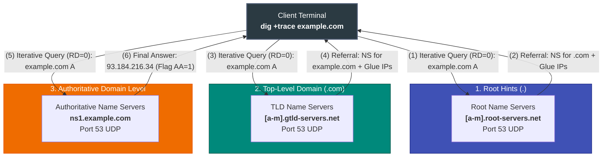
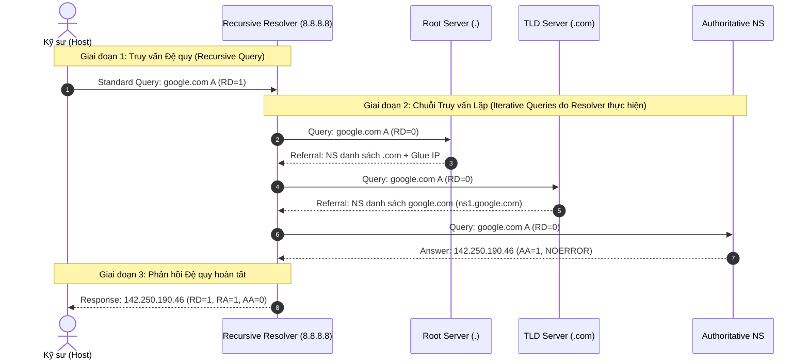

# 5_1_6 DNS Resolution Inspection

> **Khóa học**: Cloud DevOps Basic — Wire-Level Diagnostics  
> **Phân nhóm**: 5 Domain 5 - Wire-Level Network Inspection and Diagnostics › 5_1 Wire-Level Inspection and Diagnostic Toolkit  
> **Chủ đề**: Khảo sát phân giải tên miền: Phân tích cơ chế truy vấn đệ quy vs lặp, cấu trúc gói tin DNS (Header/Flags), và thực hành chẩn đoán ủy quyền với dig (+trace) và nslookup  
> **Trạng thái**: Draft  
> **Checklist đối chiếu**: [5_1_6](../../../CHECKLIST.md#51-wire-level-inspection-and-diagnostic-toolkit)  

---

## 1. Khái Niệm Cốt Lõi & Bản Chất Kỹ Thuật (Core Concepts & Technical Deep Dive)

Hệ thống phân giải tên miền (Domain Name System — DNS) là hạ tầng cốt lõi của mạng Internet toàn cầu, chịu trách nhiệm ánh xạ tên miền dạng văn bản dễ nhớ (Human-readable FQDN) sang địa chỉ số IP dạng máy học (IPv4/IPv6) mà ngăn xếp mạng sử dụng để định tuyến gói tin (RFC 1034, RFC 1035).

Đối với kỹ sư Cloud và DevOps, sự cố kết nối giữa các dịch vụ phân tán, container microservices hoặc hạ tầng đám mây thường bắt nguồn từ tầng phân giải DNS trước khi bất kỳ kết nối TCP nào có thể hình thành. Việc làm chủ công cụ phân tích wire-level như `dig` và `nslookup` đòi hỏi sự thấu hiểu sâu sắc từ tầng vận chuyển (L4), cấu trúc khung gói tin (Packet Header), cho đến cơ chế ủy quyền phân cấp (Hierarchical Delegation).

```
+---------------------------------------------------------------------------------------+
|                    Cây phân cấp tên miền toàn cầu (DNS Namespace)                     |
|                                                                                       |
|                                        [ . ] (Root)                                   |
|                                     /    |     \                                      |
|                                 .com    .net    .org  (TLD - Top-Level Domain)        |
|                                 /         \                                           |
|                            google        example (SLD - Second-Level Domain)          |
|                             /                                                         |
|                           www   (Subdomain / Leaf Node)                               |
+---------------------------------------------------------------------------------------+
```

---

### 1.1 Tầng Vận Chuyển DNS: Cổng 53, UDP vs TCP và Cờ Truncation (TC) (RFC 1035, RFC 7766)

DNS hoạt động trên cổng chuẩn **53** ở cả hai giao thức tầng vận chuyển là **UDP** và **TCP**:

1. **DNS qua UDP (Mặc định cho truy vấn nhẹ)**:
   - Phần lớn các truy vấn tên miền thông thường được truyền tải qua UDP nhằm tối ưu hóa độ trễ và giảm tải tài nguyên hệ thống. Do UDP là giao thức phi kết nối (connectionless), client không phải mất 3-way handshake như TCP (tiết kiệm 1 RTT trọn vẹn).
   - Theo tiêu chuẩn gốc **RFC 1035 (Section 4.2.1)**, các thông điệp DNS đóng gói trong UDP bị giới hạn kích thước tối đa là **512 bytes** (chưa tính header IPv4/UDP).
2. **Cờ Cắt Ngắn Dữ Liệu (Truncation Flag — `TC=1`)**:
   - Nếu dữ liệu phản hồi từ máy chủ DNS (ví dụ danh sách nhiều địa chỉ IP, các bản ghi TXT dài, hoặc chữ ký số DNSSEC RRSIG) vượt quá 512 bytes, máy chủ DNS bắt buộc phải thiết lập cờ **`TC = 1`** trong phần Header và gửi phần dữ liệu đã bị cắt ngắn về cho client.
   - Khi client nhận được phản hồi có cờ `TC=1`, bộ phân giải (DNS Resolver) của client sẽ tự động thiết lập một kết nối **TCP cổng 53** tới máy chủ đó và gửi lại truy vấn để nhận trọn vẹn toàn bộ dữ liệu phản hồi (RFC 1035 Section 4.2.2 & RFC 7766).
3. **Cơ chế Mở Rộng EDNS(0) (RFC 6891)**:
   - Để tránh việc liên tục chuyển đổi sang TCP gây tăng độ trễ kết nối, cơ chế Extension Mechanisms for DNS (EDNS0) cho phép client và server thương lượng kích thước bộ đệm UDP lớn hơn (thường là 1232 hoặc 4096 bytes) thông qua bản ghi giả lập `OPT RR`.
4. **Bắt buộc dùng TCP cổng 53**:
   - Các tác vụ đồng bộ toàn bộ cơ sở dữ liệu vùng tên miền giữa các máy chủ (Zone Transfers: AXFR / IXFR) luôn luôn bắt buộc phải sử dụng giao thức TCP cổng 53 để đảm bảo tính toàn vẹn và độ tin cậy của dữ liệu truyền tải.

---

### 1.2 Phân Biệt Truy Vấn Đệ Quy (Recursive) vs Truy Vấn Lặp (Iterative) (RFC 1034)

Kiến trúc phân giải tên miền hoạt động dựa trên sự phối hợp giữa hai chế độ truy vấn cơ bản:

```
[Client / Stub Resolver]
           |
 (1) Query: RD=1 (Đệ quy)
           v
[Recursive Resolver (8.8.8.8)] ──(2) RD=0 (Lặp)──> [Root Server (.)]
                               <── Referral: TLD ──
                               ──(3) RD=0 (Lặp)──> [TLD Server (.com)]
                               <── Referral: NS  ──
                               ──(4) RD=0 (Lặp)──> [Authoritative NS (google.com)]
                               <── Answer (AA=1) ──
           |
 (5) Trả lời cuối cùng: RA=1
           v
[Client / Stub Resolver]
```

1. **Truy vấn đệ quy (Recursive Query — RD=1, RA=1)**:
   - Client (hoặc Stub Resolver trên máy trạm) gửi một truy vấn tới máy chủ DNS đệ quy trung gian (như Google DNS `8.8.8.8`, Cloudflare `1.1.1.1`, hoặc Local ISP DNS) và thiết lập cờ **`RD = 1`** (Recursion Desired).
   - Máy chủ DNS đệ quy tiếp nhận yêu cầu và có nghĩa vụ **làm thay toàn bộ công việc** tìm kiếm: nó tự động đi dò hỏi các cấp máy chủ trên Internet, tổng hợp kết quả cuối cùng (hoặc báo lỗi nếu không tìm thấy) rồi trả về cho client.
   - Khi trả kết quả, server thiết lập cờ **`RA = 1`** (Recursion Available) để thông báo rằng server có cung cấp dịch vụ giải quyết đệ quy này.
2. **Truy vấn lặp (Iterative Query — RD=0)**:
   - Được sử dụng bởi Recursive Resolver khi nó đi dò hỏi lần lượt các máy chủ tên miền trong chuỗi phân cấp toàn cầu, hoặc khi kỹ sư dùng `dig +trace`.
   - Trong truy vấn lặp, cờ đệ quy bị tắt (**`RD = 0`**). Máy chủ tiếp nhận truy vấn không đi hỏi giùm sang các máy chủ khác.
   - Thay vào đó, máy chủ chỉ trả về thông tin tốt nhất mà nó hiện có:
     - Nếu nó trực tiếp quản lý tên miền đó, nó trả về câu trả lời chính thức (**Authoritative Answer**).
     - Nếu nó không quản lý, nó trả về một thông báo ủy quyền (**Referral**): bao gồm danh sách các bản ghi `NS` (Name Server) của cấp quản lý thấp hơn trong phần `Authority Section`, kèm theo địa chỉ IP của các NS đó (`Glue Records`) trong phần `Additional Section`.
   - Phía người gửi truy vấn sẽ tự động lấy địa chỉ IP đó để gửi tiếp một truy vấn lặp mới đến máy chủ cấp tiếp theo.

---

### 1.3 Cấu Trúc Khung Thông Điệp DNS (RFC 1035) & Các Cờ Header Quan Trọng

Theo tiêu chuẩn RFC 1035 (Section 4.1), mọi thông điệp DNS (cả truy vấn gửi đi lẫn phản hồi nhận về) đều tuân thủ một định dạng nhị phân thống nhất chia thành **5 phần (Sections)**:

```
+-------------------------------------------------------------------+
|                        DNS Message Format                         |
+-------------------------------------------------------------------+
|  Header Section (12 bytes cố định)                                |
|  ID (16-bit) | Flags (16-bit: QR, Opcode, AA, TC, RD, RA, RCODE)  |
|  QDCOUNT (16-bit) | ANCOUNT (16-bit) | NSCOUNT (16-bit) | ARCOUNT |
+-------------------------------------------------------------------+
|  Question Section   (Câu hỏi: QNAME, QTYPE, QCLASS)               |
+-------------------------------------------------------------------+
|  Answer Section     (Các bản ghi Resource Records trả lời)        |
+-------------------------------------------------------------------+
|  Authority Section  (Các bản ghi NS chỉ định thẩm quyền ủy quyền) |
+-------------------------------------------------------------------+
|  Additional Section (Bản ghi bổ trợ: Glue records, EDNS OPT...)   |
+-------------------------------------------------------------------+
```

#### Chi tiết 16-bit Flags trong Header:
- **`QR` (Query/Response Flag — 1 bit)**: `0` biểu thị gói tin Truy vấn (Query); `1` biểu thị gói tin Phản hồi (Response).
- **`Opcode` (4 bits)**: Loại thao tác (thường là `0` cho Standard Query).
- **`AA` (Authoritative Answer — 1 bit)**: Chỉ xuất hiện trong gói tin Phản hồi (`QR=1`). Nếu `AA = 1`, nghĩa là máy chủ trả lời chính là máy chủ nắm giữ bản quyền chính thức (Authoritative Name Server) của tên miền đó, không phải kết quả lấy từ bộ nhớ đệm (Cache) của một máy chủ trung gian.
- **`TC` (TrunCation — 1 bit)**: Đặt bằng `1` khi kích thước gói tin vượt quá giới hạn truyền tải và bị cắt bớt dữ liệu.
- **`RD` (Recursion Desired — 1 bit)**: Do client thiết lập. `1` yêu cầu máy chủ phân giải đệ quy; `0` chỉ định truy vấn lặp.
- **`RA` (Recursion Available — 1 bit)**: Do máy chủ thiết lập trong phản hồi. `1` cho biết máy chủ hỗ trợ và cho phép truy vấn đệ quy.
- **`RCODE` (Response Code — 4 bits)**: Trạng thái mã lỗi của phản hồi:
  - `0 - NOERROR`: Truy vấn thành công hoàn toàn, không có lỗi.
  - `2 - SERVFAIL` (Server Failure): Máy chủ phân giải gặp sự cố nội bộ hoặc không thể liên lạc được với các máy chủ ủy quyền cấp dưới.
  - `3 - NXDOMAIN` (Non-Existent Domain / Name Error): Máy chủ có thẩm quyền khẳng định tên miền này hoàn toàn không tồn tại trong hệ thống.
  - `5 - REFUSED`: Máy chủ từ chối thực hiện truy vấn do vi phạm chính sách bảo mật (ví dụ: máy chủ DNS đóng không cho phép IP từ ngoài Internet truy vấn đệ quy).

---

### 1.4 Cơ Chế Hoạt Động Của `dig +trace`: Bóc Tách Từng Tầng Ủy Quyền

Tiện ích `dig` (Domain Information Groker) là công cụ khảo sát wire-level tiêu chuẩn cao nhất trên các hệ thống Linux/Unix. Khi truyền tham số `+trace`, cơ chế hoạt động của `dig` thay đổi hoàn toàn so với truy vấn thông thường:

1. **Vô hiệu hóa truy vấn đệ quy (`RD=0`)**: `dig` không gửi câu hỏi tới DNS server cấu hình trong `/etc/resolv.conf` để nhờ phân giải giùm.
2. **Khởi tạo từ danh sách Root Hints**: `dig` nạp danh sách 13 cụm máy chủ tên miền gốc toàn cầu (từ `a.root-servers.net` đến `m.root-servers.net`).
3. **Bước 1 — Hỏi Root Server (`.`)**: `dig` chọn một máy chủ Root bất kỳ và gửi một truy vấn lặp hỏi về bản ghi của tên miền mục tiêu. Root server trả về danh sách các máy chủ quản lý tên miền cấp cao nhất (Top-Level Domain — TLD, ví dụ `.com`).
4. **Bước 2 — Hỏi TLD Server (`.com`)**: `dig` tiếp tục chọn một máy chủ TLD (ví dụ `a.gtld-servers.net`) và gửi truy vấn lặp tiếp theo. TLD server trả về danh sách các Authoritative Name Servers quản lý tên miền cấp hai (ví dụ `ns1.google.com` cho `google.com`).
5. **Bước 3 — Hỏi Authoritative Name Server**: `dig` gửi truy vấn trực tiếp tới máy chủ quản lý chính thức này, nhận về bản ghi đích cuối cùng với cờ `AA = 1`. Quá trình này giúp kỹ sư bóc tách chính xác vị trí bị đứt gãy hoặc cấu hình sai trong chuỗi ủy quyền DNS.

---

## 2. Ví Dụ Đời Sống Thực Tế Dễ Hiểu (Intuitive Real-World Analogies)

### Ẩn dụ: "Chuỗi Danh Bạ Bưu Chính và Hai Cách Tìm Địa Chỉ Nhà"

Để hình dung sự khác biệt giữa hai cơ chế phân giải tên miền, hãy tưởng tượng bạn cần tìm địa chỉ nhà của một người tên là **"Google"** sống tại khu vực **".com"**:

1. **Truy vấn đệ quy (Gọi điện cho Tổng đài 1080 / Local Resolver)**:
   - Bạn nhấc máy gọi đến Tổng đài Bưu chính thị trấn (Recursive Resolver): *"Tìm giúp tôi số nhà của anh Google thuộc khu vực .com với!"* (Bạn đưa ra yêu cầu đệ quy: `RD=1`).
   - Bạn chỉ việc ngồi giữ máy. Nhân viên tổng đài bưu chính sẽ tự phóng xe đi gặp Hội đồng Địa chính Quốc tế (Root Server), rồi sang Ban Quản lý Đất đai khu vực (TLD Server), rồi tới Ủy ban Phường (Authoritative Server) để lấy địa chỉ chính xác.
   - Nhân viên tổng đài mang kết quả về đọc cho bạn nghe: *"Số nhà là 142.250.190.46!"* (kèm cờ xác nhận `RA=1`). Bạn không cần quan tâm họ đã đi qua bao nhiêu trạm trung gian.

2. **Truy vấn lặp và `dig +trace` (Tự mình cầm thư đi gõ cửa từng cấp chính quyền)**:
   - Bạn không nhờ tổng đài làm giùm mà tự mình đi tìm hiểu (`RD=0`):
     - **Trạm 1: Gõ cửa Trụ sở Liên Hợp Quốc (Root Server `.`)**: Bạn hỏi: *"Nhà anh Google ở đâu?"*. Họ trả lời: *"Tôi không quản lý người dân cụ thể! Nhưng đây là danh bạ trụ sở của Ban Quản lý Khu vực `.com` (Referral NS), bạn hãy sang đó mà hỏi"*.
     - **Trạm 2: Sang Ban Quản lý Khu vực `.com` (TLD Server)**: Bạn hỏi: *"Nhà anh Google ở đâu?"*. Họ bảo: *"Tôi chỉ quản lý danh sách các công ty trong khu .com, hãy sang Ủy ban Phường Google (Authoritative NS: ns1.google.com) ở địa chỉ này"*.
     - **Trạm 3: Sang thẳng Ủy ban Phường Google (Authoritative Server)**: Trưởng phường mở sổ bộ hộ khẩu chính thức ra đối chiếu và đóng dấu đỏ: *"Người này ở tại địa chỉ 142.250.190.46!"* (Authoritative Answer, cờ `AA=1`).
   - Quá trình tự đi này chính là cách `dig +trace` hoạt động: nếu bức thư bị tắc ở khâu nào (ví dụ Ban Quản lý `.com` chỉ sai địa chỉ của Ủy ban Phường), bạn sẽ lập tức nhận ra ngay tại bước đó.

3. **Cờ Cắt Ngắn Truncation (`TC=1`): Thùng thư xe máy và Xe tải chuyên dụng**:
   - Bạn gửi bưu tá chở thư bằng xe máy (UDP, sức chứa 512 bytes). Nếu người nhận gửi lại một chồng hồ sơ khổng lồ (nhiều bản ghi DNS hoặc chữ ký bảo mật DNSSEC), bưu tá không thể chở hết.
   - Bưu tá giao trước một phong bì ghi chú: *"Hàng vượt tải trọng (TC=1), vui lòng điều xe tải chuyên dụng (TCP) đến kho bãi để nhận toàn bộ lô hàng!"*. Bộ phân giải DNS sẽ lập tức khởi tạo kết nối TCP để nhận trọn vẹn dữ liệu.

---

## 3. Kiến Trúc, Luồng Hoạt Động & Hình Ảnh Trực Quan (Architecture, Diagrams & Visual Media)

### 3.1 Sơ Đồ Cấu Trúc Khung Nhị Phân Gói Tin DNS Header (RFC 1035)

```
 0  1  2  3  4  5  6  7  8  9 10 11 12 13 14 15
+--+--+--+--+--+--+--+--+--+--+--+--+--+--+--+--+
|                      ID                       |  (16 bits: Transaction ID)
+--+--+--+--+--+--+--+--+--+--+--+--+--+--+--+--+
|QR|   Opcode  |AA|TC|RD|RA|   Z    |   RCODE   |  (16 bits: Flags & Return Code)
+--+--+--+--+--+--+--+--+--+--+--+--+--+--+--+--+
|                    QDCOUNT                    |  (Số lượng câu hỏi trong Question)
+--+--+--+--+--+--+--+--+--+--+--+--+--+--+--+--+
|                    ANCOUNT                    |  (Số lượng bản ghi trong Answer)
+--+--+--+--+--+--+--+--+--+--+--+--+--+--+--+--+
|                    NSCOUNT                    |  (Số lượng bản ghi trong Authority)
+--+--+--+--+--+--+--+--+--+--+--+--+--+--+--+--+
|                    ARCOUNT                    |  (Số lượng bản ghi trong Additional)
+--+--+--+--+--+--+--+--+--+--+--+--+--+--+--+--+
```

---

### 3.2 Luồng Hoạt Động Của `dig +trace` (Dò Tuyến Ủy Quyền Từng Cấp)



---

### 3.3 So Sánh Tuần Tự Giữa Truy Vấn Đệ Quy và Truy Vấn Lặp



---

## 4. Thực Hành (Hands-on)

### 4.1 Khảo Sát Truy Vấn DNS Cơ Bản Với `dig` (Domain Information Groker)

Tiện ích `dig` cung cấp báo cáo chi tiết nhất về phản hồi wire-level của giao thức DNS trên các hệ thống Linux/Unix.

#### 1. Truy vấn chuẩn và mổ xẻ từng khối thông tin đầu ra:
```bash
# Gửi truy vấn A record chuẩn đến resolver mặc định của hệ thống
dig google.com
```

**Mẫu kết quả đầu ra thực tế và phân tích chi tiết:**
```text
; <<>> DiG 9.18.28-0ubuntu0.24.04.1-Ubuntu <<>> google.com
;; global options: +cmd
;; Got answer:
;; ->>HEADER<<- opcode: QUERY, status: NOERROR, id: 48312
;; flags: qr rd ra; QUERY: 1, ANSWER: 1, AUTHORITY: 0, ADDITIONAL: 1

;; OPT PSEUDOSECTION:
; EDNS: version: 0, flags:; udp: 65494
;; QUESTION SECTION:
;google.com.			IN	A

;; ANSWER SECTION:
google.com.		234	IN	A	142.250.190.46

;; Query time: 14 msec
;; SERVER: 127.0.0.53#53(127.0.0.53) (UDP)
;; WHEN: Sat Nov 14 08:50:00 UTC 2026
;; MSG SIZE  rcvd: 55
```

*Phân tích từng trường thông tin wire-level:*
- `status: NOERROR`: Mã phản hồi thành công (RCODE = 0).
- `flags: qr rd ra`:
  - `qr`: Phản hồi từ máy chủ (Response).
  - `rd`: Client yêu cầu đệ quy (Recursion Desired).
  - `ra`: Máy chủ hỗ trợ đệ quy (Recursion Available).
  - *Lưu ý*: Cờ `aa` không xuất hiện vì truy vấn đi qua resolver đệm (cache), không phải máy chủ có thẩm quyền trực tiếp.
- `ANSWER: 1`: Có 1 bản ghi tài nguyên được trả về.
- `google.com. 234 IN A 142.250.190.46`: Tên miền, thời gian sống còn lại trong cache (`TTL = 234` giây), lớp Internet (`IN`), loại bản ghi (`A`), và địa chỉ IPv4 tương ứng.
- `SERVER: 127.0.0.53#53(UDP)`: Địa chỉ IP và cổng của máy chủ tiếp nhận (ở đây là stub resolver cục bộ `systemd-resolved` trên Linux).

---

#### 2. Chỉ định máy chủ DNS tường minh (Bypass Resolver Cục Bộ):
Để kiểm tra xem vấn đề phân giải nằm ở resolver máy trạm hay ở phía ngoài Internet, kỹ sư chỉ định trực tiếp máy chủ DNS mục tiêu bằng cú pháp `@<server-ip>`:

```bash
# Truy vấn trực tiếp máy chủ Public DNS của Google (8.8.8.8)
dig @8.8.8.8 example.com A

# Truy vấn trực tiếp máy chủ Cloudflare DNS (1.1.1.1) đối với bản ghi IPv6 (AAAA)
dig @1.1.1.1 example.com AAAA
```

---

#### 3. Bộ lọc đầu ra cho Scripting và Automation:
Trong các kịch bản kiểm tra tự động (CI/CD hoặc Health check script), đầu ra mặc định của `dig` chứa quá nhiều thông tin chú thích. Ta sử dụng các bộ lọc:

```bash
# 1. Trích xuất duy nhất địa chỉ IP kết quả (+short)
dig +short google.com
# Output: 142.250.190.46

# 2. Loại bỏ các dòng chú thích và thống kê, chỉ giữ phần Answer Section
dig +nocmd +noall +answer google.com
# Output: google.com.		300	IN	A	142.250.190.46
```

---

### 4.2 Bóc Tách Từng Tầng Ủy Quyền Phân Cấp Với `dig +trace`

Lệnh `dig +trace` là công cụ chẩn đoán mạnh mẽ nhất khi triển khai cấu hình DNS mới cho domain hoặc khi domain gặp sự cố không thể truy cập từ một số khu vực trên thế giới.

```bash
# Chạy dò tuyến ủy quyền toàn diện từ máy chủ Root
dig +trace google.com
```

**Mẫu kết quả đầu ra bóc tách từng chặng:**
```text
; <<>> DiG 9.18.28 <<>> +trace google.com
;; global options: +cmd
.			518400	IN	NS	a.root-servers.net.
.			518400	IN	NS	b.root-servers.net.
...
;; Received 525 bytes from 127.0.0.53#53(127.0.0.53) in 1 ms

com.			172800	IN	NS	a.gtld-servers.net.
com.			172800	IN	NS	b.gtld-servers.net.
...
;; Received 1174 bytes from 198.41.0.4#53(a.root-servers.net) in 32 ms

google.com.		172800	IN	NS	ns1.google.com.
google.com.		172800	IN	NS	ns2.google.com.
google.com.		172800	IN	NS	ns3.google.com.
...
;; Received 658 bytes from 192.5.6.30#53(a.gtld-servers.net) in 48 ms

google.com.		300	IN	A	142.250.190.46
;; Received 55 bytes from 216.239.32.10#53(ns1.google.com) in 15 ms
```

*Phân tích các chặng ủy quyền:*
1. **Chặng 1**: `dig` nạp các Root Servers từ root hints cục bộ.
2. **Chặng 2**: Truy vấn tới `a.root-servers.net (198.41.0.4)` với `RD=0`. Root server trả về danh sách 13 máy chủ TLD quản lý đuôi `.com` (`a.gtld-servers.net` đến `m.gtld-servers.net`).
3. **Chặng 3**: `dig` gửi tiếp truy vấn tới `a.gtld-servers.net (192.5.6.30)`. TLD server trả về danh sách các Authoritative Name Servers chính thức của Google (`ns1.google.com` đến `ns4.google.com`).
4. **Chặng 4**: `dig` gửi truy vấn trực tiếp tới `ns1.google.com (216.239.32.10)`. Đây là trạm cuối cùng có thẩm quyền; nó trả lời bản ghi A với IP `142.250.190.46` và cờ `AA = 1`.

---

### 4.3 Khảo Sát Với Tiện Ích Đa Nền Tảng `nslookup` (Linux & Windows)

`nslookup` (Name Server Lookup) là tiện ích có sẵn trên hầu hết mọi hệ điều hành từ Linux, macOS đến Microsoft Windows.

#### 1. Chế độ dòng lệnh đơn (Non-interactive Mode):
```bash
# Truy vấn bản ghi mặc định qua DNS server hệ thống
nslookup google.com

# Chỉ định máy chủ DNS cụ thể (ví dụ máy chủ Cloudflare 1.1.1.1)
nslookup google.com 1.1.1.1
```

#### 2. Chế độ tương tác chuyên sâu (Interactive Mode):
Khởi chạy `nslookup` không kèm tham số để bước vào giao diện tương tác:

```text
$ nslookup
> server 8.8.8.8
Default server: 8.8.8.8
Address: 8.8.8.8#53

> set type=MX
> google.com
Server:		8.8.8.8
Address:	8.8.8.8#53

Non-authoritative answer:
google.com	mail exchanger = 10 smtp.google.com.

> set type=SOA
> google.com
Server:		8.8.8.8
Address:	8.8.8.8#53

Non-authoritative answer:
google.com
	origin = ns1.google.com
	mail addr = dns-admin.google.com
	serial = 698293820
	refresh = 900
	retry = 900
	expire = 1800
	minimum = 60

> set debug
> google.com
Server:		8.8.8.8
Address:	8.8.8.8#53

------------
Got answer:
    HEADER:
        opcode = QUERY, id = 2, rcode = NOERROR
        header flags:  response, want recursion, recursion avail.
        questions = 1,  answers = 1,  authority records = 0,  additional = 0

    QUESTIONS:
        google.com, type = A, class = IN
    ANSWERS:
    ->  google.com
        internet address = 142.250.190.46
        ttl = 300
------------
Non-authoritative answer:
Name:	google.com
Address: 142.250.190.46

> exit
```

---

## 5. Cạm Bẫy Thực Tế & Thực Tiễn Sản Xuất (Production Gotchas & Best Practices)

### 5.1 Cạm Bẫy Caching TTL và Negative Caching (RFC 2308)

1. **Positive Caching TTL (Thời gian sống của bản ghi hợp lệ)**:
   - Khi cấu hình dịch vụ trên production (ví dụ chuẩn bị trỏ IP sang Load Balancer mới), nếu bản ghi DNS cũ có TTL lớn (ví dụ `86400` giây = 24 giờ), toàn bộ các Recursive Resolver trên thế giới sẽ tiếp tục trả về IP cũ cho người dùng trong suốt 24 giờ kể từ thời điểm chúng lưu đệm.
   - *Best Practice*: Trước các đợt di chuyển hệ thống (migration/cutover) từ 24 đến 48 giờ, quản trị viên **phải hạ thấp TTL** của bản ghi xuống mức an toàn (ví dụ `300` giây hoặc `60` giây). Sau khi cutover thành công và hệ thống ổn định mới nâng TTL trở lại để giảm tải truy vấn cho máy chủ DNS.
2. **Negative Caching (Lưu đệm kết quả không tồn tại — RFC 2308)**:
   - Nếu một dịch vụ mới chưa kịp tạo bản ghi DNS mà người dùng hoặc hệ thống giám sát đã gửi truy vấn, máy chủ authoritative sẽ trả lời `NXDOMAIN`.
   - Theo tiêu chuẩn **RFC 2308**, các recursive resolver trung gian sẽ **lưu cache trạng thái lỗi NXDOMAIN này**. Thời gian lưu cache lỗi được xác định dựa trên trường **`MINIMUM`** trong bản ghi `SOA` (Start of Authority) của zone đó (hoặc TTL của chính bản ghi SOA).
   - *Cạm bẫy*: Dù kỹ sư vừa mới thêm bản ghi hợp lệ lên DNS console, nhưng người dùng nội bộ vẫn tiếp tục bị lỗi `NXDOMAIN` trong hàng giờ tiếp theo do resolver trung gian vẫn đang giữ negative cache.
   - *Biện pháp*: Khảo sát bản ghi SOA bằng `dig domain.com SOA` để biết chính xác giá trị `MINIMUM` và thời gian phải chờ trước khi negative cache hết hạn.

---

### 5.2 Sự Khác Biệt Giữa Stub Resolver Cục Bộ Và Public Resolver

Trên các bản phân phối Linux hiện đại (Ubuntu 20.04+, Debian 12, RHEL 9), file `/etc/resolv.conf` thường chỉ trỏ về địa chỉ Loopback đặc biệt:
```text
nameserver 127.0.0.53
options edns0 trust-ad
```

1. **Bản chất của `127.0.0.53`**:
   - Đây là **Stub Resolver cục bộ** do tiến trình `systemd-resolved` quản lý, đóng vai trò trạm chuyển tiếp (forwarder) và bộ nhớ đệm cục bộ trên máy chủ.
   - Nó không tự đi phân giải từ Root Server mà sẽ chuyển tiếp câu hỏi tới các máy chủ DNS thực thụ được cấp phát qua DHCP hoặc cấu hình trong NetworkManager.
2. **Kỹ năng chẩn đoán sự cố**:
   - Khi gặp lỗi phân giải tên miền trên Linux, kỹ sư cần kiểm tra 3 tầng:
     - Tầng 1: File `/etc/hosts` (ưu tiên phân giải cục bộ cao nhất).
     - Tầng 2: Trạng thái stub resolver bằng lệnh `resolvectl status` hoặc `systemd-resolve --status`.
     - Tầng 3: Bypass hoàn toàn resolver cục bộ bằng cách dùng `dig @8.8.8.8` hoặc `dig @<Corporate_DNS_IP>` để xác định lỗi thuộc về cấu hình máy trạm hay do hạ tầng mạng DNS bên ngoài.

---

### 5.3 Cạm Bẫy Tường Lửa Chặn Cổng 53 TCP Gây Lỗi Đứt Gãy Dịch Vụ Ẩn

Nhiều kỹ sư mạng chỉ cấu hình mở cổng **`53 UDP`** trên Firewall/Security Groups vì lầm tưởng rằng *"DNS chỉ chạy trên giao thức UDP"*.

- **Kịch bản sự cố**:
  - Khi hệ thống triển khai các bản ghi TXT lớn (xác thực SPF, DKIM, chứng chỉ SSL validation), triển khai cụm dịch vụ trả về danh sách hàng chục địa chỉ IP, hoặc kích hoạt bảo mật **DNSSEC** (chứa các chữ ký khóa công khai `RRSIG`, `DNSKEY`), kích thước gói tin DNS phản hồi sẽ vượt quá 512 bytes.
  - Máy chủ DNS gửi phản hồi UDP với cờ `TC = 1` (Truncated).
  - Client nhận được cờ `TC=1` và tự động mở kết nối TCP cổng 53 để lấy trọn vẹn dữ liệu. Tuy nhiên, kết nối TCP này bị Firewall chặn (hoặc drop âm thầm không phản hồi).
  - Kết quả: Ứng dụng rơi vào trạng thái `DNS Resolution Timeout` hoặc `Connection Timed Out` ngắt quãng rất khó debug.
- *Best Practice*: Quy tắc tường lửa cho dịch vụ DNS **luôn luôn bắt buộc phải cho phép cả hai giao thức UDP và TCP trên cổng 53**.

---

### 5.4 Kích Thước Bộ Đệm EDNS(0) và Phân Mảnh Gói Tin IP

Mặc dù chuẩn EDNS(0) (RFC 6891) cho phép bộ đệm UDP mở rộng lên tới 4096 bytes, việc gửi các gói tin UDP kích thước lớn hơn MTU chuẩn của đường truyền (1500 bytes trên Ethernet) sẽ dẫn tới **phân mảnh gói tin ở tầng mạng (IP Fragmentation)**.

- Nhiều tường lửa hoặc router trung gian trên Internet tự động chặn (drop) các phân mảnh IP tiếp theo (fragmented IP packets) vì lý do bảo mật chống tấn công DoS.
- Tiêu chuẩn hiện đại của cộng đồng DNS toàn cầu (**DNS Flag Day**) khuyến nghị đặt kích thước bộ đệm EDNS UDP tối đa an toàn ở mức **`1232 bytes`**. Kích thước này đảm bảo gói tin DNS không bao giờ bị phân mảnh khi đi qua các đường hầm VPN hoặc mạng IPv6 có MTU tối thiểu là 1280 bytes.

---

## 6. Câu Hỏi Củng Cố Kiến Thức (Active Recall Quiz)

### Câu hỏi 1: Kịch bản phân tích Header Flags
Một kỹ sư DevOps kiểm tra tính sẵn sàng của tên miền nội bộ `db-cluster.internal.net` bằng lệnh `dig` và nhận được phản hồi chứa đoạn header sau:
```text
;; ->>HEADER<<- opcode: QUERY, status: NOERROR, id: 18274
;; flags: qr rd ra; QUERY: 1, ANSWER: 1, AUTHORITY: 0, ADDITIONAL: 1
```
Dựa trên các cờ (flags) hiển thị:
1. Câu trả lời này có phải đến trực tiếp từ máy chủ quản lý chính thức (Authoritative Name Server) của tên miền không? Giải thích vì sao.
2. Ý nghĩa của cờ `ra` trong phản hồi này là gì?

<details>
<summary>Đáp án chi tiết</summary>

1. **Không phải câu trả lời có thẩm quyền trực tiếp**. Trong trường `flags`, cờ **`aa` (Authoritative Answer)** hoàn toàn **không xuất hiện**. Điều này khẳng định câu trả lời được trả về từ bộ nhớ đệm (Cache) của một máy chủ DNS đệ quy trung gian (hoặc stub resolver) chứ không phải do máy chủ nắm giữ bản quyền dữ liệu gốc của zone `internal.net` phát hành.
2. **Cờ `ra` (Recursion Available)** được máy chủ DNS phản hồi thiết lập bằng 1 để xác nhận với client rằng máy chủ này có hỗ trợ và sẵn sàng thực hiện tính năng phân giải đệ quy cho các yêu cầu kế tiếp.
</details>

---

### Câu hỏi 2: Kịch bản sự cố Negative Caching khi cấu hình bản ghi mới
Một quản trị viên chuẩn bị triển khai dịch vụ mới tại địa chỉ `payment.mycorp.com`. Trước khi cấu hình bản ghi DNS, một lập trình viên do vội vã đã truy cập thử vào domain này và nhận thông báo lỗi không tìm thấy máy chủ.
Ngay sau đó 2 phút, quản trị viên đã hoàn tất việc tạo bản ghi `payment.mycorp.com A 203.0.113.50` trên giao diện quản lý DNS chính thức của công ty. Quản trị viên kiểm tra bằng lệnh:
```bash
dig @ns1.mycorp.com payment.mycorp.com A
```
và nhận được kết quả trả về chính xác địa chỉ IP `203.0.113.50` kèm cờ `aa`. Tuy nhiên, toàn bộ lập trình viên trong văn phòng công ty khi truy cập bình thường (qua DNS văn phòng) vẫn liên tục nhận lỗi `NXDOMAIN` trong suốt 2 giờ tiếp theo.

Nguyên nhân kỹ thuật nào chi phối hiện tượng này? Kỹ sư cần kiểm tra thông số nào trong cấu hình DNS để giải thích thời gian 2 giờ chờ đợi đó?

<details>
<summary>Đáp án chi tiết</summary>

- **Nguyên nhân kỹ thuật**: Hiện tượng này do cơ chế **Negative Caching (Lưu đệm phản hồi lỗi — RFC 2308)** gây ra. Khi lập trình viên truy vấn tên miền trước lúc bản ghi được tạo, máy chủ DNS đệ quy của văn phòng đã nhận được phản hồi lỗi `NXDOMAIN` từ máy chủ authoritative. Thay vì liên tục hỏi lại máy chủ gốc ở các lần truy vấn sau, resolver văn phòng đã lưu cache trạng thái "tên miền không tồn tại" này vào bộ nhớ đệm.
- **Thông số chi phối**: Thời gian tồn tại của Negative Cache được quy định bởi trường **`MINIMUM`** nằm trong bản ghi **`SOA` (Start of Authority)** của tên miền `mycorp.com` (hoặc chính giá trị TTL của bản ghi SOA nếu nhỏ hơn).
- Để kiểm tra giá trị này, kỹ sư chạy lệnh:
  ```bash
  dig mycorp.com SOA
  ```
  Nếu trường `MINIMUM` trong bản ghi SOA được cấu hình là `7200` (giây), resolver trung gian sẽ tiếp tục giữ trạng thái lỗi NXDOMAIN trong đúng 2 giờ (7200s), phớt lờ việc bản ghi A đã thực sự xuất hiện trên authoritative server cho đến khi cache này hết hạn.
</details>

---

### Câu hỏi 3: Kịch bản hoạt động của `dig +trace` và Root Hints
Tại sao khi chạy lệnh `dig +trace api.example.com`, chặng đầu tiên của kết quả đầu ra luôn luôn hiển thị danh sách các máy chủ gốc toàn cầu (`a.root-servers.net` đến `m.root-servers.net`) mà không sử dụng máy chủ DNS cấu hình trong `/etc/resolv.conf` để phân giải? Làm thế nào `dig` có thể gửi gói tin tới các Root Server này khi bản thân tên miền của các Root Server (`root-servers.net`) cũng cần phải được phân giải trước?

<details>
<summary>Đáp án chi tiết</summary>

1. **Bản chất của `dig +trace`**:
   - Tham số `+trace` biến `dig` thành một bộ phân giải lặp (Iterative Resolver) độc lập, tự động vô hiệu hóa cờ đệ quy (**`RD = 0`**). `dig` không nhờ máy chủ trong `/etc/resolv.conf` đi tìm giùm mà tự mình đi dò hỏi từng cấp từ đỉnh của cây DNS toàn cầu (Root) xuống đến ngọn.
2. **Cơ chế khởi động từ Root Hints và Glue Records**:
   - `dig` được tích hợp sẵn một danh sách cố định gọi là **Root Hints** (thường nằm tại `/usr/share/dns/root.hints` hoặc nhúng sẵn trong mã nguồn BIND 9).
   - Danh sách này không chỉ chứa tên miền của 13 cụm máy chủ gốc (`a.root-servers.net` đến `m.root-servers.net`) mà quan trọng nhất là chứa sẵn **địa chỉ IPv4 và IPv6 cụ thể (Glue Records)** của cả 13 cụm máy chủ này (ví dụ `198.41.0.4` cho `a.root-servers.net`).
   - Do đó, `dig` không cần phân giải tên miền của Root Server mà có thể gửi ngay lập tức gói tin truy vấn L4 UDP cổng 53 tới địa chỉ IP cứng của Root Server đã có sẵn trong danh sách gợi ý.
</details>

---

## 7. 📚 Nguồn Tài Liệu Chính Thống (Tier-1 Official References)

- [RFC 1034: Domain Names - Concepts and Facilities](https://datatracker.ietf.org/doc/html/rfc1034) — Đặc tả kỹ thuật nền tảng IETF về cấu trúc không gian tên miền và cơ chế phân giải đệ quy vs lặp.
- [RFC 1035: Domain Names - Implementation and Specification](https://datatracker.ietf.org/doc/html/rfc1035) — Định dạng nhị phân gói tin thông điệp DNS, 5 phân vùng (Header, Question, Answer, Authority, Additional), các cờ Header (QR, AA, TC, RD, RA, RCODE) và quy định cổng 53 UDP/TCP.
- [RFC 2308: DNS NCACHE - Negative Caching of DNS Queries](https://datatracker.ietf.org/doc/html/rfc2308) — Tiêu chuẩn IETF về cơ chế lưu bộ nhớ đệm cho các phản hồi lỗi tiêu cực (NXDOMAIN, NODATA) và vai trò của trường SOA MINIMUM.
- [RFC 7766: DNS Transport over TCP - Implementation Requirements](https://datatracker.ietf.org/doc/html/rfc7766) — Yêu cầu triển khai bắt buộc của tầng vận chuyển DNS qua kết nối TCP.
- [BIND 9 Documentation: dig - DNS lookup utility](https://bind9.readthedocs.io/en/latest/manpages.html#dig-dns-lookup-utility) — Hướng dẫn tra cứu kỹ thuật chính thức từ Internet Systems Consortium (ISC) cho tiện ích `dig`, cú pháp và các cờ `+trace`, `+short`, `+nocmd`, `+noall`, `+answer`.
- [Microsoft Learn: nslookup Command Reference](https://learn.microsoft.com/en-us/windows-server/administration/windows-commands/nslookup) — Tài liệu tham chiếu chính thức từ Microsoft cho công cụ dòng lệnh và chế độ tương tác `nslookup` trên hệ điều hành Windows.
