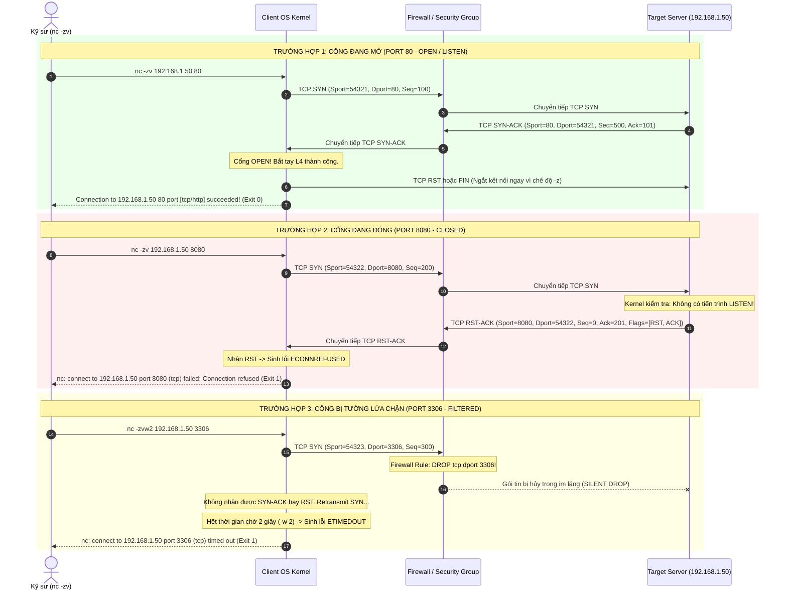
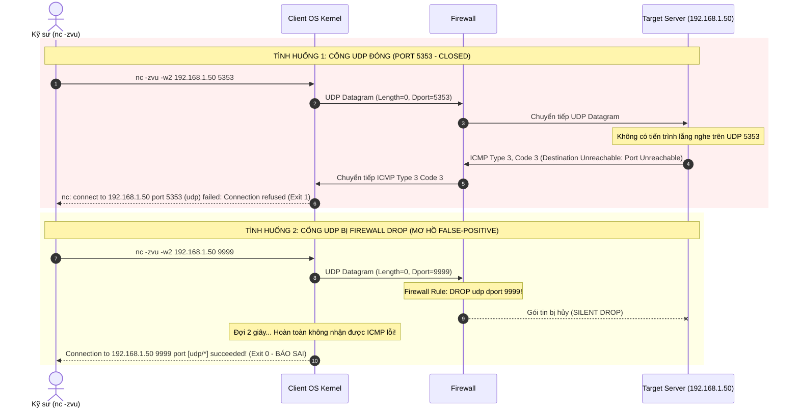

# 5_1_7 Raw Port Probing with Netcat

> **Khóa học**: Cloud DevOps Basic — Wire-Level Diagnostics  
> **Phân nhóm**: 5 Domain 5 - Wire-Level Network Inspection and Diagnostics › 5_1 Wire-Level Inspection and Diagnostic Toolkit  
> **Chủ đề**: Thăm dò cổng thô với Netcat: Cơ chế quét cổng TCP/UDP không tải (nc -zv), phân biệt trạng thái Open/Closed/Filtered và xử lý các biến thể netcat  
> **Trạng thái**: Draft  
> **Checklist đối chiếu**: [5_1_7](../../../CHECKLIST.md#51-wire-level-inspection-and-diagnostic-toolkit)

---

## 1. Khái Niệm Cốt Lõi & Bản Chất Kỹ Thuật (Core Concepts & Technical Deep Dive)

Trong quản trị hệ thống Linux và vận hành hạ tầng đám mây (Cloud & DevOps), sự cố mất kết nối mạng giữa các dịch vụ phân tán (microservices, database, message queues) diễn ra thường xuyên. Khi một ứng dụng báo lỗi không thể kết nối tới cơ sở dữ liệu hoặc API nội bộ, kỹ sư thường đứng trước nhiều lớp giả thuyết:
- Tên miền DNS có phân giải đúng IP không?
- Tường lửa (Firewall, Security Group, Network ACL) có chặn cổng không?
- Dịch vụ đích có thực sự đang chạy và lắng nghe (LISTEN) trên cổng hay không?
- Lỗi phát sinh do tầng ứng dụng (sai thông tin xác thực, lỗi SSL/TLS handshake) hay do tầng mạng?

Nếu sử dụng các công cụ tầng ứng dụng (Layer 7) như `curl`, trình duyệt web hoặc database client, việc chẩn đoán sẽ bị che mờ bởi các lớp giao thức phức tạp (HTTP header, TLS negotiation, authentication protocol). Lúc này, **Netcat (`nc`)** — được mệnh danh là *"Dao xếp Thụy Sĩ của mạng TCP/IP"* — là công cụ chuẩn mực tầng vận chuyển (Layer 4) giúp kỹ sư cô lập hoàn toàn tầng mạng và xác định trạng thái cổng dịch vụ chỉ trong vài mili-giây.

```
+-------------------------------------------------------------------------------+
|                       Mô Hình Phân Tách Chẩn Đoán L4 vs L7                    |
|                                                                               |
|  [L7: Ứng dụng]   curl, psql, mysql-client  ──> Phụ thuộc Auth, TLS, Data     |
|                                                     |                         |
|  [L4: Vận chuyển] netcat (nc -zv)           ──> Chỉ kiểm tra TCP Handshake    |
|                                                 (Không payload, Zero-I/O)     |
+-------------------------------------------------------------------------------+
```

---

### 1.1 Cơ Chế Thăm Dò Cổng TCP Không Tải (Zero-I/O TCP Port Probing) (RFC 9293)

Khi thực thi lệnh thăm dò cổng TCP với cờ `-z` (`nc -zv <host> <port>`), Netcat hoạt động ở chế độ **Zero-I/O mode**: nó chỉ khởi tạo bắt tay kết nối nhằm xác định cổng có tiếp nhận hay không mà **hoàn toàn không gửi bất kỳ byte dữ liệu tải (payload) nào** tới dịch vụ đích.

Dưới góc độ giao thức TCP chuẩn hóa theo **RFC 9293 (Transmission Control Protocol)**, một gói tin thăm dò sẽ dẫn đến một trong ba trạng thái wire-level rõ rệt:

```
                                [Client: nc -zv]
                                       |
                         Gửi gói tin TCP SYN (Seq=x)
                                       |
       +-------------------------------+-------------------------------+
       |                               |                               |
       v                               v                               v
[Trường hợp 1: OPEN]           [Trường hợp 2: CLOSED]        [Trường hợp 3: FILTERED]
Server trả về SYN-ACK          Server trả về RST hoặc RST-ACK Firewall âm thầm DROP gói
(Seq=y, Ack=x+1)               (Ack=x+1, RST=1)              (Không có phản hồi)
       |                               |                               |
Client gửi RST/FIN ngắt        Kernel client hủy kết nối      Client timeout sau (-w)
Exit code: 0                   Exit code: 1                   Exit code: 1
```

1. **Trạng thái Cổng Mở (OPEN / LISTEN)**:
   - Client gửi gói tin TCP `SYN` tới cổng đích.
   - Nếu tiến trình ứng dụng trên server đang lắng nghe (trạng thái `LISTEN`), ngăn xếp mạng của hệ điều hành server sẽ chấp nhận kết nối và phản hồi bằng gói tin **`SYN-ACK`** (trạng thái chuyển sang `SYN-RECEIVED`).
   - Client nhận được `SYN-ACK`, chứng minh 100% cổng đang mở và dịch vụ đang lắng nghe. Do chạy ở chế độ `-z`, Netcat lập tức đóng kết nối (gửi `RST` hoặc hoàn tất `ACK` rồi đóng bằng `FIN`) mà không truyền dữ liệu.
   - Kết quả hiển thị: `Connection to <host> <port> port [tcp/*] succeeded!`
   - Mã thoát (Exit code): **`0`**.

2. **Trạng thái Cổng Đóng (CLOSED)**:
   - Client gửi gói tin TCP `SYN` tới cổng đích.
   - Gói tin đến được máy chủ đích, nhưng kernel máy chủ kiểm tra bảng socket nội bộ và thấy **không có bất kỳ tiến trình nào bind vào cổng đó**.
   - Theo quy định tại **RFC 9293 (Section 3.5)**: Khi nhận được một phân đoạn gửi tới một cổng không có socket mở (trạng thái CLOSED), hệ điều hành **bắt buộc phải tạo và gửi ngược lại một phân đoạn TCP `RST` (Reset)** (hoặc `RST-ACK`) để thông báo hủy kết nối ngay lập tức.
   - Client nhận được gói tin `RST` và kernel client lập tức trả về mã lỗi `ECONNREFUSED` (*Connection refused*).
   - Kết quả hiển thị: `nc: connect to <host> port <port> (tcp) failed: Connection refused`
   - Mã thoát (Exit code): **`1`**.
   - *Ý nghĩa chẩn đoán*: Tuyến đường mạng từ client tới server hoàn toàn thông suốt, firewall không hề chặn, máy chủ đang hoạt động (UP), nhưng dịch vụ phần mềm chưa được khởi chạy hoặc bị crash.

3. **Trạng thái Bị Lọc / Chặn (FILTERED / DROPPED)**:
   - Client gửi gói tin TCP `SYN`.
   - Một thiết bị tường lửa trung gian (AWS Security Group, iptables/nftables, pfSense) hoặc tường lửa cục bộ trên máy chủ bắt gặp gói tin và áp dụng luật **`DROP`** (loại bỏ gói tin trong im lặng).
   - Không có bất kỳ gói tin phản hồi nào (`SYN-ACK` hay `RST`) được sinh ra gửi về cho client.
   - Ngăn xếp TCP của client liên tục gửi lại gói tin `SYN` (theo thuật toán TCP SYN Retransmission). Nếu cờ thời gian chờ (`-w <seconds>`) được khai báo, Netcat sẽ dừng lại khi hết thời gian và kernel trả về lỗi `ETIMEDOUT` (*Connection timed out*).
   - Kết quả hiển thị: `nc: connect to <host> port <port> (tcp) timed out: Operation now in progress`
   - Mã thoát (Exit code): **`1`**.
   - *Ý nghĩa chẩn đoán*: Gói tin bị chặn bởi tường lửa hoặc đường truyền mạng bị đứt gãy vật lý.

---

### 1.2 Cơ Chế Thăm Dò Cổng UDP và Giới Hạn Cố Hữu (RFC 768, RFC 792)

Khác với TCP, giao thức **UDP (User Datagram Protocol — RFC 768)** là giao thức phi kết nối (connectionless). UDP không hề có quá trình bắt tay 3 bước, không có cờ `SYN`, `ACK` hay số thứ tự phân đoạn (`Sequence Number`). Bản chất này dẫn đến sự khác biệt cốt tử khi dùng Netcat để thăm dò cổng UDP (`nc -zvu`):

```
+-------------------------------------------------------------------------------+
|               Cơ Chế Phản Hồi Khi Quét Cổng UDP (RFC 768 & RFC 792)           |
|                                                                               |
|  [Client: nc -zvu] ──(Gửi UDP Datagram rỗng)──> [Server / Port X]             |
|                                                        |                      |
|       +------------------------------------------------+                      |
|       |                                                |                      |
|       v                                                v                      |
| [Cổng UDP X đang MỞ]                        [Cổng UDP X đang ĐÓNG]            |
| Ứng dụng nhận datagram.                     Kernel thấy không có socket.      |
| Do UDP phi kết nối, chuẩn RFC 768          Kernel tạo gói tin ICMP:          |
| KHÔNG bắt buộc server gửi phản hồi.         Type 3 (Dest Unreachable)        |
|                                             Code 3 (Port Unreachable)         |
|       |                                                |                      |
|       v                                                v                      |
| Client KHÔNG NHẬN ĐƯỢC GÌ                  Client NHẬN ĐƯỢC ICMP Type 3/3     |
| (Mơ hồ: Open hay Filtered?)                (Khẳng định 100% cổng ĐÓNG)        |
+-------------------------------------------------------------------------------+
```

1. **Bản chất của thông báo lỗi ICMP Port Unreachable (RFC 792)**:
   - Khi một datagram UDP đến máy chủ đích nhưng không có tiến trình nào đang lắng nghe trên cổng đó, tầng IP của máy chủ đích sẽ tạo ra một thông điệp **ICMP Destination Unreachable** với **Code 3: Port Unreachable** (RFC 792) gửi ngược lại máy nguồn.
   - Khi Netcat nhận được gói ICMP Type 3 Code 3 này, nó khẳng định chắc chắn cổng UDP đích đang **CLOSED**.

2. **Cạm bẫy báo sai (False Positive) của `nc -zvu`**:
   - Nếu cổng UDP đích đang **MỞ**, tiến trình nhận được datagram nhưng theo đặc tả UDP, nó hoàn toàn có quyền im lặng (không gửi gói tin phản hồi).
   - Nếu gói tin UDP bị tường lửa **DROP âm thầm (FILTERED)**, client cũng hoàn toàn **im lặng** không nhận được bất kỳ tín hiệu nào.
   - **Hệ quả**: Trong chế độ UDP (`-u`), Netcat dựa vào nguyên tắc loại trừ: *"Nếu không nhận được thông báo lỗi ICMP Port Unreachable trong khoảng thời gian timeout, nó sẽ báo kết nối thành công (`succeeded`)"*.
   - Vì vậy, một cổng UDP bị tường lửa chặn DROP hoàn toàn vẫn có thể khiến `nc -zvu` in ra thông báo `succeeded!`. Kỹ sư phải hiểu rõ giới hạn này để không đưa ra kết luận sai lầm trong các cuộc điều tra mạng nghiêm trọng.

---

### 1.3 Ý Nghĩa Kỹ Thuật Các Tham Số Dòng Lệnh Cốt Lõi Của Netcat

| Tham số | Tên gọi chuẩn | Mô tả kỹ thuật chi tiết |
| :--- | :--- | :--- |
| **`-z`** | Zero-I/O Mode | Chỉ thực hiện bắt tay thăm dò sự tồn tại của tiến trình daemon mà không truyền gửi bất kỳ dữ liệu (I/O) nào qua socket. Giúp quét cổng cực nhanh và không làm ô nhiễm log của ứng dụng đích. |
| **`-v`** | Verbose Mode | Xuất thông tin chi tiết về tiến trình kết nối ra chuẩn lỗi `stderr` (báo trạng thái Open, Refused, Timeout hoặc phân giải DNS). Dùng `-vv` trên một số phiên bản để tăng mức độ chi tiết. |
| **`-u`** | UDP Mode | Chuyển đổi socket từ chế độ mặc định TCP sang chế độ UDP (SOCK_DGRAM). |
| **`-w <sec>`** | Timeout | Thiết lập thời gian chờ tối đa (tính bằng giây) cho việc thiết lập kết nối mạng hoặc khoảng thời gian nhàn rỗi (idle) trước khi tiến trình tự hủy. Rất quan trọng khi viết script CI/CD. |
| **`-l`** | Listen Mode | Chuyển Netcat thành máy chủ (Server), mở socket lắng nghe kết nối đến từ các client khác thay vì chủ động kết nối ra ngoài. |
| **`-p <port>`** | Port | Chỉ định số hiệu cổng cục bộ (Source port) khi ở chế độ client, hoặc số hiệu cổng lắng nghe (Listen port) khi kết hợp với `-l`. |

---

### 1.4 Bảng Mã Thoát (Exit Codes) và Tự Động Hóa Kịch Bản (Shell Scripting)

Trong các pipeline CI/CD, kịch bản triển khai hạ tầng tự động (Ansible, Terraform local-exec) hoặc Kubernetes init-containers, mã thoát (Exit Status `$?`) của Netcat là tiêu chuẩn vàng để kiểm tra điều kiện sẵn sàng:

| Exit Code | Ý nghĩa trạng thái | Nguyên nhân kỹ thuật |
| :---: | :--- | :--- |
| **`0`** | **Success (Cổng Mở)** | Bắt tay TCP thành công (`SYN-ACK` được tiếp nhận), hoặc quét UDP không nhận lỗi ICMP trong thời gian quy định. |
| **`1`** | **Connection Failure (Thất bại)** | Kết nối bị từ chối (`RST`), gói tin bị chặn dẫn đến hết thời gian chờ (`Timeout`), hoặc mạng không định tuyến được (`Host/Network Unreachable`). |
| **`2`** | **Usage / Syntax Error** | Lỗi tham số dòng lệnh (sai cờ, thiếu tham số bắt buộc, truyền cổng không hợp lệ ngoài dải 1–65535). |

---

### 1.5 Phân Biệt Các Biến Thể Netcat Trên Các Hệ Điều Hành

Một trong những nguyên nhân phổ biến gây lỗi script khi chuyển đổi giữa các môi trường (Debian vs CentOS/RHEL) là sự khác nhau giữa các gói phần mềm triển khai lệnh `nc`:

```
                                  [Họ Netcat]
                                       |
       +-------------------------------+-------------------------------+
       |                               |                               |
       v                               v                               v
[netcat-openbsd]                [nmap-ncat (Ncat)]             [netcat-traditional]
(Debian, Ubuntu, Kali)          (RHEL, Fedora, Rocky, CentOS)  (Bản gốc của Hobbit, 1995)
Tối giản, ổn định,              Tích hợp SSL/TLS (--ssl),      Hỗ trợ cờ -e /bin/sh
Hỗ trợ Unix Sockets (-U)        Access Control (--allow)       Nguy cơ bảo mật nghiêm trọng
```

1. **`netcat-openbsd` (Gói mặc định trên Ubuntu / Debian)**:
   - Được viết lại bởi nhóm phát triển OpenBSD nhằm loại bỏ các lỗ hổng bảo mật của phiên bản gốc.
   - Cú pháp mở cổng lắng nghe: `nc -l -p 8080` (hoặc `nc -l 8080`).
   - Hỗ trợ socket nội bộ Unix Domain Sockets qua cờ `-U`.
2. **`nmap-ncat` (Gói mặc định trên Red Hat Enterprise Linux / Fedora / Rocky Linux)**:
   - Do dự án bảo mật Nmap phát triển (`ncat`), được thiết kế để thay thế hoàn toàn netcat truyền thống với nhiều tính năng nâng cao.
   - Hỗ trợ mã hóa **SSL/TLS nguyên bản**: Cờ `--ssl`, `--ssl-cert`, `--ssl-key`, `--ssl-verify`.
   - Kiểm soát truy cập: Hỗ trợ danh sách trắng IP qua cờ `--allow <IP/CIDR>` và `--deny <IP/CIDR>`.
   - Cú pháp mở cổng lắng nghe: Thường dùng trực tiếp `ncat -l 8080` (khai báo số cổng ngay sau `-l`).
3. **`netcat-traditional` (Bản gốc từ tác giả Hobbit)**:
   - Phiên bản sơ khai từ thập niên 1990. Điểm đặc trưng là hỗ trợ cờ `-e <program>` cho phép chuyển tiếp stdin/stdout của socket vào một tiến trình thực thi (như `/bin/sh`).
   - Hầu hết các hệ điều hành hiện đại đều đã loại bỏ gói này hoặc biên dịch với tùy chọn vô hiệu hóa cờ `-e` để ngăn chặn tin tặc mở reverse shell.

---

## 2. Ví Dụ Đời Sống Thực Tế Dễ Hiểu (Intuitive Real-World Analogies)

Để ghi nhớ bản chất wire-level của việc thăm dò cổng qua Netcat, hãy tưởng tượng bạn là một thanh tra viên đi kiểm tra các phòng làm việc trong một tòa nhà văn phòng cao ốc:

```
+-------------------------------------------------------------------------------+
|             Phép So Sánh Thực Tế: Thao Tác Gõ Cửa Văn Phòng (Door Knocking)   |
|                                                                               |
|  1. Cổng MỞ (OPEN):                                                           |
|     Bạn gõ "Cốc cốc" (SYN) ──> Chủ phòng mở cửa chào (SYN-ACK)               |
|     ──> Bạn xác nhận có người, vẫy tay cảm ơn rồi đi ngay (RST / Zero-I/O).   |
|                                                                               |
|  2. Cổng ĐÓNG (CLOSED):                                                       |
|     Bạn gõ "Cốc cốc" (SYN) ──> Bảo vệ hành lang chạy ra xua tay ngay:         |
|     "Phòng này trống, không có ai thuê!" (RST) ──> Bạn biết ngay phòng đóng.  |
|                                                                               |
|  3. Bị TƯỜNG LỬA CHẶN (FILTERED):                                             |
|     Trước phòng có bức tường kính cách âm (Firewall DROP). Bạn gõ liên tục    |
|     nhưng không ai ra, không ai trả lời. Đứng chờ 10 phút (Timeout) trong vô  |
|     vọng mà không biết bên trong có người hay không.                          |
|                                                                               |
|  4. Cổng UDP (Ném mẩu giấy qua khe cửa sổ):                                   |
|     Bạn ném mẩu giấy (UDP Datagram). Nếu không ai quẳng mẩu giấy trả lại       |
|     (ICMP Port Unreachable), bạn không thể phân biệt mẩu giấy đã rơi vào tay  |
|     chủ phòng (Open) hay rơi vào thùng rác sau bức tường (Filtered)!          |
+-------------------------------------------------------------------------------+
```

- **Thanh tra chỉ xác nhận sự hiện diện (Zero-I/O)**: Bạn chỉ cần người mở cửa hé mắt ra xác nhận phòng đang hoạt động là bạn tích vào sổ rồi bước tiếp. Bạn không cần bước vào phòng ngồi họp, ký hợp đồng hay ăn tiệc (tương tự như Netcat không thực hiện xác thực HTTP/TLS hay tải dữ liệu nặng nề).
- **Phản ứng dứt khoát của bảo vệ (RST khi Closed)**: Bạn không phải mất thời gian đứng chờ khi cổng đóng; ngăn xếp mạng của máy chủ phản hồi lập tức bằng gói tin RST. Đây là lý do lệnh `nc -zv` kết thúc gần như tức thì với lỗi `Connection refused` khi dịch vụ đang tắt.
- **Sự im lặng đáng sợ của Tường lửa (Firewall DROP)**: Ngược lại với bảo vệ, bức tường vô hình của firewall không tạo ra bất kỳ âm thanh nào. Thanh tra viên buộc phải bấm đồng hồ hẹn giờ (`-w timeout`) để tự bỏ cuộc.

---

## 3. Kiến Trúc, Luồng Hoạt Động & Hình Ảnh Trực Quan (Architecture, Diagrams & Visual Media)

### 3.1 Sơ Đồ Tuần Tự Bắt Tay Wire-Level Khi Quét Cổng TCP

Dưới đây là tiến trình truyền tải các phân đoạn TCP trên đường truyền giữa máy trạm kiểm tra và máy chủ mục tiêu trong cả 3 tình huống mạng:



---

### 3.2 Sơ Đồ Tuần Tự Khi Quét Cổng UDP



---

### 3.3 Bảng Ma Trận So Sánh Các Trạng Thái Cổng Mạng

| Trạng thái | Tín hiệu Wire-Level | Phản hồi của Netcat (`nc -zv`) | Bản chất hệ thống | Hướng khắc phục kỹ thuật |
| :--- | :--- | :--- | :--- | :--- |
| **Open** | `SYN-ACK` | `Connection ... succeeded!` | Dịch vụ đang chạy, port đang mở, firewall cho phép thông suốt. | Kết nối tốt; nếu ứng dụng L7 vẫn lỗi, kiểm tra tiếp tài khoản, TLS cert, HTTP path. |
| **Closed** | `RST` hoặc `RST-ACK` | `Connection refused` | Máy chủ đích đang bật, định tuyến thông, nhưng ứng dụng chưa khởi chạy hoặc bị sập. | Kiểm tra tiến trình trên server đích (`systemctl status <service>`, `ss -tulpn`). |
| **Filtered** | Không phản hồi (Timeout) | `Connection timed out` | Gói tin bị chặn âm thầm bởi Firewall, Security Group, iptables hoặc đứt cáp mạng. | Kiểm tra bảng định tuyến (Route Table), Security Group in-bound, quy tắc iptables/nftables. |
| **Rejected** | ICMP Type 3 Code 9/10/13 | `No route to host` / `Host unreachable` | Tường lửa chặn chủ động và gửi thông điệp ICMP Administratively Prohibited. | Kiểm tra quy tắc tường lửa (được cấu hình lệnh `REJECT` thay vì `DROP`). |

---

## 4. Thực Hành (Hands-on)

### 4.1 Bài Thực Hành 1: Kiểm Tra Cổng Đơn và Đánh Giá Mã Thoát (Exit Code)

Thực hiện kiểm tra cổng dịch vụ web (80) trên một máy chủ nội bộ hoặc máy chủ công cộng:

```bash
# Thăm dò cổng 80 với cờ -z (zero-I/O) và -v (verbose)
nc -zv 192.168.1.50 80
```

**Quan sát kết quả đầu ra khi cổng MỞ**:
```text
Connection to 192.168.1.50 80 port [tcp/http] succeeded!
```

Kiểm tra ngay mã thoát của lệnh vừa thực thi:
```bash
echo $?
```
*Kết quả in ra*: `0` (Khẳng định cổng mở thành công).

Bây giờ thử thăm dò một cổng dịch vụ không tồn tại (ví dụ cổng 8888):
```bash
nc -zv 192.168.1.50 8888
```

**Quan sát kết quả đầu ra khi cổng ĐÓNG**:
```text
nc: connect to 192.168.1.50 port 8888 (tcp) failed: Connection refused
```

Kiểm tra mã thoát:
```bash
echo $?
```
*Kết quả in ra*: `1` (Khẳng định kết nối thất bại).

---

### 4.2 Bài Thực Hành 2: Quét Dải Cổng Kèm Giới Hạn Thời Gian Chờ (Timeout)

Khi cần rà soát nhanh một dải cổng dịch vụ microservice mà không muốn tiến trình bị treo nếu gặp các cổng bị firewall DROP:

```bash
# Quét dải cổng từ 80 đến 85 với thời gian timeout tối đa là 2 giây cho mỗi cổng
nc -z -v -w 2 192.168.1.50 80-85
```

**Đầu ra mẫu quan sát được**:
```text
Connection to 192.168.1.50 80 port [tcp/http] succeeded!
nc: connect to 192.168.1.50 port 81 (tcp) failed: Connection refused
nc: connect to 192.168.1.50 port 82 (tcp) failed: Connection refused
nc: connect to 192.168.1.50 port 83 (tcp) timed out: Operation now in progress
nc: connect to 192.168.1.50 port 84 (tcp) timed out: Operation now in progress
Connection to 192.168.1.50 85 port [tcp/*] succeeded!
```

*Phân tích kết quả*:
- Cổng **80** và **85**: Đang có dịch vụ lắng nghe (Open).
- Cổng **81** và **82**: Máy chủ phản hồi RST ngay lập tức (Closed - dịch vụ chưa bật).
- Cổng **83** và **84**: Đợi đủ 2 giây thì báo timeout (Filtered - tường lửa DROP gói tin).

---

### 4.3 Bài Thực Hành 3: Thăm Dò Cổng UDP và Bắt Gói Tin ICMP Unreachable

Thử nghiệm kiểm tra cổng phân giải DNS (53 UDP) trên máy chủ:

```bash
# Thăm dò cổng UDP 53 với thời gian timeout 2 giây
nc -z -v -u -w 2 192.168.1.50 53
```

Kết quả:
```text
Connection to 192.168.1.50 53 port [udp/domain] succeeded!
```

Để chứng minh phản ứng ICMP khi cổng UDP đóng, mở một cửa sổ terminal khác trên client chạy `tcpdump` bắt gói tin ICMP:
```bash
# Bắt gói tin ICMP trên card mạng eth0
sudo tcpdump -i eth0 -nn "icmp"
```

Tại terminal chính, thăm dò một cổng UDP ngẫu nhiên chắc chắn không mở (ví dụ UDP 54321):
```bash
nc -z -v -u -w 2 192.168.1.50 54321
```

Trên terminal `tcpdump`, bạn sẽ bắt được gói tin sau xuất hiện ngay lập tức:
```text
IP 192.168.1.50 > 192.168.1.100: ICMP 192.168.1.50 udp port 54321 unreachable, length 36
```
Và Netcat lập tức in thông báo:
```text
nc: connect to 192.168.1.50 port 54321 (udp) failed: Connection refused
```

---

### 4.4 Bài Thực Hành 4: Tạo Mock Listener Để Kiểm Thử Thông Luồng Mạng (Dummy Server)

Khi nghi ngờ tường lửa giữa 2 máy chủ chặn cổng 9000, nhưng ứng dụng backend chính thức chưa được cài đặt, kỹ sư có thể biến Netcat thành một máy chủ giả lập (Mock Listener) trong 5 giây:

**Bước 1: Trên máy chủ đích (Server: 192.168.1.50)**:
```bash
# Mở một cổng TCP 9000 lắng nghe kết nối đến
# Với netcat-openbsd:
nc -l -p 9000

# Hoặc nếu là nmap-ncat (RHEL/CentOS):
# ncat -l 9000
```
*(Tiến trình sẽ giữ terminal ở trạng thái block chờ kết nối).*

**Bước 2: Trên máy trạm kiểm tra (Client)**:
```bash
# Thăm dò xem cổng 9000 trên server đã thông chưa
nc -zv 192.168.1.50 9000
```

Ngay khi client chạy lệnh trên:
- Client in thông báo: `Connection to 192.168.1.50 9000 port [tcp/*] succeeded!`
- Server nhận kết nối và thoát tiến trình (hoặc in dữ liệu).
- **Kết luận**: Tuyến đường mạng, Security Group và routing hoàn toàn thông suốt!

---

### 4.5 Bài Thực Hành 5: Script Tự Động Hóa Chờ Dịch Vụ Sẵn Sàng (Wait-For-Port Script)

Trong Docker Compose, Kubernetes Init-Containers hoặc CI/CD pipeline, các ứng dụng backend thường sập nếu cơ sở dữ liệu (PostgreSQL/MySQL) chưa kịp khởi động xong. Script shell chuẩn POSIX dưới đây sử dụng Netcat để tạo cơ chế chờ đợi thông minh (Readiness Probe):

```bash
#!/bin/sh
# wait-for-service.sh: Kiểm tra cổng TCP trước khi khởi chạy ứng dụng chính

TARGET_HOST="db.internal"
TARGET_PORT="5432"
TIMEOUT_SECONDS=30
ELAPSED=0

echo "Đang chờ dịch vụ ${TARGET_HOST}:${TARGET_PORT} sẵn sàng..."

until nc -z -w 2 "${TARGET_HOST}" "${TARGET_PORT}" > /dev/null 2>&1; do
    ELAPSED=$((ELAPSED + 2))
    if [ "${ELAPSED}" -ge "${TIMEOUT_SECONDS}" ]; then
        echo "LỖI: Hết thời gian chờ (${TIMEOUT_SECONDS}s) - Không thể kết nối tới ${TARGET_HOST}:${TARGET_PORT}!" >&2
        exit 1
    fi
    echo "Dịch vụ chưa sẵn sàng, thử lại sau 2 giây... (Đã chờ ${ELAPSED}s)"
    sleep 2
done

echo "Thành công: Dịch vụ ${TARGET_HOST}:${TARGET_PORT} đã sẵn sàng nhận kết nối!"
exit 0
```

---

### 4.6 Bài Thực Hành 6: Giải Pháp Tương Đương Trên Windows (PowerShell & .NET)

Hệ điều hành Windows mặc định không tích hợp sẵn lệnh `nc`. Tuy nhiên, kỹ sư có thể đạt được hiệu quả kiểm tra wire-level L4 tương đương 100% bằng hai phương thức tích hợp sẵn trong PowerShell:

#### Cách 1: Sử dụng Cmdlet `Test-NetConnection`
Cmdlet này thực hiện kiểm tra bắt tay TCP tầng 4 khi truyền tham số `-Port`:

```powershell
# Kiểm tra cổng 80 trên máy chủ từ xa
Test-NetConnection -ComputerName 192.168.1.50 -Port 80
```

**Đầu ra quan sát được**:
```text
ComputerName           : 192.168.1.50
RemoteAddress          : 192.168.1.50
RemotePort             : 80
InterfaceAlias         : Ethernet0
SourceAddress          : 192.168.1.25
TcpTestSucceeded       : True
```
Thuộc tính **`TcpTestSucceeded : True`** tương đương với trạng thái `OPEN` của Netcat.

Để chỉ lấy giá trị logic Boolean phục vụ cho kịch bản tự động hóa (scripting):
```powershell
(Test-NetConnection -ComputerName 192.168.1.50 -Port 80 -WarningAction SilentlyContinue).TcpTestSucceeded
```

#### Cách 2: Sử dụng trực tiếp .NET Socket (`TcpClient`)
Khi cần tốc độ thực thi siêu nhanh hoặc cần thiết lập timeout chính xác xuống mức mili-giây (vì `Test-NetConnection` có thời gian timeout mặc định khá lâu):

```powershell
$tcpClient = New-Object System.Net.Sockets.TcpClient
$asyncResult = $tcpClient.BeginConnect("192.168.1.50", 80, $null, $null)
$waitHandle = $asyncResult.AsyncWaitHandle.WaitOne(2000, $false) # Timeout 2000ms

if ($waitHandle -and $tcpClient.Connected) {
    Write-Host "Cổng 80 MỞ (OPEN)" -ForegroundColor Green
    $tcpClient.EndConnect($asyncResult)
} else {
    Write-Host "Cổng 80 ĐÓNG hoặc BỊ CHẶN (CLOSED / FILTERED)" -ForegroundColor Red
}
$tcpClient.Close()
```

---

## 5. Cạm Bẫy Thực Tế & Thực Tiễn Sản Xuất (Production Gotchas & Best Practices)

### 5.1 Cạm Bẫy Quét Cổng UDP Báo Succeeded Giả Mạo (The UDP Mirage Trap)

- **Hiện tượng**: Một kỹ sư chạy lệnh `nc -zvu 10.0.0.1 53` để kiểm tra máy chủ DNS. Kết quả Netcat in ra `Connection to 10.0.0.1 53 port [udp/domain] succeeded!`. Kỹ sư kết luận firewall đã mở cổng UDP 53 thành công. Tuy nhiên, khi đưa ứng dụng vào chạy, toàn bộ truy vấn DNS đều bị lỗi timeout.
- **Nguyên nhân cốt lõi**:
  - Tường lửa (Security Group) thực chất vẫn đang áp dụng quy tắc **DROP** đối với cổng UDP 53.
  - Khi gửi gói UDP thăm dò rỗng, gói tin bị firewall hủy âm thầm. Máy chủ đích không hề nhận được gói tin, do đó không có gói tin ICMP Port Unreachable nào được sinh ra.
  - Netcat trên client không nhận được bất kỳ lỗi nào trong khoảng thời gian timeout, nên nó suy đoán một cách ngây thơ rằng kết nối đã thành công!
- **Best Practice trong sản xuất**:
  - **Tuyệt đối không dùng `nc -zvu` đơn thuần** để kết luận cổng UDP đang mở trên môi trường production.
  - Phải kiểm tra bằng các công cụ có khả năng gửi payload ứng dụng L7 thực thụ và nhận dữ liệu phản hồi:
    - Đối với DNS (cổng 53): Dùng `dig @10.0.0.1 google.com` hoặc `nslookup google.com 10.0.0.1`.
    - Đối với NTP (cổng 123): Dùng `ntpdate -q 10.0.0.1` hoặc `chronyc sources`.
    - Đối với SNMP (cổng 161): Dùng `snmpget` hoặc `snmpwalk`.

---

### 5.2 Quên Tham Số `-w` Khiến CI/CD Pipeline Bị Treo Vô Tận

- **Hiện tượng**: Trong script build của GitLab CI hoặc GitHub Actions runner, kỹ sư thêm lệnh kiểm tra cơ sở dữ liệu:
  ```bash
  nc -zv $DATABASE_HOST 5432
  ```
  Nếu địa chỉ IP của database bị thay đổi hoặc Security Group chưa được cấp phép (trạng thái FILTERED / DROP), job CI/CD sẽ rơi vào trạng thái treo (hang) hàng chục phút cho đến khi pipeline vượt quá giới hạn tổng và bị hủy bỏ (Runner Timeout).
- **Nguyên nhân**: Mặc định nếu không truyền tham số `-w`, thời gian chờ phụ thuộc hoàn toàn vào cấu hình TCP SYN Retransmissions của Linux kernel (`/proc/sys/net/ipv4/tcp_syn_retries`). Quá trình này có thể kéo dài tới hơn 2 phút cho một lần thử kết nối. Nếu script lặp trong vòng `while`, nó sẽ chạy vô tận.
- **Best Practice**: **Bắt buộc luôn luôn phải khai báo cờ `-w <timeout>`** trong mọi lệnh Netcat tự động:
  ```bash
  # Luôn giới hạn timeout tối đa 2 đến 3 giây
  nc -z -v -w 2 "$DATABASE_HOST" 5432
  ```

---

### 5.3 Sự Khác Biệt Cú Pháp Nguy Hiểm Giữa OpenBSD Netcat và Nmap Ncat

- **Hiện tượng**: Một script chạy thử nghiệm rất hoàn hảo trên máy phát triển cá nhân (Ubuntu Desktop), nhưng khi đưa vào container chạy base image Red Hat UBI hoặc Rocky Linux thì script lập tức báo lỗi cú pháp:
  ```text
  nc: invalid option -- 'p'
  ```
- **Nguyên nhân**:
  - Trên Ubuntu (`netcat-openbsd`), cú pháp lắng nghe truyền thống yêu cầu cờ `-p`: `nc -l -p 8080`.
  - Trên RHEL/Rocky (`nmap-ncat`), cờ `-l` nhận trực tiếp số hiệu cổng: `ncat -l 8080`. Nếu truyền thêm `-p 8080`, một số phiên bản ncat sẽ xung đột hoặc hiểu `-p` là cổng nguồn không hợp lệ trong ngữ cảnh lắng nghe.
- **Best Practice**:
  - Kiểm tra phiên bản Netcat đang cài đặt trên hệ thống trước khi sử dụng trong script phức tạp:
    ```bash
    nc -h 2>&1 | head -n 2
    ```
  - Nếu cần tính năng bảo mật nâng cao như mã hóa TLS, hãy cài đặt và chỉ định rõ binary `ncat`:
    ```bash
    # Sử dụng ncat với kết nối TLS/SSL bảo mật
    ncat --ssl -zv secure.api.internal 443
    ```

---

### 5.4 Môi Trường Container Không Có Sẵn Netcat: Kỹ Thuật `/dev/tcp` Trong Bash

Trong các container Docker hiện đại được tối ưu hóa dung lượng (Alpine tối giản, Distroless, Red Hat UBI micro), gói phần mềm `netcat` thường bị gỡ bỏ để giảm thiểu diện tích bề mặt tấn công. Khi đó, kỹ sư không thể cài thêm phần mềm nhưng vẫn cần kiểm tra cổng.

- **Giải pháp thay thế kinh điển**: Tận dụng tính năng socket ảo tích hợp sẵn trong Bash shell (**`/dev/tcp/<host>/<port>`**):
  ```bash
  # Kiểm tra cổng 80 trong Bash shell nguyên bản (không cần cài thêm netcat)
  timeout 2 bash -c "</dev/tcp/192.168.1.50/80" && echo "Port OPEN" || echo "Port CLOSED/FILTERED"
  ```
  - Nếu kết nối TCP thành công, file descriptor mở ra và lệnh trả về mã thoát `0`.
  - Lệnh `timeout 2` đóng vai trò thay thế cho cờ `-w 2` nhằm ngăn chặn trường hợp cổng bị treo do firewall DROP.

---

## 6. Câu Hỏi Củng Cố Kiến Thức (Active Recall Quiz)

### Câu hỏi 1: Phân biệt nguyên nhân sự cố qua mã phản hồi wire-level
Một kỹ sư DevOps nhận được cảnh báo khẩn cấp: Ứng dụng Backend không thể gửi dữ liệu sang Redis Cache tại địa chỉ IP `10.10.5.20:6379`. Kỹ sư đăng nhập vào máy chủ Backend và thực hiện hai lệnh kiểm tra:
```bash
# Lệnh 1: Kiểm tra tính sẵn sàng ở tầng mạng (L3)
ping -c 3 10.10.5.20

# Lệnh 2: Kiểm tra tính sẵn sàng ở tầng vận chuyển (L4)
nc -z -v -w 3 10.10.5.20 6379
```

Kết quả:
- Lệnh `ping` trả về 0% packet loss với RTT trung bình 0.8ms.
- Lệnh `nc` in ra dòng thông báo: `nc: connect to 10.10.5.20 port 6379 (tcp) failed: Connection refused` và kết thúc ngay sau 1 mili-giây.

Dựa trên các đặc tả giao thức mạng, hãy phân tích:
1. Gói tin phân đoạn TCP nào đã được máy chủ Redis gửi ngược lại máy chủ Backend?
2. Có phải tường lửa mạng (Network Security Group / iptables) đang chặn cổng 6379 không? Vì sao?
3. Nguyên nhân gốc rễ (Root Cause) khả dĩ nhất của sự cố này là gì và bước xử lý tiếp theo của kỹ sư là gì?

<details>
<summary>Đáp án chi tiết</summary>

1. **Gói tin phân đoạn TCP**: Máy chủ Redis đã gửi ngược lại gói tin **TCP `RST` (hoặc `RST-ACK`)** tới máy chủ Backend (theo chuẩn RFC 9293).
2. **Khẳng định về tường lửa**: **Tường lửa hoàn toàn KHÔNG chặn cổng 6379**. Nếu tường lửa chặn (DROP), gói tin SYN sẽ bị hủy trong im lặng và lệnh `nc` sẽ bị treo trong 3 giây cho đến khi hết thời gian chờ của cờ `-w 3` rồi báo lỗi `timed out`. Việc lệnh kết thúc ngay lập tức sau 1ms chứng minh đường truyền mạng thông suốt 100% hai chiều.
3. **Nguyên nhân gốc rễ & Bước xử lý**:
   - Gói tin TCP `RST` xuất hiện khi hệ điều hành máy chủ đích nhận được gói tin SYN nhưng kernel kiểm tra không thấy bất kỳ tiến trình nào đang lắng nghe (LISTEN) trên cổng 6379.
   - *Nguyên nhân*: Tiến trình dịch vụ `redis-server` trên máy chủ `10.10.5.20` đã bị sập (crash/OOM-killed), chưa được khởi động, hoặc đang bind nhầm vào địa chỉ loopback cục bộ `127.0.0.1` thay vì card mạng nội bộ `10.10.5.20` (hoặc `0.0.0.0`).
   - *Bước xử lý*: Đăng nhập vào máy chủ `10.10.5.20`, kiểm tra trạng thái tiến trình bằng `systemctl status redis` và kiểm tra cấu hình bind cổng bằng `ss -tulpn | grep 6379`.
</details>

---

### Câu hỏi 2: Kịch bản phân tích ảo giác cổng UDP (UDP Mirage)
Trong một dự án di chuyển hạ tầng lên đám mây, kỹ sư mạng cấu hình quy tắc tường lửa để cho phép máy trạm gửi bản tin nhật ký hệ thống (Syslog) tới máy chủ tập trung qua cổng `514 UDP`.
Để kiểm tra cấu hình, kỹ sư chạy lệnh:
```bash
nc -z -v -u -w 2 syslog.corp.internal 514
```
Màn hình console hiển thị:
```text
Connection to syslog.corp.internal 514 port [udp/syslog] succeeded!
```
Kỹ sư tự tin kết luận hệ thống đã sẵn sàng và đóng task. Tuy nhiên, sau đó máy chủ Syslog không nhận được bất kỳ dòng nhật ký nào từ ứng dụng. Khi kiểm tra lại nhật ký của Firewall đám mây, kỹ sư phát hiện rule mở cổng 514 thực chất bị viết sai địa chỉ nguồn nên toàn bộ gói tin UDP gửi đến đều bị Security Group âm thầm DROP.

Tại sao lệnh `nc -zvu` vẫn báo `succeeded!` trong khi tường lửa thực tế đang DROP toàn bộ gói tin? Cơ chế xử lý tín hiệu nào của Netcat đã gây ra sự hiểu lầm nghiêm trọng này?

<details>
<summary>Đáp án chi tiết</summary>

- **Bản chất kỹ thuật**:
  - Giao thức UDP (RFC 768) là giao thức phi kết nối, không có cơ chế bắt tay 3 bước `SYN -> SYN-ACK -> ACK` để xác thực phiên làm việc như TCP.
  - Khi chạy ở chế độ UDP (`-u`), Netcat không thể chờ đợi gói tin SYN-ACK. Thay vào đó, nó dựa hoàn toàn vào phản xạ lỗi **ICMP Destination Unreachable (Type 3 Code 3 - Port Unreachable)** từ hệ điều hành máy chủ đích (RFC 792) để xác định cổng có đóng hay không.
- **Cơ chế gây hiểu lầm**:
  - Khi Security Group thực hiện luật **DROP âm thầm**, gói tin UDP bị tiêu hủy ngay tại cổng vào của tường lửa. Gói tin không bao giờ chạm tới được hệ điều hành của máy chủ Syslog, do đó kernel máy chủ đích không hề tạo ra gói tin ICMP Type 3 Code 3 để gửi về.
  - Sau 2 giây chờ đợi (`-w 2`), Netcat trên máy trạm nhận thấy: *"Không có bất kỳ thông điệp ICMP báo lỗi nào gửi về"*.
  - Theo logic lập trình nội bộ của Netcat đối với giao thức UDP: *Không có thông báo lỗi đồng nghĩa với việc kết nối thành công*. Do đó Netcat in ra `succeeded!` và trả về exit code `0`.
- **Bài học kinh nghiệm**: Quét cổng UDP không tải qua Netcat chỉ có thể khẳng định chắc chắn khi cổng **CLOSED** (nhận được ICMP Port Unreachable). Đối với trạng thái thành công, nó luôn rơi vào vùng mơ hồ `Open|Filtered` và bắt buộc phải dùng công cụ tầng ứng dụng gửi dữ liệu thực để kiểm chứng.
</details>

---

### Câu hỏi 3: Tự động hóa Pipeline CI/CD và xử lý lỗi cú pháp
Một lập trình viên viết một đoạn kịch bản kiểm tra sức khỏe cơ sở dữ liệu trong file `entrypoint.sh` của container như sau:
```bash
#!/bin/bash
while ! nc -z $DB_HOST 3306; do
  echo "Chờ MySQL khởi động..."
  sleep 1
done
echo "MySQL đã sẵn sàng! Bắt đầu chạy migrations..."
npm start
```
Khi đưa container này vào vận hành thực tế trong hệ thống Kubernetes, lập trình viên phát hiện hai sự cố nghiêm trọng:
1. Khi cụm Kubernetes gặp sự cố phân vùng mạng (Network Partition) khiến toàn bộ gói tin gửi tới `$DB_HOST` bị mất (tương đương firewall DROP), Pod rơi vào trạng thái đứng im vô hạn định mà không bao giờ tự dừng để kích hoạt cơ chế CrashLoopBackOff của Kubernetes.
2. Trên một số node chạy image cơ sở Alpine Linux, lệnh `nc -z $DB_HOST 3306` lập tức kết thúc với mã lỗi `2` và script in lỗi `nc: default: Bad file descriptor`.

Hãy chỉ ra nguyên nhân của hai lỗi trên và viết lại đoạn script chuẩn mực, an toàn cho môi trường sản xuất.

<details>
<summary>Đáp án chi tiết</summary>

1. **Nguyên nhân sự cố 1 (Treo vô hạn)**:
   - Lệnh `nc -z` không được thiết lập cờ thời gian chờ (`-w <timeout>`).
   - Khi xảy ra mất gói tin mạng (DROP), ngăn xếp TCP kernel sẽ thử gửi lại gói SYN nhiều lần theo cấu hình TCP retransmission của hệ thống (mỗi lần chờ có thể kéo dài hàng phút). Vòng lặp `while ! nc ...` do đó bị treo vĩnh viễn ở mỗi vòng lặp, ngăn cản Pod thực hiện timeout hoặc crash để Kubernetes phát hiện và tái tạo Pod mới.
2. **Nguyên nhân sự cố 2 (Lỗi mã thoát 2 trên Alpine)**:
   - Alpine Linux sử dụng công cụ `nc` tích hợp trong bộ **BusyBox**.
   - Phiên bản Netcat của BusyBox triển khai cờ `-z` với một số ràng buộc khác biệt hoặc thiếu cờ thời gian chờ chuẩn nếu không truyền đúng cú pháp (`nc -z -w 2` vs `nc -w 2 -z`). Nếu tham số không hợp lệ, Netcat trả về exit code `2` (Syntax error), khiến điều kiện kiểm tra luôn thất bại.
3. **Đoạn script chuẩn mực viết lại**:
   Cần bổ sung:
   - Cờ `-w 2` để khống chế thời gian chờ mỗi lần thử là 2 giây.
   - Biến đếm số lần thử tối đa (Max retries) để script tự thoát với mã lỗi khác 0, cho phép Kubernetes quản lý vòng đời Pod.
   - Thêm cờ `-v` để theo dõi rõ lỗi.

   ```bash
   #!/bin/bash
   set -euo pipefail

   DB_HOST="${DB_HOST:-127.0.0.1}"
   DB_PORT="${DB_PORT:-3306}"
   MAX_RETRIES=15
   RETRY_COUNT=0

   echo "Bắt đầu kiểm tra kết nối tới MySQL tại ${DB_HOST}:${DB_PORT}..."

   until nc -z -w 2 "$DB_HOST" "$DB_PORT" > /dev/null 2>&1; do
     RETRY_COUNT=$((RETRY_COUNT + 1))
     if [ "$RETRY_COUNT" -ge "$MAX_RETRIES" ]; then
       echo "LỖI: Quá thời gian chờ (${MAX_RETRIES} lần thử). Không thể kết nối tới MySQL!" >&2
       exit 1
     fi
     echo "MySQL chưa sẵn sàng (Lần thử ${RETRY_COUNT}/${MAX_RETRIES}). Đợi 2 giây..."
     sleep 2
   done

   echo "MySQL đã sẵn sàng! Bắt đầu chạy migrations..."
   exec npm start
   ```
</details>

---

## 7. 📚 Nguồn Tài Liệu Chính Thống (Tier-1 Official References)

- [RFC 9293: Transmission Control Protocol (TCP)](https://datatracker.ietf.org/doc/html/rfc9293) — Đặc tả kỹ thuật chuẩn IETF thay thế RFC 793, quy định chi tiết về cơ chế bắt tay 3 bước, xử lý phân đoạn `RST` khi cổng đóng (Section 3.5), và quản lý trạng thái kết nối socket.
- [RFC 768: User Datagram Protocol (UDP)](https://datatracker.ietf.org/doc/html/rfc768) — Tiêu chuẩn kỹ thuật nền tảng về giao thức phi kết nối L4, giải thích lý do không có cơ chế bắt tay và tính chất không bắt buộc phản hồi.
- [RFC 792: Internet Control Message Protocol (ICMP)](https://datatracker.ietf.org/doc/html/rfc792) — Đặc tả kỹ thuật của thông điệp ICMP, định nghĩa chi tiết thông điệp lỗi Destination Unreachable (Type 3) và Port Unreachable (Code 3).
- [OpenBSD Manual Pages: nc(1) - arbitrary TCP and UDP connections and listens](https://man.openbsd.org/nc.1) — Tài liệu hướng dẫn tra cứu chính thức của OpenBSD cho tiện ích dòng lệnh Netcat, đặc tả các cờ `-z`, `-v`, `-u`, `-w`, `-l`, `-p` và bảng mã trạng thái thoát (Exit Status).
- [Nmap Project: Ncat Users' Guide](https://nmap.org/ncat/guide/index.html) — Tài liệu kỹ thuật tham chiếu chính thức cho công cụ Ncat trên các hệ điều hành RHEL/CentOS/Fedora, hướng dẫn chi tiết các tính năng bảo mật nâng cao với SSL/TLS (`--ssl`) và kiểm soát truy cập mạng.
- [Microsoft Learn: Test-NetConnection Reference](https://learn.microsoft.com/en-us/powershell/module/nettcpip/test-netconnection) — Tài liệu hướng dẫn kỹ thuật chính thức từ Microsoft cho công cụ kiểm tra kết nối mạng và chẩn đoán cổng TCP tầng 4 trên hệ điều hành Windows qua PowerShell.
