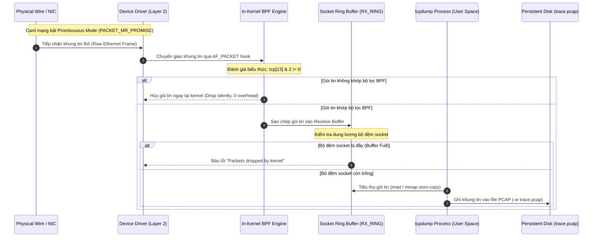

# 5_1_8 Packet Capture with tcpdump

> **Khóa học**: Cloud DevOps Basic — Wire-Level Diagnostics  
> **Phân nhóm**: 5 Domain 5 - Wire-Level Network Inspection and Diagnostics › 5_1 Wire-Level Inspection and Diagnostic Toolkit  
> **Chủ đề**: Bắt gói tin trên đường truyền với tcpdump: Kiến trúc AF_PACKET và BPF, cú pháp lọc byte-offset (tcp[13]), kỹ thuật ghi PCAP và tối ưu hóa chống tràn bộ đệm  
> **Trạng thái**: Draft  
> **Checklist đối chiếu**: [5_1_8](../../../CHECKLIST.md#51-wire-level-inspection-and-diagnostic-toolkit)  

---

## 1. Khái Niệm Cốt Lõi & Bản Chất Kỹ Thuật (Core Concepts & Technical Deep Dive)

Trong hạ tầng Cloud và phân tán, khi các công cụ kiểm tra tầng người dùng (như `curl`, `ping`, hay log ứng dụng) chỉ ghi nhận những thông báo lỗi mơ hồ như "Connection timed out" hay "Connection reset by peer", phương pháp duy nhất để tiếp cận sự thật khách quan là thu thập và giải phẫu khung tin truyền dẫn trực tiếp trên card mạng (Wire-Level Packet Capture).

Tiện ích tiêu chuẩn công nghiệp trên Linux cho nhiệm vụ này là **`tcpdump`**, hoạt động dựa trên thư viện bắt gói tin `libpcap`. Khác với các ứng dụng mạng thông thường gửi nhận dữ liệu qua socket TCP/UDP tầng 4, `tcpdump` can thiệp trực tiếp vào tầng liên kết dữ liệu (Layer 2) của nhân Linux thông qua giao diện socket gói tin chuyên dụng.

---

### 1.1 Kiến Trúc Bắt Gói Tin Trong Linux: Socket AF_PACKET & Promiscuous Mode

Để thu thập được dữ liệu trên đường truyền trước khi ngăn xếp mạng TCP/IP xử lý, nhân Linux cung cấp họ giao thức socket đặc biệt mang tên **`AF_PACKET`** (theo tài liệu Linux Kernel `packet(7)`):

```
+-------------------------------------------------------------------------------+
|                      So Sánh Luồng Gói Tin: AF_INET vs AF_PACKET              |
|                                                                               |
|  [Ứng dụng Web / cURL]                     [tcpdump (User Space)]             |
|          ^                                           ^                        |
|          | read() / write()                          | read() / mmap()        |
|  +-------|-------------------------------------------|---------------------+  |
|  |       | (Tầng L4 Socket: AF_INET)                 | (Raw Socket)        |  |
|  |       v                                           |                     |  |
|  |  [TCP/UDP Stack]                                  |                     |  |
|  |       ^                                           |                     |  |
|  |       | IP Routing / Netfilter                    | AF_PACKET Hook      |  |
|  |       v                                           v                     |  |
|  |  [IP Stack (L3)]                         [BPF Filter Engine]            |  |
|  |       ^                                           ^                     |  |
|  |       +-------------------+-----------------------+                     |  |
|  |                           |                                             |  |
|  |            [Network Device Driver (dev_add_pack)]                       |  |
|  |                           ^                                             |  |
|  |                     Linux Kernel                                        |  |
|  +---------------------------|---------------------------------------------+  |
|                              v                                                |
|            [Network Interface Card (NIC) / Physical Wire]                     |
+-------------------------------------------------------------------------------+
```

1. **Khác biệt giữa Socket `AF_INET` và `AF_PACKET`**:
   - Một ứng dụng thông thường mở socket qua họ `AF_INET` (hoặc `AF_INET6`) chỉ nhận dữ liệu payload tầng ứng dụng sau khi nhân Linux đã hoàn thành việc bóc tách header Ethernet, kiểm tra checksum IP, định tuyến, tái ráp luồng TCP và loại bỏ các header giao thức.
   - Ngược lại, socket **`AF_PACKET`** (với kiểu `SOCK_RAW`) hook trực tiếp vào tầng trình điều khiển thiết bị mạng (device driver / Layer 2). Cơ chế này cho phép tiến trình ở user space nhận nguyên vẹn khung tin thô (raw frame), bao gồm cả Ethernet Header, IP Header, TCP Header và toàn bộ Payload truyền trên dây cáp mạng.
2. **Chế độ hỗn tạp (Promiscuous Mode — `PACKET_MR_PROMISC`)**:
   - Ở trạng thái vận hành bình thường, card mạng (NIC) sử dụng bộ lọc phần cứng (Hardware MAC Filter) để kiểm tra trường địa chỉ MAC đích của mọi khung Ethernet. NIC sẽ âm thầm loại bỏ tất cả các frame không gửi tới địa chỉ MAC vật lý của nó (trừ frame Broadcast `ff:ff:ff:ff:ff:ff` hoặc Multicast đã đăng ký).
   - Khi `tcpdump` khởi động trên một giao diện mạng (ví dụ `eth0`), nó phát lệnh yêu cầu socket kích hoạt cờ **`PACKET_MR_PROMISC`**. Trình điều khiển card mạng sẽ vô hiệu hóa bộ lọc MAC phần cứng và chuyển giao toàn bộ mọi khung tin xuất hiện trên đường truyền vật lý lên ngăn xếp nhân Linux.
3. **Cơ chế Memory-Mapped Ring Buffer (`PACKET_RX_RING`)**:
   - Khi lưu lượng mạng tăng cao lên hàng chục nghìn gói/giây, việc gọi hàm hệ thống `recvmsg()` truyền thống để sao chép dữ liệu từ kernel space sang user space cho từng gói tin sẽ tiêu tốn lượng CPU khổng lồ (do chi phí chuyển đổi ngữ cảnh context switch và memory copy).
   - Tùy chọn socket **`PACKET_RX_RING`** cho phép tạo một vùng nhớ vòng đệm chia sẻ được ánh xạ (`mmap()`) trực tiếp giữa nhân hệ điều hành và tiến trình `tcpdump`. Nhờ đó, gói tin được ghi thẳng vào ring buffer, giúp tiến trình user space đọc dữ liệu mà không cần thực hiện thao tác sao chép bộ nhớ lặp đi lặp lại.

---

### 1.2 Cơ Chế Lọc Gói Tin Berkeley Packet Filter (BPF) Trong Kernel

Nếu mọi khung tin đi qua card mạng đều phải chuyển toàn bộ lên user space rồi mới dùng các câu lệnh điều kiện trong tiến trình để kiểm tra (chẳng hạn kiểm tra xem gói tin có gửi tới cổng 443 hay không), hệ thống máy chủ sẽ ngay lập tức bị quá tải và cạn kiệt tài nguyên CPU.

Để giải quyết bài toán hiệu năng này, công nghệ **Berkeley Packet Filter (BPF)** được tích hợp sâu vào nhân Linux (theo tài liệu `pcap-filter(7)`):

```
                                  [Nhân Linux (Kernel Space)]
                                 +---------------------------+
                                 |   Khung tin đến từ NIC    |
                                 +-------------+-------------+
                                               |
                                               v
                                 +---------------------------+
                                 |  BPF Bytecode Execution   |
                                 |  (Kiểm tra bộ lọc BPF)    |
                                 +-------------+-------------+
                                               |
                       +-----------------------+-----------------------+
                       | Khớp biểu thức lọc                            | Không khớp biểu thức
                       v                                               v
        +-----------------------------+                 +-----------------------------+
        | Đưa vào Socket Buffer /     |                 |  Hủy gói tin ngay lập tức   |
        | Ring Buffer (RX_RING)       |                 |  (Drop at Driver/Kernel)    |
        | -> Chuyển lên tcpdump       |                 |  -> 0% Overhead User Space  |
        +-----------------------------+                 +-----------------------------+
```

1. **Biên dịch biểu thức thành Bytecode**:
   - Khi người dùng truyền biểu thức lọc (filter expression) vào dòng lệnh `tcpdump` (ví dụ `'port 80 or port 443'`), thư viện `libpcap` sẽ biên dịch biểu thức dạng chuỗi văn bản này thành tập chỉ lệnh máy ảo BPF (BPF bytecode).
2. **Nạp bộ lọc vào Kernel (`SO_ATTACH_FILTER`)**:
   - Tiến trình `tcpdump` nạp đoạn mã BPF bytecode này trực tiếp vào nhân Linux thông qua socket option `SO_ATTACH_FILTER`.
3. **Thực thi bộ lọc ngay tại tầng Driver**:
   - Mỗi khi một khung tin vừa được NIC nhận vào bộ nhớ, nhân Linux lập tức kích hoạt bộ thông dịch BPF để kiểm tra khung tin theo tập chỉ lệnh.
   - Nếu gói tin **không khớp** biểu thức lọc: Gói tin bị hủy (discard) ngay lập tức tại chỗ. Không có bất kỳ bộ nhớ nào được cấp phát thêm và không có sự kiện đánh thức (wake-up) tiến trình user space nào diễn ra.
   - Nếu gói tin **khớp** biểu thức lọc: Kernel sao chép đúng số byte cần thiết (được chỉ định bởi Snapshot Length) vào bộ đệm nhận của socket để chuyển giao lên `tcpdump`.

---

### 1.3 Bản Chất & Nguyên Nhân Lỗi "Packets Dropped by Kernel"

Khi người dùng dừng phiên bắt gói tin bằng tổ hợp phím `Ctrl + C`, `tcpdump` luôn in ra một bản tổng kết thống kê ở cuối phiên làm việc (theo tài liệu `tcpdump(1)`):

```text
125430 packets captured
128200 packets received by filter
2770 packets dropped by kernel
```

Ý nghĩa kỹ thuật của từng chỉ số:
- **`packets captured`**: Tổng số lượng gói tin mà tiến trình `tcpdump` ở user space đã đọc thành công từ socket và xử lý (in ra màn hình hoặc ghi vào file PCAP).
- **`packets received by filter`**: Tổng số lượng gói tin xuất hiện trên giao diện mạng đã thỏa mãn biểu thức BPF và được kernel chuyển hướng vào hàng đợi socket.
- **`packets dropped by kernel`**: Số lượng gói tin đã được bộ lọc BPF chấp thuận, nhưng **bị nhân Linux vứt bỏ** do bộ đệm nhận của socket (`socket receive buffer`) bị đầy trước khi tiến trình `tcpdump` kịp đọc.

**Cơ chế phát sinh lỗi**:
Tốc độ lưu lượng mạng dồn vào bộ đệm socket vượt quá tốc độ tiêu thụ của tiến trình `tcpdump`. Hiện tượng này thường xảy ra khi:
1. `tcpdump` thực hiện phân giải ngược tên miền (Reverse DNS Lookups) qua mạng mà không có cờ `-nn`, khiến tiến trình bị chặn (blocking I/O) chờ phản hồi DNS trong khi hàng chục nghìn gói tin mạng tiếp tục tràn vào.
2. Tốc độ ghi ổ đĩa (I/O Bottleneck) khi lưu file PCAP chậm hơn tốc độ truyền dẫn thực tế của đường truyền mạng.
3. Kích thước bộ đệm nhận của socket (mặc định được giới hạn bởi tham số kernel `net.core.rmem_default`) quá nhỏ, không đủ sức chứa các xung lưu lượng tăng đột biến (traffic bursts).

---

### 1.4 Giải Phẫu Biểu Thức Lọc BPF: Từ Primitive Đến Bitmask Byte Offset (`tcp[13]`)

Bộ lọc BPF cho phép thực hiện lọc từ các nguyên thủy cấp cao (Primitives) cho tới việc giải phẫu từng bit nhị phân ở vị trí byte offset bất kỳ trong tiêu đề gói tin (theo tài liệu `pcap-filter(7)`).

#### Cú pháp Primitive phổ biến
- Lọc theo cổng và giao thức: `'port 80 or port 443'`, `'tcp port 22'`.
- Lọc theo địa chỉ nguồn / đích: `'src host 10.0.0.1 and dst port 80'`.
- Phủ định điều kiện: `'not port 22'`.

#### Biểu thức Bitmask với Macro TCP Flags
Để giám sát các hành vi kết nối mạng (như bắt tay 3 bước hoặc ngắt kết nối bất thường), BPF cung cấp macro `tcpflags`:
```bash
'tcp[tcpflags] & (tcp-syn|tcp-rst) != 0'
```
Biểu thức trên yêu cầu kernel lọc những gói tin TCP có cờ SYN hoặc cờ RST (hoặc cả hai) được bật.

#### Giải phẫu tầng sâu: Byte Offset `tcp[13] & 2 != 0`
Cú pháp tổng quát của BPF cho phép truy xuất trực tiếp một octet (byte) tại độ dời xác định: `proto[offset:size]` (trong đó `offset` tính từ 0, `size` mặc định là 1 byte nếu không khai báo).

Xét cấu trúc 20 bytes tiêu chuẩn của TCP Header:

```
 0                   1                   2                   3
 0 1 2 3 4 5 6 7 8 9 0 1 2 3 4 5 6 7 8 9 0 1 2 3 4 5 6 7 8 9 0 1
+-+-+-+-+-+-+-+-+-+-+-+-+-+-+-+-+-+-+-+-+-+-+-+-+-+-+-+-+-+-+-+-+
|          Source Port          |       Destination Port        |  Bytes 0-3
+-+-+-+-+-+-+-+-+-+-+-+-+-+-+-+-+-+-+-+-+-+-+-+-+-+-+-+-+-+-+-+-+
|                        Sequence Number                        |  Bytes 4-7
+-+-+-+-+-+-+-+-+-+-+-+-+-+-+-+-+-+-+-+-+-+-+-+-+-+-+-+-+-+-+-+-+
|                    Acknowledgment Number                      |  Bytes 8-11
+-+-+-+-+-+-+-+-+-+-+-+-+-+-+-+-+-+-+-+-+-+-+-+-+-+-+-+-+-+-+-+-+
|  Data |           |C|E|U|A|P|R|S|F|                           |
| Offset| Reserved  |W|C|R|C|S|S|Y|I|        Window Size        |  Bytes 12-15
|       |           |R|E|G|K|H|T|N|N|                           |
+-+-+-+-+-+-+-+-+-+-+-+-+-+-+-+-+-+-+-+-+-+-+-+-+-+-+-+-+-+-+-+-+
```

Tại dòng thứ 4 của TCP Header:
- **Byte 12**: Chứa 4 bit Data Offset (độ dài header) và các bit dành riêng.
- **Byte 13**: Chứa 8 bit cờ điều khiển TCP:

| Vị trí Bit | Tên Cờ | Giá trị Nhị phân | Giá trị Thập phân (Decimal) | Ý nghĩa Kỹ thuật |
| :---: | :---: | :---: | :---: | :--- |
| Bit 0 | **FIN** | `00000001` | **1** | Kết thúc phiên truyền dữ liệu (Finish) |
| Bit 1 | **SYN** | `00000010` | **2** | Đồng bộ số tuần tự, khởi tạo kết nối (Synchronize) |
| Bit 2 | **RST** | `00000100` | **4** | Tái lập / ngắt kết nối cưỡng bức (Reset) |
| Bit 3 | **PSH** | `00001000` | **8** | Đẩy dữ liệu lên ứng dụng ngay lập tức (Push) |
| Bit 4 | **ACK** | `00010000` | **16** | Xác nhận dữ liệu đã nhận (Acknowledgment) |
| Bit 5 | **URG** | `00100000` | **32** | Dữ liệu khẩn cấp (Urgent Pointer valid) |
| Bit 6 | **ECE** | `01000000` | **64** | Thông báo nghẽn mạng ECN-Echo |
| Bit 7 | **CWR** | `10000000` | **128** | Cửa sổ nghẽn đã giảm (Congestion Window Reduced) |

Do đó:
- Để kiểm tra xem gói tin có bật cờ **SYN** hay không, ta lấy toàn bộ giá trị của Byte 13 và thực hiện phép toán logic `AND` với số `2` (nhị phân `00000010`):
  ```bash
  'tcp[13] & 2 != 0'
  ```
  Nếu bit thứ 1 mang giá trị 1, phép toán `AND` sẽ cho kết quả bằng 2 (khác 0), biểu thức trả về `true` và kernel sẽ chấp thuận gói tin.
- Để kiểm tra cờ **RST**:
  ```bash
  'tcp[13] & 4 != 0'
  ```
- Để phát hiện gói tin phản hồi **SYN-ACK** trong quá trình bắt tay 3 bước (cả SYN=2 và ACK=16 cùng bật, tức $2 + 16 = 18$):
  ```bash
  'tcp[13] == 18'
  ```

---

## 2. Ví Dụ Đời Sống Thực Tế Dễ Hiểu (Intuitive Real-World Analogies)

Để hình dung trực quan cơ chế vận hành của `tcpdump`, hãy liên hệ với các hoạt động trong đời sống thực tế:

```
+---------------------------------------------------------------------------------------+
|                 Phép So Sánh: Máy Ghi Âm Đường Dây & Màng Lọc Tần Số                  |
|                                                                                       |
|  [Đường Dây Điện Thoại Công Cộng]                                                     |
|  ════════════════════════════════════════════════════════════════════════════════     |
|                      │ (Kẹp cảm ứng - Promiscuous Mode / AF_PACKET)                   |
|                      ▼                                                                |
|            [Màng Lọc Tần Số BPF] ──(Không khớp giọng nói)──> [Loại bỏ ngay tại chỗ]   |
|                      │                                                                |
|                      ▼ (Khớp tần số cần nghe)                                         |
|              [Hộp Băng Từ Tạm] (Socket Receive Buffer)                                |
|                      │                                                                |
|                      ▼                                                                |
|           [Nhân Viên Ghi Băng] (Tiến trình tcpdump)                                   |
|                      │                                                                |
|                      ▼                                                                |
|          [Kho Lưu Trữ Băng Từ] (File .pcap trên đĩa)                                  |
+---------------------------------------------------------------------------------------+
```

### 1. Kẹp cáp ghi âm đường dây (Wire Tap) và Promiscuous Mode
Bình thường, bưu tá chỉ giao thư đến hòm thư có ghi đúng họ tên của bạn trên cửa (chế độ lọc MAC thông thường). Nhưng khi cơ quan điều tra gắn một thiết bị **kẹp cảm ứng trực tiếp lên đường dây cáp viễn thông** (chế độ Promiscuous Mode qua socket `AF_PACKET`), thiết bị này sẽ thu lại tín hiệu của toàn bộ mọi cuộc gọi chạy qua sợi cáp quang đó, bất kể cuộc gọi đó gửi tới ai.

### 2. Màng lọc tần số thông minh (In-Kernel BPF Filter)
Nếu nhân viên điều tra phải thu âm 100% tất cả các cuộc trò chuyện của toàn thành phố rồi mới ngồi nghe lại để tìm manh mối, họ sẽ bị ngập trong hàng triệu giờ ghi âm vô ích và hết sạch bộ nhớ máy tính. Thay vào đó, họ lắp một chiếc **màng lọc tần số tự động ngay tại đầu kẹp trên cột điện** (In-kernel BPF). Màng lọc này chỉ mở mạch và gửi tín hiệu vào máy ghi khi phát hiện tần số giọng nói hoặc từ khóa mục tiêu (ví dụ: các cuộc gọi tới đầu số VIP 80/443 hoặc tín hiệu chuông reo SYN). Mọi tạp âm khác bị ngắt mạch ngay lập tức ngoài trời, không tiêu tốn một milliwatt điện năng nào của phòng thu.

### 3. Hiện tượng "Packets Dropped by Kernel" — Băng chuyền bị tràn giỏ
Hãy hình dung màng lọc đẩy các cuộc gọi mục tiêu vào một chiếc giỏ chứa tạm thời (Socket Receive Buffer), và có một nhân viên (tiến trình `tcpdump`) chịu trách nhiệm nhặt từng cuộn băng trong giỏ đem xếp vào két sắt (ổ đĩa). Nếu nhân viên này làm việc quá chậm chạp — ví dụ vừa nhặt cuộn băng vừa tra cứu danh bạ điện thoại dày đặc (phân giải ngược DNS) — giỏ chứa sẽ nhanh chóng bị đầy tràn. Khi giỏ đã đầy, các cuộn băng mới từ cột điện chuyển vào sẽ **rơi vỡ ra sàn nhà và biến mất vĩnh viễn**. Đó chính là hiện tượng `packets dropped by kernel`.

---

## 3. Kiến Trúc, Luồng Hoạt Động & Hình Ảnh Trực Quan (Architecture, Diagrams & Visual Media)

Sơ đồ Mermaid dưới đây mô tả chi tiết toàn bộ chu trình xử lý một gói tin từ khi tín hiệu đến card mạng cho tới khi được ghi an toàn xuống tệp tin lưu trữ:



---

## 4. Thực Hành (Hands-on CLI)

Dưới đây là các kỹ thuật thực chiến với `tcpdump` từ cơ bản đến nâng cao trên hệ điều hành Linux. Mọi thao tác bắt gói tin ở tầng thô đều yêu cầu quyền quản trị viên tối cao (`sudo` hoặc quyền `CAP_NET_RAW`, `CAP_NET_ADMIN`).

### 4.1 Bắt Gói Tin Cơ Bản và Tối Ưu Hóa Hiệu Năng Dòng Lệnh

```bash
# 1. Bắt gói tin trên một giao diện cụ thể (eth0)
# Cờ -nn: Cực kỳ quan trọng! Vô hiệu hóa phân giải ngược IP -> DNS và Port -> Tên dịch vụ
sudo tcpdump -i eth0 -nn
```

```text
# Đầu ra chuẩn:
14:22:01.102934 IP 192.168.1.100.54322 > 10.0.0.15.80: Flags [S], seq 382910291, win 64240, length 0
14:22:01.103412 IP 10.0.0.15.80 > 192.168.1.100.54322: Flags [S.], seq 948291011, ack 382910292, win 65160, length 0
```

```bash
# 2. Bắt trên toàn bộ các giao diện mạng đồng thời (Any Interface)
sudo tcpdump -i any -nn

# 3. Tăng mức độ hiển thị chi tiết (TTL, ID, Window Size, IP Options) và đảm bảo không cắt ngắn gói tin
# Cờ -vv: Hiển thị thông tin giao thức tầng mạng và vận chuyển chuyên sâu
# Cờ -s 0: Đặt Snapshot Length lên mức tối đa mặc định (262144 bytes) để thu nạp trọn vẹn payload
sudo tcpdump -i eth0 -nnvv -s 0
```

---

### 4.2 Lọc Theo Giao Thức, Địa Chỉ IP và Cổng Dịch Vụ

```bash
# 1. Lọc lưu lượng truy cập Web (Cổng 80 hoặc Cổng 443)
sudo tcpdump -i eth0 -nn 'port 80 or port 443'

# 2. Kết hợp điều kiện IP nguồn và dải cổng dịch vụ
sudo tcpdump -i eth0 -nn 'src host 192.168.1.50 and (tcp port 80 or tcp port 443)'

# 3. Lọc theo toàn bộ dải mạng con (Subnet CIDR) và loại trừ cổng quản trị SSH (Port 22)
sudo tcpdump -i eth0 -nn 'net 10.0.0.0/24 and not port 22'
```

---

### 4.3 Kỹ Thuật Lọc Nâng Cao Theo Cờ TCP (SYN / RST / Byte Offset)

```bash
# 1. Bắt toàn bộ gói tin khởi tạo kết nối (SYN) và ngắt kết nối cưỡng bức (RST)
# Sử dụng macro chuẩn tcpflags của BPF:
sudo tcpdump -i eth0 -nn 'tcp[tcpflags] & (tcp-syn|tcp-rst) != 0'

# 2. Lọc gói tin SYN bằng cú pháp Byte Offset trực tiếp tại Byte thứ 13
# Bitmask 2 (nhị phân 00000010) tương ứng với cờ SYN:
sudo tcpdump -i eth0 -nn 'tcp[13] & 2 != 0'

# 3. Lọc gói tin TCP RST (Reset connection) để truy tìm nguồn gốc gây đứt gãy kết nối
# Bitmask 4 (nhị phân 00000100) tương ứng với cờ RST:
sudo tcpdump -i eth0 -nn 'tcp[13] & 4 != 0'

# 4. Lọc chính xác gói tin SYN-ACK (Phản hồi chấp thuận bắt tay của Server)
# Byte 13 có cả cờ SYN (2) và ACK (16) được bật (2 + 16 = 18):
sudo tcpdump -i eth0 -nn 'tcp[13] == 18'
```

---

### 4.4 Thu Thập File PCAP Ngoại Tuyến và Phân Tích Chuyên Sâu

Khi điều tra sự cố trên môi trường Cloud Production, kỹ sư không nên đọc log trực tiếp trên terminal màn hình mà cần thu thập các gói tin vào file định dạng chuẩn PCAP (`.pcap`) để tải về máy phân tích bằng Wireshark hoặc nạp vào các hệ thống SIEM.

```bash
# 1. Thu thập gói tin và ghi trực tiếp vào file PCAP (-w)
# -c 1000: Tự động dừng phiên thu thập sau khi nhận đủ 1000 gói tin khớp bộ lọc
sudo tcpdump -i eth0 -nn -s 0 -c 1000 -w /var/log/traffic_capture.pcap 'port 443'
```

```bash
# 2. Đọc lại và giải mã file PCAP ngoại tuyến mà không cần chạm vào card mạng (-r)
tcpdump -r /var/log/traffic_capture.pcap -nn

# 3. Áp dụng bộ lọc BPF mới trực tiếp trên dữ liệu file PCAP đã lưu
tcpdump -r /var/log/traffic_capture.pcap -nn 'tcp[13] & 4 != 0'
```

---

### 4.5 Kỹ Thuật Xoay Vòng Tệp Tin (File Rotation) và Mở Rộng Bộ Đệm Tránh Rơi Gói

```bash
# 1. Kỹ thuật xoay vòng file PCAP tự động chống cạn kiệt ổ đĩa:
# -C 100: Cứ mỗi khi file đạt kích thước 100,000,000 bytes (~100 MB), tự động đóng file và tạo file mới (.pcap1, .pcap2)
# -W 5: Giới hạn tối đa 5 file xoay vòng (Ring buffer ghi đè file cũ nhất khi đủ 5 file)
sudo tcpdump -i eth0 -nn -s 0 -C 100 -W 5 -w /var/log/dump_rolling.pcap 'port 80 or port 443'

# 2. Mở rộng kích thước bộ đệm nhận trong kernel (-B buffer_size tính bằng KiB)
# Thiết lập bộ đệm nhận 4096 KiB (4 MB) giúp chống tràn bộ đệm khi có traffic burst đột biến
sudo tcpdump -i eth0 -nn -B 4096 'port 443'
```

---

## 5. Cạm Bẫy Thực Tế & Thực Tiễn Sản Xuất (Production Gotchas & Best Practices)

### 5.1 Cạm Bẫy Quên Cờ `-nn`: Treo Dòng Lệnh và Bão DNS Ngược
- **Hiện tượng**: Kỹ sư chạy lệnh `sudo tcpdump -i eth0` mà không chỉ định `-nn`. Khi lưu lượng mạng ùa vào với hàng nghìn gói/giây, màn hình console lập tức bị đơ cứng, không thể cuộn văn bản và không phản hồi lệnh `Ctrl + C`.
- **Bản chất**: Nếu không có cờ `-n`, `tcpdump` cố gắng gửi truy vấn DNS ngược (PTR query) cho từng địa chỉ IP nguồn và đích; nếu không có cờ thứ hai `-nn`, nó tiếp tục tra cứu file `/etc/services` cho từng số hiệu cổng. Khi mạng bị nghẽn hoặc gặp tấn công từ chối dịch vụ (DDoS), việc gửi hàng nghìn truy vấn PTR ngược lại máy chủ DNS nội bộ không những làm treo `tcpdump` mà còn có thể đánh sập luôn cụm máy chủ DNS của doanh nghiệp.
- **Thực tiễn tốt nhất**: Luôn luôn bắt đầu mọi câu lệnh `tcpdump` bằng cặp cờ `-nn`.

### 5.2 Cạm Bẫy Cạn Kiệt Không Gian Đĩa Cứng (Disk Exhaustion Outage)
- **Hiện tượng**: Bật lệnh `tcpdump -w capture.pcap` chạy ngầm trong background rồi quên tắt. Sau vài giờ, ổ cứng phân vùng `/` hoặc `/var` bị đầy 100% (`No space left on device`), khiến cơ sở dữ liệu bị hỏng dữ liệu và toàn bộ máy chủ ngừng hoạt động.
- **Bản chất**: Lưu lượng mạng 1 Gbps nếu ghi đầy đủ payload có thể sinh ra hơn 100 MB dữ liệu mỗi giây (~360 GB/giờ).
- **Thực tiễn tốt nhất**:
  - Không bao giờ chạy `tcpdump` nền vô hạn định mà không có cơ chế chặn số lượng gói (`-c <count>`).
  - Khi cần giám sát dài hạn, bắt buộc kết hợp cặp cờ xoay vòng: `-C <file_size>` (tính theo đơn vị 1,000,000 bytes) và `-W <file_count>` để tạo bộ đệm lưu trữ giới hạn cố định trên đĩa.

### 5.3 Cạm Bẫy Cắt Cụt Tải Trọng Gói Tin (Payload Truncation)
- **Hiện tượng**: Kỹ sư mở file PCAP trong Wireshark để phân tích lỗi TLS Handshake hoặc giải mã chuỗi JSON HTTP nhưng Wireshark báo lỗi `[Packet size limited during capture]`.
- **Bản chất**: Trên các phiên bản Linux cũ hoặc các bản phân phối nhúng (embedded/busybox), giá trị Snapshot Length (`-s`) mặc định của `tcpdump` có thể chỉ là 68 hoặc 96 bytes (chỉ đủ lưu IP và TCP header, cắt bỏ toàn bộ payload).
- **Thực tiễn tốt nhất**: Trên các phiên bản `tcpdump` hiện đại, giá trị mặc định là 262144 bytes. Tuy nhiên, để đảm bảo tính nhất quán tuyệt đối trên mọi nền tảng, luôn luôn khai báo rõ ràng tham số **`-s 0`** (tự động đưa snaplen về mức tối đa 262144 bytes) khi cần kiểm tra sâu payload của gói tin.

### 5.4 Cạm Bẫy "Packets Dropped by Kernel" Dưới Lưu Lượng Lớn
- **Hiện tượng**: File PCAP thu về bị thiếu mất các gói tin mấu chốt (như thiếu gói ACK kết thúc bắt tay hoặc mất gói lỗi RST), khiến việc dựng lại phiên làm việc (TCP Stream Reassembly) bị sai lệch hoàn toàn. Khi tắt lệnh, `tcpdump` thông báo hàng nghìn gói bị dropped by kernel.
- **Bản chất**: Hàng đợi socket nhận (`SO_RCVBUF`) bị tràn do tiến trình user-space tiêu thụ không kịp.
- **Thực tiễn tốt nhất**:
  - Tăng bộ đệm bắt gói tin của hệ điều hành thông qua cờ `-B <kbytes>` của `tcpdump` (ví dụ: `-B 8192` cho 8 MB buffer).
  - Tinh chỉnh tham số nhân Linux tạm thời thông qua `sysctl`:
    ```bash
    sudo sysctl -w net.core.rmem_default=26214400
    sudo sysctl -w net.core.rmem_max=67108864
    ```
  - Viết bộ lọc BPF càng cụ thể càng tốt (thu hẹp phạm vi cổng và IP mục tiêu) để kernel loại bỏ các gói tin rác ngay tại driver mà không tốn dung lượng bộ đệm socket.

### 5.5 Rủi Ro Bảo Mật & Rò Rỉ Dữ Liệu Nhạy Cảm (PII / Security Compliance)
- **Nguy cơ**: File PCAP lưu giữ nguyên vẹn toàn bộ các byte truyền trên dây. Nếu bắt gói tin trên môi trường Production chứa các kết nối HTTP không mã hóa, API token, mật khẩu quản trị, chuỗi Authorization Bearer hoặc thông tin thẻ tín dụng cá nhân (PII) sẽ bị lưu trữ dưới dạng văn bản thô (plaintext) trên file đĩa.
- **Thực tiễn tốt nhất**:
  - File PCAP thu thập từ môi trường Production phải được phân quyền nghiêm ngặt (`chmod 600`), lưu tại thư mục hạn chế truy cập.
  - Sau khi kết thúc quá trình chẩn đoán sự cố, bắt buộc phải xóa file PCAP một cách an toàn hoặc áp dụng chính sách tự động xóa sau 24h.

---

## 6. Câu Hỏi Củng Cố Kiến Thức (Active Recall Quiz)

### Câu hỏi 1: Phân tích biểu thức lọc Byte Offset trong điều tra SYN Flood
Một kỹ sư an ninh mạng phát hiện máy chủ Gateway bị tấn công từ chối dịch vụ dạng SYN Flood. Kỹ sư cần sử dụng `tcpdump` để bắt toàn bộ các gói tin TCP khởi tạo kết nối (chứa cờ SYN) nhưng **loại trừ tuyệt đối** các gói tin phản hồi chấp thuận kết nối hợp lệ (chứa cả cờ SYN và ACK).

1. Biểu thức lọc nào sau đây sử dụng cú pháp Byte Offset đáp ứng chính xác yêu cầu trên?
   - **(A)** `tcpdump -i eth0 -nn 'tcp[13] & 2 != 0'`
   - **(B)** `tcpdump -i eth0 -nn 'tcp[13] == 2'`
   - **(C)** `tcpdump -i eth0 -nn 'tcp[13] & 18 != 0'`
   - **(D)** `tcpdump -i eth0 -nn 'tcp[13] & 2 != 0 and tcp[13] & 16 != 0'`
2. Giải thích tại sao biểu thức `(A)` lại không thỏa mãn điều kiện bài toán trong thực tế.

<details>
<summary>Đáp án chi tiết</summary>

1. **Đáp án chính xác là (B)**: `'tcp[13] == 2'`.
2. **Giải thích chi tiết**:
   - Trong byte thứ 13 của TCP Header, cờ SYN nằm ở bit 1 (giá trị 2) và cờ ACK nằm ở bit 4 (giá trị 16).
   - Biểu thức **(A)** (`tcp[13] & 2 != 0`) sử dụng phép toán logic bitwise AND. Biểu thức này chỉ kiểm tra xem bit SYN có được bật hay không; nếu gói tin là **SYN-ACK** (có cả bit 1 và bit 4 cùng bật, giá trị $2 + 16 = 18$), phép tính `18 & 2` vẫn cho kết quả là `2` (khác 0). Do đó biểu thức (A) sẽ bắt cả gói SYN lẫn gói phản hồi SYN-ACK hợp lệ.
   - Để chỉ bắt gói tin **duy nhất có cờ SYN** và đảm bảo không có cờ ACK nào đi kèm (tức toàn bộ các bit khác trong byte 13 đều bằng 0 ngoại trừ bit SYN), giá trị nguyên thủy của byte thứ 13 bắt buộc phải **bằng chính xác 2** (`tcp[13] == 2`).
</details>

---

### Câu hỏi 2: Chẩn đoán nguyên nhân rơi gói tin "Packets dropped by kernel"
Trong một đợt kiểm thử tải hiệu năng cao (Stress Test) mô phỏng 100,000 yêu cầu/giây tới dịch vụ cổng 443, kỹ sư DevOps thực hiện bắt gói tin bằng câu lệnh:
```bash
sudo tcpdump -i eth0 -w /mnt/nfs_share/dump.pcap 'port 443'
```
Sau 30 giây chạy thử nghiệm, kỹ sư nhấn `Ctrl + C` và nhận được thông báo:
```text
120500 packets captured
480000 packets received by filter
359500 packets dropped by kernel
```
Mặc dù mức tải CPU tổng thể trên máy chủ chỉ đạt 35%, tại sao tỷ lệ rơi gói tin lại lên tới gần 75%? Có những điểm nghẽn kỹ thuật nào trong câu lệnh trên gây ra hiện tượng này và cần khắc phục như thế nào?

<details>
<summary>Đáp án chi tiết</summary>

1. **Nguyên nhân cốt lõi**:
   - Tỷ lệ rơi gói cao xảy ra do **nghẽn I/O tại tầng lưu trữ và thiếu cấu hình bộ đệm nhận**.
   - Kỹ sư đang thực hiện ghi trực tiếp file PCAP lên một phân vùng mạng chia sẻ qua giao thức NFS (`/mnt/nfs_share/`). Độ trễ mạng (Network Latency) và cơ chế khóa I/O đồng bộ của NFS khiến thao tác ghi dữ liệu từ tiến trình `tcpdump` bị chậm lại nghiêm trọng.
   - Đồng thời, câu lệnh thiếu cờ `-nn`, dẫn đến việc `tcpdump` có thể thực hiện tra cứu tên cho từng gói tin, và thiếu cờ mở rộng bộ đệm `-B`, khiến dung lượng `socket receive buffer` mặc định trong kernel bị lấp đầy chỉ sau vài phần nghìn giây của xung lưu lượng tải cao.
2. **Biện pháp khắc phục chuẩn sản xuất**:
   - **Loại bỏ phân giải tên**: Thêm ngay cờ `-nn`.
   - **Ghi vào bộ nhớ tạm nội bộ**: Chuyển đích ghi file PCAP về ổ đĩa cục bộ tốc độ cao (SSD NVMe) hoặc RAM disk (tmpfs như `/dev/shm/dump.pcap`) thay vì ghi qua mạng NFS.
   - **Mở rộng bộ đệm socket**: Thêm cờ `-B 8192` (cấp phát 8 MB buffer cho kernel) hoặc tinh chỉnh tham số `sysctl -w net.core.rmem_default=67108864`.
   - **Giới hạn số gói tin hoặc xoay vòng**: Sử dụng `-C` và `-W` để kiểm soát kích thước file thay vì ghi một file phình to vô hạn định.
</details>

---

### Câu hỏi 3: Phân tích sự cố Terminal Freeze khi giám sát lưu lượng máy chủ phân tán
Một kỹ sư mới vào nghề nhận nhiệm vụ kiểm tra các kết nối bất thường tới máy chủ cơ sở dữ liệu nội bộ. Kỹ sư đăng nhập SSH vào máy chủ và thực thi:
```bash
sudo tcpdump -i eth0 port 3306
```
Ngay sau khi lệnh chạy, toàn bộ phiên SSH của kỹ sư bị đóng băng. Kỹ sư không thể gõ được bất kỳ ký tự nào, không ngắt được lệnh bằng `Ctrl + C`, và sau 60 giây phiên SSH bị ngắt kết nối với lỗi "Client alive loop broken / Pipe broken".

Giải thích cơ chế ngầm gây ra thảm họa này và chỉ ra các cờ tham số bắt buộc phải bổ sung để ngăn chặn tái diễn.

<details>
<summary>Đáp án chi tiết</summary>

1. **Cơ chế gây ra sự cố**:
   - Lệnh trên phạm phải sai lầm nghiêm trọng khi **thiếu cờ `-n` (hoặc `-nn`)**.
   - Khi có gói tin đến cổng 3306, `tcpdump` nhận được IP của các client và tự động phát sinh truy vấn phân giải ngược DNS (Reverse PTR Query) tới máy chủ DNS cấu hình trong `/etc/resolv.conf`.
   - Các gói tin truy vấn DNS này phát ra trên card mạng `eth0` làm tăng lưu lượng đường truyền. Tệ hơn, nếu máy chủ DNS phân giải chậm hoặc bản ghi PTR không tồn tại, hàm `getnameinfo()` / `gethostbyaddr()` trong `tcpdump` sẽ chặn luồng (blocking thread) để chờ timeout.
   - Khi dòng lệnh bị block, bộ đệm xuất văn bản (Standard Output) của tiến trình bị nghẽn lại, làm tê liệt phiên dòng lệnh tương tác trên cửa sổ SSH.
2. **Cách khắc phục chuẩn**:
   - Luôn sử dụng cờ **`-nn`** để vô hiệu hóa hoàn toàn việc phân giải tên miền máy chủ và số hiệu cổng.
   - Câu lệnh an toàn và chuẩn xác là:
     ```bash
     sudo tcpdump -i eth0 -nn 'port 3306'
     ```
</details>

---

## 7. 📚 Nguồn Tài Liệu Chính Thống (Tier-1 Official References)

- [Linux Manual Pages: packet(7) - Packet Interface On Device Driver Level](https://man7.org/linux/man-pages/man7/packet.7.html) — Đặc tả kỹ thuật chính thức về kiến trúc socket `AF_PACKET`, cờ chế độ hỗn tạp `PACKET_MR_PROMISC` và cơ chế bộ đệm vòng `PACKET_RX_RING`.
- [The Tcpdump Group: tcpdump(1) Manual Page](https://www.tcpdump.org/manpages/tcpdump.1.html) — Tài liệu tham chiếu chuẩn xác từ nhóm phát triển `tcpdump` về toàn bộ danh mục cờ dòng lệnh (`-i`, `-nn`, `-vv`, `-s`, `-w`, `-r`, `-c`, `-C`, `-W`, `-B`) và giải thích chi tiết cơ chế thống kê rơi gói tin "packets dropped by kernel".
- [The Tcpdump Group: pcap-filter(7) Manual Page](https://www.tcpdump.org/manpages/pcap-filter.7.html) — Đặc tả kỹ thuật chính thức về cú pháp bộ lọc Berkeley Packet Filter (BPF), các macro điều khiển `tcpflags`, biểu thức quan hệ và cú pháp trích xuất dữ liệu trực tiếp theo độ dời byte offset `proto[offset:size]`.
