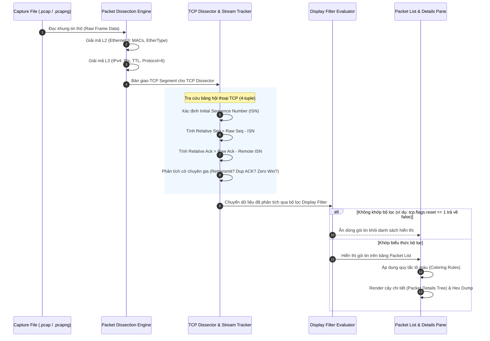

# 5_1_9 Packet Analysis with Wireshark

> **Khóa học**: Cloud DevOps Basic — Wire-Level Diagnostics  
> **Phân nhóm**: 5 Domain 5 - Wire-Level Network Inspection and Diagnostics › 5_1 Wire-Level Inspection and Diagnostic Toolkit  
> **Chủ đề**: Phân tích gói tin chuyên sâu với Wireshark: Giải phẫu cây giao thức, tái lập TCP Stream, bộ lọc hiển thị (Display Filters) và phân tích đồ thị hiệu năng (RTT / Window Scaling)  
> **Trạng thái**: Draft  
> **Checklist đối chiếu**: [5_1_9](../../../CHECKLIST.md#51-wire-level-inspection-and-diagnostic-toolkit)  

---

## 1. Khái Niệm Cốt Lõi & Bản Chất Kỹ Thuật (Core Concepts & Technical Deep Dive)

Trong khi các tiện ích dòng lệnh như `tcpdump` đóng vai trò là "máy thu âm tốc độ cao" ghi lại nguyên vẹn dòng dữ liệu nhị phân trên card mạng, thì **Wireshark** (tiền thân là Ethereal) là bộ công cụ phân tích giao thức mạng (Network Protocol Analyzer) tiêu chuẩn công nghiệp được sử dụng để giải mã, trực quan hóa và giải phẫu chi tiết từng byte dữ liệu đó.

Wireshark cung cấp khả năng hiểu sâu hàng nghìn giao thức mạng, hỗ trợ tái lập luồng truyền thông hai chiều (Stream Reassembly), tính toán các chỉ số độ trễ vòng lặp (Round Trip Time - RTT), phát hiện các bất thường tầng truyền vận (Retransmissions, Duplicate ACKs, Zero Window) và cung cấp giao diện đồ thị phân tích hiệu năng toàn diện.

---

### 1.1 Động Cơ Mổ Xẻ Giao Thức (Packet Dissection Engine) & Cây Phân Cấp Giao Thức

Trái tim của Wireshark là **Packet Dissection Engine** (Động cơ giải phẫu gói tin). Khi một tệp lưu trữ gói tin được nạp vào, động cơ này sẽ bóc tách dữ liệu nhị phân theo từng tầng giao thức từ thấp lên cao (từ Layer 2 Data Link đến Layer 7 Application):

```
+-------------------------------------------------------------------------------+
|               Cơ Chế Giải Phẫu Gói Tin Theo Tầng (Packet Dissection Tree)     |
|                                                                               |
|  [Frame] (Layer 1/2 Metadata: Frame Number, Wire Length, Timestamp)           |
|     │                                                                         |
|     └── [Ethernet II] (Layer 2: Source MAC, Destination MAC, Type: 0x0800)    |
|            │                                                                  |
|            └── [IPv4 / IPv6] (Layer 3: Src/Dst IP, TTL, Flags, Protocol: 6)   |
|                   │                                                           |
|                   └── [TCP / UDP] (Layer 4: Src/Dst Port, Seq, Ack, Flags)    |
|                          │                                                    |
|                          └── [Application Layer] (Layer 7: HTTP, TLS, DNS...) |
+-------------------------------------------------------------------------------+
```

1. **Nguyên lý hoạt động của Dissector**:
   - Mỗi giao thức trong Wireshark được quản lý bởi một module phân tích riêng biệt gọi là **Dissector**.
   - Dissector tầng dưới sau khi giải mã phần header của mình sẽ dựa vào trường chỉ định giao thức (chẳng hạn trường `EtherType = 0x0800` trong Ethernet Header chỉ định IPv4; trường `Protocol = 6` trong IPv4 Header chỉ định TCP; hoặc trường `Destination Port = 443` trong TCP Header chỉ định TLS) để chuyển tiếp phần tải trọng (payload) còn lại cho Dissector tầng kế tiếp xử lý.
2. **Cửa sổ Cây Phân Cấp Giao Thức (Protocol Hierarchy Window)**:
   - Được mở thông qua menu **Statistics → Protocol Hierarchy**, tính năng này quét toàn bộ tệp bắt gói và dựng nên một cây phân cấp hiển thị tỷ lệ phần trăm số gói tin (`% Packets`) và dung lượng byte (`% Bytes`) của từng giao thức xuất hiện trong quá trình bắt.
   - Đây là công cụ chẩn đoán đầu tiên mà kỹ sư DevOps sử dụng khi tiếp nhận một tệp bắt gói lớn để nhận diện ngay loại lưu lượng chiếm ưu thế (ví dụ: phát hiện lưu lượng UDP bất thường trong các cuộc tấn công DDoS DNS Amplification).

---

### 1.2 Định Dạng Tệp Bắt Gói: PCAP Cổ Điển vs PCAPNG (Next Generation)

Wireshark hỗ trợ hai định dạng tệp bắt gói tin phổ biến nhất hiện nay:

| Tiêu chí | Định dạng PCAP truyền thống (`.pcap`) | Định dạng PCAPNG (`.pcapng`) |
| :--- | :--- | :--- |
| **Cấu trúc tệp** | Gồm 1 Global Header duy nhất ở đầu tệp, theo sau là chuỗi các Record (Packet Header + Data). | Cấu trúc dạng khối linh hoạt (Block-based: Section Header Block, Interface Description Block, Enhanced Packet Block). |
| **Đa giao diện mạng** | Chỉ hỗ trợ ghi nhận từ **1 giao diện mạng duy nhất** trên mỗi tệp. | Hỗ trợ bắt gói đồng thời từ **nhiều giao diện mạng** trong cùng một tệp và phân định rõ gói tin đến từ cổng nào. |
| **Ghi chú & Metadata** | Không hỗ trợ thêm chú thích cho gói tin hoặc lưu tên card mạng. | Cho phép thêm ghi chú trực tiếp vào từng gói tin (Packet Comments), lưu thông tin hệ điều hành, tên card mạng và tốc độ link. |
| **Độ chính xác thời gian** | Mặc định lưu dấu thời gian ở độ phân giải Microsecond ($10^{-6}\text{ s}$). | Hỗ trợ dấu thời gian độ phân giải cao lên tới Nanosecond ($10^{-9}\text{ s}$) và có thể tùy biến cấu hình. |
| **Trạng thái hỗ trợ** | Được hỗ trợ rộng rãi bởi mọi công cụ di sản (legacy tools). | Là định dạng mặc định của Wireshark hiện đại và `tshark`. |

---

### 1.3 Cơ Chế Tái Lập Luồng TCP (TCP Reassembly) & Số Thứ Tự Tương Đối (Relative Sequence Numbers)

Khi truyền tải các tệp dữ liệu lớn (như phản hồi HTTP chứa văn bản JSON dài 50 KB hoặc tệp ảnh PNG), ngăn xếp TCP tại máy gửi sẽ chia nhỏ dữ liệu thành nhiều phân đoạn TCP (TCP Segments) phù hợp với giá trị MSS (Maximum Segment Size).

1. **TCP Stream Reassembly (Tái lập luồng TCP)**:
   - Wireshark theo dõi tiến trình của từng kết nối dựa trên 4-tuple: `(Source IP, Source Port, Destination IP, Destination Port)`.
   - Tính năng **TCP Reassembly** (cấu hình trong TCP Dissector Preferences) tự động sắp xếp các phân đoạn TCP bị phân mảnh hoặc đến không theo thứ tự (out-of-order) dựa vào trường `Sequence Number`, từ đó tái lập lại toàn bộ khối dữ liệu ứng dụng nguyên vẹn ở tầng Layer 7 (như hoàn chỉnh nội dung HTTP Response).
   - Kỹ sư có thể nhấp chuột phải vào gói tin và chọn **Follow → TCP Stream** để đọc toàn bộ cuộc hội thoại hai chiều dưới dạng văn bản thô hoặc mã hex (phía client gửi đi màu đỏ, phía server phản hồi màu xanh lam).

2. **Số thứ tự tương đối (Relative Sequence Numbers - `tcp.seq`)**:
   - Theo đặc tả RFC 9293, mỗi phiên TCP khi khởi tạo qua bắt tay 3 bước sẽ chọn một giá trị ngẫu nhiên 32-bit làm **Initial Sequence Number (ISN)** (ví dụ: `ISN = 2,845,190,412`) nhằm ngăn ngừa tấn công đoán số thứ tự (TCP Sequence Prediction Attack).
   - Nếu phải làm việc trực tiếp với các số nguyên 10 chữ số này, kỹ sư rất khó tính toán nhanh xem mỗi gói tin mang bao nhiêu byte dữ liệu và bên nhận đã xác nhận đến byte thứ mấy.
   - Mặc định, Wireshark bật tính năng **Analyze TCP sequence numbers**:
     $$\text{Relative Sequence Number} = \text{Raw Sequence Number} - \text{ISN}$$
   - Nhờ đó, gói tin SYN đầu tiên luôn có `Relative Seq = 0`, gói tin dữ liệu mang 1000 bytes tiếp theo sẽ có `Seq = 1`, và gói tin ACK kế tiếp sẽ xác nhận `Ack = 1001`.
   - Trường số thứ tự thực tế 32-bit gốc vẫn được lưu giữ và có thể truy vấn bằng bộ lọc `tcp.seq_raw`.

```
+------------------------------------------------------------------------------------+
|                Chuyển Đổi Sequence Number: Raw 32-bit sang Relative                |
|                                                                                    |
|  [Client]                                                         [Server]         |
|     │                                                                │             |
|     │── SYN (Raw Seq: 2845190412, Wireshark Relative Seq: 0) ───────>│ (Client ISN)  |
|     │                                                                │             |
|     │<─ SYN-ACK (Raw Seq: 1098234120, Wireshark Relative Seq: 0) ───│ (Server ISN)  |
|     │           (Raw Ack: 2845190413, Wireshark Relative Ack: 1)     │             |
|     │                                                                │             |
|     │── ACK (Raw Seq: 2845190413, Wireshark Relative Seq: 1) ───────>│ (Handshake   |
|     │       (Raw Ack: 1098234121, Wireshark Relative Ack: 1)         │  Complete)  |
|     │                                                                │             |
|     │── DATA [1460 bytes] (Relative Seq: 1, Next Expected Seq: 1461) >│             |
|     │                                                                │             |
|     │<─ ACK (Relative Ack: 1461, Đã nhận trọn vẹn 1460 bytes dữ liệu)│             |
+------------------------------------------------------------------------------------+
```

---

### 1.4 Ngôn Ngữ Bộ Lọc Hiển Thị (Display Filters Syntax)

Khác với bộ lọc bắt gói (Capture Filters) của `libpcap` chỉ được đánh giá trước khi ghi đĩa, **Display Filters** trong Wireshark được áp dụng sau khi gói tin đã được bắt và giải mã đầy đủ. Cú pháp Display Filter cho phép lọc trên mọi trường thuộc tính của mọi giao thức mà Wireshark hỗ trợ.

#### Toán tử so sánh và toán tử logic
Theo tài liệu chuẩn `wireshark-filter(4)`:
- **Toán tử so sánh**:
  - `==` hoặc `eq` (Bằng)
  - `!=` hoặc `ne` (Không bằng)
  - `>` hoặc `gt` (Lớn hơn)
  - `<` hoặc `lt` (Nhỏ hơn)
  - `>=` hoặc `ge` (Lớn hơn hoặc bằng)
  - `<=` hoặc `le` (Nhỏ hơn hoặc bằng)
- **Toán tử logic**:
  - `&&` hoặc `and` (Logic VÀ)
  - `||` hoặc `or` (Logic HOẶC)
  - `!` hoặc `not` (Logic PHỦ ĐỊNH)

#### Các bộ lọc chẩn đoán thông dụng trong môi trường Cloud & DevOps

| Mục đích chẩn đoán | Biểu thức Display Filter | Giải thích cơ chế |
| :--- | :--- | :--- |
| **Lọc theo địa chỉ IP** | `ip.addr == 192.168.1.1` | Khớp nếu IP nguồn HOẶC IP đích bằng `192.168.1.1`. |
| **Lọc chính xác IP nguồn** | `ip.src == 10.0.0.5` | Chỉ khớp các gói tin do máy chủ `10.0.0.5` phát đi. |
| **Lọc cổng TCP dịch vụ** | `tcp.port == 80` | Khớp nếu cổng TCP nguồn HOẶC cổng TCP đích là 80. |
| **Tìm gói ngắt kết nối RST** | `tcp.flags.reset == 1` | Bắt các gói tin TCP có cờ Reset được bật, dấu hiệu của lỗi kết nối từ chối (Connection Refused). |
| **Bắt đầu bắt tay TCP (SYN)** | `tcp.flags.syn == 1 && tcp.flags.ack == 0` | Chỉ bắt gói tin SYN đầu tiên trong tiến trình 3-way handshake, loại trừ gói phản hồi SYN-ACK. |
| **Phát hiện gói truyền lại** | `tcp.analysis.retransmission` | Cờ chuyên gia của Wireshark đánh dấu gói tin bị gửi lại do mất gói hoặc timeout trên đường truyền. |
| **Phát hiện xác nhận trùng** | `tcp.analysis.duplicate_ack` | Bắt các gói ACK trùng lặp, dấu hiệu cảnh báo mất gói phía nhận khiến client phát Fast Retransmit. |
| **Cảnh báo đầy bộ đệm nhận** | `tcp.analysis.zero_window` | Bên nhận gửi gói tin thông báo kích thước cửa sổ nhận bằng 0 (`Win=0`), không thể tiếp nhận thêm dữ liệu. |

---

### 1.5 Đồ Thị Phân Tích Hiệu Năng Luồng TCP (TCP Stream Analysis Graphs)

Khi điều tra sự cố suy giảm thông lượng mạng (Slow Network Performance), việc đọc từng dòng gói tin thô rất khó phát hiện ra xu hướng tổng thể. Menu **Statistics → TCP Stream Graphs** cung cấp các biểu đồ trực quan hóa dữ liệu luồng kết nối:

1. **Đồ thị Round Trip Time (RTT Graph)**:
   - Wireshark tính toán RTT dựa trên độ chênh lệch thời gian giữa thời điểm một phân đoạn mang dữ liệu (Data Segment) được truyền đi và thời điểm gói xác nhận tương ứng (ACK) từ phía đối tác quay trở về.
   - Đồ thị RTT vẽ giá trị thời gian trễ này theo trục thời gian hoặc theo số thứ tự gói tin. Sự xuất hiện của các gai nhọn (latency spikes) chỉ ra hiện tượng tắc nghẽn cục bộ trên các thiết bị định tuyến trung gian.
2. **Đồ thị Throughput (Thông lượng)**:
   - Trực quan hóa tốc độ truyền tải dữ liệu trung bình (Average Throughput) và thông lượng dữ liệu hữu ích (Goodput - không tính phần header và các gói retransmit) xuyên suốt vòng đời của phiên làm việc.
   - Giúp kỹ sư xác định thời điểm băng thông bị tụt dốc đột ngột để đối chiếu với các sự kiện hệ thống (như tiến trình backup dữ liệu bắt đầu chạy nền).
3. **Đồ thị Window Scaling (Cửa sổ nhận & Dữ liệu đang bay)**:
   - Hiển thị kích thước cửa sổ nhận được bên đối tác quảng bá (Receive Window Size - `tcp.window_size`) cùng lượng dữ liệu đã gửi đi nhưng chưa được ACK (Bytes in Flight).
   - Nếu đường "Bytes in Flight" liên tục chạm tới ngưỡng trần của "Receive Window", kết nối đang bị giới hạn bởi bộ đệm nhận của ứng dụng đối tác (Receive Window Constrained) chứ không phải do tắc nghẽn băng thông vật lý.
4. **Đồ thị Time-Sequence Graphs (tcptrace & Stevens)**:
   - Biểu đồ **Stevens** biểu diễn số thứ tự byte truyền theo thời gian, cho thấy nhịp điệu tăng trưởng dữ liệu tuyến tính hay bị gián đoạn.
   - Biểu đồ **tcptrace** cung cấp góc nhìn toàn diện nhất: hiển thị đồng thời số thứ tự gói đã gửi, tiến trình các gói ACK quay về, phạm vi cửa sổ nhận và đánh dấu trực tiếp các vị trí bị Fast Retransmit hoặc RTO (Retransmission Timeout).

---

## 2. Ví Dụ Đời Sống Thực Tế Dễ Hiểu (Intuitive Real-World Analogies)

```
+---------------------------------------------------------------------------------------+
|              Phép So Sánh: Máy Ghi Âm Dây Cáp vs Kính Hiển Vi Pháp Y Mạng             |
|                                                                                       |
|  [Đường Dây Cáp Mạng]                                                                 |
|         │                                                                             |
|         ▼ (tcpdump: Thu thập cuộn băng từ thô .pcap)                                  |
|  [Cuộn Băng Nhị Phân] ──────────────────────────────────────────────┐                 |
|                                                                     ▼                 |
|                                                     [Phòng Pháp Y Mạng Wireshark]     |
|                                                     +-------------------------------+ |
|                                                     | - Động cơ mổ xẻ cây giao thức | |
|                                                     | - Đánh số trang sách (Rel Seq)| |
|                                                     | - Máy vẽ điện tâm đồ (RTT/Win)| |
|                                                     | - Kính lọc màu sắc huỳnh quang| |
|                                                     +-------------------------------+ |
+---------------------------------------------------------------------------------------+
```

### 1. Kính hiển vi điện tử trong phòng pháp y số
Hãy coi `tcpdump` là chiếc **máy ghi âm ngoài hiện trường**: nó ghi lại tất cả âm thanh truyền trên dây một cách trung thực và lưu vào các cuộn băng cassette (`.pcap`). Nhưng để hiểu bản chất của một vụ án mạng, chuyên gia pháp y không thể chỉ bấm nút phát băng để nghe tạp âm. 

Họ đưa cuộn băng đó vào **phòng thí nghiệm Wireshark**. Tại đây, Wireshark hoạt động như một chiếc **kính hiển vi điện tử đa tầng**:
- Tầng kính 1: Bóc lớp vỏ bưu kiện bên ngoài (Ethernet MAC).
- Tầng kính 2: Đọc địa chỉ gửi nhận trên phong bì (IPv4/IPv6).
- Tầng kính 3: Mở hộp bảo quản an toàn (TCP/UDP).
- Tầng kính 4: Chiếu tia X đọc trực tiếp nội dung bức thư bên trong (HTTP JSON Payload).

### 2. Cuốn tiểu thuyết đánh số trang tương đối vs Mã vạch thư viện quốc gia
Nếu bạn mượn một cuốn tiểu thuyết 1000 trang từ thư viện, thư viện quốc gia gán cho cuốn sách này một mã định danh khổng lồ trong cơ sở dữ liệu: `Mã định danh bắt đầu từ số 2,845,190,412`. Khi bạn nói với bạn của mình: *"Tôi đang đọc đến đoạn hay ở mã số 2,845,190,450"*, người bạn đó sẽ phải lấy máy tính bỏ túi ra trừ đi để biết bạn mới đọc được đúng 38 trang!

Đó chính là lý do Wireshark sinh ra cơ chế **Relative Sequence Numbers**: Nó tự động quy đổi mã vạch thư viện quốc gia (Raw ISN) thành trang số `0`. Từ đó, bạn chỉ cần nhìn vào số thứ tự và biết ngay: *"Mình đã gửi đi 1460 chữ cái"* mà không cần thực hiện bất kỳ phép tính nhẩm phức tạp nào.

### 3. Máy vẽ điện tâm đồ tim mạch (ECG) cho dòng dữ liệu mạng
Khi bác sĩ kiểm tra sức khỏe của một vận động viên chạy marathon, họ không đo từng nhịp đập riêng lẻ bằng tay mà dán các điện cực để máy vẽ biểu đồ nhịp tim liên tục.

Các đồ thị **TCP Stream Graphs** trong Wireshark chính là chiếc **máy điện tâm đồ (ECG)** của mạng:
- **Đồ thị RTT**: Đo nhịp tim có đều đặn hay bị loạn nhịp (giật lag do router nghẽn).
- **Đồ thị Window Scaling**: Đo dung tích phổi của vận động viên (bộ đệm nhận của máy chủ) xem có đủ sức chứa dòng oxy dữ liệu đang ồ ạt đổ về hay đang bị ngạt thở.

---

## 3. Kiến Trúc, Luồng Hoạt Động & Hình Ảnh Trực Quan (Architecture, Diagrams & Visual Media)

Sơ đồ tuần tự dưới đây mô tả quá trình Wireshark bóc tách một gói tin TCP, tính toán Relative Sequence Numbers và đưa qua bộ lọc hiển thị Display Filter:



---

### Sơ Đồ Cây Mổ Xẻ Gói Tin (Protocol Tree Anatomy)

Dưới đây là cấu trúc trực quan của một gói tin HTTP GET truyền qua giao vận TCP được giải mã chi tiết trong cửa sổ Packet Details của Wireshark:

```
+───────────────────────────────────────────────────────────────────────────────────────────+
| Frame 12: 544 bytes on wire, 544 bytes captured on interface eth0                         |
+───────────────────────────────────────────────────────────────────────────────────────────+
  │
  ├──► Ethernet II, Src: 00:1a:2b:3c:4d:5e, Dst: 02:42:0a:00:00:01, Type: IPv4 (0x0800)
  │
  ├──► Internet Protocol Version 4, Src: 192.168.1.50, Dst: 93.184.216.34
  │     ├── Header Length: 20 bytes
  │     ├── Time to Live (TTL): 64
  │     ├── Protocol: TCP (6)
  │     └── Header Checksum: 0x4f12 [validation disabled]
  │
  ├──► Transmission Control Protocol, Src Port: 54321, Dst Port: 80, Seq: 1, Ack: 1
  │     ├── Sequence Number: 1    (relative sequence number)
  │     ├── [Raw Sequence Number: 2845190413]
  │     ├── Acknowledgment Number: 1    (relative ack number)
  │     ├── [Raw Acknowledgment Number: 1098234121]
  │     ├── Flags: 0x018 (PSH, ACK)
  │     ├── Window: 64240 (calculated window size)
  │     └── [SEQ/ACK analysis: tcp.analysis.initial_rtt = 0.024102s]
  │
  └──► Hypertext Transfer Protocol (Layer 7)
        ├── GET /index.html HTTP/1.1\r\n
        ├── Host: example.com\r\n
        └── User-Agent: curl/7.88.1\r\n
```

---

## 4. Thực Hành (Hands-on)

Phần này hướng dẫn các thao tác thực chiến với Wireshark trên giao diện người dùng và tự động hóa phân tích bằng công cụ dòng lệnh đồng hành `tshark` và `editcap`.

---

### 4.1 Khám Phá Cây Phân Cấp Giao Thức (Protocol Hierarchy)

Khi nhận được một tệp bắt gói tin sự cố từ đội ngũ vận hành:
1. Mở tệp PCAP/PCAPNG trong Wireshark: `File → Open` (hoặc phím tắt `Ctrl + O`).
2. Mở cửa sổ thống kê phân cấp: Truy cập menu **Statistics → Protocol Hierarchy**.
3. Quan sát kết quả:
   - Bảng hiển thị dạng cây thu gọn/mở rộng cho thấy toàn bộ các giao thức xuất hiện trong phiên bắt.
   - Nếu dòng `User Datagram Protocol (UDP)` chiếm trên 90% dung lượng byte của tệp mà hệ thống chỉ chạy dịch vụ Web (HTTP/HTTPS), đây là dấu hiệu rõ ràng của một cuộc tấn công từ chối dịch vụ hoặc cấu hình sai dịch vụ truyền thông.

---

### 4.2 Thực Chiến Lọc Gói Tin Với Bộ Lọc Hiển Thị (Display Filters)

Gõ các biểu thức sau vào thanh tìm kiếm màu xanh lục (Display Filter Bar) ở đầu cửa sổ Wireshark và nhấn `Enter`:

#### 1. Điều tra sự cố đứt kết nối hoặc từ chối kết nối
```text
tcp.flags.reset == 1
```
> *Tác dụng*: Lọc ra tất cả các gói tin mang cờ TCP RST. Giúp kỹ sư xác định chính xác thời điểm kết nối bị ngắt cưỡng bức và địa chỉ IP nào phát đi cờ reset này.

#### 2. Lọc các phiên bắt tay TCP mới tới cổng Web
```text
tcp.flags.syn == 1 && tcp.flags.ack == 0 && tcp.port == 443
```
> *Tác dụng*: Chỉ hiển thị các gói tin mở kết nối HTTPS mới tới cổng 443, loại bỏ hoàn toàn các gói dữ liệu đang truyền và các gói kết thúc phiên.

#### 3. Điều tra mạng chập chờn và mất gói tin
```text
tcp.analysis.retransmission || tcp.analysis.duplicate_ack
```
> *Tác dụng*: Gom toàn bộ các gói tin bị truyền lại (Retransmissions) và các gói xác nhận trùng lặp (Duplicate ACKs). Tỷ lệ xuất hiện dày đặc của bộ lọc này chứng minh chất lượng đường truyền vật lý hoặc các bộ định tuyến đang gặp sự cố quá tải.

#### 4. Tìm kiếm các sự cố tắc nghẽn bộ đệm nhận (Window Full / Zero Window)
```text
tcp.analysis.zero_window || tcp.analysis.window_full
```
> *Tác dụng*: Phát hiện các thời điểm mà ứng dụng phía nhận xử lý quá chậm khiến bộ đệm kernel socket bị đầy hoàn toàn, buộc phải phát gói tin Zero Window để chặn máy gửi truyền tiếp.

---

### 4.3 Xem Toàn Bộ Cuộc Hội Thoại Bằng "Follow TCP Stream"

1. Chọn bất kỳ gói tin TCP nào trong danh sách.
2. Nhấp chuột phải, chọn **Follow → TCP Stream** (hoặc `Ctrl + Alt + Shift + T`).
3. Một cửa sổ mới sẽ xuất hiện:
   - Wireshark tự động thiết lập bộ lọc hiển thị ngầm dạng `tcp.stream eq <index>`.
   - Toàn bộ dữ liệu payload được giải mã và nối lại theo đúng trình tự byte:
     - Dữ liệu client gửi (ví dụ: HTTP Request headers) hiển thị chữ **màu đỏ**.
     - Dữ liệu server phản hồi (ví dụ: HTTP Response headers và JSON body) hiển thị chữ **màu xanh lam**.
   - Kỹ sư có thể lưu toàn bộ nội dung luồng này ra tệp văn bản bằng nút `Save as...` để phục vụ báo cáo sự cố.

---

### 4.4 Phân Tích Đồ Thị Hiệu Năng Luồng (TCP Stream Graphs)

Để đo lường hiệu năng của một luồng tải dữ liệu lớn:
1. Nhấp chọn một gói tin thuộc luồng kết nối cần kiểm tra.
2. Mở menu **Statistics → TCP Stream Graphs → Round Trip Time Graph**.
   - Quan sát các chấm điểm trên đồ thị biểu thị thời gian RTT của từng phân đoạn.
   - Nếu RTT dao động ổn định ở mức 15 ms nhưng đột ngột nhảy vọt lên 400 ms tại một thời điểm nhất định, đây là bằng chứng kết nối bị ảnh hưởng bởi độ trễ hàng đợi (Queueing Delay) trên đường truyền.
3. Mở menu **Statistics → TCP Stream Graphs → Window Scaling**.
   - Kiểm tra xem đường biểu diễn kích thước cửa sổ nhận của máy chủ có bị suy giảm về 0 hay không.

---

### 4.5 Tự Động Hóa Chẩn Đoán Dòng Lệnh Với TShark & Editcap

Trong môi trường máy chủ Cloud (Linux Server không cài giao diện đồ họa), kỹ sư sử dụng bộ công cụ dòng lệnh chính thức đi kèm Wireshark:

#### 1. Đọc và lọc tệp bắt gói với `tshark`
Theo hướng dẫn `tshark(1)`, tham số `-r` dùng để đọc tệp và tham số `-Y` dùng để áp dụng bộ lọc hiển thị:

```bash
# Lọc toàn bộ các gói tin bị TCP Reset từ tệp capture.pcap
tshark -r capture.pcap -Y "tcp.flags.reset == 1"
```

#### 2. Trích xuất chính xác các trường dữ liệu ra định dạng bảng
Sử dụng tham số `-T fields` kết hợp các cờ `-e <field_name>` để trích xuất dữ liệu phục vụ viết kịch bản phân tích tự động:

```bash
# Trích xuất Thời gian, IP nguồn, IP đích, Cổng đích và Cờ TCP của các kết nối lỗi
tshark -r capture.pcap -Y "tcp.flags.reset == 1" \
  -T fields \
  -e frame.time \
  -e ip.src \
  -e ip.dst \
  -e tcp.dstport \
  -E header=y \
  -E separator=,
```

#### 3. Xuất luồng dữ liệu đã lọc sang tệp mới
```bash
# Trích xuất riêng lưu lượng cổng 80 và 443 sang tệp web_traffic.pcapng
tshark -r full_capture.pcap -Y "tcp.port == 80 || tcp.port == 443" -w web_traffic.pcapng
```

#### 4. Cắt nhỏ tệp bắt gói tin dung lượng lớn bằng `editcap`
Theo tài liệu `editcap(1)`, việc nạp tệp PCAP dung lượng hàng gigabyte vào Wireshark GUI sẽ gây tràn bộ nhớ. Kỹ sư sử dụng `editcap` để chia nhỏ tệp:

```bash
# Chia nhỏ tệp huge_dump.pcap thành nhiều tệp con, mỗi tệp chứa tối đa 100,000 gói tin
editcap -c 100000 huge_dump.pcap chunked_capture.pcap

# Hoặc chia nhỏ tệp theo khoảng thời gian, mỗi tệp đại diện cho 300 giây (5 phút) lưu lượng
editcap -i 300 huge_dump.pcap interval_capture.pcap
```

---

## 5. Cạm Bẫy Thực Tế & Thực Tiễn Sản Xuất (Production Gotchas & Best Practices)

---

### 5.1 Cạm Bẫy Nhầm Lẫn Giữa Capture Filter (BPF) và Display Filter (Wireshark)

Đây là lỗi phổ biến nhất của các kỹ sư chuyển đổi giữa `tcpdump` và `Wireshark`:
- **Capture Filter (BPF)**:
  - Cú pháp: Dựa trên thư viện `libpcap` (ví dụ: `src host 10.0.0.1 and port 80`).
  - Thời điểm áp dụng: Đánh giá trực tiếp trong nhân Linux (kernel) **trước khi gói tin được bắt và ghi xuống đĩa**.
  - Không hỗ trợ các trường giao thức phức tạp ở tầng ứng dụng hoặc các cờ phân tích trạng thái như `tcp.analysis.retransmission`.
- **Display Filter**:
  - Cú pháp: Cú pháp riêng biệt của Wireshark với toán tử quan hệ C-like (ví dụ: `ip.src == 10.0.0.1 && tcp.port == 80`).
  - Thời điểm áp dụng: Đánh giá trong không gian người dùng (user space) **sau khi toàn bộ dữ liệu đã được nạp và giải mã đầy đủ**.
- **Hậu quả**: Nếu bạn nhập cú pháp Capture Filter (`port 80`) vào thanh Display Filter của Wireshark hoặc nhập `tcp.port == 80` vào tham số dòng lệnh `-f` của `tcpdump`, câu lệnh sẽ báo lỗi cú pháp ngay lập tức.

---

### 5.2 Cạm Bẫy Đối Chiếu Sequence Number Giữa Wireshark và tcpdump

- **Hiện tượng**: Kỹ sư mở tệp PCAP bằng `tcpdump -r trace.pcap` và thấy gói tin mang số thứ tự `seq 3491820145:3491821605`. Tuy nhiên khi mở cùng tệp đó trong Wireshark, gói tin lại hiển thị `Sequence Number: 1461`. Kỹ sư hoang mang cho rằng một trong hai công cụ đọc sai dữ liệu.
- **Bản chất**: Wireshark mặc định trừ đi giá trị Initial Sequence Number (ISN) để hiển thị **Relative Sequence Number** bắt đầu từ 0. Trong khi đó, `tcpdump` mặc định hiển thị giá trị thô 32-bit (**Raw Sequence Number**), trừ khi có cờ đặc biệt.
- **Thực tiễn tốt nhất**:
  - Khi đối chiếu chéo giữa log máy chủ/tcpdump và Wireshark, hãy mở mục `Transmission Control Protocol` trong cửa sổ Packet Details của Wireshark và xem dòng `[Raw Sequence Number]` (hoặc sử dụng trường lọc `tcp.seq_raw`).
  - Hoặc trong Wireshark, vào `Edit → Preferences → Protocols → TCP` và tạm thời bỏ chọn ô `Relative sequence numbers`.

---

### 5.3 Cạm Bẫy Mở Tệp PCAP Khổng Lồ Gây Treo Máy & Tràn Bộ Nhớ (OOM Crash)

- **Nguy cơ**: Một tệp PCAP dung lượng 5 GB được thu thập từ máy chủ Production trong 10 phút. Nếu kỹ sư cố gắng mở trực tiếp tệp này bằng giao diện đồ họa Wireshark, tiến trình sẽ tiêu tốn từ 15 GB đến 25 GB RAM (do Wireshark phải duy trì cấu trúc cây phân tích trạng thái, bảng hội thoại và bảng bóc tách gói cho từng khung tin trong bộ nhớ). Kết quả là máy trạm bị đơ hoàn toàn hoặc tiến trình bị hệ điều hành tiêu diệt (OOM Kill).
- **Thực tiễn tốt nhất**:
  - **Không bao giờ mở tệp PCAP > 1 GB trực tiếp trên Wireshark GUI**.
  - Sử dụng **`editcap -c 100000`** để cắt nhỏ tệp thành các mảnh nhỏ trước khi phân tích.
  - Sử dụng **`tshark`** kết hợp cờ lọc `-Y` để trích xuất riêng luồng dữ liệu gặp sự cố sang một tệp nhỏ hơn:
    ```bash
    tshark -r large_capture.pcap -Y "ip.addr == 10.0.0.15 && tcp.flags.reset == 1" -w incident_subset.pcap
    ```

---

### 5.4 Cạm Bẫy Báo Động Giả Checksum Sai (TCP Checksum Offloading)

- **Hiện tượng**: Khi phân tích tệp bắt gói bắt trực tiếp trên máy chủ gửi dữ liệu, Wireshark bôi đỏ toàn bộ các gói tin phát đi với cảnh báo nghiêm trọng: `[TCP Checksum Incorrect]`. Kỹ sư nghi ngờ card mạng bị lỗi phần cứng hoặc dữ liệu bị biến đổi trên đường truyền.
- **Bản chất**: Trên các hệ điều hành và card mạng hiện đại, tính năng **TCP Checksum Offloading (Tx Checksum)** được bật mặc định. Nhân hệ điều hành giao phó hoàn toàn việc tính toán giá trị checksum cho bộ vi xử lý của card mạng (NIC hardware). Khi `tcpdump` hoặc Wireshark bắt gói tin tại tầng socket driver, card mạng chưa kịp tính checksum nên giá trị trong header tạm thời bằng `0x0000` hoặc dữ liệu rác. Khi gói tin thực sự rời khỏi cổng mạng vật lý, checksum hợp lệ mới được ghi vào.
- **Thực tiễn tốt nhất**:
  - Hiểu rõ rằng lỗi checksum trên các gói tin **gửi đi từ chính máy chủ bắt gói** hầu như luôn là báo động giả.
  - Trong Wireshark, có thể tắt cảnh báo này bằng cách vào `Edit → Preferences → Protocols → TCP` và bỏ chọn ô `Validate the TCP checksum if possible`.

---

### 5.5 Rủi Ro Bảo Mật Dữ Liệu Cá Nhân & Thông Tin Nhạy Cảm (PII)

- **Nguy cơ**: Tệp PCAP lưu giữ toàn bộ dữ liệu truyền trên dây cáp mạng. Nếu hệ thống truyền thông điệp không mã hóa hoặc phiên bắt gói thu thập cả các gói TLS trước khi mã hóa (hoặc giải mã TLS thông qua Session Key), các thông tin nhạy cảm như Authorization Headers, Session Cookies, mật khẩu Database và thông tin cá nhân khách hàng (PII) sẽ hiển thị công khai trong phần Follow TCP Stream.
- **Thực tiễn tốt nhất**:
  - Tuân thủ nguyên tắc đặc quyền tối thiểu (Least Privilege): Chỉ thu thập gói tin khi có yêu cầu điều tra sự cố cụ thể và có phê duyệt.
  - Phân quyền nghiêm ngặt tệp bắt gói (`chmod 600`) và xóa vĩnh viễn tệp sau khi hoàn thành phiên chẩn đoán.

---

## 6. Câu Hỏi Củng Cố Kiến Thức (Active Recall Quiz)

---

### Câu hỏi 1: Phân tích sự cố suy giảm thông lượng (Throughput Degradation) qua đồ thị TCP

Một ứng dụng tải tệp sao lưu dữ liệu từ cụm Kubernetes sang máy chủ lưu trữ Storage Node qua kết nối mạng 10 Gbps. Tốc độ truyền tải thực tế chỉ đạt trung bình 25 Mbps dù băng thông đường truyền hoàn toàn thông suốt và mức sử dụng CPU/RAM trên cả hai cụm máy chủ đều dưới 20%.

Kỹ sư DevOps thực hiện bắt gói tin và mở đồ thị **Window Scaling** cùng **RTT Graph** trong Wireshark. Kỹ sư phát hiện:
1. Giá trị RTT đo được duy trì cực kỳ ổn định ở mức 40 ms không có hiện tượng mất gói hay tăng vọt.
2. Đường biểu diễn `Bytes in Flight` liên tục vọt lên và bị chặn cứng tại giá trị 65,535 bytes (đúng bằng giá trị `Calculated Window Size` do Storage Node quảng bá).
3. Trong các gói tin bắt tay 3 bước (SYN và SYN-ACK), không có tùy chọn `Window Scale (RFC 7323)` nào xuất hiện trong phần TCP Options.

Giải thích nguyên nhân gốc rễ giới hạn tốc độ truyền tải và xác định giá trị thông lượng tối đa lý thuyết mà kết nối này có thể đạt được.

<details>
<summary>Đáp án chi tiết</summary>

1. **Nguyên nhân cốt lõi**:
   - Kết nối bị giới hạn bởi **cửa sổ nhận tối đa của TCP khi thiếu tính năng Window Scaling**.
   - Trường Window Size trong TCP Header tiêu chuẩn chỉ có độ dài 16 bits, cho phép chỉ định kích thước cửa sổ nhận tối đa là $2^{16} - 1 = 65,535\text{ bytes}$ (khoảng 64 KB).
   - Do thiếu tùy chọn mở rộng cửa sổ nhận (`TCP Window Scale Option` theo RFC 7323) trong quá trình bắt tay SYN/SYN-ACK, máy gửi chỉ được phép gửi tối đa 65,535 bytes dữ liệu rồi bắt buộc phải dừng lại chờ bên nhận gửi gói ACK quay về xác nhận mới được truyền tiếp.
2. **Tính toán thông lượng lý thuyết**:
   - Theo công thức thông lượng giới hạn bởi độ trễ (Bandwidth-Delay Product limitation):
     $$\text{Throughput}_{\text{max}} = \frac{\text{Receive Window Size}}{\text{RTT}} = \frac{65,535\text{ bytes} \times 8\text{ bits/byte}}{0.040\text{ seconds}} \approx \frac{524,280\text{ bits}}{0.040\text{ s}} \approx 13,107,000\text{ bps} \approx 13.1\text{ Mbps}$$
   - Con số này hoàn toàn khớp với mức thông lượng thực tế nghèo nàn quan sát được.
3. **Giải pháp khắc phục**:
   - Bật tùy chọn TCP Window Scaling trên hệ điều hành của Storage Node bằng cách cấu hình tham số nhân Linux:
     ```bash
     sudo sysctl -w net.ipv4.tcp_window_scaling=1
     ```
   - Khi tùy chọn này được kích hoạt, giá trị cửa sổ nhận có thể được nhân với hệ số lũy thừa bậc 2 (lên tới hệ số $2^{14} = 16,384$), cho phép kích thước cửa sổ nhận mở rộng lên tới 1 GB, giúp lấp đầy hoàn toàn đường truyền 10 Gbps.
</details>

---

### Câu hỏi 2: Xây dựng biểu thức Display Filter phát hiện tấn công giả mạo TCP RST

Trong một cuộc điều tra an ninh mạng sau sự cố dịch vụ API nội bộ liên tục bị ngắt kết nối bí ẩn, nhóm bảo mật nghi ngờ có một thiết bị trung gian độc hại (hoặc cấu hình firewall lỗi) đang chèn các gói tin ngắt kết nối giả mạo (Injected TCP Reset Packets).

Một gói tin bị nghi ngờ là giả mạo nếu thỏa mãn đồng thời các điều kiện sau:
1. Gói tin mang cờ TCP RST được bật.
2. Gói tin phát sinh từ dải mạng con văn phòng `192.168.10.0/24`.
3. Gói tin nhắm tới dịch vụ cơ sở dữ liệu lắng nghe trên cổng TCP `5432`.
4. Gói tin có giá trị Time to Live (TTL) trên IP Header nhỏ hơn 30 (dấu hiệu gói tin bị làm giả với số hop dị thường so với các gói tin hợp lệ vốn có TTL ban đầu là 64).

Hãy viết biểu thức Wireshark Display Filter chuẩn xác để cô lập duy nhất các gói tin này.

<details>
<summary>Đáp án chi tiết</summary>

1. **Biểu thức Display Filter chuẩn xác**:
   ```text
   tcp.flags.reset == 1 && ip.src == 192.168.10.0/24 && tcp.dstport == 5432 && ip.ttl < 30
   ```
2. **Phân tích từng thành phần của biểu thức**:
   - `tcp.flags.reset == 1`: Kiểm tra bit thứ 2 của trường cờ TCP Header có giá trị bằng 1 (cờ RST bật).
   - `ip.src == 192.168.10.0/24`: Wireshark hỗ trợ cú pháp định tuyến CIDR trực tiếp trong Display Filter để so khớp toàn bộ dải mạng nguồn từ `192.168.10.1` đến `192.168.10.254`.
   - `tcp.dstport == 5432`: Chỉ đích danh cổng đích của giao vận TCP là cổng PostgreSQL (5432). Không dùng `tcp.port == 5432` vì sẽ bắt nhầm cả chiều phản hồi.
   - `ip.ttl < 30`: Sử dụng toán tử so sánh nhỏ hơn (`<` hoặc `lt`) trên trường Time to Live của IPv4 Header để bắt các giá trị TTL dị thường.
   - Toàn bộ các mệnh đề được liên kết chặt chẽ bằng toán tử logic VÀ (`&&` hoặc `and`).
</details>

---

### Câu hỏi 3: Phân biệt cơ chế bắt gói tin và xử lý bộ nhớ giữa Wireshark và TShark / Editcap

Một kỹ sư quản trị hệ thống nhận được tệp bắt gói tin sự cố mạng tổng dung lượng 12 GB mang tên `core_switch_dump.pcapng` ghi lại toàn bộ lưu lượng của trung tâm dữ liệu trong 30 phút. 

Kỹ sư cần trích xuất danh sách tất cả các địa chỉ IP nguồn đã gửi yêu cầu DNS (cổng UDP 53) có thời gian phản hồi vượt quá 200 ms.

1. Tại sao việc mở trực tiếp tệp này trên phần mềm Wireshark cài trên máy tính xách tay cá nhân (RAM 16 GB) gần như chắc chắn sẽ thất bại?
2. Trình bày quy trình 2 bước sử dụng công cụ dòng lệnh `editcap` và `tshark` trên máy chủ để hoàn thành nhiệm vụ này mà không làm quá tải bộ nhớ hệ thống.

<details>
<summary>Đáp án chi tiết</summary>

1. **Nguyên nhân Wireshark GUI thất bại**:
   - Khi Wireshark mở một tệp bắt gói tin, nó không chỉ đơn thuần nạp các byte nhị phân vào bộ nhớ mà phải khởi tạo cấu trúc dữ liệu đồ thị phức tạp trong RAM cho từng khung tin: giải mã cây giao thức, lưu vết trạng thái từng luồng kết nối TCP/UDP, bảng phân giải tên miền và chỉ mục tìm kiếm.
   - Hệ số giãn nở bộ nhớ của Wireshark thường dao động từ gấp 3 đến gấp 5 lần kích thước tệp đĩa. Một tệp 12 GB sẽ đòi hỏi từ 36 GB đến 60 GB bộ nhớ RAM khả dụng.
   - Trên máy tính có 16 GB RAM, hệ điều hành sẽ cạn kiệt bộ nhớ vật lý, buộc phải dùng swap gây đóng băng toàn bộ hệ thống hoặc kích hoạt tiến trình OOM Killer tiêu diệt Wireshark.
2. **Quy trình xử lý dòng lệnh tối ưu**:
   - **Bước 1**: Sử dụng `tshark` với chế độ Single Pass (chạy trực tiếp trên tệp đĩa theo luồng tuần hoàn stream, không lưu toàn bộ cây gói tin vào RAM) để lọc riêng lưu lượng UDP 53 ra một tệp con nhỏ:
     ```bash
     tshark -r core_switch_dump.pcapng -Y "udp.port == 53" -w dns_subset.pcapng
     ```
     Thao tác này loại bỏ 95% lưu lượng không liên quan, đưa dung lượng tệp từ 12 GB xuống còn vài chục megabyte.
   - **Bước 2**: Trích xuất dữ liệu IP nguồn và thời gian phản hồi DNS bằng `tshark`:
     ```bash
     tshark -r dns_subset.pcapng -Y "dns.time > 0.2" -T fields -e ip.src -e dns.time -E header=y
     ```
   - Trong trường hợp muốn chia nhỏ tệp ban đầu thành các phần 500,000 gói tin để nhiều kỹ sư cùng phân tích song song trên máy tính cá nhân, kỹ sư sử dụng công cụ `editcap`:
     ```bash
     editcap -c 500000 core_switch_dump.pcapng split_part.pcapng
     ```
</details>

---

## 7. 📚 Nguồn Tài Liệu Chính Thống (Tier-1 Official References)

- [Wireshark User's Guide: Protocol Hierarchy Window](https://www.wireshark.org/docs/wsug_html_chunked/ChStatHierarchy.html) — Tài liệu chính thức từ Wireshark Foundation mô tả kiến trúc cây phân cấp giao thức và phương pháp phân tích thống kê phân bổ lưu lượng theo tầng.
- [Wireshark User's Guide: TCP Analysis Arguments](https://www.wireshark.org/docs/wsug_html_chunked/ChAdvTCPAnalysis.html) — Đặc tả kỹ thuật chính thức về cơ chế phân tích nâng cao của TCP Dissector, tái lập luồng truyền thông (TCP Reassembly), số thứ tự tương đối (Relative Sequence Numbers) và danh mục các cờ cảnh báo chuyên gia (`tcp.analysis.*`).
- [Wireshark User's Guide: TCP Stream Graphs](https://www.wireshark.org/docs/wsug_html_chunked/ChStatTCPStreamGraphs.html) — Hướng dẫn chi tiết về các loại đồ thị hiệu năng luồng TCP: Round Trip Time (RTT), Throughput, Window Scaling và Time-Sequence Graph (Stevens / tcptrace).
- [Wireshark Manual Pages: wireshark-filter(4) - Display Filter Syntax](https://www.wireshark.org/docs/man-pages/wireshark-filter.html) — Cẩm nang đặc tả toàn diện cú pháp bộ lọc hiển thị (Display Filters), danh mục toán tử quan hệ (`==`, `!=`, `<`, `<=`, `>`, `>=`), toán tử logic (`&&`, `||`, `!`) và các quy tắc so khớp trường dữ liệu.
- [Wireshark Manual Pages: tshark(1) - Dump and Analyze Network Traffic](https://www.wireshark.org/docs/man-pages/tshark.html) — Tài liệu tham chiếu chuẩn xác cho công cụ dòng lệnh TShark, bao gồm các cờ đọc ghi tệp (`-r`, `-w`), áp dụng bộ lọc hiển thị (`-Y`) và định dạng trích xuất trường dữ liệu (`-T fields -e`).
- [Wireshark Manual Pages: editcap(1) - Edit and Translate Capture Files](https://www.wireshark.org/docs/man-pages/editcap.html) — Hướng dẫn vận hành công cụ Editcap chuyên dụng để chia tách, cắt nhỏ và chuyển đổi tệp PCAP/PCAPNG theo số lượng gói (`-c`) hoặc chu kỳ thời gian (`-i`).
