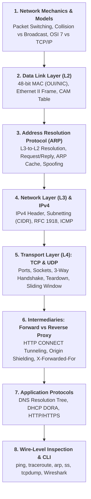
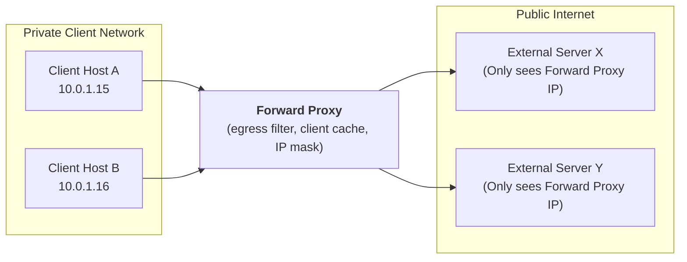
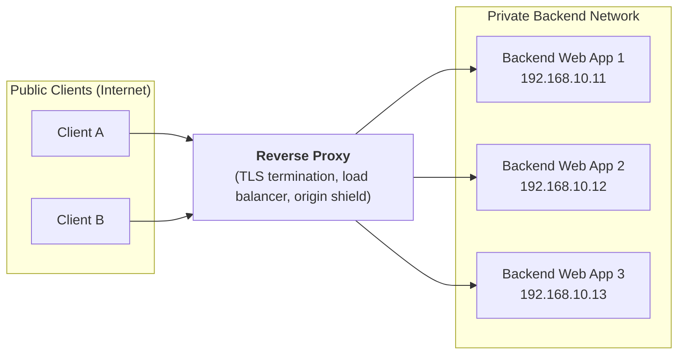

# 🌐 Computer Networking: Core Fundamentals Roadmap

> **Domain**: Computer Networking Architecture & Protocol Engineering  
> **Tracker Link**: [Return to Master Checklist](../CHECKLIST.md#domain-2-computer-networking-core-fundamentals-33-items)  
> **Authoritative References**: RFC Standards (IETF) | *Computer Networking: A Top-Down Approach* (Kurose & Ross) | [roadmap.sh/network-engineer](https://roadmap.sh/network-engineer)

---

## 🗺️ Visual Curriculum Roadmap



---

## 📚 Detailed Study Modules

### Module 1: Network Mechanics, OSI 7-Layer & TCP/IP Models
1. **How Networks Transfer Data**:
   - **Packet Switching vs. Circuit Switching**: Circuit switching (traditional telephony) reserves dedicated end-to-end physical circuits regardless of idle time. Packet switching (the Internet) chunks data into discrete packets multiplexed over shared links (Store-and-Forward transmission).
   - **Key Latency Components**: Total Delay = Propagation Delay + Transmission Delay + Queuing Delay + Processing Delay.
2. **Collision Domains vs. Broadcast Domains**:
   - **Collision Domain**: A network segment where packet collisions can occur if two devices transmit simultaneously. Hubs (Layer 1) extend collision domains; Switches (Layer 2) provide dedicated full-duplex links, breaking collision domains per port.
   - **Broadcast Domain**: A network segment where a broadcast frame (`FF:FF:FF:FF:FF:FF`) sent by one host reaches all other hosts. Switches forward broadcasts across all ports; Routers (Layer 3) stop broadcasts, defining broadcast boundaries.
3. **The OSI 7-Layer Model**:
   - **Layer 7: Application**: User-facing network protocols (HTTP, DNS, SSH, SMTP).
   - **Layer 6: Presentation**: Data serialization, character encoding (ASCII/UTF-8), compression, and encryption.
   - **Layer 5: Session**: Dialog control, establishing and terminating communication sessions between applications.
   - **Layer 4: Transport**: End-to-end communication, port addressing, reliability, flow control, and error recovery (TCP, UDP). **PDU: Segment / Datagram**.
   - **Layer 3: Network**: Logical device addressing, packet routing across intermediate networks (IPv4, IPv6, ICMP). **PDU: Packet**.
   - **Layer 2: Data Link**: Physical frame framing, physical hardware addressing (MAC), switch forwarding, and link error detection. **PDU: Frame**.
   - **Layer 1: Physical**: Transmission of raw unstructured bit streams over physical media (electrical pulses, optical light, radio waves). **PDU: Bits**.
4. **Data Encapsulation & Decapsulation Flow**:
   - **Sender (Encapsulation)**: Data $\rightarrow$ Add L4 Port Header $\rightarrow$ Add L3 IP Header $\rightarrow$ Add L2 MAC Header + FCS CRC Trailer $\rightarrow$ Transmit as L1 Bits.
   - **Receiver (Decapsulation)**: Receive L1 Bits $\rightarrow$ Validate L2 Frame CRC & MAC $\rightarrow$ Route L3 Packet & Validate IP Checksum $\rightarrow$ Reassemble L4 TCP Stream $\rightarrow$ Deliver Payload to Application Buffer.

---

### Module 2: Data Link Layer (L2), MAC Addresses & Ethernet Frames
1. **MAC Address Structure (IEEE 802)**:
   - A 48-bit (6-byte) burned-in hardware address formatted as 12 hexadecimal digits (e.g., `00:1A:2B:3C:4D:5E`).
   - **First 24 bits (3 bytes)**: **OUI (Organizationally Unique Identifier)** assigned by IEEE to the hardware manufacturer (e.g., Cisco, Intel, Apple).
   - **Last 24 bits (3 bytes)**: **NIC Specific / Extension Identifier** assigned by the manufacturer to uniquely identify the interface.
   - **Special Addresses**:
     - Broadcast MAC: `FF:FF:FF:FF:FF:FF` (all 48 bits set to 1).
     - Multicast MAC: Lowest-order bit of the first byte is set to `1` (e.g., `01:00:5E:xx:xx:xx` for IPv4 multicast).
2. **Ethernet II Frame Structure**:
   ```text
   +----------+-----+-------------+------------+-----------+-------------------+---------+
   | Preamble | SFD | Destination | Source MAC | EtherType | Payload Data      | FCS     |
   | (7 B)    | (1B)| MAC (6 B)   | (6 B)      | (2 B)     | (46 - 1500 Bytes) | CRC (4B)|
   +----------+-----+-------------+------------+-----------+-------------------+---------+
   ```
   - **Preamble & SFD**: 8 bytes of alternating bits (`10101010...10101011`) for hardware clock synchronization.
   - **Destination & Source MAC**: 6 bytes each identifying sender and recipient NICs.
   - **EtherType**: 2-byte field specifying the encapsulated network layer protocol (`0x0800` = IPv4, `0x0806` = ARP, `0x86DD` = IPv6).
   - **Payload**: Minimum 46 bytes, maximum 1500 bytes (standard Ethernet MTU).
   - **FCS (Frame Check Sequence)**: 4-byte CRC-32 checksum to detect wire corruption. Corrupted frames are silently dropped by the receiving NIC.
3. **Switches vs. Hubs & The MAC Learning Process**:
   - A switch inspects the **Source MAC** of every incoming frame to dynamically populate its **CAM Table (Content Addressable Memory / MAC Address Table)** mapping MAC $\rightarrow$ Physical Port.
   - **Forwarding Logic**:
     - If Destination MAC is in CAM table $\rightarrow$ Forward frame strictly out of that specific port.
     - If Destination MAC is unknown $\rightarrow$ Execute **Unknown Unicast Flooding** (forward frame out of all ports except the incoming port).
     - If Destination MAC is `FF:FF:FF:FF:FF:FF` $\rightarrow$ Flood frame out of all ports.

---

### Module 3: Address Resolution Protocol (ARP, RFC 826)
1. **The Need for ARP**:
   An application knows the target host's logical IP address (e.g., `192.168.1.10`), but Ethernet switches only understand physical MAC addresses. ARP translates Layer 3 IPs to Layer 2 MACs on the local link.
2. **ARP Message Exchange**:
   - **Step 1: ARP Request (Broadcast)**: Host A broadcasts an Ethernet frame (`Destination MAC: FF:FF:FF:FF:FF:FF`) asking: *"Who has IP 192.168.1.10? Tell 192.168.1.5 at 00:11:22:33:44:55"*. Every host in the broadcast domain processes this frame.
   - **Step 2: ARP Reply (Unicast)**: The target host (192.168.1.10) recognizes its IP and replies directly to Host A's MAC address with a unicast frame: *"192.168.1.10 is at 66:77:88:99:AA:BB"*.
   - **Step 3: Cache Storage**: Host A stores the mapping in its local **ARP Cache** to avoid repeating the broadcast for future packets.
3. **Gratuitous ARP & ARP Spoofing**:
   - **Gratuitous ARP**: A host broadcasts an ARP request for its own IP to notify the LAN of a MAC address change or detect duplicate IP address conflicts.
   - **ARP Cache Poisoning / Spoofing**: Because ARP has no cryptographic authentication, an attacker can send unsolicited fake ARP replies associating the Default Gateway's IP with the attacker's MAC address, routing all outbound local traffic through the attacker (Man-in-the-Middle).

---

### Module 4: Network Layer (L3), IPv4 Header & Subnetting Math
1. **IPv4 Header Anatomy (RFC 791)**:
   Standard header is 20 bytes (without options):
   - **Version (4 bits)**: Set to `4`.
   - **IHL (Internet Header Length, 4 bits)**: Number of 32-bit words in header (minimum 5, representing $5 \times 4 = 20$ bytes).
   - **Total Length (16 bits)**: Total packet size (header + data) in bytes (max 65,535 bytes).
   - **Identification, Flags, Fragment Offset (32 bits)**: Used for packet fragmentation when payload exceeds link MTU. Flags: `DF` (Don't Fragment), `MF` (More Fragments).
   - **Time to Live (TTL, 8 bits)**: Hop counter decremented by 1 at every router. When TTL reaches 0, the packet is discarded and an ICMP Time Exceeded message is sent back to the sender. Prevents infinite packet looping.
   - **Protocol (8 bits)**: Indicates encapsulated transport protocol (`1` = ICMP, `6` = TCP, `17` = UDP).
   - **Header Checksum (16 bits)**: Error detection for header fields only (recomputed at every hop due to TTL decrement).
   - **Source & Destination IP Addresses**: 32 bits (4 bytes) each.
2. **Subnetting & CIDR Math**:
   - **CIDR Notation `/N`**: $N$ bits identify the Network, $32 - N$ bits identify Hosts.
   - **Subnet Calculations**:
     - Total IP Addresses = $2^{(32 - N)}$.
     - Usable Host Addresses = $2^{(32 - N)} - 2$ (subtracting Network ID and Broadcast ID).
     - **Network ID**: Bitwise AND of IP Address and Subnet Mask.
     - **Broadcast ID**: Network ID with all host bits set to `1`.
     - *Quick Example for `192.168.1.130/26`*:
       - Subnet Mask: `/26` = 26 ones = `255.255.255.192`.
       - Host bits: $32 - 26 = 6$. Total IPs = $2^6 = 64$.
       - Block increments of 64: `0`, `64`, `128`, `192`.
       - Network ID: `192.168.1.128`.
       - Broadcast Address: `192.168.1.191`.
       - Usable Host Range: `192.168.1.129` to `192.168.1.190` (62 usable hosts).
3. **RFC 1918 Private IP Ranges**:
   - `10.0.0.0/8` (10.0.0.0 – 10.255.255.255, 16.7M IPs).
   - `172.16.0.0/12` (172.16.0.0 – 172.31.255.255, 1M IPs).
   - `192.168.0.0/16` (192.168.0.0 – 192.168.255.255, 65,536 IPs).
4. **Default Gateway Routing Decision**:
   - When a host sends a packet to target IP $D$:
     - Host computes: $\text{Local Network} = \text{Host IP} \ \& \ \text{Subnet Mask}$.
     - Host computes: $\text{Target Network} = D \ \& \ \text{Subnet Mask}$.
     - If $\text{Local Network} == \text{Target Network}$ $\rightarrow$ Destination is on local LAN. Send ARP request for $D$ and transmit frame directly to $D$'s MAC address.
     - If $\text{Local Network} \ne \text{Target Network}$ $\rightarrow$ Destination is on remote network. Send ARP request for the **Default Gateway** and transmit frame to the Gateway's MAC address with destination IP unchanged.

---

### Module 5: Transport Layer (L4): TCP & UDP
1. **Ports & Sockets**:
   - Ports are 16-bit unsigned integers ($0–65535$) identifying specific application processes on a host:
     - Well-Known Ports ($0–1023$): 22 (SSH), 53 (DNS), 80 (HTTP), 443 (HTTPS).
     - Registered Ports ($1024–49151$): Database and application services.
     - Ephemeral Ports ($49152–65535$): Dynamically allocated by OS for outbound client connections.
   - **Socket 4-Tuple**: Unique identifier for an end-to-end connection: `(Source IP, Source Port, Destination IP, Destination Port)`.
2. **TCP (RFC 9293) vs. UDP (RFC 768)**:
   - **UDP**: 8-byte minimal header (Source Port, Destination Port, Length, Checksum). Connectionless, no handshakes, no order guarantee, no flow/congestion control. Ideal for real-time voice, video streaming, DNS queries, and gaming.
   - **TCP**: 20–60 byte header. Connection-oriented, full-duplex byte stream, reliable ordered delivery via acknowledgments, flow control, and congestion control.
3. **TCP Connection Establishment (3-Way Handshake)**:
   ```mermaid
   sequenceDiagram
       autonumber
       actor Client
       actor Server
       Note over Client: State: CLOSED
       Note over Server: State: LISTEN
       Client->>Server: SYN (seq = x, Flags = [SYN])
       Note over Client: State: SYN_SENT
       Server->>Client: SYN-ACK (seq = y, ack = x + 1, Flags = [SYN, ACK])
       Note over Server: State: SYN_RECEIVED
       Client->>Server: ACK (seq = x + 1, ack = y + 1, Flags = [ACK])
       Note over Client,Server: State: ESTABLISHED (Data Transfer Begins)
   ```
4. **TCP Connection Teardown (4-Way Handshake)**:
   ```mermaid
   sequenceDiagram
       autonumber
       actor Client (Active Closer)
       actor Server (Passive Closer)
       Client->>Server: FIN (seq = u, Flags = [FIN])
       Note over Client: State: FIN_WAIT_1
       Server->>Client: ACK (ack = u + 1, Flags = [ACK])
       Note over Server: State: CLOSE_WAIT
       Note over Client: State: FIN_WAIT_2
       Note over Server: Server flushes remaining data buffer...
       Server->>Client: FIN (seq = w, ack = u + 1, Flags = [FIN, ACK])
       Note over Server: State: LAST_ACK
       Client->>Server: ACK (ack = w + 1, Flags = [ACK])
       Note over Client: State: TIME_WAIT (2 * MSL)
       Note over Server: State: CLOSED
       Note over Client: Timer expires -> State: CLOSED
   ```
   - **`TIME_WAIT`**: The active closer remains in `TIME_WAIT` for $2 \times \text{MSL}$ (Maximum Segment Lifetime, typically 60–120s) to guarantee the final ACK reached the peer and prevent stale packets from interfering with a future socket recycling the same port tuple.
   - **`CLOSE_WAIT`**: Sockets stuck in `CLOSE_WAIT` indicate an application bug: the remote peer closed the connection, but the local application process failed to call `close()` on the socket.
5. **TCP Flow Control vs. Congestion Control**:
   - **Flow Control (Sliding Window)**: Protects the **Receiver's buffer**. The receiver advertises its available buffer space via the `Window Size` (`rwnd`) field in the TCP header. The sender is strictly forbidden from transmitting more unacknowledged bytes than `rwnd`.
   - **Congestion Control**: Protects the **Network links and intermediate routers**. Maintained via the Congestion Window (`cwnd`):
     - **Slow Start**: `cwnd` starts at 10 MSS and doubles every RTT (exponential growth) until reaching `ssthresh`.
     - **Congestion Avoidance**: Additive Increase Multiplicative Decrease (AIMD). `cwnd` grows linearly by 1 MSS per RTT.
     - **Fast Retransmit & Fast Recovery**: If 3 duplicate ACKs are received, the missing segment is retransmitted immediately without waiting for the retransmission timeout (RTO).

---

### Module 6: Intermediaries & Proxy Architecture (Forward Proxy vs. Reverse Proxy)

In computer networking, **proxies are intermediaries** (RFC 9110) positioned between clients and destination servers to intercept, inspect, modify, and relay network traffic.

#### 1. Forward Proxy (Client-Side Proxy)
* **Who it Represents**: Sits on the **client side** of the connection. It acts on behalf of private clients reaching out to the external internet.
* **Network Placement**: Deployed at the perimeter/egress point of an internal private network (LAN).
* **Visibility**:
  - The **client** is fully aware of the proxy (configured explicitly in OS/browser network settings or environment variables `http_proxy`/`https_proxy`).
  - The **destination web server** has no direct knowledge of the client; it only sees the Forward Proxy's IP address making the request.
* **Core Functions & Use Cases**:
  - **Corporate Egress Filtering & Compliance**: Restricting internal employees from visiting blacklisted or non-work-related domains.
  - **Data Loss Prevention (DLP)**: Inspecting outbound payloads to prevent confidential proprietary source code or credentials from leaking.
  - **Client Anonymity**: Masking the user's real geographical IP address from destination servers.
  - **Bandwidth Optimization & Forward Caching**: Caching frequently requested external static files locally to conserve expensive WAN bandwidth.
* **Handling Encrypted HTTPS (`HTTP CONNECT` Tunneling)**:
  Because the forward proxy cannot read encrypted TLS traffic, HTTP defines the **`CONNECT` method**:
  1. Client sends plaintext request to proxy: `CONNECT example.com:443 HTTP/1.1`.
  2. Forward Proxy establishes a raw TCP socket connection to `example.com:443`.
  3. Proxy responds to client: `HTTP/1.1 200 Connection Established`.
  4. Proxy switches to a transparent blind TCP pipe, forwarding raw encrypted TLS bytes back and forth between client and server without inspecting payload bytes.



---

#### 2. Reverse Proxy (Server-Side Proxy / Gateway)
* **Who it Represents**: Sits on the **server side** of the connection. It acts on behalf of backend origin application servers.
* **Network Placement**: Deployed at the ingress DMZ of a server cluster or data center.
* **Visibility**:
  - The **external client** is unaware of the backend origin servers; the client thinks the Reverse Proxy *is* the actual web server.
  - The **backend origin servers** only communicate with the Reverse Proxy on the private network.
* **Core Functions & Use Cases**:
  - **Origin Shielding & Security**: Completely hides backend servers' private IP addresses and network topology from direct public exposure.
  - **Load Balancing**: Distributing incoming requests across multiple backend application servers using algorithms like Round Robin, Least Connections, or IP Hash.
  - **SSL/TLS Termination**: Handling heavy cryptographic TLS handshake computations at the proxy, passing decrypted plaintext HTTP over private high-speed links to backend services.
  - **Reverse Caching (Web Acceleration)**: Caching static assets (HTML, images, CSS) and caching HTTP GET API responses to serve client requests without burdening backend application runtimes.
  - **Header Injection & Client IP Tracking**: Because the backend server only sees the Reverse Proxy's socket IP, the reverse proxy must inject headers to preserve client metadata:
    - `X-Forwarded-For`: Appends the original client public IP.
    - `X-Forwarded-Proto`: Preserves original protocol (`https` vs `http`).
    - `X-Forwarded-Host`: Preserves original host requested by client.
    - **RFC 7239 `Forwarded` Standard**: Standardized unified header: `Forwarded: for=198.51.100.1;proto=https;host=example.com`.



---

#### 3. Complete Architectural Comparison: Forward vs. Reverse Proxy

| Dimension | Forward Proxy (Client Proxy) | Reverse Proxy (Server Gateway) |
| :--- | :--- | :--- |
| **Whom it represents** | Represents the **Client** to the outside world | Represents the **Server** to the outside world |
| **Physical location** | In front of internal clients (Client LAN / Egress edge) | In front of backend origin servers (Server DMZ / Ingress edge) |
| **Who configures it?** | Configured by the client or corporate IT admin | Deployed and configured by the application / system owner |
| **Identity concealed** | Conceals the **Client's identity** (server only sees proxy IP) | Conceals the **Server's identity** (client only sees proxy IP) |
| **Client awareness** | Client knows the proxy exists (sets proxy IP & port) | Client believes the proxy is the real destination origin |
| **Primary capabilities** | Egress filtering, content censorship, DLP, WAN caching, client anonymity | Ingress load balancing, SSL termination, origin shielding, reverse caching, WAF |
| **TLS handling** | Uses `HTTP CONNECT` to tunnel raw TLS without decryption | Terminates TLS, decrypts payload, and re-encrypts or forwards plaintext |
| **Prominent software** | Squid, Apache Traffic Server, Privoxy, corporate firewalls | NGINX, HAProxy, Envoy, Apache HTTP Server (`mod_proxy`), Caddy |

---

### Module 7: Core Application Layer Protocols
1. **Domain Name System (DNS, RFC 1034 / 1035)**:
   - Hierarchical inverted tree structure: Root Zone (`.`) $\rightarrow$ Top-Level Domain (TLD, e.g., `.com`, `.org`) $\rightarrow$ Second-Level Domain (`google.com`) $\rightarrow$ Subdomain (`mail.google.com`).
   - **Recursive Resolver** (ISP DNS, 8.8.8.8, 1.1.1.1): Performs full query traversal on behalf of client.
   - **Authoritative Name Server**: Stores official record mappings for a specific domain zone.
   - **Record Types**: `A` (IPv4), `AAAA` (IPv6), `CNAME` (Canonical name alias), `PTR` (Reverse IP-to-domain lookup), `MX` (Mail server priority), `TXT` (Arbitrary text, SPF/DKIM verification).
2. **Dynamic Host Configuration Protocol (DHCP)**:
   - Automates IP assignment over UDP (Port 67 Server, Port 68 Client) via the **DORA** cycle:
     1. **Discover (Broadcast)**: New host broadcasts to find available DHCP servers.
     2. **Offer (Unicast/Broadcast)**: Server offers an available IP address, subnet mask, default gateway, and DNS servers.
     3. **Request (Broadcast)**: Client requests the offered configuration.
     4. **Acknowledge (Unicast/Broadcast)**: Server commits lease and confirms configuration.
3. **HTTP / HTTPS Fundamentals**:
   - HTTP/1.1: ASCII text-based, persistent connections (`Connection: keep-alive`), stateless client-server request-response.
   - HTTPS: Standard HTTP over a Transport Layer Security (TLS) cryptographic tunnel on port 443.

---

### Module 8: Wire-Level Network Inspection & Diagnostic Toolkit
- **L2 / L3 Link & Routing Inspection**:
  - `ip link show`: Inspects hardware MAC addresses, MTU, and interface up/down states.
  - `ip addr show`: Displays IPv4/IPv6 addresses and subnet masks.
  - `ip route show`: Displays kernel routing table and default gateway.
  - `arp -a` / `ip neigh`: Displays local ARP resolution cache.
- **L4 Socket & Connection State**:
  - `ss -tulpn`: Inspects listening TCP/UDP sockets, owning process PIDs, and active socket state machines.
  - `nc -zvw3 <ip> <port>`: Netcat raw TCP probe to test if a port is open without protocol handshakes.
- **L3 Diagnostic Utilities**:
  - `ping -c 4 <ip>`: Tests ICMP echo reachability, packet loss, and RTT.
  - `traceroute -n <ip>` / `mtr <ip>`: Exploits TTL expiration to discover every intermediate router hop.
- **Wire Packet Sniffing (`tcpdump` & Wireshark)**:
  - `tcpdump -i eth0 -nn 'tcp[tcpflags] & (tcp-syn|tcp-rst) != 0'`: Sniffs connection attempts and resets.
  - `tcpdump -i any -nn -w capture.pcap 'port 80 or port 443'`: Writes raw network wire frames to standard PCAP files for deep inspection in Wireshark.

---

## 📚 Tier-1 Canonical References
- [RFC 791: Internet Protocol (IPv4)](https://datatracker.ietf.org/doc/html/rfc791)
- [RFC 792: Internet Control Message Protocol (ICMP)](https://datatracker.ietf.org/doc/html/rfc792)
- [RFC 826: Address Resolution Protocol (ARP)](https://datatracker.ietf.org/doc/html/rfc826)
- [RFC 9293: Transmission Control Protocol (TCP)](https://datatracker.ietf.org/doc/html/rfc9293)
- [RFC 768: User Datagram Protocol (UDP)](https://datatracker.ietf.org/doc/html/rfc768)
- [RFC 9110: HTTP Semantics - Section 7: Intermediaries, Proxies & Gateways](https://datatracker.ietf.org/doc/html/rfc9110#section-7)
- [RFC 7239: Forwarded HTTP Extension](https://datatracker.ietf.org/doc/html/rfc7239)
- [MDN Web Docs: Proxy servers and tunneling](https://developer.mozilla.org/en-US/docs/Web/HTTP/Proxy_servers_and_tunneling)
- *Computer Networking: A Top-Down Approach* (8th Edition) - James F. Kurose, Keith W. Ross.
