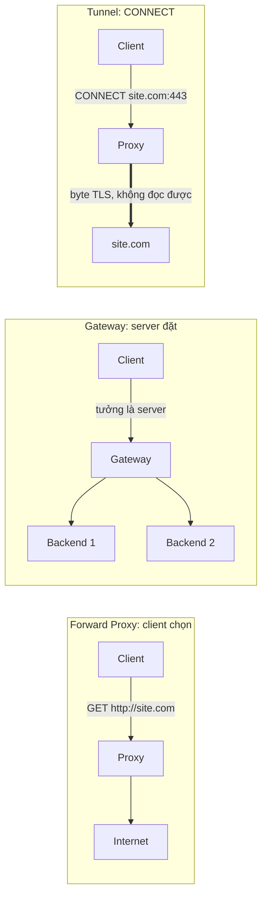
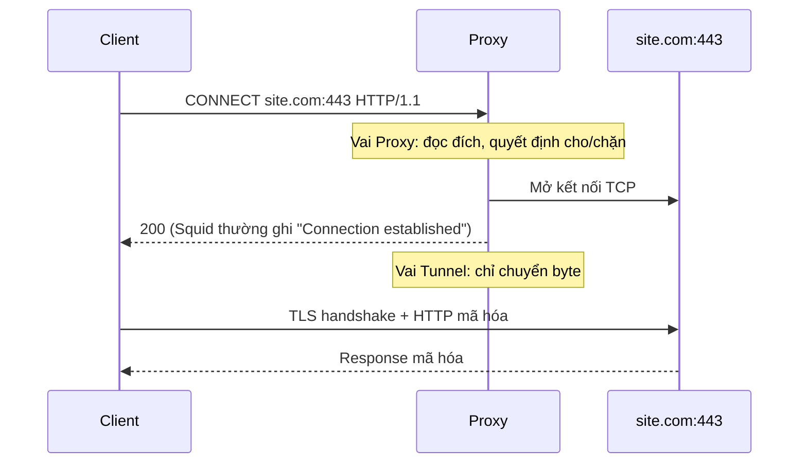
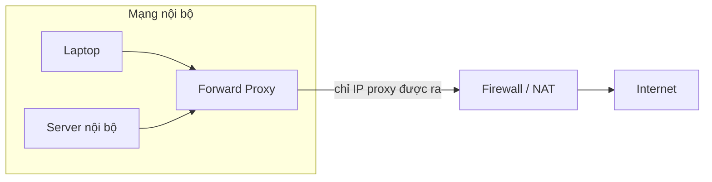
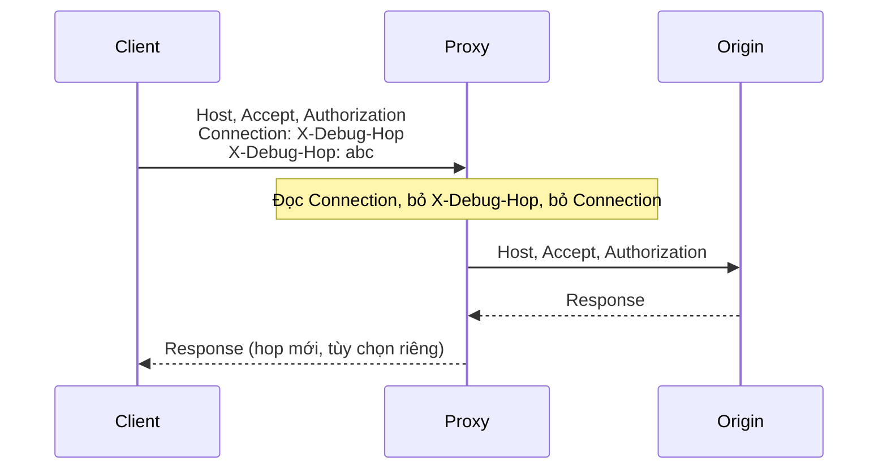
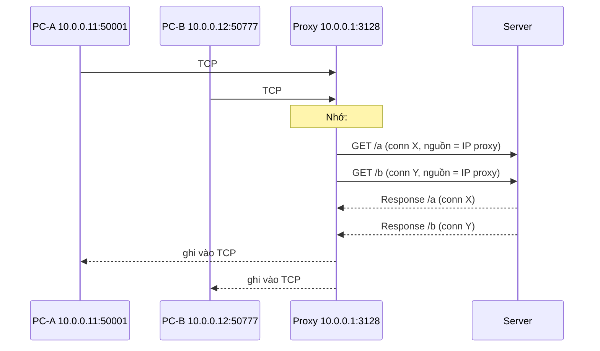
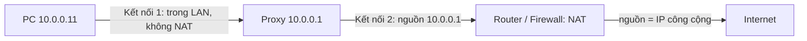
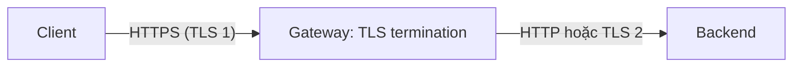
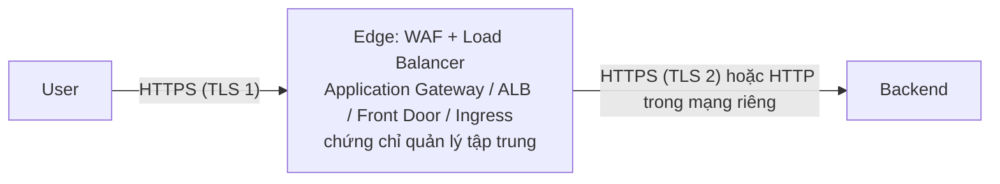
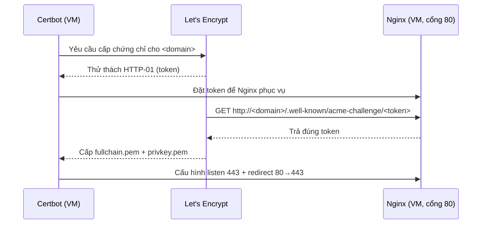

# Intermediaries: Proxy, Gateway, Tunnel, Hop-by-Hop và vị trí của TLS

> **Loại tài liệu**: Ghi chú tự học bổ trợ (Q&A deep dive), **không thuộc** chuỗi bài đã verify của khóa network.
> **Liên quan**: Module `2_6 Intermediaries and Proxy Architecture`, `2_7_3 HTTP and HTTPS Basics`, `2_7_4 TLS 1.3 Handshake and Certificate Chain of Trust`.
> **Trạng thái**: Draft, chưa qua verifier. Các nhận định về RFC được viết từ hiểu biết của người soạn và cần đối chiếu trực tiếp với RFC tại các link ở mục 9. Mục nào chưa chắc đều được đánh dấu **[cần đối chiếu]**.

**Bài học liên quan trong khóa**:
[2_6_1 What is an Intermediary](<../2 Domain 2 - Computer Networking Core Fundamentals/2_6 Intermediaries and Proxy Architecture/2_6_1 What is an Intermediary.md>) ·
[2_6_2 Forward Proxy](<../2 Domain 2 - Computer Networking Core Fundamentals/2_6 Intermediaries and Proxy Architecture/2_6_2 Forward Proxy.md>) ·
[2_6_3 Reverse Proxy](<../2 Domain 2 - Computer Networking Core Fundamentals/2_6 Intermediaries and Proxy Architecture/2_6_3 Reverse Proxy.md>) ·
[2_7_3 HTTP and HTTPS Basics](<../2 Domain 2 - Computer Networking Core Fundamentals/2_7 Core Application Layer Protocols/2_7_3 HTTP and HTTPS Basics.md>) ·
[2_7_4 TLS 1.3 Handshake](<../2 Domain 2 - Computer Networking Core Fundamentals/2_7 Core Application Layer Protocols/2_7_4 TLS 1.3 Handshake and Certificate Chain of Trust.md>)

---

## 0. Bản đồ các câu hỏi

| # | Câu hỏi | Mục |
|---|---|---|
| 1 | Proxy, Gateway, Tunnel khác nhau thế nào? | 1 |
| 2 | Proxy dùng để làm gì, là phần cứng hay phần mềm? | 2 |
| 3 | Hop-by-hop và end-to-end header | 3 |
| 4 | Nhiều máy trạm, proxy trả response về đúng máy bằng cách nào? | 4 |
| 5 | Đi qua proxy trước hay NAT trước? | 5 |
| 6 | HTTP → HTTPS thực hiện ở đâu? | 6 |
| 7 | Enterprise thường làm kịch bản nào, và Certbot + Nginx thuộc loại nào? | 7 |

---

## 1. Ba hình thái Intermediary

### 1.1 Khái niệm cốt lõi

Một HTTP request thực tế hiếm khi đi thẳng từ client tới server. Nó đi qua một **chuỗi các hop** (mỗi hop là một kết nối giữa hai node kề nhau). RFC 9110 §3.7 mô tả ba dạng trung gian phổ biến:

| | Proxy (forward) | Gateway (reverse proxy) | Tunnel |
|---|---|---|---|
| **Ai chọn nó** | **Client** chọn, thường qua cấu hình cục bộ | Phía **server** đặt, client không biết | Client yêu cầu qua `CONNECT` |
| **Đại diện cho** | Client | Server | Không đại diện ai |
| **Client nghĩ đang nói với** | Một proxy mà mình chủ động nhờ | **Origin server thật** | Đích cuối, thông qua một ống |
| **Có hiểu HTTP message không** | Có | Có | **Không** (chuyển byte mù) |
| **Là một bên của hội thoại HTTP** | Có | Có | **Không** theo RFC |

Hai thuật ngữ hướng dùng trong RFC:
- **inbound**: hướng về origin server.
- **outbound**: hướng về user agent (client).

Gateway đóng vai origin server trên kết nối phía client (outbound), rồi chuyển request vào trong (inbound). RFC cho phép gateway dịch sang cả giao thức không phải HTTP ở phía sau; trong thực hành, hiểu nó là "reverse proxy" là đủ.

### 1.2 Ví dụ đời thực

- **Proxy = thư ký của bạn**: bạn chủ động nhờ thư ký đi mua đồ, nhà cung cấp chỉ thấy thư ký.
- **Gateway = quầy lễ tân công ty**: khách tưởng lễ tân là công ty, lễ tân âm thầm chuyển việc cho các phòng phía sau.
- **Tunnel = ống kín giữa hai phòng**: người gác cổng chỉ mở ống nối hai đầu, bên trong chuyền gì thì không nhìn thấy (vì đã được niêm phong bằng TLS).

### 1.3 Sơ đồ



### 1.4 Proxy và Tunnel không loại trừ nhau

Cùng một chương trình (ví dụ Squid) có thể giữ **hai vai trong cùng một phiên**:

1. Nhận `CONNECT site.com:443`: lúc này nó là **proxy**, đọc được đích, có thể cho phép hoặc từ chối (403).
2. Sau khi trả `2xx`: nó trở thành **tunnel**, chỉ chép byte giữa hai socket.

Hệ quả: proxy công ty thường chặn HTTPS được **theo domain** (đọc từ dòng `CONNECT`), nhưng **không theo path**, trừ khi bật TLS inspection (mục 6.4).



### 1.5 Một vài lưu ý về cách phát biểu thường gặp

- Cụm "outbound connection của client" dễ gây hiểu sai; xem định nghĩa inbound/outbound ở 1.1.
- **Interception (transparent) proxy** tồn tại và client **không** chọn nó, nên lệch khỏi chữ "client chọn" của RFC. **[cần đối chiếu §3.7]**
- Một tunnel hoàn tất khi **cả hai đầu** của kết nối được relay đã đóng.

---

## 2. Proxy dùng để làm gì, và nó là gì về mặt vật lý?

### 2.1 Mục đích thực tế của forward proxy

Đây là các cách dùng phổ biến, **không phải** danh sách do RFC định nghĩa:

| Mục đích | Ý nghĩa |
|---|---|
| Kiểm soát egress | Mọi máy ra Internet qua một cửa, firewall chỉ cho IP proxy đi ra |
| Lọc/chặn | Theo domain, category, user |
| Log / audit | Biết ai truy cập gì |
| Cache | Tiết kiệm băng thông cho nội dung tải lặp lại |
| Ẩn nguồn | Server ngoài chỉ thấy IP proxy |
| Xác thực | Bắt đăng nhập trước khi ra ngoài (HTTP 407 + `Proxy-Authenticate`) |

### 2.2 Phần cứng hay phần mềm?

**Về bản chất proxy là phần mềm** lắng nghe trên một cổng. "Máy trung gian" chỉ nói về **vai trò**.

| Hình thức | Ví dụ |
|---|---|
| Phần mềm trên VM/server | Squid, Nginx, HAProxy, Envoy |
| Container/pod | Envoy sidecar, Nginx Ingress Controller |
| Dịch vụ cloud | Azure Application Gateway, AWS ALB |
| Appliance (phần cứng đóng gói sẵn) | F5 BIG-IP, Palo Alto, Fortinet |
| Chạy ngay trên máy client | mitmproxy, Fiddler, Charles (`localhost:8080`) |

### 2.3 Mô hình forward proxy trong mạng công ty



### 2.4 Kiểm tra máy mình đang dùng proxy nào

```bash
# Biến môi trường mà curl, pip, npm, git... thường đọc
env | grep -i proxy

# Xem curl có đi qua proxy không, và dòng CONNECT
curl -v https://example.com 2>&1 | grep -E "Uses proxy|CONNECT|HTTP/"

# Bỏ qua proxy một lần để so sánh
curl --noproxy '*' -v https://example.com
```

Các nơi cấu hình khác: cài đặt OS/trình duyệt, file `.pac` (Proxy Auto-Config), `git config http.proxy`, `npm config get proxy`, cấu hình docker daemon. Nếu công ty dùng transparent proxy, máy bạn có thể không có cấu hình nào mà vẫn bị đi qua proxy.

---

## 3. Hop-by-hop và End-to-end headers

### 3.1 Ý tưởng

Chuỗi `Client ⇄ Proxy ⇄ Gateway ⇄ Origin` gồm nhiều kết nối độc lập.

- **End-to-end**: nói chuyện giữa **hai đầu**, trung gian phải chuyển nguyên vẹn (`Accept`, `Authorization`, `Content-Type`, `ETag`, `Cache-Control`...).
- **Hop-by-hop**: chỉ có nghĩa với **kết nối hiện tại**, chuyển sang hop sau là vô nghĩa hoặc gây lỗi (`Connection`, `Keep-Alive`, `TE`, `Transfer-Encoding`, `Upgrade`...).

**Ví dụ đời thực**: thư gửi qua nhiều chặng xe tải. Nội dung thư và địa chỉ người nhận là end-to-end. Ghi chú trên bao tải "chuyến 5h, xếp lên pallet" chỉ có nghĩa với **một chặng**.

### 3.2 Cơ chế: `Connection` là danh sách ghi chú hop-by-hop

```
Connection: close, X-Debug-Hop
X-Debug-Hop: abc
Accept: application/json
```

Trung gian phải xóa `X-Debug-Hop` (vì được nêu trong `Connection`), rồi xóa chính `Connection` (hoặc thay bằng tùy chọn riêng của nó cho hop sau). `Accept` đi tiếp.



### 3.3 Mức độ bắt buộc: MUST và SHOULD

Theo hiểu biết của người soạn về RFC 9110 §7.6.1 **[cần đối chiếu]**:

- **MUST**: trung gian phải đọc `Connection` và loại bỏ các trường có tên nằm trong đó, rồi loại bỏ `Connection`.
- **SHOULD**: nên loại bỏ hoặc thay thế các trường đã biết cần loại bỏ (`Proxy-Connection`, `Keep-Alive`, `TE`, `Transfer-Encoding`, `Upgrade`) kể cả khi chúng không xuất hiện trong `Connection`.

Không nên gộp tất cả thành "MUST". Ngoài ra RFC 7230 đã bị RFC 9110/9112 thay thế, nên trích dẫn hai RFC mới.

### 3.4 Các trường hợp cần nhớ

| Header | Ghi chú |
|---|---|
| `Proxy-Authenticate`, `Proxy-Authorization` | Áp dụng cho hop proxy kế tiếp (RFC 9110 §11.7) |
| `Transfer-Encoding: chunked` | Chỉ là cách đóng gói trên một hop; proxy có thể nhận chunked và gửi lại bằng `Content-Length` |
| `Host` | Thường end-to-end nhưng reverse proxy hay **viết lại** khi chuyển vào backend |
| HTTP/2, HTTP/3 | **Cấm** các trường connection-specific (RFC 9113 §8.2.2) |

### 3.5 Lỗi kinh điển: WebSocket qua Nginx

`Upgrade` và `Connection` là hop-by-hop nên Nginx không tự chuyển sang backend. Phải đặt lại:

```nginx
location /ws/ {
    proxy_pass http://backend;
    proxy_http_version 1.1;
    proxy_set_header Upgrade $http_upgrade;
    proxy_set_header Connection "upgrade";
}
```

Thiếu hai dòng `proxy_set_header`, WebSocket qua Nginx thường không nâng cấp được. Đối chiếu cú pháp với tài liệu Nginx về WebSocket proxying cho phiên bản bạn dùng.

---

## 4. Proxy biết trả response về máy nào?

### 4.1 Câu trả lời ngắn

Nhờ **mỗi máy trạm có một kết nối TCP riêng tới proxy**. Proxy nhớ cặp `kết nối phía client ↔ kết nối/transaction phía server` trong bộ nhớ tiến trình, và ghi response vào **đúng socket** mà request đã đến. Proxy không tra cứu IP trong header HTTP.



Từng kết nối được phân biệt bằng bộ bốn **(IP nguồn, port nguồn, IP đích, port đích)**.

### 4.2 Nếu dùng chung một kết nối upstream cho nhiều client

| Giao thức | Cách ghép request ↔ response |
|---|---|
| HTTP/1.1 | Mỗi lúc chỉ một request đang xử lý trên một kết nối upstream; proxy mượn kết nối cho một transaction rồi trả lại pool |
| HTTP/2 | Nhiều request song song, phân biệt bằng **stream ID** |
| Tunnel (`CONNECT`) | Proxy giữ một **cặp socket** và chép byte hai chiều |

### 4.3 Phân biệt với NAT

| | NAT | Forward proxy |
|---|---|---|
| Tầng | IP/TCP | Ứng dụng (HTTP) |
| Cơ chế | Bảng ánh xạ `(IP:port nội bộ) ↔ (IP:port công cộng)`, viết lại header gói tin | **Kết thúc** kết nối của client rồi **mở kết nối mới** |

### 4.4 Server có biết client thật không?

Mặc định không, server chỉ thấy IP proxy. Proxy có thể thêm header `Forwarded` (chuẩn, RFC 7239) hoặc `X-Forwarded-For` (phổ biến, không chuẩn) nếu được cấu hình.

```bash
# Trên máy proxy (Squid): kết nối đang mở từ các máy trạm tới cổng 3128
ss -tn state established '( sport = :3128 )'
# Log truy cập (đường dẫn mặc định có thể khác theo bản phân phối)
tail -f /var/log/squid/access.log
```

---

## 5. Đi qua proxy trước hay NAT trước?

Với mô hình phổ biến (proxy trong LAN, IP private), thứ tự là `PC → Proxy → NAT → Internet`, nhưng chính xác hơn: có **hai kết nối khác nhau** và chỉ kết nối thứ hai bị NAT.



| Mô hình | Thứ tự |
|---|---|
| Proxy trong LAN, IP private | PC → Proxy → **NAT** → Internet |
| Proxy ở DMZ có IP công cộng | PC → Proxy → Internet, có thể không cần NAT cho proxy |
| Transparent proxy trên gateway | Gói của PC được chuyển hướng (ví dụ `iptables REDIRECT`) vào proxy trước, kết nối ra ngoài của proxy mới được NAT/masquerade |
| Proxy dạng cloud (ví dụ Azure Firewall) | Phụ thuộc route và kiến trúc cụ thể |

Mạng thật có thể có nhiều lớp NAT hoặc proxy nối proxy; cần xem sơ đồ mạng để chắc chắn.

```bash
curl -s https://ifconfig.me ; echo      # IP mà bên ngoài thấy
ip -4 addr show | grep inet             # IP private của máy bạn
env | grep -i proxy                     # có cấu hình proxy tường minh không
```

Nếu hai IP đầu khác nhau thì có NAT. `ifconfig.me` chỉ để tham khảo nhanh, hãy dùng dịch vụ mà tổ chức cho phép.

---

## 6. HTTP → HTTPS được thực hiện ở đâu?

**HTTPS = HTTP chạy bên trong một phiên TLS.** Thường không có thiết bị nào "đổi HTTP thành HTTPS" giữa đường. Câu hỏi đúng là: **ai là bên kết thúc TLS** và **ai ép client dùng HTTPS**.

### 6.1 Kịch bản 1: `https://` qua forward proxy (qua tunnel)

TLS bắt tay **trực tiếp client ⇄ server** xuyên qua tunnel `CONNECT`. Proxy và NAT chỉ thấy byte mã hóa.

### 6.2 Kịch bản 2: client gõ `http://`, được ép lên HTTPS

1. Client gửi `GET http://site.com/` (cổng 80).
2. **Server hoặc gateway** trả `301`/`308` với `Location: https://site.com/`.
3. Client mở kết nối mới tới cổng 443 và bắt tay TLS.

Sau lần đầu, header **HSTS** (`Strict-Transport-Security`) khiến trình duyệt tự nâng cấp ngay ở client.

```bash
curl -sI http://example.com | head -n 5     # quan sát redirect, kết quả tùy site
```

### 6.3 Kịch bản 3: TLS termination tại Gateway



Phía client là HTTPS, phía backend có thể là HTTP thuần. TLS **kết thúc tại gateway**, không còn end-to-end tới backend. Ví dụ: Nginx, Application Gateway, ALB, Ingress Controller.

### 6.4 Kịch bản 4: forward proxy có TLS inspection

Có **hai phiên TLS riêng**: client ⇄ proxy và proxy ⇄ server. Proxy dùng chứng chỉ do **CA nội bộ** ký thay cho site, máy client phải tin CA đó. Khi đó proxy không còn là tunnel mù.

```bash
# Xem ai ký chứng chỉ mà máy bạn nhận được
openssl s_client -connect example.com:443 -servername example.com </dev/null 2>/dev/null \
  | openssl x509 -noout -issuer -subject
```

Lệnh này kết nối trực tiếp, không qua proxy tường minh. Với `curl -v` qua proxy, xem dòng `issuer` ở phần chứng chỉ. Nếu chứng chỉ của một site công khai do CA nội bộ ký, đó là dấu hiệu của TLS inspection.

### 6.5 Tóm tắt

| Câu hỏi | Vị trí |
|---|---|
| Ai bắt tay TLS khi dùng `https://` qua forward proxy thường | Client ⇄ Server (end-to-end, qua tunnel) |
| Ai ép `http://` sang `https://` | Server/Gateway (redirect) hoặc trình duyệt (HSTS) |
| Ai giải mã HTTPS phía server | Gateway nếu có TLS termination, ngược lại là origin |
| Ai giải mã HTTPS phía client nội bộ | Chỉ proxy có TLS inspection |
| NAT có tham gia | Không, chỉ đổi địa chỉ |

---

## 7. Enterprise thường làm gì

Phải tách **hai hướng traffic**.

### 7.1 Hướng vào (người dùng → ứng dụng): TLS termination tại edge được quản lý



| Vấn đề | Cách enterprise giải quyết |
|---|---|
| Nhiều chứng chỉ, dễ hết hạn | Quản lý tập trung: Key Vault, ACM, **cert-manager** trong K8s |
| Private key rải rác trên VM | Key để ở nơi kiểm soát (Key Vault/HSM/ACM) |
| Cần WAF, rate limit | Gom về một lớp edge |
| Backend cũng phải mã hóa | **End-to-end TLS**: giải mã ở edge để WAF kiểm tra, rồi mã hóa lại |
| Wildcard / dịch vụ nội bộ | **DNS-01** hoặc CA nội bộ |
| Redirect HTTP → HTTPS | Cấu hình ở edge (listener 80 → 443) cộng HSTS |

### 7.2 Hướng ra (máy nội bộ → Internet)

1. **Tunnel (`CONNECT`), không giải mã**: lọc theo domain/FQDN, dễ triển khai, không thấy nội dung.
2. **TLS inspection**: giải mã bằng CA nội bộ cài vào client; thấy nội dung nhưng tốn công quản lý, có thể làm hỏng ứng dụng dùng certificate pinning, và có vấn đề riêng tư/pháp lý.

Thường gặp: máy trạm nhân viên hay bị inspection, server thường chỉ allowlist FQDN. Đây là các mẫu hay gặp, **không phải số liệu khảo sát**.

### 7.3 Phân tích case Certbot + Nginx trên một VM

Quy trình đã cấu hình:

```bash
sudo apt update
sudo apt install -y certbot python3-certbot-nginx
sudo certbot --nginx -d <domain> --non-interactive --agree-tos -m <email> --redirect
```



| Khía cạnh | Phân loại |
|---|---|
| Ai kết thúc TLS | **Nginx trên VM** (TLS termination) |
| Ai redirect HTTP → HTTPS | **Nginx** (`--redirect`), tức server side |
| Vai trò của Nginx | Origin nếu phục vụ file tĩnh; **gateway** nếu `proxy_pass` tới app |
| Kiểu xác minh | **HTTP-01** qua cổng 80 (không cấp được wildcard) |
| Điều kiện | DNS trỏ đúng IP, cổng 80 mở từ Internet |

Kiểm tra gia hạn tự động:

```bash
systemctl list-timers | grep -i certbot
sudo certbot renew --dry-run
```

Thời hạn chứng chỉ Let's Encrypt mặc định hiện là 90 ngày, nhưng họ đã công bố lộ trình rút ngắn. **[cần đối chiếu trên letsencrypt.org]**

Đánh giá: phù hợp cho lab và dự án nhỏ. Bản chất (TLS termination + redirect) giống mô hình enterprise, nhưng enterprise tránh để mỗi VM tự giữ key và tự gia hạn.

### 7.4 Lộ trình nâng cấp (ví dụ Azure)

- Đặt **Application Gateway** hoặc Front Door trước VM, HTTPS listener và redirect 80 → 443 tại đó.
- Chứng chỉ để trong **Key Vault**.
- Nginx trên VM làm origin, bật end-to-end TLS nếu cần.

---

## 8. Câu hỏi tự kiểm tra (Active Recall)

1. Vì sao một proxy có thể chặn `https://site.com` theo domain nhưng không chặn được theo path?
2. Gateway và forward proxy khác nhau ở điểm nào về "ai chọn" và "đại diện cho ai"?
3. Header X xuất hiện trong `Connection: X`. Trung gian phải làm gì với X, và với chính `Connection`?
4. Vì sao WebSocket qua Nginx cần `proxy_set_header Upgrade ...`?
5. Hai client A, B cùng nhờ một proxy. Proxy dựa vào đâu để trả đúng response?
6. Trong `PC → Proxy → NAT → Internet`, kết nối nào bị NAT?
7. Trong cấu hình Certbot + Nginx của bạn, TLS bắt đầu ở đâu và kết thúc ở đâu?
8. Khi nào proxy thôi là "tunnel mù"?

---

## 9. 📚 Nguồn Tài Liệu Chính Thống (Official References)

- [RFC 9110 §3.7 – Intermediaries](https://www.rfc-editor.org/rfc/rfc9110.html#section-3.7) - Định nghĩa proxy, gateway, tunnel; thuật ngữ inbound/outbound.
- [RFC 9110 §7.6.1 – Connection](https://www.rfc-editor.org/rfc/rfc9110.html#section-7.6.1) - Quy tắc xử lý `Connection` và các trường hop-by-hop.
- [RFC 9110 §9.3.6 – CONNECT](https://www.rfc-editor.org/rfc/rfc9110.html#section-9.3.6) - Thiết lập tunnel.
- [RFC 9110 §11.7 – Proxy Authentication](https://www.rfc-editor.org/rfc/rfc9110.html#section-11.7) - `Proxy-Authenticate` và `Proxy-Authorization`.
- [RFC 9110 §4.2.2 – https URI Scheme](https://www.rfc-editor.org/rfc/rfc9110.html#section-4.2.2) - HTTPS là HTTP trên kết nối an toàn.
- [RFC 9112 §6.1 – Transfer-Encoding](https://www.rfc-editor.org/rfc/rfc9112.html#section-6.1) và [§9 – Connection Management](https://www.rfc-editor.org/rfc/rfc9112.html#section-9) - HTTP/1.1.
- [RFC 9113 §5 – Streams and Multiplexing](https://www.rfc-editor.org/rfc/rfc9113.html#section-5) và [§8.2.2 – Connection-Specific Header Fields](https://www.rfc-editor.org/rfc/rfc9113.html#section-8.2.2) - HTTP/2.
- [RFC 7239 – Forwarded HTTP Extension](https://www.rfc-editor.org/rfc/rfc7239.html) - Header `Forwarded`.
- [RFC 6797 – HSTS](https://www.rfc-editor.org/rfc/rfc6797.html) - Strict Transport Security.
- [RFC 3022 – Traditional IP NAT](https://www.rfc-editor.org/rfc/rfc3022.html) - NAT/NAPT.
- TLS: khóa network này dạy TLS theo RFC 9846 (xem [2_7_4](<../2 Domain 2 - Computer Networking Core Fundamentals/2_7 Core Application Layer Protocols/2_7_4 TLS 1.3 Handshake and Certificate Chain of Trust.md>)); đối chiếu trực tiếp trang RFC đó thay vì ghi chú này.
- [Let's Encrypt – Challenge Types](https://letsencrypt.org/docs/challenge-types/) - HTTP-01, DNS-01.
- [Certbot docs – Nginx](https://eff-certbot.readthedocs.io/en/stable/using.html#nginx) - Plugin `--nginx`.
- [Azure Application Gateway – TLS overview](https://learn.microsoft.com/azure/application-gateway/ssl-overview) - TLS termination, end-to-end TLS.
- [Azure Firewall Premium features](https://learn.microsoft.com/azure/firewall/premium-features) - TLS inspection.
- [AWS – HTTPS listeners for ALB](https://docs.aws.amazon.com/elasticloadbalancing/latest/application/create-https-listener.html) - TLS termination tại ALB.
- [MDN – Proxy servers and tunneling](https://developer.mozilla.org/en-US/docs/Web/HTTP/Proxy_servers_and_tunneling) - Tóm tắt dễ đọc (MDN hay đổi cấu trúc URL, nếu lỗi hãy tìm theo tiêu đề).
- Tier 3 / ngoài danh sách Tier 1, chỉ dùng tra cú pháp: [Nginx – WebSocket proxying](https://nginx.org/en/docs/http/websocket.html), [cert-manager docs](https://cert-manager.io/docs/), [curl man page](https://curl.se/docs/manpage.html).
