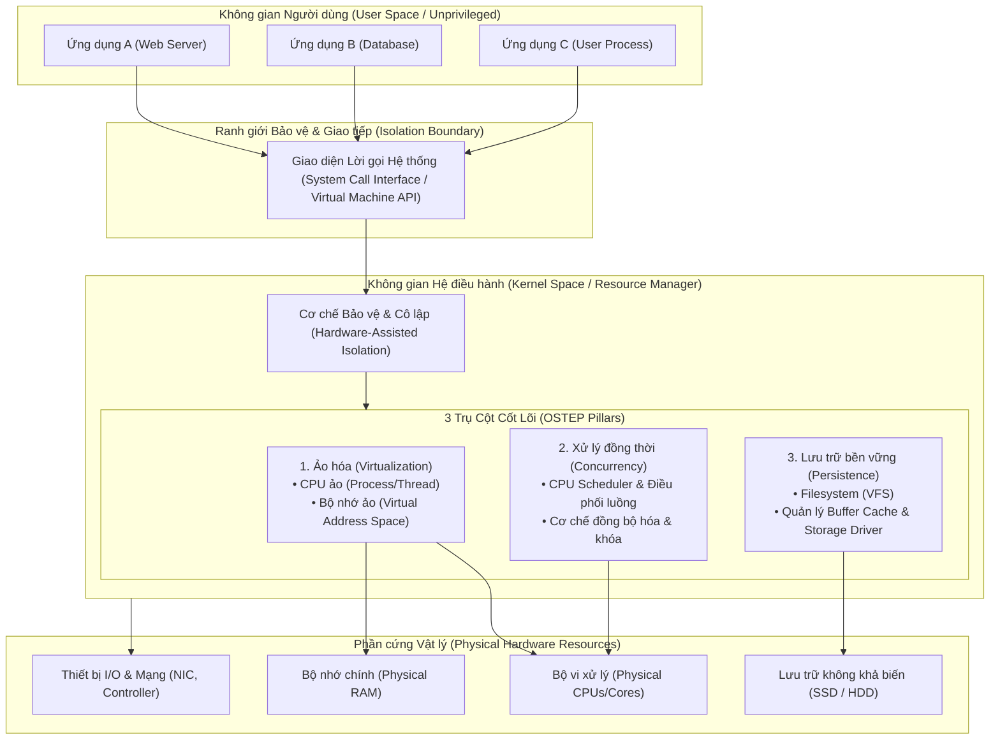

# 1_1_1 The Role of an Operating System

> **Khóa học**: Cloud DevOps Basic — OS Core  
> **Phân nhóm**: 1 Domain 1 - Operating System Core Fundamentals › 1_1 OS Architecture and Hardware Privilege Modes  
> **Chủ đề**: Vai trò nền tảng của hệ điều hành: Quản lý tài nguyên, trừu tượng hóa phần cứng và bảo vệ cô lập hệ thống  
> **Trạng thái**: Draft (WRITE-CDB-1_1_1, 14-11-2026)  
> **Checklist đối chiếu**: [1_1_1](../../../CHECKLIST.md#domain-1-operating-system-core-fundamentals-45-items)  

---

## 1. Khái Niệm Cốt Lõi & Bản Chất Kỹ Thuật (Core Concepts & Technical Deep Dive)

Hệ điều hành (Operating System - OS) là lớp phần mềm hệ thống cơ bản nhất nằm giữa phần cứng vật lý (CPU, RAM, thiết bị lưu trữ, I/O) và các chương trình ứng dụng người dùng. Theo lý thuyết hệ điều hành hiện đại (điển hình là phân loại trong giáo trình *Operating Systems: Three Easy Pieces - OSTEP*), chức năng tổng thể của một hệ điều hành được xây dựng trên **ba trụ cột nền tảng**:

1. **Ảo hóa (Virtualization)**:
   - Hệ điều hành tiếp nhận các tài nguyên vật lý thực tế—chẳng hạn như bộ vi xử lý (CPU), bộ nhớ vật lý (RAM) hay ổ đĩa—và chuyển đổi (ảo hóa) chúng thành các dạng tài nguyên ảo, dễ sử dụng và linh hoạt hơn rất nhiều đối với các chương trình người dùng.
   - Nhờ ảo hóa, mỗi chương trình hoạt động như thể nó đang độc quyền sở hữu một CPU riêng (thông qua tiến trình và bộ lập lịch) và một không gian địa chỉ bộ nhớ riêng biệt khổng lồ (thông qua bộ nhớ ảo).

2. **Xử lý đồng thời (Concurrency)**:
   - Trong quá trình vận hành, hệ thống phải xử lý nhiều luồng công việc cùng một lúc trong phạm vi cùng một chương trình hoặc trên toàn bộ hệ thống.
   - Hệ điều hành giải quyết các bài toán phức tạp và hóc búa liên quan đến tương tranh: lập lịch thực thi, đồng bộ hóa giữa các luồng/tiến trình, và quản lý truy cập dữ liệu dùng chung để đảm bảo tính nhất quán của hệ thống.

3. **Lưu trữ bền vững (Persistence)**:
   - Các bộ nhớ chính như DRAM là bộ nhớ khả biến (volatile), dữ liệu sẽ biến mất ngay khi mất nguồn điện.
   - Để lưu giữ dữ liệu an toàn lâu dài, hệ điều hành cung cấp hệ thống tệp (filesystem) quản lý các thiết bị lưu trữ không khả biến (non-volatile storage devices như SSD, HDD), giúp dữ liệu được lưu trữ an toàn, tin cậy qua thời gian và có thể truy xuất lại sau mỗi lần tái khởi động.

### Vai trò quản trị tài nguyên (Resource Manager) và trừu tượng hóa phần cứng

Bên cạnh ba trụ cột trên, hệ điều hành đảm nhận hai vai trò vận hành sống còn:

- **Bộ quản trị tài nguyên (Resource Manager)**:
  - Do cơ chế ảo hóa cho phép nhiều chương trình cùng chạy đồng thời (chia sẻ CPU), nhiều chương trình cùng truy cập mã lệnh và dữ liệu riêng của chúng (chia sẻ RAM), và nhiều chương trình cùng gửi yêu cầu I/O (chia sẻ ổ đĩa và thiết bị ngoại vi), hệ điều hành đóng vai trò như một cơ quan quản lý và điều phối tài nguyên.
  - OS quyết định tiến trình nào được cấp phát bao nhiêu CPU, dung lượng bộ nhớ nào được cấp cho ứng dụng nào, và điều phối quyền truy cập thiết bị một cách hiệu quả, công bằng.

- **Lớp trừu tượng hóa phần cứng (Hardware Abstraction Layer) & Giao diện Syscall**:
  - Nếu không có OS, lập trình viên sẽ phải trực tiếp viết mã thao tác với từng thanh ghi, cổng I/O hay giao thức điều khiển chi tiết của từng dòng vi điều khiển hoặc chip phần cứng khác nhau.
  - Hệ điều hành che giấu hoàn toàn sự phức tạp ở tầng vật lý, đóng vai trò như một "thư viện chuẩn" khổng lồ và cung cấp giao diện máy ảo (virtual machine interface) thông qua các **lời gọi hệ thống (system calls - syscalls)**. Ứng dụng chỉ cần gọi các hàm trừu tượng tiêu chuẩn (như đọc/ghi tệp, cấp phát bộ nhớ) mà không cần quan tâm đến loại phần cứng bên dưới.

### Nguyên lý bảo vệ thông qua cô lập (Isolation & Protection)

Một mục tiêu tối quan trọng của hệ điều hành là **ngăn chặn các chương trình người dùng độc hại hoặc gặp lỗi làm mất ổn định hệ thống**:
- **Nguyên lý cô lập (Isolation)**: Hệ điều hành cô lập các tiến trình hoàn toàn độc lập với nhau. Mỗi tiến trình chạy trong một không gian địa chỉ riêng biệt và không thể trực tiếp đọc, ghi đè dữ liệu của tiến trình khác hoặc can thiệp vào không gian bộ nhớ của chính Kernel.
- Cô lập các tiến trình khỏi nhau là chìa khóa then chốt của cơ chế bảo vệ (protection). Nhờ sự hỗ trợ của phần cứng (chế độ đặc quyền CPU), hệ điều hành thiết lập ranh giới phòng thủ nghiêm ngặt, đảm bảo rằng một ứng dụng người dùng dù có bị lỗi nghiêm trọng (crash, segmentation fault) cũng không thể kéo sập toàn bộ cỗ máy hay ảnh hưởng tới các ứng dụng khác đang chạy song song.

---

## 2. Ví Dụ Đời Sống Thực Tế Dễ Hiểu (Intuitive Real-World Analogies)

### Ẩn dụ: Tòa Thị Chính & Chính Quyền Thành Phố (City Government & Town Hall)

Hãy tưởng tượng một máy tính vật lý giống như một **Thành phố công nghiệp hiện đại**, trong đó:
- **Phần cứng vật lý (CPU, RAM, Ổ cứng)**: Tương tự như lưới điện trung tâm, nguồn cấp nước sạch, quỹ đất đai và hệ thống kho bãi lưu trữ hàng hóa của toàn thành phố.
- **Các tiến trình người dùng (User Applications)**: Tương tự như hàng trăm doanh nghiệp tư nhân, nhà máy sản xuất khác nhau hoạt động trong thành phố.

Nếu một thành phố **không có chính quyền quản lý (Không có OS)**:
- Doanh nghiệp nào lớn hơn, mạnh hơn sẽ chiếm đoạt toàn bộ nguồn điện và nguồn nước (CPU và RAM), khiến các doanh nghiệp nhỏ hơn bị "chết đói" (starvation).
- Khi phát sinh tranh chấp hoặc xả thải bừa bãi, một doanh nghiệp có thể tự ý đào xới và đổ phế thải sang khuôn viên đất đai của doanh nghiệp khác (tiến trình này ghi đè bộ nhớ của tiến trình kia), làm hỏng hàng hóa và làm sụp đổ hoàn toàn trật tự kinh tế của cả thành phố.

Khi **Hệ điều hành xuất hiện với tư cách Tòa Thị Chính & Bộ máy Chính quyền**:
1. **Ban hành luật lệ & Cô lập hàng rào (Isolation & Protection)**: Chính quyền cấp giấy chứng nhận quyền sử dụng đất riêng cho từng doanh nghiệp (không gian bộ nhớ ảo). Doanh nghiệp A không được phép bước qua hàng rào sang đất của Doanh nghiệp B. Nếu một doanh nghiệp làm ăn thua lỗ và phá sản (tiến trình crash), chỉ có văn phòng của họ đóng cửa, toàn bộ các doanh nghiệp khác và tòa thị chính vẫn hoạt động hoàn toàn bình thường.
2. **Phân phối tài nguyên công bằng (Resource Management)**: Sở Điện lực và Sở Tài nguyên (CPU Scheduler và Memory Manager) luân phiên cấp phát điện năng theo hạn mức và thời gian hợp lý, đảm bảo mọi doanh nghiệp đều có cơ hội hoạt động.
3. **Cung cấp hạ tầng tiện ích dùng chung (Hardware Abstraction & System Calls)**: Thành phố xây dựng sẵn hệ thống đường sá trải nhựa, đường ống dẫn nước và bưu điện (Hệ thống tệp và Lời gọi hệ thống). Doanh nghiệp muốn vận chuyển hàng hóa chỉ việc gửi bưu phẩm qua bưu điện mà không cần tự mình đi mở đường hay rải dây cáp xuyên thành phố.

---

## 3. Kiến Trúc, Luồng Hoạt Động & Hình Ảnh Trực Quan (Architecture, Diagrams & Visual Media)

Sơ đồ dưới đây minh họa vị trí trung tâm của Hệ điều hành trong việc đóng vai trò là Lớp trừu tượng hóa phần cứng, Bộ quản lý tài nguyên và Hàng rào cô lập bảo vệ:



---

## 4. Thực Hành (Hands-on): Quan Sát Hệ Thống & Lớp Trừu Tượng Hóa Phần Cứng Trên Linux

Trong môi trường thực tế của kỹ sư Systems và DevOps, chúng ta có thể tương tác trực tiếp với giao diện trừu tượng hóa và hệ thống thông tin ảo mà Linux Kernel cung cấp để kiểm tra nền tảng phần cứng và phiên bản hệ điều hành.

### 4.1 Kiểm tra thông tin Kernel và Kiến trúc phần cứng với `uname`

Lệnh `uname` đọc dữ liệu hệ thống do kernel cung cấp:
- Cờ `-r` (`--kernel-release`): In thông tin phiên bản phát hành của Linux Kernel đang chạy.
- Cờ `-m` (`--machine`): In tên kiến trúc phần cứng của máy (ví dụ: `x86_64`).

```bash
# In tên hệ điều hành (-s), phiên bản kernel release (-r) và kiến trúc máy (-m)
uname -srm
```

> 💡 **Minh họa thực thi (Illustrative Output)**:
```text
Linux 6.8.0-49-generic x86_64
```
*Giải thích*: Cỗ máy đang chạy nhân Linux phiên bản phát hành `6.8.0-49-generic` trên nền tảng vi kiến trúc phần cứng 64-bit (`x86_64`).

---

### 4.2 Nhận diện chuỗi định danh Kernel qua Filesystem ảo `/proc/version`

Linux Kernel cung cấp `/proc`, một hệ thống tệp ảo trong bộ nhớ (virtual pseudo-filesystem), đóng vai trò như một cánh cửa sổ cho phép không gian người dùng nhìn vào cấu trúc nội tại của Kernel. Tập tin `/proc/version` định danh cụ thể chuỗi phiên bản kernel đang chạy, bao gồm cả phiên bản trình biên dịch GCC đã dùng để build kernel:

```bash
# Đọc chuỗi định danh Kernel chi tiết từ virtual procfs
cat /proc/version
```

> 💡 **Minh họa thực thi (Illustrative Output)**:
```text
Linux version 6.8.0-49-generic (buildd@lcy02-amd64-009) (x86_64-linux-gnu-gcc-13 (Ubuntu 13.2.0-23ubuntu4) 13.2.0, GNU ld (GNU Binutils for Ubuntu) 2.42) #49-Ubuntu SMP PREEMPT_DYNAMIC Mon Nov  4 02:24:22 UTC 2024
```

---

### 4.3 Thu thập thông tin vi kiến trúc CPU phần cứng được trừu tượng hóa với `lscpu`

Tiện ích `lscpu` thu thập thông tin kiến trúc CPU từ hệ thống tệp ảo `sysfs` và `/proc/cpuinfo`, thể hiện khả năng trừu tượng hóa phần cứng của hệ điều hành:

```bash
# Lọc các trường thông tin kiến trúc, chế độ hoạt động và mô hình CPU
lscpu | grep -E "Architecture|CPU op-mode|Model name|Virtualization"
```

> 💡 **Minh họa thực thi (Illustrative Output)**:
```text
Architecture:                    x86_64
CPU op-mode(s):                  32-bit, 64-bit
Model name:                      12th Gen Intel(R) Core(TM) i7-12700H
Virtualization:                  VT-x
```
*Giải thích*: Hệ điều hành nhận diện bộ vi xử lý thực tế, trừu tượng hóa các tập lệnh phần cứng và chế độ hoạt động (32-bit, 64-bit), đồng thời phát hiện công nghệ hỗ trợ ảo hóa phần cứng (`VT-x`), làm cơ sở để OS thực hiện nhiệm vụ ảo hóa CPU và bảo vệ tài nguyên.

---

## 5. Cạm Bẫy Thực Tế & Thực Tiễn Sản Xuất (Production Gotchas & Best Practices)

Trong môi trường vận hành hạ tầng Cloud và DevOps thực tế, việc hiểu rõ vai trò quản lý tài nguyên và ranh giới bảo vệ của OS giúp kỹ sư phòng tránh các sự cố kinh điển:

1. **Hiệu ứng "Hàng xóm ồn ào" (Noisy Neighbor) & Cạn kiệt tài nguyên**:
   - *Bản chất*: Mặc dù OS thực hiện chia sẻ thời gian CPU và bộ nhớ, nhưng nếu không cấu hình giới hạn tài nguyên phân cấp (chẳng hạn như Linux cgroups trong container), một tiến trình bị lỗi rò rỉ bộ nhớ (memory leak) hoặc vòng lặp vô tận (infinite loop) có thể vắt kiệt RAM vật lý của máy.
   - *Hậu quả*: Kernel buộc phải kích hoạt cơ chế Out-Of-Memory Killer (OOM Killer) để tiêu diệt tiến trình nhằm cứu vãn hệ thống, và đôi khi tiến trình bị tiêu diệt lại là một ứng dụng nghiệp vụ quan trọng khác cùng chia sẻ máy chủ.

2. **Ảo tưởng về việc ứng dụng người dùng can thiệp trực tiếp phần cứng**:
   - *Bản chất*: Lập trình viên mới đôi khi cố gắng tìm cách "tối ưu hóa hiệu năng cực đại" bằng cách bỏ qua lời gọi hệ thống để thao tác trực tiếp vào bộ nhớ vật lý hoặc thanh ghi thiết bị từ user space.
   - *Thực tế*: Phần cứng và OS được thiết kế để chặn đứng hành vi này. Mọi nỗ lực truy cập vùng nhớ ngoài không gian địa chỉ được cấp phát đều bị CPU kích hoạt ngoại lệ (General Protection Fault / Page Fault) và OS sẽ phát tín hiệu kết thúc tiến trình ngay lập tức (`SIGSEGV` - Segmentation Fault) nhằm duy trì nguyên tắc cô lập.

3. **Nguy cơ lỗi tính nhất quán dữ liệu do mất điện đột ngột (Persistence Pitfall)**:
   - *Bản chất*: Để tối ưu hiệu năng I/O, hệ điều hành thường lưu dữ liệu ghi vào bộ đệm trong RAM (Page Cache/Buffer) trước khi xả định kỳ xuống ổ đĩa cứng không khả biến (Persistence).
   - *Thực tiễn*: Các dịch vụ cơ sở dữ liệu quan trọng phải chủ động sử dụng các lời gọi đồng bộ dữ liệu (`fsync()`, `fdatasync()`) để yêu cầu OS xả ngay lập tức dữ liệu xuống đĩa trước khi báo hoàn tất giao dịch, tránh nguy cơ mất mát dữ liệu khi máy chủ vật lý đột ngột mất nguồn điện.

---

## 6. Câu Hỏi Củng Cố Kiến Thức (Active Recall Quiz)

<details>
<summary><b>Câu hỏi 1:</b> Ba trụ cột cốt lõi của một hệ điều hành theo phân loại của OSTEP là gì và mỗi trụ cột giải quyết bài toán kỹ thuật nào?</summary>

**Đáp án:**
Ba trụ cột cốt lõi gồm:
1. **Ảo hóa (Virtualization)**: Chuyển đổi các tài nguyên vật lý (CPU, RAM, ổ đĩa) thành các dạng ảo dễ sử dụng hơn (tiến trình, không gian địa chỉ ảo), tạo cho mỗi chương trình cảm giác đang độc quyền sở hữu hệ thống.
2. **Xử lý đồng thời (Concurrency)**: Giải quyết các vấn đề phức tạp khi hệ thống phải xử lý nhiều công việc cùng một lúc (đa tiến trình, đa luồng) trong cùng chương trình hoặc trên toàn hệ thống, đảm bảo tính đồng bộ và toàn vẹn dữ liệu.
3. **Lưu trữ bền vững (Persistence)**: Quản lý và lưu trữ dữ liệu an toàn, tin cậy lâu dài trên các thiết bị lưu trữ không khả biến (non-volatile storage như SSD/HDD) thông qua hệ thống tệp, bảo toàn dữ liệu ngay cả khi mất nguồn điện.
</details>

<details>
<summary><b>Câu hỏi 2:</b> Tại sao nguyên lý "Cô lập" (Isolation) lại là nền tảng sống còn của cơ chế bảo vệ trong hệ điều hành? Một tiến trình ứng dụng người dùng bị sập (crash) có thể làm sập luôn toàn bộ máy tính vật lý không?</summary>

**Đáp án:**
- **Nguyên lý cô lập** tách biệt hoàn toàn không gian địa chỉ và quyền hạn của các tiến trình khỏi nhau và khỏi chính kernel. Nhờ sự hỗ trợ từ cơ chế bảo vệ phần cứng của CPU, một tiến trình không thể tự ý truy cập hoặc làm biến đổi bộ nhớ của tiến trình khác.
- Do đó, nếu một tiến trình ứng dụng người dùng gặp lỗi nghiêm trọng (như chia cho 0, truy cập con trỏ sai gây segmentation fault), chỉ duy nhất tiến trình đó bị hệ điều hành cô lập và kết thúc. Toàn bộ các tiến trình khác và nhân hệ điều hành vẫn tiếp tục hoạt động bình thường, cỗ máy vật lý không bị sập.
</details>

<details>
<summary><b>Câu hỏi 3:</b> Trong thực tế quản trị Linux, các lệnh `uname -r`, `uname -m`, file ảo `/proc/version` và lệnh `lscpu` cung cấp những thông tin kỹ thuật gì về lớp trừu tượng hóa phần cứng và hệ điều hành?</summary>

**Đáp án:**
- `uname -r`: In thông tin chuỗi phiên bản phát hành (kernel release) của Linux Kernel đang vận hành (ví dụ: `6.8.0-49-generic`).
- `uname -m`: In định danh kiến trúc phần cứng của máy (ví dụ: `x86_64`).
- `/proc/version`: Định danh chuỗi phiên bản kernel chi tiết đang chạy được lưu trong virtual procfs, bao gồm cả phiên bản trình biên dịch GCC dùng để build kernel.
- `lscpu`: Thu thập và hiển thị thông tin vi kiến trúc CPU (tên vi xử lý, số luồng, kiến trúc 64-bit, cờ ảo hóa phần cứng) bằng cách tổng hợp dữ liệu từ `sysfs` và `/proc/cpuinfo`.
</details>

---

## 7. 📚 Nguồn Tài Liệu Chính Thống (Tier-1 Official References)

- [OSTEP Chapter 2: Introduction to Operating Systems](https://pages.cs.wisc.edu/~remzi/OSTEP/intro.pdf) - Giáo trình chuẩn mực *Operating Systems: Three Easy Pieces* (Remzi H. Arpaci-Dusseau & Andrea C. Arpaci-Dusseau), phân tích ba trụ cột Virtualization, Concurrency, Persistence, cơ chế Resource Manager và nguyên lý Isolation.
- [Linux Manual Pages: uname(1)](https://man7.org/linux/man-pages/man1/uname.1.html) - Tài liệu hướng dẫn chính thức chuẩn POSIX/Linux về lệnh `uname`, tra cứu các tùy chọn in phiên bản kernel (`-r`) và kiến trúc máy (`-m`).
- [Linux Manual Pages: proc_version(5)](https://man7.org/linux/man-pages/man5/proc_version.5.html) - Đặc tả kỹ thuật tập tin ảo `/proc/version` định danh chuỗi phiên bản Linux Kernel đang chạy.
- [Linux Manual Pages: lscpu(1)](https://man7.org/linux/man-pages/man1/lscpu.1.html) - Hướng dẫn chính thức về tiện ích `lscpu` tổng hợp thông tin vi kiến trúc CPU từ `sysfs` và `/proc/cpuinfo`.
