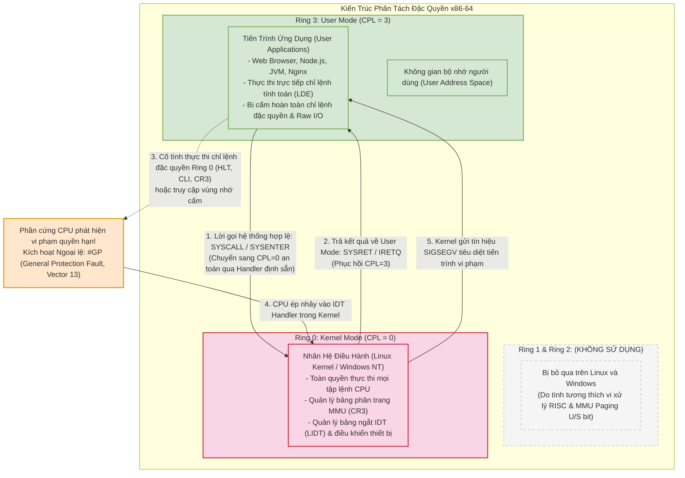

# 1_1_2 Dual-Mode Operation (User Mode vs Kernel Mode)

> **Khóa học**: Cloud DevOps Basic — OS Core  
> **Phân nhóm**: 1 Domain 1 - Operating System Core Fundamentals › 1_1 OS Architecture and Hardware Privilege Modes  
> **Chủ đề**: Phân định ranh giới đặc quyền thực thi phần cứng giữa User Mode và Kernel Mode  
> **Trạng thái**: Verified (WRITE-CDB-1_1_2, 14-11-2026)  
> **Checklist đối chiếu**: [1_1_2](../../../CHECKLIST.md#domain-1-operating-system-core-fundamentals-45-items)  

---

## 1. Khái Niệm Cốt Lõi & Bản Chất Kỹ Thuật (Core Concepts & Technical Deep Dive)

Trong kiến trúc máy tính hiện đại, việc thực thi chương trình người dùng được xây dựng dựa trên nguyên lý then chốt mang tên **Limited Direct Execution (LDE - Thực thi Trực tiếp có Giới hạn)**.

### 1.1 Nguyên lý Limited Direct Execution (LDE)

Để hệ thống đạt hiệu năng tính toán tối đa (maximum speed), phương pháp hiệu quả nhất là để các chỉ lệnh mã máy của tiến trình người dùng được thực thi trực tiếp trên phần cứng CPU (native execution) thay vì phải chạy qua các tầng giả lập hay thông dịch trung gian chậm chạp. 

Tuy nhiên, nếu CPU để tiến trình chạy trực tiếp hoàn toàn mà không có bất kỳ rào cản kiểm soát nào từ hệ điều hành, hệ thống sẽ đối mặt với thảm họa:
- Một tiến trình bị lỗi hoặc cố tình chạy vòng lặp vô tận sẽ độc chiếm CPU vĩnh viễn, ngăn không cho bất kỳ tiến trình nào khác (hoặc chính OS) có cơ hội can thiệp.
- Một chương trình bất kỳ có thể tự do đọc và ghi đè vào không gian bộ nhớ của các chương trình khác hoặc ghi đè trực tiếp lên mã nguồn của chính hệ điều hành.
- Tiến trình có thể tự do phát các lệnh đọc/ghi I/O trực tiếp tới ổ đĩa cứng, card mạng hoặc phần cứng thô, làm tê liệt toàn bộ cơ chế phân quyền và bảo vệ.

Nếu không có sự kiểm soát chặt chẽ đối với các chương trình đang chạy, hệ điều hành sẽ mất hoàn toàn quyền kiểm soát cỗ máy và bị hạ cấp xuống chỉ còn đóng vai trò là "một thư viện tiện ích" (*"just a library"*)—một trạng thái bất lực đối với một hệ điều hành thực thụ. Vì vậy, kiến trúc máy tính bắt buộc phải kết hợp giữa **thực thi trực tiếp** (để đạt tốc độ) và **giới hạn phần cứng** (để giữ quyền kiểm soát).

---

### 1.2 Cơ Chế Chế Độ Kép (Dual-Mode Operation) & Các Cấp Độ Đặc Quyền

Để hiện thực hóa Limited Direct Execution, các nhà thiết kế kiến trúc vi xử lý đã trang bị tính năng hỗ trợ phân chia chế độ hoạt động phần cứng, gọi là **Dual-Mode Operation (Chế độ kép)**:

1. **User Mode (Chế độ người dùng - Unprivileged Mode)**:
   - Là chế độ hoạt động bị giới hạn nghiêm ngặt về quyền hạn.
   - Các chương trình ứng dụng thông thường (trình duyệt web, ứng dụng web backend, trình biên dịch, công cụ dòng lệnh) đều được thực thi trong User Mode.
   - Ở chế độ này, tiến trình **bị phần cứng nghiêm cấm** thực hiện các thao tác đặc quyền (*privileged operations*), chẳng hạn như: phát lệnh I/O trực tiếp tới đĩa cứng hay card mạng, sửa đổi bảng phân trang bộ nhớ, hoặc thực thi các chỉ lệnh thay đổi trạng thái phần cứng của CPU (như tắt ngắt).
   - Nếu một tiến trình đang chạy ở User Mode cố tình thực thi một chỉ lệnh đặc quyền, phần cứng bộ xử lý sẽ từ chối thực hiện và **lập tức kích hoạt một ngoại lệ phần cứng (hardware exception / fault)**. Khi đó, quyền điều khiển CPU bị tước khỏi tiến trình và chuyển về hệ điều hành, và hệ điều hành sẽ lập tức tiêu diệt (*terminate / kill*) tiến trình vi phạm để bảo toàn hệ thống.

2. **Kernel Mode (Chế độ nhân / Chế độ giám sát - Privileged / Supervisor Mode)**:
   - Là chế độ hoạt động sở hữu toàn quyền đối với phần cứng máy tính.
   - Nhân hệ điều hành (OS Kernel) hoạt động trong chế độ này.
   - Mã lệnh chạy trong Kernel Mode có quyền thực thi toàn bộ tập lệnh của CPU, truy cập toàn bộ không gian địa chỉ bộ nhớ vật lý, thao tác trực tiếp với các thanh ghi điều khiển hệ thống của CPU và toàn bộ các thiết bị ngoại vi I/O.

---

### 1.3 Bản Chất Phần Cứng: CPL Trong Thanh Ghi `%cs` vs Trừu Tượng Hóa "Mode Bit"

Một vấn đề kỹ thuật thường gây hiểu lầm bắt nguồn từ cách giảng dạy trong các giáo trình khoa học máy tính kinh điển (như của Silberschatz hay Tanenbaum):

> [!NOTE]
> **Mô hình trừu tượng sách giáo khoa**:  
> Sách giáo khoa thường mô tả một cách giản lược rằng CPU sở hữu một *"Mode Bit"* nằm trong thanh ghi trạng thái (PSW - Processor Status Word), với quy ước bit = 1 là User Mode và bit = 0 là Kernel Mode.

**Thực tế trên kiến trúc vi xử lý x86 và x86-64**:
- Phần cứng x86-64 **không** theo dõi quyền thực thi bằng một "Mode Bit" đơn lẻ trong thanh ghi trạng thái `EFLAGS` / `RFLAGS`.
- Thay vào đó, kiến trúc CPU x86-64 quản lý quyền hạn thực thi thông qua trường **CPL (Current Privilege Level)** gồm 2 bit, được lưu trữ ở **2 bit thấp nhất của thanh ghi đoạn mã `%cs` (Code Segment Register)**:
  - `00b` (0): Mức đặc quyền tối cao — **Ring 0** (Kernel Mode).
  - `11b` (3): Mức đặc quyền tối thiểu — **Ring 3** (User Mode).

Trong mã nguồn Linux Kernel cho kiến trúc x86 (`arch/x86/include/asm/segment.h` và `ptrace.h`), việc kiểm tra xem một tiến trình có đang vận hành trong User Mode hay không được thực hiện trực tiếp bằng cách kiểm tra giá trị của 2 bit này thông qua mặt nạ phân đoạn:

```c
/* arch/x86/include/asm/segment.h */
#define SEGMENT_RPL_MASK 0x3

/* arch/x86/include/asm/ptrace.h */
static __always_inline int user_mode(struct pt_regs *regs) {
    return !!(regs->cs & 3);
}
```

Nếu 2 bit cuối của `%cs` khác 0 (giá trị là 3), CPU xác nhận tiến trình đang chạy ở User Mode (Ring 3).

---

### 1.4 Tại Sao Linux và Windows Chỉ Dùng Ring 0 và Ring 3?

Kiến trúc bộ xử lý x86 trong lịch sử định nghĩa tới **4 vòng bảo vệ (Hardware Protection Rings)** xếp theo thứ tự giảm dần quyền hạn từ Ring 0 đến Ring 3:
- **Ring 0**: Kernel Mode (Mức đặc quyền cao nhất).
- **Ring 1**: Được thiết kế cho các dịch vụ cốt lõi của hệ điều hành.
- **Ring 2**: Được thiết kế cho các trình điều khiển thiết bị (Device Drivers).
- **Ring 3**: User Mode (Mức đặc quyền thấp nhất, dành cho ứng dụng người dùng).

Tuy nhiên, các hệ điều hành hiện đại như **Linux** và **Windows** hoàn toàn bỏ qua Ring 1 và Ring 2, chỉ hoạt động trên mô hình 2 mức đặc quyền (Dual-Mode): **Ring 0** cho Kernel và **Ring 3** cho User Space. Quyết định kiến trúc này xuất phát từ 3 lý do căn bản:

1. **Tính tương thích đa kiến trúc (Portability across architectures)**:  
   Nhiều kiến trúc vi xử lý RISC phổ biến khác (chẳng hạn như ARM, MIPS, RISC-V) trong thiết kế phần cứng ban đầu chỉ cung cấp 2 mức đặc quyền (User Mode và Supervisor/Privileged Mode). Để nhân Linux và Windows có thể biên dịch và chạy thống nhất trên nhiều nền tảng vi xử lý khác nhau, hệ điều hành chỉ chuẩn hóa trên mô hình tối thiểu 2 mức đặc quyền.
2. **Cơ chế phân trang phần cứng MMU (Paging U/S Bit)**:  
   Đơn vị quản lý bộ nhớ phần cứng (MMU) trong cơ chế phân trang x86 chỉ cung cấp **1 bit duy nhất** mang tên cờ **U/S (User/Supervisor Bit)** trên các mục bảng trang (page table entries). Bit này chỉ phân biệt giữa User (Ring 3) và Supervisor (Ring 0, 1, 2) mà không có cơ chế gắn quyền riêng biệt cho Ring 1 hoặc Ring 2. Do đó, phần cứng bộ nhớ không thể bảo vệ riêng biệt giữa Ring 1 và Ring 2.
3. **Tối ưu hóa các lệnh chuyển đổi nhanh (Fast Syscalls)**:  
   Các chỉ lệnh phần cứng hiện đại dùng cho chuyển đổi chế độ siêu tốc như `SYSCALL`/`SYSRET` trên x86-64 được các nhà sản xuất chip tối ưu để nhảy trực tiếp giữa Ring 3 và Ring 0 mà không hỗ trợ các vòng trung gian.

---

### 1.5 Tập Lệnh Đặc Quyền (Privileged Instructions) & Ngoại Lệ #GP

Một tập hợp các chỉ lệnh máy nhạy cảm được phần cứng quy định là **chỉ lệnh đặc quyền** (*Privileged Instructions*), chỉ được phép thực thi khi CPU đang ở trạng thái `CPL = 0` (Ring 0). Các chỉ lệnh này bao gồm:
- **Quản lý trạng thái CPU & Ngắt**: `HLT` (Halt CPU - tạm dừng bộ xử lý), `CLI` (Clear Interrupt Flag - vô hiệu hóa ngắt phần cứng), `STI` (Set Interrupt Flag - cho phép ngắt).
- **Quản lý bảng quản trị hệ thống**: `LIDT` (Load Interrupt Descriptor Table Register - nạp bảng vector ngắt), `LGDT` (Load Global Descriptor Table Register), `LTR` (Load Task Register).
- **Quản lý bộ nhớ ảo & Phân trang**: `MOV CR0, ...`, `MOV CR3, ...` (thanh ghi `CR3` chứa địa chỉ cơ sở của bảng phân trang bộ nhớ của tiến trình).

Nếu mã chạy trong Ring 3 cố tình thực thi một trong các chỉ lệnh trên, phần cứng vi xử lý sẽ ngay lập tức chặn lại và kích hoạt ngoại lệ **General Protection Fault (`#GP`, Vector ngắt số 13)**. Mã xử lý bẫy `#GP` trong Linux Kernel (`arch/x86/kernel/traps.c`) sẽ kiểm tra ngữ cảnh; nếu lỗi phát sinh từ User Mode, Kernel sẽ gửi tín hiệu `SIGSEGV` để buộc dừng và ghi nhận lỗi đổ vỡ tiến trình.

---

## 2. Ví Dụ Đời Sống Thực Tế Dễ Hiểu (Intuitive Real-World Analogies)

### Ẩn Dụ: Hành Khách và Phi Công Trên Chuyến Bay Thương Mại (Passenger vs Pilot in Cockpit)

Để dễ hình dung cơ chế phân quyền giữa User Mode và Kernel Mode, hãy liên tưởng kiến trúc máy tính với một chuyến bay thương mại chở khách:

```text
+------------------------------------------------------------------------+
|                           CHUYẾN BAY THƯƠNG MẠI                        |
|                                                                        |
|  [ KHOANG HÀNH KHÁCH - User Mode / Ring 3 ]                            |
|  - Hành khách tự do đọc sách, nghe nhạc, uống nước                     |
|  - Tự do đi lại trong giới hạn hàng ghế của mình                       |
|  - TUYỆT ĐỐI KHÔNG ĐƯỢC CHẠM VÀO CẦN LÁI ĐỘNG CƠ                       |
|                                                                        |
|         | Nhấn chuông gọi tiếp viên (System Call / Trap)               |
|         v                                                              |
|  ====================== CỬA BỌC THÉP CÁCH LY ========================  |
|                                                                        |
|  [ BUỒNG LÁI PHI CÔNG - Kernel Mode / Ring 0 ]                         |
|  - Phi công có toàn quyền điều khiển cần lái, độ cao, động cơ máy bay  |
|  - Tiếp nhận yêu cầu hợp lệ từ tiếp viên, kiểm tra an toàn và xử lý    |
|                                                                        |
|  * Hành khách cố tình tông cửa buồng lái (chạy lệnh đặc quyền Ring 0): |
|    --> Cảm biến an ninh báo động (General Protection Fault #GP)        |
|    --> Cảnh sát hàng không còng tay và khống chế ngay (SIGSEGV - Kill) |
+------------------------------------------------------------------------+
```

1. **Khoang hành khách (User Mode — Ring 3)**:
   - Mỗi hành khách ngồi ở một số ghế cụ thể (tương đương với một tiến trình trong không gian địa chỉ ảo riêng biệt). Hành khách có toàn quyền tự do đọc sách, gõ máy tính, ăn uống tại chỗ của mình (thực thi các phép tính toán logic, xử lý mảng, gọi hàm nội bộ).
   - Tuy nhiên, hành khách không được phép chạy vào buồng lái, không được chạm vào cần gạt góc lượn, công tắc điện hay nút mở cửa thoát hiểm trên không (tương đương với việc không được can thiệp vào thanh ghi `CR3`, không được tắt ngắt bằng `CLI` hay tắt máy bằng `HLT`).

2. **Chuông gọi tiếp viên (System Call / Trap — Cầu nối chuyển chế độ)**:
   - Khi hành khách cần một dịch vụ cần can thiệp từ phi hành đoàn—chẳng hạn như yêu cầu cung cấp bữa ăn nóng hoặc thông báo cần hỗ trợ y tế khẩn cấp (tương đương việc cần đọc/ghi file từ đĩa, gửi gói tin qua mạng)—hành khách không thể tự ý xuống khoang hàng hóa để lấy đồ.
   - Thay vào đó, hành khách phải **bấm nút chuông gọi tiếp viên**. Tín hiệu chuông (software interrupt / syscall) làm tiếp viên xuất hiện. Tiếp viên kiểm tra yêu cầu: nếu hợp lệ, tiếp viên sẽ thông báo qua điện đàm buồng lái để phi hành đoàn thực hiện dịch vụ an toàn.

3. **Cố tình xông vào buồng lái (General Protection Fault #GP & Termination)**:
   - Nếu một hành khách quá khích manh động cố tình phá cửa bọc thép để xông vào buồng lái đòi tự lái máy bay (tiến trình ở Ring 3 cố tình thực thi lệnh `HLT` hoặc ghi thanh ghi `CR3`), cảm biến phần cứng của cửa sẽ kích hoạt hệ thống báo động an ninh khẩn cấp (CPU phát sinh ngoại lệ `#GP`).
   - Cảnh sát an ninh hàng không trên máy bay sẽ lập tức khống chế, còng tay và cách ly hành khách đó ngay tại chỗ (Linux Kernel nhận bẫy `#GP`, phát tín hiệu `SIGSEGV` tiêu diệt tiến trình vi phạm). Nhờ đó, một hành khách có vấn đề không bao giờ có thể làm rơi cả chiếc máy bay chở hàng trăm hành khách khác.

---

## 3. Kiến Trúc, Luồng Hoạt Động & Hình Ảnh Trực Quan (Architecture, Diagrams & Visual Media)

### 3.1 Hình Ảnh Kiến Trúc Chính Thức Từ Microsoft Learn

Dưới đây là sơ đồ kiến trúc chính thức mô tả sự phân tách giữa không gian User Mode và Kernel Mode cùng luồng giao tiếp kiểm soát phần cứng:

[](https://learn.microsoft.com/en-us/windows-hardware/drivers/gettingstarted/images/userandkernelmode01.png)  
*Hình 1: Mô hình phân tách ranh giới User Mode và Kernel Mode cùng luồng chuyển tiếp kiểm soát phần cứng (Nguồn: Microsoft Learn).*

---

### 3.2 Sơ Đồ Mermaid: Ranh Giới Đặc Quyền Phần Cứng x86 & Cơ Chế Kiểm Soát



---

## 4. Code Mẫu Trực Quan Hoặc Dòng Lệnh Thực Chiến (Runnable Sample Code / CLI)

> ⚠️ Chưa chạy thử (not executed by the squad) - Ví dụ minh họa hành vi phần cứng kích hoạt ngoại lệ #GP (General Protection Fault) khi gặp chỉ lệnh đặc quyền ở Ring 3.

### 4.1 Thử Nghiệm C: Cố Tình Thực Thi Chỉ Lệnh Đặc Quyền Trong User Mode

Đoạn mã C dưới đây sử dụng Assembly nhúng (`inline assembly`) để cố tình phát chỉ lệnh đặc quyền `HLT` (Halt Processor - lệnh yêu cầu CPU dừng hoạt động cho đến khi có ngắt phần cứng kế tiếp) ngay trong một tiến trình người dùng bình thường:

```c
/*
 * File: test_privilege.c
 * Mục đích: Minh họa phản ứng của phần cứng CPU khi mã chạy trong User Mode (Ring 3)
 *           cố tình thực thi chỉ lệnh đặc quyền Ring 0 (HLT).
 */

#include <stdio.h>

int main(void) {
    printf("[USER MODE] Tiến trình đang chạy với mức đặc quyền Ring 3 (CPL = 3)...\n");
    printf("[USER MODE] Chuẩn bị thử nghiệm phát chỉ lệnh đặc quyền: 'hlt'...\n");

    /*
     * HLT (Halt) là chỉ lệnh đặc quyền tối cao của CPU x86-64.
     * Chỉ lệnh này chỉ được phép thực thi khi CPL = 0 (Ring 0 / Kernel Mode).
     * Khi thực thi tại Ring 3, phần cứng CPU x86 sẽ chặn đứng lệnh này
     * và lập tức phát sinh ngoại lệ General Protection Fault (#GP, Vector 13).
     */
    __asm__ volatile ("hlt");

    /* Dòng in dưới đây sẽ KHÔNG BAO GIỜ được CPU chạm tới */
    printf("[USER MODE] Dòng này sẽ không bao giờ được in ra màn hình!\n");
    return 0;
}
```

### 4.2 Thao Tác Biên Dịch Và Thực Thi Trên Linux CLI

```bash
# 1. Biên dịch mã nguồn bằng trình biên dịch GCC
gcc test_privilege.c -o test_privilege

# 2. Thực thi chương trình từ môi trường User Space
./test_privilege
```

### 4.3 Đầu Ra Minh Họa & Phân Tích Cơ Chế Ngầm

```text
[USER MODE] Tiến trình đang chạy với mức đặc quyền Ring 3 (CPL = 3)...
[USER MODE] Chuẩn bị thử nghiệm phát chỉ lệnh đặc quyền: 'hlt'...
Segmentation fault (core dumped)
```

**Giải thích cơ chế xử lý ngầm của hệ thống**:
1. **Phát hiện tại phần cứng**: Khi vi xử lý x86-64 giải mã chỉ lệnh `hlt`, bộ giải mã lệnh (Instruction Decoder) kiểm tra trường CPL ở 2 bit thấp của thanh ghi `%cs`. Vì CPL = 3 (khác 0), CPU từ chối thực thi lệnh `hlt`.
2. **Kích hoạt ngắt phần cứng**: CPU lập tức dừng luồng thực thi thông thường, lưu trạng thái thanh ghi của tiến trình vào ngăn xếp kernel và kích hoạt ngoại lệ **General Protection Fault (`#GP`, Vector ngắt số 13)**.
3. **Phản ứng của Linux Kernel**: Quyền điều khiển được trao cho hàm xử lý ngắt trong kernel (`exc_general_protection` trong tệp nguồn `arch/x86/kernel/traps.c`). Kernel thực hiện kiểm tra:
   ```c
   if (user_mode(regs)) {
       gp_user_force_sig_segv(regs, X86_TRAP_GP, error_code, desc);
       goto exit;
   }
   ```
   Do macro `user_mode(regs)` xác nhận lỗi xảy ra từ Ring 3 (`regs->cs & 3 != 0`), hàm `gp_user_force_sig_segv()` phát tín hiệu `SIGSEGV` (Signal 11) đến tiến trình, dẫn đến việc tiến trình bị buộc dừng lập tức và tạo tệp core dump.

---

## 5. Cạm Bẫy Thực Tế & Thực Tiễn Sản Xuất (Production Gotchas & Best Practices)

Trong kỹ thuật hệ thống và quản trị hạ tầng Cloud DevOps, các cạm bẫy nhận thức sau đây rất thường gặp:

### 1. Cạm bẫy nhận thức: "Mode Bit trong thanh ghi PSW" (Textbook Abstraction)
- **Sai lầm phổ biến**: Nhiều kỹ sư nhớ máy móc từ các bài giảng lý thuyết nhập môn rằng *"CPU có một cờ đơn lẻ gọi là Mode Bit nằm trong thanh ghi PSW, 0 là Kernel và 1 là User"*.
- **Bản chất thực tế trên x86-64**: Không tồn tại bit nào tên là "Mode Bit" trong thanh ghi cờ `RFLAGS`. Trên kiến trúc x86-64, quyền hạn được biểu diễn bằng trường 2-bit **CPL (Current Privilege Level)** nằm trong thanh ghi `%cs`. Để đổi mode, CPU phải nạp lại thanh ghi `%cs` thông qua các lệnh chuyển đổi đặc thù (`IRETQ`, `SYSRETQ`), không thể đơn giản là lật 1 bit trong thanh ghi cờ.

### 2. Ngộ nhận về việc sử dụng 4 Rings bảo vệ trên hệ điều hành hiện đại
- **Sai lầm phổ biến**: Nghĩ rằng các hệ điều hành lớn đưa driver card đồ họa hoặc card mạng chạy ở Ring 1 hoặc Ring 2 để tăng tính bảo vệ.
- **Thực tế**: Cả Linux và Windows đều hoạt động thuần túy ở mô hình Dual-Mode (Ring 0 và Ring 3). Driver thiết bị chạy trong Kernel Mode (Ring 0) hoặc được đưa hoàn toàn ra ngoài User Space (Ring 3) trong các kiến trúc user-space drivers (như Windows UMDF hoặc DPDK trên Linux). Ring 1 và Ring 2 bị bỏ qua hoàn toàn do giới hạn của cờ phân trang bộ nhớ `U/S` trong bảng trang MMU và yêu cầu tương thích với các vi xử lý RISC (chỉ có 2 mức).

### 3. Hiểu lầm về nguồn gốc của tín hiệu `SIGSEGV`
- **Sai lầm phổ biến**: Đa số lập trình viên mặc định rằng `Segmentation fault (SIGSEGV)` chỉ xảy ra khi truy cập sai vùng nhớ (như dereference con trỏ `NULL` hoặc truy cập ngoài mảng).
- **Thực tế**: Khi mã ứng dụng User Mode cố tình thực thi một chỉ lệnh đặc quyền (chẳng hạn như `HLT`, `CLI`, hoặc `LIDT`), CPU phát sinh ngoại lệ phần cứng `#GP` (General Protection Fault). Nhân Linux trên x86-64 quy đổi ngoại lệ `#GP` từ không gian người dùng thành tín hiệu `SIGSEGV` để tiêu diệt tiến trình. Do đó, một lỗi `SIGSEGV` có thể bắt nguồn từ vi phạm đặc quyền chỉ lệnh chứ không chỉ riêng vi phạm phân vùng bộ nhớ.

---

## 6. Câu Hỏi Củng Cố Kiến Thức (Active Recall Quiz)

<details>
<summary><b>Câu hỏi 1:</b> Một lập trình viên viết một ứng dụng C chạy trên Linux và chèn câu lệnh Assembly <code>__asm__("cli");</code> (Clear Interrupts - cấm ngắt CPU) nhằm ngăn hệ điều hành ngắt tiến trình trong lúc tính toán một tác vụ nặng. Chuyện gì sẽ xảy ra khi thực thi chương trình này và tại sao hệ thống phải làm như vậy?</summary>

**Đáp án:**
- **Kết quả**: Chương trình sẽ bị hệ điều hành tiêu diệt ngay lập tức với lỗi `Segmentation fault (core dumped)`.
- **Nguyên nhân kỹ thuật**: Lệnh `CLI` là chỉ lệnh đặc quyền chỉ được phép thực thi tại `CPL = 0` (Ring 0). Khi ứng dụng người dùng chạy ở Ring 3 (`CPL = 3`) thực thi `CLI`, vi xử lý x86-64 phát hiện vi phạm phân quyền và kích hoạt ngoại lệ General Protection Fault (`#GP`, Vector 13). Kernel xử lý bẫy `#GP` bằng cách gửi tín hiệu `SIGSEGV` đến tiến trình.
- **Lý do hệ thống ngăn cấm**: Theo nguyên lý Limited Direct Execution (LDE), nếu một tiến trình người dùng được phép tự ý tắt ngắt, nó có thể vô hiệu hóa ngắt bộ định thời (timer interrupt), dẫn tới việc chiếm dụng CPU vĩnh viễn và khiến hệ điều hành mất hoàn toàn quyền kiểm soát máy tính.
</details>

<details>
<summary><b>Câu hỏi 2:</b> Mặc dù kiến trúc vi xử lý x86 hỗ trợ 4 vòng bảo vệ (Ring 0 đến Ring 3), tại sao các hệ điều hành hiện đại như Linux và Windows chỉ sử dụng Ring 0 và Ring 3?</summary>

**Đáp án:**
Có 3 nguyên nhân kỹ thuật chính:
1. **Tính tương thích đa nền tảng vi xử lý (Portability)**: Nhiều kiến trúc chip khác (như ARM, MIPS, RISC-V) chỉ thiết kế 2 mức đặc quyền (User Mode và Privileged/Supervisor Mode). Chuẩn hóa hệ điều hành trên 2 mức giúp nhân OS dễ dàng chuyển đổi (port) sang các kiến trúc phần cứng khác nhau.
2. **Cơ chế phân trang MMU chỉ có 1 bit phân quyền**: Cờ bảo vệ bộ nhớ trong bảng phân trang của MMU (cờ `U/S` - User/Supervisor) chỉ là 1 bit duy nhất, chỉ phân biệt được User (Ring 3) và Supervisor (Ring 0, 1, 2) chứ không thể gán quyền riêng biệt cho Ring 1 hoặc Ring 2.
3. **Tối ưu hóa phần cứng cho lệnh gọi nhanh**: Các chỉ lệnh gọi hệ thống siêu tốc hiện đại (`SYSCALL`/`SYSRET`) được thiết kế phần cứng để chuyển đổi trực tiếp giữa Ring 3 và Ring 0 mà không hỗ trợ các ring trung gian.
</details>

<details>
<summary><b>Câu hỏi 3:</b> Trong kiến trúc vi xử lý x86-64 thực tế, mức đặc quyền hiện tại (Current Privilege Level) của CPU được theo dõi và xác định thông qua thành phần phần cứng nào?</summary>

**Đáp án:**
- Mức đặc quyền không được lưu trong một "Mode Bit" đơn lẻ của thanh ghi cờ trạng thái `RFLAGS` như mô hình giản lược trong sách giáo khoa.
- Thay vào đó, nó được lưu trữ tại trường **CPL (Current Privilege Level)** gồm 2 bit nằm ở **2 bit thấp nhất của thanh ghi đoạn mã `%cs` (Code Segment Register)**:
  - Giá trị `00b` (0) biểu thị **Ring 0** (Kernel Mode).
  - Giá trị `11b` (3) biểu thị **Ring 3** (User Mode).
- Nhân Linux kiểm tra trạng thái này thông qua macro `user_mode(regs)` bằng phép toán kiểm tra bit: `regs->cs & 3`.
</details>

---

## 7. 📚 Nguồn Tài Liệu Chính Thống (Tier-1 Official References)

- [OSTEP Chapter 6: Mechanism: Limited Direct Execution](https://pages.cs.wisc.edu/~remzi/OSTEP/cpu-mechanisms.pdf) - Giáo trình chuẩn mực *Operating Systems: Three Easy Pieces* (Remzi H. Arpaci-Dusseau & Andrea C. Arpaci-Dusseau), phân tích chuyên sâu về cơ chế Limited Direct Execution, rào cản chỉ lệnh đặc quyền và cơ chế bẫy phần cứng.
- [Microsoft Learn: User Mode and Kernel Mode](https://learn.microsoft.com/en-us/windows-hardware/drivers/gettingstarted/user-mode-and-kernel-mode) - Tài liệu kỹ thuật chính thống từ Microsoft mô tả mô hình bảo vệ 2 chế độ (Dual-Mode) và ranh giới an toàn không gian bộ nhớ trong hệ điều hành Windows.
- [Linux Kernel Source: arch/x86/include/asm/segment.h](https://raw.githubusercontent.com/torvalds/linux/master/arch/x86/include/asm/segment.h) - Mã nguồn nhân Linux chính thức định nghĩa mặt nạ phân đoạn phần cứng `SEGMENT_RPL_MASK` (0x3) và các cấp độ phân đoạn Ring 0 / Ring 3 trên x86-64.
- [Linux Kernel Source: arch/x86/kernel/traps.c](https://raw.githubusercontent.com/torvalds/linux/master/arch/x86/kernel/traps.c) - Mã nguồn nhân Linux xử lý ngoại lệ phần cứng General Protection Fault (`exc_general_protection`) và điều hướng phát tín hiệu `SIGSEGV` khi mã User Mode vi phạm chỉ lệnh đặc quyền.
- [Linux Manual Pages: syscall(2)](https://man7.org/linux/man-pages/man2/syscall.2.html) - Hướng dẫn chính thức về giao diện chuyển đổi giữa User Mode và Kernel Mode qua lời gọi hệ thống trong Linux.
