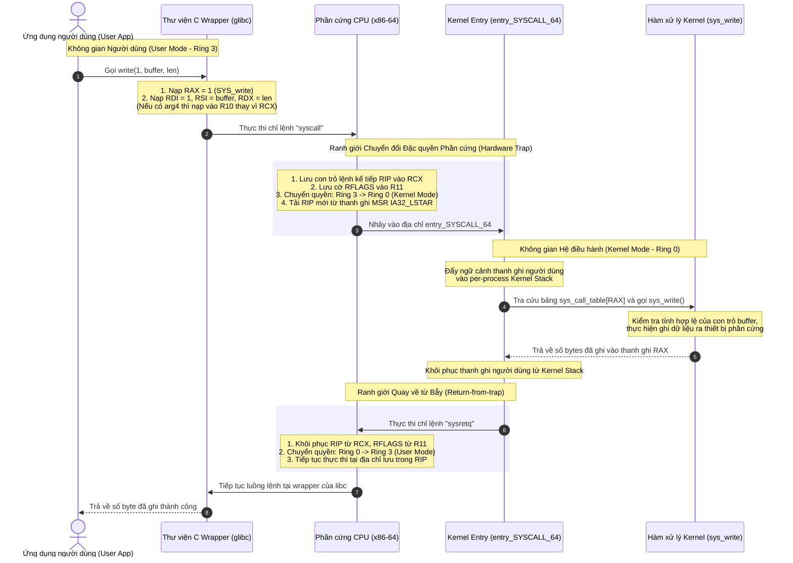

# 1_1_3 System Calls and Software Traps

> **Khóa học**: Cloud DevOps Basic — OS Core  
> **Phân nhóm**: 1 Domain 1 - Operating System Core Fundamentals › 1_1 OS Architecture and Hardware Privilege Modes  
> **Chủ đề**: Lời gọi hệ thống và cơ chế bẫy phần mềm: Ranh giới bảo vệ, chuyển đổi đặc quyền CPU và quy ước gọi x86-64  
> **Trạng thái**: Draft (WRITE-CDB-1_1_3, 14-11-2026)  
> **Checklist đối chiếu**: [1_1_3](../../../CHECKLIST.md#domain-1-operating-system-core-fundamentals-45-items)  

---

## 1. Khái Niệm Cốt Lõi & Bản Chất Kỹ Thuật (Core Concepts & Technical Deep Dive)

Trong kiến trúc máy tính hiện đại, để đảm bảo tính ổn định và an toàn, phần cứng CPU áp dụng mô hình phân tách đặc quyền (Dual-Mode / Ring 3 User Mode vs Ring 0 Kernel Mode). Các chương trình người dùng (User Programs) chạy ở chế độ không đặc quyền (User Mode) và bị tước bỏ quyền thực thi trực tiếp các chỉ lệnh nhạy cảm như tương tác với thiết bị I/O, cấp phát bộ nhớ vật lý hay quản lý ngắt. Khi cần thực hiện các tác vụ này, chương trình bắt buộc phải thông qua **Lời gọi hệ thống (System Call - Syscall)** và cơ chế **Bẫy phần mềm (Software Trap)**.

### 1.1 Khác biệt bản chất giữa Procedure Call và System Call

Trong lập trình thông thường (chẳng hạn ngôn ngữ C), việc gọi hàm hệ thống như `read()`, `write()`, hay `open()` trông hoàn toàn giống với một lời gọi hàm thông thường (Procedure Call). Tuy nhiên, về mặt bản chất phần cứng và hệ thống:

- **Lời gọi hàm thông thường (Procedure Call)**: Sử dụng lệnh `call` của CPU để nhảy trực tiếp đến một địa chỉ bộ nhớ cụ thể nằm trong cùng không gian địa chỉ ảo của tiến trình người dùng. CPU không hề thay đổi mức đặc quyền (vẫn ở Ring 3).
- **Lời gọi hệ thống (System Call)**: Mã nguồn người dùng **tuyệt đối không thể chỉ định một địa chỉ bộ nhớ tùy ý trong Kernel để nhảy vào** (nếu cố tình dùng lệnh `call` nhảy vào vùng nhớ Kernel, CPU sẽ lập tức phát sinh lỗi vi phạm bảo vệ phần cứng). Thay vào đó, một lời gọi hệ thống được ẩn giấu bên trong hàm bọc (wrapper function) của thư viện C chuẩn (glibc/musl). Hàm wrapper này chuẩn bị các tham số, đặt số hiệu syscall tương ứng vào thanh ghi và kích hoạt một **chỉ lệnh bẫy phần cứng đặc biệt (hardware trap instruction)**.

```text
+-----------------------------------------------------------------------------------+
| Tiêu chí                  | Procedure Call (Hàm thông thường)  | System Call (Lời gọi hệ thống)      |
+-----------------------------------------------------------------------------------+
| Cơ chế chuyển giao        | Lệnh call nhảy tới địa chỉ bộ nhớ  | Lệnh trap (syscall) kích hoạt ngắt  |
| Mức đặc quyền CPU         | Giữ nguyên User Mode (Ring 3)      | Nâng lên Kernel Mode (Ring 0)       |
| Không gian địa chỉ        | Cùng không gian người dùng         | Chuyển giao sang không gian Kernel  |
| Kiểm soát điểm vào        | Do tiến trình tự do quyết định     | Cố định nghiêm ngặt qua Trap Table  |
| Ngăn xếp (Stack) sử dụng  | User Stack                         | Per-process Kernel Stack            |
+-----------------------------------------------------------------------------------+
```

---

### 1.2 Bản chất kỹ thuật của Software Trap & Bảng bẫy (Trap Table / IDT)

**Bẫy phần mềm (Software Trap)** là một cơ chế chuyển giao quyền điều khiển đồng bộ được kích hoạt bởi chính luồng lệnh đang thực thi của tiến trình, với sự trợ giúp trực tiếp từ phần cứng vi xử lý:
1. **Chuyển đổi mức đặc quyền tức thì**: Lệnh trap đồng thời chuyển con trỏ lệnh vào nhân Kernel và nâng mức đặc quyền của CPU từ User Mode lên Kernel Mode.
2. **Khởi tạo duy nhất tại thời điểm khởi động (Boot Time Initialization)**:
   - Kernel kiểm soát chặt chẽ những dòng mã nào được phép thực thi khi xảy ra trap thông qua việc thiết lập **Bảng bẫy (Trap Table)** hoặc **Bảng mô tả ngắt (Interrupt Descriptor Table - IDT)** lúc hệ thống khởi động.
   - Khi cỗ máy vừa bật nguồn, CPU chạy ở chế độ đặc quyền tối cao (Kernel Mode). Nhân hệ điều hành tận dụng thời điểm này để thực thi các chỉ lệnh đặc quyền, nạp địa chỉ các hàm xử lý bẫy (Trap Handlers) vào phần cứng. Mã người dùng ở Ring 3 hoàn toàn không có khả năng sửa đổi bảng này.
   - Khi lệnh trap xảy ra, CPU phần cứng tự động đối chiếu số hiệu ngắt/bẫy và nhảy chính xác đến hàm xử lý đã được Kernel đăng ký trước, loại bỏ hoàn toàn khả năng người dùng điều hướng CPU thực thi mã độc hại.

---

### 1.3 Lưu trữ ngữ cảnh thanh ghi & Lệnh quay về từ bẫy (Return-From-Trap)

Để đảm bảo tiến trình người dùng có thể tiếp tục hoạt động chính xác sau khi Kernel hoàn thành tác vụ, hệ thống thực hiện quy trình lưu và khôi phục ngữ cảnh:

1. **Lưu trữ ngữ cảnh lên Kernel Stack**: Khi lệnh trap được kích hoạt, phần cứng CPU và đoạn mã stub đầu vào của Kernel sẽ tự động đẩy toàn bộ trạng thái thanh ghi của người dùng (Registers, Flags, con trỏ lệnh Program Counter / `RIP`, con trỏ ngăn xếp `RSP`) vào **ngăn xếp Kernel riêng biệt của từng tiến trình (per-process kernel stack)**.
2. **Thực thi trong không gian nhân**: Kernel đọc số hiệu syscall và các tham số từ thanh ghi, kiểm tra tính hợp lệ của dữ liệu và thực thi tác vụ tương ứng trong chế độ đặc quyền.
3. **Lệnh quay về từ bẫy (Return-from-trap)**:
   - Khi hoàn tất, hệ điều hành gọi chỉ lệnh quay về đặc biệt (trên x86-64 là `sysretq` hoặc `iretq`).
   - Lệnh này thực hiện hai hành động đồng thời và nguyên tử: khôi phục các thanh ghi, cờ và Program Counter từ Kernel Stack, đồng thời **hạ mức đặc quyền của CPU từ Kernel Mode trở lại User Mode**, tiếp tục thực thi câu lệnh kế tiếp của chương trình người dùng.

---

### 1.4 Cơ chế Fast System Call trên x86-64 và Quy ước gọi (Calling Convention)

Trên các kiến trúc 32-bit cũ (x86), system call thường được kích hoạt bằng lệnh ngắt phần mềm `int 0x80`. Cơ chế này đòi hỏi CPU phải truy cập bộ nhớ RAM để tra cứu bảng IDT, gây tiêu tốn đáng kể chu kỳ xung nhịp.

Trên kiến trúc **64-bit (x86-64 Linux)**, các nhà sản xuất phần cứng và cộng đồng Linux đã chuẩn hóa cơ chế **Fast System Call**:
- **Chỉ lệnh phần cứng**: Sử dụng cặp lệnh `syscall` (để vào kernel) và `sysretq` (để quay về user mode).
- **Model-Specific Registers (MSRs)**: CPU loại bỏ hoàn toàn việc tra cứu bảng IDT trong RAM. Địa chỉ entry point của Kernel (`entry_SYSCALL_64`), cờ mặt nạ và phân đoạn mã được nạp sẵn vào các thanh ghi MSR chuyên dụng (`IA32_STAR`, `IA32_LSTAR`, `IA32_FMASK`) ngay từ lúc boot. Khi lệnh `syscall` được gọi, CPU nhảy tức thì đến địa chỉ lưu trong thanh ghi `IA32_LSTAR`.

#### Quy ước truyền tham số System Call (Syscall Calling Convention) trên x86-64 Linux:
Theo đặc tả ABI của Linux x86-64 (chi tiết tại `man 2 syscall`):
- **Số hiệu System Call**: Nạp vào thanh ghi **`RAX`** (ví dụ: `1` là `SYS_write`, `0` là `SYS_read`, `60` là `SYS_exit`).
- **Các tham số truyền vào (tối đa 6 tham số)**: Nạp theo thứ tự các thanh ghi:
  1. Tham số 1: **`RDI`**
  2. Tham số 2: **`RSI`**
  3. Tham số 3: **`RDX`**
  4. Tham số 4: **`R10`** *(Lưu ý khác biệt quan trọng với C ABI bên dưới!)*
  5. Tham số 5: **`R8`**
  6. Tham số 6: **`R9`**
- **Giá trị trả về**: Kernel lưu mã kết quả (hoặc mã lỗi âm) vào thanh ghi **`RAX`**.

> ⚠️ **Sự khác biệt sống còn giữa C Library ABI và Linux Syscall ABI**:  
> Trong quy ước gọi hàm thông thường của ngôn ngữ C trên x86-64 (System V AMD64 ABI), tham số thứ 4 được truyền qua thanh ghi **`RCX`**.  
> Tuy nhiên, trong Syscall ABI, tham số thứ 4 bắt buộc phải dùng **`R10`** thay thế.  
> **Nguyên nhân phần cứng**: Khi chỉ lệnh phần cứng `syscall` được CPU thực thi, CPU tự động lưu con trỏ lệnh kế tiếp (`RIP`) vào thanh ghi `RCX` (và lưu cờ `RFLAGS` vào `R11`) để phục vụ cho lệnh `sysretq`. Do đó, thanh ghi `RCX` và `R11` bị phần cứng ghi đè (clobbered), buộc kernel phải nhận tham số thứ 4 qua `R10`.

---

## 2. Ví Dụ Đời Sống Thực Tế Dễ Hiểu (Intuitive Real-World Analogies)

### Ẩn dụ: Ngân Hàng & Quầy Giao Dịch Sau Kính Chống Đạn (Bank Teller & Armored Glass)

Hãy hình dung kiến trúc phân tách đặc quyền của máy tính như một **Chi nhánh Ngân hàng trung tâm**:

```text
[ Không gian Khách hàng (User Space) ]       [ Quầy Kính Chống Đạn ]       [ Không gian Kho tiền (Kernel Space) ]
 Khách hàng (User Application)       --->   Khe nộp phiếu (Syscall)  --->  Giao dịch viên (Trap Handler)
 Điền mẫu: Số tiền, Tài khoản              Phần cứng nâng quyền           Vào kho tiền lấy tiền mặt (Hardware I/O)
 Nhận tiền & Biên lai                <---   Khe trả tiền (Sysret)    <---  Hạ quyền về mức khách hàng
```

1. **Khách hàng (User Application)**: Đứng ở sảnh giao dịch bên ngoài (User Space). Khách hàng có nhu cầu rút 100 triệu tiền mặt từ tài khoản (truy cập tài nguyên phần cứng I/O).
2. **Quầy kính chống đạn & Khe giao dịch (Hardware Boundary & Trap)**:
   - Khách hàng tuyệt đối không được phép tự do đi vào khu vực kho tiền của ngân hàng (Kernel Memory) để tự ý mở két sắt lấy tiền. Nếu khách hàng cố tình trèo qua vách kính hoặc phá cửa, hệ thống báo động an ninh sẽ kích hoạt và bảo vệ có vũ trang sẽ trấn áp ngay lập tức (phần cứng CPU phát sinh ngoại lệ `General Protection Fault` và kết thúc tiến trình bằng tín hiệu `SIGSEGV`).
   - Khách hàng bắt buộc phải đứng ngoài quầy, lấy một phiếu rút tiền theo mẫu quy định của ngân hàng, điền đầy đủ thông tin: Mã nghiệp vụ "Rút tiền" (Số hiệu Syscall nạp vào `RAX`), Số tài khoản (tham số vào `RDI`), Số tiền cần rút (tham số vào `RSI`). Sau đó, khách hàng đẩy tờ phiếu qua khe hẹp trên cửa kính chống đạn (gọi lệnh `syscall`).
3. **Giao dịch viên & Nhân viên kho (Kernel Trap Handler & Core)**:
   - Giao dịch viên ở phía bên trong quầy (Kernel Mode) tiếp nhận tờ phiếu qua khe.
   - Giao dịch viên thực hiện kiểm tra an toàn: xác minh chữ ký của khách, kiểm tra số dư khả dụng (Pointer Validation & Permission Check). Nếu thông tin không hợp lệ, giao dịch viên từ chối và ghi mã lỗi vào phiếu (trả về mã lỗi âm như `-EFAULT`, `-EACCES` trong `RAX`).
   - Nếu hợp lệ, giao dịch viên dùng chìa khóa đặc quyền mở kho tiền, đếm đủ 100 triệu tiền mặt, sau đó đẩy tiền và hóa đơn qua khe trả lại cho khách hàng (thực thi lệnh `sysretq`).
4. **Khách hàng nhận kết quả**: Khách hàng nhận tiền mặt và tiếp tục các công việc cá nhân của mình ở không gian bên ngoài.

---

## 3. Kiến Trúc, Luồng Hoạt Động & Hình Ảnh Trực Quan (Architecture, Diagrams & Visual Media)

Biểu đồ trình tự (Sequence Diagram) dưới đây mô tả chi tiết toàn bộ chu trình thực thi một lời gọi hệ thống từ User Space, qua ranh giới phần cứng CPU, vào nhân Kernel và quay trở lại:



---

## 4. Thực Hành (Hands-on): Triển Khai & Quan Sát System Call Trên Linux x86-64

Dưới đây là chương trình C hoàn chỉnh minh họa hai cách gọi hệ thống để xuất chuỗi ra màn hình (STDOUT, file descriptor 1):
1. **Cách 1**: Sử dụng hàm wrapper tiêu chuẩn `syscall(2)` do thư viện C/POSIX cung cấp.
2. **Cách 2**: Sử dụng trực tiếp chỉ lệnh hợp ngữ nội tuyến phần cứng `syscall` (Raw Inline Assembly) trên kiến trúc x86-64, tuân thủ đúng quy ước truyền tham số thanh ghi và khai báo các thanh ghi bị ghi đè (clobbered registers).

### 4.1 Mã nguồn C minh họa (`demo_syscall.c`)

```c
#define _GNU_SOURCE
#include <unistd.h>
#include <sys/syscall.h>

int main(void) {
    // -------------------------------------------------------------
    // Cách 1: Gọi System Call thông qua hàm wrapper tiêu chuẩn của POSIX/glibc
    // syscall(SYS_write, fd, buf, count)
    // -------------------------------------------------------------
    const char msg1[] = "1. Direct invocation via POSIX syscall(SYS_write)\n";
    syscall(SYS_write, 1, msg1, sizeof(msg1) - 1);

    // -------------------------------------------------------------
    // Cách 2: Gọi System Call trực tiếp bằng chỉ lệnh phần cứng x86-64 (Inline Assembly)
    // Quy ước: RAX = số hiệu syscall, RDI = arg1, RSI = arg2, RDX = arg3
    // -------------------------------------------------------------
    const char msg2[] = "2. Raw x86-64 hardware syscall instruction\n";
    long ret;
    register long rax __asm__("rax") = 1;                 // 1 = SYS_write trên Linux x86-64
    register long rdi __asm__("rdi") = 1;                 // fd = 1 (STDOUT)
    register const char *rsi __asm__("rsi") = msg2;       // Con trỏ tới chuỗi ký tự
    register long rdx __asm__("rdx") = sizeof(msg2) - 1;  // Độ dài chuỗi (bytes)

    __asm__ volatile (
        "syscall"
        : "=a" (ret)                                      // Giá trị trả về của kernel nằm trong RAX
        : "r" (rax), "r" (rdi), "r" (rsi), "r" (rdx)      // Các thanh ghi tham số đầu vào
        : "rcx", "r11", "memory"                          // CPU phần cứng tự động clobber RCX và R11
    );

    return 0;
}
```

---

### 4.2 Biên dịch và Thực thi

Biên dịch chương trình bằng trình biên dịch `gcc`:

```bash
gcc -Wall -O2 demo_syscall.c -o demo_syscall
./demo_syscall
```

> 💡 **Minh họa thực thi (Illustrative Output)**:
```text
1. Direct invocation via POSIX syscall(SYS_write)
2. Raw x86-64 hardware syscall instruction
```

---

### 4.3 Quan sát quá trình bẫy hệ thống với `strace`

Tiện ích `strace` là công cụ chẩn đoán kinh điển của kỹ sư hệ thống trên Linux, cho phép chặn bắt và hiển thị mọi system call mà tiến trình thực hiện:

```bash
strace -e trace=write ./demo_syscall
```

> 💡 **Minh họa thực thi (Illustrative Output)**:
```text
write(1, "1. Direct invocation via POSIX s"..., 50) = 50
1. Direct invocation via POSIX syscall(SYS_write)
write(1, "2. Raw x86-64 hardware syscall i"..., 43) = 43
2. Raw x86-64 hardware syscall instruction
+++ exited with 0 +++
```
*Giải thích*: Cả hai phương thức—cho dù gọi qua hàm thư viện `syscall()` hay phát trực tiếp chỉ lệnh phần cứng `syscall` trong assembly—đều kích hoạt cùng một lời gọi hệ thống `write` với `fd=1` ở tầng nhân Kernel, trả về số byte đã ghi thành công là `50` và `43`.

---

## 5. Cạm Bẫy Thực Tế & Thực Tiễn Sản Xuất (Production Gotchas & Best Practices)

Trong kỹ thuật hệ thống và tối ưu hóa hạ tầng DevOps, việc tương tác với System Call đòi hỏi sự am hiểu sâu sắc về ranh giới phần cứng:

1. **Hiểm họa quên khai báo Clobber `RCX` và `R11` trong Inline Assembly**:
   - *Cạm bẫy*: Khi lập trình viên viết hợp ngữ nội tuyến (Inline Assembly) để tối ưu hóa micro-benchmark hoặc phát triển thư viện cấp thấp, nếu quên khai báo `"rcx"` và `"r11"` trong danh sách các thanh ghi bị ảnh hưởng (Clobber list), trình biên dịch GCC/Clang sẽ mặc định rằng các thanh ghi này vẫn giữ nguyên giá trị trước và sau khi thực thi khối assembly.
   - *Hậu quả*: Phần cứng CPU tự ý ghi đè `RIP` vào `RCX` và `RFLAGS` vào `R11` khi gọi `syscall`. Kết quả là các biến cục bộ hoặc con trỏ của chương trình người dùng được trình biên dịch tối ưu hóa lưu trên `RCX`/`R11` sẽ bị hỏng hoàn toàn (silent data corruption), dẫn đến lỗi crash ngẫu nhiên cực kỳ khó gỡ lỗi.

2. **Sai lầm truyền tham số thứ 4 giữa C ABI và Syscall ABI (`RCX` vs `R10`)**:
   - *Cạm bẫy*: Khi tự tay xây dựng các hàm stub hoặc hook system call, lập trình viên thường nhầm lẫn sử dụng quy ước hàm C tiêu chuẩn (đặt tham số thứ 4 vào `RCX`).
   - *Hậu quả*: Do `syscall` xóa sạch `RCX`, Kernel sẽ đọc giá trị rác từ `R10` làm tham số thứ 4. Đối với các syscall có từ 4 tham số trở lên (như `mmap`, `epoll_pwait`, `copy_file_range`), lệnh sẽ luôn thất bại với mã lỗi `-EINVAL` hoặc cấp phát sai vùng nhớ.

3. **Xác thực con trỏ người dùng trong Kernel (Pointer Validation & TOCTOU)**:
   - *Nguyên tắc sống còn*: Kernel chạy ở Ring 0 nên có quyền đọc ghi vào hầu hết bộ nhớ vật lý. Tuy nhiên, Kernel **tuyệt đối không bao giờ được giải tham chiếu (dereference) trực tiếp con trỏ do User Space truyền vào**.
   - *Giải pháp*: Linux Kernel bắt buộc phải sử dụng các hàm giao tiếp an toàn như `copy_from_user()` và `copy_to_user()`. Các hàm này thực hiện kiểm tra ranh giới: con trỏ có thực sự thuộc không gian người dùng không? Vùng nhớ đó có quyền truy cập hợp lệ không? Nếu con trỏ trỏ vào vùng nhớ Kernel hoặc vùng nhớ chưa được map, hàm an toàn sẽ chặn lại và trả về `-EFAULT` thay vì làm Kernel bị hoảng loạn (Kernel Panic).

4. **Chi phí chuyển đổi ngữ cảnh (Syscall Overhead) trong High-Performance I/O**:
   - *Chi phí ẩn*: Mỗi một lần thực hiện syscall, CPU phải trả giá bằng việc chuyển đổi chế độ đặc quyền (Ring 3 sang Ring 0), hoán đổi con trỏ ngăn xếp, lưu/phục hồi hàng loạt thanh ghi, và có thể làm mất hiệu lực một phần bộ nhớ đệm CPU (CPU cache / branch predictor). Chi phí này tiêu tốn từ vài chục đến hàng trăm nanoseconds cho mỗi lần gọi.
   - *Thực tiễn sản xuất*:
     - Luôn sử dụng bộ đệm (Buffered I/O) như `fgets`/`fwrite` trong thư viện chuẩn thay vì gọi `read()`/`write()` từng byte đơn lẻ.
     - Sử dụng cơ chế ảo hóa nhanh `vDSO` (Virtual Dynamic Shared Object) cho các syscall chỉ đọc thông tin như `gettimeofday()` hoặc `clock_gettime()`, cho phép đọc thời gian trực tiếp ở User Space mà không cần kích hoạt trap vào Kernel.
     - Trong kiến trúc hệ thống hiện đại, áp dụng **`io_uring`** trên Linux để giao tiếp I/O qua hàng đợi vòng chia sẻ (Shared Ring Buffers), cho phép gửi hàng nghìn yêu cầu I/O mà không tốn bất kỳ một lời gọi syscall nào.

---

## 6. Câu Hỏi Củng Cố Kiến Thức (Active Recall Quiz)

<details>
<summary><b>Câu hỏi 1:</b> Tại sao một chương trình người dùng không thể gọi trực tiếp một hàm xử lý của Kernel bằng lệnh <code>call 0xffffffff81000000</code> thông thường mà bắt buộc phải sử dụng chỉ lệnh bẫy <code>syscall</code>?</summary>

**Đáp án:**
- Phần cứng CPU duy trì cơ chế bảo vệ phân tầng dựa trên chế độ đặc quyền (Current Privilege Level - CPL). Khi chương trình người dùng đang chạy ở Ring 3 (User Mode), bảng phân trang MMU đánh dấu các trang bộ nhớ của Kernel là vùng nhớ chỉ dành cho chế độ Supervisor (Ring 0).
- Nếu chương trình dùng lệnh `call` nhảy trực tiếp vào địa chỉ bộ nhớ của Kernel, phần cứng CPU sẽ phát hiện sự không tương thích đặc quyền và ngay lập tức kích hoạt ngoại lệ bảo vệ phần cứng (`General Protection Fault` / `Page Fault`), chấm dứt tiến trình người dùng bằng tín hiệu `SIGSEGV`.
- Chỉ lệnh bẫy `syscall` là cánh cổng được thiết kế sẵn bởi phần cứng: nó vừa thực hiện bước nhảy vào địa chỉ entry point được thiết lập an toàn từ trước trong thanh ghi MSR (`IA32_LSTAR`), vừa nâng mức đặc quyền của CPU lên Ring 0 một cách có kiểm soát.
</details>

<details>
<summary><b>Câu hỏi 2:</b> Trong quy ước gọi (Calling Convention) của Linux x86-64, tại sao tham số thứ 4 của System Call lại được truyền qua thanh ghi <code>R10</code> thay vì thanh ghi <code>RCX</code> như quy ước gọi hàm C thông thường?</summary>

**Đáp án:**
- Theo quy ước gọi hàm tiêu chuẩn System V AMD64 ABI của ngôn ngữ C, tham số thứ 4 được đặt trong `RCX`.
- Tuy nhiên, khi chỉ lệnh phần cứng `syscall` của CPU x86-64 được kích hoạt, phần cứng CPU tự động ghi đè thanh ghi `RCX` để lưu lại địa chỉ con trỏ lệnh kế tiếp (`RIP`) của chương trình người dùng (phục vụ cho việc quay về sau này bằng lệnh `sysretq`). Đồng thời, thanh ghi `R11` cũng bị CPU tự động ghi đè để lưu cờ `RFLAGS`.
- Do `RCX` bị phần cứng phá hủy (clobbered), Linux Syscall ABI bắt buộc phải thay thế `RCX` bằng thanh ghi `R10` để truyền tham số thứ 4 cho kernel.
</details>

<details>
<summary><b>Câu hỏi 3:</b> Chỉ lệnh <code>sysretq</code> thực hiện những nhiệm vụ phần cứng quan trọng nào để kết thúc một system call và đưa luồng thực thi trở lại không gian người dùng?</summary>

**Đáp án:**
Chỉ lệnh `sysretq` thực hiện các thao tác nguyên tử (atomic) sau:
1. Nạp lại con trỏ lệnh thực thi `RIP` của người dùng từ thanh ghi `RCX`.
2. Khôi phục lại thanh ghi cờ trạng thái `RFLAGS` từ thanh ghi `R11`.
3. Hạ mức đặc quyền phần cứng của CPU từ Kernel Mode (Ring 0) trở lại User Mode (Ring 3).
4. Tiếp tục thực thi luồng lệnh của chương trình người dùng ngay tại câu lệnh nằm sau chỉ lệnh `syscall` đã gọi trước đó.
</details>

---

## 7. 📚 Nguồn Tài Liệu Chính Thống (Tier-1 Official References)

- [OSTEP Chapter 6: Mechanism: Limited Direct Execution](https://pages.cs.wisc.edu/~remzi/OSTEP/cpu-mechanisms.pdf) - Giáo trình *Operating Systems: Three Easy Pieces* (Remzi H. Arpaci-Dusseau & Andrea C. Arpaci-Dusseau), phân tích chi tiết cơ chế System Calls, Software Traps, Bảng bẫy (Trap Table), per-process Kernel Stack và lệnh Return-from-trap.
- [Linux Manual Pages: syscall(2)](https://man7.org/linux/man-pages/man2/syscall.2.html) - Tài liệu hướng dẫn chính thức từ Linux man-pages project về giao diện lời gọi hệ thống gián tiếp, đặc tả chi tiết kiến trúc thanh ghi và Calling Conventions trên x86-64.
- [Linux Manual Pages: intro(2)](https://man7.org/linux/man-pages/man2/intro.2.html) - Tổng quan chính thức của Linux Programmer's Manual về vai trò của các hàm C library wrappers đối với System Calls và cơ chế bắt lỗi hệ thống (`errno`).
