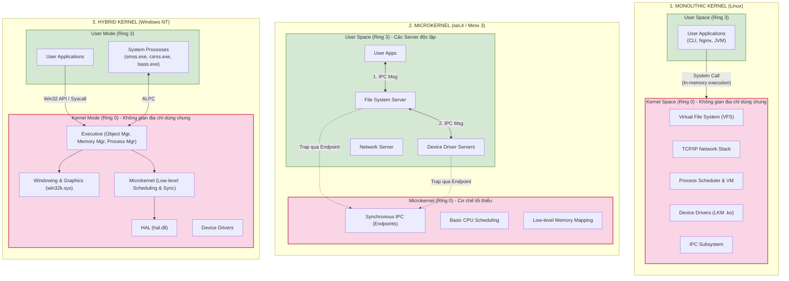

# 1_1_4 Kernel Architectures (Monolithic vs Microkernel vs Hybrid)

> **Khóa học**: Cloud DevOps Basic — OS Core  
> **Phân nhóm**: 1 Domain 1 - Operating System Core Fundamentals › 1_1 OS Architecture and Hardware Privilege Modes  
> **Chủ đề**: Phân tích kiến trúc nhân hệ điều hành: Monolithic, Microkernel và Hybrid Kernel  
> **Trạng thái**: Verified (WRITE-CDB-1_1_4, 14-11-2026)  
> **Checklist đối chiếu**: [1_1_4](../../../CHECKLIST.md#domain-1-operating-system-core-fundamentals-45-items)  

---

## 1. Khái Niệm Cốt Lõi & Bản Chất Kỹ Thuật (Core Concepts & Technical Deep Dive)

Trong thiết kế hệ điều hành, **Kernel (Nhân)** là thành phần phần mềm trung tâm nắm quyền kiểm soát tối cao đối với toàn bộ tài nguyên phần cứng. Quyết định kiến trúc cơ bản nhất của một hệ điều hành là: **Những dịch vụ nào nên được đặt bên trong không gian đặc quyền của Kernel (Ring 0), và những dịch vụ nào nên bị đẩy ra ngoài không gian người dùng (Ring 3)?**

Lời giải cho bài toán phân định ranh giới này đã hình thành nên ba trường phái kiến trúc nhân kinh điển: **Monolithic Kernel**, **Microkernel**, và **Hybrid Kernel**.

---

### 1.1 Kiến Trúc Monolithic Kernel (Nhân Nguyên Khối — Điển Hình: Linux)

Trong kiến trúc Monolithic Kernel:
- **Tất cả các dịch vụ cốt lõi của hệ điều hành**—bao gồm Quản lý bộ nhớ ảo, Lập lịch tiến trình (Process Scheduler), Hệ thống tệp ảo (Virtual File System - VFS), Ngăn xếp mạng (Network Stack), Giao tiếp liên tiến trình (IPC), và toàn bộ các Trình điều khiển thiết bị (Device Drivers)—**đều cùng vận hành trong một không gian địa chỉ ảo duy nhất tại Kernel Mode (Ring 0)**.

```text
+------------------------------------------------------------------------+
|                      MONOLITHIC KERNEL (LINUX)                         |
|                                                                        |
|  [ USER SPACE - Ring 3 ]                                               |
|  +--------------------+  +--------------------+  +------------------+  |
|  | User Application 1 |  | User Application 2 |  | Web Server/Nginx |  |
|  +--------------------+  +--------------------+  +------------------+  |
|  ------------------------ System Call Interface ---------------------- |
|  [ KERNEL SPACE - Ring 0 ]  (Single Shared Virtual Address Space)      |
|  +------------------------------------------------------------------+  |
|  |  Process Scheduler   |  Virtual Memory Mgr  |  VFS & File Systems|  |
|  |  Network Protocols   |  Inter-Process Comm  |  Security Subsystem|  |
|  |  Block Layer / IO    |  Device Drivers (.ko)|  Hardware Control  |  |
|  +------------------------------------------------------------------+  |
|  ------------------------- Hardware Layer ---------------------------- |
|  [ HARDWARE: CPU, Memory, Disk, Network Interface Cards, Peripherals ] |
+------------------------------------------------------------------------+
```

#### Ưu điểm và Thách thức kỹ thuật:
1. **Hiệu năng thực thi cực đại (Maximum In-Memory Performance)**:
   - Vì tất cả các thành phần nằm chung trong một không gian địa chỉ của nhân, việc trao đổi dữ liệu giữa hệ thống tệp, bộ lập lịch và driver mạng được thực hiện thông qua **các lời gọi hàm trong bộ nhớ trực tiếp (in-memory function calls)**.
   - Hệ thống không phải trả chi phí chuyển đổi ngữ cảnh (context switch) hay chuyển đổi mức đặc quyền phần cứng giữa các thành phần nội bộ của hệ điều hành.
2. **Vùng ảnh hưởng lỗi duy nhất (Single Failure Domain)**:
   - Theo tài liệu chính thức từ Microsoft Learn và giáo trình OSTEP (Ch. 13), tất cả mã chạy trong Kernel Mode dùng chung một không gian địa chỉ ảo duy nhất.
   - Do đó, một driver phần cứng hoạt động trong kernel không hề được cô lập khỏi các driver khác hay khỏi chính hệ điều hành. Nếu một kernel driver bị lỗi ghi đè dữ liệu vào sai địa chỉ bộ nhớ ảo, nó có thể phá hủy dữ liệu của kernel hoặc của driver khác.
   - **Hậu quả**: Khi một driver trong kernel bị đổ vỡ (crash), toàn bộ hệ điều hành sẽ sụp đổ ngay lập tức (**Kernel Panic** trên Linux hoặc **Blue Screen of Death - BSOD** trên Windows).

#### Tính module hóa động trong Linux: Loadable Kernel Modules (LKM)
Để khắc phục nhược điểm phải biên dịch lại toàn bộ nhân mỗi khi cần hỗ trợ phần cứng mới, Linux triển khai cơ chế **Loadable Kernel Modules (LKM, các tệp định dạng `.ko`)**:
- LKM cho phép nạp động hoặc gỡ bỏ các đoạn mã (driver, filesystem module, packet filter) trực tiếp vào không gian địa chỉ kernel đang chạy mà không cần khởi động lại máy tính.
- Quá trình nạp được thực hiện qua các lời gọi hệ thống `init_module(2)` hoặc `finit_module(2)`.
- Khi đã được nạp vào nhân, mã của module sẽ chạy với toàn quyền đặc quyền Ring 0 y hệt như mã nhân gốc.

---

### 1.2 Kiến Trúc Microkernel (Vi Nhân — Điển Hình: seL4, Mach, Minix 3)

Trái ngược hoàn toàn với Monolithic, triết lý Microkernel hướng tới mục tiêu tối giản hóa tối đa những gì nằm trong không gian đặc quyền:
- Nhân chạy ở Kernel Mode (Ring 0) chỉ giữ lại **các cơ chế nguyên thủy tối thiểu (minimal primitives)**:
  1. Giao tiếp liên tiến trình (**IPC - Inter-Process Communication**).
  2. Lập lịch tiến trình mức cơ bản (Basic Scheduling).
  3. Quản lý ánh xạ không gian địa chỉ và bộ nhớ ảo cấp thấp.
- **Tất cả các dịch vụ hệ điều hành truyền thống khác**—như File Systems, Network Stack, Device Drivers, và Trình quản lý tiến trình cấp cao—đều bị tách rời và chuyển ra ngoài vận hành trong **User Space (Ring 3)** dưới dạng các tiến trình máy chủ độc lập (**Isolated User-Space Servers**).

```text
+------------------------------------------------------------------------+
|                       MICROKERNEL (seL4 / MINIX)                       |
|                                                                        |
|  [ USER SPACE - Ring 3 ] (Isolated Memory Address Spaces)              |
|  +-------------+  +--------------+  +--------------+  +-------------+  |
|  | User App 1  |  | File Server  |  | Net Driver   |  | Disk Driver |  |
|  +-------------+  +--------------+  +--------------+  +-------------+  |
|         ^                ^                 ^                 ^         |
|         | Synchronous    | Message-        | Passing         | (IPC)   |
|         v                v                 v                 v         |
|  ------------------------- System Call / IPC Boundary ---------------- |
|  [ MICROKERNEL - Ring 0 ] (Minimal Primitives Only)                    |
|  +------------------------------------------------------------------+  |
|  |   IPC Mechanism (Endpoints) | Basic Scheduling | Low-level VM   |  |
|  +------------------------------------------------------------------+  |
|  ------------------------- Hardware Layer ---------------------------- |
|  [ HARDWARE: CPU, Memory, Disk, Network Interface Cards, Peripherals ] |
+------------------------------------------------------------------------+
```

#### Ưu điểm và Thách thức kỹ thuật:
1. **Khả năng cô lập lỗi tuyệt đối (Strong Fault Isolation & Reliability)**:
   - Vì Driver ổ đĩa và Network Stack chạy trong các không gian địa chỉ ảo tách biệt ở Ring 3, nếu driver card mạng gặp lỗi con trỏ hoặc bị tấn công tràn bộ đệm dẫn đến sập tiến trình, **nhân microkernel và các thành phần khác của hệ điều hành hoàn toàn không bị ảnh hưởng**.
   - Hệ điều hành có thể đơn giản là khởi động lại tiến trình server bị lỗi trong vài mili-giây mà không cần khởi động lại toàn bộ máy chủ.
   - Điển hình như **seL4** là microkernel đầu tiên trên thế giới được kiểm chứng toán học hình thức (formally verified) chứng minh không có lỗi tràn bộ đệm hay rò rỉ quyền hạn.
2. **Chi phí hiệu năng của IPC (IPC Overhead & Context Switching)**:
   - Theo đặc tả kiến trúc seL4 và giáo trình OSTEP, giao tiếp giữa các thành phần phải thông qua cơ chế truyền thông điệp đồng bộ (synchronous message passing) qua các đối tượng kernel gọi là **endpoints**.
   - Mỗi lần một ứng dụng muốn đọc một khối dữ liệu từ đĩa:
     - Ứng dụng phải gửi thông điệp IPC tới File Server $\rightarrow$ chuyển ngữ cảnh sang Kernel $\rightarrow$ chuyển ngữ cảnh sang File Server (Ring 3).
     - File Server tính toán và gửi IPC tới Disk Driver Server $\rightarrow$ chuyển ngữ cảnh sang Kernel $\rightarrow$ chuyển sang Disk Driver (Ring 3).
   - Chi phí liên tục lưu/khôi phục thanh ghi CPU, chuyển đổi bảng phân trang MMU và làm xả bộ nhớ đệm (TLB/Cache misses) khiến hiệu năng I/O của microkernel truyền thống thấp hơn đáng kể so với Monolithic kernel.

---

### 1.3 Kiến Trúc Hybrid Kernel (Nhân Lai — Điển Hình: Windows NT)

Nhằm tìm kiếm điểm cân bằng hoàn hảo giữa **tính module hóa, trừu tượng hóa của Microkernel** và **tốc độ thực thi vượt trội của Monolithic Kernel**, kiến trúc **Hybrid Kernel** ra đời, tiêu biểu nhất là dòng hệ điều hành **Windows NT** (Windows 10, Windows 11, Windows Server):

```text
+------------------------------------------------------------------------+
|                       HYBRID KERNEL (WINDOWS NT)                       |
|                                                                        |
|  [ USER MODE - Ring 3 ]                                                |
|  +--------------------+  +------------------------------------------+  |
|  | User Applications  |  | System Processes (smss.exe, csrss.exe,   |  |
|  | & Subsystem DLLs   |  |                   lsass.exe, services)   |  |
|  +--------------------+  +------------------------------------------+  |
|  ------------------------- System Service Dispatch ------------------- |
|  [ KERNEL MODE - Ring 0 ] (Shared Kernel Address Space)                |
|  +------------------------------------------------------------------+  |
|  | Executive Subsystems:                                            |  |
|  |  - Object Manager       - Memory Manager     - Process/Thread Mgr|  |
|  |  - I/O Manager (Drivers)- Security Reference - LPC/ALPC Subsystem|  |
|  +------------------------------------------------------------------+  |
|  | Windowing & Graphics Subsystem: win32k.sys (GUI, GDI, User)      |  |
|  +------------------------------------------------------------------+  |
|  | Microkernel: Thread Scheduling, Interrupt & Exception Dispatch   |  |
|  +------------------------------------------------------------------+  |
|  | Hardware Abstraction Layer (HAL - hal.dll)                       |  |
|  +------------------------------------------------------------------+  |
|  ------------------------- Hardware Layer ---------------------------- |
|  [ HARDWARE: CPU, Memory, Disks, Video Adapter, Network Cards ]        |
+------------------------------------------------------------------------+
```

#### Bản chất kỹ thuật của Windows NT:
1. **Thiết kế hướng đối tượng và module hóa kiểu Microkernel**:
   - Windows NT tổ chức các tài nguyên hệ thống (tệp tin, thiết bị, khóa Registry, tiến trình, luồng, cơ chế đồng bộ) dưới dạng các **Objects** được quản lý tập trung và thống nhất bởi **Object Manager**.
   - Hỗ trợ mô hình Client/Server thông qua cơ chế giao tiếp gọi thủ tục cục bộ nâng cao (**ALPC - Advanced Local Procedure Call**).
2. **Thực thi trong cùng không gian địa chỉ kiểu Monolithic**:
   - Để loại bỏ triệt để hiện tượng suy giảm hiệu năng do IPC giữa User Mode và Kernel Mode, Windows NT gom toàn bộ các thành phần: **Executive Subsystems, Microkernel, Hardware Abstraction Layer (HAL - `hal.dll`), Trình điều khiển thiết bị (Device Drivers), và Hệ thống đồ họa giao diện người dùng (`win32k.sys`) chạy chung trong một không gian địa chỉ Kernel Mode (Ring 0)**.
3. **Phân cấp thành phần hệ thống chuẩn xác của Windows NT**:
   - **User Mode (Ring 3)**:
     - **System Processes**: Các tiến trình hệ thống nền tảng bắt buộc phải có để Windows hoạt động: `smss.exe` (Session Manager), `csrss.exe` (Client/Server Runtime Subsystem), `lsass.exe` (Local Security Authority Subsystem), `services.exe` (Service Control Manager).
     - **Subsystem DLLs & User Apps**: Các thư viện API người dùng (`kernel32.dll`, `user32.dll`, `gdi32.dll`) chuyển tiếp yêu cầu của ứng dụng xuống kernel.
   - **Kernel Mode (Ring 0)**:
     - **Executive**: Chứa các hệ thống con quản lý cấp cao (Object Manager, Virtual Memory Manager, Process & Thread Manager, I/O Manager).
     - **Kernel (Microkernel)**: Chịu trách nhiệm lập lịch luồng cấp thấp, đồng bộ hóa đa xử lý (spinlocks) và phân phối ngắt.
     - **HAL (`hal.dll`)**: Lớp phần mềm cách ly kernel khỏi sự khác biệt phần cứng của bo mạch chủ, chipset và bộ điều khiển ngắt APIC.
     - **Windowing and Graphics System (`win32k.sys`)**: Đảm nhiệm toàn bộ việc dựng hình GUI, quản lý cửa sổ và hiển thị.

---

## 2. Ví Dụ Đời Sống Thực Tế Dễ Hiểu (Intuitive Real-World Analogies)

### Ẩn Dụ: Ba Mô Hình Vận Hành Doanh Nghiệp (Corporate Organization Models)

Để nắm bắt trực quan sự khác biệt cốt lõi giữa ba kiến trúc nhân, hãy quan sát cách ba công ty với quy mô và văn hóa làm việc khác nhau tổ chức văn phòng của họ:

```text
+------------------------------------------------------------------------+
|                     MÔ HÌNH VĂN PHÒNG DOANH NGHIỆP                    |
|                                                                        |
| 1. MONOLITHIC: "Công ty gia đình mở"                                   |
|    - Tất cả nhân sự (Giám đốc, Kế toán, IT, Tài xế) ngồi chung 1 phòng |
|    - Cần hỏi gì: Quay sang nói trực tiếp (Gọi hàm in-memory siêu tốc)  |
|    - Rủi ro: Một tài xế say xỉn làm cháy bàn --> Cháy cả công ty!      |
|                                                                        |
| 2. MICROKERNEL: "Tòa nhà văn phòng biệt lập"                           |
|    - Ban quản lý chỉ giữ buồng thang máy & hòm thư (Ring 0: IPC)       |
|    - Các phòng Kế toán, IT, Hậu cần thuê các phòng khóa riêng biệt     |
|    - Cô lập: Phòng IT hỏng máy chủ --> Chỉ phòng IT cúp điện           |
|    - Chi phí: Mỗi lần gửi giấy tờ phải bấm chuông qua lễ tân (Trễ IPC) |
|                                                                        |
| 3. HYBRID: "Tập đoàn quy mô lớn kết hợp"                               |
|    - Ban điều hành và Bộ phận đồ họa ngồi chung phòng VIP (Ring 0)     |
|    - Bộ phận an ninh, bảo vệ đối ngoại ngồi ở phòng riêng (User Mode)  |
|    - Đạt được: Tốc độ phản hồi cao ở khối cốt lõi + An toàn đối ngoại  |
+------------------------------------------------------------------------+
```

1. **Monolithic (Linux) — "Công ty gia đình ngồi chung một đại sảnh mở"**:
   - Tất cả mọi người từ Giám đốc điều hành, Kế toán trưởng, Kỹ sư mạng, cho đến Nhân viên kho và Tài xế lái xe đều ngồi làm việc chung trong một căn phòng rộng lớn không hề có vách ngăn (Ring 0 - Shared Address Space).
   - **Tốc độ**: Khi Kế toán cần số liệu từ Thủ kho, chỉ cần quay ghế sang gọi một tiếng là xong ngay lập tức (gọi hàm trực tiếp trong bộ nhớ, zero latency).
   - **Hiểm họa**: Một ngày nọ, một tài xế mới được tuyển dụng bất cẩn làm chập tàn thuốc lá khiến chiếc bàn làm việc bốc cháy (lỗi bug con trỏ nhớ trong một driver thiết bị bên thứ ba). Do căn phòng không có tường ngăn cách chống cháy, ngọn lửa lập tức thiêu rụi toàn bộ văn phòng, toàn bộ công ty phải ngừng hoạt động (Kernel Panic, sập toàn bộ máy tính). Khi cần thêm người làm tạm thời, công ty gọi các cộng tác viên vào ngồi chung bàn làm việc (cơ chế Loadable Kernel Modules - LKM).

2. **Microkernel (seL4 / Minix) — "Tòa cao ốc với các phòng ban biệt lập"**:
   - Ban quản lý tòa nhà chỉ đảm nhận việc vận hành hệ thống thang máy trung tâm và hòm thư chuyển phát (Ring 0: IPC Primitives & Basic Scheduling).
   - Toàn bộ các phòng ban chức năng khác (Kế toán, Hậu cần, IT, Đội xe) phải thuê từng căn phòng riêng biệt ở các tầng khác nhau, có cửa bọc thép khóa số độc lập (User Mode - Ring 3).
   - **Cô lập an toàn tuyệt đối**: Nếu phòng IT bị chập cầu chì cháy máy chủ (driver mạng crash), cửa phòng tự động đóng lại, ngắt điện cục bộ và kỹ sư thay cầu chì mới trong 2 giây (restart server tiến trình). Các phòng Kế toán và Hậu cần hoàn toàn không bị ảnh hưởng, cả tòa nhà vẫn hoạt động bình thường.
   - **Đánh đổi**: Mỗi lần Kế toán muốn gửi một hóa đơn sang phòng Thủ kho, họ không thể nói trực tiếp mà phải cho giấy tờ vào phong bì, bấm thang máy xuống tầng trệt nhờ nhân viên lễ tân chuyển giao (giao tiếp IPC qua kernel endpoint). Việc này làm tăng đáng kể thời gian xử lý thủ tục hành chính.

3. **Hybrid (Windows NT) — "Mô hình tập đoàn lai ghép tối ưu"**:
   - Ban lãnh đạo nhận thấy việc chạy qua lại giữa các phòng ban biệt lập làm các tác vụ thường ngày như ký giấy tờ và vẽ bảng biểu quá chậm.
   - Do đó, họ quyết định đưa toàn bộ **Ban điều hành cấp cao (Executive)** và cả **Bộ phận thiết kế đồ họa giao diện (GDI `win32k.sys`)** vào ngồi chung một phòng lớn đặc quyền (Ring 0) để trao đổi tức thì.
   - Tuy nhiên, họ vẫn giữ tính kỷ luật của mô hình tòa nhà bằng cách quy hoạch mọi tài nguyên thành các "Hồ sơ đối tượng" chuẩn mực (**Object Manager**), đồng thời đặt các bộ phận kiểm soát danh tính và an ninh nhạy cảm (`lsass.exe`, `csrss.exe`) ở các văn phòng độc lập bên ngoài (User Mode).

---

## 3. Kiến Trúc, Luồng Hoạt Động & Hình Ảnh Trực Quan (Architecture, Diagrams & Visual Media)

### 3.1 Hình Ảnh Kiến Trúc Chính Thức Từ Microsoft Learn

Dưới đây là sơ đồ kiến trúc chính thức mô tả cấu trúc phân tầng hoàn chỉnh của hệ điều hành Windows NT giữa không gian User Mode và Kernel Mode:

[](https://learn.microsoft.com/en-us/windows-hardware/drivers/kernel/images/ntarch.png)  
*Hình 1: Tổng quan kiến trúc phân tầng Windows NT giữa các tiến trình User Mode và các phân hệ Kernel Mode (Nguồn: Microsoft Learn).*

---

### 3.2 Sơ Đồ So Sánh Tổng Thể: Monolithic vs Microkernel vs Hybrid Kernel



---

## 4. Code Mẫu Trực Quan Hoặc Dòng Lệnh Thực Chiến (Runnable Sample Code / CLI)

> ⚠️ Dữ liệu đầu ra dòng lệnh dưới đây mang tính chất minh họa (illustrative output) ghi nhận trên hệ thống Linux x86_64 nhằm quan sát cơ chế module hóa động (LKM) của kiến trúc Monolithic.

### 4.1 Khảo Sát Các Module Nhân Đang Nạp Bằng `lsmod`

Lệnh `lsmod` đọc thông tin từ tập tin ảo `/proc/modules` và định dạng danh sách các module đang hoạt động trong không gian kernel:

```bash
# Liệt kê 10 kernel module đầu tiên đang được nạp trong bộ nhớ nhân Linux
lsmod | head -n 10
```

**Đầu ra minh họa**:
```text
Module                  Size  Used by
overlay               151552  12
ext4                 1032192  2
crc16                  16384  1 ext4
mbcache                16384  1 ext4
jbd2                  167936  1 ext4
nls_iso8859_1          16384  1
vfat                   24576  1
fat                    94208  1 vfat
intel_rapl_msr         20480  0
intel_rapl_common      40960  1 intel_rapl_msr
```

- **Giải thích các cột hiển thị**:
  - `Module`: Tên của kernel module (ví dụ: `overlay` dùng cho container storage, `ext4` là driver hệ thống tệp).
  - `Size`: Kích thước bộ nhớ RAM (tính theo byte) mà module chiếm dụng trong không gian kernel.
  - `Used by`: Số lượng các thành phần hoặc tiến trình khác đang phụ thuộc vào module này, kèm theo danh sách tên module phụ thuộc (ví dụ: `ext4` đang sử dụng module `crc16`, `mbcache` và `jbd2`).

---

### 4.2 Đọc Trực Tiếp Trạng Thái Module Từ `procfs`

Hạt nhân Linux lưu trữ trực tiếp trạng thái cấu trúc của từng module trong hệ thống tệp ảo `/proc/modules`:

```bash
# Xem 5 dòng đầu tiên của tệp ảo /proc/modules
cat /proc/modules | head -n 5
```

**Đầu ra minh họa**:
```text
overlay 151552 12 - Live 0xffffffffc0850000
ext4 1032192 2 - Live 0xffffffffc0920000
crc16 16384 1 ext4, Live 0xffffffffc0840000
mbcache 16384 1 ext4, Live 0xffffffffc0835000
jbd2 167936 1 ext4, Live 0xffffffffc0800000
```

- **Phân tích kỹ thuật**:
  - Trạng thái `Live`: Xác nhận module đang hoạt động bình thường trong kernel.
  - Địa chỉ hex ở cuối (ví dụ `0xffffffffc0920000`): Đây chính là **địa chỉ bộ nhớ ảo thực tế trong không gian địa chỉ 64-bit của Kernel Mode (Ring 0)** nơi mã máy của module được nạp vào. Điều này minh chứng trực quan rằng module LKM được gắn trực tiếp vào cùng không gian địa chỉ ảo với nhân Linux.

---

### 4.3 Truy Vấn Siêu Dữ Liệu Module Bằng `modinfo`

Tiện ích `modinfo` phân tích tệp nhị phân `.ko` (hoặc module đang nạp) để trích xuất thông tin tác giả, bản quyền, các tham số cấu hình và tính năng an toàn biên dịch:

```bash
# Kiểm tra metadata chi tiết của module overlay (hoặc ext4)
modinfo overlay
```

**Đầu ra minh họa**:
```text
filename:       /lib/modules/6.8.0-49-generic/kernel/fs/overlayfs/overlay.ko.zst
alias:          fs-overlay
description:    Overlay filesystem
author:         Miklos Szeredi <miklos@szeredi.hu>
license:        GPL
srcversion:     A1B2C3D4E5F60718293A4B5
depends:        
retpoline:      Y
intree:         Y
name:           overlay
vermagic:       6.8.0-49-generic SMP preempt mod_unload modversions 
```

- **Phân tích kỹ thuật**:
  - `filename`: Đường dẫn tệp module nhị phân trên ổ đĩa.
  - `license`: Giấy phép mã nguồn (rất quan trọng trong Linux: nếu nạp module có license không tương thích như "Proprietary", kernel sẽ bị đánh dấu là "tainted").
  - `retpoline: Y`: Xác nhận module được biên dịch với kỹ thuật phòng vệ chống tấn công đầu cơ nhánh Specter V2.
  - `vermagic`: Chuỗi phiên bản kiểm tra tính tương thích nghiêm ngặt; nếu chuỗi `vermagic` của module không khớp với phiên bản kernel đang chạy, lệnh nạp sẽ bị từ chối để tránh làm sập nhân.

---

## 5. Cạm Bẫy Thực Tế & Thực Tiễn Sản Xuất (Production Gotchas & Best Practices)

Trong vận hành hạ tầng Cloud, DevOps và kỹ thuật phần mềm hệ thống, việc hiểu rõ bản chất của kiến trúc nhân giúp giải thích các quyết định thiết kế quan trọng:

### 1. Tại sao Linux Monolithic vẫn thống trị môi trường Cloud & DevOps?
- **Nghịch lý kiến trúc**: Về mặt lý thuyết hàn lâm, Microkernel được đánh giá cao hơn vượt bậc về tính an toàn và khả năng tự phục hồi. Vậy tại sao 90%+ hạ tầng Cloud thế giới (AWS EC2, Google Cloud, Azure VMs, Kubernetes) lại vận hành trên nhân Linux Monolithic?
- **Bản chất thực tế**: Trong môi trường tính toán đám mây quy mô siêu lớn (Hyper-Scale Cloud), **thông lượng (throughput) và độ trễ (latency)** là yếu tố quyết định sống còn. Chi phí chuyển đổi ngữ cảnh IPC liên tục của Microkernel làm giảm đáng kể hiệu năng của các tác vụ I/O đĩa và gói tin mạng.
- **Giải pháp thực tiễn của Linux**: Thay vì chuyển dịch sang Microkernel, Linux giữ nguyên hiệu năng đỉnh cao của kiến trúc Monolithic ở Ring 0, đồng thời xây dựng các rào chắn cách ly an toàn:
  - Cô lập ứng dụng bằng **cgroups và namespaces** (nền tảng của Docker và Kubernetes Containers).
  - Ứng dụng công nghệ **eBPF (Extended Berkeley Packet Filter)**: Cho phép chạy mã tùy biến an toàn ngay bên trong nhân Linux mà không cần nạp kernel module, được bộ xác thực (eBPF Verifier) kiểm tra an toàn tĩnh trước khi chạy để đảm bảo không thể làm crash kernel.

### 2. Sự trỗi dậy của Microkernel trong hệ thống sinh mạng và xe tự hành
- Trong khi Monolithic dẫn đầu về thông lượng máy chủ, kiến trúc Microkernel lại là tiêu chuẩn bắt buộc trong các hệ thống đòi hỏi độ an toàn sinh mạng tuyệt đối (**Mission-Critical / Safety-Critical Systems**):
  - **Hệ thống nhúng xe hơi (Automotive)**: Nền tảng xe tự hành sử dụng **QNX Neutrino** hoặc **seL4** vì tiêu chuẩn an toàn ISO 26262 ASIL-D. Nếu một driver cảm biến LiDAR hay camera bị crash, microkernel lập tức khởi động lại driver đó trong vài mili-giây mà hệ thống phanh và lái của xe không bao giờ bị tê liệt.
  - **Hàng không và Y tế**: Nơi mà một cú crash hệ điều hành có thể cướp đi sinh mạng con người, tính năng **Formal Verification** (chứng minh toán học không có lỗi) của seL4 mang giá trị vượt xa yếu tố thông lượng thô.

### 3. Bước ngoặt lịch sử đưa GUI (`win32k.sys`) vào Ring 0 trong Windows NT 4.0
- Trong các phiên bản đầu tiên của Windows NT (NT 3.1 đến NT 3.51), hệ thống đồ họa cửa sổ và giao diện người dùng (GDI / USER) được thiết kế theo đúng chuẩn mực microkernel: nó chạy trong một tiến trình riêng biệt ở User Mode.
- **Vấn đề nảy sinh**: Mọi thao tác hiển thị giao diện cơ bản—như di chuyển con trỏ chuột, vẽ một nút bấm, hay kéo một thanh cuộn—đều phát sinh hàng loạt các thông điệp IPC (LPC) và chuyển đổi ngữ cảnh qua lại giữa ứng dụng, tiến trình đồ họa và kernel. Giao diện người dùng của Windows NT 3.51 bị đánh giá là cực kỳ chậm chạp và giật lag so với Windows 95.
- **Quyết định tại NT 4.0**: Để cứu vãn hiệu năng đồ họa thương mại, Microsoft đã đưa ra quyết định táo bạo: chuyển toàn bộ phân hệ đồ họa `win32k.sys` từ User Mode vào chạy trực tiếp trong Kernel Mode (Ring 0). Quyết định này giúp Windows NT 4.0 đạt tốc độ đồ họa vượt bậc, đánh dấu sự xác lập dứt khoát của mô hình **Hybrid Kernel**—sẵn sàng đánh đổi một phần ranh giới an toàn tuyệt đối để đổi lấy hiệu năng thực tế.

---

## 6. Câu Hỏi Củng Cố Kiến Thức (Active Recall Quiz)

<details>
<summary><b>Câu hỏi 1:</b> Một trình điều khiển card mạng (Network Driver) gặp lỗi nghiêm trọng (như truy cập con trỏ NULL). Hậu quả đối với toàn bộ máy tính sẽ khác nhau như thế nào giữa hệ điều hành Linux (Monolithic) và hệ điều hành seL4 (Microkernel)?</summary>

**Đáp án:**
- **Trên Linux (Monolithic Kernel)**: Do toàn bộ driver chạy chung một không gian địa chỉ ảo tại Kernel Mode (Ring 0), lỗi truy cập con trỏ sai sẽ làm sập trực tiếp không gian nhân, kích hoạt lỗi **Kernel Panic** và khiến toàn bộ máy tính bị tê liệt ngay lập tức.
- **Trên seL4 (Microkernel)**: Driver card mạng hoạt động như một tiến trình máy chủ độc lập trong User Space (Ring 3). Khi gặp lỗi, chỉ duy nhất tiến trình driver card mạng đó bị dừng lại. Nhân seL4 ở Ring 0 hoàn toàn không bị ảnh hưởng và có thể lập tức tái khởi động driver mới trong tích tắc, hệ thống vẫn tiếp tục hoạt động bình thường.
</details>

<details>
<summary><b>Câu hỏi 2:</b> Tại sao hệ điều hành Windows NT được định nghĩa là một "Hybrid Kernel" thay vì là một Microkernel thuần túy hay một Monolithic Kernel thuần túy?</summary>

**Đáp án:**
Windows NT được gọi là Hybrid Kernel vì nó kết hợp đặc tính của cả hai mô hình:
1. **Thừa hưởng từ Microkernel**: Thiết kế cấu trúc phân tầng dạng module hóa cao độ, trừu tượng hóa toàn bộ tài nguyên thành đối tượng đồng nhất qua Object Manager, và hỗ trợ mô hình Client/Server qua cơ chế ALPC.
2. **Thừa hưởng từ Monolithic**: Để tránh tổn thất hiệu năng do chi phí chuyển đổi ngữ cảnh IPC, Windows NT gom toàn bộ Executive, Microkernel, lớp HAL, các trình điều khiển thiết bị, và cả hệ thống đồ họa GUI (`win32k.sys`) vào thực thi chung trong một không gian địa chỉ duy nhất tại Kernel Mode (Ring 0).
</details>

<details>
<summary><b>Câu hỏi 3:</b> Trong Linux, cơ chế Loadable Kernel Module (LKM) giải quyết nhược điểm nào của kiến trúc Monolithic truyền thống? Mã nguồn của một module <code>.ko</code> sau khi được nạp vào nhân sẽ chạy ở mức đặc quyền phần cứng nào?</summary>

**Đáp án:**
- **Giải quyết nhược điểm**: Cơ chế LKM giải quyết nhược điểm phải biên dịch lại toàn bộ kernel hoặc khởi động lại hệ thống mỗi khi cần bổ sung driver phần cứng, hệ thống tệp mới hoặc tính năng mạng. LKM cho phép nạp và gỡ bỏ mã chức năng động ngay trong lúc hệ điều hành đang chạy.
- **Mức đặc quyền**: Sau khi được nạp thông qua `init_module(2)` hoặc `finit_module(2)`, mã của tệp `.ko` được tích hợp trực tiếp vào không gian địa chỉ của nhân và thực thi tại **Ring 0 (Kernel Mode)** với toàn quyền đặc quyền phần cứng.
</details>

---

## 7. 📚 Nguồn Tài Liệu Chính Thống (Tier-1 Official References)

- [OSTEP Chapter 13: Address Spaces](https://pages.cs.wisc.edu/~remzi/OSTEP/vm-intro.pdf) - Giáo trình *Operating Systems: Three Easy Pieces* (Remzi H. Arpaci-Dusseau & Andrea C. Arpaci-Dusseau), phân tích nguyên lý cô lập không gian địa chỉ ảo giữa các tiến trình và bài toán bảo vệ bộ nhớ trong thiết kế nhân Monolithic và Microkernel.
- [seL4 Documentation: Inter-Process Communication (IPC)](https://docs.sel4.systems/Tutorials/ipc.html) - Tài liệu hướng dẫn chính thức từ dự án seL4 mô tả cơ chế truyền thông điệp đồng bộ qua endpoints trong kiến trúc Microkernel.
- [Microsoft Learn: Overview of Windows Components](https://learn.microsoft.com/en-us/windows-hardware/drivers/kernel/overview-of-windows-components) - Tài liệu kiến trúc chính thức từ Microsoft phân tích cấu trúc các thành phần User Mode (System Processes, Subsystem DLLs) và Kernel Mode (Executive, Kernel, HAL, Graphics Subsystem) trong Windows NT.
- [Microsoft Learn: User Mode and Kernel Mode](https://learn.microsoft.com/en-us/windows-hardware/drivers/gettingstarted/user-mode-and-kernel-mode) - Hướng dẫn kỹ thuật từ Microsoft về cơ chế chia sẻ không gian địa chỉ ảo trong Kernel Mode và rủi ro đổ vỡ hệ thống của kernel driver.
- [Linux Manual Pages: lsmod(8)](https://man7.org/linux/man-pages/man8/lsmod.8.html) - Hướng dẫn chính thức về tiện ích dòng lệnh `lsmod` hiển thị trạng thái các Loadable Kernel Modules từ `/proc/modules`.
- [Linux Manual Pages: modinfo(8)](https://man7.org/linux/man-pages/man8/modinfo.8.html) - Hướng dẫn chính thức về tiện ích `modinfo` trích xuất thông tin siêu dữ liệu từ các tệp module nhân Linux (`.ko`).
