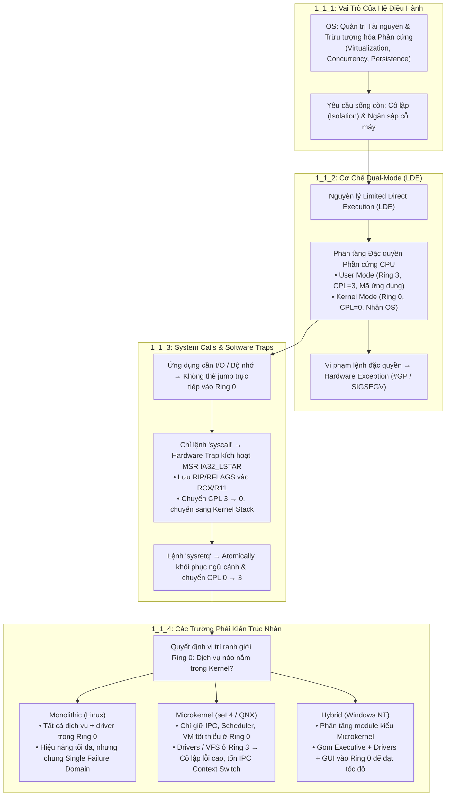

# 1_1 OS Architecture and Hardware Privilege Modes

> **Khóa học**: Cloud DevOps Basic — OS Core · **Domain**: 1 Domain 1 - Operating System Core Fundamentals · **Roadmap gốc**: [os/README.md](../../README.md#module-1-os-architecture--hardware-protection-modes)

---

## Module này dạy gì? (What & Why)

Module này cung cấp nền tảng kiến trúc sâu sắc nhất về cách một hệ điều hành kiểm soát phần cứng và bảo vệ sự ổn định của toàn bộ cỗ máy máy tính. Người học sẽ hiểu rõ tại sao hệ điều hành ra đời dựa trên ba trụ cột Ảo hóa (Virtualization), Xử lý đồng thời (Concurrency) và Lưu trữ bền vững (Persistence) để đóng vai trò là Bộ quản lý tài nguyên và Lớp trừu tượng hóa phần cứng. Tiếp theo, module phân tích nguyên lý Thực thi trực tiếp có giới hạn (Limited Direct Execution - LDE), nơi CPU phần cứng phân chia ranh giới đặc quyền giữa User Mode (Ring 3) và Kernel Mode (Ring 0) thông qua trường CPL của thanh ghi `%cs` nhằm ngăn chặn các chương trình lỗi hoặc độc hại làm sập hệ thống. Cuối cùng, module làm sáng tỏ cơ chế bẫy phần mềm (Software Trap) và quy ước gọi hệ thống (System Call Calling Convention) trên kiến trúc x86-64, cùng bức tranh tổng thể về ba trường phái kiến trúc nhân kinh điển: Monolithic Kernel, Microkernel và Hybrid Kernel với sự đánh đổi cốt lõi giữa hiệu năng bộ nhớ và sự cô lập lỗi tuyệt đối.

---

## Lộ trình bài học (Lesson Path)

| Bài học | Mục tiêu cốt lõi | Checklist ID |
| :--- | :--- | :---: |
| [1_1_1 The Role of an Operating System](./1_1_1%20The%20Role%20of%20an%20Operating%20System.md) | Nắm vững ba trụ cột của OS (Virtualization, Concurrency, Persistence), vai trò quản lý tài nguyên và ranh giới cô lập (Isolation) bảo vệ máy tính. | [1_1_1](../../../CHECKLIST.md#domain-1-operating-system-core-fundamentals-45-items) |
| [1_1_2 Dual-Mode Operation User Mode vs Kernel Mode](./1_1_2%20Dual-Mode%20Operation%20User%20Mode%20vs%20Kernel%20Mode.md) | Thấu hiểu nguyên lý Limited Direct Execution (LDE), phân định đặc quyền Ring 3 vs Ring 0, trường CPL trong thanh ghi `%cs` và xử lý ngoại lệ GPF. | [1_1_2](../../../CHECKLIST.md#domain-1-operating-system-core-fundamentals-45-items) |
| [1_1_3 System Calls and Software Traps](./1_1_3%20System%20Calls%20and%20Software%20Traps.md) | Làm chủ cơ chế bẫy phần mềm (Software Trap), lưu ngữ cảnh trên Kernel Stack, lệnh `sysretq` và quy ước truyền tham số x86-64 qua thanh ghi (`R10` vs `RCX`). | [1_1_3](../../../CHECKLIST.md#domain-1-operating-system-core-fundamentals-45-items) |
| [1_1_4 Kernel Architectures Monolithic Microkernel Hybrid](./1_1_4%20Kernel%20Architectures%20Monolithic%20Microkernel%20Hybrid.md) | So sánh bản chất kiến trúc giữa Monolithic (Linux), Microkernel (seL4/QNX) và Hybrid (Windows NT); phân tích chi phí IPC vs rủi ro Single Failure Domain. | [1_1_4](../../../CHECKLIST.md#domain-1-operating-system-core-fundamentals-45-items) |

---

## Bản đồ khái niệm (Concept Map)

Sơ đồ dưới đây xâu chuỗi sự gắn kết kiến trúc chặt chẽ giữa 4 bài học trong Module 1.1:

---

## Ẩn dụ xuyên suốt (Module Analogy)

Bốn bài học trong module được kết nối mạch lạc thông qua sự tiến hóa của các mô hình tổ chức xã hội và quản trị:

1. **Thành phố & Tòa thị chính (1_1_1)**: Các tiến trình là các doanh nghiệp trong thành phố; nếu không có chính quyền (OS) ban hành luật pháp và phân phối điện nước công bằng, kẻ mạnh sẽ cướp tài nguyên và xả thải sang đất của kẻ khác làm tê liệt toàn thành phố.
2. **Khoang hành khách & Buồng lái máy bay (1_1_2)**: Máy bay đang bay ở tốc độ cao (Direct Execution). Hành khách ngồi ở khoang phổ thông (User Mode Ring 3) được tự do đọc sách, nghe nhạc nhưng cửa buồng lái được khóa kiên cố bằng mã vân tay. Chỉ có phi công (Kernel Mode Ring 0) mới được phép chạm vào cần lái và bảng điều khiển động cơ. Hành khách tự ý đạp cửa buồng lái sẽ bị hệ thống an ninh khống chế ngay lập tức.
3. **Quầy giao dịch ngân hàng sau kính chống đạn (1_1_3)**: Khách hàng cần rút tiền không được phép tự xông vào kho tiền. Khách hàng đứng ngoài quầy kính, điền đầy đủ mẫu phiếu rút tiền (đặt số hiệu syscall vào `RAX`, tham số vào `RDI`, `RSI`, `R10`), rồi đẩy qua khe an toàn (lệnh `syscall`). Giao dịch viên bên trong (Kernel Trap Handler) xác thực chữ ký, vào kho kiểm tiền rồi trả tiền kèm biên lai qua khe (lệnh `sysretq`).
4. **Mô hình tổ chức doanh nghiệp (1_1_4)**: 
   - *Monolithic* giống như một văn phòng không vách ngăn (Open-plan Office): Mọi phòng ban (kinh doanh, kế toán, IT) ngồi chung một phòng, trao đổi công việc cực nhanh nhưng nếu một nhân viên bị cảm cúm (driver bị lỗi), cả công ty sẽ lây bệnh và phải đóng cửa.
   - *Microkernel* giống như mô hình công ty ký hợp đồng thuê các nhà thầu độc lập: Ban giám đốc chỉ giữ lại vài người điều phối ở trụ sở, mọi nghiệp vụ giao cho các đối tác riêng biệt. Một nhà thầu phá sản không ảnh hưởng đến trụ sở, nhưng việc gửi công văn thư từ qua lại (IPC) làm chậm tiến độ.
   - *Hybrid* giống như tập đoàn đa ngành có quy chế riêng: Về mặt giấy tờ cơ cấu chia thành nhiều khối độc lập, nhưng thực tế toàn bộ các trưởng bộ phận chủ chốt đều được cấp thẻ VIP ngồi chung trong phòng điều hành trung tâm để đưa ra quyết định nhanh nhất.

---

## Tự kiểm tra cuối module (Module Review)

<b>Câu hỏi 1:</b> Nguyên lý Limited Direct Execution (LDE) giải quyết đồng thời hai yêu cầu tưởng chừng mâu thuẫn nào trong thiết kế hệ điều hành?

**Đáp án:**
LDE giải quyết đồng thời:
1. **Hiệu năng thực thi tối đa (Maximum Performance)**: Để chương trình người dùng chạy trực tiếp trên các bóng bán dẫn phần cứng của CPU (native direct execution), không thông qua lớp giả lập hay thông dịch trung gian chậm chạp.
2. **Kiểm soát và bảo vệ chặt chẽ (Control and Protection)**: Giới hạn quyền hạn bằng phần cứng (Dual-Mode / Ring 3 vs Ring 0). Các thao tác can thiệp phần cứng hoặc thay đổi trạng thái máy tính đều bị chặn lại ở User Mode và buộc phải ủy thác cho Kernel kiểm tra an toàn thông qua bẫy phần mềm (Trap / System Call).

<b>Câu hỏi 2:</b> Trên vi xử lý x86-64, điều gì thực sự phân biệt giữa việc CPU đang chạy ở User Mode hay Kernel Mode? "Mode Bit" trong sách giáo khoa tương ứng với thành phần phần cứng nào?

**Đáp án:**
- "Mode Bit" trong sách giáo khoa là một mô hình khái niệm trừu tượng. Trên vi xử lý x86-64 thực tế, mức đặc quyền được xác định bởi trường **CPL (Current Privilege Level)** gồm 2 bit nằm ở vị trí thấp nhất của **thanh ghi đoạn mã `%cs` (Code Segment Register)**.
- Khi `CPL = 00b` (0), CPU hoạt động ở **Ring 0 (Kernel Mode)** với toàn quyền đặc quyền.
- Khi `CPL = 11b` (3), CPU hoạt động ở **Ring 3 (User Mode)** và bị phần cứng từ chối mọi chỉ lệnh đặc quyền. Phép kiểm tra trong nhân Linux được thực thi qua macro `user_mode(regs)`: `(regs->cs & 3) != 0`.

<b>Câu hỏi 3:</b> Tại sao chỉ lệnh `syscall` trên x86-64 lại tự động phá hủy (clobber) thanh ghi `RCX` và `R11`, và điều này ảnh hưởng như thế nào đến quy ước truyền tham số thứ 4?

**Đáp án:**
- Khi thực thi chỉ lệnh phần cứng `syscall`, phần cứng vi xử lý tự động lưu địa chỉ con trỏ lệnh kế tiếp (`RIP`) của chương trình người dùng vào thanh ghi `RCX`, đồng thời lưu cờ trạng thái `RFLAGS` vào thanh ghi `R11` (để lệnh `sysretq` sau này khôi phục lại).
- Do thanh ghi `RCX` bị phần cứng ghi đè, quy ước gọi của Linux Syscall ABI không thể sử dụng `RCX` để truyền tham số thứ 4 như quy ước hàm C thông thường (System V AMD64 ABI). Thay vào đó, Syscall ABI bắt buộc phải đổi sang sử dụng thanh ghi **`R10`** để truyền tham số thứ 4.

<b>Câu hỏi 4:</b> Đánh đổi kỹ thuật (trade-off) then chốt giữa kiến trúc Monolithic Kernel (Linux) và Microkernel (seL4/QNX) là gì? Trong trường hợp nào Microkernel là lựa chọn bắt buộc?

**Đáp án:**
- **Đánh đổi cốt lõi**:
  - *Monolithic*: Tối ưu hóa hiệu năng tối đa nhờ việc gọi hàm trực tiếp trong cùng không gian địa chỉ bộ nhớ ảo ở Ring 0, nhưng phải chịu rủi ro "Single Failure Domain" (một driver bị lỗi con trỏ có thể làm sập toàn bộ hệ thống bằng Kernel Panic).
  - *Microkernel*: Tối ưu hóa độ an toàn và cô lập lỗi tuyệt đối bằng cách đẩy driver và hệ thống tệp ra các tiến trình độc lập ở Ring 3 (driver lỗi chỉ sập tiến trình đó và có thể restart ngay), nhưng phải trả giá bằng độ trễ và chi phí suy giảm hiệu năng do liên tục chuyển đổi ngữ cảnh và sao chép thông điệp IPC.
- **Trường hợp bắt buộc**: Microkernel là tiêu chuẩn bắt buộc trong các hệ thống an toàn sinh mạng (Safety-Critical / Mission-Critical) như hệ thống lái và phanh của xe tự hành (chuẩn ISO 26262 ASIL-D), thiết bị y tế hồi sức cấp cứu và điều khiển hàng không vũ trụ.

---

## 📚 Nguồn chính (Key References)

- [OSTEP Chapter 2: Introduction to Operating Systems](https://pages.cs.wisc.edu/~remzi/OSTEP/intro.pdf) - Giáo trình *Operating Systems: Three Easy Pieces*, phân tích ba trụ cột Virtualization, Concurrency, Persistence và vai trò Resource Manager.
- [OSTEP Chapter 6: Mechanism: Limited Direct Execution](https://pages.cs.wisc.edu/~remzi/OSTEP/cpu-mechanisms.pdf) - Giáo trình OSTEP phân tích chi tiết nguyên lý LDE, cơ chế bẫy phần mềm, Trap Table và per-process Kernel Stack.
- [OSTEP Chapter 13: Address Spaces](https://pages.cs.wisc.edu/~remzi/OSTEP/vm-intro.pdf) - Giáo trình OSTEP giải thích cấu trúc không gian địa chỉ ảo và sự cô lập bộ nhớ trong các kiến trúc nhân hệ điều hành.
- [Linux Manual Pages: syscall(2)](https://man7.org/linux/man-pages/man2/syscall.2.html) - Tài liệu hướng dẫn chính thức từ Linux man-pages project về giao diện lời gọi hệ thống gián tiếp và calling convention trên x86-64.
- [Linux Manual Pages: intro(2)](https://man7.org/linux/man-pages/man2/intro.2.html) - Tổng quan chính thức của Linux Programmer's Manual về các hàm C wrapper đối với system call.
- [Linux Manual Pages: uname(1)](https://man7.org/linux/man-pages/man1/uname.1.html) - Tài liệu chính thức về lệnh in thông tin hệ thống, kernel release và machine hardware name.
- [Linux Manual Pages: proc_version(5)](https://man7.org/linux/man-pages/man5/proc_version.5.html) - Đặc tả file ảo `/proc/version` định danh phiên bản Linux kernel đang chạy.
- [Linux Manual Pages: lscpu(1)](https://man7.org/linux/man-pages/man1/lscpu.1.html) - Hướng dẫn chính thức về tiện ích thu thập thông tin kiến trúc CPU từ `sysfs` và `/proc/cpuinfo`.
- [Microsoft Learn: User Mode and Kernel Mode](https://learn.microsoft.com/en-us/windows-hardware/drivers/gettingstarted/user-mode-and-kernel-mode) - Tài liệu kỹ thuật chính thống từ Microsoft mô tả mô hình bảo vệ 2 chế độ và ranh giới không gian bộ nhớ.
- [Microsoft Learn: Overview of Windows Components](https://learn.microsoft.com/en-us/windows-hardware/drivers/kernel/overview-of-windows-components) - Tài liệu kiến trúc chính thức từ Microsoft phân tích cấu trúc User Mode và Kernel Mode trong Windows NT (Hybrid Kernel).
- [seL4 Documentation: Inter-Process Communication (IPC)](https://docs.sel4.systems/Tutorials/ipc.html) - Tài liệu chính thức từ dự án seL4 mô tả cơ chế truyền thông điệp đồng bộ qua endpoints trong kiến trúc Microkernel.
- [Linux Manual Pages: lsmod(8)](https://man7.org/linux/man-pages/man8/lsmod.8.html) - Hướng dẫn chính thức về tiện ích hiển thị trạng thái Loadable Kernel Modules từ `/proc/modules`.
- [Linux Manual Pages: modinfo(8)](https://man7.org/linux/man-pages/man8/modinfo.8.html) - Hướng dẫn chính thức về tiện ích trích xuất thông tin siêu dữ liệu từ module nhân Linux (`.ko`).
