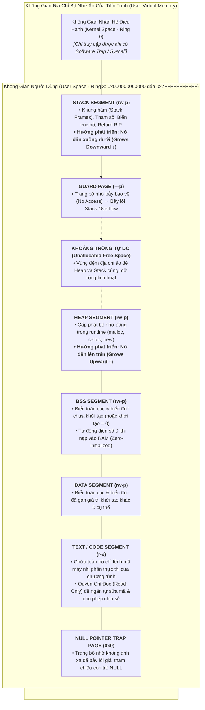

# 1_2_1 Process Concept and Memory Anatomy

> **Khóa học**: Cloud DevOps Basic — OS Core  
> **Phân nhóm**: 1 Domain 1 - Operating System Core Fundamentals › 1_2 Process Management and Anatomy  
> **Chủ đề**: Khái niệm tiến trình và giải phẫu không gian địa chỉ bộ nhớ ảo: Text, Data, BSS, Heap và Stack  
> **Trạng thái**: Draft (WRITE-CDB-1_2_1, 14-11-2026)  
> **Checklist đối chiếu**: [1_2_1](../../../CHECKLIST.md#domain-1-operating-system-core-fundamentals-45-items)  

---

## 1. Khái Niệm Cốt Lõi & Bản Chất Kỹ Thuật (Core Concepts & Technical Deep Dive)

Trong khoa học máy tính và kiến trúc hệ điều hành, khái niệm nền tảng nhất về một thực thể tính toán đang vận hành chính là **Tiến trình (Process)**.

### 1.1 Khái niệm Tiến trình (Process Concept) & Trạng thái máy (Machine State)

Theo giáo trình chuẩn mực *Operating Systems: Three Easy Pieces (OSTEP - Ch. 4)*, tiến trình về mặt bản chất được định nghĩa một cách súc tích: **"Tiến trình là một chương trình đang trong quá trình thực thi"** (*a program in execution*).

Cần phân biệt rành mạch giữa hai khái niệm:
- **Chương trình (Program)**: Là một thực thể tĩnh (passive entity). Nó chỉ là một tập hợp các chỉ lệnh mã máy và dữ liệu được biên dịch sẵn, nằm im lìm dưới dạng tệp tin trên ổ đĩa cứng lưu trữ dài hạn (ví dụ: tệp định dạng ELF trên Linux như `/bin/ls` hay tệp PE `.exe` trên Windows). Chương trình không tự tiêu tốn chu kỳ CPU hay bộ nhớ RAM.
- **Tiến trình (Process)**: Là một thực thể động (active entity). Khi người dùng hoặc hệ thống kích hoạt chạy một chương trình, hệ điều hành sẽ đọc tệp nhị phân từ ổ đĩa, nạp mã lệnh và dữ liệu vào bộ nhớ RAM, phân bổ các tài nguyên hệ thống và bắt đầu điều phối CPU thực thi các câu lệnh.

Một tiến trình không chỉ đơn thuần là mã lệnh, mà nó bao gồm toàn bộ **Trạng thái máy (Machine State)** tại bất kỳ thời điểm nào trong vòng đời của nó:
1. **Không gian địa chỉ bộ nhớ (Memory Address Space)**: Toàn bộ các byte bộ nhớ mà tiến trình có quyền truy cập, bao gồm mã lệnh chỉ dẫn và toàn bộ các cấu trúc dữ liệu đang đọc/ghi.
2. **Tập thanh ghi phần cứng của CPU (CPU Registers)**:
   - **Program Counter (PC / RIP trên x86-64)**: Con trỏ lệnh lưu trữ địa chỉ của câu lệnh mã máy kế tiếp sẽ được nạp và thực thi bởi CPU.
   - **Stack Pointer (SP / RSP)** & **Frame Pointer (FP / RBP)**: Các thanh ghi quản lý đỉnh ngăn xếp và khung ngăn xếp của các hàm đang thực thi.
   - **Các thanh ghi mục đích chung (General-Purpose Registers)**: Lưu giữ các giá trị tính toán tức thời, tham số hàm và cờ trạng thái xử lý (`RFLAGS`).
3. **Thông tin vào/ra (I/O Information)**: Danh sách các tài nguyên lưu trữ và mạng mà tiến trình đang mở, được quản lý thông qua **bảng mô tả tệp (Open File Descriptors - FDs)**, bao gồm `stdin` (0), `stdout` (1), `stderr` (2) cùng các tệp tin hoặc kết nối socket mạng khác.

---

### 1.2 Giải phẫu không gian địa chỉ bộ nhớ ảo của Tiến trình (Process Memory Anatomy)

Nhờ kỹ thuật trừu tượng hóa bộ nhớ ảo (Virtual Memory), mỗi tiến trình đều vận hành trong một không gian địa chỉ ảo biệt lập khổng lồ (trên kiến trúc x86-64 lên tới 128 TB cho không gian người dùng). Không gian này được hệ điều hành và bộ quản lý bộ nhớ phần cứng (MMU) phân chia thành các **phân vùng logic (Segments / VMAs)** với chức năng và quyền hạn truy cập riêng biệt:

```text
+-------------------------------------------------------------------------------+
| Phân đoạn (Segment) | Vị trí địa chỉ | Quyền hạn | Hướng phát triển | Mục đích kỹ thuật                  |
+---------------------+----------------+-----------+------------------+------------------------------------+
| Text / Code         | Vùng thấp      | Read-Exec | Cố định          | Chứa chỉ lệnh mã máy đã biên dịch  |
| Data (Initialized)  | Ngay trên Text | Read-Write| Cố định          | Biến toàn cục/tĩnh có giá trị khởi tạo|
| BSS (Uninitialized) | Ngay trên Data | Read-Write| Cố định          | Biến toàn cục/tĩnh khởi tạo bằng 0 |
| Heap                | Ngay trên BSS  | Read-Write| Nở lên trên (↑)  | Cấp phát bộ nhớ động tại runtime   |
| Free Space          | Giữa Heap-Stack| Không có  | Co giãn linh hoạt| Vùng đệm địa chỉ ảo chưa cấp phát  |
| Guard Page          | Dưới đáy Stack | No Access | Cố định          | Bẫy ngắt trang khi tràn Stack      |
| Stack               | Vùng cao       | Read-Write| Nở xuống dưới (↓)| Khung hàm, biến cục bộ, return RIP |
+-------------------------------------------------------------------------------+
```

#### Chi tiết các phân đoạn bộ nhớ:

1. **Phân đoạn Mã lệnh (Text / Code Segment)**:
   - Nằm ở vùng địa chỉ thấp nhất của không gian bộ nhớ người dùng.
   - Chứa toàn bộ các chỉ lệnh mã máy nhị phân mà CPU sẽ nạp vào để xử lý.
   - **Đặc tính an toàn**: Được thiết lập thuộc tính **Chỉ đọc và Thực thi (`r-x`)**. Hệ thống nghiêm cấm quyền ghi (`w`) vào phân đoạn này để ngăn chặn hiện tượng chương trình tự ý sửa đổi mã lệnh của chính mình (Self-modifying code) hoặc bị mã độc ghi đè shellcode. Do là vùng chỉ đọc, các tiến trình chạy cùng một chương trình có thể an toàn chia sẻ chung các khung trang bộ nhớ vật lý này trong RAM.

2. **Phân đoạn Dữ liệu khởi tạo (Data Segment / Initialized Data)**:
   - Nằm tiếp giáp ngay phía trên phân đoạn Text.
   - Lưu trữ các biến toàn cục (global variables) và biến tĩnh (static variables) đã được lập trình viên gán giá trị khởi tạo khác 0 cụ thể trong mã nguồn (ví dụ: `int max_retries = 5;` hoặc `static char app_env[] = "production";`).
   - Có thuộc tính **Đọc và Ghi (`rw-`)**, kích thước phân đoạn này được xác định cố định ngay từ thời điểm biên dịch chương trình.

3. **Phân đoạn Dữ liệu chưa khởi tạo (BSS Segment - Block Started by Symbol)**:
   - Nằm ngay phía trên phân đoạn Data.
   - Lưu trữ các biến toàn cục và biến tĩnh **chưa được gán giá trị cụ thể** hoặc được gán bằng giá trị 0 (ví dụ: `int global_counter;` hoặc `static int cache[1024] = {0};`).
   - **Tối ưu hóa dung lượng lưu trữ**: Trên tệp nhị phân lưu ở ổ đĩa, phân đoạn BSS không tốn dung lượng để lưu hàng triệu số 0 mà chỉ ghi lại một số nguyên mô tả kích thước cần cấp phát. Khi hệ điều hành nạp chương trình vào RAM, Kernel sẽ tự động cấp phát và ánh xạ các trang bộ nhớ đã được điền sẵn số 0 (Zero-initialized memory) cho vùng này.

4. **Phân đoạn Vùng nhớ Động (Heap Segment)**:
   - Nằm tiếp giáp phía trên đỉnh của BSS.
   - Được sử dụng cho việc **cấp phát bộ nhớ động tại thời gian chạy (runtime)** theo yêu cầu của ứng dụng (thông qua các hàm cấp phát như `malloc()`, `calloc()`, `realloc()`, `free()` trong C hoặc toán tử `new`/`delete` trong C++).
   - **Hướng phát triển**: Bắt đầu từ vùng địa chỉ thấp và **nở dần lên trên về phía vùng địa chỉ cao hơn (grows upward)**. Kích thước của Heap được điều chỉnh linh hoạt thông qua các lời gọi hệ thống như `brk()`, `sbrk()` hoặc ánh xạ vùng nhớ ẩn danh `mmap()`.

5. **Khoảng trống tự do (Free Space)**:
   - Vùng địa chỉ ảo khổng lồ nằm giữa đỉnh của Heap và đáy của Stack. Vùng này chưa được ánh xạ tới các khung trang bộ nhớ vật lý, đóng vai trò như một vùng đệm cho phép cả Heap và Stack cùng có không gian mở rộng tự do trong suốt quá trình vận hành mà không xâm lấn đè lên nhau.

6. **Phân đoạn Ngăn xếp (Stack Segment)**:
   - Được đặt tại **vùng địa chỉ cao nhất của không gian địa chỉ bộ nhớ người dùng (high end of user memory)**.
   - **Hướng phát triển**: Ngược lại hoàn toàn với Heap, Stack **nở dần xuống dưới về phía các địa chỉ bộ nhớ thấp hơn (grows downward)**.
   - **Nhiệm vụ**: Stack quản lý việc thực thi hàm và các lời gọi thủ tục lồng nhau. Mỗi khi một hàm được triệu gọi, hệ thống sẽ đẩy một **Khung ngăn xếp (Stack Frame)** vào Stack, chứa:
     - Các tham số truyền vào hàm (Function Arguments).
     - Địa chỉ trở về (Return Address / RIP) để CPU biết phải quay lại câu lệnh nào sau khi hàm kết thúc.
     - Con trỏ khung hàm trước đó (Saved Frame Pointer / RBP).
     - Toàn bộ các biến cục bộ (Local / Automatic Variables) được khai báo bên trong phạm vi hàm.
     - Khi hàm kết thúc và trả về, toàn bộ Stack Frame đó sẽ tự động được thu hồi (popped) bằng cách dịch chuyển con trỏ `RSP`.

7. **Trang bảo vệ ngăn xếp (Guard Page)**:
   - Nằm tại biên giới chặn phía dưới vùng Stack là một hoặc nhiều trang bộ nhớ đặc biệt được thiết lập trạng thái **Không có quyền truy cập (No Access / `---p`)**.
   - **Vai trò bảo vệ**: Khi một chương trình gặp lỗi đệ quy vô hạn hoặc khai báo biến cục bộ vượt quá kích thước cho phép, Stack sẽ nở xuống chạm vào Guard Page. Phần cứng MMU phát hiện hành vi truy cập trái phép và lập tức kích hoạt bẫy ngắt trang (Page Fault), giúp hệ điều hành nhận diện sự cố **Tràn ngăn xếp (Stack Overflow)** và kết thúc tiến trình ngay tức khắc (`SIGSEGV`), bảo vệ không để Stack tiếp tục ghi đè phá hủy dữ liệu trong vùng Heap bên dưới.

---

## 2. Ví Dụ Đời Sống Thực Tế Dễ Hiểu (Intuitive Real-World Analogies)

### Ẩn dụ: Bản Vẽ Thiết Kế Trên Giấy vs Công Trường Đang Thi Công (Blueprints vs Construction Site)

Để nắm bắt trọn vẹn sự khác biệt giữa Chương trình và Tiến trình cũng như cấu trúc phân đoạn bộ nhớ, hãy liên tưởng đến lĩnh vực xây dựng kiến trúc:

```text
[ TẬP BẢN VẼ TRÊN GIẤY ]                  [ CÔNG TRƯỜNG THI CÔNG ĐANG HOẠT ĐỘNG ]
       (Program trên Ổ đĩa)                                (Process trong RAM)
    • Chỉ là bản vẽ tĩnh                       • Thực thể động, tiêu tốn điện năng, vật tư
    • Không tốn điện, không tốn gạch           • Máy móc cơ giới hoạt động theo bản vẽ (CPU chạy Text)
    • Cất trong tủ lưu trữ                     • Kho vật tư đã đóng thùng sẵn (Data Segment)
                                               • Kho bãi trống chờ tập kết đồ (BSS Segment)
                                               • Bãi chứa vật tư phát sinh nở rộng dần (Heap - grows up)
                                               • Sổ nhật ký ghi chép từng bước thi công (Stack - grows down)
```

1. **Chương trình (Program) là Bản vẽ kiến trúc trong ngăn kéo**:
   - Bộ bản vẽ thiết kế một tòa nhà cao tầng nằm im lìm trên giấy. Bản thân nó không thể tự đổ bê tông, không tiêu tốn điện năng, không gây ra bất kỳ tiếng ồn nào trên thực tế. Đó là hình ảnh của tệp thực thi `/bin/ls` nằm trên ổ cứng SSD.
2. **Tiến trình (Process) là Công trường thi công thực tế**:
   - Khi nhà thầu mang bản vẽ ra công địa và bấm nút khởi công, một công trường nhộn nhịp được hình thành. Máy móc cơ giới rền vang, công nhân thi công, nguyên vật liệu được chuyển đến và tiêu thụ liên tục.
3. **Phân bổ không gian công trường tương ứng các phân đoạn bộ nhớ**:
   - **Text Segment**: Tương ứng với **Bảng chỉ dẫn thi công nguyên bản** được dựng cố định ở cổng vào công trường. Mọi kỹ sư, công nhân đều đọc các bước thi công từ đây (Read-only), và không một ai được phép dùng bút xóa vẽ bậy lên bảng mẫu.
   - **Data Segment**: Tương ứng với **Khu kho chứa các thùng vật liệu ban đầu** đã được đóng gói và ghi rõ số lượng, chủng loại từ lúc bắt đầu thi công (ví dụ: 500 bao xi măng được đánh số sẵn).
   - **BSS Segment**: Tương ứng với **Khu đất trống đã san ủi bằng phẳng**, được quy hoạch sẵn để chứa vật tư chuẩn bị nhập về nhưng hiện tại chưa có gì ngoài mặt bằng trống (Zero-initialized).
   - **Heap Segment**: Tương ứng với **Bãi tập kết vật liệu và thiết bị phát sinh theo tiến độ**. Khi công trình phát sinh thêm hạng mục, quản lý công trường sẽ yêu cầu mở rộng bãi chứa về phía trước (nở lên trên) để chứa thêm giàn giáo, gạch đá mới.
   - **Stack Segment**: Tương ứng với **Sổ nhật ký công trường của Kỹ sư trưởng**:
     - Khi nhận một nhiệm vụ mới (gọi hàm), kỹ sư lật một trang sổ mới (Stack Frame), ghi chú lại công việc cần làm, các thông số kỹ thuật tạm thời (biến cục bộ), và vị trí cần quay lại báo cáo sau khi xong việc (Return Address).
     - Khi công việc hoàn thành, kỹ sư xé bỏ trang ghi chú đó và quay trở lại công việc trước đó. Cuốn sổ được viết từ trang cuối lật ngược dần lên (grows downward).
   - **Guard Page**: Là **Hàng rào thép gai an toàn** ngăn cách giữa bãi tập kết vật liệu và khu vực lán trại chỉ huy. Nếu kỹ sư ghi chép quá đà vượt qua hàng rào an toàn, còi báo động khẩn cấp sẽ hú vang và toàn bộ công trường tạm dừng ngay lập tức.
4. **Hai tòa nhà cùng một bản vẽ**: Nếu hai đội thi công cùng nhận một bản vẽ thiết kế để xây hai tòa nhà cạnh nhau (hai tiến trình chạy cùng file nhị phân `/bin/ls`), họ là **hai công trường hoàn toàn biệt lập**. Dù đọc chung một mẫu bản vẽ (Text segment), vật tư của công trường này (Heap/Data/Stack) không bao giờ được phép nằm lẫn hay tự tiện mang sang công trường của đối phương.

---

## 3. Kiến Trúc, Luồng Hoạt Động & Hình Ảnh Trực Quan (Architecture, Diagrams & Visual Media)

Sơ đồ phân bổ không gian địa chỉ bộ nhớ ảo của một tiến trình người dùng trên nền tảng 64-bit (x86-64 Linux):



---

## 4. Thực Hành (Hands-on): Khảo Sát Phân Đoạn Nhị Phân & Bản Đồ Bộ Nhớ Ảo Trên Linux

Trong thực tế vận hành và gỡ lỗi hệ thống, kỹ sư DevOps/Systems sử dụng các công cụ dòng lệnh tiêu chuẩn để soi thấu kích thước các phân đoạn tĩnh của tệp thực thi cũng như cấu trúc các vùng nhớ ảo động đang chạy.

### 4.1 Khảo sát kích thước phân đoạn tĩnh của file thực thi ELF với `size`

Lệnh `size` (thuộc bộ công cụ GNU Binary Utilities - binutils) cho phép liệt kê kích thước chính xác của các phân đoạn `text`, `data`, và `bss` bên trong một tệp nhị phân định dạng ELF:

```bash
# Kiểm tra kích thước các phân đoạn của tệp thực thi /bin/ls
size /bin/ls
```

> 💡 **Minh họa thực thi (Illustrative Output)**:
```text
   text    data     bss     dec     hex filename
 129821    4848    4848  139517   220fd /bin/ls
```

*Giải thích chi tiết các cột dữ liệu*:
- **`text` (129,821 bytes)**: Kích thước của phân đoạn mã máy chỉ huy và các hằng số chỉ đọc.
- **`data` (4,848 bytes)**: Kích thước các biến toàn cục và tĩnh đã được gán giá trị khởi tạo cụ thể trong mã nguồn của lệnh `ls`.
- **`bss` (4,848 bytes)**: Kích thước vùng nhớ mà hệ điều hành cần dành sẵn cho các biến toàn cục chưa khởi tạo (được điền số 0 khi nạp vào RAM).
- **`dec` (139,517)** & **`hex` (`220fd`)**: Tổng dung lượng bộ nhớ của 3 phân đoạn tĩnh cộng lại biểu diễn dưới dạng thập phân và thập lục phân.

---

### 4.2 Khảo sát các vùng nhớ ảo thực tế (VMA) thông qua `/proc/[pid]/maps`

Tập tin ảo `/proc/[pid]/maps` (hoặc `/proc/self/maps` đối với chính tiến trình đang thực thi lệnh) hiển thị chi tiết tất cả các vùng bộ nhớ ảo (Virtual Memory Areas - VMAs) đang được ánh xạ, kèm theo quyền hạn truy cập tương ứng:

```bash
# Đọc 8 dòng đầu tiên trong bản đồ bộ nhớ ảo của chính tiến trình cat
cat /proc/self/maps | head -n 8
```

> 💡 **Minh họa thực thi (Illustrative Output)**:
```text
55a956e68000-55a956e6d000 r-xp 00000000 00:22 7702644   /usr/bin/cat
55a956e71000-55a956e72000 rw-p 00008000 00:22 7702644   /usr/bin/cat
55a99188d000-55a9918ae000 rw-p 00000000 00:00 0         [heap]
7fffb2c0d000-7fffb2c2e000 rw-p 00000000 00:00 0         [stack]
```

*Phân tích từng trường thông tin trên một dòng ánh xạ*:
1. **Dải địa chỉ ảo (`55a956e68000-55a956e6d000`)**: Điểm bắt đầu và kết thúc của vùng nhớ ảo đó trong không gian tiến trình.
2. **Quyền hạn truy cập (`perms`)**:
   - `r`: Quyền đọc (Read).
   - `w`: Quyền ghi (Write).
   - `x`: Quyền thực thi mã máy (Execute).
   - `p`: Bộ nhớ riêng tư (Private - áp dụng cơ chế Copy-on-Write khi tiến trình fork) hoặc `s` (Shared - chia sẻ chung giữa các tiến trình).
   - *Quan sát*: Vùng mã lệnh `/usr/bin/cat` đầu tiên có quyền `r-xp` (chỉ đọc và thực thi, không cho ghi), trong khi vùng dữ liệu bên dưới có quyền `rw-p` (cho phép đọc ghi dữ liệu).
3. **Offset (`00000000`)**: Độ lệch vị trí tính từ đầu tệp tin nhị phân gốc.
4. **Device (`00:22`)** & **Inode (`7702644`)**: Định danh thiết bị lưu trữ và chỉ số Inode của tệp tin thực thi trên hệ thống tệp.
5. **Pathname (`/usr/bin/cat`, `[heap]`, `[stack]`)**: Tên tệp tin được ánh xạ hoặc nhãn nhận diện đặc biệt của Kernel:
   - `[heap]`: Vùng nhớ động do ứng dụng quản lý cấp phát runtime.
   - `[stack]`: Vùng ngăn xếp lưu khung hàm và biến cục bộ của luồng thực thi chính.

---

## 5. Cạm Bẫy Thực Tế & Thực Tiễn Sản Xuất (Production Gotchas & Best Practices)

Trong thiết kế phần mềm hệ thống và vận hành hạ tầng Cloud, việc nắm vững giải phẫu bộ nhớ là chìa khóa để phòng tránh và cô lập các lỗi sập hệ thống nghiêm trọng:

1. **Phân biệt rạch ròi giữa Stack Overflow và Heap Exhaustion (Out-Of-Memory)**:
   - *Tràn ngăn xếp (Stack Overflow)*:
     - *Bản chất*: Xảy ra khi luồng thực thi hàm vượt quá hạn mức tối đa của Stack (thường được giới hạn bởi hệ điều hành qua `ulimit -s`, mặc định thường là 8 MB trên Linux).
     - *Nguyên nhân kinh điển*: Hàm đệ quy không có điểm dừng (infinite recursion) hoặc lập trình viên khai báo các mảng dữ liệu cục bộ quá lớn trên Stack (ví dụ: `char large_buffer[10 * 1024 * 1024];` tức 10 MB).
     - *Hậu quả*: Đỉnh stack mở rộng chạm vào **Guard Page**, phần cứng MMU kích hoạt Page Fault và Kernel lập tức kết thúc tiến trình với tín hiệu `SIGSEGV` (Segmentation Fault). Tiến trình sập tức thì mà không làm tiêu tốn RAM của toàn bộ máy chủ.
   - *Cạn kiệt vùng nhớ động (Heap Exhaustion / OOM)*:
     - *Bản chất*: Xảy ra khi ứng dụng liên tục gọi `malloc()` cấp phát bộ nhớ trên Heap nhưng quên gọi `free()` (hiện tượng **Memory Leak - Rò rỉ bộ nhớ**) hoặc dữ liệu trong RAM phình to vượt quá tổng dung lượng RAM vật lý và bộ nhớ Swap của máy chủ.
     - *Hậu quả*: Toàn bộ cỗ máy rơi vào tình trạng cạn kiệt tài nguyên (Memory Pressure). Kernel buộc phải kích hoạt cơ chế **OOM Killer** để rà soát điểm số phạt (`oom_score`) và tiêu diệt tiến trình ngốn nhiều bộ nhớ nhất nhằm bảo vệ sự sống còn của toàn hệ thống.

2. **Hiểm họa Tràn bộ đệm trên Ngăn xếp (Stack-based Buffer Overflow) trong C/C++**:
   - *Nguy cơ bảo mật*: Các biến cục bộ của hàm được xếp tuần tự trên Stack Frame, ngay phía trên địa chỉ trở về (Return Address / Saved RIP). Nếu lập trình viên sử dụng các hàm không an toàn không kiểm tra độ dài dữ liệu (như `gets()`, `strcpy()`, `sprintf()`), kẻ tấn công có thể gửi chuỗi dữ liệu vượt quá kích thước mảng đệm để ghi đè lên Return Address.
   - *Hậu quả*: Khi hàm thực thi lệnh `ret`, CPU sẽ nhảy đến địa chỉ mã độc do kẻ tấn công cài cắm thay vì quay lại luồng thực thi hợp lệ (kỹ thuật Stack Smashing / ROP Chain).

3. **Cơ chế ASLR (Address Space Layout Randomization) trong môi trường sản xuất**:
   - *Thực tế vận hành*: Trong các hệ điều hành hiện đại, địa chỉ bắt đầu của phân đoạn Stack, Heap và các thư viện liên kết động (`.so`) **không bao giờ nằm cố định tại một địa chỉ bộ nhớ định sẵn**.
   - *Cơ chế bảo vệ*: Kỹ thuật ASLR tự động tạo độ lệch ngẫu nhiên (random offset) cho các vùng nhớ ảo mỗi lần tiến trình được khởi chạy lại. Điều này khiến kẻ tấn công không thể dự đoán trước địa chỉ của Stack hay các hàm hệ thống trong bộ nhớ, vô hiệu hóa phần lớn các cuộc tấn công khai thác lỗi bộ đệm trong môi trường sản xuất.

---

## 6. Câu Hỏi Củng Cố Kiến Thức (Active Recall Quiz)

<details>
<summary><b>Câu hỏi 1:</b> Điểm khác biệt bản chất giữa phân đoạn Data (Initialized Data) và phân đoạn BSS (Uninitialized Data) là gì? Tại sao việc khai báo một mảng toàn cục kích thước khổng lồ <code>int large_arr[1000000] = {0};</code> lại không làm tăng dung lượng tệp nhị phân trên ổ đĩa?</summary>

**Đáp án:**
- **Phân đoạn Data**: Lưu trữ các biến toàn cục hoặc biến tĩnh đã được gán giá trị khởi tạo khác 0 cụ thể. Các giá trị này bắt buộc phải được ghi lại từng byte vào tệp nhị phân ELF trên đĩa để nạp vào RAM lúc khởi động.
- **Phân đoạn BSS**: Lưu trữ các biến toàn cục hoặc tĩnh chưa khởi tạo hoặc được khởi tạo bằng giá trị 0.
- **Lý do tệp không phình to**: Định dạng nhị phân ELF tối ưu hóa dung lượng đĩa bằng cách không ghi hàng triệu byte số 0 vào tệp thực thi, mà chỉ ghi lại tổng kích thước cần thiết của vùng BSS trong bảng Header. Khi hệ điều hành nạp chương trình vào RAM để tạo tiến trình, Kernel mới thực hiện cấp phát và ánh xạ các trang bộ nhớ vật lý đã được điền sẵn số 0 cho phân đoạn BSS.
</details>

<details>
<summary><b>Câu hỏi 2:</b> Phân đoạn Heap và phân đoạn Stack có hướng phát triển bộ nhớ ảo như thế nào? Thành phần nào của hệ điều hành đóng vai trò ngăn chặn hai vùng nhớ này đè lên nhau gây phá hủy dữ liệu?</summary>

**Đáp án:**
- **Hướng phát triển**:
  - Vùng Heap bắt đầu từ địa chỉ thấp và **nở dần lên trên (grows upward)** về phía địa chỉ cao hơn khi ứng dụng cấp phát bộ nhớ động (`malloc`).
  - Vùng Stack bắt đầu từ địa chỉ cao nhất của không gian người dùng và **nở dần xuống dưới (grows downward)** về phía địa chỉ thấp hơn mỗi khi có lời gọi hàm mới.
- **Thành phần ngăn chặn**:
  - **Khoảng trống tự do (Unallocated Free Space)**: Nằm giữa Heap và Stack, đóng vai trò vùng đệm địa chỉ ảo cho phép hai bên co giãn linh hoạt.
  - **Trang bảo vệ (Guard Page)**: Nằm ở đáy của Stack là một trang bộ nhớ không có quyền truy cập (`---p`). Nếu Stack phình to quá mức chạm vào Guard Page, bộ quản lý bộ nhớ phần cứng (MMU) sẽ kích hoạt ngoại lệ ngắt trang (Page Fault) và hệ điều hành sẽ tiêu diệt tiến trình bằng tín hiệu `SIGSEGV` (Segmentation Fault) để bảo vệ toàn vẹn hệ thống trước khi Stack có cơ hội xâm lấn phá hủy Heap.
</details>

<details>
<summary><b>Câu hỏi 3:</b> Khi quan sát tệp ảo <code>/proc/[pid]/maps</code> trên Linux, ký tự <code>p</code> trong chuỗi quyền hạn <code>r-xp</code> hay <code>rw-p</code> mang ý nghĩa kỹ thuật gì đối với cơ chế quản lý bộ nhớ của hệ điều hành?</summary>

**Đáp án:**
- Ký tự `p` đại diện cho thuộc tính **Private (Bộ nhớ riêng tư)**, phân biệt với ký tự `s` là **Shared (Bộ nhớ chia sẻ)**.
- **Ý nghĩa kỹ thuật**: Vùng nhớ mang thuộc tính Private áp dụng cơ chế **Copy-on-Write (CoW)**. Khi một tiến trình tạo tiến trình con thông qua lệnh `fork()`, cả hai tiến trình ban đầu sẽ chia sẻ chung các khung trang bộ nhớ vật lý ở chế độ chỉ đọc. Chỉ khi một trong hai tiến trình thực hiện thao tác ghi dữ liệu vào trang bộ nhớ đó, phần cứng mới kích hoạt bẫy để Kernel tạo một bản sao vật lý riêng biệt của trang đó cho tiến trình thực hiện thao tác ghi, đảm bảo tính cô lập bộ nhớ giữa các tiến trình mà không làm lãng phí RAM.
</details>

---

## 7. 📚 Nguồn Tài Liệu Chính Thống (Tier-1 Official References)

- [OSTEP Chapter 4: Processes](https://pages.cs.wisc.edu/~remzi/OSTEP/cpu-intro.pdf) - Giáo trình chuẩn mực *Operating Systems: Three Easy Pieces* (Remzi H. Arpaci-Dusseau & Andrea C. Arpaci-Dusseau), phân tích định nghĩa bản chất tiến trình, thành phần trạng thái máy (Machine State) và sự khác biệt giữa Program vs Process.
- [OSTEP Chapter 13: Address Spaces](https://pages.cs.wisc.edu/~remzi/OSTEP/vm-intro.pdf) - Giáo trình OSTEP phân tích chi tiết cấu trúc không gian địa chỉ bộ nhớ ảo của tiến trình, cơ chế phát triển của Heap (grows up) và Stack (grows down), cùng các yêu cầu bảo vệ phân vùng.
- [Linux Manual Pages: size(1)](https://man7.org/linux/man-pages/man1/size.1.html) - Tài liệu hướng dẫn chính thức từ GNU Binary Utilities mô tả tiện ích `size` phân tích kích thước các phân đoạn `text`, `data`, `bss` của tệp nhị phân ELF.
- [Linux Manual Pages: proc_pid_maps(5)](https://man7.org/linux/man-pages/man5/proc_pid_maps.5.html) - Đặc tả kỹ thuật chính thức từ Linux man-pages project về định dạng tệp ảo `/proc/[pid]/maps`, mô tả các vùng bộ nhớ ảo (VMAs) và cờ quyền hạn truy cập của tiến trình.
