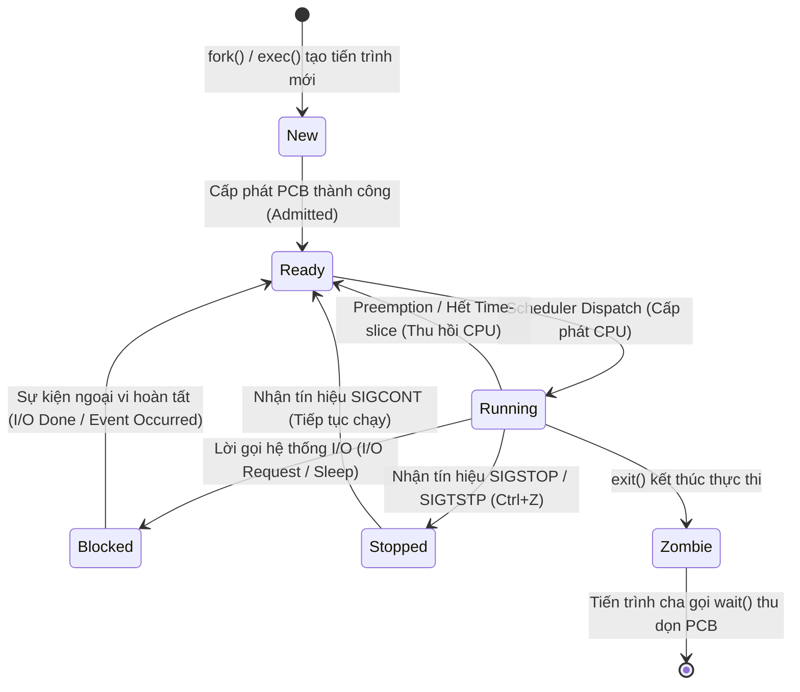

# 1_2_2 Process States and Transitions

> **Khóa học**: Cloud DevOps Basic — OS Core  
> **Phân nhóm**: 1 Domain 1 - Operating System Core Fundamentals › 1_2 Process Management and Anatomy  
> **Chủ đề**: Vòng đời tiến trình: Mô hình 5 trạng thái, cơ chế chuyển dịch và nhận diện trạng thái trên Linux  
> **Trạng thái**: Verified (WRITE-CDB-1_2_2, 14-11-2026)  
> **Checklist đối chiếu**: [1_2_2](../../../CHECKLIST.md#domain-1-operating-system-core-fundamentals-45-items)  

---

## 1. Khái Niệm Cốt Lõi & Bản Chất Kỹ Thuật (Core Concepts & Technical Deep Dive)

Trong hệ điều hành đa nhiệm (Multitasking Operating System), bộ vi xử lý (CPU) được chia sẻ luân phiên giữa hàng trăm hoặc hàng nghìn tiến trình khác nhau. Để quản lý hiệu quả và không lãng phí chu kỳ xử lý của CPU, hệ điều hành theo dõi và quản lý vòng đời của từng tiến trình thông qua **Mô hình Trạng thái Tiến trình (Process State Model)**.

---

### 1.1 Ba Trạng Thái Cốt Lõi & Hai Trạng Thái Vòng Đời

Theo giáo trình khoa học máy tính chuẩn mực (*Operating Systems: Three Easy Pieces - OSTEP*, Chương 4), ở góc nhìn nền tảng, một tiến trình luôn tồn tại ở một trong **ba trạng thái cơ bản**:

1. **Running (Đang thực thi)**:
   - Tiến trình đang trực tiếp chiếm giữ một nhân vi xử lý (CPU Core) và đang thực thi các chỉ lệnh mã máy của nó.
2. **Ready (Sẵn sàng)**:
   - Tiến trình đã có đầy đủ tài nguyên cần thiết trong bộ nhớ (mã lệnh, dữ liệu, ngăn xếp) và hoàn toàn sẵn sàng chạy.
   - Tuy nhiên, nó tạm thời chưa thể thực thi vì CPU đang bận phục vụ một tiến trình khác. Tiến trình nằm trong **Hàng đợi sẵn sàng (Ready Queue / Run Queue)** để chờ bộ lập lịch của hệ điều hành (CPU Scheduler) phân bổ thời gian CPU.
3. **Blocked / Waiting (Bị chặn / Chờ)**:
   - Tiến trình không thể tiếp tục thực thi ngay cả khi CPU đang hoàn toàn rảnh rỗi.
   - Nguyên nhân là tiến trình đang phải chờ một sự kiện bên ngoài hoặc một thao tác ngoại vi hoàn tất: ví dụ phát lệnh đọc tệp từ ổ đĩa cứng, chờ nhận gói tin phản hồi từ card mạng, hoặc chờ một khoảng thời gian trong lệnh `sleep()`.

Bên cạnh ba trạng thái cốt lõi trên, hệ điều hành hiện đại theo dõi thêm **hai trạng thái phụ trợ** xác định thời điểm bắt đầu và kết thúc của một tiến trình:
- **New / Embryo (Khởi tạo)**: Trạng thái ban đầu khi tiến trình đang được hệ điều hành kiến tạo (cấp phát cấu trúc quản trị Process Control Block - PCB, phân bổ không gian địa chỉ). Tiến trình chưa sẵn sàng chạy.
- **Final / Terminated / Zombie (Kết thúc / Xác sống)**: Tiến trình đã hoàn thành việc thực thi mã lệnh hoặc bị hệ thống hủy bỏ. Phần lớn tài nguyên bộ nhớ đã được thu hồi, nhưng bản ghi PCB vẫn được giữ lại trong bảng tiến trình của kernel để chờ tiến trình cha đọc mã thoát (Exit Status) thông qua lời gọi hệ thống `wait()`.

---

### 1.2 Cơ Chế Và Sự Kiện Kích Hoạt Chuyển Dịch Trạng Thái (State Transitions)

Sự chuyển dịch qua lại giữa các trạng thái không diễn ra ngẫu nhiên mà được điều khiển chặt chẽ bởi các sự kiện phần cứng và hạt nhân hệ điều hành:

```text
               +-------------------------------------------------+
               |                   [ NEW ]                       |
               +-------------------------------------------------+
                                       |
                                       | 1. Admitted (Khởi tạo xong)
                                       v
        +-----------------------> [ READY ] <---------------------+
        |                              |                          |
        | 3. Descheduled / Preempted   | 2. Scheduled / Dispatch  | 5. I/O Done
        |    (Hết time-slice)          v                          |    (Ngắt I/O xong)
        |                      +---------------+                  |
        +--------------------- |   [ RUNNING ] |                  |
                               +---------------+                  |
                                       |                          |
                                       | 4. I/O Initiate / Block  |
                                       |    (Gọi đọc đĩa/mạng)    |
                                       v                          |
                               +---------------+                  |
                               |   [ BLOCKED ] -------------------+
                               +---------------+
                                       |
                                       | 6. Exit (Hoàn tất)
                                       v
                              +-----------------+
                              |  [ TERMINATED ] |
                              +-----------------+
```

1. **Ready $\rightarrow$ Running (Scheduled / Dispatch)**:
   - Bộ lập lịch của hệ điều hành lựa chọn tiến trình từ Ready Queue và trao quyền kiểm soát CPU cho nó (nạp ngữ cảnh thanh ghi, thiết lập con trỏ lệnh PC).
2. **Running $\rightarrow$ Ready (Descheduled / Preempted)**:
   - Xảy ra khi tiến trình hết định mức thời gian sử dụng CPU được cấp (**Time-slice Expiration**) trong cơ chế chia sẻ thời gian (Time-sharing), hoặc khi một tiến trình khác có mức ưu tiên cao hơn xuất hiện và chiếm quyền kiểm soát (**Preemption**).
3. **Running $\rightarrow$ Blocked (I/O Initiate / Waiting)**:
   - Tiến trình chủ động thực hiện một lời gọi hệ thống đòi hỏi chờ đợi (như `read()`, `write()`, `connect()`). Hệ điều hành ngay lập tức chuyển tiến trình sang trạng thái Blocked, tháo dỡ tiến trình khỏi CPU để nhường core cho một tiến trình Ready khác. CPU không bao giờ phải ngồi chờ thiết bị I/O chậm chạp.
4. **Blocked $\rightarrow$ Ready (I/O Done / Event Occurred)**:
   - Khi thiết bị ngoại vi hoàn tất việc nạp dữ liệu vào bộ đệm, nó kích hoạt một ngắt phần cứng (Hardware Interrupt). Bộ xử lý ngắt trong kernel xác định tiến trình đang chờ dữ liệu này và đưa nó trở lại **Ready Queue**.
   - > [!IMPORTANT]
     > **Điểm mấu chốt**: Khi I/O hoàn thành, tiến trình **không chuyển thẳng vào trạng thái Running**, mà bắt buộc phải quay lại trạng thái **Ready** để xếp hàng chờ CPU Scheduler cấp phát lượt chạy tiếp theo.
5. **Running $\rightarrow$ Terminated (Exit)**:
   - Tiến trình kết thúc việc thực thi (gọi `exit()`) hoặc bị hủy do nhận tín hiệu tiêu diệt (như `SIGKILL`, `SIGSEGV`).

---

### 1.3 Hiện Thực Trạng Thái Tiến Trình Trên Linux (`ps` và `/proc`)

Trong hạt nhân Linux, cấu trúc quản trị tiến trình `task_struct` lưu trữ trạng thái thực thi hiện tại. Các tiện ích kiểm tra hệ thống như `ps` và tệp ảo `/proc/[pid]/status` ánh xạ các trạng thái này thành các ký tự viết tắt tiêu chuẩn.

#### Các mã trạng thái cơ bản trong cột `S` hoặc `STAT` của lệnh `ps`:
- **`R` (Running / Runnable)**: Tiến trình đang trực tiếp thực thi trên CPU hoặc đang nằm trong hàng đợi chờ chạy (Run Queue).
- **`S` (Interruptible Sleep)**: Tiến trình đang ngủ / chờ một sự kiện hoặc I/O hoàn tất. Trạng thái này có thể bị ngắt (đánh thức) bởi một tín hiệu UNIX (Signal) gửi đến.
- **`D` (Uninterruptible Sleep)**: Tiến trình đang ngủ sâu không thể ngắt (thường là đang chờ I/O phần cứng hoặc truy cập hệ thống tệp trực tiếp). **Tiến trình ở trạng thái này bỏ qua hoàn toàn mọi tín hiệu, không thể bị tiêu diệt ngay cả bằng `kill -9`**.
- **`Z` (Zombie / Defunct)**: Tiến trình đã kết thúc thực thi nhưng tiến trình cha chưa gọi `wait()` để thu hồi bảng mã thoát.
- **`T` (Stopped by job control signal)**: Tiến trình bị tạm dừng bởi tín hiệu kiểm soát công việc (ví dụ: người dùng nhấn `Ctrl + Z` gửi `SIGTSTP`, hoặc gửi `SIGSTOP`).
- **`t` (Stopped by debugger)**: Tiến trình bị tạm dừng trong quá trình gỡ lỗi theo dõi luồng (tracing).
- **`I` (Idle kernel thread)**: Luồng nhân ở trạng thái nhàn rỗi, không tiêu tốn tài nguyên tải CPU.

#### Các cờ bổ trợ theo chuẩn định dạng BSD (BSD STAT Modifiers):
Khi sử dụng lệnh `ps` với định dạng hiển thị chi tiết (ví dụ: `ps aux` hoặc `ps -o stat`), cột `STAT` có thể xuất hiện các ký tự bổ sung phía sau chữ cái trạng thái chính:
- **`<`**: Mức ưu tiên cao (**High Priority**, giá trị nice âm, được ưu tiên cấp CPU nhiều hơn).
- **`N`**: Mức ưu tiên thấp (**Low Priority / Nice**, giá trị nice dương, nhường CPU cho các tiến trình khác).
- **`s`**: Tiến trình là người dẫn đầu phiên làm việc (**Session Leader**, ví dụ: tiến trình shell đăng nhập bash).
- **`l`**: Tiến trình đa luồng (**Multi-threaded**, sở hữu nhiều luồng xử lý bên trong, được tạo bởi `clone()` với `CLONE_THREAD`).
- **`+`**: Nằm trong nhóm tiến trình tiền cảnh (**Foreground Process Group** trong phiên điều khiển terminal).

---

## 2. Ví Dụ Đời Sống Thực Tế Dễ Hiểu (Intuitive Real-World Analogies)

### Ẩn Dụ: Bệnh Nhân Trong Phòng Khám Đa Khoa (Patients in a Multi-Specialty Clinic)

Để hiểu rõ tại sao hệ điều hành phải phân chia nhiều trạng thái và điều phối nhịp nhàng như vậy, hãy hình dung quy trình khám chữa bệnh tại một bệnh viện đa khoa đông đúc:

```text
+------------------------------------------------------------------------+
|                      PHÒNG KHÁM ĐA KHOA BỆNH VIỆN                     |
|                                                                        |
| 1. [ NEW ] Quầy tiếp đón bệnh nhân:                                   |
|    - Bệnh nhân bấm số, lấy phiếu khám, tạo sổ bệnh án mới (PCB)        |
|                                                                        |
| 2. [ READY ] Ghế ngồi tại phòng chờ:                                   |
|    - Bệnh nhân hoàn toàn khỏe khoắn, ngồi chờ y tá gọi tên             |
|                                                                        |
| 3. [ RUNNING ] Bàn khám trực tiếp của Bác sĩ:                          |
|    - Bác sĩ (CPU Core) đang trực tiếp bắt mạch, nghe tim bệnh nhân     |
|                                                                        |
| 4. [ BLOCKED ] Phòng chụp X-quang / Xét nghiệm máu:                    |
|    - Bác sĩ chỉ định đi chụp X-quang (Phát lệnh I/O đọc đĩa/mạng)      |
|    - Bệnh nhân rời phòng khám để đi chụp, bác sĩ gọi bệnh nhân Ready   |
|      khác vào khám ngay (CPU không bị lãng phí chờ đợi)                |
|    - Chụp xong (I/O Done): Bệnh nhân QUAY VỀ PHÒNG CHỜ (Ready),        |
|      chờ y tá gọi lượt tiếp theo, KHÔNG ĐƯỢC xông thẳng vào phòng khám |
|                                                                        |
| 5. [ TERMINATED / ZOMBIE ] Quầy thanh toán viện phí:                   |
|    - Khám xong, bệnh nhân ngồi chờ người nhà đến nộp tiền viện phí     |
|      và nhận đơn thuốc (Chờ tiến trình cha gọi wait() thu thập mã)     |
+------------------------------------------------------------------------+
```

1. **New (Khởi tạo)**:
   - Người bệnh bước vào bệnh viện và lấy số tại quầy lễ tân. Nhân viên y tế mở một cuốn sổ bệnh án mới, ghi họ tên và tiền sử bệnh (OS khởi tạo cấu trúc PCB, cấp phát PID). Bệnh nhân chưa được gặp bác sĩ ngay.
2. **Ready (Sẵn sàng tại phòng chờ)**:
   - Sau khi có sổ, bệnh nhân ra hàng ghế chờ trước cửa phòng khám ngồi đợi. Bệnh nhân hoàn toàn tỉnh táo và sẵn sàng khám, chỉ đợi y tá mở cửa gọi mã số vào (nằm trong Run Queue chờ CPU Scheduler).
3. **Running (Đang khám với Bác sĩ)**:
   - Y tá gọi số: Bệnh nhân bước vào phòng và ngồi đối diện bác sĩ. Bác sĩ dùng ống nghe kiểm tra nhịp tim và kê đơn (tiến trình đang trực tiếp chạy trên nhân CPU). Một phòng khám tại một thời điểm chỉ có thể khám cho một bệnh nhân duy nhất (nguyên lý 1 CPU Core chạy 1 thread tại một thời điểm).
4. **Blocked (Đi chụp phim / Xét nghiệm)**:
   - Bác sĩ nói: *"Bác cần sang phòng bên cạnh chụp phim X-quang phổi"* (lời gọi hệ thống đọc đĩa hoặc gửi dữ liệu qua mạng).
   - Nếu bệnh nhân cứ ngồi lì trong phòng đợi kỹ thuật viên mang phim về (mất 15 phút), bác sĩ sẽ phải ngồi chơi xơi nước, hàng chục người khác ngoài phòng chờ bị ách tắc (lãng phí CPU vô cùng lớn).
   - Vì vậy, bệnh nhân phải **rời phòng khám** sang khu vực xét nghiệm (chuyển sang trạng thái Blocked). Bác sĩ lập tức gọi bệnh nhân `Ready` tiếp theo vào khám.
   - Khi có kết quả phim (I/O Done), bệnh nhân **phải quay lại phòng chờ (Ready)** để đợi đến lượt bác sĩ đọc kết quả, chứ không được phép xông thẳng vào phòng bác sĩ khi bác sĩ đang khám cho người khác.
5. **Terminated / Zombie (Chờ thanh toán viện phí)**:
   - Bác sĩ khám xong và ký giấy ra viện. Bệnh nhân cầm hóa đơn ra quầy thu ngân ngồi đợi người nhà mang tiền viện phí đến đóng để hoàn tất thủ tục xuất viện (tiến trình cha gọi `wait()` để tiếp nhận mã thoát, sau đó kernel mới giải phóng hoàn toàn cuốn sổ bệnh án PCB).

---

## 3. Kiến Trúc, Luồng Hoạt Động & Hình Ảnh Trực Quan (Architecture, Diagrams & Visual Media)

### 3.1 Sơ Đồ Trạng Thái Chi Tiết (Mermaid State Diagram)

Dưới đây là sơ đồ chu trình chuyển dịch trạng thái hoàn chỉnh của tiến trình trong hệ điều hành:



---

### 3.2 Bảng Đối Chiếu: Lý Thuyết Hệ Điều Hành vs Hiện Thực Linux

| Trạng thái lý thuyết | Mã trạng thái trên Linux (`ps`) | Tên trạng thái `/proc/[pid]/status` | Đặc tính vận hành của Kernel |
| :--- | :--- | :--- | :--- |
| **New** | *(Nội bộ nhân)* | *(Chưa xuất hiện trên procfs)* | Kernel đang cấp phát `task_struct`, nạp nhị phân ELF và khởi tạo bảng trang. |
| **Ready** | `R` | `R (running)` | Nằm trong Run Queue của bộ lập lịch (CFS/EEVDF), sẵn sàng chạy khi có core rảnh. |
| **Running** | `R` | `R (running)` | Đang trực tiếp chiếm giữ CPU core và thực thi các chỉ lệnh máy. |
| **Blocked (Ngắt được)** | `S` | `S (sleeping)` | Chờ I/O hoặc tín hiệu; tiêu tốn zero CPU; tự thức dậy khi có dữ liệu hoặc Signal. |
| **Blocked (Không ngắt)**| `D` | `D (disk sleep)` | Ngủ sâu chờ phần cứng I/O (Disk/NFS); **bỏ qua mọi Signal, kể cả `SIGKILL`**. |
| **Stopped** | `T` hoặc `t` | `T (stopped)` / `t (tracing stop)` | Tạm dừng do tín hiệu Job Control hoặc bị gắn cờ Debugger (gdb/ptrace). |
| **Zombie** | `Z` | `Z (zombie)` | Mã lệnh và RAM đã giải phóng; chỉ còn giữ lại `task_struct` trong bảng tiến trình. |

---

## 4. Code Mẫu Trực Quan Hoặc Dòng Lệnh Thực Chiến (Runnable Sample Code / CLI)

> ⚠️ Dữ liệu đầu ra dòng lệnh dưới đây mang tính chất minh họa (illustrative output) ghi nhận trên hệ thống Linux x86_64 nhằm quan sát các trạng thái tiến trình thực tế.

### 4.1 Khảo Sát Trạng Thái Tiến Trình Chi Tiết Bằng `ps`

Lệnh `ps` cho phép trích xuất chính xác các thuộc tính quản trị tiến trình bao gồm PID, PPID, mã trạng thái cơ bản (`state`), chuỗi cờ trạng thái BSD mở rộng (`stat`) và tên lệnh (`comm`):

```bash
# Liệt kê 10 tiến trình đầu tiên kèm theo mã trạng thái phân tích
ps -eo pid,ppid,state,stat,comm | head -n 10
```

**Đầu ra minh họa**:
```text
  PID  PPID S STAT COMMAND
    1     0 S Ss   systemd
    2     0 S S    kthreadd
    3     2 I I<   rcu_gp
    4     2 I I<   rcu_par_gp
   10     2 I I<   kworker/0:0H-events_highpri
  845     1 S Ssl  NetworkManager
  912     1 S Ssl  dockerd
 1240  1235 S Ss   bash
 1350  1240 R R+   ps
 1351  1240 S S+   head
```

- **Giải mã chi tiết các chuỗi ký tự `STAT`**:
  - `PID 1 (systemd)` mang `STAT = Ss`: Là tiến trình đang ở trạng thái ngủ có thể ngắt (`S`), đồng thời là người dẫn đầu phiên làm việc (`s` - Session Leader của toàn bộ user-space).
  - `PID 3 (rcu_gp)` mang `STAT = I<`: Là luồng nhân nhàn rỗi (`I` - Idle kernel thread) với mức ưu tiên cực cao (`<` - High priority).
  - `PID 912 (dockerd)` mang `STAT = Ssl`: Tiến trình đang ngủ chờ sự kiện (`S`), là Session Leader (`s`), và sở hữu nhiều luồng xử lý đồng thời (`l` - Multi-threaded).
  - `PID 1350 (ps)` mang `STAT = R+`: Tiến trình đang trực tiếp chạy trên CPU (`R`) và thuộc nhóm tiến trình tiền cảnh (`+` - Foreground process group đang tương tác với terminal).

---

### 4.2 Kiểm Tra Trạng Thái Trực Tiếp Qua `procfs`

Mỗi tiến trình trên Linux đều có một thư mục đại diện trong tệp ảo `/proc/[pid]`. Tập tin `/proc/[pid]/status` chứa thông tin toàn diện dưới dạng văn bản có cấu trúc rõ ràng:

```bash
# Kiểm tra trạng thái chi tiết của chính tiến trình shell hiện tại qua liên kết /proc/self
grep -E "^Name:|^State:|^Pid:|^PPid:|^Threads:" /proc/self/status
```

**Đầu ra minh họa**:
```text
Name:   grep
State:  R (running)
Pid:    1420
PPid:   1240
Threads:        1
```

- **Phân tích kỹ thuật**:
  - `State: R (running)`: Xác nhận tiến trình `grep` đang chạy trực tiếp trên CPU khi đang đọc tệp ảo.
  - Tệp `/proc/[pid]/status` hiển thị đầy đủ tên trạng thái tường minh (human-readable label) như `R (running)`, `S (sleeping)`, `D (disk sleep)`, `Z (zombie)`, giúp các kịch bản tự động hóa (scripting) dễ dàng phân tích mà không cần giải mã ký tự đơn lẻ.

---

## 5. Cạm Bẫy Thực Tế & Thực Tiễn Sản Xuất (Production Gotchas & Best Practices)

Trong quản trị hạ tầng máy chủ Linux và vận hành ứng dụng Cloud/DevOps, các trạng thái tiến trình sau đây là nguồn gốc của nhiều sự cố kinh điển:

### 1. Cơn Ác Mộng Trạng Thái `D` (Uninterruptible Sleep) Trên Môi Trường Production
- **Bản chất kỹ thuật**: Trạng thái `D` được thiết kế để bảo vệ dữ liệu: khi một tiến trình đang trao đổi dữ liệu với phần cứng (ví dụ: ghi một sector lên ổ cứng), nếu nó bị gián đoạn giữa chừng bởi một tín hiệu, cấu trúc dữ liệu của kernel hoặc tệp tin có thể bị hỏng hoàn toàn. Vì vậy, Linux cấm phân phối mọi tín hiệu đến tiến trình ở trạng thái `D`.
- **Cạm bẫy thực tế**:
  - Khi một phân vùng mạng chia sẻ (**NFS Mount**) bị mất kết nối mạng đột ngột, hoặc ổ đĩa SAN/SSD gặp lỗi phần cứng (bad block) không phản hồi.
  - Mọi tiến trình cố gắng đọc/ghi vào thư mục mount đó sẽ lập tức rơi vào trạng thái `D` và kẹt cứng vĩnh viễn tại đó.
- **Hậu quả vận hành**:
  - Kỹ sư chạy lệnh `kill -9 <PID>` hoàn toàn **không có bất kỳ tác dụng nào**.
  - Chỉ số tải hệ thống (**Load Average**) tăng vọt bất thường. Nhiều kỹ sư lầm tưởng Load Average cao là do quá tải CPU; nhưng trên Linux, **Load Average tính tổng của cả tiến trình ở trạng thái `R` lẫn trạng thái `D`**.
  - **Cách xử lý**: Cách duy nhất để giải thoát tiến trình kẹt `D` là khắc phục sự cố phần cứng/phục hồi mạng cho NFS, hoặc buộc phải khởi động lại máy chủ vật lý (reboot).

### 2. Hiện Tượng "CPU Starvation" Khi Hàng Đợi `R` (Run Queue) Quá Tải
- Khi số lượng tiến trình ở trạng thái `R` vượt quá xa số lượng nhân CPU vật lý (ví dụ: máy chủ có 4 CPU Core nhưng có tới 80 tiến trình ở trạng thái `R`):
  - Các tiến trình rơi vào tình trạng đói chu kỳ xử lý (CPU Starvation).
  - Bộ lập lịch phải thực hiện chuyển đổi ngữ cảnh liên tục với tần suất hàng trăm nghìn lần mỗi giây (**High Context Switches**). Thời gian CPU tiêu tốn cho việc lưu và nạp lại thanh ghi của hệ điều hành thậm chí vượt quá thời gian thực thi mã hữu ích của ứng dụng, khiến toàn bộ hệ thống bị nghẽn (Thrashing/Slowdown).
- **Thực tiễn DevOps**: Luôn giám sát số lượng tiến trình `R` thông qua lệnh `vmstat 1` (cột đầu tiên `r`). Nếu `r` thường xuyên lớn hơn số core CPU, đó là dấu hiệu bắt buộc phải scale up thêm CPU hoặc tối ưu hóa mã nguồn xử lý bất đồng bộ (Non-blocking I/O).

---

## 6. Câu Hỏi Củng Cố Kiến Thức (Active Recall Quiz)

<details>
<summary><b>Câu hỏi 1:</b> Khi một tiến trình đang ở trạng thái Blocked (chờ đọc tệp từ ổ đĩa) và ổ đĩa đã hoàn tất việc nạp dữ liệu vào bộ đệm (I/O Done), tiến trình này có được cấp quyền nhảy thẳng vào trạng thái Running để tiếp tục thực thi ngay lập tức không? Tại sao?</summary>

**Đáp án:**
- **Không**. Tiến trình bắt buộc phải chuyển từ trạng thái `Blocked` sang trạng thái **`Ready`**, chứ không thể chuyển thẳng sang `Running`.
- **Nguyên nhân kỹ thuật**: Tại thời điểm ngắt I/O hoàn tất phát sinh, CPU có thể đang bận rộn thực thi một tiến trình khác. Hệ điều hành đưa tiến trình vừa xong I/O vào hàng đợi sẵn sàng (`Ready Queue`), và phải đợi cho đến khi bộ lập lịch (CPU Scheduler) quyết định lựa chọn và cấp phát CPU cho nó ở lượt phân phối tiếp theo.
</details>

<details>
<summary><b>Câu hỏi 2:</b> Một kỹ sư DevOps nhận thấy một tiến trình sao lưu dữ liệu bị treo cứng. Kỹ sư thực hiện lệnh <code>kill -9 &lt;PID&gt;</code> nhưng tiến trình vẫn không biến mất, kiểm tra lệnh <code>ps</code> thấy cột STAT hiển thị ký tự <code>D</code>. Tại sao lệnh tiêu diệt không có tác dụng và nguyên nhân gốc rễ là gì?</summary>

**Đáp án:**
- **Ký tự `D`** đại diện cho trạng thái **Uninterruptible Sleep** (ngủ sâu không thể ngắt), thường xảy ra khi tiến trình đang chờ một thao tác I/O phần cứng hoặc hệ thống tệp mạng (NFS).
- **Lý do không thể kill**: Để bảo vệ tính toàn vẹn của hệ điều hành và tránh hỏng dữ liệu phần cứng giữa chừng, kernel được thiết kế để bỏ qua hoàn toàn mọi tín hiệu UNIX gửi đến tiến trình ở trạng thái `D`, bao gồm cả tín hiệu hủy diệt tối cao `SIGKILL` (`kill -9`). Tiến trình chỉ có thể biến mất khi thao tác I/O phần cứng kết thúc thành công hoặc báo lỗi thất bại.
</details>

<details>
<summary><b>Câu hỏi 3:</b> Trong kết quả hiển thị của lệnh <code>ps aux</code> trên máy chủ Linux, một tiến trình có chuỗi giá trị tại cột STAT là <code>Ssl+</code>. Hãy giải mã ý nghĩa kỹ thuật của từng ký tự này.</summary>

**Đáp án:**
- **`S`**: Trạng thái cơ bản là **Interruptible Sleep** (đang ngủ có thể ngắt, chờ đợi sự kiện hoặc dữ liệu I/O).
- **`s`**: Tiến trình là **Session Leader** (người dẫn đầu phiên làm việc trong kiến trúc quản lý tiến trình).
- **`l`**: Tiến trình là **Multi-threaded** (đa luồng, có nhiều luồng thực thi bên trong cùng chia sẻ không gian bộ nhớ).
- **`+`**: Tiến trình thuộc **Foreground Process Group** (nhóm tiến trình chạy tiền cảnh đang kết nối và nhận tín hiệu trực tiếp từ cửa sổ dòng lệnh terminal).
</details>

---

## 7. 📚 Nguồn Tài Liệu Chính Thống (Tier-1 Official References)

- [OSTEP Chapter 4: Processes](https://pages.cs.wisc.edu/~remzi/OSTEP/cpu-intro.pdf) - Giáo trình chuẩn mực *Operating Systems: Three Easy Pieces* (Remzi H. Arpaci-Dusseau & Andrea C. Arpaci-Dusseau), phân tích chuyên sâu về vòng đời tiến trình, mô hình ba trạng thái Running - Ready - Blocked và cơ chế chuyển đổi ngữ cảnh.
- [Linux Manual Pages: ps(1)](https://man7.org/linux/man-pages/man1/ps.1.html) - Hướng dẫn chính thức về tiện ích dòng lệnh `ps`, bảng mã hóa các trạng thái tiến trình tiêu chuẩn (Process State Codes: `R`, `S`, `D`, `Z`, `T`) và các cờ bổ trợ định dạng BSD (`<`, `N`, `s`, `l`, `+`).
- [Linux Manual Pages: proc_pid_status(5)](https://man7.org/linux/man-pages/man5/proc_pid_status.5.html) - Đặc tả kỹ thuật tập tin ảo `/proc/[pid]/status`, định nghĩa trường trạng thái `State:` với các nhãn tường minh trong hạt nhân Linux.
