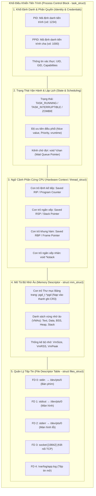

# 1_2_3 Process Control Block (PCB)

> **Khóa học**: Cloud DevOps Basic — OS Core  
> **Phân nhóm**: 1 Domain 1 - Operating System Core Fundamentals › 1_2 Process Management and Anatomy  
> **Chủ đề**: Khối điều khiển tiến trình (PCB / task_struct): Cấu trúc dữ liệu trung tâm quản lý định danh, ngữ cảnh phần cứng, bộ nhớ và tệp tin  
> **Trạng thái**: Draft (WRITE-CDB-1_2_3, 14-11-2026)  
> **Checklist đối chiếu**: [1_2_3](../../../CHECKLIST.md#domain-1-operating-system-core-fundamentals-45-items)  

---

## 1. Khái Niệm Cốt Lõi & Bản Chất Kỹ Thuật (Core Concepts & Technical Deep Dive)

Trong nhân của mọi hệ điều hành đa nhiệm (Multitasking Operating System), để có thể quản lý, theo dõi và luân chuyển hàng trăm tiến trình đồng thời trên một số lượng nhân CPU hạn chế, hệ điều hành bắt buộc phải duy trì một cấu trúc dữ liệu trung tâm đại diện cho sự tồn tại của từng tiến trình. Cấu trúc dữ liệu cốt lõi này được gọi là **Khối điều khiển tiến trình (Process Control Block - PCB)** hay **Bộ mô tả tiến trình (Process Descriptor)**.

### 1.1 Định nghĩa PCB & Vị trí trong Kernel

Theo giáo trình *Operating Systems: Three Easy Pieces (OSTEP - Ch. 4)*, danh sách tiến trình (Process List / Task List) là một trong những cấu trúc dữ liệu đầu tiên và quan trọng nhất được khởi tạo trong nhân hệ điều hành. Mỗi phần tử trong danh sách này là một PCB:
- **Trong hệ điều hành giảng dạy (xv6)**: PCB được định nghĩa dưới dạng cấu trúc `struct proc` bằng ngôn ngữ C.
- **Trong nhân Linux (Linux Kernel)**: PCB được hiện thực hóa bằng cấu trúc đồ sộ **`struct task_struct`** (được khai báo chi tiết trong tệp tiêu đề `include/linux/sched.h`).
- **Trong nhân Windows NT**: PCB tương ứng với cấu trúc **`EPROCESS`** (Executive Process Block) nằm trong không gian nhân.

> [!NOTE]
> **Bản chất kỹ thuật của `struct proc` trong xv6 (OSTEP Ch. 4)**:
> ```c
> struct proc {
>     char *mem;                  // Con trỏ tới vùng nhớ tiến trình
>     uint sz;                    // Kích thước bộ nhớ tiến trình (bytes)
>     char *kstack;               // Ngăn xếp kernel riêng biệt của tiến trình
>     enum proc_state state;      // Trạng thái tiến trình (RUNNING, SLEEPING,...)
>     int pid;                    // Định danh tiến trình (Process ID)
>     struct proc *parent;        // Con trỏ tới tiến trình cha (Parent Process)
>     void *chan;                 // Kênh ngủ / biến điều kiện chờ đợi
>     int killed;                 // Cờ đánh dấu tiến trình bị tiêu diệt
>     struct file *ofile[NOFILE]; // Bảng các tệp tin đang mở (Open files)
>     struct inode *cwd;          // Thư mục làm việc hiện tại
>     struct context context;     // Ngữ cảnh thanh ghi CPU được lưu khi switch
>     struct trapframe *tf;       // Khung bẫy lưu ngữ cảnh khi xảy ra trap/syscall
> };
> ```

---

### 1.2 Các nhóm thông tin thiết yếu được theo dõi trong PCB

Một PCB tiêu chuẩn lưu trữ đầy đủ toàn bộ siêu dữ liệu (metadata) cần thiết để hệ điều hành kiểm soát một tiến trình từ khi được sinh ra (`fork`) cho đến khi hoàn toàn biến mất khỏi hệ thống (`exit` / `wait`):

1. **Thông tin định danh tiến trình (Process Identification)**:
   - **`PID` (Process Identifier)**: Số nguyên dương duy nhất định danh tiến trình trong toàn bộ hệ thống.
   - **`PPID` (Parent Process Identifier)**: Mã PID của tiến trình cha đã triệu gọi hàm `fork()` để tạo ra tiến trình này.
   - **Thông tin phả hệ & nhóm**: Con trỏ trỏ tới tiến trình cha (`struct proc *parent`), danh sách các tiến trình con, và định danh nhóm tiến trình (Process Group ID - PGID).
   - **Định danh bảo mật (Credentials)**: User ID (`UID`), Group ID (`GID`), cùng các cờ phân quyền thực thi (Capabilities).

2. **Trạng thái thực thi của tiến trình (Process State)**:
   - Trường trạng thái cho biết tiến trình hiện đang ở giai đoạn nào trong vòng đời:
     - `RUNNING`: Đang chiếm giữ CPU và thực thi chỉ lệnh mã máy.
     - `READY` / `RUNNABLE`: Đã sẵn sàng thực thi nhưng đang nằm trong hàng đợi chờ CPU Scheduler phân bổ thời gian.
     - `SLEEPING` / `BLOCKED`: Đang tạm dừng chờ đợi một sự kiện phần cứng, dữ liệu I/O từ đĩa/mạng, hoặc một tín hiệu đồng bộ hóa.
     - `ZOMBIE`: Tiến trình đã hoàn tất thực thi (`exit`), nhưng PCB vẫn phải được lưu giữ trong Process Table để tiến trình cha có thể đọc mã thoát (Exit Status) thông qua lệnh `wait()`.
   - **Kênh chờ đợi (`chan` / Wait Channel)**: Địa chỉ của đối tượng hoặc sự kiện mà tiến trình đang bị khóa chờ đợi.

3. **Ngữ cảnh thanh ghi CPU phần cứng (Saved CPU Register Context)**:
   - Khi bộ lập lịch quyết định chuyển CPU từ tiến trình A sang tiến trình B (Context Switch), hệ thống bắt buộc phải "đóng băng" trạng thái tính toán của tiến trình A.
   - Cấu trúc `struct context` (hoặc `thread_struct` trong Linux) lưu trữ bản sao của tất cả các thanh ghi phần cứng thiết yếu:
     - **Program Counter (PC / RIP)**: Lưu vị trí lệnh mã máy tiếp theo mà tiến trình sẽ thực thi khi được đánh thức.
     - **Stack Pointer (SP / RSP)**: Trỏ tới đỉnh ngăn xếp người dùng hoặc ngăn xếp nhân.
     - **Frame Pointer (FP / RBP)**: Trỏ tới khung hàm hiện tại.
     - Các thanh ghi mục đích chung và thanh ghi cờ trạng thái (`RFLAGS`).
   - Ngữ cảnh này được lưu trên **ngăn xếp nhân riêng biệt (per-process kernel stack - `kstack`)** hoặc trực tiếp trong PCB.

4. **Thông tin quản lý bộ nhớ (Memory Management Information)**:
   - Chứa thông tin về cấu trúc không gian địa chỉ bộ nhớ ảo của tiến trình.
   - **Con trỏ bảng trang (Page Table Pointer)**: Trong Linux Kernel, trường này được quản lý qua con trỏ `struct mm_struct *mm` (hoặc `active_mm` đối với các luồng nhân mượn không gian địa chỉ). Khi tiến trình được chọn thực thi, địa chỉ vật lý của bảng phân trang cấp cao nhất sẽ được nạp vào thanh ghi điều khiển phần cứng của CPU (thanh ghi `CR3` trên x86-64) để kích hoạt cơ chế dịch địa chỉ của MMU.
   - Kích thước không gian bộ nhớ ảo (`sz`), con trỏ vùng nhớ (`mem`), và danh sách các phân đoạn bộ nhớ ảo (VMAs: Text, Data, BSS, Heap, Stack).

5. **Bảng mô tả tệp tin đang mở (Open File Descriptors Table)**:
   - Mảng các con trỏ quản lý tệp tin (trong xv6 là `struct file *ofile[NOFILE]`, trong Linux là `struct files_struct *files`).
   - Mảng này ánh xạ trực tiếp các số nguyên đại diện cho tệp tin (File Descriptors - FDs: `0` cho STDIN, `1` cho STDOUT, `2` cho STDERR) sang các cấu trúc tệp nội tại của Kernel, lưu trữ vị trí con trỏ đọc/ghi tệp (file offset), chế độ truy cập (read/write), và con trỏ Inode (`struct inode *cwd`).

---

## 2. Ví Dụ Đời Sống Thực Tế Dễ Hiểu (Intuitive Real-World Analogies)

### Ẩn dụ: Hồ Sơ Bệnh Án Điện Tử & Căn Cước Công Dân (Electronic Medical Record & Citizen ID)

Hãy hình dung hệ điều hành như một **Bệnh viện trung ương hiện đại** và mỗi tiến trình là một **Bệnh nhân** đang được theo dõi điều trị:

```text
[ CĂN CƯỚC & HỒ SƠ BỆNH ÁN ]               [ THÀNH PHẦN TRONG PCB (task_struct) ]
 • Số định danh công dân (Số CCCD)   --->   • Process ID (PID)
 • Mã số người giám hộ / Cha mẹ     --->   • Parent Process ID (PPID)
 • Tình trạng sức khỏe hiện tại      --->   • Process State (Running, Sleeping, Zombie)
 • Ảnh chụp X-quang & chỉ số sinh tồn --->   • Saved CPU Registers (RIP, RSP, RFLAGS)
 • Sổ hồng đăng ký tài sản/phòng ở  --->   • Con trỏ bảng trang MMU (mm_struct / CR3)
 • Chùm chìa khóa tủ gửi đồ y tế    --->   • Bảng mô tả tệp mở (File Descriptor Table)
```

1. **Định danh bệnh nhân (PID / PPID)**:
   - Mỗi bệnh nhân khi vào viện được cấp một mã bệnh nhân duy nhất (PID) và thông tin liên hệ của thân nhân bảo lãnh đưa vào viện (PPID). Bệnh viện phân loại bệnh nhân theo mã số này để không bao giờ nhầm lẫn y lệnh.
2. **Tình trạng điều trị (Process State)**:
   - Bác sĩ dán nhãn trạng thái lên bìa hồ sơ: Đang trong phòng phẫu thuật (Running trên CPU), Đang nằm tại phòng hồi sức chờ đến lượt khám (Ready trong hàng đợi), Đang chờ kết quả xét nghiệm máu từ phòng lab (Sleeping / Blocked chờ I/O đĩa), hoặc Đã hoàn tất điều trị nhưng chờ người nhà thanh toán viện phí xuất viện (Zombie).
3. **Ảnh chụp hiện trường khi bác sĩ đổi ca (Saved CPU Registers / Context Switch)**:
   - Khi bác sĩ trưởng (CPU) phải chuyển sang cấp cứu gấp cho một ca bệnh nguy kịch hơn, bác sĩ sẽ ghi chép chính xác lại toàn bộ thông số: huyết áp, nhịp tim, liều thuốc đang tiêm dở đến giọt thứ bao nhiêu (lưu Program Counter và các thanh ghi vào `struct context`). Bác sĩ đóng tập hồ sơ lại cất vào ngăn kéo. Khi quay trở lại ca bệnh này, bác sĩ chỉ việc mở hồ sơ ra và tiếp tục tiêm đúng liều lượng mà không phải khám lại từ đầu.
4. **Sổ hồng phòng điều trị riêng biệt (Memory Pointers - `mm_struct`)**:
   - Hồ sơ kẹp theo sơ đồ phòng bệnh nội trú riêng tư của bệnh nhân (không gian địa chỉ ảo). Bệnh nhân phòng này không thể tự ý bước sang lục lọi tủ thuốc của bệnh nhân phòng bên cạnh.
5. **Chùm chìa khóa tủ đồ (File Descriptor Table)**:
   - Bệnh nhân giữ một chùm chìa khóa đánh số: Chìa số 0 mở ngăn nhận thuốc (stdin), Chìa số 1 mở ngăn gửi kết quả (stdout), Chìa số 2 mở ngăn báo động khẩn (stderr). Nếu bệnh nhân xin thêm tủ lưu trữ kết quả chụp chiếu, bệnh viện cấp thêm chìa số 3, số 4.

---

## 3. Kiến Trúc, Luồng Hoạt Động & Hình Ảnh Trực Quan (Architecture, Diagrams & Visual Media)

Sơ đồ kiến trúc cấu trúc dữ liệu nội tại của Process Control Block (`task_struct` trong Linux Kernel / `struct proc` trong OS theory):



---

## 4. Thực Hành (Hands-on): Khảo Sát Siêu Dữ Liệu PCB Trên Hệ Thống Linux Thực Tế

Trong hệ điều hành Linux, toàn bộ thông tin nội tại của cấu trúc `task_struct` trong Kernel được phơi bày trực quan thông qua hệ thống tệp ảo `/proc`. Kỹ sư hệ thống có thể kiểm tra trực tiếp các trường dữ liệu của PCB mà không cần can thiệp vào mã nguồn nhân.

### 4.1 Trích xuất thông tin PCB của tiến trình qua `/proc/[pid]/status`

Tệp `/proc/[pid]/status` cung cấp định dạng con người dễ đọc về các trường cốt lõi trong PCB của tiến trình. Hãy khảo sát tiến trình khởi nguyên của hệ thống (PID 1 - `systemd` hoặc `init`):

```bash
# Trích xuất các trường thông tin cốt lõi trong PCB của PID 1
grep -E "Pid|PPid|State|VmPeak|VmSize|VmRSS|Threads|FDSize" /proc/1/status
```

> 💡 **Minh họa thực thi (Illustrative Output)**:
```text
State:   S (sleeping)
Pid:     1
PPid:    0
FDSize:  256
VmSize:  107792 kB
VmRSS:   14280 kB
Threads: 1
```

*Phân tích kỹ thuật các trường dữ liệu*:
- **`State: S (sleeping)`**: Tiến trình đang ở trạng thái ngủ ngắt quãng (Interruptible Sleep), tức đang chờ đợi sự kiện I/O hoặc tín hiệu mà không tiêu tốn chu kỳ CPU.
- **`Pid: 1`**: Định danh duy nhất của tiến trình khởi nguyên hệ thống.
- **`PPid: 0`**: Tiến trình cha là PID 0 (Swapper / Idle task được khởi tạo trực tiếp từ mã nguồn boot của Kernel).
- **`FDSize: 256`**: Số lượng khe cắm bảng mô tả tệp (File Descriptor slots) hiện đang được cấp phát trong cấu trúc `files_struct` của tiến trình này.
- **`VmSize: 107792 kB`**: Tổng kích thước không gian bộ nhớ ảo (Virtual Memory Size) mà tiến trình đang chiếm dụng.
- **`VmRSS: 14280 kB`**: Kích thước tập làm việc thực tế trong RAM vật lý (Resident Set Size).
- **`Threads: 1`**: Số lượng luồng thực thi (threads) thuộc về tiến trình này.

---

### 4.2 Kiểm tra bảng File Descriptors đang mở qua thư mục `/proc/[pid]/fd/`

Thư mục ảo `/proc/[pid]/fd/` chứa danh sách tất cả các tệp tin, socket mạng, hoặc đường ống (pipe) mà tiến trình đang mở. Tên của mỗi mục trong thư mục này chính là số nguyên đại diện cho File Descriptor:

```bash
# Kiểm tra các File Descriptors mà chính lệnh ls/shell đang mở
ls -l /proc/self/fd/
```

> 💡 **Minh họa thực thi (Illustrative Output)**:
```text
total 0
lrwx------ 1 user user 64 Nov 14 12:00 0 -> /dev/pts/1
lrwx------ 1 user user 64 Nov 14 12:00 1 -> /dev/pts/1
lrwx------ 1 user user 64 Nov 14 12:00 2 -> /dev/pts/1
lr-x------ 1 user user 64 Nov 14 12:00 3 -> /proc/15234/fd
```

*Quan sát chi tiết*:
- Mỗi mục là một **liên kết tượng trưng (symbolic link)** chỉ tới tài nguyên thực tế bên dưới.
- `0`, `1`, `2`: Ánh xạ tới thiết bị terminal ảo `/dev/pts/1` (đại diện cho luồng nhập chuẩn `stdin`, xuất chuẩn `stdout`, và xuất lỗi `stderr`).
- `3`: Là file descriptor tạm thời được lệnh `ls` mở ra để đọc danh sách thư mục `/proc/self/fd/`.
- Đối với các tiến trình mạng (như Nginx, Node.js), tại đây sẽ xuất hiện các liên kết dạng `socket:[42819]`, minh chứng rằng socket mạng cũng được Kernel quản lý như một file descriptor trong bảng của PCB.

---

## 5. Cạm Bẫy Thực Tế & Thực Tiễn Sản Xuất (Production Gotchas & Best Practices)

Trong quản trị hạ tầng Cloud và phát triển hệ thống backend, việc quản lý tài nguyên gắn liền với PCB quyết định trực tiếp độ sẵn sàng (High Availability) của dịch vụ:

1. **Hiểm họa Rò rỉ File Descriptor (FD Leak) & Lỗi "Too many open files" (`EMFILE`)**:
   - *Bản chất*: Mỗi khi một ứng dụng mở tệp (`open()`), mở kết nối cơ sở dữ liệu hoặc chấp nhận một kết nối HTTP mới (`accept()`), Kernel sẽ cấp phát một khe cắm trong mảng File Descriptor của PCB.
   - *Cạm bẫy*: Nếu lập trình viên quên đóng tệp hoặc kết nối trong các khối xử lý ngoại lệ (Exception Handling / `catch`), số lượng FD của tiến trình sẽ tăng liên tục. Khi vượt quá hạn mức tối đa cho phép của tiến trình (`ulimit -n`), các lời gọi mở tệp hoặc nhận kết nối mạng tiếp theo sẽ lập tức bị Kernel từ chối và trả về mã lỗi **`EMFILE` (Too many open files)**.
   - *Thực tiễn khắc phục*:
     - Kiểm tra số lượng FD đang mở của tiến trình bằng lệnh: `ls -1 /proc/<PID>/fd | wc -l`.
     - Điều chỉnh hạn mức FD trong tệp cấu hình hệ thống `/etc/security/limits.conf` hoặc trực tiếp cho service trong systemd bằng chỉ thị `LimitNOFILE=65535`.

2. **Cạn kiệt tài nguyên nhân hệ điều hành do Fork Bomb (PCB / PID Exhaustion)**:
   - *Cạm bẫy*: Một đoạn mã độc hại hoặc một lỗi logic đệ quy vô hạn tạo tiến trình con liên tục (ví dụ: `:(){ :|:& };:` trong Bash).
   - *Bản chất phần cứng*: Mỗi tiến trình được tạo ra đòi hỏi hệ điều hành phải cấp phát một cấu trúc PCB (`task_struct`) và một ngăn xếp nhân (`kstack` - thường tốn từ 8 KB đến 16 KB bộ nhớ RAM không thể chuyển vào swap).
   - *Hậu quả*: Toàn bộ bảng Process Table bị lấp đầy, số lượng PID khả dụng chạm trần `/proc/sys/kernel/pid_max`, và bộ nhớ nhân bị cạn kiệt hoàn toàn. Quản trị viên không thể đăng nhập vào máy chủ (kể cả qua SSH) vì lệnh `login` hoặc `bash` không thể `fork` thêm tiến trình mới, buộc phải khởi động lại máy vật lý bằng nút nguồn.
   - *Thực tiễn phòng chống*: Thiết lập giới hạn số lượng tiến trình tối đa cho từng user qua `ulimit -u` hoặc sử dụng **cgroups v2** với thông số giới hạn `pids.max` trong container (Docker/Kubernetes).

3. **Chi phí cấp phát bộ nhớ nhân không thể Swap (Unswappable Kernel Memory)**:
   - Các cấu trúc dữ liệu quản lý của Kernel như PCB (`task_struct`), danh sách mô tả tệp (`files_struct`), và bảng phân trang (`mm_struct`) bắt buộc phải luôn thường trực trong bộ nhớ RAM vật lý (Non-paged memory). Nếu một máy chủ chạy hàng chục nghìn tiến trình hoặc luồng (threads), dung lượng RAM tiêu tốn cho bản thân các PCB có thể lên tới hàng trăm Megabytes hoặc Gigabytes, làm giảm đáng kể không gian RAM dành cho bộ nhớ đệm ứng dụng (Application Buffer Cache).

---

## 6. Câu Hỏi Củng Cố Kiến Thức (Active Recall Quiz)

<details>
<summary><b>Câu hỏi 1:</b> Trong quá trình chuyển đổi ngữ cảnh (Context Switch) giữa hai tiến trình, Khối điều khiển tiến trình (PCB) đóng vai trò kỹ thuật then chốt như thế nào?</summary>

**Đáp án:**
PCB đóng vai trò là nơi lưu trữ và phục hồi trạng thái tính toán của tiến trình:
1. Khi tiến trình đang chạy bị ngắt (Preempted), Kernel sẽ đọc toàn bộ trạng thái thanh ghi phần cứng hiện tại của CPU (Program Counter/RIP, Stack Pointer/RSP, các thanh ghi mục đích chung, cờ trạng thái) và lưu chúng vào cấu trúc `struct context` bên trong PCB (hoặc trên ngăn xếp nhân `kstack`) của tiến trình đó.
2. Tiếp theo, Kernel chọn một tiến trình mới từ hàng đợi Ready, trích xuất trạng thái thanh ghi đã lưu từ PCB của tiến trình mới này và nạp ngược lại vào các thanh ghi phần cứng của CPU, đồng thời cập nhật thanh ghi `CR3` trỏ tới bảng phân trang của tiến trình mới. Nhờ đó, tiến trình mới có thể tiếp tục thực thi chính xác từ vị trí nó đã dừng lại trước đó.
</details>

<details>
<summary><b>Câu hỏi 2:</b> Tại sao con trỏ quản lý bảng phân trang bộ nhớ ảo (như trường <code>mm_struct *mm</code> trong Linux) bắt buộc phải được lưu trữ bên trong PCB của từng tiến trình?</summary>

**Đáp án:**
Mỗi tiến trình sở hữu một không gian địa chỉ ảo độc lập (đảm bảo tính cô lập và bảo vệ). Bảng phân trang là bản đồ ánh xạ từ các địa chỉ ảo này sang các khung trang bộ nhớ vật lý (RAM). Khi CPU chuyển đổi từ tiến trình này sang tiến trình khác, phần cứng bộ quản lý bộ nhớ (MMU) bắt buộc phải chuyển sang sử dụng bảng phân trang của tiến trình mới (bằng cách nạp địa chỉ gốc của bảng phân trang vào thanh ghi điều khiển `CR3`). Nếu không lưu con trỏ bảng trang trong PCB, hệ điều hành sẽ không thể kích hoạt đúng không gian bộ nhớ của tiến trình khi điều phối nó lên CPU.
</details>

<details>
<summary><b>Câu hỏi 3:</b> Một dịch vụ Backend viết bằng Java hoặc Go trên máy chủ Linux đột ngột gặp lỗi <code>java.io.IOException: Too many open files</code> và từ chối mọi yêu cầu mới. Dưới góc độ quản trị hệ điều hành, thành phần nào trong PCB đang bị quá tải và cách kiểm tra nhanh nhất là gì?</summary>

**Đáp án:**
- **Thành phần bị quá tải**: Bảng mô tả tệp mở (File Descriptor Table nằm trong cấu trúc `files_struct` của PCB) đã đạt tới hạn mức tối đa cho phép (`FDSize` hoặc hạn mức `ulimit -n` của hệ thống). Khi số lượng tệp/socket mở chạm ngưỡng này, hàm gọi `open()` hoặc `accept()` của kernel sẽ trả về mã lỗi `EMFILE`.
- **Cách kiểm tra nhanh nhất**:
  - Đếm số lượng file descriptor mà tiến trình đang mở: `ls -1 /proc/<PID>/fd | wc -l`.
  - Kiểm tra hạn mức tối đa hiện tại của tiến trình qua: `grep "Max open files" /proc/<PID>/limits`.
</details>

---

## 7. 📚 Nguồn Tài Liệu Chính Thống (Tier-1 Official References)

- [OSTEP Chapter 4: Processes](https://pages.cs.wisc.edu/~remzi/OSTEP/cpu-intro.pdf) - Giáo trình chuẩn mực *Operating Systems: Three Easy Pieces* (Remzi H. Arpaci-Dusseau & Andrea C. Arpaci-Dusseau), phân tích chi tiết cấu trúc dữ liệu Process Control Block (`struct proc`), Process List và cơ chế lưu trữ ngữ cảnh.
- [Linux Manual Pages: proc_pid_status(5)](https://man7.org/linux/man-pages/man5/proc_pid_status.5.html) - Đặc tả kỹ thuật chính thức từ Linux man-pages project về tệp ảo `/proc/[pid]/status`, mô tả các trường trạng thái PCB: `Pid`, `PPid`, `State`, `FDSize`, `VmSize`, `VmRSS`, và `Threads`.
- [Linux Manual Pages: proc_pid_fd(5)](https://man7.org/linux/man-pages/man5/proc_pid_fd.5.html) - Hướng dẫn chính thức về thư mục ảo `/proc/[pid]/fd/` biểu diễn bảng mô tả tệp mở (File Descriptors) của tiến trình trong nhân Linux.
- [Linux Kernel Documentation: active_mm](https://docs.kernel.org/mm/active_mm.html) - Tài liệu kỹ thuật chính thức của Linux Kernel giải thích vai trò của các trường quản lý bộ nhớ `task_struct->mm` và `active_mm` trong việc điều phối luồng và quản lý không gian địa chỉ.
