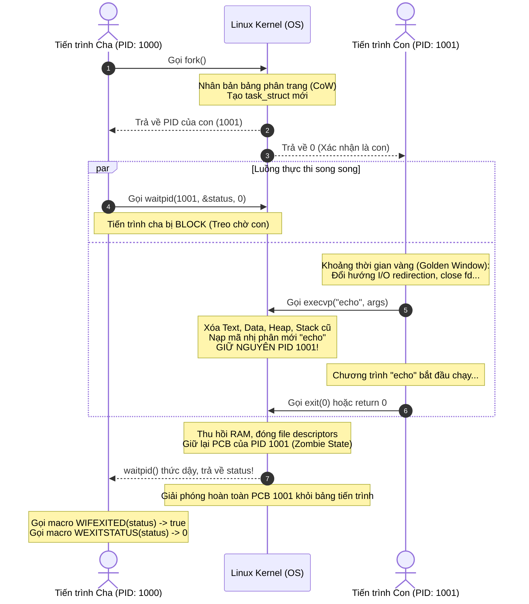

# 1_2_4 Process Creation and Lifecycle (fork, exec, wait, exit)

> **Khóa học**: Cloud DevOps Basic — OS Core  
> **Phân nhóm**: 1 Domain 1 - Operating System Core Fundamentals › 1_2 Process Management and Anatomy  
> **Chủ đề**: Vòng đời tiến trình Unix/Linux: Bộ tứ hệ thống fork(), exec(), wait(), exit() và cơ chế Copy-on-Write  
> **Trạng thái**: Verified (WRITE-CDB-1_2_4, 14-11-2026)  
> **Checklist đối chiếu**: [1_2_4](../../../CHECKLIST.md#domain-1-operating-system-core-fundamentals-45-items)  

---

## 1. Khái Niệm Cốt Lõi & Bản Chất Kỹ Thuật (Core Concepts & Technical Deep Dive)

Trong các hệ điều hành họ Unix và Linux, việc khởi tạo, kiểm soát và kết thúc một tiến trình được xây dựng trên một tập hợp giao diện lập trình hệ thống (API) tối giản nhưng vô cùng mạnh mẽ: **Bộ tứ `fork()`, `exec()`, `wait()`, và `exit()`**.

---

### 1.1 Chi Tiết Bộ Tứ Lời Gọi Hệ Thống (System Calls)

Theo giáo trình kinh điển *Operating Systems: Three Easy Pieces (OSTEP)*, Chương 5:

```text
+------------------------------------------------------------------------+
|                     BỘ TỨ LỜI GỌI HỆ THỐNG QUẢN LÝ TIẾN TRÌNH          |
|                                                                        |
|  1. fork()   : Nhân bản tiến trình hiện tại thành tiến trình con mới   |
|  2. exec()   : Nạp chương trình mới, ghi đè toàn bộ bộ nhớ (giữ PID)   |
|  3. wait()   : Tạm dừng tiến trình cha cho đến khi con kết thúc        |
|  4. exit()   : Chấm dứt tiến trình, giải phóng bộ nhớ, giữ lại exit code|
+------------------------------------------------------------------------+
```

1. **`fork()` — Nhân bản tiến trình**:
   - Lời gọi hệ thống `fork()` được hệ điều hành cung cấp để tạo ra một tiến trình mới mang tên **tiến trình con (child process)**.
   - Tiến trình con sinh ra là một **bản sao gần như y hệt (almost exact copy)** của tiến trình cha đang gọi: nó thừa hưởng bản sao các biến số, con trỏ lệnh, ngăn xếp (stack), đống nhớ (heap) và bảng mô tả tệp (file descriptor table).
   - **Điểm phân biệt sống còn**: `fork()` được gọi một lần nhưng **trả về hai lần** ở hai không gian tiến trình khác nhau:
     - Trong không gian của **tiến trình con**, `fork()` trả về giá trị **`0`**.
     - Trong không gian của **tiến trình cha**, `fork()` trả về **PID (Process ID) của tiến trình con** vừa được tạo ra.
     - Nếu không đủ tài nguyên để tạo tiến trình, `fork()` trả về giá trị âm (`-1`) cho tiến trình cha.

2. **`exec()` (Họ hàm `execve`, `execvp`, `execl`...) — Thay thế hình ảnh tiến trình**:
   - Trong khi `fork()` nhân bản mã nguồn đang chạy, họ hàm `exec()` cho phép tiến trình nạp và chạy một chương trình nhị phân hoàn toàn khác (ví dụ: thực thi lệnh `ls`, `grep`, hoặc `python`).
   - Khi được gọi với đường dẫn tệp thực thi và danh sách tham số, `exec()` sẽ **ghi đè hoàn toàn** các phân vùng bộ nhớ hiện tại của tiến trình (`Code/Text`, `Data`, `BSS`, `Heap`, `Stack`) bằng mã lệnh và dữ liệu của chương trình mới.
   - > [!IMPORTANT]
     > **Bản chất kỹ thuật**: Lời gọi `exec()` **không tạo ra một tiến trình mới** và **không cấp phát một PID mới**. Tiến trình mới nạp vẫn tiếp tục chạy với đúng số PID nguyên thủy của nó.
   - Một lời gọi `exec()` thành công **sẽ không bao giờ trả về**; mã lệnh phía sau `exec()` chỉ được thực thi nếu quá trình nạp tệp nhị phân thất bại (ví dụ: tệp không tồn tại hoặc không có quyền thực thi).

3. **`wait()` / `waitpid()` — Đồng bộ hóa và thu dọn hậu sự**:
   - Lời gọi hệ thống `wait()` tạm dừng (block) việc thực thi của tiến trình cha cho đến khi có ít nhất một tiến trình con của nó kết thúc.
   - Hàm `waitpid(pid, &status, options)` cung cấp khả năng kiểm soát linh hoạt hơn: cho phép cha chờ đích danh một tiến trình con cụ thể theo `pid`, hoặc kiểm tra trạng thái mà không bị block (thông qua cờ `WNOHANG`).
   - Lời gọi `wait()` đảm nhiệm hai nhiệm vụ tối quan trọng:
     1. Thu thập mã trạng thái thoát (**Exit Status**) của con để cha biết con hoàn thành thành công hay thất bại.
     2. Báo hiệu cho kernel giải phóng hoàn toàn cấu trúc quản trị PCB (`task_struct`) của tiến trình con khỏi bảng tiến trình hệ thống, ngăn chặn tiến trình con trở thành Zombie.

4. **`exit()` — Chấm dứt vòng đời tiến trình**:
   - Tiến trình kết thúc việc thực thi bằng cách chủ động gọi `exit()` hoặc khi hàm `main()` kết thúc bằng lệnh `return`.
   - Hệ điều hành thu hồi toàn bộ bộ nhớ ảo, giải phóng các trang RAM vật lý và đóng các tệp tin đang mở của tiến trình.
   - Trạng thái thoát (Exit Code) được kernel lưu lại tạm thời trong cấu trúc PCB để chờ tiến trình cha đến thu thập.

---

### 1.2 Triết Lý Unix: Tại Sao Tách Rời `fork()` Và `exec()`?

Các hệ điều hành khác (như Windows với API `CreateProcess()`) gom việc tạo tiến trình và nạp chương trình vào chung một lời gọi hàm duy nhất. Ngược lại, các nhà sáng lập Unix đã chủ động tách rời thành hai bước độc lập: `fork()` rồi mới đến `exec()`.

**Tại sao sự phân tách này lại là một kiệt tác kiến trúc?**
- Nó tạo ra một **khoảng thời gian vàng (Golden Window)** ở tiến trình con: **sau khi con đã sinh ra nhưng trước khi gọi `exec()`**.
- Trong khoảng thời gian này, tiến trình con chạy độc lập với cha nhưng vẫn mang mã của chương trình gốc. Do đó, chương trình (đặc biệt là **Unix Shell**) có thể tùy biến môi trường thực thi của tiến trình con một cách linh hoạt mà **không làm phức tạp hóa hạt nhân kernel**:

```text
                  +----------------------------------------+
                  |         Tiến trình Shell (Cha)        |
                  +----------------------------------------+
                                      |
                                      | calls fork()
                                      v
         +----------------------------------------------------------+
         |                 Tiến trình Con (Child)                   |
         |                                                          |
         |  [ KHOẢNG THỜI GIAN VÀNG TRƯỚC EXEC ]                     |
         |  1. Đổi hướng I/O: close(1); open("out.txt", ...);       |
         |  2. Đấu nối Pipeline: dup2(pipefd[1], STDOUT_FILENO);    |
         |  3. Thiết lập biến môi trường, đổi thư mục chdir()       |
         |                                                          |
         |  calls execvp("grep", args)                              |
         |  --> Toàn bộ bộ nhớ cũ bị ghi đè, chương trình mới chạy! |
         +----------------------------------------------------------+
```

- **Điều hướng đầu vào/đầu ra (I/O Redirection)**: Khi người dùng gõ `ls > output.txt`, Shell thực hiện:
  1. `fork()` tạo tiến trình con.
  2. Ở tiến trình con: đóng luồng chuẩn `stdout` (`close(1)`), mở tệp `output.txt` (tự động nhận descriptor số 1 vì Unix luôn cấp descriptor nhỏ nhất còn trống).
  3. Tiến trình con gọi `execvp("ls", ...)`. Lệnh `ls` khi chạy chỉ việc ghi dữ liệu vào descriptor 1 như bình thường, và dữ liệu tự động chảy thẳng vào tệp `output.txt` mà bản thân mã nguồn của `ls` không cần biết gì về việc điều hướng!
- **Đường ống liên tiến trình (Unix Pipelines)**: Cơ chế kết nối `cmd1 | cmd2` được thực hiện bằng cách tạo một đường ống `pipe()` trước khi `fork()`, sau đó ở mỗi tiến trình con sử dụng `dup2()` để nối đầu ra của `cmd1` vào đầu vào của `cmd2` trước khi gọi `exec()`.

---

### 1.3 Cơ Chế Tối Ưu Hóa: Copy-on-Write (CoW)

Về mặt lý thuyết, việc `fork()` sao chép toàn bộ không gian địa chỉ bộ nhớ từ cha sang con sẽ vô cùng tốn kém tài nguyên và làm suy giảm hiệu năng nghiêm trọng (ví dụ: tiến trình cha đang chiếm 8 GB RAM thì `fork()` sẽ phải sao chép cả 8 GB). Hơn nữa, nếu tiến trình con gọi `exec()` ngay sau đó, toàn bộ 8 GB vừa sao chép sẽ bị xóa bỏ ngay lập tức.

Để giải quyết bài toán này, hạt nhân Linux triển khai cơ chế **Copy-on-Write (CoW — Sao chép khi ghi)**:
- Theo tài liệu chính thức từ Linux Manual Pages (`man 2 fork`, mục NOTES):
  > *"Under Linux, fork() is implemented using copy-on-write pages, so the only penalty that it incurs is the time and memory required to duplicate the parent's page tables, and to create a unique task structure for the child."*
- **Quy trình vận hành của CoW**:
  1. Khi `fork()` được gọi, kernel **không sao chép các khung trang RAM vật lý (physical frames)**. Thay vào đó, nó chỉ nhân bản **bảng phân trang (page tables)** và tạo một cấu trúc `task_struct` mới cho con.
  2. Bảng phân trang của cả cha và con đều trỏ chung vào cùng các trang nhớ vật lý cũ.
  3. Kernel đánh dấu quyền truy cập của tất cả các trang nhớ chia sẻ này thành **chỉ đọc (read-only)**.
  4. Chừng nào cả cha và con chỉ đọc dữ liệu, chúng tiếp tục dùng chung bộ nhớ vật lý mà không tốn thêm một byte RAM nào.
  5. Khi tiến trình cha hoặc con thực hiện thao tác **ghi (write)** vào một trang nhớ, phần cứng MMU phát hiện vi phạm quyền ghi trên trang read-only và kích hoạt ngoại lệ **Page Fault**.
  6. Trình xử lý ngắt Page Fault của kernel sẽ can thiệp: âm thầm cấp phát một khung trang vật lý mới toanh, sao chép nội dung của trang nhớ đó sang trang mới, cập nhật bảng phân trang của tiến trình đang ghi trỏ tới trang mới với quyền đọc/ghi (read-write), và cho phép lệnh ghi tiếp tục thực hiện.

---

### 1.4 Giải Mã Trạng Thái Kết Thúc Với Macro POSIX

Khi tiến trình con kết thúc, mã thoát của nó được trả về cho tiến trình cha thông qua tham số số nguyên `wstatus` trong `wait(&wstatus)` hoặc `waitpid(pid, &wstatus, options)`. Để diễn giải chuẩn xác giá trị này, chuẩn POSIX định nghĩa các macro chuyên dụng (`man 2 wait`):
- **`WIFEXITED(wstatus)`**: Trả về giá trị khác không (`true`) nếu tiến trình con kết thúc một cách bình thường (thông qua lệnh gọi `exit(3)`, `_exit(2)` hoặc lệnh `return` từ hàm `main()`).
- **`WEXITSTATUS(wstatus)`**: Nếu `WIFEXITED` là true, macro này trích xuất **8 bit thấp nhất (least significant 8 bits)** của mã thoát mà tiến trình con đã truyền vào (giá trị từ `0` đến `255`).

---

## 2. Ví Dụ Đời Sống Thực Tế Dễ Hiểu (Intuitive Real-World Analogies)

### Ẩn Dụ: Nhân Bản Vô Tính & Chuyển Giao Linh Hồn (Cell Cloning & Soul Transmigration)

Để hình dung bộ tứ `fork`, `exec`, `wait`, `exit`, hãy liên tưởng đến một câu chuyện giả tưởng về công nghệ nhân bản sinh học:

```text
+------------------------------------------------------------------------+
|              NHÂN BẢN VÔ TÍNH & CHUYỂN GIAO LINH HỒN                   |
|                                                                        |
| 1. fork():                                                             |
|    - Một người cha bước vào buồng nhân bản vô tính.                    |
|    - Cỗ máy tạo ra một đứa con giống hệt cha từ ADN đến ký ức.        |
|    - Cả hai dùng chung căn nhà (Copy-on-Write). Chỉ khi ai muốn sơn lại|
|      phòng riêng (ghi bộ nhớ), phòng mới được xây riêng cho người đó.  |
|    - Bác sĩ thì thầm vào tai con: "Số của con là 0".                   |
|      Bác sĩ đưa cho cha tấm thẻ ghi: "Con của ông có mã số là 5001".   |
|                                                                        |
| 2. Khoảnh khắc trước exec():                                           |
|    - Đứa con đeo khẩu trang, gắn kính bảo hộ, đổi hướng micro thu âm  |
|      (Shell đổi hướng I/O Redirection, thiết lập đường ống).           |
|                                                                        |
| 3. exec():                                                             |
|    - Đứa con bước vào phòng chuyển giao linh hồn.                      |
|    - Thể xác và số căn cước giữ nguyên (PID = 5001 không đổi).         |
|    - Ký ức cũ bị xóa sạch, nạp linh hồn của một "Kiến trúc sư" mới.    |
|                                                                        |
| 4. exit():                                                             |
|    - Kiến trúc sư làm xong việc, nhắm mắt xuôi tay (exit).             |
|    - Thể xác giải phóng, chỉ để lại bản di chúc ghi mã kết quả (0).    |
|                                                                        |
| 5. wait():                                                             |
|    - Người cha đứng ở phòng chờ, tiếp nhận bản di chúc (waitpid),      |
|      đọc mã kết quả rồi mới cho phép hỏa táng hoàn tất (xóa PCB).      |
+------------------------------------------------------------------------+
```

---

## 3. Kiến Trúc, Luồng Hoạt Động & Hình Ảnh Trực Quan (Architecture, Diagrams & Visual Media)

### Sơ Đồ Trình Tự Vòng Đời Tiến Trình (Mermaid Sequence Diagram)

Sơ đồ dưới đây mô tả chính xác từng bước tương tác giữa Tiến trình Cha, Hạt nhân Linux (Kernel) và Tiến trình Con thông qua bộ tứ system calls:



---

## 4. Code Mẫu Trực Quan Hoặc Dòng Lệnh Thực Chiến (Runnable Sample Code / CLI)

> ⚠️ Chưa chạy thử (not executed by the squad) - Ví dụ minh họa mã nguồn C mẫu theo chuẩn POSIX/Linux System Calls biểu diễn đầy đủ chu trình `fork()`, `execvp()`, `waitpid()`, và giải mã mã thoát.

### 4.1 Mã Nguồn C Mẫu Toàn Diện: `process_lifecycle.c`

```c
/*
 * File: process_lifecycle.c
 * Mục đích: Minh họa chu trình tạo tiến trình bằng fork(),
 *           nạp chương trình mới bằng execvp(),
 *           chờ đợi và thu hồi mã thoát bằng waitpid().
 */

#include <stdio.h>
#include <stdlib.h>
#include <unistd.h>
#include <sys/types.h>
#include <sys/wait.h>

int main(void) {
    printf("[Parent PID: %d] Bắt đầu khởi chạy chương trình chính...\n", getpid());

    // 1. Gọi fork() để tạo tiến trình con
    pid_t pid = fork();

    if (pid < 0) {
        // Lỗi tạo tiến trình
        perror("fork thất bại");
        return EXIT_FAILURE;
    } else if (pid == 0) {
        // -------------------------------------------------------------
        // NHÁNH TIẾN TRÌNH CON (Child Process)
        // -------------------------------------------------------------
        printf("[Child PID: %d, Parent PPID: %d] Tiến trình con đã được sinh ra!\n",
               getpid(), getppid());
        printf("[Child PID: %d] Đang chuẩn bị gọi execvp(\"echo\")...\n", getpid());

        // Danh sách đối số truyền cho lệnh echo (kết thúc bằng NULL)
        char *args[] = {"echo", "Xin chao tu tien trinh con duoc nap boi execvp!", NULL};

        // 2. Nạp chương trình mới bằng execvp
        execvp(args[0], args);

        // LƯU Ý: Nếu execvp thành công, dòng lệnh dưới đây KHÔNG BAO GIỜ được chạm tới!
        perror("execvp thất bại");
        _exit(127);
    } else {
        // -------------------------------------------------------------
        // NHÁNH TIẾN TRÌNH CHA (Parent Process)
        // -------------------------------------------------------------
        printf("[Parent PID: %d] Đã tạo thành công tiến trình con PID: %d.\n", getpid(), pid);
        printf("[Parent PID: %d] Đang chờ tiến trình con kết thúc bằng waitpid()...\n", getpid());

        int status;
        // 3. Chờ tiến trình con kết thúc
        pid_t waited_pid = waitpid(pid, &status, 0);

        if (waited_pid == -1) {
            perror("waitpid thất bại");
            return EXIT_FAILURE;
        }

        // 4. Phân tích mã trạng thái thoát của con bằng Macro POSIX
        if (WIFEXITED(status)) {
            printf("[Parent PID: %d] Tiến trình con PID %d kết thúc bình thường.\n",
                   getpid(), waited_pid);
            printf("[Parent PID: %d] Mã thoát (Exit Code) của con là: %d\n",
                   getpid(), WEXITSTATUS(status));
        } else if (WIFSIGNALED(status)) {
            printf("[Parent PID: %d] Tiến trình con PID %d bị hủy bởi tín hiệu (Signal) số: %d\n",
                   getpid(), waited_pid, WTERMSIG(status));
        }
    }

    printf("[Parent PID: %d] Chương trình cha hoàn tất thành công.\n", getpid());
    return EXIT_SUCCESS;
}
```

---

### 4.2 Thao Tác Biên Dịch Và Thực Thi Trên Linux CLI

```bash
# 1. Biên dịch chương trình bằng GCC
gcc -Wall -Wextra process_lifecycle.c -o process_lifecycle

# 2. Thực thi chương trình
./process_lifecycle
```

### 4.3 Đầu Ra Minh Họa & Phân Tích

```text
[Parent PID: 12450] Bắt đầu khởi chạy chương trình chính...
[Parent PID: 12450] Đã tạo thành công tiến trình con PID: 12451.
[Parent PID: 12450] Đang chờ tiến trình con kết thúc bằng waitpid()...
[Child PID: 12451, Parent PPID: 12450] Tiến trình con đã được sinh ra!
[Child PID: 12451] Đang chuẩn bị gọi execvp("echo")...
Xin chao tu tien trinh con duoc nap boi execvp!
[Parent PID: 12450] Tiến trình con PID 12451 kết thúc bình thường.
[Parent PID: 12450] Mã thoát (Exit Code) của con là: 0
[Parent PID: 12450] Chương trình cha hoàn tất thành công.
```

- **Nhận xét quan sát**:
  - Dòng chữ `Xin chao tu tien trinh con duoc nap boi execvp!` do chính chương trình nhị phân `/bin/echo` in ra sau khi `execvp` ghi đè không gian nhớ của tiến trình con 12451.
  - Tiến trình cha 12450 nhận được chính xác mã thoát `0` (`WEXITSTATUS(status) = 0`) mà lệnh `echo` trả về khi hoàn tất.

---

## 5. Cạm Bẫy Thực Tế & Thực Tiễn Sản Xuất (Production Gotchas & Best Practices)

Trong kỹ thuật phát triển ứng dụng hệ thống và vận hành hạ tầng Cloud/DevOps, bộ tứ `fork`, `exec`, `wait`, `exit` tiềm ẩn những cạm bẫy sống còn:

### 1. Cạm Bẫy `exit(3)` vs `_exit(2)` Trong Nhánh Tiến Trình Con Sau `fork()`
- **Vấn đề**: Khi một tiến trình gọi hàm thư viện `exit(3)` của ngôn ngữ C, hàm này sẽ tự động xả các bộ đệm I/O trong user-space (`fflush()`) và thực thi các hàm dọn dẹp đã đăng ký với `atexit()`.
- **Rủi ro**: Nếu tiến trình con sau khi `fork()` gặp lỗi trước khi kịp gọi `exec()` và gọi `exit(3)`:
  - Do tiến trình con thừa hưởng bản sao bộ đệm `stdio` của cha, việc con xả bộ đệm có thể dẫn đến hiện tượng **dữ liệu bị ghi trùng lặp hai lần (Double Flush)** vào tệp tin khi cha kết thúc sau đó.
- **Quy tắc vàng**: Trong nhánh con sau `fork()`, nếu xảy ra lỗi không thể gọi `exec()`, **luôn luôn sử dụng `_exit(2)`** (lời gọi hệ thống trực tiếp của Linux) thay vì `exit(3)`. `_exit(2)` yêu cầu kernel thu hồi tiến trình ngay lập tức mà không xả bộ đệm stdio dùng chung của tiến trình cha.

### 2. Rò Rỉ Bảng Tiến Trình (Process Table Exhaustion / Zombie Leak)
- **Vấn đề**: Nếu tiến trình cha liên tục gọi `fork()` để xử lý tác vụ nền nhưng lập trình viên quên không gọi `wait()` hoặc `waitpid()` để thu dọn kết quả:
  - Các tiến trình con sau khi hoàn thành sẽ trở thành các tiến trình **Zombie (`Z`)**.
- **Hậu quả sản xuất**:
  - Dù Zombie không tiêu tốn RAM hay CPU, mỗi zombie vẫn chiếm giữ một mục trong bảng tiến trình của kernel và giữ một số định danh **PID**.
  - Giới hạn số lượng PID trên máy chủ Linux là hữu hạn (được quy định trong `/proc/sys/kernel/pid_max`, thông thường mặc định là 32,768 hoặc 4,194,304).
  - Khi cạn kiệt bảng PID, hệ điều hành sẽ từ chối tạo bất kỳ tiến trình mới nào, trả về lỗi kinh điển: `fork: Resource temporarily unavailable`, khiến toàn bộ máy chủ và các dịch vụ khác (như SSH) bị tê liệt hoàn toàn.

### 3. Phòng Chống Tấn Công "Fork Bomb" (`:(){ :|:& };:`)
- **Bản chất**: Đoạn mã bash kinh điển `:(){ :|:& };:` định nghĩa một hàm tự gọi chính nó và đẩy vào chạy ngầm liên tục theo cấp số nhân. Trong vòng chưa đầy 2 giây, hàng chục nghìn tiến trình con được sinh ra, vắt kiệt bảng PID và bảng phân trang MMU của máy chủ.
- **Giải pháp bảo vệ thực tiễn trong DevOps**:
  - Cấu hình giới hạn số lượng tiến trình tối đa cho từng người dùng thông qua tham số `nproc` trong tệp cấu hình PAM (`/etc/security/limits.conf`):
    ```text
    appuser  hard  nproc  2048
    ```
  - Trong môi trường Docker / Kubernetes: Luôn đặt giới hạn **PIDs Limit** thông qua cờ `--pids-limit` của Docker hoặc chỉ thị `pids.max` trong Linux cgroups v2 để ngăn ngừa một container bị tấn công làm sập toàn bộ nút máy chủ vật lý (Node).

### 4. Giải Pháp Khởi Chạy Tinh Gọn Khi Không Cần Tùy Biến: `posix_spawn(3)` & `vfork(2)`
- Khi ứng dụng chỉ đơn thuần muốn thực thi một chương trình ngoài mà không cần can thiệp tùy biến phức tạp (như điều hướng I/O hay đổi biến môi trường giữa `fork` và `exec`), việc gọi `fork()` vẫn phải trả chi phí sao chép bảng phân trang (page tables).
- Chuẩn POSIX định nghĩa hàm `posix_spawn(3)` (trên Linux thường tận dụng `vfork(2)` hoặc `clone(CLONE_VM | CLONE_VFORK)`) kết hợp tạo và nạp chương trình mới mà không nhân bản bảng phân trang, giúp tăng tốc độ khởi tạo tiến trình con trong các ứng dụng hiệu năng cao.

---

## 6. Câu Hỏi Củng Cố Kiến Thức (Active Recall Quiz)

<details>
<summary><b>Câu hỏi 1:</b> Tại sao một lời gọi hàm thuộc họ <code>exec()</code> khi thực thi thành công lại không bao giờ trả về giá trị (never returns)? Lập trình viên có cần viết mã xử lý giá trị trả về của <code>exec()</code> khi nó thành công không?</summary>

**Đáp án:**
- **Nguyên nhân**: Khi `exec()` thực thi thành công, toàn bộ không gian địa chỉ bộ nhớ cũ của tiến trình (bao gồm cả phân vùng mã lệnh `Text` và ngăn xếp `Stack` chứa điểm gọi hàm `exec()`) đã bị kernel ghi đè hoàn toàn bằng mã lệnh của chương trình mới. Vì đoạn mã cũ không còn tồn tại trong bộ nhớ, CPU không còn con trỏ lệnh nào để quay trở về sau hàm `exec()`.
- **Thực hành**: Lập trình viên **không bao giờ nhận được giá trị trả về khi thành công**. Bất kỳ dòng code nào nằm ngay phía sau lời gọi `exec()` chỉ được chạy khi `exec()` thất bại (trả về `-1`).
</details>

<details>
<summary><b>Câu hỏi 2:</b> Tại sao các nhà thiết kế kiến trúc Unix lại chủ động tách rời việc tạo tiến trình thành hai lời gọi <code>fork()</code> và <code>exec()</code> riêng biệt thay vì tạo một hàm gộp duy nhất? Khoảng cách giữa <code>fork()</code> và <code>exec()</code> đem lại lợi ích gì cho Unix Shell?</summary>

**Đáp án:**
- **Lợi ích**: Sự tách rời tạo ra một "khoảng thời gian vàng" ở tiến trình con: sau khi con đã được sinh ra độc lập nhưng trước khi nạp mã chương trình mới bằng `exec()`.
- **Ứng dụng cho Shell**: Shell có thể can thiệp vào môi trường của tiến trình con để thực hiện các thao tác tùy biến phức tạp mà không làm phức tạp hóa hạt nhân kernel:
  - Đóng và chuyển hướng các luồng chuẩn (I/O Redirection: `>`, `<`) bằng `dup2()`.
  - Kết nối dữ liệu giữa các tiến trình thông qua đường ống (`pipe()`).
  - Thiết lập biến môi trường riêng, thay đổi thư mục làm việc (`chdir()`), hoặc thiết lập mặt nạ chặn tín hiệu (signal mask).
</details>

<details>
<summary><b>Câu hỏi 3:</b> Cơ chế Copy-on-Write (CoW) trong lời gọi <code>fork()</code> của Linux hoạt động như thế nào? Tại sao nó giúp hệ thống tiết kiệm tài nguyên bộ nhớ tối đa khi tạo tiến trình?</summary>

**Đáp án:**
- **Cơ chế hoạt động**: Khi gọi `fork()`, kernel Linux không sao chép vật lý các trang RAM từ cha sang con mà chỉ sao chép bảng phân trang (page tables). Cả hai tiến trình tạm thời chia sẻ chung các khung trang RAM vật lý ở chế độ chỉ đọc (**read-only**). Khi một trong hai tiến trình cố gắng ghi dữ liệu vào một trang, phần cứng MMU kích hoạt ngắt **Page Fault**. Lúc này kernel mới thực sự cấp phát một trang RAM vật lý mới, sao chép dữ liệu sang và cấp quyền ghi riêng cho tiến trình đó.
- **Tiết kiệm tài nguyên**: Ngăn chặn việc sao chép hàng gigabyte dữ liệu vô ích, đặc biệt khi phần lớn tiến trình con sau khi `fork()` sẽ ngay lập tức gọi `exec()` để ghi đè toàn bộ bộ nhớ.
</details>

---

## 7. 📚 Nguồn Tài Liệu Chính Thống (Tier-1 Official References)

- [OSTEP Chapter 5: Process API](https://pages.cs.wisc.edu/~remzi/OSTEP/cpu-api.pdf) - Giáo trình chuẩn mực *Operating Systems: Three Easy Pieces* (Remzi H. Arpaci-Dusseau & Andrea C. Arpaci-Dusseau), phân tích chuyên sâu về bộ tứ `fork()`, `exec()`, `wait()`, triết lý tách rời fork/exec và cơ chế I/O redirection trong Unix.
- [Linux Manual Pages: fork(2)](https://man7.org/linux/man-pages/man2/fork.2.html) - Hướng dẫn chính thức về lời gọi hệ thống `fork`, đặc tả kỹ thuật cơ chế Copy-on-Write (CoW) và quản lý bảng phân trang trong Linux kernel.
- [Linux Manual Pages: execve(2)](https://man7.org/linux/man-pages/man2/execve.2.html) - Tài liệu kỹ thuật chính thức về giao diện nạp chương trình thực thi, ghi đè không gian bộ nhớ tiến trình và kế thừa bộ mô tả tệp.
- [Linux Manual Pages: wait(2)](https://man7.org/linux/man-pages/man2/wait.2.html) - Hướng dẫn chuẩn POSIX về các lời gọi hệ thống `wait`, `waitpid` và các macro giải mã trạng thái thoát (`WIFEXITED`, `WEXITSTATUS`).
