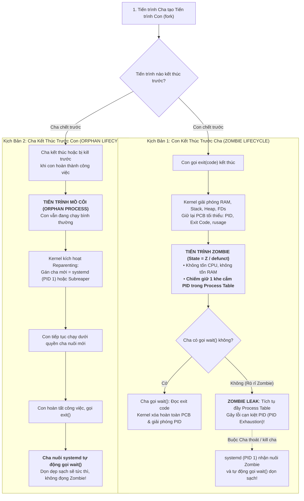

# 1_2_5 Zombie vs Orphan Processes

> **Khóa học**: Cloud DevOps Basic — OS Core  
> **Phân nhóm**: 1 Domain 1 - Operating System Core Fundamentals › 1_2 Process Management and Anatomy  
> **Chủ đề**: Phân biệt bản chất tiến trình Zombie và Orphan: Vòng đời kết thúc, cơ chế wait(), reparenting sang init/subreaper và phòng ngừa rò rỉ PID  
> **Trạng thái**: Draft (WRITE-CDB-1_2_5, 14-11-2026)  
> **Checklist đối chiếu**: [1_2_5](../../../CHECKLIST.md#domain-1-operating-system-core-fundamentals-45-items)  

---

## 1. Khái Niệm Cốt Lõi & Bản Chất Kỹ Thuật (Core Concepts & Technical Deep Dive)

Trong mô hình quản lý tiến trình của các hệ điều hành họ UNIX/Linux (chuẩn POSIX), tiến trình luôn được tổ chức theo cấu trúc hình cây phân cấp phả hệ nghiêm ngặt. Mọi tiến trình con đều được sinh ra từ một tiến trình cha thông qua lời gọi hệ thống `fork()`. Khi các tiến trình trong cây phân cấp này kết thúc không đồng thời, hệ điều hành phát sinh hai trạng thái tiến trình đặc biệt mang tính kinh điển: **Tiến trình Thây Ma (Zombie Process)** và **Tiến trình Mồ Côi (Orphan Process)**.

### 1.1 Vòng đời kết thúc chuẩn của Tiến trình con & Cơ chế `wait()`

Khi một tiến trình con hoàn thành nhiệm vụ tính toán của mình, nó sẽ triệu gọi hàm kết thúc `exit()` hoặc `_exit(status)`:
1. **Thu hồi tài nguyên phần cứng**: Ngay khi tiến trình con gọi `exit()`, nhân hệ điều hành (Kernel) sẽ lập tức giải phóng hầu như toàn bộ tài nguyên nặng mà tiến trình đang chiếm dụng:
   - Toàn bộ không gian địa chỉ bộ nhớ ảo (Text, Data, BSS, Heap, Stack) được thu hồi và trả lại cho bộ nhớ RAM vật lý.
   - Toàn bộ các tệp tin và kết nối socket đang mở (`files_struct`) được đóng lại.
2. **Lưu giữ mục PCB tối thiểu (Minimal PCB Entry)**:
   - Mặc dù tài nguyên ứng dụng đã được giải phóng, Kernel **chưa thể xóa bỏ hoàn toàn tiến trình con khỏi bảng tiến trình (Process Table / Task List)**.
   - Nhân hệ điều hành bắt buộc phải giữ lại một mục PCB tối thiểu chứa: Mã định danh tiến trình (**`PID`**), Trạng thái kết thúc (**Termination Status / Exit Code**), và Thông tin thống kê tiêu thụ tài nguyên CPU/Memory (**`rusage`**).
   - Mục đích của việc giữ lại này là để **cho phép tiến trình cha có thể đọc được kết quả thực thi và lý do kết thúc của con** (ví dụ: con kết thúc thành công với mã 0, hay bị chết vì tín hiệu `SIGSEGV`).
3. **Thu hoạch (Reaping)**: Tiến trình cha phải triệu gọi lời gọi hệ thống **`wait()`** hoặc **`waitpid()`**. Lời gọi này sẽ đọc mã trạng thái của con, sau đó Kernel mới chính thức xóa bỏ hoàn toàn mục PCB của tiến trình con khỏi Process Table và giải phóng mã `PID` đó về kho để tái sử dụng.

---

### 1.2 Tiến trình Zombie (Zombie / Defunct Process)

Theo tài liệu chính thức `man 2 wait` và giáo trình *OSTEP (Ch. 4)*:
- **Định nghĩa**: Một tiến trình con đã hoàn tất thực thi (đã gọi `exit()`), nhưng tiến trình cha **chưa hề thực hiện lời gọi hệ thống `wait()`** để thu hoạch mã trạng thái, thì tiến trình con đó rơi vào trạng thái **Zombie (Thây ma)**.
- **Trạng thái hiển thị**: Trong bảng điều khiển tiến trình (như lệnh `ps`), tiến trình này mang mã trạng thái **`Z`** (hoặc `Z+`) kèm theo hậu tố chú thích **`<defunct>`** (đã chết).
- **Mức độ tiêu thụ tài nguyên**:
  - Tiến trình Zombie **hoàn toàn không tiêu tốn chu kỳ CPU** (vì nó không còn chỉ lệnh nào để thực thi).
  - Tiến trình Zombie **không còn chiếm dụng bộ nhớ RAM ứng dụng** (không gian địa chỉ đã bị Kernel giải phóng sạch sẽ khi gọi `exit()`).
- **Hiểm họa Rò rỉ Zombie (Zombie Leak) & Cạn kiệt PID**:
  - Mặc dù không ngốn RAM hay CPU, nhưng chừng nào tiến trình cha chưa gọi `wait()`, mục PCB của Zombie **vẫn tiếp tục chiếm giữ một khe cắm (slot) trong bảng Process Table của Kernel**.
  - Mỗi khe cắm này giữ chặt một mã số `PID`. Nếu một tiến trình cha (ví dụ như một web server hoặc tiến trình quản trị daemon chạy nền 24/7) liên tục sinh ra hàng nghìn tiến trình con xử lý tác vụ ngắn hạn nhưng bị lỗi logic quên gọi `wait()`, các mục Zombie sẽ tích tụ ngày càng nhiều.
  - Khi số lượng Zombie chạm ngưỡng giới hạn tối đa của hệ thống (được quy định trong `/proc/sys/kernel/pid_max`), toàn bộ kho PID bị cạn kiệt. Lúc này, hệ điều hành **hoàn toàn không thể tạo thêm bất kỳ tiến trình mới nào** (lệnh `fork()` luôn trả về mã lỗi `-EAGAIN`), khiến hệ thống rơi vào trạng thái tê liệt.

---

### 1.3 Tiến trình Mồ Côi (Orphan Process) & Cơ chế Nhận Nuôi (Reparenting)

Trường hợp ngược lại xảy ra khi quan hệ thời gian giữa cha và con bị đảo lộn:
- **Định nghĩa**: Một tiến trình **vẫn đang hoạt động bình thường** (đang chạy tính toán trên CPU hoặc đang ngủ chờ I/O), nhưng **tiến trình cha của nó đã kết thúc hoặc bị tiêu diệt trước** (`parent terminated prematurely`).
- **Cơ chế Nhận nuôi (Reparenting)**:
  - Một tiến trình trong hệ điều hành không thể tồn tại "vô thừa nhận" mà không có cha trong cây phân cấp phả hệ. Do đó, ngay khi tiến trình cha kết thúc, Kernel sẽ tự động kích hoạt cơ chế nhận nuôi (Reparenting):
  - **Mô hình truyền thống**: Tiến trình mồ côi sẽ được tự động chuyển quyền làm con (reparented) cho tiến trình gốc tối cao của hệ thống: **`init` (trên SysVinit) hoặc `systemd` (PID 1)**.
  - **Mô hình hiện đại (từ Linux 3.4+)**: Kernel bổ sung tính năng **Subreaper** thông qua lời gọi điều khiển `prctl(PR_SET_CHILD_SUBREAPER)`. Một tiến trình tổ tiên còn sống gần nhất (ví dụ: Session Manager, Container Shim, hoặc tiến trình quản lý phiên dịch vụ) đã đăng ký cờ Subreaper sẽ đứng ra nhận nuôi tiến trình mồ côi thay vì đẩy thẳng lên PID 1.
- **Tại sao Orphan Process không gây hại như Zombie?**:
  - Tiến trình nhận nuôi (PID 1 `systemd` hoặc Subreaper) được thiết kế chuyên biệt để hoạt động như một "người giám hộ quốc gia": nó liên tục duy trì vòng lặp sự kiện gọi `wait()` / `waitpid()` để lắng nghe tín hiệu `SIGCHLD`.
  - Khi tiến trình mồ côi hoàn thành công việc và gọi `exit()` sau này, cha nuôi mới sẽ lập tức thu hoạch mã thoát ngay trong tích tắc. Vì vậy, một tiến trình mồ côi **sẽ không bao giờ bị biến thành Zombie vĩnh viễn**.

---

## 2. Ví Dụ Đời Sống Thực Tế Dễ Hiểu (Intuitive Real-World Analogies)

### Ẩn dụ: Linh Hồn Vất Vưởng (Zombie) vs Đứa Trẻ Mồ Côi Được Nhận Nuôi (Orphan)

Để hình dung bản chất của hai trạng thái này trong hệ điều hành, hãy liên tưởng đến cuộc sống xã hội:

```text
[ TIẾN TRÌNH ZOMBIE ]                                    [ TIẾN TRÌNH ORPHAN ]
  • Người đã qua đời (con gọi exit())                      • Đứa trẻ đang sống khỏe mạnh (con đang chạy)
  • Thi thể đã hỏa táng, tài sản đã trả (RAM/FD thu hồi)   • Cha mẹ không may qua đời trước (cha chết trước)
  • Giấy báo tử nằm tại Ủy ban chờ người thân ký nhận      • Được Trại trẻ mồ côi quốc gia nhận nuôi (Init/Subreaper)
  • Người cha bỏ đi không chịu đến ký (cha không wait())   • Đứa trẻ tiếp tục lớn lên và sống bình thường
  • HỒ SƠ TỒN ĐỌNG CHIẾM CHỖ TRÊN GIÁ (Chiếm PID Slot)     • Sau này mất đi, Trại trẻ tự làm tang lễ (Auto-reaped)
```

1. **Tiến trình Zombie là "Linh hồn vất vưởng"**:
   - Khi một người qua đời (con gọi `exit()`), thi thể đã được mang đi an táng sạch sẽ (RAM và các bộ đệm được hệ điều hành giải phóng hoàn toàn). Tuy nhiên, trên bàn của bộ phận quản lý hộ tịch (Process Table của Kernel), tờ giấy chứng tử và bản di chúc (Exit Code) vẫn phải lưu giữ lại để người thân đến ký xác nhận.
   - Nếu người cha vô trách nhiệm bỏ đi biệt tăm mà không đến trụ sở ký nhận (tiến trình cha không gọi `wait()`), bộ phận quản lý hộ tịch không thể đóng hồ sơ. Hồ sơ đó cứ nằm chiếm một ngăn tủ (chiếm giữ một PID slot). Linh hồn người mất trở thành "linh hồn vất vưởng" (Zombie).
   - **Nghịch lý vũ lực**: Bạn không thể cầm súng (lệnh `kill -9`) để bắn chết một kẻ vốn dĩ đã chết từ lâu! Cách duy nhất để giải thoát linh hồn Zombie là ép người cha đến ký nhận, hoặc nếu người cha qua đời, ủy ban sẽ tự động thanh lý hồ sơ tồn đọng.
2. **Tiến trình Orphan là "Đứa trẻ mồ côi được nhận nuôi"**:
   - Một đứa trẻ còn sống khỏe mạnh, đang vui chơi học tập bình thường (tiến trình con đang chạy), nhưng không may cha mẹ qua đời đột ngột (tiến trình cha kết thúc trước).
   - Khi đứa trẻ bơ vơ giữa xã hội, pháp luật quy định **Trại trẻ mồ côi quốc gia (`systemd` PID 1)** hoặc **Người giám hộ đại diện gia tộc (Subreaper)** sẽ ngay lập tức đứng ra làm thủ tục nhận đứa trẻ làm con nuôi hợp pháp (Reparenting).
   - Đứa trẻ mồ côi tiếp tục sinh sống và phát triển bình thường. Sau này khi đứa trẻ sống hết cuộc đời và qua đời (con gọi `exit()`), người cha nuôi `systemd` chu đáo sẽ đứng ra tổ chức tang lễ và ký đầy đủ thủ tục khai tử (gọi `wait()`), đảm bảo đứa trẻ khi mất đi sẽ được an nghỉ trọn vẹn chứ không bao giờ biến thành Zombie.

---

## 3. Kiến Trúc, Luồng Hoạt Động & Hình Ảnh Trực Quan (Architecture, Diagrams & Visual Media)

Biểu đồ dưới đây minh họa hai ngã rẽ vòng đời trái ngược nhau giữa Zombie Process (con chết trước cha) và Orphan Process (cha chết trước con):



---

## 4. Thực Hành (Hands-on): Triển Khai & Quan Sát Tiến Trình Zombie & Orphan Bằng C

Để quan sát tận mắt hành vi phần cứng và hệ điều hành, chúng ta sẽ biên dịch hai chương trình C tối giản mô phỏng chuẩn xác từng kịch bản.

### 4.1 Demo 1: Tạo và Khảo Sát Tiến Trình Zombie (`demo_zombie.c`)

Trong chương trình này, tiến trình con kết thúc ngay lập tức với mã thoát 42, trong khi tiến trình cha cố tình ngủ 10 giây và không hề gọi hàm `wait()`:

```c
#include <stdio.h>
#include <stdlib.h>
#include <unistd.h>

int main(void) {
    pid_t pid = fork();

    if (pid < 0) {
        perror("fork that bai");
        return 1;
    }

    if (pid == 0) {
        // Tien trinh Con
        printf("[Con PID %d] Con da hoan thanh cong viec va thoat ngay lap tuc...\n", getpid());
        _exit(42);
    } else {
        // Tien trinh Cha
        printf("[Cha PID %d] Da tao con PID %d. Cha ngu 10s va KHONG goi wait()...\n", getpid(), pid);
        sleep(10);
        printf("[Cha PID %d] Cha tinh giac va ket thuc.\n", getpid());
    }

    return 0;
}
```

#### Biên dịch và kiểm tra trạng thái Zombie bằng `ps`:

```bash
gcc -Wall demo_zombie.c -o demo_zombie
./demo_zombie &
```

Ngay trong lúc tiến trình cha đang ngủ, hãy kiểm tra trạng thái tiến trình con bằng lệnh `ps`:

```bash
ps -o pid,ppid,state,stat,comm -p <PID_CUA_CON>
```

> 💡 **Minh họa thực thi (Illustrative Output)**:
```text
[Cha PID 41200] Da tao con PID 41201. Cha ngu 10s va KHONG goi wait()...
[Con PID 41201] Con da hoan thanh cong viec va thoat ngay lap tuc...

$ ps -o pid,ppid,state,stat,comm -p 41201
  PID  PPID S STAT COMMAND
41201 41200 Z Z+   demo_zombie <defunct>
```

*Phân tích kết quả*:
- Cột **`S` (State)** hiển thị chữ cái **`Z`** đại diện cho Zombie.
- Cột **`STAT`** hiển thị **`Z+`** và cột **`COMMAND`** được Kernel gắn thẻ chú thích **`<defunct>`**.
- Sau khi hết 10 giây, tiến trình cha kết thúc. Tại thời điểm cha thoát, tiến trình con Zombie 41201 lập tức được `systemd` nhận nuôi và `wait()` dọn sạch, hoàn toàn biến mất khỏi bảng `ps`.

---

### 4.2 Demo 2: Tạo và Khảo Sát Tiến Trình Mồ Côi (`demo_orphan.c`)

Trong chương trình này, tiến trình cha thoát ngay lập tức, bỏ lại tiến trình con tiếp tục ngủ và in ra mã định danh của cha mình trước và sau khi cha chết:

```c
#include <stdio.h>
#include <stdlib.h>
#include <unistd.h>

int main(void) {
    pid_t pid = fork();

    if (pid < 0) {
        perror("fork that bai");
        return 1;
    }

    if (pid == 0) {
        // Tien trinh Con
        printf("[Con PID %d] Ban dau: Cha toi la PPID %d\n", getpid(), getppid());
        printf("[Con PID %d] Con ngu 3s cho cha chet truoc...\n", getpid());
        sleep(3);
        printf("[Con PID %d] Sau khi cha chet: Cha moi cua toi la PPID %d\n", getpid(), getppid());
    } else {
        // Tien trinh Cha
        printf("[Cha PID %d] Cha thoat truoc ngay lap tuc!\n", getpid());
        exit(0);
    }

    return 0;
}
```

#### Biên dịch và thực thi:

```bash
gcc -Wall demo_orphan.c -o demo_orphan
./demo_orphan
```

> 💡 **Minh họa thực thi (Illustrative Output)**:
```text
[Cha PID 41350] Cha thoat truoc ngay lap tuc!
[Con PID 41351] Ban dau: Cha toi la PPID 41350
[Con PID 41351] Con ngu 3s cho cha chet truoc...
$ [Con PID 41351] Sau khi cha chet: Cha moi cua toi la PPID 1
```

*Phân tích kết quả*:
- Khi tiến trình cha 41350 thoát, dấu nhắc lệnh terminal (`$`) lập tức xuất hiện trở lại vì tiến trình cha của shell đã kết thúc.
- Ba giây sau, khi tiến trình con thức dậy và gọi `getppid()`, mã định danh cha của nó đã tự động được Kernel chuyển thành **`PPID 1`** (tức `systemd` hoặc Subreaper của phiên làm việc). Tiến trình đã chính thức trở thành Orphan và được hệ thống bảo bọc.

---

## 5. Cạm Bẫy Thực Tế & Thực Tiễn Sản Xuất (Production Gotchas & Best Practices)

Trong quản trị hạ tầng máy chủ và container hóa (Docker/Kubernetes), hiểu rõ bản chất Zombie và Orphan giúp kỹ sư xử lý các sự cố tắc nghẽn hệ thống nghiêm trọng:

1. **Hiểu lầm kinh điển: "Dùng lệnh `kill -9` để tiêu diệt Zombie"**:
   - *Cạm bẫy*: Kỹ sư phát hiện hàng trăm tiến trình `<defunct>` trong lệnh `top` và cố gắng dùng lệnh `kill -9 <PID_Zombie>` để xóa chúng.
   - *Bản chất kỹ thuật*: Lệnh `kill -9` gửi tín hiệu `SIGKILL` đến tiến trình. Tín hiệu này chỉ có tác dụng yêu cầu Kernel kết thúc một tiến trình **đang sống**. Một tiến trình Zombie vốn dĩ đã chết từ trước, nó không còn không gian bộ nhớ, không còn luồng thực thi để tiếp nhận bất kỳ tín hiệu nào! Vì vậy, lệnh `kill -9` với Zombie là hoàn toàn vô tác dụng.
   - *Cách xử lý chuẩn xác*:
     1. Gửi tín hiệu `SIGCHLD` đến tiến trình cha để nhắc nhở cha gọi `wait()`: `kill -s SIGCHLD <PID_Cha>`.
     2. Nếu tiến trình cha bị lỗi treo cứng (hung/stuck) và không phản hồi tín hiệu, giải pháp duy nhất là **tiêu diệt tiến trình cha**: `kill -9 <PID_Cha>`. Khi tiến trình cha chết, toàn bộ các Zombie con của nó sẽ lập tức bị mồ côi, được `systemd` (PID 1) nhận nuôi và tự động gọi `wait()` dọn sạch trong tích tắc!

2. **Sự cố rò rỉ Zombie & Cạn kiệt PID trong Docker / Kubernetes Containers**:
   - *Cạm bẫy sản xuất*: Trong Dockerfile, lập trình viên thường đặt lệnh chạy trực tiếp ứng dụng ở vị trí PID 1 (ví dụ: `ENTRYPOINT ["node", "app.js"]` hoặc `ENTRYPOINT ["python", "server.py"]`).
   - *Nguyên nhân sự cố*:
     - Các ứng dụng người dùng thông thường như Node.js hay Python không được thiết kế để làm một Init System: chúng không có mã nguồn lắng nghe và xử lý vòng lặp `wait()` cho các tiến trình con không mong muốn (ví dụ các subprocess do thư viện bên thứ ba sinh ra rồi kết thúc).
     - Trong Linux, tiến trình chạy ở **PID 1 trong một PID Namespace** có trách nhiệm bắt buộc phải nhận nuôi các tiến trình mồ côi và reap các zombie. Nếu ứng dụng của bạn không làm điều này, container sẽ tích tụ hàng nghìn Zombie.
     - Khi số lượng Zombie chạm ngưỡng giới hạn PID của container (`--pids-limit` trong Docker hoặc `podPidsLimit` trong Kubernetes Kubelet), container sẽ từ chối tạo mọi tiến trình mới, gây sập dịch vụ với lỗi `fork: Resource temporarily unavailable`.
   - *Giải pháp Best Practice*:
     - Luôn sử dụng một Init System siêu nhỏ chuyên dụng làm lớp bọc PID 1 trong container, chẳng hạn như **`tini`** hoặc **`dumb-init`**:
     ```dockerfile
     # Sử dụng tini làm PID 1 để tự động reap zombie và chuyển tiếp tín hiệu
     ENTRYPOINT ["/usr/bin/tini", "--"]
     CMD ["node", "app.js"]
     ```
     - Hoặc thêm cờ `--init` khi chạy Docker: `docker run --init my-app:latest`.

---

## 6. Câu Hỏi Củng Cố Kiến Thức (Active Recall Quiz)

<details>
<summary><b>Câu hỏi 1:</b> Tại sao một tiến trình Zombie không còn tiêu tốn bộ nhớ RAM hay chu kỳ CPU nhưng việc tích tụ nhiều Zombie lại có thể làm sập toàn bộ hệ điều hành?</summary>

**Đáp án:**
- Tiến trình Zombie không tốn RAM hay CPU vì toàn bộ không gian địa chỉ ảo và bộ nhớ làm việc của nó đã được Kernel giải phóng khi gọi `exit()`.
- Tuy nhiên, mỗi Zombie vẫn bắt buộc phải chiếm giữ một mục bản ghi PCB tối thiểu trong bảng quản lý tiến trình (Process Table) của Kernel để lưu mã thoát.
- Bản ghi này giữ chặt một mã số định danh `PID`. Nếu Zombie bị rò rỉ tích tụ với số lượng lớn, toàn bộ kho số PID khả dụng của hệ thống (bị giới hạn bởi `/proc/sys/kernel/pid_max`) sẽ bị cạn kiệt. Khi đó, Kernel không thể cấp phát thêm PID cho bất kỳ tiến trình nào khác, khiến mọi lệnh `fork()` mới trong toàn hệ thống đều thất bại, làm tê liệt toàn bộ máy chủ.
</details>

<details>
<summary><b>Câu hỏi 2:</b> Tại sao lệnh <code>kill -9 &lt;PID_Zombie&gt;</code> hoàn toàn không có tác dụng đối với một tiến trình Zombie? Làm thế nào để dọn dẹp một tiến trình Zombie mà không cần khởi động lại máy?</summary>

**Đáp án:**
- Lệnh `kill -9` gửi tín hiệu `SIGKILL` yêu cầu kết thúc tiến trình. Một Zombie vốn dĩ đã là một tiến trình đã chết (đã gọi `exit()`), không còn luồng thực thi hay ngăn xếp để nhận tín hiệu, nên lệnh `kill` không có tác dụng.
- **Cách dọn dẹp**:
  1. Gửi tín hiệu `kill -s SIGCHLD <PID_Cha>` để kích thích tiến trình cha triệu gọi hàm `wait()` thu hoạch con.
  2. Nếu tiến trình cha bị treo cứng không phản hồi, thực hiện tiêu diệt chính tiến trình cha: `kill -9 <PID_Cha>`. Khi tiến trình cha chết, Kernel sẽ tự động chuyển quyền làm cha của Zombie sang cho `systemd` (PID 1) hoặc Subreaper. Tiến trình nhận nuôi mới này sẽ lập tức gọi `wait()` và dọn dẹp sạch sẽ Zombie khỏi hệ thống.
</details>

<details>
<summary><b>Câu hỏi 3:</b> Trong môi trường Docker Container, tại sao kỹ sư DevOps được khuyến nghị sử dụng công cụ như <code>tini</code> hoặc cờ <code>--init</code> thay vì chạy trực tiếp ứng dụng nghiệp vụ với tư cách PID 1?</summary>

**Đáp án:**
- Trong một PID Namespace của container, tiến trình chạy ở vị trí PID 1 bắt buộc phải đảm nhận vai trò của một Init System: quản lý việc chuyển tiếp tín hiệu kết thúc (`SIGTERM`/`SIGINT`) và thu hoạch (reap) các tiến trình con mồ côi kết thúc.
- Các ứng dụng nghiệp vụ thông thường (như Node.js, Python, Java) không có vòng lặp thu hoạch `wait()` tích hợp sẵn. Khi các tác vụ nền hoặc lệnh shell chạy trong container kết thúc, chúng sẽ biến thành Zombie vĩnh viễn và không bao giờ được dọn dẹp, gây cạn kiệt hạn mức `pids-limit` của container.
- Công cụ như `tini` hoặc `dumb-init` đóng vai trò là một tiến trình PID 1 siêu nhẹ, có nhiệm vụ đón nhận và liên tục gọi `wait()` để dọn dẹp tức thì mọi tiến trình con mồ côi bị chết, ngăn chặn hoàn toàn nguy cơ rò rỉ Zombie trong container.
</details>

---

## 7. 📚 Nguồn Tài Liệu Chính Thống (Tier-1 Official References)

- [OSTEP Chapter 4: Processes](https://pages.cs.wisc.edu/~remzi/OSTEP/cpu-intro.pdf) - Giáo trình chuẩn mực *Operating Systems: Three Easy Pieces* (Remzi H. Arpaci-Dusseau & Andrea C. Arpaci-Dusseau), phân tích chi tiết trạng thái Zombie, mục PCB tối thiểu lưu mã thoát và cơ chế thu hoạch tiến trình qua `wait()`.
- [Linux Manual Pages: wait(2)](https://man7.org/linux/man-pages/man2/wait.2.html) - Tài liệu hướng dẫn chính thức từ Linux man-pages project về lời gọi hệ thống `wait`, `waitpid`, định nghĩa kỹ thuật của Zombie process và cơ chế nhận nuôi con mồ côi (adoption by init).
- [Linux Manual Pages: PR_SET_CHILD_SUBREAPER(2const)](https://man7.org/linux/man-pages/man2/PR_SET_CHILD_SUBREAPER.2const.html) - Đặc tả kỹ thuật chính thức về thao tác `PR_SET_CHILD_SUBREAPER` trong lời gọi hệ thống `prctl`, cho phép một tiến trình tổ tiên đóng vai trò làm subreaper nhận nuôi và dọn dẹp các tiến trình con mồ côi.
