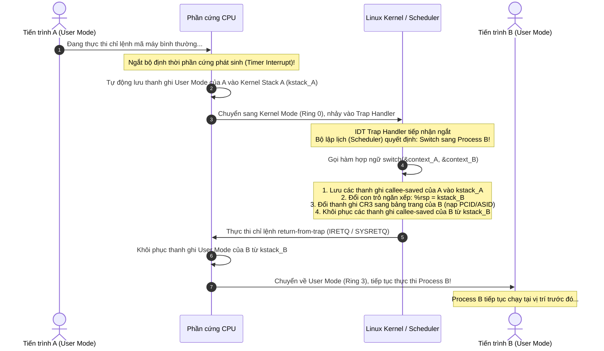

# 1_2_6 Context Switching

> **Khóa học**: Cloud DevOps Basic — OS Core  
> **Phân nhóm**: 1 Domain 1 - Operating System Core Fundamentals › 1_2 Process Management and Anatomy  
> **Chủ đề**: Cơ chế chuyển đổi ngữ cảnh: Bản chất tầng thấp, chi phí trực tiếp và gián tiếp, kỹ thuật giám sát trên Linux  
> **Trạng thái**: Verified (WRITE-CDB-1_2_6, 14-11-2026)  
> **Checklist đối chiếu**: [1_2_6](../../../CHECKLIST.md#domain-1-operating-system-core-fundamentals-45-items)  

---

## 1. Khái Niệm Cốt Lõi & Bản Chất Kỹ Thuật (Core Concepts & Technical Deep Dive)

Trong hệ điều hành đa nhiệm (Multitasking Operating System), bộ vi xử lý (CPU) tạo ra ảo ảnh rằng hàng chục hay hàng trăm chương trình đang chạy cùng một lúc (Time-sharing). Ảo ảnh này được xây dựng trên một cơ chế tầng thấp tối quan trọng của hạt nhân hệ điều hành: **Chuyển đổi ngữ cảnh (Context Switching)**.

---

### 1.1 Bản Chất Của Chuyển Đổi Ngữ Cảnh Tầng Thấp

Theo giáo trình kinh điển *Operating Systems: Three Easy Pieces (OSTEP)*, Chương 6:
- **Chuyển đổi ngữ cảnh** là quy trình kỹ thuật mà thông qua đó hệ điều hành tạm thời đình chỉ việc thực thi của một tiến trình đang chạy (outgoing process) và khôi phục trạng thái để tiếp tục chạy một tiến trình khác (incoming process) trên cùng một nhân vi xử lý (CPU core).

```text
+------------------------------------------------------------------------+
|                     QUY TRÌNH CHUYỂN ĐỔI NGỮ CẢNH                      |
|                                                                        |
|  1. Lưu trữ thanh ghi CPU của tiến trình cũ vào Kernel Stack / PCB     |
|  2. Chuyển đổi con trỏ ngăn xếp hạt nhân (%rsp) sang tiến trình mới    |
|  3. Nạp lại thanh ghi cơ sở bảng phân trang CR3 (nếu đổi không gian)   |
|  4. Khôi phục các thanh ghi CPU từ Kernel Stack của tiến trình mới     |
|  5. Thực thi chỉ lệnh return-from-trap đưa CPU trở lại User Mode       |
+------------------------------------------------------------------------+
```

Về mặt hiện thực trong mã nguồn nhân hệ điều hành (ví dụ: hàm hợp ngữ `switch()` trong OSTEP hoặc `__switch_to()` trong Linux kernel):
1. **Lưu ngữ cảnh cũ**: Hạt nhân thực thi đoạn mã hợp ngữ chuyên dụng để lưu toàn bộ các thanh ghi đa năng của CPU, con trỏ lệnh (`Program Counter - PC/RIP`), con trỏ ngăn xếp người dùng (`RSP`) và cờ trạng thái của tiến trình hiện tại vào ngăn xếp hạt nhân (**Kernel Stack**) hoặc cấu trúc PCB của nó.
2. **Đổi con trỏ ngăn xếp**: Hạt nhân thay đổi giá trị con trỏ ngăn xếp của CPU từ ngăn xếp hạt nhân của tiến trình cũ sang ngăn xếp hạt nhân của tiến trình mới được bộ lập lịch (Scheduler) lựa chọn.
3. **Khôi phục ngữ cảnh mới**: Hạt nhân nạp lại các thanh ghi CPU đã lưu trước đó từ ngăn xếp hạt nhân của tiến trình mới.
4. **Quay về User Mode**: Hệ điều hành thực thi chỉ lệnh quay về từ bẫy ngắt (**Return-from-trap**, ví dụ: `IRETQ` hoặc `SYSRETQ`), đưa CPU quay trở lại mức đặc quyền Ring 3 và tiếp tục thực thi tiến trình mới chính xác tại chỉ lệnh mà nó đã dừng lại trước đó.

---

### 1.2 Chi Phí Trực Tiếp Và Chi Phí Gián Tiếp (Direct vs. Indirect Costs)

Chi phí hiệu năng của một lần chuyển đổi ngữ cảnh không chỉ đơn thuần là vài chu kỳ CPU để nạp thanh ghi. Theo OSTEP Chương 6 và Chương 19, chi phí chuyển đổi ngữ cảnh được phân định thành hai nhóm rõ rệt:

#### 1. Chi phí trực tiếp (Direct Overhead):
- Là thời gian CPU trực tiếp thực thi các chỉ lệnh hợp ngữ cần thiết để:
  - Lưu và khôi phục hàng chục thanh ghi CPU (General-Purpose Registers, Segment Registers, FP/SIMD Registers nếu có).
  - Cập nhật con trỏ ngăn xếp hạt nhân.
  - Nạp lại thanh ghi điều khiển cơ sở của bảng phân trang: **thanh ghi `CR3`** trên kiến trúc x86-64 (để trỏ vào bảng trang bộ nhớ ảo của tiến trình mới).
- Chi phí trực tiếp này có thể đo đạc được chính xác, thường tiêu tốn từ vài trăm nano-giây đến vài micro-giây tùy vi kiến trúc vi xử lý.

#### 2. Chi phí gián tiếp (Indirect Overhead — Đắt đỏ hơn rất nhiều!):
Chi phí gián tiếp bắt nguồn từ hiện tượng làm xáo trộn các tầng bộ nhớ đệm phần cứng của bộ vi xử lý:
- **Mất hiệu lực bộ nhớ đệm chuyển đổi địa chỉ (TLB Invalidation / Flushing)**:
  - Bộ đệm **TLB (Translation Lookaside Buffer)** là bộ nhớ đệm phần cứng siêu tốc lưu trữ các bản dịch từ địa chỉ ảo sang địa chỉ vật lý.
  - Khi hệ điều hành đổi sang tiến trình mới và nạp lại thanh ghi `CR3`, theo mặc định phần cứng CPU phải **xả sạch toàn bộ TLB (TLB Flush)** để ngăn không cho tiến trình mới sử dụng nhầm ánh xạ địa chỉ bộ nhớ của tiến trình cũ.
  - Khi tiến trình mới bắt đầu chạy, gần như mọi truy cập bộ nhớ đầu tiên đều bị trượt TLB (**TLB Misses**). Phần cứng MMU buộc phải thực hiện thao tác duyệt cây bảng trang trong RAM vật lý (**Page Table Walk**) tốn kém hàng trăm chu kỳ CPU.
  - *Giải pháp phần cứng*: Các CPU hiện đại hỗ trợ cơ chế gắn nhãn không gian địa chỉ (**ASID - Address Space Identifier** trên ARM, hoặc **PCID - Process-Context Identifier** trên x86-64), cho phép các mục trong TLB được đánh dấu theo định danh tiến trình, giúp chuyển đổi tiến trình mà không cần xả sạch toàn bộ TLB (OSTEP Ch. 19).
- **Ô nhiễm bộ nhớ đệm vi xử lý (CPU Cache Pollution & Cache Misses)**:
  - Các tầng bộ nhớ đệm L1, L2, L3 của CPU đang chứa đầy các khối dữ liệu và chỉ lệnh thường dùng của tiến trình cũ.
  - Khi tiến trình mới bắt đầu thực thi, toàn bộ dữ liệu của nó đều chưa có trong cache (**Cold Cache**), dẫn đến hiện tượng trượt bộ nhớ đệm hàng loạt (**CPU Cache Misses**).
  - CPU phải dừng chờ dữ liệu được kéo từ bộ nhớ chính RAM lên cache để "làm ấm" lại tập dữ liệu làm việc (**warm up its working set**).

---

### 1.3 Phân Loại Trên Linux: Chuyển Đổi Tự Nguyện vs Cưỡng Bức

Theo tài liệu hướng dẫn chuẩn của Linux (`man 1 pidstat`, `man 8 vmstat`), hạt nhân Linux theo dõi hai loại chuyển đổi ngữ cảnh độc lập:

1. **Voluntary Context Switch (`cswch/s` — Tự nguyện)**:
   - Xảy ra khi tiến trình **tự nguyện nhường quyền kiểm soát CPU**.
   - Nguyên nhân điển hình: Tiến trình thực hiện một lời gọi hệ thống đòi hỏi chờ đợi tài nguyên ngoại vi (chờ đọc/ghi đĩa cứng, chờ nhận dữ liệu từ socket mạng), gọi `sleep()`, hoặc bị block khi chờ giải phóng khóa tương tranh (**Mutex lock / Semaphore**).
2. **Non-voluntary Context Switch (`nvcswch/s` — Cưỡng bức / Không tự nguyện)**:
   - Xảy ra khi tiến trình **bị hệ điều hành tước quyền kiểm soát CPU một cách bắt buộc**.
   - Nguyên nhân điển hình: Tiến trình đã sử dụng hết hạn mức thời gian CPU được cấp (**Time-slice Expiration**) và bị ngắt bộ định thời (Timer Interrupt) can thiệp, hoặc có một tiến trình khác có mức ưu tiên cao hơn thức dậy và chiếm quyền (**Preemption**).

---

## 2. Ví Dụ Đời Sống Thực Tế Dễ Hiểu (Intuitive Real-World Analogies)

### Ẩn Dụ: Bàn Làm Việc Của Nhân Viên Đa Nhiệm (Desk of a Multitasking Employee)

Để hình dung sự khác biệt giữa chi phí trực tiếp và chi phí gián tiếp của chuyển đổi ngữ cảnh, hãy tưởng tượng một nhân viên xử lý hồ sơ duy nhất trong một văn phòng bận rộn (tương đương 1 CPU Core):

```text
+------------------------------------------------------------------------+
|                     BÀN LÀM VIỆC CỦA NHÂN VIÊN ĐA NHIỆM                |
|                                                                        |
| 1. ĐANG LÀM VIỆC VỚI HỒ SƠ A (Process A):                              |
|    - Bút, thước, giấy nháp của A đang bày đầy trên bàn (L1/L2 Cache)  |
|    - Trong đầu đang nhớ rõ các số liệu của A (Bản nhẩm nhanh TLB)      |
|                                                                        |
| 2. CHUÔNG BÁO HẾT GIỜ REO! (Timer Interrupt):                          |
|    * CHI PHÍ TRỰC TIẾP (Direct Cost):                                  |
|      - Thu dọn từng tờ giấy của A kẹp vào cặp A (Lưu registers)        |
|      - Cất cặp A, lấy cặp hồ sơ B ra mở trên bàn (Nạp registers của B) |
|      --> Mất 30 giây dọn bàn (Thời gian CPU chạy mã hợp ngữ switch)    |
|                                                                        |
|    * CHI PHÍ GIÁN TIẾP (Indirect Cost - Đắt đỏ hơn nhiều!):           |
|      - Đầu óc bạn trống rỗng về vụ việc của B (Cold Cache / TLB Flush) |
|      - Phải liên tục chạy xuống kho lưu trữ dưới tầng hầm (RAM) để     |
|        tra cứu từng thông tư của B (Cache Misses & TLB Misses)         |
|      --> Mất 15 phút ban đầu làm việc chậm chạp mới bắt nhịp lại được! |
+------------------------------------------------------------------------+
```

1. **Chi phí trực tiếp (Dọn dẹp bàn làm việc)**:
   - Mỗi lần đổi sang làm việc cho khách hàng khác, bạn phải dừng tay, lấy kẹp ghim tập tài liệu của khách hàng cũ cho vào cặp của họ, rồi mở cặp của khách hàng mới ra bày lên bàn.
   - Thao tác này tiêu tốn năng lượng cơ bắp thực sự (chu kỳ CPU), nhưng có thể hoàn thành tương đối nhanh nếu chỉ xếp tài liệu.
2. **Chi phí gián tiếp (Trí nhớ ngắn hạn và quãng đường xuống kho)**:
   - Trong suốt thời gian làm cho khách hàng cũ, bạn đã quen tay, nhớ rõ từng số liệu trong đầu (TLB) và để sẵn các biểu mẫu liên quan ngay trong tầm tay (L1/L2 Cache).
   - Khi khách hàng mới ngồi vào, mọi thông tin trong đầu bạn về khách cũ đều vô dụng. Bộ não bạn hoàn toàn xa lạ với vụ việc của khách mới.
   - Bạn phải liên tục đứng dậy, đi xuống tận kho lưu trữ tệp ở tầng hầm (truy cập bộ nhớ RAM vật lý) để tra cứu từng điều khoản. Tốc độ giải quyết hồ sơ ban đầu của khách hàng mới cực kỳ chậm chạp cho đến khi thông tin của khách mới được "làm ấm" trở lại trong đầu bạn.

---

## 3. Kiến Trúc, Luồng Hoạt Động & Hình Ảnh Trực Quan (Architecture, Diagrams & Visual Media)

### Sơ Đồ Trình Tự Chuyển Đổi Ngữ Cảnh (Mermaid Sequence Diagram)

Sơ đồ dưới đây mô tả chính xác quy trình kỹ thuật từng bước khi hạt nhân hệ điều hành thực hiện chuyển đổi ngữ cảnh giữa Tiến trình A và Tiến trình B theo kiến trúc OSTEP:



---

## 4. Code Mẫu Trực Quan Hoặc Dòng Lệnh Thực Chiến (Runnable Sample Code / CLI)

> ⚠️ Dữ liệu đầu ra dòng lệnh dưới đây mang tính chất minh họa (illustrative output) ghi nhận trên hệ thống Linux x86_64 nhằm quan sát tần suất chuyển đổi ngữ cảnh thực tế.

### 4.1 Giám Sát Tần Suất Chuyển Đổi Ngữ Cảnh Toàn Hệ Thống Bằng `vmstat`

Lệnh `vmstat` báo cáo thống kê về bộ nhớ ảo, tiến trình, ngắt và hoạt động của CPU theo định kỳ mỗi giây:

```bash
# Giám sát hệ thống mỗi 1 giây trong 5 lần lấy mẫu
vmstat 1 5
```

**Đầu ra minh họa**:
```text
procs -----------memory---------- ---swap-- -----io---- -system-- ------cpu-----
 r  b   swpd   free   buff  cache   si   so    bi    bo   in   cs us sy id wa st
 2  0      0 3824512 215400 4812304    0    0    12    45  850 2450  8  4 88  0  0
 1  0      0 3824120 215400 4812304    0    0     0     0  912 3120  5  3 92  0  0
 3  0      0 3823900 215400 4812320    0    0     0     8 1240 4850 14  8 78  0  0
 1  0      0 3823650 215400 4812320    0    0     0     0  780 2100  4  2 94  0  0
 2  0      0 3823400 215400 4812320    0    0     0    16  890 2890  6  3 91  0  0
```

- **Phân tích cột chỉ số then chốt**:
  - **Cột `cs` (Context Switches)** nằm dưới nhóm `-system-`: Cho biết **tổng số lần chuyển đổi ngữ cảnh diễn ra trên toàn bộ hệ thống trong mỗi giây**.
  - Trong điều kiện máy chủ bình thường, giá trị `cs` dao động từ vài trăm đến vài nghìn switches/giây. Nếu con số này vọt lên hàng trăm nghìn hoặc hàng triệu, hệ thống đang gặp hiện tượng bão chuyển đổi ngữ cảnh.
  - Cột `r` (Run queue): Số lượng tiến trình đang ở trạng thái Ready/Running.
  - Cột `in` (Interrupts): Số lượng ngắt hệ thống phát sinh mỗi giây.

---

### 4.2 Phân Tích Chi Tiết Voluntary vs Non-voluntary Bằng `pidstat`

Tiện ích `pidstat` (thuộc gói `sysstat`) cho phép phân rã chi tiết tần suất chuyển đổi ngữ cảnh của từng tiến trình:

```bash
# Phân tích tần suất chuyển đổi ngữ cảnh theo từng tiến trình mỗi 1 giây trong 3 lần
pidstat -w 1 3
```

**Đầu ra minh họa**:
```text
Linux 6.8.0-49-generic (cloud-node-01) 	14/11/2026 	_x86_64_	(4 CPU)

12:45:01      UID       PID   cswch/s nvcswch/s  Command
12:45:02     1000      2145   1250.00      4.00  nginx
12:45:02     1000      3412      8.00    820.00  ffmpeg
12:45:02        0        15     45.00      0.00  ksoftirqd/1
12:45:02     1000      4120    310.00     12.00  mysqld
```

- **Phân tích kỹ thuật các trường hiển thị**:
  - `cswch/s` (Voluntary context switches/sec):
    - Tiến trình `nginx` ghi nhận `1250.00` cswch/s nhưng chỉ có `4.00` nvcswch/s. Điều này hoàn toàn hợp lý: Nginx là ứng dụng hướng sự kiện mạng (Event-driven / I/O-bound). Nó liên tục tự nguyện nhường CPU (`cswch/s` cao) khi đọc/ghi socket mạng thông qua `epoll`.
  - `nvcswch/s` (Non-voluntary context switches/sec):
    - Tiến trình `ffmpeg` ghi nhận `820.00` nvcswch/s nhưng chỉ có `8.00` cswch/s. Đây là đặc trưng kinh điển của tác vụ nặng về tính toán (CPU-bound). `ffmpeg` vắt kiệt thời gian CPU và liên tục bị bộ lập lịch tước quyền kiểm soát cưỡng bức (`nvcswch/s` rất cao) khi hết lượng tử thời gian (time-slice).

---

## 5. Cạm Bẫy Thực Tế & Thực Tiễn Sản Xuất (Production Gotchas & Best Practices)

Trong vận hành hạ tầng Cloud, Kubernetes và các dịch vụ quy mô lớn, các sự cố liên quan đến chuyển đổi ngữ cảnh là bài toán hiệu năng kinh điển:

### 1. Cơn Bão Chuyển Đổi Ngữ Cảnh (Context Switch Storm) & CPU Thrashing
- **Cạm bẫy thiết kế ứng dụng**: Lập trình viên thiết lập kích thước Thread Pool quá lớn (ví dụ: tạo 1000–2000 luồng trong một dịch vụ Java Spring Boot hoặc Python backend) trên một máy chủ ảo chỉ có 4 hoặc 8 vCPU.
- **Hậu quả vận hành**:
  - Hàng nghìn luồng cạnh tranh khốc liệt số core CPU ít ỏi và tranh giành các tài nguyên khóa dùng chung (**Lock Contention**).
  - Tần suất chuyển đổi ngữ cảnh (`cs` trong `vmstat`) tăng vọt lên mức hàng triệu lần mỗi giây.
  - **Hiện tượng CPU Thrashing**: CPU dành tới **40%–70% tổng năng lực tính toán chỉ để lưu và nạp lại thanh ghi của hệ điều hành** (tăng cao cột `%sy` - system CPU time) và chịu đựng tổn thất do trượt Cache/TLB, khiến thời gian xử lý mã nghiệp vụ của ứng dụng (`%us` - user CPU time) sụp đổ, ứng dụng bị nghẽn (hang/unresponsive).
- **Thực tiễn tốt nhất (Best Practices)**:
  - Đối với các tác vụ thuần tính toán (CPU-bound): Kích thước Thread Pool tối ưu nên bằng đúng số CPU Core (`N_threads = N_cores`).
  - Đối với các tác vụ I/O mạng (I/O-bound): Ưu tiên sử dụng mô hình lập trình bất đồng bộ không chặn (Non-blocking I/O như Node.js, Go Goroutines, Netty, hoặc Java 21 Virtual Threads) thay vì tạo ra hàng nghìn kernel threads truyền thống.

### 2. Tối Ưu Hóa Phần Cứng: PCID (x86-64) và ASID (ARM)
- **Vấn đề lịch sử**: Trước đây, mỗi lần chuyển đổi tiến trình (đổi giá trị thanh ghi `CR3`), toàn bộ bộ đệm TLB bị xả sạch, làm tăng đột biến độ trễ truy cập bộ nhớ sau mỗi lần switch.
- **Giải pháp phần cứng hiện đại**:
  - Trên kiến trúc x86-64, Intel và AMD bổ sung tính năng **PCID (Process-Context Identifier)**: trường 12-bit gắn nhãn không gian địa chỉ cho từng mục trong TLB.
  - Hạt nhân Linux hỗ trợ tính năng này thông qua cấu hình `CONFIG_X86_PCID`. Khi đổi tiến trình, kernel giữ nguyên các mục dịch địa chỉ của các tiến trình quen thuộc trong TLB mà không cần xả sạch.
  - **Lưu ý DevOps**: Trong môi trường ảo hóa máy ảo (KVM/VMware), hãy luôn đảm bảo CPU flags của máy ảo đã kích hoạt cờ `pcid` và `invpcid` để tận dụng tối đa khả năng giảm tải chi phí gián tiếp của chuyển đổi ngữ cảnh.

---

## 6. Câu Hỏi Củng Cố Kiến Thức (Active Recall Quiz)

<details>
<summary><b>Câu hỏi 1:</b> Chi phí của một lần chuyển đổi ngữ cảnh (Context Switch) gồm những thành phần nào? Tại sao chi phí gián tiếp (Indirect Cost) lại thường đắt đỏ và gây ảnh hưởng hiệu năng nặng nề hơn chi phí trực tiếp?</summary>

**Đáp án:**
- **Thành phần chi phí**:
  - **Chi phí trực tiếp (Direct Cost)**: Thời gian CPU thực thi mã hợp ngữ để lưu các thanh ghi của tiến trình cũ vào ngăn xếp kernel, đổi con trỏ ngăn xếp `%rsp`, nạp lại thanh ghi cơ sở bảng phân trang `CR3`, và nạp lại thanh ghi của tiến trình mới.
  - **Chi phí gián tiếp (Indirect Cost)**: Hiện tượng mất hiệu lực bộ nhớ đệm TLB (TLB Invalidation dẫn đến hàng loạt TLB Misses) và hiện tượng ô nhiễm bộ nhớ đệm vi xử lý (CPU Cache L1/L2/L3 Misses do Cold Cache).
- **Tại sao chi phí gián tiếp đắt đỏ hơn**: Chi phí trực tiếp chỉ tiêu tốn vài trăm nano-giây. Ngược lại, chi phí gián tiếp buộc CPU phải liên tục dừng chờ để kéo dữ liệu từ bộ nhớ chính RAM (chậm hơn cache từ 100 đến 200 lần) trong hàng nghìn chu kỳ lệnh tiếp theo cho đến khi tập dữ liệu làm việc của tiến trình mới được làm ấm hoàn toàn.
</details>

<details>
<summary><b>Câu hỏi 2:</b> Khi sử dụng tiện ích <code>pidstat -w 1</code> để giám sát hai tiến trình A và B trên máy chủ Linux, kỹ sư nhận thấy: Tiến trình A có <code>cswch/s = 2000</code> và <code>nvcswch/s = 5</code>; Tiến trình B có <code>cswch/s = 10</code> và <code>nvcswch/s = 1500</code>. Hãy phân tích bản chất tải công việc (Workload Characteristic) của từng tiến trình.</summary>

**Đáp án:**
- **Tiến trình A là tác vụ I/O-bound (hoặc Event-driven)**:
  - Chỉ số `cswch/s` rất cao (chuyển đổi tự nguyện) chứng tỏ tiến trình A liên tục chủ động nhường CPU do thực hiện các thao tác I/O chờ dữ liệu (như đọc đĩa, nhận gói tin socket mạng, gọi `sleep()`). Chỉ số `nvcswch/s` thấp cho thấy nó hiếm khi dùng hết định mức thời gian CPU.
- **Tiến trình B là tác vụ CPU-bound (thuần tính toán)**:
  - Chỉ số `nvcswch/s` rất cao (chuyển đổi cưỡng bức) chứng tỏ tiến trình B liên tục vắt kiệt lượng tử thời gian CPU được cấp và bị hạt nhân tước quyền điều khiển bắt buộc thông qua ngắt bộ định thời (Timer Interrupt). Chỉ số `cswch/s` thấp cho thấy nó gần như không phải chờ đợi các thao tác I/O ngoại vi.
</details>

<details>
<summary><b>Câu hỏi 3:</b> Tính năng phần cứng PCID (Process-Context Identifier) trên kiến trúc x86-64 giải quyết bài toán hiệu năng nào trong quá trình chuyển đổi ngữ cảnh giữa các tiến trình?</summary>

**Đáp án:**
- **Vấn đề giải quyết**: Trước khi có PCID, mỗi khi chuyển đổi ngữ cảnh giữa hai tiến trình khác nhau, kernel buộc phải xả sạch toàn bộ bộ đệm TLB khi nạp lại thanh ghi `CR3` để tránh nhầm lẫn địa chỉ ảo giữa các tiến trình, gây ra bão TLB Misses.
- **Cơ chế PCID**: PCID bổ sung trường nhãn định danh 12-bit vào các mục trong TLB. Nhờ đó, TLB có thể lưu trữ đồng thời bản dịch địa chỉ của nhiều tiến trình khác nhau. Khi đổi tiến trình, CPU không cần xả sạch TLB mà chỉ cần chuyển nhãn PCID hiện tại, giúp tái sử dụng ngay các bản dịch địa chỉ có sẵn và loại bỏ phần lớn chi phí gián tiếp của chuyển đổi ngữ cảnh.
</details>

---

## 7. 📚 Nguồn Tài Liệu Chính Thống (Tier-1 Official References)

- [OSTEP Chapter 6: Mechanism: Limited Direct Execution](https://pages.cs.wisc.edu/~remzi/OSTEP/cpu-mechanisms.pdf) - Giáo trình chuẩn mực *Operating Systems: Three Easy Pieces* (Remzi H. Arpaci-Dusseau & Andrea C. Arpaci-Dusseau), phân tích chuyên sâu về cơ chế chuyển đổi ngữ cảnh tầng thấp (`switch`), bẫy ngắt phần cứng và quản lý ngăn xếp hạt nhân.
- [OSTEP Chapter 19: Paging: Faster Translations (TLBs)](https://pages.cs.wisc.edu/~remzi/OSTEP/vm-tlbs.pdf) - Giáo trình *Operating Systems: Three Easy Pieces*, trình bày chi tiết về chi phí xả sạch TLB khi chuyển đổi không gian địa chỉ và cơ chế gắn nhãn ASID/PCID.
- [Linux Manual Pages: vmstat(8)](https://man7.org/linux/man-pages/man8/vmstat.8.html) - Hướng dẫn chính thức về tiện ích `vmstat`, đặc tả trường `cs` theo dõi tần suất chuyển đổi ngữ cảnh toàn hệ thống mỗi giây.
- [Linux Manual Pages: pidstat(1)](https://man7.org/linux/man-pages/man1/pidstat.1.html) - Hướng dẫn chính thức về tiện ích `pidstat`, định nghĩa chi tiết hai cơ chế chuyển đổi ngữ cảnh tự nguyện (`cswch/s`) và cưỡng bức (`nvcswch/s`).
