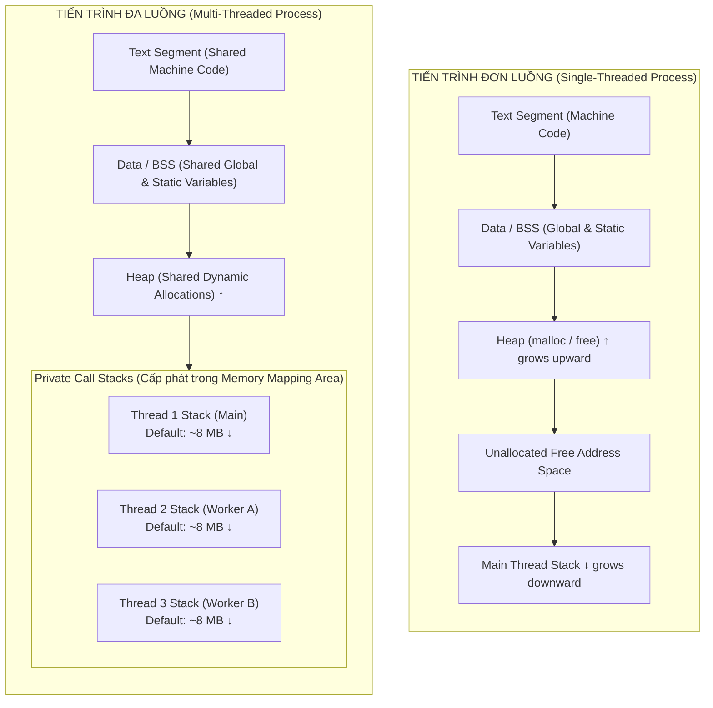

# 1_3_1 Process vs Thread

> **Khóa học**: Cloud DevOps Basic — OS Core  
> **Phân nhóm**: 1 Domain 1 - Operating System Core Fundamentals › 1_3 Thread Management and Multithreading  
> **Chủ đề**: So sánh chuyên sâu Tiến trình (Process) và Luồng (Thread): Phân định không gian chia sẻ tài nguyên và trạng thái riêng tư của luồng thực thi  
> **Trạng thái**: Draft (WRITE-CDB-1_3_1, 14-11-2026)  
> **Checklist đối chiếu**: [1_3_1](../../../CHECKLIST.md#domain-1-operating-system-core-fundamentals-45-items)  

---

## 1. Khái Niệm Cốt Lõi & Bản Chất Kỹ Thuật (Core Concepts & Technical Deep Dive)

Trong kiến trúc hệ điều hành hiện đại, việc phân biệt rạch ròi giữa **Tiến trình (Process)** và **Luồng thực thi (Thread)** là nền tảng cốt tử để hiểu cách thức CPU phân chia thời gian, quản lý bộ nhớ và điều phối các tác vụ tính toán đồng thời (*concurrency*).

```
+-------------------------------------------------------------------------+
|                              PROCESS (PID)                              |
|  - Resource Container & Address Space Isolation Unit                    |
|  - mm_struct: Virtual Memory (Text, Data, BSS, Heap)                    |
|  - files_struct: Open File Descriptors, Sockets, Pipes                  |
|  - sighand_struct: Signal Actions & Dispositions                        |
|                                                                         |
|   +-----------------------+                 +-----------------------+   |
|   |     THREAD 1 (TID)    |                 |     THREAD 2 (TID)    |   |
|   |  - Schedulable Unit   |                 |  - Schedulable Unit   |   |
|   |  - PC / RIP Register  |                 |  - PC / RIP Register  |   |
|   |  - CPU Registers Set  |                 |  - CPU Registers Set  |   |
|   |  - Private Stack      |                 |  - Private Stack      |   |
|   |  - Thread-Local (TLS) |                 |  - Thread-Local (TLS) |   |
|   |  - Signal Mask        |                 |  - Signal Mask        |   |
|   +-----------------------+                 +-----------------------+   |
+-------------------------------------------------------------------------+
```

### 1.1 Khái niệm Bản chất: Đơn vị Tài nguyên vs Đơn vị Lập lịch

Theo giáo trình chuẩn mực *Operating Systems: Three Easy Pieces (OSTEP - Ch. 26)*:
- **Tiến trình (Process)**: Là **đơn vị cơ bản của việc cấp phát tài nguyên và cô lập không gian địa chỉ bộ nhớ** (*unit of resource allocation and address space protection*). Mỗi tiến trình sở hữu một bảng trang bộ nhớ ảo độc lập (`mm_struct` trên Linux), một bảng mô tả tệp mở riêng (`files_struct`), và danh tính bảo mật riêng (UID/GID). Nhờ cơ chế cô lập của phần cứng MMU, một tiến trình không thể đọc hay ghi đè vào không gian bộ nhớ của tiến trình khác trừ khi sử dụng các giao thức liên lạc liên tiến trình (IPC) được cấp phép.
- **Luồng (Thread)**: Là **đơn vị cơ bản của việc lập lịch và thực thi trên CPU** (*unit of CPU execution and scheduling*). Trong một chương trình truyền thống (đơn luồng), tiến trình chỉ có duy nhất một điểm thực thi — tương ứng với một con trỏ lệnh Program Counter (PC). Ngược lại, một chương trình đa luồng (*multi-threaded program*) sở hữu nhiều điểm thực thi độc lập hoạt động đồng thời bên trong cùng một tiến trình.

Vì các luồng bên trong cùng một tiến trình chia sẻ chung toàn bộ không gian địa chỉ bộ nhớ và tài nguyên hệ thống, chi phí tạo mới, hủy bỏ và chuyển ngữ cảnh (*context switch*) giữa các luồng rẻ hơn đáng kể so với tiến trình. Do đó, luồng trong hệ điều hành thường được gọi là **Tiến trình hạng nhẹ (Lightweight Process - LWP)**.

---

### 1.2 Những gì các Thread chia sẻ chung trong một Process

Theo đặc tả chuẩn POSIX.1 (`man 7 pthreads`), tất cả các luồng thuộc về cùng một tiến trình chia sẻ chung các tài nguyên hệ thống sau:

1. **Không gian địa chỉ bộ nhớ ảo đầy đủ (Virtual Address Space)**:
   - **Text Segment**: Toàn bộ mã máy nhị phân đã biên dịch của chương trình.
   - **Data Segment**: Toàn bộ biến toàn cục và biến tĩnh đã được khởi tạo giá trị.
   - **BSS Segment**: Toàn bộ biến toàn cục và biến tĩnh chưa khởi tạo.
   - **Heap Segment**: Vùng nhớ cấp phát động thông qua `malloc()`, `calloc()` hoặc toán tử `new`. Mọi con trỏ trỏ tới vùng nhớ Heap đều có thể được đọc/ghi tự do bởi bất kỳ thread nào trong cùng tiến trình.
2. **Bảng mô tả tệp mở (Open File Descriptors Table)**:
   - Được quản lý thông qua cấu trúc `struct files_struct` trong Linux Kernel. Nếu Thread 1 mở một tệp tin trên ổ đĩa hoặc kết nối tới một Network Socket (`int fd = open(...)`), thì Thread 2 và Thread 3 có thể trực tiếp thực hiện lệnh `read()` hoặc `write()` trên số `fd` đó mà không cần qua IPC.
3. **Thư mục làm việc hiện tại và thông tin hệ thống tệp (`fs_struct`)**:
   - Thư mục hiện tại (*Current Working Directory - CWD*), thư mục gốc (*Root Directory*), và mặt nạ cấp quyền tạo tệp (*Umask*). Nếu một thread gọi `chdir()`, thư mục làm việc của tất cả các thread khác đều thay đổi theo.
4. **Bộ xử lý tín hiệu và Hành vi tín hiệu (Signal Dispositions / Handlers)**:
   - Được quản lý thông qua cấu trúc `struct sighand_struct`. Nếu một thread thiết lập hàm xử lý tín hiệu thông qua `sigaction(SIGINT, ...)`, hành vi xử lý đó áp dụng chung cho toàn bộ tiến trình.
5. **Danh tính tiến trình & Quyền hạn hệ thống (Process Credentials)**:
   - Process ID (PID / TGID), Parent Process ID (PPID), Process Group ID (PGID), Session ID (SID).
   - User ID thực và hiệu dụng (Real/Effective UID, GID), Supplementary Group IDs.
6. **Giới hạn tài nguyên hệ thống (Resource Limits - `rlimit`)**:
   - Các ngưỡng giới hạn cấu hình bởi `setrlimit()` (như số lượng file descriptors tối đa `RLIMIT_NOFILE`, giới hạn thời gian CPU `RLIMIT_CPU`).

---

### 1.3 Những gì là Riêng tư Tuyệt đối của từng Thread

Mặc dù chia sẻ chung tài nguyên tiến trình, mỗi luồng bắt buộc phải sở hữu một tập trạng thái thực thi riêng biệt (*Thread-Private State*) để đảm bảo CPU có thể tạm dừng và phục hồi nó độc lập:

1. **Thread ID độc nhất (TID / LWP)**:
   - Mỗi luồng được kernel gán một định danh duy nhất gọi là **TID** (Thread ID) hoặc **LWP** (Lightweight Process ID). Trên Linux, mã định danh này được truy xuất thông qua syscall `gettid(2)`.
   - Phân biệt với định danh `pthread_t` trả về bởi `pthread_self(3)`: `pthread_t` là một opaque handle do thư viện người dùng (glibc NPTL) quản lý, thường là địa chỉ con trỏ trỏ tới cấu trúc `struct pthread` trên heap, không phải là TID cấp kernel.
2. **Con trỏ lệnh (Program Counter - PC / RIP)**:
   - Cho biết chỉ lệnh mã máy tiếp theo mà CPU sẽ nạp và thực thi riêng cho luồng đó. Mỗi luồng có thể đang chạy ở một hàm hoàn toàn khác nhau trong mã nguồn.
3. **Tập thanh ghi CPU (CPU General-Purpose & Floating-Point Registers)**:
   - Bao gồm các thanh ghi số nguyên (RAX, RBX, RCX, RDX, RSI, RDI,... trên x86_64), thanh ghi cờ trạng thái (RFLAGS), và các thanh ghi dấu phẩy động (AVX/SSE). Khi CPU chuyển ngữ cảnh giữa các thread, tập thanh ghi này được lưu lại để khôi phục chính xác trạng thái tính toán.
4. **Ngăn xếp thực thi riêng biệt (Private User Call Stack)**:
   - Mỗi thread bắt buộc phải có một vùng Stack riêng trong không gian địa chỉ để lưu trữ:
     - Các khung hàm (*Stack Frames*).
     - Biến cục bộ (*Local Variables*) của các hàm đang được gọi.
     - Địa chỉ trả về (*Return Addresses*) khi hàm kết thúc.
   - **Kích thước Stack mặc định**: Trên hệ thống Linux x86_64, kích thước stack mặc định của luồng do cấu hình `RLIMIT_STACK` quy định, thường là **8 MB (8192 KB)**, có thể kiểm tra qua lệnh `ulimit -s`.
5. **Ngăn xếp Kernel riêng biệt (Private Kernel Stack)**:
   - Mỗi luồng khi bẫy vào Kernel Mode (thông qua System Call hoặc ngắt phần cứng) đều có một vùng nhớ `kstack` riêng (thường là 8 KB hoặc 16 KB) trong không gian bộ nhớ của nhân để thực thi mã kernel an toàn.
6. **Vùng nhớ cục bộ luồng (Thread-Local Storage - TLS)**:
   - Các biến được định nghĩa với từ khóa `__thread` (trong C) hoặc `thread_local` (trong C++11). Mỗi thread có một bản sao độc lập của biến này, được định vị thông qua thanh ghi phân đoạn FS/GS trên kiến trúc x86_64.
7. **Mặt nạ tín hiệu riêng tư (Signal Mask)**:
   - Mỗi luồng có thể tự thiết lập danh sách các tín hiệu bị chặn (*blocked signals*) độc lập với các luồng khác bằng hàm `pthread_sigmask(3)`.
8. **Hàng đợi tín hiệu chờ xử lý riêng (Pending Signals)**:
   - Tín hiệu được gửi đích danh tới một luồng thông qua `pthread_kill(3)` hoặc `tgkill(2)` sẽ xếp hàng tại luồng đó.
9. **Mã lỗi riêng biệt (`errno`)**:
   - Trong chuẩn POSIX hiện đại, `errno` không còn là một biến toàn cục đơn lẻ. Nó được định nghĩa lại dưới dạng macro gọi hàm thread-local (ví dụ: `*__errno_location()`), đảm bảo lỗi phát sinh từ syscall của Thread A không ghi đè lên mã lỗi của Thread B.

---

### 1.4 Hiện thực hóa ở tầng Kernel Linux: `struct task_struct` & `clone(2)`

Một đặc tính kiến trúc độc đáo và xuất sắc của **Linux Kernel**: **Hệ điều hành Linux hoàn toàn không có cấu trúc dữ liệu `struct thread` riêng biệt!**

Cả tiến trình độc lập và luồng thực thi bên trong tiến trình đều được biểu diễn đồng nhất bằng cùng một cấu trúc dữ liệu cốt lõi: **`struct task_struct`** (được định nghĩa trong tệp mã nguồn `include/linux/sched.h`).

```
                    +------------------------------------+
                    |  Thread Group Leader (Main Thread) |
                    |      task_struct (PID=1000)        |
                    |      TGID = 1000, TID = 1000       |
                    +-----------------+------------------+
                                      |
       +------------------------------+------------------------------+
       | shared mm_struct             | shared files_struct          | shared sighand_struct
       v                              v                              v
+---------------+              +---------------+              +---------------+
| Memory Layout |              |  FD Table     |              | Signal Action |
| (VMA / Pages) |              | [0][1][2]...  |              |  Table        |
+---------------+              +---------------+              +---------------+
       ^                              ^                              ^
       | shared mm_struct             | shared files_struct          | shared sighand_struct
       +------------------------------+------------------------------+
                                      |
                    +-----------------+------------------+
                    |        Worker Thread (Clone)       |
                    |      task_struct (PID=1001)        |
                    |      TGID = 1000, TID = 1001       |
                    +------------------------------------+
```

Sự khác biệt giữa việc tạo một "tiến trình mới" (`fork`) và tạo một "luồng mới" (`pthread_create`) trên Linux chỉ nằm ở các cờ tham số (*flags*) được truyền vào System Call nền tảng **`clone(2)`**:

```c
// Cú pháp Linux system call clone(2)
int clone(int (*fn)(void *), void *stack, int flags, void *arg, ...);
```

Khi thư viện chuẩn POSIX NPTL (*Native POSIX Thread Library*) thực hiện lời gọi hàm `pthread_create(3)`, nó sẽ thực thi `clone(2)` với một tổ hợp cờ đặc biệt:

| Cờ `clone(2)` | Ý nghĩa kỹ thuật đối với cấu trúc `task_struct` |
| :--- | :--- |
| **`CLONE_VM`** | Con trỏ bộ nhớ `task_struct->mm` trỏ chung vào cùng một cấu trúc `struct mm_struct`. Hai luồng chia sẻ chung toàn bộ không gian địa chỉ bộ nhớ ảo. |
| **`CLONE_FS`** | Chia sẻ thông tin hệ thống tệp `task_struct->fs` (thư mục làm việc hiện tại, thư mục gốc, umask). |
| **`CLONE_FILES`** | Con trỏ `task_struct->files` trỏ chung vào cùng một bảng mô tả tệp `struct files_struct`. Hai luồng chia sẻ chung danh sách File Descriptors. |
| **`CLONE_SIGHAND`** | Chia sẻ bảng bộ xử lý tín hiệu `struct sighand_struct`. Cài đặt handler ở luồng này có tác dụng ngay với luồng kia. |
| **`CLONE_THREAD`** | Đưa `task_struct` mới vào cùng một **Thread Group** với tiến trình gọi. Thread mới sẽ nhận cùng giá trị **TGID** (*Thread Group ID*). |
| **`CLONE_SYSVSEM`** | Chia sẻ chung danh sách hoàn tác Semaphore System V (*semundo*). |

#### Phân biệt TGID vs TID trên Linux
Cơ chế Thread Group giải thích hiện tượng thường gây nhầm lẫn cho các kỹ sư lập trình:
- **`getpid(2)`**: Trên Linux, hàm này trả về giá trị `task->tgid` (**Thread Group ID**). Vì tất cả các thread tạo bởi `pthread_create` đều nằm trong cùng thread group của Main Thread, nên **mọi thread đều nhận được cùng một giá trị PID** khi gọi `getpid()`.
- **`gettid(2)`**: Trả về giá trị `task->pid` thực tế của kernel, chính là **TID** duy nhất của từng luồng thực thi.
- Trình quản lý hệ thống xem toàn bộ Thread Group này là một ứng dụng duy nhất, nhưng bộ lập lịch (*Linux CFS / EEVDF Scheduler*) sẽ lập lịch độc lập cho từng `task_struct` riêng lẻ trên các lõi CPU vật lý.

---

## 2. Ví Dụ Đời Sống Thực Tế Dễ Hiểu (Intuitive Real-World Analogies)

Để ghi nhớ bản chất của Process và Thread mà không bị sa lầy vào thuật ngữ khô khan, hãy liên tưởng tới **Mô hình Công ty Doanh nghiệp và Các Nhân viên Văn phòng**:

```
+-------------------------------------------------------------------------------+
|                       CÔNG TY CỔ PHẦN CÔNG NGHỆ (PROCESS)                    |
|   - Trụ sở văn phòng rào chắn an ninh (Không gian bộ nhớ ảo cách ly - MMU)    |
|   - Mã số thuế doanh nghiệp & Giấy phép đăng ký kinh doanh (PID / TGID)      |
|   - Tủ hồ sơ lưu trữ tài liệu hợp đồng, con dấu công ty (File Descriptors)    |
|   - Nhà ăn, phòng giải lao, kho dự trữ chung của công ty (Heap / Data Segment)|
|                                                                               |
|   [Nhân viên A (Thread 1)]               [Nhân viên B (Thread 2)]             |
|   - Bàn tay gõ phím riêng (Registers, PC) - Bàn tay gõ phím riêng (Registers, PC)|
|   - Sổ tay cá nhân bỏ túi (Private Stack) - Sổ tay cá nhân bỏ túi (Private Stack)|
|   - Thẻ nhân viên nội bộ (TID / LWP)     - Thẻ nhân viên nội bộ (TID / LWP)   |
|   - Tai nghe cách âm (Signal Mask)       - Tai nghe cách âm (Signal Mask)     |
+-------------------------------------------------------------------------------+
```

### 1. Công ty là Tiến trình (Process - Resource Container)
Một Công ty được thành lập có tư cách pháp nhân riêng biệt. Công ty thuê một mặt bằng trụ sở có hàng rào an ninh ngăn cách tuyệt đối với các công ty lân cận (tương tự **bộ nhớ ảo cách ly** của Process).
- Công ty sở hữu **Mã số thuế doanh nghiệp** duy nhất để giao dịch với chính quyền nhà nước (tương tự **Process ID - PID**).
- Trong công ty có một **kho hồ sơ chung** (tương tự **Bảng File Descriptors**), một **phòng ăn và két sắt chung** (tương tự **Heap Segment** và **Data Segment**). Mọi nhân viên hợp pháp của công ty đều có thể ra vào kho lấy tài liệu hoặc vào nhà ăn lấy đồ uống.
- Một công ty khác ở tòa nhà bên cạnh không thể tự ý bước vào văn phòng công ty bạn để xem trộm giấy tờ, trừ khi hai công ty ký biên bản liên lạc chính thức (tương tự **Inter-Process Communication - IPC** như Unix Domain Socket hay Shared Memory).

### 2. Nhân viên là Luồng thực thi (Thread - Schedulable Unit)
Trong công ty có nhiều nhân viên đang cùng nhau làm việc để hoàn thành dự án lớn:
- **Dùng chung hạ tầng**: Tất cả nhân viên dùng chung văn phòng, cùng hít thở bầu không khí, dùng chung máy in, uống nước ở cùng một bình nước chung (chia sẻ chung Heap, Code, File Descriptors).
- **Sở hữu tài sản riêng**: Mỗi nhân viên đều có:
  - Một đôi bàn tay và bộ não đang tập trung gõ phím vào từng dòng code cụ thể (tương tự **Program Counter** và **CPU Registers**).
  - Một cuốn **sổ tay cá nhân bỏ túi** ghi lại các phép tính nhẩm, ghi chú cuộc họp tạm thời mà người khác không được tự tiện đọc hay ghi đè (tương tự **Private Stack** và các **Local Variables**).
  - Một chiếc **thẻ nhân viên** đeo trên cổ có mã số định danh nội bộ (tương tự **Thread ID - TID**).
  - Một chiếc **tai nghe chống ồn** để phớt lờ thông báo loa phát thanh khi đang cần tập trung cao độ (tương tự **Signal Mask** chặn tín hiệu).

### 3. Quy luật Sinh - Tử và Phạm vi Ảnh hưởng Sự cố (Crash Domain)
- **Nhân viên tan ca về nhà (`pthread_exit`)**: Khi một nhân viên hoàn thành nhiệm vụ và rời văn phòng, công ty vẫn tiếp tục mở cửa và các đồng nghiệp khác vẫn làm việc bình thường.
- **Nhân viên làm cháy trụ sở (`SIGSEGV` - Segmentation Fault)**: Nếu một nhân viên bất cẩn làm chập điện hoặc châm lửa đốt cháy toàn bộ văn phòng công ty (truy cập con trỏ NULL hoặc tràn bộ đệm gây lỗi bộ nhớ nghiêm trọng), thì toàn bộ tòa nhà sập xuống! Chính quyền (Hệ điều hành Kernel) sẽ cưỡng chế đóng cửa công ty, giải thể pháp nhân và **toàn bộ nhân viên khác trong công ty đều bị sa thải ngay lập tức**!

---

## 3. Kiến Trúc, Luồng Hoạt Động & Hình Ảnh Trực Quan (Architecture, Diagrams & Visual Media)

### 3.1 Minh Họa Kiến Trúc Đặc Quyền Thực Thi Phần Cứng

Để các luồng có thể yêu cầu tài nguyên hoặc chuyển giao quyền kiểm soát cho bộ lập lịch của hệ điều hành, CPU phải thực hiện chuyển đổi giữa User Mode (Ring 3) và Kernel Mode (Ring 0):

[](https://learn.microsoft.com/en-us/windows-hardware/drivers/gettingstarted/images/userandkernelmode01.png)  
*Hình 1: Mô hình phân tách đặc quyền phần cứng giữa User Mode và Kernel Mode từ tài liệu Microsoft Learn.*

---

### 3.2 Sơ đồ Cấu Trúc Bộ Nhớ: Đơn Luồng (Single-Thread) vs Đa Luồng (Multi-Thread)

Sơ đồ dưới đây minh họa sự biến đổi của không gian địa chỉ bộ nhớ ảo khi một tiến trình chuyển từ mô hình đơn luồng sang đa luồng:



---

### 3.3 Bảng So Sánh Tổng Hợp Thuộc Tính Giữa Process và Thread

Bảng đối chiếu kỹ thuật chi tiết giữa Process và Thread:

| Tiêu chí So sánh | Tiến trình (Process) | Luồng thực thi (Thread) |
| :--- | :--- | :--- |
| **Bản chất định nghĩa** | Đơn vị sở hữu tài nguyên & cô lập không gian bộ nhớ | Đơn vị lập lịch và thực thi chỉ lệnh trên CPU |
| **Không gian địa chỉ (Address Space)** | Hoàn toàn cô lập; mỗi process có bảng phân trang MMU riêng | Dùng chung toàn bộ không gian địa chỉ của tiến trình cha |
| **Bảng File Descriptors** | Độc lập; tiến trình con sao chép bảng của cha khi `fork` | Chia sẻ chung một bảng `files_struct` duy nhất |
| **Chi phí khởi tạo (Creation Overhead)** | Rất tốn kém (cần cấp phát PCB, nhân bản page table via CoW) | Rất nhẹ (chỉ cần cấp phát stack ~8MB ảo và một `task_struct`) |
| **Chi phí Chuyển ngữ cảnh (Context Switch)** | Cao: Phải xả bộ nhớ đệm TLB, nạp lại thanh ghi CR3, hỏng CPU Cache | Thấp: Giữ nguyên bảng phân trang CR3, chỉ hoán đổi CPU registers |
| **Cơ chế Giao tiếp (Communication)** | Phức tạp, phải qua IPC: Pipes, Sockets, Shared Memory, Message Queues | Đơn giản, đọc/ghi trực tiếp biến toàn cục hoặc con trỏ Heap |
| **Cơ chế Đồng bộ (Synchronization)** | Kernel Semaphore, File Locks, IPC Mutex | User-space Futex, `pthread_mutex`, spinlock, atomic |
| **Độ an toàn sự cố (Fault Isolation)** | Cao: Lỗi crash (Segfault) của process này không ảnh hưởng process khác | Thấp: Một thread dính lỗi `SIGSEGV` sẽ kéo sập toàn bộ tiến trình |
| **Biểu diễn trong Linux Kernel** | `struct task_struct` với `mm` và `files` độc lập | `struct task_struct` với cờ `CLONE_VM`, `CLONE_FILES`, `CLONE_THREAD` |
| **Mã định danh (Identifier)** | PID độc nhất toàn hệ thống (`getpid()`) | TID cấp kernel (`gettid()`) và `pthread_t` cấp userspace |

---

## 4. Code Mẫu Trực Quan Hoặc Dòng Lệnh Thực Chiến (Runnable Sample Code / CLI)

### 4.1 Mã nguồn C Thực Chiến: Kiểm Chứng Bộ Nhớ Chia Sẻ vs Riêng Tư & Phân Định PID vs TID

Chương trình C dưới đây chứng minh bằng thực nghiệm:
1. Con trỏ Heap và Biến toàn cục được chia sẻ chung giữa các luồng.
2. Biến cục bộ nằm trên Stack là độc lập và nằm ở các vùng địa chỉ bộ nhớ hoàn toàn khác nhau.
3. Lời gọi `getpid()` cho ra cùng một mã số, trong khi syscall `gettid()` cho ra các mã định danh luồng riêng biệt.

```c
/**
 * file: process_vs_thread_demo.c
 * Biên dịch: gcc -O2 -pthread process_vs_thread_demo.c -o process_vs_thread_demo
 * Thực thi:  ./process_vs_thread_demo
 */
#define _GNU_SOURCE
#include <stdio.h>
#include <stdlib.h>
#include <unistd.h>
#include <pthread.h>
#include <sys/syscall.h>
#include <sys/types.h>

// 1. Biến toàn cục: Nằm ở Data/BSS Segment (Chia sẻ chung giữa mọi Thread)
static int global_shared_counter = 100;

// Cấu trúc dữ liệu cấp phát trên Heap để chia sẻ giữa các luồng
typedef struct {
    int shared_heap_value;
} SharedData;

// Hàm thực thi của Worker Thread
void *worker_thread_func(void *arg) {
    SharedData *data = (SharedData *)arg;

    // 2. Biến cục bộ: Nằm trên Private Stack riêng của Worker Thread
    int local_stack_var = 42;

    // Lấy PID (Thread Group ID) và TID (Kernel Thread ID)
    pid_t pid = getpid();
    pid_t tid = (pid_t)syscall(SYS_gettid);
    pthread_t ptid = pthread_self();

    printf("\n[WORKER THREAD] Đang chạy...\n");
    printf("  -> getpid()           = %d (Dùng chung Process PID/TGID)\n", pid);
    printf("  -> syscall(SYS_gettid)= %d (Kernel TID duy nhất cho Thread này)\n", tid);
    printf("  -> pthread_self()     = %lu (POSIX thread handle - con trỏ glibc)\n", (unsigned long)ptid);
    printf("  -> Địa chỉ Local Stack Var : %p (Thuộc Worker Stack)\n", (void *)&local_stack_var);
    printf("  -> Địa chỉ Shared Heap Var  : %p (Giá trị: %d)\n", (void *)&(data->shared_heap_value), data->shared_heap_value);
    printf("  -> Địa chỉ Global Shared Var: %p (Giá trị trước sửa: %d)\n", (void *)&global_shared_counter, global_shared_counter);

    // Thay đổi dữ liệu chia sẻ
    data->shared_heap_value += 500;
    global_shared_counter += 50;

    printf("[WORKER THREAD] Đã sửa shared_heap_value = %d, global_shared_counter = %d\n",
           data->shared_heap_value, global_shared_counter);

    // Tạm dừng 20 giây để quan sát bằng lệnh ps / procfs từ terminal khác
    printf("[WORKER THREAD] Đang ngủ 20 giây để bạn kiểm tra CLI...\n");
    sleep(20);

    return NULL;
}

int main(void) {
    // Biến cục bộ trên Main Thread Stack
    int main_local_stack_var = 999;

    // Cấp phát dữ liệu trên Heap
    SharedData *heap_data = (SharedData *)malloc(sizeof(SharedData));
    if (!heap_data) {
        perror("malloc thất bại");
        return 1;
    }
    heap_data->shared_heap_value = 1000;

    pid_t main_pid = getpid();
    pid_t main_tid = (pid_t)syscall(SYS_gettid);

    printf("=================================================================\n");
    printf("[MAIN THREAD] Khởi động chương trình...\n");
    printf("  -> Main getpid()           = %d\n", main_pid);
    printf("  -> Main syscall(SYS_gettid)= %d\n", main_tid);
    printf("  -> Địa chỉ Main Stack Var  : %p (Thuộc Main Thread Stack)\n", (void *)&main_local_stack_var);
    printf("  -> Địa chỉ Heap Pointer    : %p\n", (void *)heap_data);
    printf("=================================================================\n");

    pthread_t worker_tid;
    // Khởi tạo luồng mới thông qua NPTL clone(2)
    if (pthread_create(&worker_tid, NULL, worker_thread_func, (void *)heap_data) != 0) {
        perror("pthread_create thất bại");
        free(heap_data);
        return 1;
    }

    // Chờ Worker Thread thực hiện xong
    pthread_join(worker_tid, NULL);

    printf("\n=================================================================\n");
    printf("[MAIN THREAD] Worker Thread đã hoàn tất và kết thúc (Joined).\n");
    printf("  -> Kiểm tra Global Shared Var sau khi Worker sửa: %d\n", global_shared_counter);
    printf("  -> Kiểm tra Heap Shared Var sau khi Worker sửa  : %d\n", heap_data->shared_heap_value);
    printf("=================================================================\n");

    free(heap_data);
    return 0;
}
```

---

### 4.2 Các Câu Lệnh CLI Điều Tra Quản Trị Hệ Thống (DevOps Inspection CLI)

Khi chương trình trên đang chạy và thực hiện `sleep(20)`, hãy mở một terminal thứ hai để điều tra cấu trúc Thread và Process dưới góc nhìn Kernel:

#### 1. Kiểm tra kích thước Stack mặc định của hệ thống
```bash
# Kiểm tra stack size limit cho mỗi thread (đơn vị: kilobytes)
ulimit -s
# Kết quả điển hình: 8192 (tương đương 8 MB)
```

#### 2. Liệt kê các luồng bằng lệnh `ps -eLf`
```bash
# Lệnh ps với cờ -L cho phép hiển thị các LWP (Lightweight Processes / Threads)
ps -eLf | grep process_vs_thread_demo | grep -v grep
```
*Đầu ra mẫu giải thích chi tiết*:
```text
UID          PID    PPID     LWP  NLWP C STIME TTY          TIME CMD
phandinh    4210    2105    4210     2 0 14:15 pts/0    00:00:00 ./process_vs_thread_demo
phandinh    4210    2105    4211     2 0 14:15 pts/0    00:00:00 ./process_vs_thread_demo
```
- **`PID` (4210)**: Thread Group ID. Cả hai hàng đều có cùng PID 4210 vì cùng thuộc một tiến trình.
- **`LWP` (Lightweight Process)**: Mã định danh luồng cấp kernel (Kernel TID).
  - Luồng chính có `LWP = 4210` (trùng với PID).
  - Luồng worker có `LWP = 4211` (TID độc lập do Kernel cấp phát).
- **`NLWP` (Number of LightWeight Processes)**: Số lượng luồng đang hoạt động trong tiến trình (ở đây là 2 luồng).

#### 3. Điều tra thư mục `/proc/[pid]/task/`
Mỗi khi một thread được tạo ra thông qua `clone(2)`, Linux Kernel tạo một thư mục con tương ứng bên trong `/proc/<PID>/task/`:
```bash
# Thay thế 4210 bằng PID thực tế của chương trình
ls -la /proc/4210/task/
```
*Đầu ra quan sát*:
```text
dr-xr-xr-x 7 phandinh phandinh 0 Nov 14 14:15 .
dr-xr-xr-x 9 phandinh phandinh 0 Nov 14 14:15 ..
dr-xr-xr-x 7 phandinh phandinh 0 Nov 14 14:15 4210
dr-xr-xr-x 7 phandinh phandinh 0 Nov 14 14:15 4211
```
Kernel hiển thị 2 thư mục con mang tên chính là các kernel TID: `4210` và `4211`. Bên trong mỗi thư mục này chứa đầy đủ các tệp trạng thái máy riêng như `status`, `sched`, `stack` của từng luồng.

#### 4. Giám sát thời gian thực CPU của từng Thread bằng `top -H`
```bash
# Giám sát từng thread riêng lẻ của một process cụ thể
top -H -p 4210
```
Cờ `-H` kích hoạt chế độ *Thread Mode*, cho phép kỹ sư DevOps quan sát xem chính xác luồng nào trong số hàng trăm luồng của ứng dụng (ví dụ một ứng dụng Java/Spring Boot hay Go) đang gây nghẽn 100% CPU trên từng lõi.

---

## 5. Cạm Bẫy Thực Tế & Thực Tiễn Sản Xuất (Production Gotchas & Best Practices)

Trong môi trường triển khai Cloud và Microservices quy mô lớn, việc lạm dụng hoặc hiểu sai cơ chế vận hành của Thread dẫn tới những sự cố sập hệ thống nghiêm trọng:

### 1. Cạm bẫy Bùng nổ Bộ nhớ ảo do Kích thước Stack (Thread Stack Space Explosion)
- *Hiện tượng*: Một ứng dụng Java hoặc C++ mở rộng Thread Pool lên 1.000 hoặc 2.000 luồng để phục vụ lượng truy cập tăng vọt. Mặc dù bộ nhớ Heap vẫn còn trống nhiều, ứng dụng đột ngột sập với lỗi `java.lang.OutOfMemoryError: unable to create new native thread` hoặc bị hệ điều hành từ chối cấp phát bộ nhớ ảo.
- *Bản chất kỹ thuật*: Theo mặc định hệ thống Linux, mỗi luồng mới được cấp phát một vùng ngăn xếp ảo có kích thước lên tới **8 MB** (`RLIMIT_STACK = 8192 KB`).
  $$\text{Tổng bộ nhớ ảo dự trù} = 1.000 \times 8\text{ MB} = 8\text{ GB Virtual Memory!}$$
  Trên các hệ thống 32-bit hoặc các container bị giới hạn tài nguyên địa chỉ ảo nghiêm ngặt, bảng trang ảo của tiến trình sẽ cạn kiệt ngay lập tức.
- *Khắc phục*: 
  - Trong C/POSIX: Dùng `pthread_attr_setstacksize(&attr, 512 * 1024)` để giới hạn stack của worker thread xuống 512 KB hoặc 1 MB nếu thread không dùng đệ quy sâu.
  - Trong Java: Điều chỉnh tham số JVM `-Xss` (ví dụ: `-Xss512k` hoặc `-Xss1m`).
  - Trong kiến trúc hệ thống hiện đại: Chuyển dịch sang mô hình bất đồng bộ hướng sự kiện (Non-blocking I/O / Event-driven như Node.js, Netty) hoặc Luồng ảo (Java Virtual Threads / Go Goroutines).

---

### 2. Xung đột Dữ liệu trên Bộ nhớ Chia sẻ (Race Conditions & Data Races)
- *Hiện tượng*: Biến đếm toàn cục hoặc cấu trúc danh sách liên kết (`LinkedList`, `HashMap`) bị sai lệch dữ liệu, thiếu hụt giá trị hoặc gây vòng lặp vô tận (infinite loop) một cách ngẫu nhiên khi chịu tải cao.
- *Bản chất kỹ thuật*: Vì các thread chia sẻ chung Heap và Data Segment, các phép toán tưởng chừng đơn nguyên như `counter++` thực chất gồm 3 chỉ lệnh mã máy:
  1. `MOV EAX, [counter]` (Nạp giá trị từ RAM vào thanh ghi CPU)
  2. `ADD EAX, 1` (Cộng 1 trên ALU)
  3. `MOV [counter], EAX` (Ghi ngược kết quả từ thanh ghi về RAM)
  Nếu hai luồng bị bộ lập lịch ngắt xen kẽ giữa các chỉ lệnh này, giá trị ghi đè sẽ làm mất dữ liệu của luồng kia (*Lost Update*).
- *Khắc phục*: Bắt buộc phải bảo vệ các vùng truy cập dữ liệu chia sẻ (*Critical Sections*) bằng khóa loại trừ tương hỗ (`pthread_mutex_t`), thao tác nguyên tử (*Atomic Operations* như `std::atomic` / `AtomicInteger`), hoặc cấu trúc dữ liệu Lock-Free.

---

### 3. Vùng Phá Hủy Chung khi Xảy Ra Sự Cố (Shared Crash Domain)
- *Bản chất kỹ thuật*: Các tiến trình có không gian bộ nhớ ảo độc lập. Nếu Process A bị lỗi truy cập bộ nhớ bất hợp pháp (truy cập con trỏ rác, giải phóng vùng nhớ hai lần `double free`), phần cứng MMU kích hoạt ngắt bảo vệ bộ nhớ và Kernel sẽ tiêu diệt Process A bằng tín hiệu `SIGSEGV`. Các Process B, C khác hoàn toàn không bị ảnh hưởng.
- *Cạm bẫy trong Multithreading*: Mọi thread trong cùng tiến trình chia sẻ chung một không gian bộ nhớ ảo duy nhất. Do đó, **nếu chỉ cần một worker thread duy nhất trong số 500 thread gặp lỗi Segmentation Fault, toàn bộ tiến trình sẽ bị hệ điều hành tiêu diệt ngay lập tức**, kéo theo cái chết của toàn bộ 499 luồng còn lại!
- *Thực tiễn sản xuất*: Với các thành phần xử lý các tác vụ rủi ro cao (như parse tệp tin người dùng tải lên, chạy plugin của bên thứ ba), kiến trúc sư DevOps nên cô lập chúng ra các **Process độc lập** (hoặc Worker Container riêng biệt) thay vì chạy chung trong luồng của tiến trình máy chủ chính.

---

### 4. Cạm bẫy Xử Lý Tín hiệu trong Ứng dụng Đa luồng (Signal Handling Quirks)
- *Bản chất kỹ thuật*: Hành vi tín hiệu (*Signal Disposition*) được cấu hình bằng `sigaction()` áp dụng cho **toàn bộ tiến trình**. Tuy nhiên, mặt nạ chặn tín hiệu (*Signal Mask*) lại là thuộc tính **riêng của từng luồng**.
- *Cạm bẫy*: Khi một tín hiệu từ hệ thống gửi tới tiến trình (ví dụ: `SIGINT` từ tổ hợp phím Ctrl+C, hoặc `SIGTERM` từ Kubernetes khi scale down pod), Linux Kernel sẽ chọn ngẫu nhiên một luồng trong tiến trình mà không chặn tín hiệu đó để chuyển giao thực thi hàm handler. Nếu hàm handler truy cập vào tài nguyên đang bị khóa bởi luồng khác, hiện tượng khóa chết (*Deadlock*) có thể xảy ra ngay trong Signal Handler.
- *Thực tiễn tốt nhất (Best Practice)*: Trong ứng dụng đa luồng POSIX, luồng chính nên chặn toàn bộ tín hiệu trước khi tạo các worker threads (để các worker thừa kế mặt nạ chặn). Sau đó, tạo một luồng riêng biệt chuyên dụng gọi hàm `sigwait()` hoặc `sigwaitinfo()` để xử lý tín hiệu hệ thống một cách đồng bộ và an toàn.

---

## 6. Câu Hỏi Củng Cố Kiến Thức (Active Recall Quiz)

<details>
<summary><b>Câu hỏi 1:</b> Tại sao trong một tiến trình C đa luồng sử dụng thư viện pthreads, hàm <code>getpid()</code> luôn trả về cùng một giá trị số nguyên giống hệt nhau khi được gọi từ mọi luồng, trong khi syscall <code>gettid()</code> lại trả về các số hoàn toàn khác nhau?</summary>

**Đáp án:**
- Trên Linux Kernel, cả tiến trình và luồng đều được biểu diễn đồng nhất bằng cấu trúc dữ liệu `struct task_struct`.
- Khi các luồng được khởi tạo qua thư viện NPTL bằng lệnh `clone(2)`, cờ `CLONE_THREAD` được kích hoạt để đưa luồng mới vào cùng một **Thread Group** với tiến trình gọi.
- Hàm chuẩn `getpid(2)` theo đặc tả POSIX trên Linux sẽ đọc và trả về trường **`task->tgid`** (Thread Group ID) của cấu trúc `task_struct`. Vì mọi luồng trong nhóm đều chia sẻ chung một TGID, nên `getpid()` luôn cho ra cùng một giá trị PID.
- Ngược lại, syscall `gettid(2)` đọc trường **`task->pid`** thực tế của kernel, là mã định danh luồng cấp thấp duy nhất (*Kernel Thread ID / LWP*) mà bộ lập lịch CPU của hệ điều hành dùng để phân biệt và điều phối từng thực thể thực thi độc lập.
</details>

<details>
<summary><b>Câu hỏi 2:</b> Nếu một worker thread trong ứng dụng đa luồng (ví dụ một luồng xử lý ảnh) vô tình đọc một con trỏ NULL và gây ra lỗi Segmentation Fault (tín hiệu SIGSEGV), chuyện gì sẽ xảy ra với các worker thread khác đang xử lý giao dịch tài chính trong cùng ứng dụng?</summary>

**Đáp án:**
- **Toàn bộ ứng dụng và tất cả các worker thread khác sẽ bị hệ điều hành tiêu diệt ngay lập tức.**
- **Bản chất nguyên nhân**: Mọi luồng trong cùng một tiến trình chia sẻ chung cùng một không gian địa chỉ bộ nhớ ảo (`struct mm_struct`) và cùng chung hành vi xử lý tín hiệu (`struct sighand_struct`). Lỗi đọc con trỏ NULL vi phạm vùng nhớ thuộc quyền kiểm soát của phần cứng quản lý bộ nhớ (MMU). Khi MMU kích hoạt ngoại lệ bẫy trang bộ nhớ, hệ điều hành sẽ chuyển giao tín hiệu `SIGSEGV` cho tiến trình. Vì hành vi mặc định của `SIGSEGV` là hủy tiến trình và tạo core dump (*Terminate with Core Dump*), hệ điều hành sẽ giải phóng toàn bộ bảng trang và thu hồi toàn bộ tài nguyên của tiến trình, bất kể các luồng khác có tham gia vào thao tác lỗi đó hay không.
</details>

<details>
<summary><b>Câu hỏi 3:</b> Trong một máy chủ xử lý dữ liệu viết bằng C++, kiến trúc sư thiết kế một Thread Pool khởi tạo sẵn 1.000 luồng. Nếu hệ thống Linux có cấu hình stack mặc định là 8 MB (<code>ulimit -s = 8192</code>), dung lượng bộ nhớ ảo tối đa mà hệ điều hành phải dự trù cho các ngăn xếp luồng này là bao nhiêu? Kỹ sư cần sử dụng hàm POSIX nào để tối ưu hóa không gian bộ nhớ này?</summary>

**Đáp án:**
- **Dung lượng bộ nhớ ảo dự trù**:
  $$\text{Tổng dung lượng Virtual Memory} = 1.000 \times 8\text{ MB} = 8.000\text{ MB} \approx 8\text{ GB}$$
  Mặc dù ban đầu Linux chỉ cấp phát trang vật lý khi stack thực sự chạm tới (theo cơ chế Demand Paging), nhưng không gian địa chỉ ảo 8 GB vẫn bị chiếm dụng trong bảng phân vùng bộ nhớ của tiến trình.
- **Cách tối ưu hóa**:
  - Kỹ sư cần sử dụng hàm **`pthread_attr_setstacksize()`** thuộc thư viện chuẩn POSIX Threads để chủ động cấu hình kích thước stack của từng luồng trước khi gọi `pthread_create()`.
  - Nếu tác vụ của worker thread chỉ xử lý tính toán đơn giản và không có hàm đệ quy sâu, kích thước stack có thể giảm an toàn xuống mức **512 KB** hoặc **1 MB**, giúp giảm mức tiêu thụ không gian bộ nhớ ảo từ 8 GB xuống chỉ còn 512 MB – 1 GB cho toàn bộ pool 1.000 luồng.
</details>

---

## 7. 📚 Nguồn Tài Liệu Chính Thống (Tier-1 Official References)

- [OSTEP Chapter 26: Concurrency: An Introduction](https://pages.cs.wisc.edu/~remzi/OSTEP/threads-intro.pdf) - Giáo trình chuẩn mực *Operating Systems: Three Easy Pieces* (Remzi H. Arpaci-Dusseau & Andrea C. Arpaci-Dusseau), phân tích định nghĩa bản chất của Thread, so sánh không gian địa chỉ đơn luồng vs đa luồng, và cơ chế chuyển ngữ cảnh luồng.
- [Linux Manual Pages: pthreads(7)](https://man7.org/linux/man-pages/man7/pthreads.7.html) - Đặc tả kỹ thuật chuẩn POSIX.1 từ Linux man-pages project, quy định chi tiết danh sách tài nguyên chia sẻ chung trong tiến trình và các thuộc tính riêng biệt của từng luồng.
- [Linux Manual Pages: clone(2)](https://man7.org/linux/man-pages/man2/clone.2.html) - Tài liệu System Call `clone(2)` của Linux Kernel, phân tích chi tiết các cờ `CLONE_VM`, `CLONE_FS`, `CLONE_FILES`, `CLONE_SIGHAND`, `CLONE_THREAD` được NPTL sử dụng để tạo luồng.
- [Linux Manual Pages: gettid(2)](https://man7.org/linux/man-pages/man2/gettid.2.html) - Đặc tả kỹ thuật syscall `gettid`, giải thích sự khác biệt giữa Kernel Thread ID (TID) và POSIX Thread Group ID (TGID / PID).
- [Linux Manual Pages: proc_pid_task(5)](https://man7.org/linux/man-pages/man5/proc_pid_task.5.html) - Tài liệu hệ thống tệp ảo `/proc/[pid]/task`, mô tả cách Linux Kernel hiển thị từng luồng thực thi như một thư mục con chứa metadata điều phối.
- [Microsoft Learn: User Mode and Kernel Mode](https://learn.microsoft.com/en-us/windows-hardware/drivers/gettingstarted/user-mode-and-kernel-mode) - Tài liệu kiến trúc phân tầng đặc quyền thực thi phần cứng CPU từ Microsoft Learn.
