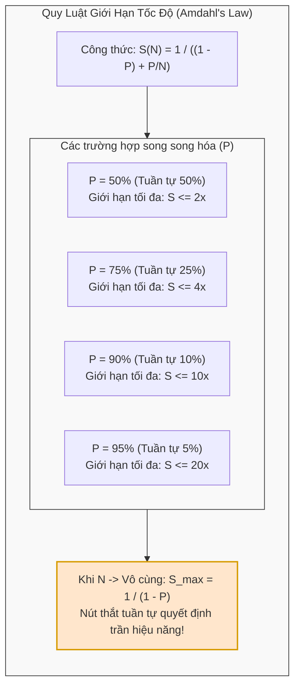

# 1_3_2 Concurrency vs Parallelism

> **Khóa học**: Cloud DevOps Basic — OS Core  
> **Phân nhóm**: 1 Domain 1 - Operating System Core Fundamentals › 1_3 Thread Management and Multithreading  
> **Chủ đề**: Phân định Concurrency và Parallelism, Định luật Amdahl và kỹ thuật kiểm soát CPU Affinity trên Linux  
> **Trạng thái**: Verified (WRITE-CDB-1_3_2, 14-11-2026)  
> **Checklist đối chiếu**: [1_3_2](../../../CHECKLIST.md#domain-1-operating-system-core-fundamentals-45-items)  

---

## 1. Khái Niệm Cốt Lõi & Bản Chất Kỹ Thuật (Core Concepts & Technical Deep Dive)

Trong lĩnh vực khoa học máy tính và kỹ thuật hệ thống, hai thuật ngữ **Concurrency (Tính đồng thời)** và **Parallelism (Tính song song)** rất thường bị nhầm lẫn hoặc sử dụng thay thế cho nhau. Tuy nhiên, chúng đại diện cho hai khái niệm hoàn toàn khác biệt: một bên là nguyên lý **cấu trúc phần mềm**, còn một bên là năng lực **thực thi của phần cứng**.

---

### 1.1 Định Nghĩa Chuẩn Xác: Concurrency vs Parallelism

Nhà khoa học máy tính Rob Pike (đồng tác giả ngôn ngữ Go và kiến trúc sư hệ điều hành Unix/Plan 9) đã đúc kết sự khác biệt này bằng một câu châm ngôn kinh điển:

> *"Concurrency is about dealing with lots of things at once. Parallelism is about doing lots of things at once. Concurrency is not parallelism, although it enables parallelism."*  
> *(Concurrency là về việc **xử lý** nhiều việc cùng lúc. Parallelism là về việc **thực thi** nhiều việc cùng lúc. Concurrency không phải là parallelism, dù nó tạo tiền đề cho parallelism).*

```text
+------------------------------------------------------------------------+
|                    SO SÁNH BẢN CHẤT KỸ THUẬT CỐT LÕI                   |
|                                                                        |
| 1. CONCURRENCY (Tính đồng thời):                                       |
|    - Bản chất: Thuộc về CẤU TRÚC PHẦN MỀM (Program Structure).         |
|    - Khái niệm: Khả năng phân rã bài toán thành các luồng độc lập      |
|      có thể tiến triển đan xen (interleaving) mà không phụ thuộc       |
|      vào việc có thực thi cùng một tích tắc vật lý hay không.          |
|    - Môi trường: Hoạt động hoàn hảo ngay cả trên 1 CPU Core đơn nhân   |
|      thông qua cơ chế chia sẻ thời gian (Time-slicing / Preemption).   |
|                                                                        |
| 2. PARALLELISM (Tính song song):                                       |
|    - Bản chất: Thuộc về NĂNG LỰC PHẦN CỨNG (Hardware Execution).       |
|    - Khái niệm: Các luồng tính toán được CPU thực thi TẠI ĐÚNG CÙNG    |
|      MỘT TÍCH TẮC THỜI GIAN VẬT LÝ trên các core CPU riêng biệt.       |
|    - Môi trường: BẮT BUỘC cần phần cứng đa nhân (Multi-core) hoặc      |
|      đa vi xử lý vật lý (Multi-socket).                                |
+------------------------------------------------------------------------+
```

Theo giáo trình *Operating Systems: Three Easy Pieces (OSTEP)*, Chương 26:
- Thay vì chỉ có một con trỏ lệnh duy nhất (`Program Counter - PC`), một chương trình đa luồng (multi-threaded program) sở hữu nhiều con trỏ lệnh độc lập.
- Trên **hệ thống 1 CPU Core**, hệ điều hành thực hiện Concurrency bằng cách chuyển đổi ngữ cảnh (Context Switching) luân phiên giữa các luồng: Luồng A chạy 5ms $\rightarrow$ Luồng B chạy 5ms $\rightarrow$ Luồng A chạy tiếp. Tại bất kỳ một nano-giây vật lý nào, chỉ có duy nhất 1 luồng thực thi trên bán dẫn của core.
- Trên **hệ thống Multi-core (ví dụ: 4 cores)**, hệ thống có thể đạt được cả Concurrency lẫn Parallelism: Luồng A chạy trên Core 0, Luồng B chạy trên Core 1 tại đúng cùng một thời điểm xung nhịp đồng hồ (clock tick).

---

### 1.2 Định Luật Amdahl (Amdahl's Law) & Nút Thắt Tuần Tự

Một sai lầm kinh điển trong thiết kế hệ thống là giả định rằng: *"Nếu một thuật toán chạy trên 1 core mất 10 giây, thì khi chạy trên 10 cores nó sẽ chỉ mất 1 giây"*. Nhà khoa học máy tính Gene Amdahl (1967) đã chứng minh rằng tốc độ tăng tốc của một chương trình song song bị chặn trên bởi tỷ lệ mã bắt buộc phải chạy tuần tự.

#### Công thức Định luật Amdahl:
$$S(N) = \frac{1}{(1 - P) + \frac{P}{N}}$$

Trong đó:
- **$S(N)$**: Hệ số tăng tốc lý thuyết (Theoretical Speedup) khi sử dụng $N$ nhân xử lý.
- **$P$**: Tỷ lệ phần trăm khối lượng công việc của chương trình có thể chạy song song ($0 \le P \le 1$).
- **$(1 - P)$**: Tỷ lệ phần trăm khối lượng công việc bắt buộc phải chạy **tuần tự** (Serial Fraction, ví dụ: khởi tạo tệp, phân phối dữ liệu ban đầu, tranh chấp khóa đồng bộ, tổng hợp kết quả cuối cùng).
- **$N$**: Số lượng nhân vi xử lý (CPU Cores).

#### Giới hạn toán học tối thượng (Amdahl's Bottleneck):
Khi số lượng nhân vi xử lý tiến tới vô cùng ($N \to \infty$), thành phần $\frac{P}{N} \to 0$. Khi đó, hệ số tăng tốc cực đại bị giới hạn bởi:

$$\lim_{N \to \infty} S(N) = \frac{1}{1 - P}$$

**Ví dụ thực tế gây sốc**:
Giả sử bạn tối ưu hóa một ứng dụng xử lý dữ liệu lớn để $90\%$ khối lượng công việc có thể chạy song song ($P = 0.90$), còn $10\%$ mã là tuần tự ($1 - P = 0.10$):
- Nếu chạy trên máy chủ **$N = 4$ cores**:
  $$S(4) = \frac{1}{(1 - 0.90) + \frac{0.90}{4}} = \frac{1}{0.10 + 0.225} = \frac{1}{0.325} \approx 3.08\times$$
- Nếu nâng cấp lên máy chủ siêu khủng **$N = 64$ cores**:
  $$S(64) = \frac{1}{0.10 + \frac{0.90}{64}} = \frac{1}{0.10 + 0.014} \approx 8.77\times$$
- Nếu đầu tư cụm máy chủ **$N = 10,000$ cores**:
  $$S(10000) \approx \frac{1}{0.10} = 10\times$$
$\rightarrow$ **Kết luận**: Dù bạn có tăng số core lên gấp hàng nghìn lần, tốc độ của toàn bộ hệ thống **không bao giờ có thể nhanh hơn 10 lần** so với chạy 1 core! $10\%$ mã tuần tự trở thành bức tường kiên cố giới hạn toàn bộ hệ thống.

#### So sánh: Định luật Amdahl vs Định luật Gustafson
- **Amdahl's Law (Strong Scaling)**: Đặt giả thiết **kích thước bài toán là cố định** (Fixed problem size). Khi tăng core, mục tiêu là giải cùng một bài toán đó trong thời gian ngắn nhất.
- **Gustafson's Law (Weak Scaling)**: Đặt giả thiết **thời gian thực thi là cố định** nhưng kích thước bài toán mở rộng theo năng lực tính toán ($S(N) = N - (1 - P)(N - 1)$). Trong kỷ nguyên Big Data và AI, khi có nhiều core hơn, chúng ta xử lý tập dữ liệu lớn hơn nhiều lần trong cùng một khoảng thời gian chấp nhận được.

---

### 1.3 Kiểm Soát Thực Thi Bằng CPU Affinity Trên Linux (`pthread_setaffinity_np`)

Trên hệ điều hành Linux, bộ lập lịch (Scheduler) mặc định có thể luân chuyển một luồng giữa các CPU core khác nhau để cân bằng tải. Tuy nhiên, Linux cung cấp giao diện lập trình cho phép ứng dụng can thiệp gán cố định luồng vào một core cụ thể (**CPU Pinning / Affinity**):
- Hàm `pthread_setaffinity_np(pthread_t thread, size_t cpusetsize, const cpu_set_t *cpuset)` đặt mặt nạ CPU affinity cho luồng chỉ định.
- Bằng cách sử dụng các macro `CPU_ZERO(&cpuset)` và `CPU_SET(core_id, &cpuset)`, chúng ta có thể:
  - Gán cả 2 luồng ngốn CPU vào cùng `Core 0`: Hai luồng buộc phải tranh chấp chia sẻ thời gian trên 1 core $\rightarrow$ Thể hiện bản chất **Concurrency**.
  - Gán Luồng 1 vào `Core 0` và Luồng 2 vào `Core 1`: Cả hai luồng chạy song song trên 2 core phần cứng riêng biệt $\rightarrow$ Thể hiện bản chất **Parallelism**.

---

## 2. Ví Dụ Đời Sống Thực Tế Dễ Hiểu (Intuitive Real-World Analogies)

### Ẩn Dụ: Đầu Bếp Trong Gian Bếp Nhà Hàng (Chefs in a Restaurant Kitchen)

Để nắm bắt trực quan sự khác biệt giữa Concurrency, Parallelism và Định luật Amdahl, hãy cùng bước vào gian bếp của một nhà hàng ẩm thực:

```text
+------------------------------------------------------------------------+
|                     ẨN DỤ GIAN BẾP NHÀ HÀNG ẨM THỰC                   |
|                                                                        |
| 1. CONCURRENCY: "1 Đầu bếp tung hứng 3 món ăn"                         |
|    - Chỉ có 1 người đầu bếp duy nhất (1 CPU Core).                     |
|    - Khách gọi: Món Xào, Món Kho, Món Canh.                            |
|    - Người đầu bếp chuyển tay liên tục (Time-slicing interleaving):    |
|      Đảo rau 10s --> Nêm thịt 10s --> Khuấy canh 10s.                  |
|    - Tại một tích tắc: Chỉ cầm được 1 cái muôi trên tay!               |
|    - Kết quả: Cả 3 món cùng tiến triển đồng thời.                      |
|                                                                        |
| 2. PARALLELISM: "3 Đầu bếp đứng 3 bếp gas riêng biệt"                  |
|    - Nhà hàng có 3 đầu bếp độc lập (3 CPU Cores).                      |
|    - Đúng 12:00:00: Đầu bếp 1 xào rau, Đầu bếp 2 kho thịt,             |
|      Đầu bếp 3 nấu canh cùng một giây đồng hồ vật lý!                  |
|    - Kết quả: Thực thi song song thực sự trên phần cứng.               |
|                                                                        |
| 3. AMDAHL'S LAW: "Nút thắt nghiệm thu của Bếp trưởng"                 |
|    - 9 món ăn có thể do 9 đầu bếp phụ nấu song song (P = 90%).         |
|    - Nhưng khâu nêm gia vị cuối cùng và trang trí đĩa bắt buộc phải do |
|      đích thân 1 Bếp trưởng làm tuần tự mất 10 phút (1 - P = 10%).     |
|    - Dù có thuê 10,000 đầu bếp phụ (N --> vô cùng), bữa tiệc KHÔNG     |
|      BAO GIỜ có thể hoàn thành nhanh hơn 10 phút của Bếp trưởng!       |
+------------------------------------------------------------------------+
```

1. **Concurrency (Đồng thời) — Một đầu bếp xoay sở nhiều chảo**:
   - Nếu người đầu bếp nấu xong xuôi món rau mất 15 phút, rồi mới bắt tay vào nấu món thịt 20 phút (thực thi tuần tự - Synchronous Sequential), thực khách sẽ phải đợi quá lâu và món rau sẽ bị nguội ngắt trước khi có thịt.
   - Thay vào đó, người đầu bếp tổ chức công việc theo dạng **Concurrency**: bật cả 3 bếp gas, trong lúc đợi nước sôi thì đảo rau, trong lúc chờ rau ngấm thì quay sang nêm thịt. Cấu trúc công việc được chia nhỏ đan xen giúp cả 3 món ăn cùng hoàn thành nóng hổi, dù tại bất kỳ thời điểm nào đầu bếp cũng chỉ dùng 1 đôi tay.
2. **Parallelism (Song song) — Nhiều đầu bếp cùng xào nấu**:
   - Khi quán ăn đông khách, nhà hàng thuê thêm 2 đầu bếp mới, bố trí 3 người đứng ở 3 bếp gas độc lập. Cả 3 người đồng thời thao tác tại cùng một giây đồng hồ. Công suất chế biến thức ăn tăng gấp 3 lần thực sự nhờ tài nguyên phần cứng được bổ sung.
3. **Amdahl's Law — Bếp trưởng là nút thắt cổ chai**:
   - Thuê thêm nhiều đầu bếp phụ chỉ giúp giải quyết khâu xào nấu thô ($P$). Nhưng nếu tất cả các món ăn đều phải xếp hàng chờ một Bếp trưởng duy nhất ký duyệt và nếm thử ($1 - P$), thì việc tuyển thêm hàng trăm đầu bếp phụ cũng hoàn toàn vô nghĩa đối với tổng thời gian hoàn thành bữa ăn.

---

## 3. Kiến Trúc, Luồng Hoạt Động & Hình Ảnh Trực Quan (Architecture, Diagrams & Visual Media)

### 3.1 Sơ Đồ So Sánh Trục Thời Gian: Concurrency vs Parallelism

```mermaid
gantt
    title So sánh trục thời gian thực thi: Concurrency vs Parallelism
    dateFormat X
    axisFormat %s

    section Single Core (Concurrency)
    Task 1 (Time slice 1) :active, 0, 2
    Task 2 (Time slice 1) :crit, 2, 4
    Task 1 (Time slice 2) :active, 4, 6
    Task 2 (Time slice 2) :crit, 6, 8

    section Dual Core (Parallelism)
    Core 0 - Task 1 (Simultaneous) :active, 0, 4
    Core 1 - Task 2 (Simultaneous) :crit, 0, 4
```



*Nhận xét*: 
- Trong **Concurrency (1 Core)**: Task 1 và Task 2 thực thi đan xen (interleaving) qua các lát cắt thời gian. Tại thời điểm `t = 1`, chỉ Task 1 chạy; tại `t = 3`, chỉ Task 2 chạy.
- Trong **Parallelism (Dual Core)**: Task 1 và Task 2 chạy song song tại đúng cùng một khoảng thời gian từ `t = 0` đến `t = 4`.

---

### 3.2 Sơ Đồ Giới Hạn Tăng Tốc Của Định Luật Amdahl



---

## 4. Code Mẫu Trực Quan Hoặc Dòng Lệnh Thực Chiến (Runnable Sample Code / CLI)

> ⚠️ Dữ liệu mã nguồn C và đầu ra dòng lệnh dưới đây mang tính chất minh họa (illustrative output) ghi nhận trên hệ thống Linux x86_64 đa nhân nhằm quan sát sự khác biệt giữa Concurrency và Parallelism.

### 4.1 Mã C Thực Nghiệm Gán CPU Affinity: `concurrency_vs_parallelism.c`

Chương trình C dưới đây tạo 2 luồng ngốn CPU (`busy_loop`). Người dùng có thể truyền tham số dòng lệnh để chọn chế độ:
- Chế độ `1` (Concurrency): Gán cả 2 luồng vào **CPU Core 0**.
- Chế độ `2` (Parallelism): Gán Luồng 1 vào **CPU Core 0** và Luồng 2 vào **CPU Core 1**.

```c
/*
 * File: concurrency_vs_parallelism.c
 * Mục đích: Minh họa Concurrency (1 Core Time-slicing) vs Parallelism (Multi-core)
 *           sử dụng pthread_setaffinity_np trên Linux.
 */

#define _GNU_SOURCE
#include <stdio.h>
#include <stdlib.h>
#include <pthread.h>
#include <sched.h>
#include <unistd.h>

// Hàm thực thi vòng lặp nặng để tiêu tốn 100% CPU core
void *heavy_computation(void *arg) {
    long thread_id = (long)arg;
    printf("[Thread %ld] Bắt đầu tính toán trên CPU...\n", thread_id);
    
    volatile unsigned long long count = 0;
    while (count < 5000000000ULL) {
        count++;
    }
    
    printf("[Thread %ld] Hoàn tất tính toán!\n", thread_id);
    return NULL;
}

int main(int argc, char *argv[]) {
    if (argc < 2) {
        fprintf(stderr, "Cách dùng: %s <1: Chế độ Concurrency | 2: Chế độ Parallelism>\n", argv[0]);
        return EXIT_FAILURE;
    }

    int mode = atoi(argv[1]);
    pthread_t thread1, thread2;
    cpu_set_t cpuset1, cpuset2;

    CPU_ZERO(&cpuset1);
    CPU_ZERO(&cpuset2);

    if (mode == 1) {
        // Chế độ 1: Cả 2 luồng gán chung vào CPU 0 (Concurrency)
        printf("=== CHẾ ĐỘ 1: CONCURRENCY (Gán cả 2 luồng vào CPU Core 0) ===\n");
        CPU_SET(0, &cpuset1);
        CPU_SET(0, &cpuset2);
    } else {
        // Chế độ 2: Luồng 1 vào CPU 0, Luồng 2 vào CPU 1 (Parallelism)
        printf("=== CHẾ ĐỘ 2: PARALLELISM (Luồng 1 vào Core 0, Luồng 2 vào Core 1) ===\n");
        CPU_SET(0, &cpuset1);
        CPU_SET(1, &cpuset2);
    }

    // Tạo luồng 1 và gán CPU affinity
    pthread_create(&thread1, NULL, heavy_computation, (void *)1);
    pthread_setaffinity_np(thread1, sizeof(cpu_set_t), &cpuset1);

    // Tạo luồng 2 và gán CPU affinity
    pthread_create(&thread2, NULL, heavy_computation, (void *)2);
    pthread_setaffinity_np(thread2, sizeof(cpu_set_t), &cpuset2);

    // Chờ 2 luồng hoàn tất
    pthread_join(thread1, NULL);
    pthread_join(thread2, NULL);

    printf("Toàn bộ chương trình hoàn tất!\n");
    return EXIT_SUCCESS;
}
```

---

### 4.2 Thao Tác Biên Dịch Và Quan Sát Trực Quan Bằng `mpstat`

```bash
# 1. Biên dịch chương trình với cờ -pthread
gcc -O2 -pthread concurrency_vs_parallelism.c -o concurrency_vs_parallelism

# 2. Mở một terminal thứ hai để giám sát tải từng core CPU bằng mpstat
mpstat -P ALL 1
```

#### Quan sát Đầu ra trong Chế độ 1 (Concurrency: Gán cả 2 luồng vào Core 0):
```bash
./concurrency_vs_parallelism 1
```
**Đầu ra minh họa từ `mpstat -P ALL 1`**:
```text
13:10:01  CPU    %usr   %nice    %sys %iowait   %irq   %soft  %steal  %guest  %gnice   %idle
13:10:02  all   25.00    0.00    0.00    0.00   0.00    0.00    0.00    0.00    0.00   75.00
13:10:02    0  100.00    0.00    0.00    0.00   0.00    0.00    0.00    0.00    0.00    0.00
13:10:02    1    0.00    0.00    0.00    0.00   0.00    0.00    0.00    0.00    0.00  100.00
13:10:02    2    0.00    0.00    0.00    0.00   0.00    0.00    0.00    0.00    0.00  100.00
13:10:02    3    0.00    0.00    0.00    0.00   0.00    0.00    0.00    0.00    0.00  100.00
```
- **Nhận xét**: Chỉ có duy nhất `CPU 0` bị chiếm dụng `100%`. Hai luồng đang chia sẻ thời gian (time-slicing) trên cùng một nhân vật lý. Các core còn lại (`CPU 1, 2, 3`) hoàn toàn nhàn rỗi (`%idle = 100%`). Tổng tải toàn hệ thống là `25%` (trên máy 4 cores).

#### Quan sát Đầu ra trong Chế độ 2 (Parallelism: Luồng 1 vào Core 0, Luồng 2 vào Core 1):
```bash
./concurrency_vs_parallelism 2
```
**Đầu ra minh họa từ `mpstat -P ALL 1`**:
```text
13:10:05  CPU    %usr   %nice    %sys %iowait   %irq   %soft  %steal  %guest  %gnice   %idle
13:10:06  all   50.00    0.00    0.00    0.00   0.00    0.00    0.00    0.00    0.00   50.00
13:10:06    0  100.00    0.00    0.00    0.00   0.00    0.00    0.00    0.00    0.00    0.00
13:10:06    1  100.00    0.00    0.00    0.00   0.00    0.00    0.00    0.00    0.00    0.00
13:10:06    2    0.00    0.00    0.00    0.00   0.00    0.00    0.00    0.00    0.00  100.00
13:10:06    3    0.00    0.00    0.00    0.00   0.00    0.00    0.00    0.00    0.00  100.00
```
- **Nhận xét**: Cả `CPU 0` và `CPU 1` đồng thời chạm mức `100%` tại cùng một thời điểm. Cả hai luồng đang được thực thi vật lý song song. Thời gian chạy hoàn tất của chương trình giảm đi gần một nửa so với Chế độ 1.

---

## 5. Cạm Bẫy Thực Tế & Thực Tiễn Sản Xuất (Production Gotchas & Best Practices)

Trong thiết kế kiến trúc phần mềm Cloud và vận hành hạ tầng DevOps, việc hiểu sai về Concurrency và Parallelism dẫn đến những tổn thất tài chính và suy giảm hiệu năng nghiêm trọng:

### 1. Ảo Tưởng Tăng Tốc Tuyến Tính (Linear Scaling Illusion) Trên Đám Mây
- **Sự cố kinh điển**: Doanh nghiệp nhận thấy ứng dụng backend xử lý đơn hàng bị chậm. Đội ngũ DevOps quyết định nâng cấp gói máy chủ đám mây (AWS EC2 / Azure VM) từ máy 4 vCPU lên máy 32 vCPU (chi phí tăng gấp 8 lần) với kỳ vọng tốc độ xử lý sẽ tăng gấp 8 lần.
- **Thực tế phũ phàng**: Hiệu năng ứng dụng chỉ tăng được khoảng $1.3\times$ đến $1.5\times$, sau đó đi ngang.
- **Giải mã theo Định luật Amdahl**:
  - Mã nguồn ứng dụng chứa các đoạn găng (Critical Sections) được bảo vệ bằng khóa độc quyền (**Global Mutex / Database Lock**), hoặc tiến trình phải ghi nhật ký tuần tự vào một tệp (Write-Ahead Logging - WAL).
  - Phần mã tuần tự này chiếm $20\%$ tổng thời gian ($1 - P = 0.20$). Theo công thức Amdahl, trần hiệu năng tối đa của hệ thống là $S_{max} = \frac{1}{0.20} = 5\times$. Do chi phí tranh chấp khóa (Lock Contention) tăng vọt khi nhiều core cùng truy cập, hiệu năng thực tế thậm chí còn thấp hơn nhiều.
- **Bài học kiến trúc**: Trước khi nâng cấp CPU, bắt buộc phải tối ưu hóa giảm thiểu phần mã tuần tự: chia nhỏ khóa (Lock Striping), sử dụng cấu trúc dữ liệu không khóa (Lock-free data structures), hoặc chuyển sang kiến trúc bất đồng bộ (Actor model / Event-driven).

### 2. Cạm Bẫy Phân Bổ Quá Nhiều Luồng (Over-Threading) Gây Tổn Thất Hiệu Năng
- Lập trình viên nghĩ rằng: *"Càng tạo nhiều luồng (threads) thì chương trình càng chạy nhanh"*. Họ tạo ra 500 luồng tính toán số học trên một máy chủ chỉ có 8 CPU Core.
- **Hậu quả**: 500 luồng không thể chạy song song (Parallelism) vì phần cứng chỉ có 8 nhân vật lý. Chúng buộc phải chạy đồng thời (Concurrency) qua việc kernel liên tục thực hiện chuyển đổi ngữ cảnh hàng trăm nghìn lần mỗi giây. Chi phí lưu/nạp thanh ghi và trượt bộ nhớ đệm CPU Cache làm chương trình chạy **chậm hơn đáng kể** so với việc chỉ tạo đúng 8 luồng.

### 3. Phân Biệt Strong Scaling vs Weak Scaling Trong Hệ Thống Phân Tán
- Khi làm việc với các hệ thống dữ liệu lớn (Big Data / Machine Learning như Apache Spark, Ray, Kubernetes distributed jobs):
  - Nếu dữ liệu cố định (ví dụ: huấn luyện mô hình trên tập dữ liệu 100 GB không đổi), hệ thống bị giới hạn bởi **Strong Scaling (Amdahl)**. Càng thêm máy, hiệu quả tăng tốc biên càng giảm dần.
  - Nếu dữ liệu mở rộng theo tài nguyên (ví dụ: mỗi máy chủ bổ sung sẽ xử lý thêm 100 GB dữ liệu mới trong cùng 1 giờ), hệ thống tuân theo **Weak Scaling (Gustafson)**, cho phép mở rộng quy mô tuyến tính rất tốt.

---

## 6. Câu Hỏi Củng Cố Kiến Thức (Active Recall Quiz)

<details>
<summary><b>Câu hỏi 1:</b> Phân biệt sự khác nhau bản chất giữa Concurrency và Parallelism. Một máy chủ đời cũ chỉ trang bị duy nhất 1 CPU Core đơn nhân có thể đạt được Parallelism không? Có thể đạt được Concurrency không? Tại sao?</summary>

**Đáp án:**
- **Sự khác nhau**: Concurrency là đặc tính cấu trúc phần mềm (xử lý nhiều việc đan xen cùng lúc), trong khi Parallelism là năng lực phần cứng (thực thi nhiều việc tại đúng cùng một tích tắc vật lý).
- **Trên máy 1 CPU Core đơn nhân**:
  - **Không thể đạt được Parallelism**: Vì tại bất kỳ một nano-giây nào, phần cứng bán dẫn của 1 core duy nhất chỉ có thể nạp và thực thi lệnh của một luồng duy nhất.
  - **Hoàn toàn đạt được Concurrency**: Thông qua cơ chế chia sẻ thời gian (Time-slicing) của hệ điều hành, kernel luân chuyển thực thi các luồng đan xen nhau liên tục, giúp tất cả các tác vụ cùng tiến triển.
</details>

<details>
<summary><b>Câu hỏi 2:</b> Một ứng dụng phân tích video có 80% thời gian thực thi có thể chia nhỏ để chạy song song trên nhiều CPU cores, còn 20% thời gian bắt buộc phải chạy tuần tự (đọc tệp video từ đĩa và ghi kết quả ra bộ nhớ). Theo định luật Amdahl, nếu chạy ứng dụng này trên máy chủ có 16 CPU Cores, hệ số tăng tốc lý thuyết là bao nhiêu? Nếu nâng cấp máy chủ lên vô hạn cores thì tốc độ tối đa có thể đạt được là bao nhiêu?</summary>

**Đáp án:**
- Áp dụng công thức Amdahl: $P = 0.80$, $1 - P = 0.20$, $N = 16$:
  $$S(16) = \frac{1}{(1 - 0.80) + \frac{0.80}{16}} = \frac{1}{0.20 + 0.05} = \frac{1}{0.25} = 4.0\times$$
  $\rightarrow$ Ứng dụng chạy nhanh hơn **4 lần** trên máy 16 cores.
- Khi nâng cấp lên vô hạn cores ($N \to \infty$):
  $$S_{max} = \frac{1}{1 - P} = \frac{1}{0.20} = 5.0\times$$
  $\rightarrow$ Dù có bao nhiêu cores đi nữa, tốc độ tối đa không bao giờ vượt quá **5 lần**.
</details>

<details>
<summary><b>Câu hỏi 3:</b> Khi sử dụng công cụ <code>mpstat -P ALL 1</code> trên hệ điều hành Linux để giám sát một ứng dụng chạy 2 luồng ngốn CPU, dấu hiệu nhận biết nào trên các cột hiển thị giúp bạn phân biệt ứng dụng đang chạy ở chế độ Concurrency (Time-slicing) hay Parallelism (Song song thực sự)?</summary>

**Đáp án:**
- **Dấu hiệu Concurrency (trên 1 core)**: Bạn sẽ thấy duy nhất một CPU core (ví dụ `CPU 0`) hiển thị chỉ số `%usr` đạt xấp xỉ `100%`, trong khi các core CPU khác đều có `%idle` đạt `100%`. Hai luồng đang chia sẻ thời gian trên cùng nhân đó.
- **Dấu hiệu Parallelism (trên nhiều cores)**: Bạn sẽ thấy ít nhất hai CPU cores riêng biệt (ví dụ cả `CPU 0` và `CPU 1`) đồng thời hiển thị chỉ số `%usr` đạt xấp xỉ `100%` tại cùng các khoảng thời gian lấy mẫu. Cả hai luồng đang được thực thi vật lý song song trên hai nhân vi xử lý riêng biệt.
</details>

---

## 7. 📚 Nguồn Tài Liệu Chính Thống (Tier-1 Official References)

- [Rob Pike: Concurrency is not Parallelism (The Go Blog / Heroku Waza 2012)](https://go.dev/blog/waza-talk) - Bài giảng và bài viết nền tảng của Rob Pike phân tích triết lý sâu sắc giữa cấu trúc đồng thời (concurrency) và thực thi song song (parallelism).
- [OSTEP Chapter 26: Concurrency: An Introduction](https://pages.cs.wisc.edu/~remzi/OSTEP/threads-intro.pdf) - Giáo trình chuẩn mực *Operating Systems: Three Easy Pieces* (Remzi H. Arpaci-Dusseau & Andrea C. Arpaci-Dusseau), giới thiệu khái niệm đa luồng, con trỏ lệnh độc lập và chia sẻ thời gian CPU.
- [University of Wisconsin-Madison: Mark D. Hill (Gene M. Amdahl Professor of CS)](https://pages.cs.wisc.edu/~markhill/) - Phân tích lý thuyết điện toán song song chuyên sâu về công thức định luật Amdahl "S = 1 / ((1 - P) + P/N)" trên kiến trúc vi xử lý đa nhân.
- [Linux Manual Pages: pthread_setaffinity_np(3)](https://man7.org/linux/man-pages/man3/pthread_setaffinity_np.3.html) - Hướng dẫn chính thức từ Linux man-pages về hàm thiết lập mặt nạ gắn kết CPU (CPU Affinity) cho luồng POSIX.
- [Linux Manual Pages: mpstat(1)](https://man7.org/linux/man-pages/man1/mpstat.1.html) - Tài liệu hướng dẫn chính thức về tiện ích `mpstat` báo cáo thống kê mức sử dụng riêng biệt của từng CPU core trên Linux.
