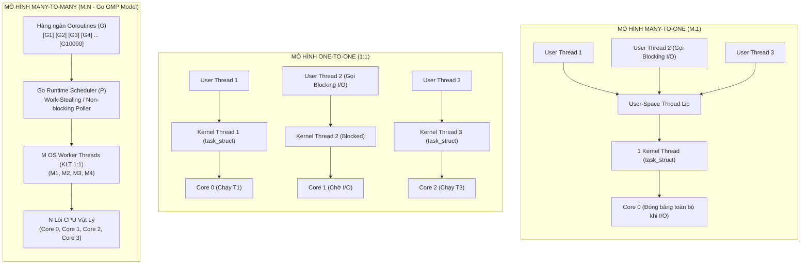

# 1_3_3 Multithreading Models

> **Khóa học**: Cloud DevOps Basic — OS Core  
> **Phân nhóm**: 1 Domain 1 - Operating System Core Fundamentals › 1_3 Thread Management and Multithreading  
> **Chủ đề**: Các mô hình đa luồng (Multithreading Models): Many-to-One, One-to-One, Many-to-Many và bản chất lập lịch Goroutine tầng người dùng  
> **Trạng thái**: Draft (WRITE-CDB-1_3_3, 14-11-2026)  
> **Checklist đối chiếu**: [1_3_3](../../../CHECKLIST.md#domain-1-operating-system-core-fundamentals-45-items)  

---

## 1. Khái Niệm Cốt Lõi & Bản Chất Kỹ Thuật (Core Concepts & Technical Deep Dive)

Trong kiến trúc hệ thống máy tính, việc hiện thực hóa đa luồng (*multithreading*) đòi hỏi sự phối hợp giữa hai cấp độ đặc quyền thực thi:
- **Luồng cấp người dùng (User-Level Threads - ULT)**: Được tạo, quản lý và điều phối hoàn toàn trong không gian người dùng (*User Space - Ring 3*) bởi một thư viện hoặc runtime của ngôn ngữ lập trình. Kernel hoàn toàn không nhận biết sự tồn tại của từng ULT này.
- **Luồng cấp hạt nhân (Kernel-Level Threads - KLT)**: Được hỗ trợ, quản lý và lập lịch trực tiếp bởi nhân hệ điều hành (*Kernel Space - Ring 0*). Mỗi KLT là một thực thể độc lập được bộ lập lịch CPU của hệ điều hành (*OS Scheduler*) phân bổ thời gian thực thi trên các lõi phần cứng.

Mối quan hệ ánh xạ giữa User-Level Threads và Kernel-Level Threads định hình nên **3 mô hình đa luồng kinh điển** trong khoa học máy tính:

```
    Many-to-One (M:1)              One-to-One (1:1)               Many-to-Many (M:N)
   (Green Threads Model)       (Standard OS / NPTL Model)      (Two-Level / User Runtime)

    ULT  ULT  ULT  ULT            ULT   ULT   ULT   ULT           ULT  ULT  ULT  ULT  ULT
      \    |    /   /              |     |     |     |              \   \   |   /   /
       \   |   /   /               |     |     |     |             [Runtime Scheduler]
        \  |  /   /                |     |     |     |                 /    |    \
     +-------------+               |     |     |     |                /     |     \
     | 1 KLT (OS)  |             KLT   KLT   KLT   KLT             KLT     KLT    KLT
     +------+------+              |     |     |     |               |       |      |
            |                     |     |     |     |               |       |      |
          CPU 0                 CPU 0 CPU 1 CPU 2 CPU 3           CPU 0   CPU 1  CPU 2
```

---

### 1.1 Mô hình Many-to-One (M:1 - Green Threads)

Trong mô hình Many-to-One, một tập hợp gồm nhiều luồng cấp người dùng ($M$ User Threads) được ánh xạ lên **duy nhất một luồng cấp hạt nhân** ($1$ Kernel Thread).

#### 1. Cơ chế vận hành
- Toàn bộ quá trình quản lý luồng (tạo luồng, hủy luồng, hoán đổi ngữ cảnh thực thi, lưu trữ con trỏ lệnh PC và thanh ghi) được thực hiện bởi một **thư viện luồng ở không gian người dùng** (*User-Space Thread Library*, ví dụ: *GNU Portable Threads*, *Green Threads* trong Java 1.1).
- Khi hoán đổi giữa hai User Threads, thư viện chỉ cần thực hiện các thao tác lưu và nạp lại thanh ghi trong cấu trúc bộ nhớ người dùng (thông qua các cơ chế như `setjmp`/`longjmp` hoặc tráo đổi con trỏ ngăn xếp fiber), **hoàn toàn không cần thực hiện System Call bẫy vào Kernel (Ring 0)**. Do đó, chi phí chuyển ngữ cảnh siêu nhẹ và tốc độ cực kỳ nhanh.

#### 2. Hạn chế chí mạng (The Critical Flaws)
Theo nghiên cứu kinh điển của Anderson et al. (*Scheduler Activations: Effective Kernel Support for the User-Level Management of Parallelism, ACM TOCS*):
1. **Hiệu ứng Nghẽn toàn bộ Tiến trình do Lời gọi Chặn (Blocking System Call Problem)**:
   - Vì Kernel chỉ nhìn thấy 1 luồng duy nhất, nếu bất kỳ một User Thread nào thực hiện một System Call có tính chất chờ đợi (blocking I/O như `read()` từ tệp tin hoặc mạng), hoặc gặp lỗi thiếu trang bộ nhớ (*Page Fault*), **Kernel sẽ đưa toàn bộ Kernel Thread đó vào trạng thái Chờ (Waiting / Blocked)**.
   - Hậu quả: **Toàn bộ tất cả các User Threads còn lại trong tiến trình đều bị đóng băng theo**, ngay cả khi chúng có sẵn công việc tính toán để làm!
2. **Không tận dụng được phần cứng đa lõi (No Multicore Parallelism)**:
   - Vì Kernel chỉ phân bổ thời gian CPU cho 1 Kernel Thread duy nhất, toàn bộ tiến trình chỉ có thể chạy trên **đúng 1 lõi CPU vật lý tại một thời điểm**, bất kể máy chủ có 32 hay 64 lõi CPU.

---

### 1.2 Mô hình One-to-One (1:1 - Chuẩn mực Hệ điều hành Hiện đại)

Trong mô hình One-to-One, **mỗi luồng cấp người dùng được ánh xạ trực tiếp và gắn liền với đúng một luồng cấp hạt nhân độc lập**.

#### 1. Cơ chế vận hành & Vị thế thống trị
Đây là mô hình chuẩn mực được triển khai trên hầu hết các hệ điều hành phổ biến hiện nay: **Linux** (thông qua thư viện NPTL), **Microsoft Windows** (Win32 Threads), và **macOS/iOS**.
- Mỗi khi ứng dụng gọi hàm tạo luồng ở tầng người dùng (ví dụ: `pthread_create(3)` trên Linux hoặc `CreateThread()` trên Windows), thư viện sẽ yêu cầu Kernel tạo ra một thực thể điều phối độc lập (trên Linux là một `struct task_struct` với cờ `CLONE_THREAD`, trên Windows là một cấu trúc `ETHREAD`).
- Bộ lập lịch của hệ điều hành (*OS Kernel Scheduler*) trực tiếp nhận biết và điều phối từng luồng này lên các lõi CPU vật lý khác nhau.

#### 2. Ưu điểm vượt trội
1. **Khả năng song song đa lõi thực thụ (True Multicore Parallelism)**:
   - Các luồng trong cùng một ứng dụng có thể được Kernel phân bổ thực thi đồng thời trên nhiều lõi CPU vật lý khác nhau vào cùng một thời điểm, tối đa hóa hiệu năng phần cứng.
2. **Cách ly hoàn toàn lời gọi chặn (Blocking Call Isolation)**:
   - Nếu Thread 1 thực hiện một System Call blocking (như đọc đĩa hoặc chờ kết nối mạng), Kernel chỉ chuyển trạng thái của riêng `task_struct` của Thread 1 sang Blocked. Các Thread 2, 3, 4 khác trong tiến trình vẫn tiếp tục được lập lịch chạy bình thường trên các lõi CPU khác mà không hề bị gián đoạn.

#### 3. Chi phí đánh đổi (Overhead & Limitations)
- **Chi phí Chuyển ngữ cảnh (Context Switch Overhead)**: Mỗi lần hoán đổi luồng đòi hỏi CPU phải chuyển đặc quyền từ User Mode (Ring 3) sang Kernel Mode (Ring 0) và ngược lại, gây tiêu tốn chu kỳ CPU và phá vỡ bộ nhớ đệm lệnh/dữ liệu của CPU.
- **Tiêu tốn bộ nhớ Kernel và User Stack**: Mỗi luồng 1:1 bắt buộc phải có một vùng nhớ `kstack` riêng trong Kernel (8–16 KB) và một vùng Stack ảo mặc định trong User Space (thường là 8 MB trên Linux). Điều này giới hạn số lượng luồng thực tế của một tiến trình: một máy chủ thông thường khó có thể duy trì quá vài nghìn native OS threads đồng thời mà không bị cạn kiệt bộ nhớ hoặc quá tải bộ lập lịch.

#### 4. Lịch sử tiến hóa trên Linux: Từ LinuxThreads tới NPTL
- Trong các phiên bản Linux cổ điển (nhân 2.4 trở về trước), thư viện `LinuxThreads` sử dụng một luồng quản lý trung gian (*manager thread*) để xử lý việc tạo và hủy luồng, dẫn tới nhiều sai lệch nghiêm trọng so với chuẩn POSIX (như mỗi luồng có một PID riêng biệt, gây sai sót khi nhận tín hiệu).
- Bắt đầu từ Linux 2.6, **NPTL (Native POSIX Thread Library)** do Ulrich Drepper và Ingo Molnar (Red Hat) phát triển đã thay thế hoàn toàn LinuxThreads:
  - Tận dụng triệt để các cờ mở rộng của System Call `clone(2)` như `CLONE_THREAD` để đưa các luồng vào chung một Thread Group (chung TGID/PID).
  - Tích hợp cơ chế khóa nhanh ở không gian người dùng **`futex(2)` (Fast Userspace Mutex)**, cho phép các thao tác khóa/mở khóa khi không có tranh chấp (*uncontended*) được thực hiện hoàn toàn ở User Space mà không cần bẫy vào Kernel.

---

### 1.3 Mô hình Many-to-Many (M:N / Hai tầng - Two-Level Model)

Mô hình Many-to-Many multiplex (ghép kênh) một số lượng lớn $M$ luồng cấp người dùng lên một số lượng nhỏ hơn hoặc bằng $N$ luồng cấp hạt nhân ($M \ge N$).

#### 1. Nguyên lý thiết kế
- Hệ điều hành Kernel chỉ tạo ra một số lượng luồng hạt nhân vừa đủ (thường bằng số lõi CPU vật lý, $N = \text{CPU Cores}$) để đại diện cho khả năng xử lý song song của phần cứng.
- Một bộ lập lịch trung gian (*Runtime Scheduler*) ở không gian người dùng sẽ chia nhỏ và điều phối hàng chục nghìn hoặc hàng trăm nghìn luồng nhẹ ($M$) luân phiên thực thi trên $N$ luồng hạt nhân đó.
- Khi một luồng người dùng thực hiện xong hoặc bước vào trạng thái chờ I/O bất đồng bộ, Runtime Scheduler sẽ gỡ nó ra khỏi luồng hạt nhân và nạp một luồng người dùng khác vào chạy ngay lập tức.

#### 2. Vấn đề Scheduler Activations & Upcalls
Trong mô hình M:N thuần túy ở cấp độ hệ điều hành, bài toán khó nhất là làm thế nào để User-Space Scheduler biết được khi nào một Kernel Thread bị block bởi I/O hoặc Page Fault.
- Công trình nghiên cứu của Anderson et al. đề xuất cơ chế **Scheduler Activations**: Kernel sẽ gửi một tín hiệu thông báo ngược (*Upcall*) từ Kernel Space lên User Space mỗi khi một KLT bị chặn, giúp thư viện người dùng kịp thời khởi tạo một KLT thay thế để giữ nguyên số lượng luồng tính toán song song.
- Tuy nhiên, độ phức tạp quá lớn trong việc đồng bộ trạng thái giữa Kernel và User Space đã khiến các triển khai M:N cấp hệ điều hành (như trên Solaris hay NetBSD) dần bị loại bỏ trong thực tế, nhường chỗ cho mô hình 1:1 đơn giản và ổn định hơn.

---

## 2. Ví Dụ Đời Sống Thực Tế Dễ Hiểu (Intuitive Real-World Analogies)

Để hình dung sự khác biệt giữa 3 mô hình đa luồng, hãy tưởng tượng mối quan hệ công việc giữa **Các Chuyên viên Thiết kế (User Threads)** và **Các Công nhân Xây dựng có Chứng chỉ Hành nghề (Kernel Threads)**:

```
+-----------------------------------------------------------------------------------+
|                        MÔ HÌNH NHÂN LỰC XÂY DỰNG CÔNG TRÌNH                       |
|                                                                                   |
|  [Many-to-One] : 100 Chuyên viên trong phòng họp máy lạnh (User Threads)          |
|                  -> Chỉ thuê duy nhất 1 Công nhân ngoài hiện trường (Kernel Thread)|
|                  -> Đổi người nói nhanh như chớp. Nhưng hễ công nhân kẹt đào đường|
|                     (Blocking I/O), cả 100 chuyên viên ngồi cắn móng tay chờ đợi! |
|                                                                                   |
|  [One-to-One]  : 100 Chuyên viên -> Thuê hẳn 100 Công nhân riêng biệt (1:1)       |
|                  -> Cả 100 công nhân thi công song song trên các góc công trường! |
|                  -> Ai tắc đường người nấy chịu, 99 người kia vẫn làm bình thường.|
|                  -> Nhược điểm: Chi phí mua 100 bộ bảo hộ & tiền lương quá đắt đỏ!|
|                                                                                   |
|  [Many-to-Many]: 1.000 Chuyên viên -> Do Tổ trưởng thông minh (Go Runtime) điều phối|
|                  -> Chỉ ký hợp đồng với 8 Công nhân tinh nhuệ (= 8 Lõi CPU)       |
|                  -> Chuyên viên nào chờ vật tư thì dẹp sang một bên, nhường ngay  |
|                     công nhân cho chuyên viên khác tiếp tục thi công!             |
+-----------------------------------------------------------------------------------+
```

### 1. Many-to-One (Green Threads): Một công nhân gánh 100 chuyên viên
- Một công ty có 100 chuyên viên lên ý tưởng trong phòng máy lạnh (User-Space Library). Trong phòng họp, việc nhường micro cho chuyên viên khác phát biểu diễn ra cực kỳ nhanh chóng và không tốn một đồng chi phí thủ tục nào (chuyển ngữ cảnh ở User Space không tốn syscall).
- Tuy nhiên, ngoài công trường thi công thực tế, công ty chỉ có kinh phí thuê đúng **1 anh công nhân có chứng chỉ hành nghề duy nhất** (1 Kernel Thread).
- **Hậu quả**: Khi anh công nhân ra ngoài đào đất và bị vướng đường ống nước phải dừng lại chờ cơ quan chức năng kiểm tra (Blocking I/O), anh ta bị giữ chân tại chỗ. Ở trong phòng lạnh, **cả 100 chuyên viên đều phải ngồi chơi xơi nước**, không một ai có thể tiếp tục triển khai công việc!

### 2. One-to-One (Linux NPTL / Windows): Mỗi chuyên viên sở hữu một công nhân riêng
- Để khắc phục vấn đề trên, công ty quyết định: Mỗi chuyên viên sẽ được tuyển dụng kèm theo đúng **1 công nhân hiện trường độc quyền** (Mô hình 1:1).
- Nếu công ty có 8 chuyên viên và công trường có 8 khu vực thi công độc lập (8 lõi CPU), cả 8 công nhân có thể cùng lúc cầm búa thi công song song (*True Parallelism*). Nếu anh công nhân số 1 bị vướng thủ tục đào đường, chỉ riêng anh ta đứng chờ; 7 anh công nhân còn lại vẫn tiếp tục thi công rầm rộ.
- **Vấn đề**: Khi công ty nhận dự án khổng lồ cần 10.000 chuyên viên, việc thuê 10.000 công nhân hiện trường sẽ làm công ty phá sản vì tiền mua 10.000 bộ đồ bảo hộ, đóng 10.000 hợp đồng bảo hiểm lao động (ngốn cạn kiệt RAM cho Kernel Stack và bảng quản lý `task_struct`), đồng thời người điều hành công trường sẽ phát điên vì liên tục phải điểm danh hoán đổi 10.000 con người (Context Switch Thrashing).

### 3. Many-to-Many (Go Goroutine Runtime): Ban điều phối nhân lực linh hoạt
- Mô hình M:N giải quyết triệt để bài toán này bằng cách đưa vào một **Tổ trưởng điều phối nhân lực thông minh** (*User-Space Runtime Scheduler* như Go Runtime hoặc Java Virtual Threads):
- Công ty cho phép tuyển thoải mái 100.000 chuyên viên làm việc tự do (*Goroutines*), nhưng ngoài công trường chỉ duy trì đúng **8 công nhân chủ lực** (tương ứng 8 lõi CPU của máy chủ).
- Tổ trưởng đứng quan sát: Bất cứ khi nào một chuyên viên cần chờ đối tác gửi tài liệu từ nước ngoài về qua bưu điện (Network I/O), tổ trưởng lập tức yêu cầu chuyên viên đó ngồi sang khu vực chờ (đưa Goroutine vào hàng đợi Network Poller / epoll), và ngay lập tức gọi một chuyên viên khác đang có sẵn dữ liệu vào tiếp quản anh công nhân đó để thi công tiếp. Nhờ đó, 8 công nhân luôn luôn hoạt động 100% công suất mà không bao giờ bị lãng phí chu kỳ chờ đợi!

---

## 3. Kiến Trúc, Luồng Hoạt Động & Hình Ảnh Trực Quan (Architecture, Diagrams & Visual Media)

### 3.1 Ranh Giới Đặc Quyền Phần Cứng Giữa User Mode và Kernel Mode

Mọi sự tương tác giữa User Threads và Kernel Threads đều chịu sự kiểm soát nghiêm ngặt của cơ chế phân tầng đặc quyền phần cứng CPU:

[](https://learn.microsoft.com/en-us/windows-hardware/drivers/gettingstarted/images/userandkernelmode01.png)  
*Hình 1: Mô hình chuyển đổi ngữ cảnh đặc quyền giữa User Mode và Kernel Mode từ tài liệu Microsoft Learn.*

---

### 3.2 Sơ đồ Kiến Trúc Điều Phối: So Sánh 3 Mô Hình Đa Luồng

Sơ đồ tuần tự và ánh xạ dưới đây mô tả cách các luồng tầng người dùng tương tác với tầng hạt nhân và lõi phần cứng:



---

### 3.3 Bảng So Sánh Kỹ Thuật Toàn Diện Giữa 3 Mô Hình

| Đặc tính Kỹ thuật | Many-to-One (M:1) | One-to-One (1:1) | Many-to-Many (M:N - Go GMP) |
| :--- | :--- | :--- | :--- |
| **Thực thể quản lý lập lịch** | Thư viện người dùng (User Library) | Bộ lập lịch hệ điều hành (OS Scheduler) | Kết hợp: User Runtime trên nền OS Kernel |
| **Tận dụng CPU Đa lõi** | ❌ Không (chỉ chạy trên 1 lõi duy nhất) | ✔️ Có (chạy song song thực thụ trên mọi lõi) | ✔️ Có (chia đều các Goroutines lên các lõi) |
| **Xử lý Blocking I/O** | ❌ Kéo sập/đóng băng toàn bộ tiến trình | ✔️ Chỉ phong tỏa riêng luồng gọi I/O | ✔️ Runtime tự tách G bị block, điều phối G khác |
| **Chi phí Chuyển ngữ cảnh** | Siêu nhẹ (~vài chục chu kỳ CPU, không bẫy ngắt) | Nặng (~hàng nghìn chu kỳ CPU do chuyển Ring 0) | Rất nhẹ (~vài chục nano giây trong User Space) |
| **Kích thước Stack khởi điểm** | Cố định theo thư viện (~vài MB) | Mặc định hệ điều hành: **~8 MB** (`ulimit -s`) | Động: Khởi đầu chỉ **~2 KB**, co giãn tự động |
| **Số lượng luồng tối đa** | Hàng nghìn (nhưng chỉ 1 chạy tại một thời điểm) | Vài nghìn (bị giới hạn bởi RAM & OS limits) | **Hàng triệu** luồng đồng thời trên 1 máy |
| **Ví dụ triển khai tiêu biểu** | Green Threads (Java 1.1), GNU Pth | Linux NPTL, Win32 Threads, Java 8/11/17 | Go Goroutines, Java 21 Virtual Threads, BEAM |

---

## 4. Code Mẫu Trực Quan Hoặc Dòng Lệnh Thực Chiến (Runnable Sample Code / CLI)

Để hiểu rõ sự khác biệt về dấu vết tài nguyên (*resource footprint*) giữa **Mô hình One-to-One cấp hệ điều hành** và **Mô hình Many-to-Many ở tầng User-Space Runtime**, hãy phân tích hai đoạn mã thực nghiệm dưới đây:

### 4.1 Mã nguồn C: Mô hình One-to-One (POSIX Threads)
Chương trình tạo 5 native threads thông qua NPTL. Mỗi luồng tương ứng trực tiếp với một `task_struct` cấp kernel và được cấp phát một vùng nhớ stack 8 MB.

```c
/**
 * file: posix_1to1_demo.c
 * Biên dịch: gcc -O2 -pthread posix_1to1_demo.c -o posix_1to1_demo
 * Thực thi:  ./posix_1to1_demo
 */
#define _GNU_SOURCE
#include <stdio.h>
#include <stdlib.h>
#include <unistd.h>
#include <pthread.h>
#include <sys/syscall.h>

void *thread_worker(void *arg) {
    long id = (long)arg;
    pid_t tid = (pid_t)syscall(SYS_gettid);
    printf("[1:1 KLT] Worker %ld đang chạy trên Kernel TID = %d (PID = %d)\n", id, tid, getpid());
    
    // Giữ luồng sống để kiểm tra qua lệnh ps
    sleep(30);
    return NULL;
}

int main(void) {
    pthread_t threads[5];
    printf("[MAIN] Khởi tạo 5 POSIX Native Threads (Mô hình 1:1)...\n");
    printf("[MAIN] PID tiến trình: %d\n", getpid());

    for (long i = 0; i < 5; i++) {
        if (pthread_create(&threads[i], NULL, thread_worker, (void *)i) != 0) {
            perror("Lỗi pthread_create");
            return 1;
        }
    }

    for (int i = 0; i < 5; i++) {
        pthread_join(threads[i], NULL);
    }
    printf("[MAIN] Hoàn tất.\n");
    return 0;
}
```

---

### 4.2 Mã nguồn Go: Mô hình Many-to-Many ở Tầng Runtime (Goroutines)
Chương trình tạo **10.000 Goroutines** đồng thời. Mỗi Goroutine chỉ tiêu tốn khoảng **2 KB** bộ nhớ stack ban đầu:

```go
/**
 * file: goroutine_mn_demo.go
 * Thực thi: go run goroutine_mn_demo.go
 */
package main

import (
	"fmt"
	"os"
	"runtime"
	"sync"
	"time"
)

func main() {
	pid := os.Getpid()
	numCPU := runtime.NumCPU()
	fmt.Printf("=================================================================\n")
	fmt.Printf("[GO M:N DEMO] Tiến trình PID = %d\n", pid)
	fmt.Printf("[GO M:N DEMO] Số lõi CPU logic phần cứng (N) = %d\n", numCPU)
	fmt.Printf("[GO M:N DEMO] Đang tạo 10.000 Goroutines (M = 10,000)...\n")
	fmt.Printf("=================================================================\n")

	var wg sync.WaitGroup
	const totalGoroutines = 10000

	for i := 0; i < totalGoroutines; i++ {
		wg.Add(1)
		go func(id int) {
			defer wg.Done()
			// Mô phỏng công việc nhẹ và ngủ 30 giây
			time.Sleep(30 * time.Second)
		}(i)
	}

	fmt.Printf("[GO M:N DEMO] Đã tạo thành công %d Goroutines!\n", totalGoroutines)
	fmt.Printf("[GO M:N DEMO] Hãy mở terminal khác và kiểm tra số lượng OS Threads thực tế:\n")
	fmt.Printf("       ps -eLf | grep %d | grep -v grep\n", pid)
	fmt.Printf("=================================================================\n")

	wg.Wait()
	fmt.Println("[GO M:N DEMO] Toàn bộ Goroutines đã hoàn thành.")
}
```

---

### 4.3 Quan Sát & So Sánh Bằng Công Cụ Quản Trị Hệ Thống (CLI)

Khi chạy hai chương trình trên, hãy dùng lệnh `ps -eLf` để quan sát số lượng luồng thực tế mà Linux Kernel quản lý:

#### 1. Kiểm tra chương trình C (POSIX 1:1)
```bash
ps -eLf | grep posix_1to1_demo | grep -v grep
```
*Kết quả quan sát*:
```text
UID          PID    PPID     LWP  NLWP C STIME TTY          TIME CMD
phandinh    5120    2105    5120     6 0 14:30 pts/0    00:00:00 ./posix_1to1_demo
phandinh    5120    2105    5121     6 0 14:30 pts/0    00:00:00 ./posix_1to1_demo
phandinh    5120    2105    5122     6 0 14:30 pts/0    00:00:00 ./posix_1to1_demo
phandinh    5120    2105    5123     6 0 14:30 pts/0    00:00:00 ./posix_1to1_demo
phandinh    5120    2105    5124     6 0 14:30 pts/0    00:00:00 ./posix_1to1_demo
phandinh    5120    2105    5125     6 0 14:30 pts/0    00:00:00 ./posix_1to1_demo
```
- Tạo 5 threads người dùng $\rightarrow$ Hệ điều hành sinh ra đúng **6 LWPs** (1 Main Thread + 5 Worker Threads). Cột `NLWP` hiển thị rõ số 6. Mỗi thread là một `task_struct` độc lập trong Kernel.

#### 2. Kiểm tra chương trình Go (10.000 Goroutines)
```bash
ps -eLf | grep goroutine_mn_demo | grep -v grep
```
*Kết quả quan sát*:
```text
UID          PID    PPID     LWP  NLWP C STIME TTY          TIME CMD
phandinh    5200    2105    5200     9 0 14:31 pts/0    00:00:00 ./goroutine_mn_demo
... (chỉ có khoảng 8 đến 12 dòng LWP hiển thị) ...
```
- Mặc dù ứng dụng đang chạy **10.000 Goroutines**, Linux Kernel chỉ ghi nhận **khoảng 8 đến 12 LWPs (OS threads)** (chủ yếu tương ứng với số lõi CPU logic của máy tính để làm worker threads, cộng thêm vài thread quản lý bộ dọn rác GC và sysmon).
- **Hệ điều hành hoàn toàn không tạo 10.000 kernel threads!** 10.000 Goroutines đó tồn tại dưới dạng các cấu trúc dữ liệu siêu nhỏ nằm trên vùng nhớ Heap của Go Runtime ở User Space.

---

## 5. Cạm Bẫy Thực Tế & Thực Tiễn Sản Xuất (Production Gotchas & Best Practices)

### 1. CỰC KỲ QUAN TRỌNG: Làm Rõ Bản Chất Lập Lịch Goroutine (User-Space Runtime vs OS Kernel)

> [!CAUTION]
> **Nhận định sai lầm phổ biến**: *"Hệ điều hành Linux hỗ trợ cơ chế đa luồng Many-to-Many bằng cách tích hợp sẵn Goroutines."*  
> **Sự thật kỹ thuật 100%**: **Nhân Linux Kernel hoàn toàn KHÔNG biết Goroutine là cái gì!**

- **Ranh giới trách nhiệm**:
  - Ở tầng nhân hệ điều hành, Linux Kernel chỉ duy trì và tuân thủ nghiêm ngặt **Mô hình One-to-One (1:1)** thông qua `struct task_struct` và System Call `clone(2)`.
  - Toàn bộ cơ chế điều phối Goroutine — mô hình kiến trúc **$G, M, P$** (được định nghĩa trong tệp mã nguồn chính thức `src/runtime/proc.go` của Go):
    - **`G` (Goroutine)**: Đại diện cho một luồng thực thi cấp người dùng, chứa ngăn xếp riêng (bắt đầu từ 2 KB) và con trỏ lệnh PC.
    - **`M` (Machine / Worker Thread)**: Đại diện cho một **OS Kernel Thread thực thụ**, được tạo thông qua `clone(2)` và liên kết 1:1 với một `task_struct` của Linux.
    - **`P` (Processor)**: Đại diện cho tài nguyên ngữ cảnh logic cần thiết để thực thi mã Go (số lượng $P$ mặc định bằng `GOMAXPROCS` = số lõi CPU logic).
  - Bộ lập lịch Go Runtime (*Work-Stealing Runtime Scheduler*) vận hành hoàn toàn ở **Không gian Người dùng (User Space - Ring 3)**. Nó thực hiện việc gắp các Goroutine ($G$) đặt lên các Worker Thread ($M$) để CPU thực thi.
  - Khi một Goroutine thực hiện thao tác I/O mạng hoặc kênh (*channel*), Go Runtime đưa $G$ đó vào bộ theo dõi sự kiện mạng (*Network Poller* dựa trên `epoll(7)` của Linux) mà **không làm block OS thread $M$**. Khi có kết nối CGo gọi hàm C bị chặn, Go Runtime sẽ nhả Worker Thread $M$ đó ra cho kernel quản lý và tạo một $M$ mới để tiếp tục phục vụ các Goroutine khác.

---

### 2. Cạm bẫy Cạn kiệt Luồng trong Mô hình One-to-One (Thread Pool Exhaustion & C10K Problem)
- *Hiện tượng*: Một dịch vụ viết bằng Java Spring Boot sử dụng máy chủ nhúng Tomcat truyền thống theo mô hình "Mỗi kết nối một luồng" (*Thread-per-connection*). Khi lượng người dùng truy cập đồng thời vượt quá 2.000–3.000 kết nối, máy chủ phản hồi cực kỳ chậm chạp, CPU tăng vọt 100% dù không xử lý nghiệp vụ nặng, và cuối cùng sập với lỗi `OutOfMemoryError: unable to create new native thread`.
- *Nguyên nhân*: Mỗi kết nối mở ra chiếm dụng 1 Native OS Thread. Khi có hàng nghìn luồng, CPU dành phần lớn thời gian chỉ để làm một việc vô ích: **hoán đổi qua lại giữa hàng nghìn ngữ cảnh luồng (Context Switch Thrashing)**.
- *Khắc phục*:
  - Chuyển sang mô hình lập trình bất đồng bộ không chặn (*Non-blocking I/O / Event-Driven*) dựa trên `epoll` (Netty, Node.js).
  - Nâng cấp lên Java 21+ để tận dụng **Project Loom (Virtual Threads)**: Đưa mô hình Many-to-Many vào máy ảo JVM, cho phép hàng triệu Virtual Threads chạy mượt mà trên một số lượng nhỏ Carrier OS Threads.

---

### 3. Cạm bẫy Lời gọi Chặn (Blocking Syscalls) trong Mô hình Many-to-One và Hybrid Runtimes
- *Hiện tượng*: Trong các ứng dụng sử dụng mô hình luồng người dùng hoặc coroutine đơn luồng (như Python Gevent/Asyncio hay Node.js Event Loop), một lập trình viên vô tình gọi một hàm C của bên thứ ba thực hiện mã hóa RSA đồng bộ hoặc đọc tệp tin lớn bằng `fread()` thông thường. Ngay lập tức, toàn bộ trang web của mọi người dùng khác đang truy cập vào hệ thống đều bị treo đứng (*Freeze*).
- *Bản chất kỹ thuật*: Vì toàn bộ runtime người dùng đang ký sinh trên 1 Kernel Thread duy nhất, khi hàm C thực hiện một lời gọi chặn bẫy vào Kernel, Kernel đưa luồng đó vào hàng đợi chờ. Toàn bộ vòng lặp sự kiện (*Event Loop*) ở User Space bị đóng băng.
- *Thực tiễn tốt nhất*: Mọi tác vụ tính toán nặng (CPU-intensive) hoặc tác vụ gọi tệp tin/thư viện C đồng bộ phải được đẩy sang một **Worker Thread Pool riêng biệt** (như `uv_work_queue` trong libuv của Node.js hoặc Goroutine riêng trong Go) để không làm phong tỏa luồng điều phối chính.

---

## 6. Câu Hỏi Củng Cố Kiến Thức (Active Recall Quiz)

<details>
<summary><b>Câu hỏi 1:</b> Tại sao mô hình Many-to-One (Green Threads) từng là lựa chọn phổ biến ở những phiên bản sơ khai của Java (Java 1.1) nhưng sau đó đã bị khai tử hoàn toàn để nhường chỗ cho mô hình One-to-One (Native Threads) từ Java 1.3 trở đi?</summary>

**Đáp án:**
- **Nguyên nhân lịch sử**: Ở thời kỳ đầu của Java, nhiều hệ điều hành Unix chưa hỗ trợ luồng cấp hạt nhân (*kernel threads*) theo chuẩn POSIX một cách ổn định và đồng nhất. Việc xây dựng Green Threads hoàn toàn ở không gian người dùng giúp máy ảo JVM có thể chạy đa luồng nhất quán trên mọi hệ điều hành mà không phụ thuộc vào kernel.
- **Lý do bị khai tử**:
  1. **Không hỗ trợ phần cứng đa lõi/đa vi xử lý (SMP)**: Máy chủ bắt đầu trang bị nhiều CPU và nhiều lõi, nhưng Green Threads chỉ chạy trên 1 luồng hạt nhân duy nhất, gây lãng phí nghiêm trọng tài nguyên phần cứng tính toán.
  2. **Vấn đề phong tỏa do Blocking I/O**: Khi một thread thực hiện lời gọi đọc đĩa hoặc mạng có tính chất chờ, toàn bộ máy ảo JVM bị treo cứng, khiến việc xây dựng các máy chủ mạng (web server) quy mô lớn trở nên bất khả thi. Do đó, Java đã chuyển đổi hoàn toàn sang mô hình 1:1 dựa trên Native Threads của hệ điều hành.
</details>

<details>
<summary><b>Câu hỏi 2:</b> Khi một ứng dụng Go tạo ra 100.000 Goroutines đồng thời trên máy chủ Linux 8 cores, tại sao hệ điều hành không bị cạn kiệt bộ nhớ ảo và lệnh <code>ps -eLf</code> chỉ hiển thị khoảng chục Kernel Threads?</summary>

**Đáp án:**
- **Bản chất Goroutines là User-Space Threads**: 100.000 Goroutines được quản lý hoàn toàn bởi Go Runtime Scheduler ở tầng người dùng chứ không phải là các luồng cấp hệ điều hành.
- **Tiêu thụ bộ nhớ siêu nhỏ**: Mỗi Goroutine khởi tạo ban đầu chỉ chiếm một ngăn xếp bộ nhớ động khoảng **2 KB** (được cấp phát trên Heap của tiến trình), khác biệt hoàn toàn với OS Thread của Linux tiêu tốn mặc định **8 MB** không gian địa chỉ ảo. 100.000 Goroutines chỉ chiếm khoảng 200 MB RAM.
- **Ánh xạ M:N**: Go Runtime chỉ khởi tạo một số lượng Worker Threads cấp kernel ($M$) xấp xỉ bằng số lõi CPU vật lý ($N \approx 8$ threads, cộng thêm vài luồng phụ trợ) để điều phối 100.000 Goroutines này. Do đó, lệnh `ps -eLf` chỉ thấy số lượng LWP bằng số Kernel Threads thực tế của hệ điều hành.
</details>

<details>
<summary><b>Câu hỏi 3:</b> Điểm khác biệt mấu chốt giữa Bộ lập lịch của Hệ điều hành (OS Kernel Scheduler) và Bộ lập lịch của Ngôn ngữ lập trình (Go Runtime Scheduler / JVM Virtual Thread Scheduler) là gì?</summary>

**Đáp án:**
- **OS Kernel Scheduler (ví dụ Linux CFS/EEVDF)**:
  - Vận hành ở **Kernel Mode (Ring 0)**.
  - Phân bổ tài nguyên phần cứng CPU cho các tiến trình và luồng độc lập (`struct task_struct`).
  - Áp dụng cơ chế **Lập lịch ưu tiên cưỡng bức (Preemptive Scheduling)** dựa trên ngắt đồng hồ phần cứng (*Timer Interrupt*), bắt buộc tạm dừng một luồng khi nó hết lượt cấp phát thời gian (*time slice*), bất kể luồng đó đang làm gì.
  - Phải chịu chi phí chuyển đổi ngữ cảnh đặc quyền phần cứng và xả bộ đệm.
- **User-Space Runtime Scheduler (Go Scheduler / Project Loom)**:
  - Vận hành hoàn toàn ở **User Mode (Ring 3)**.
  - Phân bổ các tác vụ tính toán siêu nhẹ (Goroutines / Virtual Threads) lên trên các Worker Threads có sẵn của hệ điều hành.
  - Sử dụng cơ chế phối hợp linh hoạt kết hợp chèn điểm kiểm tra tại lời gọi hàm (*Cooperative with non-cooperative preemption checkpoints*) và giám sát bởi tiến trình nền (`sysmon`).
  - Chi phí chuyển ngữ cảnh diễn ra trực tiếp trong User Space bằng cách thay đổi con trỏ ngăn xếp và thanh ghi của cấu trúc dữ liệu người dùng, hoàn toàn không cần bẫy vào Kernel.
</details>

---

## 7. 📚 Nguồn Tài Liệu Chính Thống (Tier-1 Official References)

- [OSTEP Chapter 26: Concurrency: An Introduction](https://pages.cs.wisc.edu/~remzi/OSTEP/threads-intro.pdf) - Giáo trình chuẩn mực *Operating Systems: Three Easy Pieces* (Remzi H. Arpaci-Dusseau & Andrea C. Arpaci-Dusseau), phân tích bản chất lập lịch luồng, tài nguyên chia sẻ và các bài toán đồng thời.
- [Anderson et al. (ACM TOCS / UW CSE): Scheduler Activations: Effective Kernel Support for the User-Level Management of Parallelism](https://homes.cs.washington.edu/~tom/pubs/sched_act.pdf) - Công trình khoa học nền tảng phân tích ưu - nhược điểm của User-Level Threads, Kernel Threads và kiến trúc điều phối đa luồng hai tầng (Two-Level Model).
- [Linux Manual Pages: pthreads(7)](https://man7.org/linux/man-pages/man7/pthreads.7.html) - Đặc tả kỹ thuật chuẩn POSIX Threads trên Linux, phân tích chi tiết quá trình chuyển dịch từ LinuxThreads sang NPTL (1:1 model).
- [Linux Manual Pages: clone(2)](https://man7.org/linux/man-pages/man2/clone.2.html) - Tài liệu System Call `clone(2)` của Linux Kernel, giải thích cờ `CLONE_THREAD` và sự thống nhất của Thread Group.
- [Go Language Source Code: src/runtime/proc.go](https://go.dev/src/runtime/proc.go) - Tài liệu mã nguồn chính thức của ngôn ngữ Go, mô tả chi tiết kiến trúc bộ lập lịch M:N (mô hình G, M, P) ở không gian người dùng.
- [Microsoft Learn: User Mode and Kernel Mode](https://learn.microsoft.com/en-us/windows-hardware/drivers/gettingstarted/user-mode-and-kernel-mode) - Tài liệu giải thích kiến trúc phân tách đặc quyền thực thi phần cứng giữa User Mode và Kernel Mode từ Microsoft Learn.
