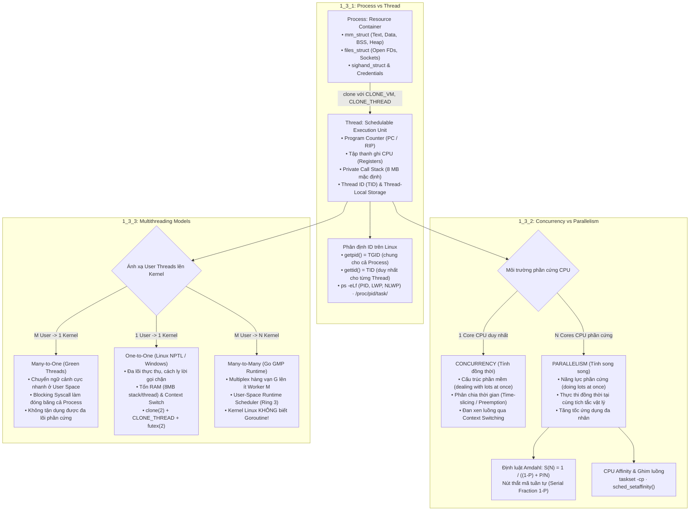

# 1_3 Thread Management and Multithreading

> **Khóa học**: Cloud DevOps Basic — OS Core · **Domain**: 1 Domain 1 - Operating System Core Fundamentals · **Roadmap gốc**: [os/README.md](<../../README.md#module-3-threads--multithreading-models>)

---

## Module này dạy gì? (What & Why)

Module này phân tích chuyên sâu về bản chất của luồng thực thi (Thread)—đơn vị lập lịch và thực thi chỉ lệnh cơ bản của CPU (thường được gọi là Tiến trình hạng nhẹ - Lightweight Process)—và sự phân định rạch ròi giữa các tài nguyên được chia sẻ chung trong một tiến trình (Text, Data, BSS, Heap, Open File Descriptors) với các trạng thái riêng tư bắt buộc của từng luồng (TID, Program Counter, CPU Registers, Private User Call Stack ~8 MB, Signal Mask, errno). Tiếp theo, module làm sáng tỏ sự khác biệt mang tính nền tảng giữa Concurrency (tính đồng thời—nguyên lý cấu trúc phần mềm xử lý nhiều tác vụ đan xen trên 1 core CPU qua cơ chế Time-Slicing) và Parallelism (tính song song—năng lực phần cứng thực thi đồng thời tại cùng một tích tắc vật lý trên nhiều core CPU), cùng với việc tính toán giới hạn tăng tốc theo Định luật Amdahl và kỹ thuật ghim luồng CPU Affinity (`taskset`). Cuối cùng, module so sánh toàn diện 3 mô hình đa luồng kinh điển: Many-to-One (Green Threads, dễ bị đóng băng toàn bộ khi gặp blocking I/O), One-to-One (chuẩn mực thống trị của Linux NPTL và Windows, đa lõi thực thụ qua `clone(2)` và `futex(2)`), và Many-to-Many ở tầng User-Space Runtime (như kiến trúc $G, M, P$ trong Go Runtime), đồng thời làm rõ bản chất kỹ thuật rằng nhân Linux hoàn toàn chỉ quản lý luồng 1:1 và hoàn toàn không nhận biết Goroutine.

---

## Lộ trình bài học (Lesson Path)

| Bài học | Mục tiêu cốt lõi | Checklist ID |
| :--- | :--- | :---: |
| [1_3_1 Process vs Thread](<./1_3_1 Process vs Thread.md>) | Phân biệt ranh giới tài nguyên chia sẻ (Memory, FDs) vs trạng thái riêng tư (PC, Registers, Private Stack), hiện thực hóa `task_struct` qua `clone(2)`, phân biệt TGID (`getpid`) vs TID (`gettid`) và điều tra hệ thống qua `ps -eLf`, `/proc/[pid]/task/`. | [1_3_1](<../../../CHECKLIST.md#domain-1-operating-system-core-fundamentals-45-items>) |
| [1_3_2 Concurrency vs Parallelism](<./1_3_2 Concurrency vs Parallelism.md>) | Thấu hiểu châm ngôn Rob Pike ("Dealing with vs Doing lots of things at once"), phân biệt time-slicing đơn nhân vs thực thi song song đa nhân, tính toán giới hạn tăng tốc theo Định luật Amdahl, và kiểm soát CPU Affinity qua `taskset`/`sched_setaffinity`. | [1_3_2](<../../../CHECKLIST.md#domain-1-operating-system-core-fundamentals-45-items>) |
| [1_3_3 Multithreading Models](<./1_3_3 Multithreading Models.md>) | So sánh toàn diện 3 mô hình (Many-to-One, One-to-One, Many-to-Many), lịch sử NPTL thay thế LinuxThreads, cạm bẫy blocking syscall, và làm rõ bản chất Go Goroutine Runtime ($G, M, P$) là bộ lập lịch tầng người dùng (User-Space Runtime Scheduler) chứ không phải tính năng của kernel OS. | [1_3_3](<../../../CHECKLIST.md#domain-1-operating-system-core-fundamentals-45-items>) |

---

## Bản đồ khái niệm (Concept Map)

Sơ đồ dưới đây mô tả mối liên hệ chặt chẽ giữa 3 bài học trong Module 1.3:

---

## Ẩn dụ xuyên suốt (Module Analogy)

Các bài học trong Module 1.3 được liên kết nhất quán thông qua chuỗi ẩn dụ đời sống thực tế:

1. **Công ty và các Nhân viên Văn phòng (1_3_1)**:
   - **Công ty (Process)** là một thực thể pháp nhân độc lập có hàng rào an ninh bảo vệ (không gian bộ nhớ ảo `mm_struct`), có mã số thuế doanh nghiệp (PID/TGID), kho tài liệu chung (bảng File Descriptors), và phòng ăn tập thể (Heap/Data segment).
   - **Nhân viên (Threads)** là những cá nhân lao động: dùng chung phòng ăn và kho tài liệu, nhưng mỗi người có một bàn tay đang gõ phím riêng (Program Counter và CPU Registers), một cuốn sổ tay cá nhân bỏ túi không ai được nhòm ngó (Private Stack), và một thẻ tên nhân viên nội bộ (Thread ID / TID). Nếu một nhân viên hoàn thành việc và tan ca (`pthread_exit`), công ty vẫn tiếp tục chạy. Nhưng nếu một nhân viên nổi điên làm cháy trụ sở (lỗi `SIGSEGV` do đọc con trỏ rác), toàn bộ tòa nhà sập xuống và toàn bộ nhân viên khác đều mất việc (Process bị Kernel kill)!
2. **Người đầu bếp trong căn bếp gia đình vs Chuỗi nhà hàng tiệc cưới (1_3_2)**:
   - **Concurrency (Người đầu bếp đơn độc)**: Trong một căn bếp chỉ có 1 đầu bếp (1 CPU Core), đầu bếp phải liên tục đảo qua lại: xào rau 2 phút, quay sang khuấy nồi súp 3 phút, rồi mở lò nướng kiểm tra thịt. Dù nhiều món ăn cùng tiến triển (xử lý nhiều việc cùng lúc), nhưng tại một giây vật lý, đầu bếp chỉ có thể cầm một cái chảo.
   - **Parallelism (Nhà hàng nhiều đầu bếp)**: Một nhà hàng tuyển 4 đầu bếp đứng tại 4 bếp ga độc lập (4 CPU Cores). Cả 4 người cùng lúc cầm chảo xào nấu 4 món ăn khác nhau tại đúng cùng một tích tắc thời gian vật lý.
   - **Định luật Amdahl**: Dù bạn có tuyển thêm 100 đầu bếp (tăng Core CPU lên vô hạn), thì món "gà hầm thuốc bắc" bắt buộc phải ninh 45 phút trên ngọn lửa nhỏ (phần việc tuần tự không thể phân rã) vẫn khiến toàn bộ bữa tiệc không thể hoàn thành sớm hơn 45 phút!
3. **Mô hình Quản lý Dự án và Công nhân Hiện trường (1_3_3)**:
   - **Many-to-One (Green Threads)**: 100 chuyên viên lên ý tưởng trong phòng họp máy lạnh (User Space Library), nhưng ngoài công trường thực tế chỉ thuê đúng 1 công nhân duy nhất có giấy phép hành nghề (1 Kernel Thread). Đổi người nói trong phòng nhanh như chớp, nhưng hễ anh công nhân ngoài hiện trường bị kẹt thủ tục đào đường (Blocking I/O), cả 100 chuyên viên trong phòng đều phải ngồi cắn móng tay chờ đợi!
   - **One-to-One (Linux NPTL / Windows)**: Mỗi chuyên viên được cấp hẳn 1 công nhân riêng ngoài công trường (1:1). Cả 100 công nhân thi công song song trên 100 góc công trường, ai kẹt việc người nấy chịu. Nhưng công ty tốn rất nhiều tiền mua 100 bộ đồ bảo hộ lao động đắt đỏ (8 MB stack cho mỗi luồng và chi phí chuyển ngữ cảnh Ring 0).
   - **Many-to-Many (Go Goroutine Runtime)**: Ban quản lý thông minh (Go Runtime Scheduler) tuyển 10.000 chuyên viên làm việc tự do (Goroutines với ngăn xếp khởi điểm chỉ 2 KB), nhưng chỉ ký hợp đồng với 8 công nhân tinh nhuệ (8 Kernel Worker Threads tương ứng 8 lõi CPU). Hễ chuyên viên nào chờ đối tác gửi tài liệu từ xa (I/O mạng), ban quản lý lập tức nhấc chuyên viên đó ra chỗ chờ và đưa ngay chuyên viên khác vào làm tiếp trên tay công nhân đó!

---

## Tự kiểm tra cuối module (Module Review)

<b>Câu hỏi 1:</b> Tại sao trong một tiến trình đa luồng (ví dụ ứng dụng viết bằng C/pthreads), tất cả các luồng đều thấy cùng một giá trị PID khi gọi <code>getpid()</code>, nhưng lệnh <code>ps -eLf</code> lại hiển thị nhiều mã số LWP khác nhau?

**Đáp án:**
- Trên Linux Kernel, cả tiến trình và luồng đều được biểu diễn đồng nhất bằng cấu trúc dữ liệu `struct task_struct`.
- Khi các luồng được tạo thông qua thư viện NPTL bằng System Call `clone(2)`, cờ `CLONE_THREAD` được kích hoạt để gộp các luồng mới vào cùng một **Thread Group** với luồng chính (Main Thread).
- Hàm chuẩn POSIX `getpid(2)` trên Linux trả về trường **`task->tgid`** (Thread Group ID). Vì toàn bộ các luồng trong tiến trình đều thuộc chung một Thread Group, nên `getpid()` luôn cho ra cùng một giá trị PID duy nhất.
- Ngược lại, lệnh `ps -eLf` hiển thị cột **`LWP`** (Lightweight Process ID), chính là trường **`task->pid`** thực tế của Kernel (truy xuất qua syscall `gettid(2)`). Đây là mã định danh luồng cấp thấp duy nhất mà bộ lập lịch CPU của hệ điều hành dùng để phân biệt và điều phối từng luồng thực thi độc lập trên các lõi phần cứng.

<b>Câu hỏi 2:</b> Phân tích sự khác biệt cốt lõi giữa Concurrency và Parallelism theo định nghĩa của Rob Pike? Một hệ thống máy chủ chỉ có 1 CPU Core vật lý có thể đạt được Parallelism không, và làm thế nào để nó đạt được Concurrency?

**Đáp án:**
- **Định nghĩa của Rob Pike**:
  - *Concurrency* là về việc **xử lý** nhiều việc cùng lúc (*dealing with lots of things at once*), thuộc về nguyên lý cấu trúc thiết kế của phần mềm.
  - *Parallelism* là về việc **thực thi** nhiều việc cùng lúc (*doing lots of things at once*), thuộc về năng lực vật lý của phần cứng vi xử lý.
- **Trên hệ thống 1 CPU Core vật lý**:
  - **Không thể đạt được Parallelism**: Tại bất kỳ một tích tắc nano-giây thời gian vật lý nào, bán dẫn của một lõi CPU đơn nhân chỉ có thể nạp và thực thi các chỉ lệnh của duy nhất một con trỏ lệnh (PC).
  - **Đạt được Concurrency thông qua Time-Slicing**: Hệ điều hành kích hoạt ngắt đồng hồ định thời (*Timer Interrupt*), cho phép bộ lập lịch thực hiện chuyển đổi ngữ cảnh (*Context Switching*) luân phiên cực nhanh giữa các luồng (ví dụ mỗi luồng chạy 5–10 mili-giây rồi nhường lượt). Dưới góc nhìn của con người, các luồng có vẻ như đang chạy đồng thời cùng lúc.

<b>Câu hỏi 3:</b> Theo Định luật Amdahl, nếu một chương trình có 20% khối lượng công việc bắt buộc phải chạy tuần tự (Serial Fraction $1 - P = 0.2$), hệ số tăng tốc tối đa ($S_{\max}$) mà hệ thống có thể đạt được là bao nhiêu khi tăng số lượng CPU cores lên vô hạn ($N \to \infty$)? Bài học rút ra cho kỹ sư DevOps là gì?

**Đáp án:**
- **Công thức tính giới hạn Amdahl**:
  $$S_{\max} = \lim_{N \to \infty} \frac{1}{(1 - P) + \frac{P}{N}} = \frac{1}{1 - P}$$
- Với tỷ lệ tuần tự $1 - P = 0.2$ (tức 20%), hệ số tăng tốc tối đa là:
  $$S_{\max} = \frac{1}{0.2} = 5\text{ lần}$$
- **Bài học cho DevOps / Kiến trúc sư hệ thống**:
  - Tốc độ tối đa của hệ thống bị chặn cứng bởi phần công việc tuần tự (như tranh chấp khóa cơ sở dữ liệu, ghi log đồng bộ, khởi tạo tài nguyên).
  - Việc bỏ thêm tiền để nâng cấp máy chủ từ 8 cores lên 64 cores hoặc 128 cores không thể giúp ứng dụng chạy nhanh hơn 5 lần nếu không cấu trúc lại mã nguồn để giảm tỷ lệ công việc tuần tự ($1 - P$). Sau một ngưỡng nhất định, việc tăng thêm core chỉ làm lãng phí chi phí Cloud mà không đem lại cải thiện hiệu năng tương xứng.

<b>Câu hỏi 4:</b> Tại sao trong mô hình đa luồng One-to-One (như Linux NPTL), mỗi luồng người dùng lại cần một vùng nhớ ngăn xếp (stack) mặc định lên tới 8 MB, trong khi Go Goroutine trong mô hình Many-to-Many khởi điểm chỉ cần 2 KB?

**Đáp án:**
- **Luồng 1:1 cấp Hệ điều hành (OS Threads / pthreads)**:
  - Sử dụng vùng nhớ ngăn xếp có kích thước cố định (*Contiguous Fixed Stack*) do hệ điều hành cấp phát trong không gian địa chỉ ảo, quy định bởi `RLIMIT_STACK` (thường là **8 MB**, kiểm tra bằng `ulimit -s`).
  - Hệ điều hành và trình biên dịch C/C++ không thể biết trước hàm của người dùng sẽ gọi đệ quy sâu bao nhiêu hoặc khai báo mảng cục bộ lớn cỡ nào, nên bắt buộc phải cấp phát một vùng địa chỉ ảo đủ lớn (kèm một trang Guard Page ở đáy) để phòng ngừa tràn ngăn xếp (*Stack Overflow*).
- **Go Goroutines (User-Space Threads)**:
  - Áp dụng kỹ thuật **Ngăn xếp co giãn động (Dynamic Resizable Stack)**.
  - Ban đầu, mỗi Goroutine chỉ được Go Runtime cấp phát một vùng nhớ nhỏ **~2 KB** trên Heap. Trình biên dịch Go tự động chèn một đoạn mã kiểm tra (*stack split prologue*) ở đầu mỗi hàm. Khi ngăn xếp 2 KB sắp đầy, Go Runtime sẽ cấp phát một vùng ngăn xếp mới có dung lượng gấp đôi (4 KB, 8 KB...), sao chép dữ liệu cũ sang và cập nhật con trỏ một cách trong suốt.
  - Nhờ cơ chế này, một tiến trình Go có thể duy trì hàng triệu Goroutines đồng thời mà chỉ tiêu tốn vài gigabyte RAM, thay vì làm cạn kiệt bảng phân trang như OS Threads.

<b>Câu hỏi 5:</b> Nhận định sau đúng hay sai về mặt kỹ thuật: <i>"Hệ điều hành Linux hỗ trợ mô hình đa luồng Many-to-Many bằng cách tích hợp trực tiếp Goroutine vào trong Kernel Scheduler"</i>? Hãy làm rõ cơ chế phối hợp thực tế giữa Go Runtime và Linux Kernel.

**Đáp án:**
- **Nhận định trên hoàn toàn SAI 100%!**
- **Sự thật kỹ thuật**:
  - Nhân **Linux Kernel hoàn toàn KHÔNG biết Goroutine là gì**. Ở tầng hạt nhân, Linux chỉ duy trì và thực thi nghiêm ngặt **Mô hình One-to-One (1:1)** thông qua cấu trúc `struct task_struct` và System Call `clone(2)`.
  - Toàn bộ cơ chế điều phối Goroutine—mô hình **$G, M, P$**—là một **Bộ lập lịch ở Không gian Người dùng (User-Space Runtime Scheduler)** do ngôn ngữ Go tự hiện thực trong tệp `src/runtime/proc.go`:
    - **`G` (Goroutine)**: Chỉ là một cấu trúc dữ liệu người dùng mô tả tác vụ và ngăn xếp 2 KB.
    - **`M` (Machine / Worker Thread)**: Là một **OS Kernel Thread thực thụ**, được tạo thông qua `clone(2)` và liên kết 1:1 với một `task_struct` của Linux.
    - **`P` (Processor)**: Ngữ cảnh logic để chạy mã Go (mặc định bằng số lõi CPU logic).
  - Bộ lập lịch Go Runtime ở Ring 3 thực hiện gắp các Goroutine ($G$) gán vào các Worker Thread ($M$) để CPU thực thi. Linux Kernel chỉ làm nhiệm vụ duy nhất là lập lịch cho các Worker Thread $M$ này trên các lõi phần cứng.

---

## 📚 Nguồn chính (Key References)

- [OSTEP Chapter 26: Concurrency: An Introduction](https://pages.cs.wisc.edu/~remzi/OSTEP/threads-intro.pdf) - Giáo trình chuẩn mực *Operating Systems: Three Easy Pieces* (Remzi H. Arpaci-Dusseau & Andrea C. Arpaci-Dusseau), phân tích định nghĩa bản chất của Thread, so sánh không gian địa chỉ đơn luồng vs đa luồng, cơ chế chuyển ngữ cảnh luồng, và sự khác biệt giữa Concurrency vs Parallelism.
- [Anderson et al. (ACM TOCS / UW CSE): Scheduler Activations: Effective Kernel Support for the User-Level Management of Parallelism](https://homes.cs.washington.edu/~tom/pubs/sched_act.pdf) - Công trình khoa học nền tảng phân tích ưu - nhược điểm của User-Level Threads, Kernel Threads, cơ chế Upcalls và kiến trúc điều phối đa luồng hai tầng (Two-Level Model).
- [Linux Manual Pages: pthreads(7)](https://man7.org/linux/man-pages/man7/pthreads.7.html) - Đặc tả kỹ thuật chuẩn POSIX.1 từ Linux man-pages project, quy định chi tiết danh sách tài nguyên chia sẻ chung trong tiến trình, thuộc tính riêng của từng luồng và quá trình tiến hóa từ LinuxThreads sang NPTL (1:1 model).
- [Linux Manual Pages: clone(2)](https://man7.org/linux/man-pages/man2/clone.2.html) - Tài liệu System Call `clone(2)` của Linux Kernel, phân tích các cờ `CLONE_VM`, `CLONE_FS`, `CLONE_FILES`, `CLONE_SIGHAND`, `CLONE_THREAD` được NPTL sử dụng để tạo luồng.
- [Linux Manual Pages: gettid(2)](https://man7.org/linux/man-pages/man2/gettid.2.html) - Đặc tả kỹ thuật syscall `gettid`, giải thích sự khác biệt giữa Kernel Thread ID (TID) và POSIX Thread Group ID (TGID / PID).
- [Linux Manual Pages: proc_pid_task(5)](https://man7.org/linux/man-pages/man5/proc_pid_task.5.html) - Tài liệu hệ thống tệp ảo `/proc/[pid]/task`, mô tả cách Linux Kernel hiển thị từng luồng thực thi dưới dạng một thư mục con mang số hiệu TID.
- [Linux Manual Pages: sched_setaffinity(2)](https://man7.org/linux/man-pages/man2/sched_setaffinity.2.html) - Đặc tả kỹ thuật System Call ghim tiến trình và luồng vào các lõi CPU cụ thể (CPU Affinity Mask).
- [Linux Manual Pages: taskset(1)](https://man7.org/linux/man-pages/man1/taskset.1.html) - Hướng dẫn tiện ích dòng lệnh `taskset` để thiết lập và kiểm tra CPU Affinity của tiến trình và luồng trên Linux.
- [Linux Manual Pages: futex(2)](https://man7.org/linux/man-pages/man2/futex.2.html) - Đặc tả kỹ thuật cơ chế khóa nhanh ở không gian người dùng (*Fast Userspace Mutex*) trong Linux Kernel.
- [Go Language Source Code: src/runtime/proc.go](https://go.dev/src/runtime/proc.go) - Tài liệu mã nguồn chính thức của ngôn ngữ Go, mô tả chi tiết kiến trúc bộ lập lịch M:N (mô hình G, M, P) ở không gian người dùng.
- [Microsoft Learn: User Mode and Kernel Mode](https://learn.microsoft.com/en-us/windows-hardware/drivers/gettingstarted/user-mode-and-kernel-mode) - Tài liệu giải thích kiến trúc phân tách đặc quyền thực thi phần cứng giữa User Mode và Kernel Mode từ Microsoft Learn.
