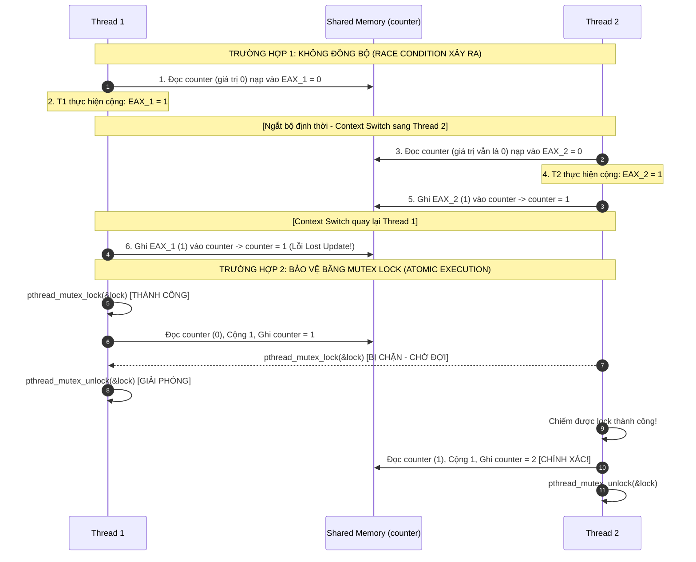

# 1_4_1 Race Conditions and Critical Sections

> **Khóa học**: Cloud DevOps Basic — OS Core  
> **Phân nhóm**: 1 Domain 1 - Operating System Core Fundamentals › 1_4 Process Synchronization and Concurrency  
> **Chủ đề**: Điều kiện tranh định (Race Conditions), Miền găng (Critical Sections) và cơ chế loại trừ tương hỗ trong môi trường đồng thời  
> **Trạng thái**: Draft (WRITE-CDB-1_4_1, 14-11-2026)  
> **Checklist đối chiếu**: [1_4_1](../../../CHECKLIST.md#domain-1-operating-system-core-fundamentals-45-items)  

---

## 1. Khái Niệm Cốt Lõi & Bản Chất Kỹ Thuật (Core Concepts & Technical Deep Dive)

Trong lập trình đồng thời (*concurrent programming*), khi nhiều luồng thực thi (*threads*) cùng chạy bên trong một tiến trình, chúng chia sẻ chung không gian bộ nhớ ảo (Data, BSS, Heap). Khả năng truy cập tự do vào vùng nhớ chung này đem lại tốc độ trao đổi dữ liệu cực nhanh, nhưng đồng thời tạo ra một trong những hiểm họa lớn nhất của kỹ thuật phần mềm: **Điều kiện tranh định (Race Condition)**.

```
       +-------------------------------------------------------------+
       |                VÙNG NHỚ CHIA SẺ (SHARED MEMORY)             |
       |                   Biến toàn cục: counter = 0                |
       +-------------------------------------------------------------+
                       ^                             ^
                       |                             |
             [Đọc / Ghi không khóa]        [Đọc / Ghi không khóa]
                       |                             |
             +---------+---------+         +---------+---------+
             |      THREAD 1     |         |      THREAD 2     |
             |  1. Đọc: reg=0    |         |  1. Đọc: reg=0    |
             |  2. Tăng: reg=1   |         |  2. Tăng: reg=1   |
             |  3. Ghi: mem=1    |         |  3. Ghi: mem=1    |
             +-------------------+         +-------------------+
                       |                             |
                       +--------------+--------------+
                                      v
                      KẾT QUẢ CUỐI CÙNG: counter = 1
                 (Lẽ ra phải là 2 -> MẤT MÁT CẬP NHẬT!)
```

---

### 1.1 Khái Niệm Bản Chất: Race Condition & Critical Section

Theo giáo trình chuẩn mực *Operating Systems: Three Easy Pieces (OSTEP - Ch. 26)*:
- **Điều kiện tranh định (Race Condition)**: Là một khiếm khuyết phần mềm xảy ra khi nhiều luồng thực thi đồng thời cùng truy cập và thao tác trên một dữ liệu hoặc tài nguyên dùng chung, và **kết quả cuối cùng của chương trình phụ thuộc vào thời điểm và trật tự thực thi ngẫu nhiên, không thể đoán trước (*non-deterministic*) của bộ lập lịch CPU**.
- **Miền găng (Critical Section)**: Là một đoạn mã nguồn trong chương trình có hành vi truy xuất vào biến hoặc cấu trúc dữ liệu khả biến dùng chung (*shared mutable state*). Để đảm bảo tính đúng đắn và tính tất định của chương trình, **tại bất kỳ một thời điểm vật lý nào, không được phép có nhiều hơn một luồng cùng thực thi bên trong miền găng đó**.
- **Loại trừ tương hỗ (Mutual Exclusion)**: Là thuộc tính đảm bảo rằng nếu Luồng A đang thực thi bên trong miền găng, thì mọi luồng khác (Luồng B, Luồng C...) đều bị ngăn chặn và bắt buộc phải chờ đợi bên ngoài cho đến khi Luồng A rời khỏi miền găng an toàn.

---

### 1.2 Mổ Xẻ Tầng Hợp Ngữ (Assembly Breakdown): Vì Sao `counter++` Không Nguyên Tử?

Trong ngôn ngữ lập trình bậc cao như C, C++, Java hay Go, thao tác tăng một biến số nguyên `counter++` trông giống như một câu lệnh duy nhất. Tuy nhiên, ở tầng vi kiến trúc phần cứng máy tính (như x86_64), **CPU không thể trực tiếp thực hiện phép toán cộng trên ô nhớ RAM của một biến số dùng chung mà không nạp nó vào thanh ghi**.

Câu lệnh `counter++` thực chất được trình biên dịch dịch thành một chuỗi gồm **3 chỉ lệnh mã máy hợp ngữ độc lập**:

```assembly
; Giả sử biến 'counter' nằm tại ô nhớ [counter]
movl    counter(%rip), %eax   ; 1. NẠP (Load): Đọc giá trị từ RAM vào thanh ghi CPU EAX
addl    $1, %eax              ; 2. CỘNG (Modify): Tăng giá trị thanh ghi EAX lên 1 trên ALU
movl    %eax, counter(%rip)   ; 3. LƯU (Store): Ghi ngược giá trị từ EAX về ô nhớ RAM
```

#### Kịch Bản Mất Mát Cập Nhật (The Lost Update Anomaly)
Giả sử biến toàn cục ban đầu có giá trị `counter = 0`. Hai luồng Thread 1 và Thread 2 cùng thực thi đoạn mã `counter++`:

| Bước | Luồng thực thi | Chỉ lệnh Hợp ngữ | Thanh ghi Luồng | Bộ nhớ `counter` | Ghi chú sự kiện |
| :---: | :--- | :--- | :---: | :---: | :--- |
| **1** | **Thread 1** | `movl counter, %eax` | EAX = 0 | 0 | Thread 1 nạp giá trị 0 vào thanh ghi |
| **2** | **Thread 1** | `addl $1, %eax` | EAX = 1 | 0 | Thread 1 tính toán giá trị mới là 1 |
| **3** | *Kernel OS* | **[TIMER INTERRUPT]** | - | 0 | **Hết time-slice! CPU chuyển sang Thread 2** |
| **4** | **Thread 2** | `movl counter, %eax` | EAX = 0 | 0 | Thread 2 nạp giá trị cũ (vẫn là 0) |
| **5** | **Thread 2** | `addl $1, %eax` | EAX = 1 | 0 | Thread 2 tính toán giá trị mới là 1 |
| **6** | **Thread 2** | `movl %eax, counter` | EAX = 1 | **1** | Thread 2 ghi giá trị 1 vào ô nhớ RAM |
| **7** | *Kernel OS* | **[CONTEXT SWITCH]** | - | 1 | **CPU chuyển ngữ cảnh quay lại Thread 1** |
| **8** | **Thread 1** | `movl %eax, counter` | EAX = 1 | **1** | Thread 1 ghi đè giá trị 1 cũ vào ô nhớ RAM |

**Hậu quả**: Hai luồng thực hiện hai phép cộng độc lập, nhưng giá trị biến `counter` cuối cùng chỉ tăng lên **1 thay vì 2**! Phép tính của Thread 2 đã bị Thread 1 ghi đè và biến mất hoàn toàn. Trong một hệ thống ngân hàng hay thương mại điện tử, hiện tượng này đồng nghĩa với việc tiền gửi bị thất thoát hoặc số lượng tồn kho bị tính toán sai lệch nghiêm trọng.

---

### 1.3 Giải Pháp Chuẩn: Khóa Loại Trừ Tương Hỗ (`pthread_mutex_t`)

Để giải quyết triệt để Race Condition, chuẩn POSIX (`man 7 pthreads`) cung cấp cơ chế khóa **Mutex (Mutual Exclusion Lock)**:
- Trước khi bước vào miền găng, luồng bắt buộc phải gọi `pthread_mutex_lock(&mutex)`. Nếu khóa đang tự do, luồng chiếm quyền sở hữu khóa và đi tiếp. Nếu khóa đang bị luồng khác nắm giữ, luồng gọi sẽ bị đưa vào hàng đợi chờ.
- Sau khi hoàn tất các thao tác trên biến chia sẻ, luồng bắt buộc phải gọi `pthread_mutex_unlock(&mutex)` để giải phóng khóa, cho phép luồng tiếp theo bước vào.

---

## 2. Ví Dụ Đời Sống Thực Tế Dễ Hiểu (Intuitive Real-World Analogies)

Để hình dung sống động bản chất của Race Condition và Critical Section, hãy theo dõi câu chuyện **Hai Vợ Chồng Cùng Rút Tiền Tại Hai Cây ATM Khác Nhau**:

```
+-------------------------------------------------------------------------------+
|                       TÀI KHOẢN TIẾT KIỆM CHUNG (SHARED MEMORY)               |
|                                Số dư: 1.000.000 VNĐ                           |
+-------------------------------------------------------------------------------+
                 ^                                               ^
                 |                                               |
     [Cây ATM A - Quận 1 (Thread 1)]                [Cây ATM B - Cầu Giấy (Thread 2)]
     1. Tra thẻ: Số dư = 1.000.000 VNĐ              1. Tra thẻ: Số dư = 1.000.000 VNĐ
     2. Nhập lệnh rút: 1.000.000 VNĐ                2. Nhập lệnh rút: 1.000.000 VNĐ
     3. Kiểm tra: Đủ tiền -> Nhả 1 triệu!           3. Kiểm tra: Đủ tiền -> Nhả 1 triệu!
     4. Trừ tiền & Lưu: Số dư = 0 VNĐ               4. Trừ tiền & Lưu: Số dư = 0 VNĐ
                 |                                               |
                 +-----------------------+-----------------------+
                                         v
                      HẬU QUẢ: KHÁCH HÀNG RÚT ĐƯỢC 2 TRIỆU VNĐ!
                      NGÂN HÀNG BỊ THẤT THOÁT TRẮNG 1 TRIỆU ĐỒNG!
```

### 1. Bối cảnh không có bảo vệ Miền găng (Race Condition xảy ra)
Hai vợ chồng cùng đứng tên trên một sổ tiết kiệm chung có số dư đúng **1.000.000 VNĐ**. Vào đúng 12 giờ trưa:
- **Người chồng ở Cây ATM A**: Đưa thẻ vào, máy ATM đọc số dư từ máy chủ trung tâm: `1.000.000 VNĐ`. Anh chọn rút 1 triệu. Máy ATM kiểm tra thấy số dư đủ điều kiện, chuẩn bị đếm tiền.
- **Cùng tích tắc đó, Người vợ ở Cây ATM B**: Cũng đưa thẻ phụ vào, máy ATM đọc số dư từ máy chủ: vẫn ghi nhận `1.000.000 VNĐ` (vì ATM A chưa kịp cập nhật lại máy chủ!). Chị cũng chọn rút 1 triệu.
- **Sự cố xảy ra**: Cả hai cây ATM cùng nghe tiếng "xoạch xoạch" đếm tiền và cùng nhả ra 1 triệu đồng tiền mặt! Sau đó, ATM A cập nhật số dư thành 0 đồng; ATM B cũng cập nhật số dư thành 0 đồng.
- **Kết quả**: Hai vợ chồng rút được tổng cộng **2.000.000 VNĐ** từ một tài khoản chỉ có 1 triệu! Ngân hàng chịu thiệt hại mất trắng 1 triệu đồng do điều kiện tranh định giữa 2 cây ATM.

### 2. Miền găng và Khóa Mutex cứu nguy hệ thống
- **Miền găng (Critical Section)** chính là chuỗi hành động nhạy cảm: `[Kiểm tra số dư -> Trừ tiền trong cơ sở dữ liệu -> Nhả tiền mặt]`.
- **Giải pháp Khóa (Mutex Lock)**: Ngân hàng thiết lập quy tắc: Bất kỳ cây ATM nào muốn kiểm tra và trừ tiền tài khoản này thì phải **chiếm chiếc Khóa Độc Quyền (Mutex Lock)** của tài khoản đó.
  - Khi ATM A bắt đầu giao dịch, nó khóa tài khoản lại.
  - Khi ATM B định đọc tài khoản, hệ thống báo: *"Tài khoản đang bận xử lý, vui lòng chờ trong giây lát"*.
  - ATM A trừ xong 1 triệu, cập nhật số dư thành 0 đồng, nhả tiền mặt xong xuôi mới mở khóa (`unlock`).
  - Lúc này ATM B mới được vào kiểm tra: Thấy số dư bằng 0 đồng, ATM B từ chối nhả tiền! Ngân hàng được bảo vệ an toàn 100%.

---

## 3. Kiến Trúc, Luồng Hoạt Động & Hình Ảnh Trực Quan (Architecture, Diagrams & Visual Media)

### 3.1 Ranh Giới Đặc Quyền Hệ Thống

Các cơ chế đồng bộ hóa giữa các luồng có thể diễn ra ở User Space hoặc cần sự can thiệp của Kernel Mode khi xảy ra tranh chấp khóa:

[](https://learn.microsoft.com/en-us/windows-hardware/drivers/gettingstarted/images/userandkernelmode01.png)  
*Hình 1: Mô hình phân tách đặc quyền phần cứng CPU giữa User Mode và Kernel Mode từ Microsoft Learn.*

---

### 3.2 Sơ đồ Tuần Tự: Không Đồng Bộ vs Đồng Bộ Bằng Mutex



---

## 4. Code Mẫu Trực Quan Hoặc Dòng Lệnh Thực Chiến (Runnable Sample Code / CLI)

### 4.1 Mã Nguồn C Thực Nghiệm: Đối Chứng Trực Quan Race Condition vs Mutex Synchronization

Chương trình dưới đây tạo 2 luồng độc lập, mỗi luồng lặp **1.000.000 lần** tăng biến đếm. Chúng ta sẽ chạy thử cả hai chế độ:
1. Chế độ không khóa: Chứng kiến kết quả bị sai lệch ngẫu nhiên.
2. Chế độ dùng `pthread_mutex_t`: Đạt kết quả chính xác tuyệt đối 2.000.000.

```c
/**
 * file: race_condition_demo.c
 * Biên dịch: gcc -O2 -pthread race_condition_demo.c -o race_condition_demo
 * Thực thi:  ./race_condition_demo
 */
#define _GNU_SOURCE
#include <stdio.h>
#include <stdlib.h>
#include <pthread.h>
#include <unistd.h>

#define NUM_ITERATIONS 1000000

// Biến chia sẻ toàn cục:
// Khai báo 'volatile' để bắt buộc trình biên dịch GCC phải phát sinh chỉ lệnh đọc/ghi RAM thực tế
// trên mỗi lần lặp, ngăn chặn trình tối ưu hóa (-O2) gộp cả vòng lặp thành một lệnh cộng duy nhất,
// nhờ đó tái hiện trung thực chuỗi 3 chỉ lệnh mov/add/mov và điều kiện tranh định Lost Update.
static volatile long unsafe_counter = 0;
static long safe_counter = 0;

// Khóa Mutex của chuẩn POSIX
static pthread_mutex_t lock = PTHREAD_MUTEX_INITIALIZER;

// Worker 1: Không sử dụng cơ chế bảo vệ (Gây Race Condition)
void *worker_unsafe(void *arg) {
    (void)arg;
    for (int i = 0; i < NUM_ITERATIONS; i++) {
        // MIỀN GĂNG KHÔNG ĐƯỢC BẢO VỆ:
        // Biên dịch thành 3 lệnh: nạp (load) -> cộng (add) -> ghi (store)
        unsafe_counter++;
    }
    return NULL;
}

// Worker 2: Có sử dụng Mutex bảo vệ miền găng
void *worker_safe(void *arg) {
    (void)arg;
    for (int i = 0; i < NUM_ITERATIONS; i++) {
        // BƯỚC VÀO MIỀN GĂNG: Chiếm khóa loại trừ tương hỗ
        pthread_mutex_lock(&lock);
        
        safe_counter++; // Miền găng an toàn
        
        // RỜI KHỎI MIỀN GĂNG: Mở khóa cho luồng khác
        pthread_mutex_unlock(&lock);
    }
    return NULL;
}

int main(void) {
    pthread_t t1, t2;

    printf("=================================================================\n");
    printf("[THỰC NGHIỆM 1] Chạy 2 luồng KHÔNG CÓ KHÓA (Unsynchronized)...\n");
    printf("  -> Mục tiêu lý thuyết: 2 x %d = %d\n", NUM_ITERATIONS, 2 * NUM_ITERATIONS);
    
    unsafe_counter = 0;
    pthread_create(&t1, NULL, worker_unsafe, NULL);
    pthread_create(&t2, NULL, worker_unsafe, NULL);
    pthread_join(t1, NULL);
    pthread_join(t2, NULL);

    printf("  -> Kết quả thực tế   : %ld\n", unsafe_counter);
    if (unsafe_counter != 2 * NUM_ITERATIONS) {
        printf("  => CẢNH BÁO: Phát hiện Race Condition! Mất mát %ld lượt cập nhật!\n",
               (2 * NUM_ITERATIONS) - unsafe_counter);
    }
    printf("=================================================================\n");

    printf("\n[THỰC NGHIỆM 2] Chạy 2 luồng CÓ BẢO VỆ BẰNG PTHREAD_MUTEX...\n");
    safe_counter = 0;
    pthread_create(&t1, NULL, worker_safe, NULL);
    pthread_create(&t2, NULL, worker_safe, NULL);
    pthread_join(t1, NULL);
    pthread_join(t2, NULL);

    printf("  -> Kết quả thực tế   : %ld\n", safe_counter);
    if (safe_counter == 2 * NUM_ITERATIONS) {
        printf("  => THÀNH CÔNG: Miền găng được bảo vệ tuyệt đối, kết quả chuẩn 100%%!\n");
    }
    printf("=================================================================\n");

    pthread_mutex_destroy(&lock);
    return 0;
}
```

---

### 4.2 Thực Thi & Soi Hợp Ngữ Bằng GNU Toolchain

#### 1. Biên dịch và kiểm chứng kết quả
```bash
gcc -O2 -pthread race_condition_demo.c -o race_condition_demo
./race_condition_demo
```
*Kết quả mẫu điển hình trên máy tính đa nhân*:
```text
=================================================================
[THỰC NGHIỆM 1] Chạy 2 luồng KHÔNG CÓ KHÓA (Unsynchronized)...
  -> Mục tiêu lý thuyết: 2 x 1000000 = 2000000
  -> Kết quả thực tế   : 1214829
  => CẢNH BÁO: Phát hiện Race Condition! Mất mát 785171 lượt cập nhật!
=================================================================

[THỰC NGHIỆM 2] Chạy 2 luồng CÓ BẢO VỆ BẰNG PTHREAD_MUTEX...
  -> Kết quả thực tế   : 2000000
  => THÀNH CÔNG: Miền găng được bảo vệ tuyệt đối, kết quả chuẩn 100%!
=================================================================
```

#### 2. Soi mã máy hợp ngữ bằng `objdump`
Để tận mắt thấy 3 chỉ lệnh độc lập của phép toán `unsafe_counter++` (nhờ từ khóa `volatile` ngăn GCC `-O2` tối ưu hóa gộp vòng lặp):
```bash
objdump -d -M intel race_condition_demo | grep -A 10 "<worker_unsafe>:"
```
*Bạn sẽ quan sát thấy chuỗi chỉ lệnh nạp - cộng - ghi lặp lại trên mỗi chu kỳ*:
```assembly
mov    rax, QWORD PTR [rip+0x2fd2]   # 1. Nạp (Load): Đọc giá trị từ ô nhớ RAM vào thanh ghi RAX
add    rax, 0x1                      # 2. Cộng (Modify): Tăng thanh ghi RAX lên 1 trên ALU
mov    QWORD PTR [rip+0x2fc7], rax   # 3. Lưu (Store): Ghi ngược giá trị RAX trở lại ô nhớ RAM
```
Sự tách rời giữa 3 câu lệnh này là bằng chứng rõ ràng nhất giải thích vì sao Race Condition luôn rình rập trong mọi hệ thống đồng thời nếu thiếu cơ chế đồng bộ hóa.

---

## 5. Cạm Bẫy Thực Tế & Thực Tiễn Sản Xuất (Production Gotchas & Best Practices)

Trong các hệ thống Cloud và Microservices phân tán có lưu lượng truy cập cao, Race Condition dẫn tới những sự cố cực kỳ khó tái hiện (*Heisenbugs*):

### 1. Hiểm họa Tối ưu hóa Trình biên dịch (Compiler Optimization Bugs & `volatile`)
- *Cạm bẫy*: Lập trình viên cố tình dùng một biến cờ toàn cục `bool stop_flag = false` để điều khiển luồng công việc. Khi bật tối ưu hóa `-O2` hoặc `-O3`, trình biên dịch nhận thấy biến `stop_flag` không bị sửa đổi bên trong vòng lặp của luồng đó, nó liền tối ưu hóa bằng cách **nạp giá trị của biến vào một thanh ghi duy nhất một lần và không bao giờ đọc lại từ RAM nữa**!
  ```c
  // Mã người viết:
  while (!stop_flag) { /* làm việc */ }
  
  // Trình biên dịch dịch thành hợp ngữ tối ưu:
  // if (stop_flag == false) while(true) { ... } -> Vòng lặp vô tận!
  ```
- *Khắc phục*: Không dựa vào việc đọc biến thông thường để đồng bộ luồng. Bắt buộc phải sử dụng các thao tác nguyên tử (*Atomic*) hoặc khóa Mutex để thiết lập rào cản bộ nhớ (*Memory Barrier*), buộc trình biên dịch và CPU phải đọc dữ liệu mới nhất từ RAM.

---

### 2. Cạm bẫy Tranh Chấp Khóa Quá Mức (Lock Contention & Khủng hoảng Hiệu năng)
- *Hiện tượng*: Một dịch vụ xử lý giao dịch mở rộng lên 32 lõi CPU nhưng thông lượng xử lý (*Throughput*) lại giảm thảm hại so với khi chạy trên 4 lõi CPU.
- *Nguyên nhân*: Miền găng được thiết kế **quá rộng (Coarse-Grained Locking)**. Nếu toàn bộ hàm xử lý giao dịch (bao gồm cả việc tính toán, giải mã JSON và gọi cơ sở dữ liệu) được bọc trong một khóa Mutex duy nhất, thì 31 lõi CPU còn lại sẽ dành 99% thời gian để xếp hàng chờ đợi luồng đầu tiên nhả khóa!
- *Thực tiễn tốt nhất*:
  - **Thu hẹp miền găng (Fine-Grained Locking)**: Chỉ bọc khóa ở đúng vài dòng lệnh cập nhật dữ liệu chia sẻ. Tuyệt đối không thực hiện I/O mạng, đọc đĩa hay tác vụ tốn thời gian bên trong miền găng.
  - Sử dụng cấu trúc dữ liệu không khóa (*Lock-Free*) hoặc phân vùng dữ liệu theo từng luồng (*Sharding / Thread-Local State*).

---

### 3. Cạm bẫy Khóa Lồng Nhau Dẫn Đến Bế Tắc (Deadlock via Nested Locks)
- *Cạm bẫy*: Luồng A chiếm Khóa 1 rồi chờ chiếm Khóa 2. Cùng lúc đó, Luồng B chiếm Khóa 2 rồi chờ chiếm Khóa 1. Cả hai luồng đóng băng vĩnh viễn, kéo sập ứng dụng.
- *Nguyên tắc sống còn*: Luôn tuân thủ quy tắc **Trật tự Khóa Toàn cầu (Global Lock Ordering)**: Mọi luồng trong toàn bộ hệ thống bắt buộc phải chiếm các khóa theo cùng một thứ tự định sẵn (ví dụ: luôn chiếm Khóa 1 trước, sau đó mới chiếm Khóa 2).

---

## 6. Câu Hỏi Củng Cố Kiến Thức (Active Recall Quiz)

<details>
<summary><b>Câu hỏi 1:</b> Tại sao thao tác <code>counter++</code> trên biến số nguyên toàn cục trong ngôn ngữ C không phải là một thao tác nguyên tử (atomic operation)? Hãy giải thích cơ chế ngầm ở tầng vi kiến trúc CPU.</summary>

**Đáp án:**
- Ở tầng vi kiến trúc CPU (như x86_64), phần cứng không thể trực tiếp thực hiện phép toán cộng số học trên ô nhớ RAM nếu không nạp dữ liệu vào thanh ghi.
- Thao tác `counter++` được phân rã thành **3 chỉ lệnh hợp ngữ độc lập**:
  1. `Load`: Nạp giá trị hiện tại của biến từ ô nhớ RAM vào thanh ghi CPU (`mov`).
  2. `Modify`: Tăng giá trị thanh ghi lên 1 thông qua khối số học logic ALU (`add`).
  3. `Store`: Ghi ngược giá trị mới từ thanh ghi về lại ô nhớ RAM (`mov`).
- Nếu ngắt đồng hồ bộ định thời (Timer Interrupt) xảy ra giữa các chỉ lệnh này, hệ điều hành sẽ chuyển ngữ cảnh sang luồng khác. Luồng mới đọc phải giá trị cũ chưa cập nhật, dẫn tới hiện tượng **Ghi đè mất mát dữ liệu (Lost Update)**.
</details>

<details>
<summary><b>Câu hỏi 2:</b> Phân biệt khái niệm giữa Điều kiện tranh định (Race Condition) và Miền găng (Critical Section)? Mối quan hệ biện chứng giữa hai khái niệm này là gì?</summary>

**Đáp án:**
- **Miền găng (Critical Section)** là một **đoạn mã nguồn** truy xuất vào biến hoặc tài nguyên chia sẻ có thể biến đổi trạng thái. Miền găng là một vùng mã xác định cần được kiểm soát truy cập.
- **Điều kiện tranh định (Race Condition)** là một **lỗi sai / khiếm khuyết phần mềm** xảy ra khi tính chất loại trừ tương hỗ của miền găng bị vi phạm: nhiều luồng cùng bước vào miền găng tại một thời điểm, khiến kết quả đầu ra phụ thuộc vào sự ngẫu nhiên của việc phân chia thời gian CPU.
- **Mối quan hệ**: Race Condition là *hậu quả* phát sinh khi Critical Section *không được bảo vệ* bằng cơ chế đồng bộ hóa (như Mutex).
</details>

<details>
<summary><b>Câu hỏi 3:</b> Trong một máy chủ web chịu tải cao, kiến trúc sư bọc toàn bộ khối mã phân tích cú pháp JSON và ghi nhận vào cơ sở dữ liệu bên trong một khóa <code>pthread_mutex_t</code> dùng chung. Hệ quả tiêu cực gì sẽ xảy ra đối với hiệu năng hệ thống? Kỹ sư nên tối ưu hóa đoạn mã này như thế nào?</summary>

**Đáp án:**
- **Hệ quả tiêu cực**:
  - Gây ra hiện tượng **Tranh chấp khóa dữ dội (Severe Lock Contention)**. Tác vụ phân tích cú pháp JSON và gọi cơ sở dữ liệu tốn rất nhiều thời gian (CPU-heavy và I/O-bound). Việc giữ khóa trong suốt thời gian dài này khiến mọi luồng khác bị dồn ứ, các lõi CPU rơi vào trạng thái ngủ chờ vô ích, làm triệt tiêu hoàn toàn năng lực xử lý song song đa lõi của máy chủ.
- **Cách tối ưu hóa**:
  - **Thu hẹp tối đa miền găng**: Tác vụ phân tích cú pháp JSON sử dụng biến cục bộ nên có thể chạy song song độc lập hoàn toàn mà không cần khóa.
  - Luồng chỉ kích hoạt khóa Mutex trong đúng vài micro-giây cần thiết để cập nhật kết quả vào danh sách bộ nhớ chia sẻ hoặc hàng đợi ghi, sau đó lập tức nhả khóa (`unlock`) trước khi thực hiện các tác vụ tiếp theo.
</details>

---

## 7. 📚 Nguồn Tài Liệu Chính Thống (Tier-1 Official References)

- [OSTEP Chapter 26: Concurrency: An Introduction](https://pages.cs.wisc.edu/~remzi/OSTEP/threads-intro.pdf) - Giáo trình chuẩn mực *Operating Systems: Three Easy Pieces* (Remzi H. Arpaci-Dusseau & Andrea C. Arpaci-Dusseau), phân tích định nghĩa bản chất Race Conditions, giải phẫu 3 chỉ lệnh hợp ngữ của `counter++`, và khái niệm Critical Section.
- [Linux Manual Pages: pthreads(7)](https://man7.org/linux/man-pages/man7/pthreads.7.html) - Đặc tả kỹ thuật chuẩn POSIX Threads từ Linux man-pages project, mô tả mô hình đồng bộ hóa bộ nhớ chia sẻ và các công cụ đồng bộ nguyên thủy.
- [Linux Manual Pages: pthread_mutex_lock(3p)](https://man7.org/linux/man-pages/man3/pthread_mutex_lock.3p.html) - Hướng dẫn chuẩn POSIX về hàm `pthread_mutex_lock` và `pthread_mutex_unlock`, định nghĩa thuộc tính loại trừ tương hỗ (Mutual Exclusion).
- [Microsoft Learn: User Mode and Kernel Mode](https://learn.microsoft.com/en-us/windows-hardware/drivers/gettingstarted/user-mode-and-kernel-mode) - Tài liệu kiến trúc phân tầng đặc quyền thực thi phần cứng CPU giữa User Mode và Kernel Mode từ Microsoft Learn.
