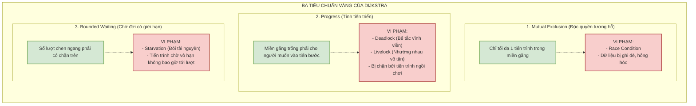
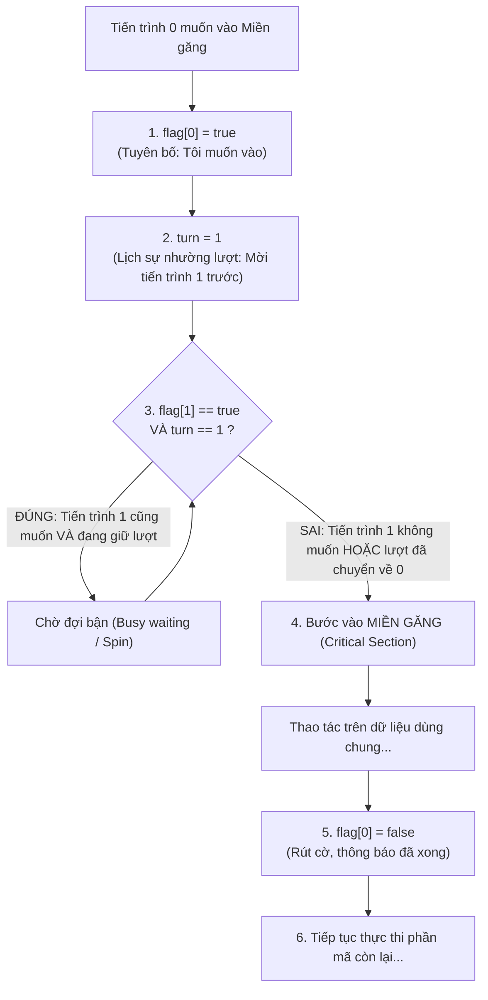

# 1_4_2 The Three Critical Section Requirements

> **Khóa học**: Cloud DevOps Basic — OS Core  
> **Phân nhóm**: 1 Domain 1 - Operating System Core Fundamentals › 1_4 Process Synchronization and Concurrency  
> **Chủ đề**: Ba tiêu chuẩn vàng của Dijkstra giải quyết bài toán Miền găng: Mutual Exclusion, Progress và Bounded Waiting  
> **Trạng thái**: Verified (WRITE-CDB-1_4_2, 14-11-2026)  
> **Checklist đối chiếu**: [1_4_2](../../../CHECKLIST.md#domain-1-operating-system-core-fundamentals-45-items)  

---

## 1. Khái Niệm Cốt Lõi & Bản Chất Kỹ Thuật (Core Concepts & Technical Deep Dive)

Trong lập trình đồng thời và thiết kế hệ điều hành, **Miền găng (Critical Section - CS)** là đoạn mã truy cập và thao tác trên tài nguyên dùng chung khả biến (shared mutable state). Nếu nhiều luồng hoặc tiến trình cùng bước vào miền găng tại một thời điểm, hiện tượng xung đột dữ liệu (**Race Condition**) sẽ xảy ra, làm phá hủy tính toàn vẹn của hệ thống.

Năm 1965, nhà khoa học máy tính huyền thoại **Edsger W. Dijkstra** trong công trình kinh điển *EWD 123: "Cooperating sequential processes"* đã đặt nền móng lý thuyết cho việc giải quyết bài toán này. Mọi thuật toán hoặc cơ chế khóa đồng bộ (Locking mechanism) muốn được công nhận là **đúng đắn** bắt buộc phải thỏa mãn trọn vẹn **Ba Tiêu Chuẩn Vàng (The Three Critical Section Requirements)**:

```text
+------------------------------------------------------------------------+
|              BA TIÊU CHUẨN VÀNG CỦA DIJKSTRA CHO MIỀN GĂNG             |
|                                                                        |
|  1. MUTUAL EXCLUSION (Độc quyền tương hỗ):                            |
|     - Tại bất kỳ thời điểm nào, chỉ có TỐI ĐA 1 tiến trình được phép   |
|       thực thi bên trong miền găng của nó.                             |
|                                                                        |
|  2. PROGRESS (Tính tiến triển):                                        |
|     - Khi miền găng trống và có tiến trình muốn vào, CHỈ NHỮNG tiến    |
|       trình đang muốn vào mới được tham gia biểu quyết chọn ai vào tiếp;|
|       quyết định KHÔNG ĐƯỢC PHÉP bị trì hoãn vô tận (chống Deadlock).  |
|                                                                        |
|  3. BOUNDED WAITING (Chờ đợi có giới hạn):                             |
|     - Phải có một giới hạn chặn trên đối với số lần các tiến trình     |
|       khác được phép chen vào miền găng trước một tiến trình đã đăng ký |
|       yêu cầu (chống Starvation / Đói tài nguyên).                     |
+------------------------------------------------------------------------+
```

---

### 1.1 Phân Tích Chi Tiết 3 Tiêu Chuẩn

#### 1. Độc Quyền Tương Hỗ (Mutual Exclusion)
- **Định nghĩa**: Nếu tiến trình $P_i$ đang thực thi các chỉ lệnh trong miền găng của nó, thì không có bất kỳ tiến trình $P_j$ nào khác ($j \ne i$) được phép bước vào miền găng của $P_j$.
- **Bản chất**: Đây là tiêu chuẩn an toàn sống còn (**Safety Property** — *"Nothing bad happens"*). Nếu tiêu chuẩn này bị vi phạm, hai luồng sẽ đồng thời ghi đè lên bộ nhớ chung, gây lỗi dữ liệu tức thì.

#### 2. Tính Tiến Triển (Progress)
- **Định nghĩa**: Nếu không có tiến trình nào đang ở trong miền găng và có một hoặc nhiều tiến trình đang có nhu cầu bước vào:
  1. Chỉ những tiến trình đang thực sự có nhu cầu vào miền găng mới được quyền tham gia vào quá trình quyết định xem ai sẽ là người kế tiếp được vào.
  2. Những tiến trình đang chạy ở ngoài miền găng (non-critical section) hoặc đã dừng lại (halted) tuyệt đối không được cản trở các tiến trình khác.
  3. Quá trình lựa chọn không được phép kéo dài vô tận (nghĩa là hệ thống không thể rơi vào trạng thái bế tắc Deadlock hoặc Livelock).
- **Bản chất**: Đây là tiêu chuẩn vận hành sống động (**Liveness Property** — *"Something good eventually happens"*). Nó đảm bảo hệ thống không bị "đóng băng" khi tài nguyên đang hoàn toàn rảnh rỗi.

#### 3. Chờ Đợi Có Giới Hạn (Bounded Waiting)
- **Định nghĩa**: Sau khi một tiến trình $P_i$ phát tín hiệu yêu cầu được vào miền găng, phải tồn tại một **giới hạn chặn trên (bound)** đối với số lần mà các tiến trình khác được phép "chen ngang" vào miền găng trước $P_i$.
- **Bản chất**: Tiêu chuẩn này bảo vệ tính công bằng (**Fairness**), đảm bảo không có bất kỳ tiến trình nào phải chờ đợi vô hạn và bị chết đói tài nguyên (**Starvation**). Khi $P_i$ đã xếp hàng, nó chắc chắn sẽ được phục vụ sau một số hữu hạn các lượt.

---

### 1.2 Phân Tích Các Thử Nghiệm Thuật Toán Sai Lầm Kinh Điển

Để thấu hiểu tại sao cần đồng thời cả 3 tiêu chuẩn, hãy phân tích hai giải pháp trực giác nhưng sai lầm được Dijkstra và OSTEP (Chương 28) chỉ rõ:

#### Thử nghiệm sai lầm 1: Luân phiên nghiêm ngặt (Strict Alternation) — Vi phạm Progress
Giả sử dùng một biến chia sẻ `int turn = 0;`:
```c
// Mã của Tiến trình 0:
while (turn != 0); // Busy wait
// [CRITICAL SECTION]
turn = 1;

// Mã của Tiến trình 1:
while (turn != 1); // Busy wait
// [CRITICAL SECTION]
turn = 0;
```
- **Mutual Exclusion**: Được đảm bảo (chỉ ai có `turn` tương ứng mới được vào).
- **VI PHẠM NGUYÊN TẮC PROGRESS**:
  - Giả sử Tiến trình 0 vào miền găng, làm xong, đặt `turn = 1` rồi chuyển sang làm việc khác ngoài miền găng và không có nhu cầu quay lại.
  - Tiến trình 1 vào miền găng, làm xong, đặt `turn = 0`.
  - Lúc này, Tiến trình 1 muốn vào miền găng **lần thứ hai liên tiếp**. Nhưng nó bị kẹt cứng ở vòng lặp `while (turn != 1)` vì `turn` đang là 0.
  - Mặc dù Tiến trình 0 đang ngồi chơi ngoài sân và không hề có nhu cầu vào miền găng, sự vắng mặt của nó đã chặn đứng Tiến trình 1 bước vào một miền găng đang hoàn toàn trống! Thuật toán thất bại vì vi phạm tiêu chuẩn Progress.

#### Thử nghiệm sai lầm 2: Cờ trạng thái đơn giản (Boolean Flags) — Vi phạm Mutual Exclusion hoặc Deadlock
Giả sử dùng mảng cờ `bool flag[2] = {false, false};` để thể hiện ý muốn vào:
- **Biến thể A (Kiểm tra rồi mới đặt cờ)**:
  ```c
  while (flag[1]); // Chờ người kia hết muốn vào
  flag[0] = true;  // Đặt cờ của mình
  // [CRITICAL SECTION]
  flag[0] = false;
  ```
  $\rightarrow$ **Vi phạm Mutual Exclusion**: Nếu cả hai tiến trình cùng kiểm tra `flag` của đối phương tại cùng một thời điểm, cả hai đều thấy cờ đối phương là `false`. Cả hai cùng vượt qua vòng lặp, cùng đặt cờ `true` và cùng bước vào miền găng $\rightarrow$ Thảm họa Race Condition!
- **Biến thể B (Đặt cờ rồi mới kiểm tra)**:
  ```c
  flag[0] = true;  // Tôi muốn vào
  while (flag[1]); // Chờ người kia rút cờ
  // [CRITICAL SECTION]
  flag[0] = false;
  ```
  $\rightarrow$ **Vi phạm Progress (Deadlock / Livelock)**: Nếu cả hai tiến trình cùng đặt `flag[0] = true` và `flag[1] = true` cùng lúc, sau đó cả hai cùng rơi vào vòng lặp `while`. Hai bên liên tục nhìn cờ của nhau và chờ đối phương rút lui. Cả hai bị bế tắc vĩnh viễn, không ai bước được vào miền găng đang trống!

---

### 1.3 Thuật Toán Peterson (Peterson's Algorithm, 1981)

Gary Peterson đã kết hợp tinh tế ý tưởng của **cờ ý định (intent flag)** và **biến nhường lượt (polite turn)** để tạo ra giải pháp phần mềm hoàn chỉnh đầu tiên thỏa mãn cả 3 tiêu chuẩn cho 2 tiến trình:

```c
// Biến dùng chung
bool flag[2] = {false, false}; // flag[i] = true nghĩa là tiến trình i muốn vào
int turn = 0;                  // turn phân định ai được ưu tiên khi tranh chấp

void enter_critical_section(int self) {
    int other = 1 - self;
    flag[self] = true;          // 1. Tuyên bố ý định muốn vào
    turn = other;               // 2. Lịch sự nhường lượt cho đối phương ("Mời anh trước")

    // 3. Chờ chừng nào đối phương vẫn muốn vào VÀ đang giữ lượt
    while (flag[other] && turn == other);
}

void leave_critical_section(int self) {
    flag[self] = false;         // Rút cờ khi rời khỏi miền găng
}
```

- **Thỏa mãn Mutual Exclusion**: Để cả hai cùng vào miền găng, điều kiện `while` của cả hai phải cùng sai. Nhưng biến `turn` tại bất kỳ thời điểm nào chỉ có thể nhận một giá trị (0 hoặc 1). Tiến trình nào gán `turn = other` sau cùng sẽ bị chặn lại ở vòng lặp `while`.
- **Thỏa mãn Progress**: Nếu Tiến trình 1 không muốn vào (`flag[1] == false`), Tiến trình 0 vượt qua vòng `while` ngay lập tức mà không bị cản trở.
- **Thỏa mãn Bounded Waiting**: Khi Tiến trình 0 đang chờ, Tiến trình 1 rời miền găng và đặt `flag[1] = false`. Nếu Tiến trình 1 muốn vào lại ngay, nó phải đặt `turn = 0` (nhường lượt cho 0). Nhờ đó, Tiến trình 0 được đảm bảo bước vào miền găng chỉ sau tối đa 1 lượt của Tiến trình 1.

---

## 2. Ví Dụ Đời Sống Thực Tế Dễ Hiểu (Intuitive Real-World Analogies)

### Ẩn Dụ: Quy Tắc Sử Dụng Phòng Vệ Sinh Công Cộng Duy Nhất (The Single Restroom Analogy)

Hãy hình dung một quán cà phê đông khách chỉ có duy nhất **một phòng vệ sinh khép kín (Miền găng - Critical Section)**:

```text
+------------------------------------------------------------------------+
|               QUY TẮC PHÒNG VỆ SINH QUÁN CÀ PHÊ (DIJKSTRA)             |
|                                                                        |
| 1. MUTUAL EXCLUSION (Độc quyền):                                       |
|    - Khi có một người bước vào phòng và chốt cửa, TUYỆT ĐỐI không ai   |
|      khác được phép bước vào cùng lúc.                                 |
|                                                                        |
| 2. PROGRESS (Tính tiến triển):                                         |
|    - Khi phòng vệ sinh đang TRỐNG:                                     |
|      Những khách đang ngồi uống cà phê ngoài sân (không có nhu cầu)   |
|      tuyệt đối KHÔNG ĐƯỢC chặn cửa không cho người khác vào!           |
|    - Hai người muốn vào cùng lúc không được đứng nhường nhau vô tận:   |
|      "Mời bác vào" - "Không, mời bác" làm cửa phòng trống mãi mãi.    |
|                                                                        |
| 3. BOUNDED WAITING (Chờ đợi có hạn):                                   |
|    - Bạn đã đứng vào hàng chờ trước cửa phòng.                         |
|    - Một vị khách VIP không thể liên tục chen ngang vào trước mặt bạn  |
|      100 lần khiến bạn phải đứng chờ vô hạn đến mức kiệt sức!          |
+------------------------------------------------------------------------+
```

1. **Mutual Exclusion — Khóa chốt an toàn**:
   - Khi vị khách A bước vào, chiếc chốt cửa được gài lại. Bất kỳ ai khác (khách B, khách C) đến đẩy cửa đều thấy cửa khóa và phải dừng lại bên ngoài. Tiêu chuẩn này ngăn chặn thảm họa riêng tư và xung đột.
2. **Progress — Không cản trở khi không có nhu cầu**:
   - Khách D đang ngồi thưởng thức cà phê ở bàn ngoài sân (chạy ngoài miền găng). Khách D không có quyền cầm chìa khóa giấu vào túi khiến khách A đang cần dùng lại không thể vào một căn phòng đang hoàn toàn trống rỗng.
   - Khi phòng trống và có hai người cùng bước tới cửa, quy tắc phải chọn ra một người vào ngay lập tức trong vài giây, không thể để hai người đứng nhìn nhau bế tắc (Deadlock) ngoài cửa.
3. **Bounded Waiting — Xếp hàng văn minh, không chen ngang vô tận**:
   - Bạn đã xếp hàng thứ hai. Người thứ nhất đi ra, theo lẽ công bằng, bạn phải là người kế tiếp được vào (hoặc tối đa chỉ có 1 người khẩn cấp được ưu tiên chen trước 1 lượt). Không thể có chuyện người thứ nhất vừa ra lại lập tức quay vòng vào lại, cứ thế lặp đi lặp lại khiến bạn đứng chờ vô hạn đến ngất xỉu (Starvation).

---

## 3. Kiến Trúc, Luồng Hoạt Động & Hình Ảnh Trực Quan (Architecture, Diagrams & Visual Media)

### 3.1 Sơ Đồ Ma Trận: Ba Tiêu Chuẩn & Hậu Quả Khi Bị Vi Phạm



---

### 3.2 Luồng Hoạt Động Thuật Toán Peterson



---

## 4. Code Mẫu Trực Quan Hoặc Dòng Lệnh Thực Chiến (Runnable Sample Code / CLI)

> ⚠️ Dữ liệu mã nguồn C dưới đây mang tính chất minh họa (illustrative output) ghi nhận trên hệ thống Linux x86_64 nhằm phân tích logic thuật toán Peterson theo chuẩn POSIX.

### 4.1 Minh Họa Thuật Toán Peterson Trong C: `peterson_demo.c`

```c
/*
 * File: peterson_demo.c
 * Mục đích: Minh họa thuật toán Peterson thỏa mãn 3 tiêu chuẩn của Dijkstra:
 *           Mutual Exclusion, Progress, và Bounded Waiting cho 2 luồng.
 */

#define _GNU_SOURCE
#include <stdio.h>
#include <stdlib.h>
#include <pthread.h>
#include <stdbool.h>
#include <stdatomic.h>

#define ITERATIONS 1000000

// Biến chia sẻ của thuật toán Peterson
volatile bool flag[2] = {false, false};
volatile int turn = 0;

// Tài nguyên dùng chung cần bảo vệ trong Miền găng
long long shared_counter = 0;

void enter_region(int self) {
    int other = 1 - self;
    flag[self] = true;
    turn = other;

    // Rào cản bộ nhớ (Memory Barrier) để ngăn CPU / Trình biên dịch tái sắp xếp lệnh
    __sync_synchronize();

    while (flag[other] && turn == other) {
        // Chờ đến lượt
    }
}

void leave_region(int self) {
    flag[self] = false;
    __sync_synchronize();
}

void *worker_thread(void *arg) {
    long id = (long)arg;
    for (int i = 0; i < ITERATIONS; i++) {
        enter_region(id);
        
        // --- BẮT ĐẦU MIỀN GĂNG (CRITICAL SECTION) ---
        shared_counter++; // Thao tác đọc-sửa-ghi được bảo vệ
        // --- KẾT THÚC MIỀN GĂNG ---
        
        leave_region(id);
    }
    return NULL;
}

int main(void) {
    pthread_t t0, t1;

    printf("Khởi chạy 2 luồng với thuật toán Peterson bảo vệ shared_counter...\n");
    printf("Mỗi luồng tăng biến đếm %d lần (Kỳ vọng tổng = %d)\n", ITERATIONS, ITERATIONS * 2);

    pthread_create(&t0, NULL, worker_thread, (void *)0);
    pthread_create(&t1, NULL, worker_thread, (void *)1);

    pthread_join(t0, NULL);
    pthread_join(t1, NULL);

    printf("Kết quả thực tế shared_counter = %lld\n", shared_counter);
    if (shared_counter == ITERATIONS * 2) {
        printf("XÁC NHẬN: Thuật toán Peterson bảo vệ thành công Mutual Exclusion!\n");
    } else {
        printf("CẢNH BÁO: Xảy ra lỗi Race Condition!\n");
    }

    return EXIT_SUCCESS;
}
```

---

### 4.2 Thao Tác Biên Dịch Và Thực Thi

```bash
# 1. Biên dịch chương trình với thư viện pthread
gcc -O2 -pthread peterson_demo.c -o peterson_demo

# 2. Thực thi chương trình
./peterson_demo
```

### 4.3 Đầu Ra Minh Họa & Phân Tích

```text
Khởi chạy 2 luồng với thuật toán Peterson bảo vệ shared_counter...
Mỗi luồng tăng biến đếm 1000000 lần (Kỳ vọng tổng = 2000000)
Kết quả thực tế shared_counter = 2000000
XÁC NHẬN: Thuật toán Peterson bảo vệ thành công Mutual Exclusion!
```

- **Giải thích kỹ thuật**:
  - Nhờ có lệnh `__sync_synchronize()` (Memory Barrier), trình biên dịch GCC và phần cứng CPU vi kiến trúc x86 không thể đảo thứ tự thực thi giữa lệnh ghi `flag[self] = true` và `turn = other`.
  - Giá trị đếm cuối cùng đạt đúng chính xác $2,000,000$, minh chứng rằng tại mọi thời điểm chỉ có tối đa 1 luồng được bước vào biến đổi `shared_counter`.

---

## 5. Cạm Bẫy Thực Tế & Thực Tiễn Sản Xuất (Production Gotchas & Best Practices)

Trong kỹ thuật phát triển hệ thống và vận hành hạ tầng Cloud, việc nắm vững 3 tiêu chuẩn của Dijkstra giúp giải thích lý do tại sao các giải pháp khóa phần mềm thuần túy không còn đủ dùng trên phần cứng hiện đại:

### 1. Cạm bẫy Tái sắp xếp lệnh (Memory Reordering) làm sập Peterson trên CPU Đa nhân
- **Vấn đề lý thuyết vs Thực tế**: Thuật toán Peterson được chứng minh đúng đắn về mặt toán học dựa trên giả định mô hình bộ nhớ nhất quán tuần tự (**Sequential Consistency**).
- **Thực tế phần cứng hiện đại**: Các CPU hiện đại (như Intel x86-64, ARM, Apple Silicon) và các trình biên dịch tối ưu hóa (GCC, Clang) thường xuyên thực hiện **Tái sắp xếp bộ nhớ ngoài trật tự (Out-of-Order Execution / Memory Reordering)** để tăng tốc độ.
- **Hậu quả**: Lệnh gán `turn = other` có thể bị CPU đẩy lên thực thi trước lệnh `flag[self] = true`. Khi đó, cả hai luồng sẽ cùng thấy cờ đối phương là `false` và cùng nhảy vào miền găng $\rightarrow$ **Vi phạm nghiêm trọng Mutual Exclusion!**
- **Giải pháp**: Trên hệ thống đa nhân hiện đại, các giải pháp đồng bộ hóa phải dựa trên các chỉ lệnh nguyên tử phần cứng (**Hardware Atomic Instructions** như `lock cmpxchg`, Test-and-Set) kết hợp với các rào cản bộ nhớ (**Memory Barriers / Fences**).

### 2. Hiện tượng Đói tài nguyên (Starvation) trong các hệ thống khóa bất công (Unfair Locks)
- **Cạm bẫy sản xuất**: Nhiều kỹ sư lập trình sử dụng các cơ chế Spinlock hoặc Mutex không có hàng đợi thứ tự (Non-FIFO Locks) vì chúng đạt hiệu năng thông lượng thô rất cao.
- **Hậu quả**: Khi hàng trăm luồng cùng tranh chấp một chiếc khóa, các luồng đang chạy trên các core CPU ở gần bộ nhớ đệm (Cache-locality) liên tục giành được khóa. Một số luồng chạy trên các core xa hoặc luồng có mức ưu tiên thấp có thể bị "bỏ quên" và không bao giờ giành được khóa $\rightarrow$ **Vi phạm tiêu chuẩn Bounded Waiting**, gây ra lỗi Timeout bí ẩn trên các dịch vụ thanh toán hoặc xử lý đơn hàng.

---

## 6. Câu Hỏi Củng Cố Kiến Thức (Active Recall Quiz)

<details>
<summary><b>Câu hỏi 1:</b> Một lập trình viên đề xuất giải pháp đồng bộ cho 2 tiến trình bằng cách sử dụng một biến số nguyên duy nhất <code>int turn = 0;</code> để quy định lượt vào miền găng (tiến trình 0 chỉ vào khi turn == 0, tiến trình 1 chỉ vào khi turn == 1). Giải pháp này thỏa mãn và vi phạm tiêu chuẩn nào trong 3 tiêu chuẩn của Dijkstra? Tại sao?</summary>

**Đáp án:**
- **Thỏa mãn**: **Mutual Exclusion** (Độc quyền tương hỗ) được đảm bảo tuyệt đối, vì tại một thời điểm biến `turn` chỉ có thể là 0 hoặc 1, không bao giờ cả hai cùng vào được.
- **Vi phạm**: Vi phạm nghiêm trọng tiêu chuẩn **Progress** (Tính tiến triển). Bởi vì nếu tiến trình 0 sau khi hoàn thành lượt của mình chuyển sang làm việc khác ngoài miền găng và không muốn quay lại, thì tiến trình 1 dù đang rất cần vào miền găng lần thứ hai cũng bị chặn cứng vĩnh viễn ở vòng lặp chờ `turn == 1`. Một tiến trình không có nhu cầu đã cản trở tiến trình khác bước vào một miền găng đang trống rỗng.
</details>

<details>
<summary><b>Câu hỏi 2:</b> Trong 3 tiêu chuẩn của Dijkstra, tiêu chuẩn nào là "Safety Property" (Đặc tính an toàn) và tiêu chuẩn nào là "Liveness Property" (Đặc tính sống động)? Hậu quả của hệ thống là gì nếu vi phạm một trong hai nhóm đặc tính này?</summary>

**Đáp án:**
- **Safety Property (An toàn)**: Là **Mutual Exclusion** (nguyên lý *"Không có điều xấu nào xảy ra"*). Nếu vi phạm, thảm họa Race Condition xuất hiện, dữ liệu dùng chung bị ghi đè hỗn loạn và hỏng tính toàn vẹn.
- **Liveness Property (Sống động)**: Là **Progress** và **Bounded Waiting** (nguyên lý *"Điều tốt đẹp cuối cùng sẽ phải diễn ra"*). Nếu vi phạm Progress, hệ thống bị tê liệt do Deadlock hoặc Livelock; nếu vi phạm Bounded Waiting, tiến trình bị Starvation (chết đói tài nguyên vì chờ đợi vô hạn).
</details>

<details>
<summary><b>Câu hỏi 3:</b> Trong thuật toán Peterson, biến <code>flag[i]</code> và biến <code>turn</code> đảm nhận vai trò ý nghĩa kỹ thuật gì? Tại sao phải cần cả hai biến này mới thỏa mãn trọn vẹn cả 3 tiêu chuẩn?</summary>

**Đáp án:**
- **Biến `flag[i]`**: Đại diện cho **Ý muốn / Nhu cầu** bước vào miền găng của tiến trình `i` (`flag[i] = true` nghĩa là tôi đang muốn vào).
- **Biến `turn`**: Đóng vai trò là **Trọng tài phân định / Sự lịch sự** khi có tranh chấp đồng thời (`turn = other` nghĩa là tôi nhường quyền ưu tiên cho đối phương đi trước).
- **Tại sao cần cả hai**:
  - Nếu chỉ có `turn`, thuật toán bị luân phiên cưỡng bức, vi phạm **Progress**.
  - Nếu chỉ có `flag`, khi hai bên cùng đặt cờ sẽ dẫn đến bế tắc **Deadlock** (cả hai cùng chờ nhau), hoặc nếu kiểm tra cờ trước sẽ vi phạm **Mutual Exclusion**.
  - Sự kết hợp giữa "tuyên bố ý định" (`flag`) và "lịch sự nhường lượt" (`turn`) giúp bẻ gãy thế đối xứng, đảm bảo chỉ duy nhất một bên được bước vào khi tranh chấp và đảm bảo bên kia sẽ được vào ngay sau đó (**Bounded Waiting**).
</details>

---

## 7. 📚 Nguồn Tài Liệu Chính Thống (Tier-1 Official References)

- [Edsger W. Dijkstra: Cooperating Sequential Processes (EWD 123, 1965)](https://www.cs.utexas.edu/~EWD/ewd01xx/EWD123.PDF) - Bài báo khoa học nền tảng định nghĩa bài toán Miền găng và ba tiêu chuẩn đồng bộ hóa kinh điển (Section 2.1 & 2.2).
- [OSTEP Chapter 28: Locks](https://pages.cs.wisc.edu/~remzi/OSTEP/threads-locks.pdf) - Giáo trình *Operating Systems: Three Easy Pieces* (Remzi H. Arpaci-Dusseau & Andrea C. Arpaci-Dusseau), phân tích chuyên sâu về tiêu chí đánh giá khóa đồng bộ (Mutual Exclusion, Fairness, Performance) và thuật toán Peterson.
