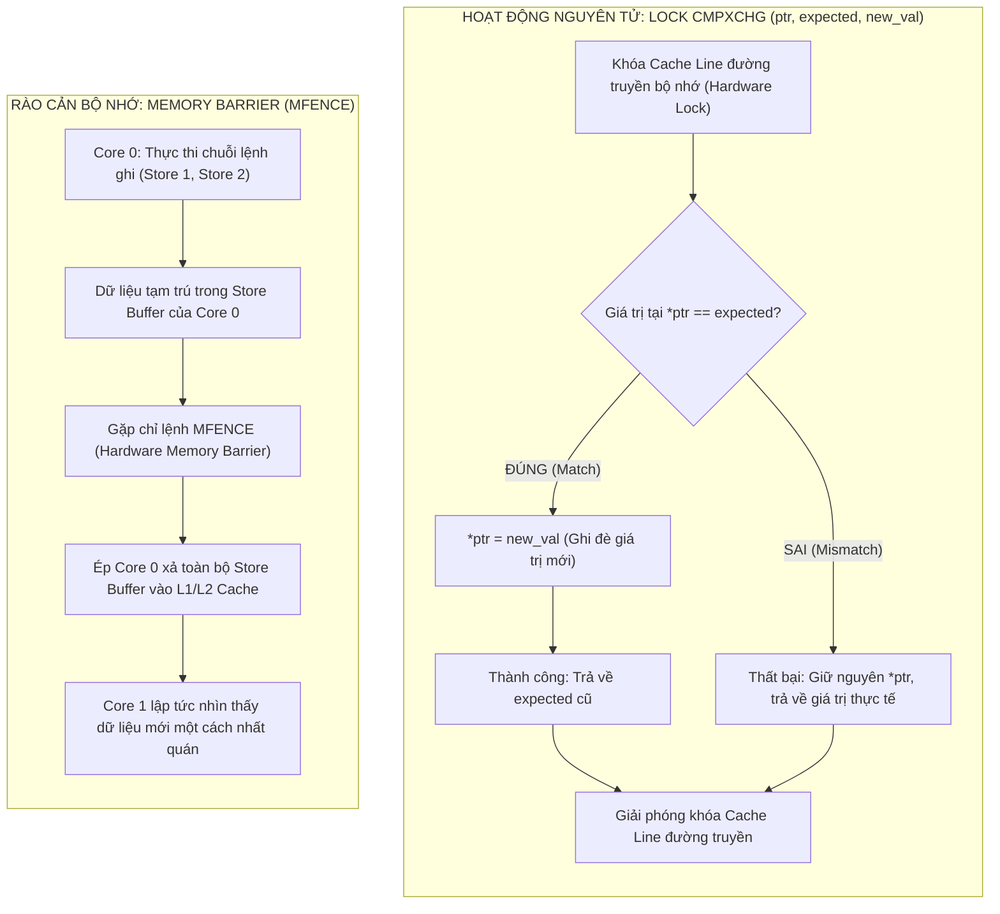

# 1_4_3 Hardware Synchronization Primitives

> **Khóa học**: Cloud DevOps Basic — OS Core  
> **Phân nhóm**: 1 Domain 1 - Operating System Core Fundamentals › 1_4 Process Synchronization and Concurrency  
> **Chủ đề**: Các cơ chế đồng bộ phần cứng (Hardware Synchronization Primitives): Test-and-Set, Compare-and-Swap (CAS), và Rào cản bộ nhớ (Memory Barriers)  
> **Trạng thái**: Draft (WRITE-CDB-1_4_3, 14-11-2026)  
> **Checklist đối chiếu**: [1_4_3](../../../CHECKLIST.md#domain-1-operating-system-core-fundamentals-45-items)  

---

## 1. Khái Niệm Cốt Lõi & Bản Chất Kỹ Thuật (Core Concepts & Technical Deep Dive)

Trong lý thuyết khoa học máy tính cổ điển, các nhà nghiên cứu từng cố gắng xây dựng các thuật toán đồng bộ hóa hoàn toàn bằng phần mềm (như thuật toán Dekker hay thuật toán Peterson). Tuy nhiên, trên các kiến trúc máy tính hiện đại với bộ xử lý đa nhân (*multi-core*), kỹ thuật thực thi ngoài trật tự (*out-of-order execution*) và bộ nhớ đệm ghi trì hoãn (*store buffers*), **phần mềm thuần túy không thể nào tự đảm bảo tính loại trừ tương hỗ một cách tin cậy nếu không có sự trợ giúp từ các chỉ lệnh phần cứng chuyên biệt**.

Để giải quyết tận gốc bài toán này, các kiến trúc vi xử lý (như x86, ARM, RISC-V) cung cấp hai nhóm công cụ đồng bộ hóa phần cứng cốt lõi:
1. **Các chỉ lệnh nguyên tử (Atomic Read-Modify-Write Instructions)**.
2. **Các rào cản bộ nhớ (Memory Barriers / Fences)**.

```
+-------------------------------------------------------------------------------+
|                    CÁC NỀN TẢNG ĐỒNG BỘ HÓA TẦNG PHẦN CỨNG                    |
|                                                                               |
|  1. CHỈ LỆNH NGUYÊN TỬ (Atomic Instructions):                                 |
|     - Test-and-Set (xchg) : Ghi giá trị mới và trả về giá trị cũ trong 1 nhịp |
|     - Compare-and-Swap    : So sánh bộ nhớ với expected, nếu đúng thì ghi mới |
|       (cmpxchg + lock)      (Nền tảng của cấu trúc dữ liệu Lock-Free)         |
|     - LL / SC             : Cặp lệnh Load-Linked & Store-Conditional (ARM)    |
|                                                                               |
|  2. RÀO CẢN BỘ NHỚ (Memory Barriers / Fences):                                |
|     - Compiler Barrier    : Ngăn trình biên dịch đảo thứ tự lệnh lúc compile  |
|     - CPU Memory Fence    : Ép CPU xả Store Buffer, tuần tự hóa đọc/ghi RAM   |
|       (mfence, lfence)      trên hệ thống đa nhân (Multi-Core SMP)            |
+-------------------------------------------------------------------------------+
```

---

### 1.1 Các Chỉ Lệnh Nguyên Tử Phần Cứng (Atomic Read-Modify-Write)

Theo giáo trình *Operating Systems: Three Easy Pieces (OSTEP - Ch. 28)*:
Một thao tác được gọi là **Nguyên tử (Atomic)** khi nó được phần cứng CPU thực thi trọn vẹn như một khối duy nhất: hoặc là toàn bộ thao tác hoàn thành thành công, hoặc là không có gì thay đổi; tuyệt đối không thể có bất kỳ ngắt phần cứng, ngắt đồng hồ hay luồng tính toán nào khác xen ngang vào giữa.

#### 1. Chỉ lệnh Test-and-Set (`xchg` trên kiến trúc x86)
- **Hành vi logic**:
  ```c
  int TestAndSet(int *old_ptr, int new_val) {
      int old = *old_ptr; // Đọc giá trị cũ
      *old_ptr = new_val; // Ghi giá trị mới
      return old;         // Trả về giá trị cũ
  }
  ```
- **Hiện thực phần cứng**: Trên x86, chỉ lệnh `xchg` tự động khóa bus hoặc đường truyền bộ nhớ đệm (*cache line*) và thực hiện hoán đổi nguyên tử giá trị giữa thanh ghi và ô nhớ RAM. Nếu giá trị cũ là 0 (ổ khóa mở), luồng ghi vào số 1 (khóa lại) và nhận về 0 $\rightarrow$ chiếm khóa thành công!

#### 2. Chỉ lệnh Compare-and-Swap (CAS - `cmpxchg` trên x86)
- **Hành vi logic**:
  ```c
  int CompareAndSwap(int *ptr, int expected, int new_val) {
      int original = *ptr;
      if (original == expected) {
          *ptr = new_val;
      }
      return original;
  }
  ```
- **Cơ chế hoạt động**:
  - CAS nhận vào 3 tham số: con trỏ ô nhớ (`ptr`), giá trị kỳ vọng (`expected`), và giá trị mới muốn cập nhật (`new_val`).
  - CPU sẽ so sánh nội dung tại ô nhớ `ptr` với `expected`. Nếu bằng nhau, nó ghi đè `new_val` vào ô nhớ. Nếu không bằng (do luồng khác đã nhanh tay thay đổi dữ liệu trước), CPU giữ nguyên giá trị ô nhớ và trả về giá trị thực tế đang có.
- **Tiền tố `LOCK` trên x86**: Để `cmpxchg` trở thành nguyên tử trên máy tính nhiều CPU core, trình biên dịch bắt buộc phải chèn tiền tố **`lock cmpxchg`**. Tín hiệu này kích hoạt giao thức duy trì nhất quán bộ nhớ đệm (như *MESI Protocol*), khóa đường truyền cache line của ô nhớ đó để không core nào khác có thể ghi đồng thời.
- **Tầm quan trọng**: CAS là khối gạch nền móng để xây dựng toàn bộ hệ sinh thái **Thuật toán không khóa (Lock-Free Data Structures)**, các lớp nguyên tử trong Java (`java.util.concurrent.atomic`) và Go (`sync/atomic`).

#### 3. Cặp chỉ lệnh Load-Linked / Store-Conditional (LL/SC trên ARM & RISC-V)
- Thay vì dùng một chỉ lệnh phức tạp như CAS, kiến trúc RISC (như ARMv8 với `LDREX`/`STREX` hoặc RISC-V với `lr`/`sc`) sử dụng cặp lệnh:
  - `Load-Linked (LL)`: Nạp giá trị từ bộ nhớ và đặt một cờ giám sát phần cứng (*hardware monitor*) theo dõi ô nhớ đó.
  - `Store-Conditional (SC)`: Chỉ cho phép ghi giá trị mới nếu từ lúc gọi LL đến nay **chưa có bất kỳ luồng hoặc vi xử lý nào khác ghi đè vào ô nhớ đó**. Nếu có sự can thiệp, lệnh SC sẽ thất bại và trả về mã lỗi để phần mềm thử lại.

---

### 1.2 Rào Cản Bộ Nhớ (Memory Barriers & Instruction Reordering)

Tại sao việc chỉ sở hữu các chỉ lệnh nguyên tử vẫn chưa đủ để đảm bảo tính an toàn đồng thời?

Theo tài liệu chính thức từ nhân Linux (*Linux Kernel Memory Barriers - docs.kernel.org*):
Trong các bộ vi xử lý hiện đại, để tối đa hóa hiệu năng xử lý, **cả trình biên dịch lẫn phần cứng CPU đều chủ động tái sắp xếp trật tự thực thi của các lệnh đọc/ghi bộ nhớ (Memory Reordering)**, miễn sao trật tự đó không làm thay đổi kết quả của một luồng đơn lẻ:
1. **Trình biên dịch (Compiler Reordering)**: Trình tối ưu hóa (O2/O3) có thể đổi chỗ các câu lệnh gán biến hoặc gom các thao tác đọc biến vào thanh ghi để tăng tốc độ.
2. **Phần cứng CPU (Out-of-Order Execution & Store Buffers)**:
   - Khi CPU thực hiện lệnh ghi, nó không ghi trực tiếp ngay vào RAM (vì RAM quá chậm), mà đẩy dữ liệu vào một bộ đệm siêu tốc gọi là **Store Buffer**.
   - Các lõi CPU khác chưa nhìn thấy ngay giá trị mới này. Hệ quả là trên các kiến trúc bộ nhớ yếu (*Weakly-Ordered Memory Architectures* như ARM) hoặc ngay cả kiến trúc x86 (cho phép đọc vượt trước ghi - Store-Load Reordering), các luồng chạy trên các core khác nhau có thể quan sát thứ tự cập nhật biến hoàn toàn trái ngược nhau!

#### Minh họa Hiểm họa Tái sắp xếp lệnh
Giả sử có hai biến toàn cục `data = 0` và `flag = 0`:

```text
Luồng 1 (Producer):                  Luồng 2 (Consumer):
data = 42;                           while (flag == 0); // Chờ cờ bật
flag = 1;                            print(data);       // Kỳ vọng in ra 42
```
Nếu CPU hoặc trình biên dịch đảo trật tự của Luồng 1 thành `flag = 1; data = 42;`, Luồng 2 có thể nhìn thấy `flag == 1` trước khi `data` được ghi giá trị 42, dẫn tới việc in ra **`data = 0`** (dữ liệu rác)!

---

### 1.3 Phân Biệt: Compiler Barrier vs Hardware Memory Barrier

Để ngăn chặn thảm họa tái sắp xếp dữ liệu, kỹ sư hệ thống sử dụng hai tầng rào cản:

| Đặc tính Kỹ thuật | Rào cản Trình biên dịch (Compiler Barrier) | Rào cản Phần cứng (Hardware Memory Barrier) |
| :--- | :--- | :--- |
| **Mục đích** | Ngăn trình biên dịch di chuyển lệnh đọc/ghi qua ranh giới | Ép CPU vi kiến trúc phải tuần tự hóa đọc/ghi RAM giữa các Core |
| **Cú pháp trong C/Linux** | `barrier()` $\rightarrow$ `__asm__ __volatile__("": : :"memory")` | `smp_mb()`, `mfence`, `lfence`, `sfence` (x86), `dmb` (ARM) |
| **Mã máy sinh ra** | **Không sinh ra bất kỳ mã máy nào (0 instructions)** | Sinh ra chỉ lệnh máy cụ thể ép xả Store Buffers |
| **Phạm vi hiệu lực** | Chỉ trong quá trình tối ưu hóa lúc biên dịch mã nguồn | Có hiệu lực thời gian thực trên bus phần cứng và vi xử lý |

---

## 2. Ví Dụ Đời Sống Thực Tế Dễ Hiểu (Intuitive Real-World Analogies)

Để thấu hiểu hai khái niệm kỹ thuật sâu sắc này, hãy liên tưởng tới **Khóa Vân Tay Siêu Tốc** và **Rào Chắn Dây Chuyền Sản Xuất**:

```
+-------------------------------------------------------------------------------+
|                    ẨN DỤ: DÂY CHUYỀN SẢN XUẤT ĐÓNG GÓI THIẾT BỊ               |
|                                                                               |
|  [Khóa Vân Tay Siêu Tốc - Hardware Atomic]:                                   |
|  Cửa kho tiền chỉ mở ra khi đặt đúng vân tay (CAS: so sánh đúng danh tính).    |
|  Thao tác mở chốt và đẩy cửa diễn ra trong đúng 1 tích tắc cơ học duy nhất.   |
|  Không một tên trộm nào có thể chen một sợi tóc vào giữa khoảnh khắc đó!      |
|                                                                               |
|  [Rào Chắn Kiểm Soát Công Đoạn - Memory Barrier]:                             |
|  Các công nhân khôn lanh luôn muốn làm tắt: Bỏ đồ chơi vào hộp (data=42), rồi |
|  dán tem niêm phong (flag=1).                                                 |
|  Nếu không có người giám sát, công nhân có thể dán tem trước khi bỏ đồ chơi!  |
|  Rào chắn Memory Barrier buộc công nhân: "Bỏ đồ chơi xong xuôi 100%, đi qua   |
|  cửa kiểm tra này rồi mới được phép dán tem niêm phong ra ngoài thị trường!"  |
+-------------------------------------------------------------------------------+
```

### 1. Khóa Vân Tay Siêu Tốc (Hardware Atomic Primitives)
- Hãy tưởng tượng một chiếc khóa két sắt thông minh (đại diện cho chỉ lệnh **Compare-and-Swap - CAS**):
- Khóa yêu cầu bạn nhập mật mã cũ dự kiến. Khóa kiểm tra: *"Mật mã hiện tại có đúng là 1234 không?"*. Nếu đúng, nó lập tức cập nhật mật mã mới thành 5678 và mở két.
- Toàn bộ quá trình kiểm tra mật mã cũ và ghi nhận mật mã mới được phần cứng cơ khí thực hiện trong đúng **1 nhịp chuyển động bánh răng duy nhất**. Kẻ gian bên ngoài không tài nào chèn ngón tay vào để tráo mật mã ngay giữa lúc bánh răng đang xoay.

### 2. Kính Cách Âm và Rào Chắn Trật Tự (Memory Barrier)
- Trong một xưởng sản xuất điện thoại thông minh, công đoạn gồm 2 bước:
  - Bước 1: Lắp pin vào điện thoại (`data = 42`).
  - Bước 2: Dán tem bảo hành niêm phong nắp lưng (`flag = 1`).
- Tuy nhiên, các công nhân (đại diện cho **Bộ vi xử lý CPU tối ưu hóa ngoài trật tự - Out-of-Order Execution**) rất nhanh nhảu: Nhận thấy cuộn tem dán ở ngay cạnh tay, anh ta tiện tay dán luôn tem niêm phong trước khi pin kịp chuyển tới!
- Khách hàng mua về thấy tem bảo hành nguyên vẹn (`flag == 1`), liền bật nguồn nhưng máy không chạy vì bên trong... chưa có pin (`data == 0`)!
- Để ngăn chặn tai họa này, quản đốc dựng một **Rào chắn thép (Memory Barrier)** ở giữa: Công nhân bắt buộc phải lắp pin xong hoàn toàn, đặt điện thoại qua cửa rào chắn, hệ thống camera xác nhận pin đã vào vị trí, lúc đó cửa rào mới mở cho phép chuyển điện thoại sang công đoạn dán tem!

---

## 3. Kiến Trúc, Luồng Hoạt Động & Hình Ảnh Trực Quan (Architecture, Diagrams & Visual Media)

### 3.1 Minh Họa Kiến Trúc Chuyển Đổi Đặc Quyền

Các cơ chế đồng bộ hóa phần cứng vận hành trực tiếp tại các tầng thanh ghi và bus phần cứng CPU, hỗ trợ cho cả User Mode và Kernel Mode:

[](https://learn.microsoft.com/en-us/windows-hardware/drivers/gettingstarted/images/userandkernelmode01.png)  
*Hình 1: Mô hình phân tách đặc quyền thực thi CPU giữa User Mode và Kernel Mode từ Microsoft Learn.*

---

### 3.2 Sơ đồ Luồng Hoạt Động của Chỉ Lệnh `LOCK CMPXCHG` và Rào Cản Bộ Nhớ



---

## 4. Code Mẫu Trực Quan Hoặc Dòng Lệnh Thực Chiến (Runnable Sample Code / CLI)

### 4.1 Mã Nguồn C Thực Chiến: Triển Khai Khóa Tự Chế Bằng Built-in Atomic và CAS

Chương trình C dưới đây minh họa việc sử dụng trực tiếp các chỉ lệnh nguyên tử phần cứng thông qua các hàm nội tại (*built-in intrinsics*) của GCC/Clang:
1. Hiện thực hóa một Spinlock cơ bản bằng `__atomic_test_and_set`.
2. Thực hiện cập nhật số dư tài khoản an toàn không cần khóa (*Lock-Free CAS Loop*) bằng `__atomic_compare_exchange_n`.

```c
/**
 * file: hardware_sync_demo.c
 * Biên dịch: gcc -O2 -pthread hardware_sync_demo.c -o hardware_sync_demo
 * Thực thi:  ./hardware_sync_demo
 */
#define _GNU_SOURCE
#include <stdio.h>
#include <stdlib.h>
#include <pthread.h>
#include <stdbool.h>
#include <unistd.h>

// 1. Tự dựng Spinlock bằng chỉ lệnh phần cứng Test-and-Set
typedef struct {
    // Biến cờ: 0 là tự do, 1 là đang bị chiếm giữ
    volatile char lock_flag;
} SpinlockHardware;

void spinlock_init(SpinlockHardware *lock) {
    lock->lock_flag = 0;
}

void spinlock_acquire(SpinlockHardware *lock) {
    // __atomic_test_and_set tương đương chỉ lệnh xchg trên x86:
    // Đặt biến thành 1 và trả về giá trị cũ.
    // Nếu giá trị cũ là 1 (khóa đang bận), tiếp tục lặp chờ (busy-wait).
    while (__atomic_test_and_set(&(lock->lock_flag), __ATOMIC_ACQUIRE)) {
        #if defined(__x86_64__) || defined(_M_X64)
        // Chỉ lệnh 'pause' tối ưu hóa pipeline của CPU x86 khi busy-wait
        __builtin_ia32_pause();
        #endif
    }
}

void spinlock_release(SpinlockHardware *lock) {
    // Giải phóng khóa và thiết lập Release Memory Barrier
    __atomic_clear(&(lock->lock_flag), __ATOMIC_RELEASE);
}

// 2. Thao tác Lock-Free bằng Compare-and-Swap (CAS)
// Tài khoản ngân hàng cập nhật số dư hoàn toàn không cần Mutex!
static long bank_account_balance = 1000;

bool deposit_lock_free(long amount) {
    long current_balance;
    long new_balance;

    do {
        // Đọc giá trị kỳ vọng hiện tại
        current_balance = bank_account_balance;
        new_balance = current_balance + amount;

        // __atomic_compare_exchange_n tương đương 'LOCK CMPXCHG':
        // Nếu bank_account_balance vẫn bằng current_balance, ghi new_balance và trả về true.
        // Nếu một luồng khác đã thay đổi số dư, trả về false và nạp giá trị mới vào current_balance để thử lại.
    } while (!__atomic_compare_exchange_n(&bank_account_balance, 
                                         &current_balance, 
                                         new_balance, 
                                         false, 
                                         __ATOMIC_SEQ_CST, 
                                         __ATOMIC_SEQ_CST));
    return true;
}

// Thử nghiệm chạy đa luồng
static SpinlockHardware custom_lock;
static long shared_counter = 0;

void *worker_task(void *arg) {
    long id = (long)arg;
    for (int i = 0; i < 500000; i++) {
        // Test 1: Bảo vệ bằng Spinlock phần cứng
        spinlock_acquire(&custom_lock);
        shared_counter++;
        spinlock_release(&custom_lock);

        // Test 2: Nạp tiền ngân hàng bằng Lock-free CAS
        deposit_lock_free(1);
    }
    return NULL;
}

int main(void) {
    pthread_t t1, t2;
    spinlock_init(&custom_lock);

    printf("=================================================================\n");
    printf("[PHẦN CỨNG ĐỒNG BỘ] Khởi động 2 luồng thao tác đồng thời...\n");
    printf("  -> Số dư ban đầu: %ld VNĐ\n", bank_account_balance);
    printf("=================================================================\n");

    pthread_create(&t1, NULL, worker_task, (void *)1);
    pthread_create(&t2, NULL, worker_task, (void *)2);

    pthread_join(t1, NULL);
    pthread_join(t2, NULL);

    printf("\n[KẾT QUẢ ĐỐI CHIẾU]\n");
    printf("  -> shared_counter (Bảo vệ bằng Hardware Spinlock) : %ld (Kỳ vọng: 1000000)\n", shared_counter);
    printf("  -> bank_account_balance (Cập nhật qua Lock-Free CAS): %ld (Kỳ vọng: 1001000)\n", bank_account_balance);
    printf("=================================================================\n");

    return 0;
}
```

---

### 4.2 Kiểm Chứng và Soi Chỉ Lệnh Assembly

#### 1. Biên dịch và thực thi
```bash
gcc -O2 -pthread hardware_sync_demo.c -o hardware_sync_demo
./hardware_sync_demo
```
*Kết quả đầu ra chính xác 100%*:
```text
=================================================================
[PHẦN CỨNG ĐỒNG BỘ] Khởi động 2 luồng thao tác đồng thời...
  -> Số dư ban đầu: 1000 VNĐ
=================================================================

[KẾT QUẢ ĐỐI CHIẾU]
  -> shared_counter (Bảo vệ bằng Hardware Spinlock) : 1000000 (Kỳ vọng: 1000000)
  -> bank_account_balance (Cập nhật qua Lock-Free CAS): 1001000 (Kỳ vọng: 1001000)
=================================================================
```

#### 2. Soi chỉ lệnh `lock cmpxchg` thực tế trong mã máy
```bash
objdump -d -M intel hardware_sync_demo | grep -E "lock|xchg|pause" | head -n 10
```
Bạn sẽ thấy rõ ràng trình biên dịch GCC đã tự động chuyển đổi mã C thành các chỉ lệnh máy đặc quyền phần cứng:
- `xchg BYTE PTR [rdi], sil` (Test-and-Set)
- `pause` (Chỉ lệnh CPU x86 giảm tải cho bộ dự đoán rẽ nhánh khi quay vòng)
- `lock cmpxchg QWORD PTR [rip+...], rdx` (Chỉ lệnh CAS với cờ khóa đường truyền phần cứng)

---

## 5. Cạm Bẫy Thực Tế & Thực Tiễn Sản Xuất (Production Gotchas & Best Practices)

Trong thiết kế hệ thống tính toán hiệu năng cao (*High-Frequency Trading, Kernel Drivers, Database Engines*), việc sử dụng sai các chỉ lệnh phần cứng nguyên tử sẽ dẫn tới những cái bẫy chết người:

### 1. Vấn đề ABA trong Vòng Lặp Compare-and-Swap (The ABA Problem)
- *Hiện tượng*: Luồng 1 đọc giá trị ô nhớ $A$. Trong khi Luồng 1 chuẩn bị thực hiện CAS, Luồng 2 chen ngang đổi giá trị ô nhớ thành $B$, rồi một lát sau lại đổi ngược trở lại thành $A$. Khi Luồng 1 tiếp tục thực thi, lệnh CAS so sánh thấy ô nhớ vẫn bằng $A$ (giống hệt giá trị ban đầu), nên nó vui vẻ thực hiện ghi đè dữ liệu mới!
- *Hiểm họa nghiêm trọng*: Trong các cấu trúc dữ liệu con trỏ (như danh sách liên kết không khóa *Lock-Free Stack/Queue*), nút $A$ có thể đã bị giải phóng vùng nhớ (`free(A)`) và được cấp phát lại cho một mục đích hoàn toàn khác. Việc Luồng 1 tưởng nhầm nút $A$ chưa thay đổi sẽ gây ra lỗi giải phóng hai lần (*Double Free*) hoặc phá hủy toàn bộ cấu trúc bộ nhớ (*Heap Corruption / Use-After-Free*).
- *Khắc phục*: Sử dụng kỹ thuật **Đánh dấu phiên bản kèm theo (Tagged Pointers / Double-Word CAS - `CMPXCHG16B` trên x86_64)**: Mỗi lần cập nhật con trỏ, tăng thêm một số phiên bản đếm tuần tự (ví dụ: cặp `(Pointer, Version)`). Giá trị sẽ là `(A, 1)` $\rightarrow$ `(B, 2)` $\rightarrow$ `(A, 3)`. Khi Luồng 1 so sánh `(A, 1)` với `(A, 3)`, CAS sẽ phát hiện sự thay đổi và từ chối cập nhật.

---

### 2. Chi Phí Bão Cache Line do Tiền Tố `LOCK` (Cache Line Bouncing)
- *Bản chất kỹ thuật*: Mặc dù chỉ lệnh nguyên tử `lock cmpxchg` nhanh hơn hàng trăm lần so với việc chuyển ngữ cảnh vào Kernel, nhưng tiền tố `LOCK` ép giao thức duy trì nhất quán bộ nhớ cache (*MESI Cache Coherence Protocol*) phải liên tục truyền tín hiệu hủy hiệu lực (*Invalidation*) tới tất cả các lõi CPU khác đang giữ cache line đó.
- *Cạm bẫy*: Nếu 64 lõi CPU cùng liên tục gọi `atomic_fetch_add` trên **duy nhất một biến đếm toàn cục**, dòng dữ liệu của cache line đó sẽ liên tục bị "ném qua ném lại" (*Bouncing*) giữa các bộ nhớ đệm L1/L2 của các lõi. Hiện tượng này làm nghẽn toàn bộ bus kết nối vi xử lý (CPU Interconnect), khiến hiệu năng đa nhân sụt giảm thê thảm.
- *Khắc phục*: Sử dụng kỹ thuật chia nhỏ biến đếm theo từng lõi CPU (**Per-CPU Counters / LongAdder trong Java**) và chỉ cộng tổng lại khi thực sự cần đọc dữ liệu.

---

### 3. Sự Khác Biệt Mô Hình Bộ Nhớ Giữa x86 và ARM (Memory Model Pitfalls)
- *x86 Architecture (Strong Memory Model / TSO)*: Phần cứng x86 duy trì trật tự đọc/ghi rất nghiêm ngặt (Total Store Order). Các thao tác đọc không bao giờ vượt trước đọc, ghi không vượt trước ghi. Do đó, lập trình viên trên x86 thường vô tình quên chèn Memory Barrier mà mã vẫn chạy bình thường.
- *ARM Architecture (Weak Memory Model)*: Kiến trúc ARM (Apple Silicon M1/M2/M3, AWS Graviton) cho phép CPU tùy ý đảo trật tự hầu như mọi thao tác đọc/ghi để tối ưu tiết kiệm điện và xung nhịp.
- *Cạm bẫy khi chuyển giao (Migration)*: Một chương trình C/C++ đa luồng viết thiếu rào cản bộ nhớ chạy trơn tru nhiều năm trên máy chủ Intel/AMD x86, nhưng ngay khi được biên dịch và triển khai lên máy chủ ARM (như AWS Graviton), hệ thống lập tức xuất hiện hàng loạt lỗi sai lệch dữ liệu ngẫu nhiên không thể giải thích!
- *Thực tiễn tốt nhất*: Luôn sử dụng đúng các chuẩn trừu tượng hóa của ngôn ngữ (**C11/C++11 `std::atomic`** với cờ bộ nhớ chuẩn xác như `memory_order_acquire`, `memory_order_release`, `memory_order_seq_cst`) thay vì viết mã hợp ngữ phụ thuộc vào kiến trúc vi xử lý cụ thể.

---

## 6. Câu Hỏi Củng Cố Kiến Thức (Active Recall Quiz)

<details>
<summary><b>Câu hỏi 1:</b> Tại sao các thuật toán đồng bộ hóa phần mềm thuần túy (như thuật toán Peterson) lại không thể hoạt động chính xác trên các máy chủ hiện đại sử dụng vi xử lý đa nhân (Multi-core SMP)?</summary>

**Đáp án:**
- Thuật toán Peterson được thiết kế dựa trên giả định lý thuyết rằng: Các thao tác đọc (Load) và ghi (Store) vào ô nhớ bộ nhớ chính luôn diễn ra theo đúng trật tự tuần tự từng dòng mã viết trong chương trình (*Sequential Consistency*).
- Trên các vi xử lý hiện đại, giả định này bị phá vỡ hoàn toàn do hai yếu tố:
  1. **Thực thi ngoài trật tự (Out-of-Order Execution) và Store Buffers**: CPU có thể trì hoãn việc ghi giá trị vào RAM hoặc đảo trật tự thực thi giữa các lệnh đọc và ghi độc lập để tối ưu hóa pipeline.
  2. **Tối ưu hóa của Trình biên dịch (Compiler Reordering)**: Trình biên dịch có thể tự ý hoán đổi các câu lệnh gán biến cờ nếu nó nhận thấy trong phạm vi hàm đơn lẻ không có sự phụ thuộc dữ liệu.
- Do đó, các lõi CPU khác nhau sẽ nhìn thấy các biến cờ của thuật toán Peterson ở các trật tự khác nhau, dẫn đến việc cả hai luồng cùng đồng thời bước vào miền găng!
</details>

<details>
<summary><b>Câu hỏi 2:</b> Chỉ lệnh Compare-and-Swap (CAS) vận hành như thế nào? Tại sao CAS được xem là vũ khí tối thượng để xây dựng các cấu trúc dữ liệu không khóa (Lock-Free Data Structures)?</summary>

**Đáp án:**
- **Cơ chế vận hành của CAS**:
  - CAS nhận 3 tham số: ô nhớ cần kiểm tra (`ptr`), giá trị kỳ vọng (`expected`), và giá trị mới muốn cập nhật (`new_val`).
  - CPU thực hiện một thao tác nguyên tử: Kiểm tra xem giá trị tại `*ptr` có đúng bằng `expected` hay không. Nếu bằng, ghi giá trị `new_val` vào và trả về `true` (hoặc giá trị cũ). Nếu không bằng, hủy thao tác ghi và trả về `false`.
- **Tại sao là vũ khí của Lock-Free**:
  - Thay vì phải sử dụng khóa (bắt các luồng khác phải dừng chờ / sleep), thuật toán Lock-Free áp dụng cơ chế **Thử lại lạc quan (Optimistic Retry Loop)**: Luồng đọc giá trị hiện tại, tính toán giá trị mới, rồi dùng CAS để ghi đè.
  - Nếu không có ai tranh chấp, thao tác thành công ngay lập tức mà không tốn chi phí khóa. Nếu có luồng khác vừa ghi đè trước, CAS sẽ thất bại an toàn, và luồng chỉ việc đọc lại giá trị mới rồi thử lại. Điều này đảm bảo hệ thống luôn có ít nhất một luồng tiến triển công việc mà không bao giờ bị nghẽn do giữ khóa (*Deadlock-Free*).
</details>

<details>
<summary><b>Câu hỏi 3:</b> Phân biệt sự khác nhau bản chất giữa Rào cản Trình biên dịch (Compiler Barrier) và Rào cản Bộ nhớ Phần cứng (Hardware Memory Barrier)? Khi nào lập trình viên bắt buộc phải sử dụng Hardware Memory Barrier?</summary>

**Đáp án:**
- **Compiler Barrier (ví dụ: `__asm__ __volatile__("": : :"memory")`)**:
  - Chỉ có tác dụng trong quá trình biên dịch mã nguồn.
  - Nó chỉ thị cho trình biên dịch không được phép di chuyển các thao tác đọc/ghi bộ nhớ qua lại ranh giới rào cản.
  - **Không sinh ra bất kỳ câu lệnh mã máy nào** trên CPU, và hoàn toàn không thể ngăn chặn việc phần cứng CPU tự ý đảo trật tự lệnh khi chạy thực tế.
- **Hardware Memory Barrier (ví dụ: `mfence` trên x86, `dmb` trên ARM)**:
  - Sinh ra chỉ lệnh mã máy cụ thể được phần cứng CPU thực thi.
  - Ép vi xử lý phải xả sạch toàn bộ các hàng đợi Store Buffer và tuần tự hóa các truy cập bộ nhớ trên bus phần cứng, đảm bảo mọi lõi CPU khác đều nhìn thấy các thay đổi dữ liệu theo đúng trật tự thời gian.
- **Thời điểm bắt buộc dùng**: Bắt buộc phải sử dụng Hardware Memory Barrier khi chia sẻ dữ liệu hoặc trao đổi tín hiệu đồng bộ giữa **nhiều luồng chạy trên các lõi CPU vật lý khác nhau** (SMP) mà không sử dụng các hàm khóa chuẩn của hệ điều hành.
</details>

---

## 7. 📚 Nguồn Tài Liệu Chính Thống (Tier-1 Official References)

- [OSTEP Chapter 28: Locks](https://pages.cs.wisc.edu/~remzi/OSTEP/threads-locks.pdf) - Giáo trình chuẩn mực *Operating Systems: Three Easy Pieces* (Remzi H. Arpaci-Dusseau & Andrea C. Arpaci-Dusseau), phân tích chi tiết cơ chế hoạt động của Test-and-Set, Compare-and-Swap (CAS), và Load-Linked / Store-Conditional.
- [Linux Kernel Documentation: Memory Barriers](https://docs.kernel.org/core-api/wrappers/memory-barriers.html) - Tài liệu kỹ thuật chính thức từ Linux Kernel Documentation, giải thích tường tận về CPU Out-of-Order Execution, Store Buffers, Compiler Barriers (`barrier()`) và Hardware Memory Fences (`smp_mb()`).
- [Linux Manual Pages: pthreads(7)](https://man7.org/linux/man-pages/man7/pthreads.7.html) - Đặc tả chuẩn POSIX Threads về các yêu cầu đồng bộ hóa bộ nhớ giữa các luồng.
- [Microsoft Learn: User Mode and Kernel Mode](https://learn.microsoft.com/en-us/windows-hardware/drivers/gettingstarted/user-mode-and-kernel-mode) - Tài liệu kiến trúc phân tầng đặc quyền thực thi phần cứng CPU giữa User Mode và Kernel Mode từ Microsoft Learn.
