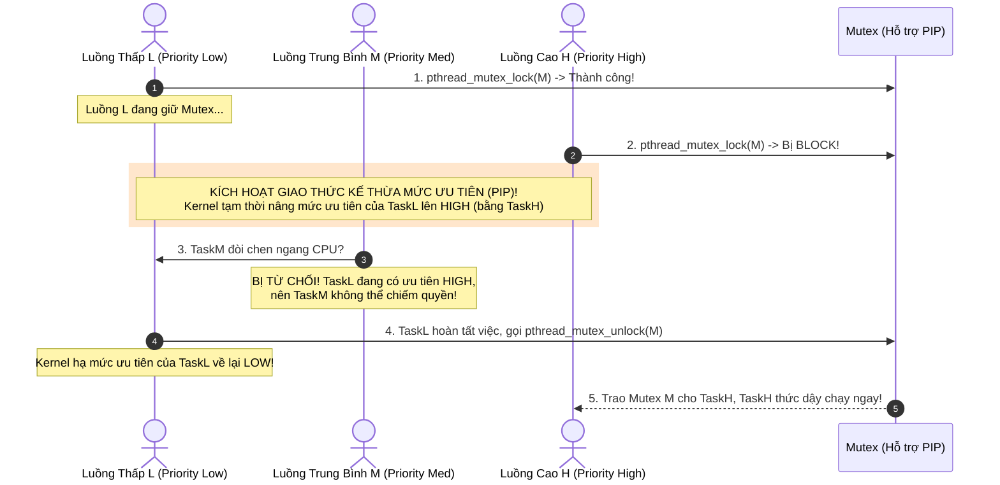

# 1_4_4 Mutex Locks

> **Khóa học**: Cloud DevOps Basic — OS Core  
> **Phân nhóm**: 1 Domain 1 - Operating System Core Fundamentals › 1_4 Process Synchronization and Concurrency  
> **Chủ đề**: Khóa độc quyền tương hỗ (Mutex): Ngữ nghĩa sở hữu, các loại Mutex POSIX, hiện tượng Priority Inversion và kiến trúc 3 tầng của Linux Kernel  
> **Trạng thái**: Verified (WRITE-CDB-1_4_4, 14-11-2026)  
> **Checklist đối chiếu**: [1_4_4](../../../CHECKLIST.md#domain-1-operating-system-core-fundamentals-45-items)  

---

## 1. Khái Niệm Cốt Lõi & Bản Chất Kỹ Thuật (Core Concepts & Technical Deep Dive)

Thuật ngữ **Mutex** là viết tắt của **Mutual Exclusion Lock (Khóa độc quyền tương hỗ)**. Đây là cơ chế đồng bộ hóa nền tảng và phổ biến nhất trong các hệ thống POSIX và hệ điều hành hiện đại, được thiết kế để bảo vệ miền găng (Critical Section) trước nguy cơ xung đột dữ liệu (Race Condition).

---

### 1.1 Ngữ Nghĩa Sở Hữu Nghiêm Ngặt (Strict Ownership Semantics)

Điểm khác biệt cốt lõi phân định Mutex với các cơ chế đồng bộ hóa khác (như Semaphore) nằm ở **Tính sở hữu (Ownership)**:
- Một Mutex khi bị khóa sẽ được gắn liền với định danh của luồng đã khóa nó (**Owner Thread**).
- **Quy tắc sở hữu tuyệt đối**: **Chỉ duy nhất luồng đã thực hiện thao tác khóa (`lock`) mới có quyền thực hiện thao tác mở khóa (`unlock`) chiếc Mutex đó**.
- Theo đặc tả chuẩn POSIX (`man 3 pthread_mutex_lock`): Nếu một luồng cố tình gọi `pthread_mutex_unlock()` trên một chiếc Mutex đang do luồng khác nắm giữ, hoặc trên một Mutex chưa hề bị khóa:
  - Với loại Mutex kiểm tra lỗi (`PTHREAD_MUTEX_ERRORCHECK`), hàm sẽ trả về mã lỗi **`EPERM` (Operation not permitted)**.
  - Với loại Mutex mặc định (`PTHREAD_MUTEX_NORMAL`), hành vi này dẫn đến kết quả bất định (**Undefined Behavior**).

---

### 1.2 Các Loại Mutex Chuẩn POSIX

Chuẩn POSIX.1-2008 định nghĩa 3 loại Mutex cơ bản thông qua thuộc tính `pthread_mutexattr_settype`:

| Loại Mutex | Tự khóa lại chính mình (Re-locking) | Mở khóa bởi luồng khác (Non-owner unlock) | Ứng dụng thực tế |
| :--- | :--- | :--- | :--- |
| **`PTHREAD_MUTEX_NORMAL`** *(Mặc định)* | **Gây Deadlock vĩnh viễn** (tiến trình tự chờ chính mình nhả khóa). | Gây Undefined Behavior (có thể làm hỏng trạng thái khóa). | Hiệu năng cao nhất, dùng khi logic mã nguồn đã được chứng minh an toàn. |
| **`PTHREAD_MUTEX_ERRORCHECK`** | Trả về mã lỗi **`EDEADLK`** ngay lập tức, ngăn ngừa Deadlock. | Trả về mã lỗi **`EPERM`**, ngăn ngừa vi phạm quyền sở hữu. | Dùng trong môi trường kiểm thử (Testing/Debugging) để truy tìm lỗi logic. |
| **`PTHREAD_MUTEX_RECURSIVE`** | Cho phép khóa nhiều lần liên tiếp; tăng biến đếm nội bộ (**lock counter**). | Trả về mã lỗi **`EPERM`**. | Dùng trong các hàm đệ quy hoặc các hàm thành phần gọi lồng nhau. Phải gọi số lần `unlock` tương ứng. |

---

### 1.3 Sự Cố Nghịch Đảo Mức Ưu Tiên (Priority Inversion) & Giao Thức Kế Thừa (PIP)

#### Bài toán Nghịch đảo mức ưu tiên (Priority Inversion)
Hiện tượng này xảy ra trong các hệ điều hành sử dụng bộ lập lịch ưu tiên ưu tiên tước quyền (Preemptive Priority Scheduling):
1. **Luồng Thấp (Low-priority - $L$)** giành được Mutex $M$ để truy cập tài nguyên.
2. **Luồng Cao (High-priority - $H$)** thức dậy và cần Mutex $M$. Vì $M$ đang bị $L$ giữ, luồng $H$ bị block và rơi vào hàng đợi chờ.
3. Đúng lúc này, các **Luồng Trung bình (Medium-priority - $M_1, M_2$)** thức dậy. Vì các luồng $M_1, M_2$ có độ ưu tiên cao hơn $L$ và không cần Mutex $M$, bộ lập lịch CPU liên tục cấp phát thời gian cho các luồng trung bình chạy, khiến luồng $L$ không thể chạy để hoàn thành công việc và nhả khóa.
4. **Hậu quả thảm khốc**: Luồng $H$ (ưu tiên cao nhất) bị gián tiếp "đói CPU" và chờ đợi vô tận bởi các luồng trung bình!

> [!NOTE]
> **Sự kiện lịch sử 1997 — Tàu thám hiểm Sao Hỏa (Mars Pathfinder)**:  
> Tàu đổ bộ Mars Pathfinder của NASA liên tục bị khởi động lại tự động giữa vũ trụ. Nguyên nhân gốc rễ là một luồng thu thập dữ liệu khí tượng (độ ưu tiên thấp) giữ một mutex dùng chung, bị các luồng xử lý truyền thông tin (độ ưu tiên trung bình) chen ngang liên tục, khiến luồng quản lý bus dữ liệu đo lường thông tin (độ ưu tiên cao nhất) bị trễ hạn, kích hoạt cơ chế Watchdog Timer reset toàn bộ hệ thống tàu thăm dò.

```text
                  HIỆN TƯỢNG NGHỊCH ĐẢO MỨC ƯU TIÊN
  Độ ưu tiên
     ^
 Cao |              Luồng H cần Mutex M --> Bị BLOCK! (Chờ L nhả khóa)
     |              ========================...............===========>
     |
Trung|                         Luồng Medium chen ngang chạy liên tục!
     |                         ---------------------------------------->
     |
Thấp | Luồng L giữ M               (Bị Medium chiếm CPU, không thể nhả M!)
     | =============               .....................................>
     +-----------------------------------------------------------------> Thời gian
```

#### Giải pháp: Giao thức Kế thừa mức ưu tiên (Priority Inheritance Protocol - PIP)
Để giải quyết triệt để bài toán này, chuẩn POSIX định nghĩa giao thức `PTHREAD_PRIO_INHERIT` (`man 3 pthread_mutexattr_setprotocol`):
- Khi Luồng Cao ($H$) bị block vì chờ Mutex đang do Luồng Thấp ($L$) nắm giữ, kernel sẽ **tạm thời nâng mức ưu tiên của $L$ lên bằng đúng mức ưu tiên của $H$**.
- Nhờ có mức ưu tiên cao tạm thời này, các luồng trung bình không thể chen ngang chiếm quyền của $L$.
- Luồng $L$ nhanh chóng chạy xong miền găng, gọi `unlock()` nhả Mutex. Ngay khi nhả khóa, kernel hạ mức ưu tiên của $L$ về lại mức ban đầu, và trao quyền kiểm soát cho Luồng $H$. Các kỹ sư NASA đã cứu sống tàu Pathfinder từ Trái Đất bằng cách kích hoạt cơ chế Priority Inheritance từ xa.

---

### 1.4 Kiến Trúc Khóa Mutex 3 Tầng Siêu Tốc Của Linux Kernel

Trong tài liệu chính thức từ Linux Kernel Documentation (*Documentation/locking/mutex-design.html*), nhân Linux tối ưu hóa việc chiếm giữ Mutex thông qua kiến trúc **3 tầng (3-Tier Mutex Architecture)**:

```text
+------------------------------------------------------------------------+
|                 KIẾN TRÚC 3 TẦNG CỦA LINUX KERNEL MUTEX                |
|                                                                        |
|  [ TẦNG 1: FASTPATH ] (Không có tranh chấp - Zero Contention)          |
|  - Sử dụng duy nhất 1 chỉ lệnh nguyên tử: atomic CAS (lock cmpxchg)    |
|  - Thành công: Chiếm khóa ngay lập tức trong vài nano-giây!            |
|  - Thất bại: Chuyển xuống Tầng 2.                                      |
|                                                                        |
|  [ TẦNG 2: MIDPATH ] (Tối ưu hóa xoay chờ - Optimistic Spinning)       |
|  - Kiểm tra xem chủ sở hữu khóa (Owner) có đang chạy trên core CPU khác|
|    không. Nếu ĐANG CHẠY: Luồng hiện tại xoay chờ ngắn (MCS lock).      |
|  - Vì chủ sở hữu sắp nhả khóa, xoay chờ sẽ nhanh hơn Context Switch!   |
|  - Thất bại hoặc chủ sở hữu đang ngủ: Chuyển xuống Tầng 3.             |
|                                                                        |
|  [ TẦNG 3: SLOWPATH ] (Chờ đợi nặng - Sleep on Wait Queue)             |
|  - Đưa luồng vào hàng đợi chờ (Wait-queue) của Mutex.                  |
|  - Gọi schedule_preempt_disabled() nhường CPU cho tiến trình khác.     |
+------------------------------------------------------------------------+
```

1. **Fastpath**: Khi Mutex đang hoàn toàn rảnh rỗi (trường hợp phổ biến nhất), luồng chỉ mất một chỉ lệnh nguyên tử `lock cmpxchg` để đổi trạng thái khóa từ 1 về 0. Không hề có can thiệp của bộ lập lịch.
2. **Midpath (Optimistic Spinning)**: Nếu Mutex đang bị chiếm giữ, kernel kiểm tra xem luồng chủ sở hữu có đang trực tiếp chạy trên một CPU core khác hay không. Nếu có, khả năng cao là miền găng rất ngắn và khóa sắp được nhả. Luồng yêu cầu sẽ chủ động xoay chờ (**Spinning**) trên một hàng đợi MCS lock nhẹ để chộp lấy khóa ngay khi nó được nhả, tránh phải trả chi phí đắt đỏ của hai lần chuyển đổi ngữ cảnh (Context Switch).
3. **Slowpath**: Nếu luồng chủ sở hữu đang ngủ (đang chờ I/O) hoặc việc xoay chờ quá lâu, kernel chuyển luồng yêu cầu sang trạng thái ngủ (`TASK_UNINTERRUPTIBLE`), gắn vào danh sách hàng đợi chờ của Mutex và gọi bộ lập lịch nhường core CPU cho tiến trình khác.

---

## 2. Ví Dụ Đời Sống Thực Tế Dễ Hiểu (Intuitive Real-World Analogies)

### Ẩn Dụ: Chìa Khóa Phòng Họp VIP & Sự Cố Nhân Viên Tạp Vụ (The VIP Conference Room Key)

Hãy tưởng tượng một công ty công nghệ có một phòng họp VIP duy nhất:

```text
+------------------------------------------------------------------------+
|                   ẨN DỤ PHÒNG HỌP VIP & SỰ CỐ PATHFINDER               |
|                                                                        |
| 1. CHÌA KHÓA KHẮC TÊN (Ownership):                                     |
|    - Ai vào phòng họp thì cầm chìa khóa đóng cửa lại.                  |
|    - Quy tắc bắt buộc: Chỉ chính người đã cầm chìa khóa mới được phép  |
|      mở khóa trả lại ở bàn lễ tân khi ra về.                           |
|                                                                        |
| 2. SỰ CỐ MARS PATHFINDER (Priority Inversion):                         |
|    - Chú công nhân tạp vụ (Luồng thấp L) vào lau dọn, cầm chìa khóa.   |
|    - Giám đốc điều hành (Luồng cao H) cần họp khẩn cấp, đứng đợi chú L |
|      dọn xong để lấy chìa khóa.                                        |
|    - Đúng lúc đó, các Trưởng phòng (Luồng trung bình M) rủ nhau        |
|      chơi bóng bàn và buôn chuyện ồn ào ngoài hành lang, kéo chú L ra  |
|      nhờ vả việc vặt. Chú L không thể dọn xong phòng để trả chìa khóa! |
|    --> Giám đốc H bị trễ cuộc họp quan trọng vì các Trưởng phòng M!    |
|                                                                        |
| 3. GIẢI PHÁP KẾ THỪA MỨC ƯU TIÊN (Priority Inheritance):               |
|    - Giám đốc H nói: "Tôi tạm thời bổ nhiệm chú tạp vụ L làm Phó Giám  |
|      đốc lâm thời!"                                                    |
|    - Nhờ thẻ Phó Giám đốc, không Trưởng phòng M nào dám cản trở chú L. |
|    - Chú L lau dọn xong trong 1 phút, trả chìa khóa cho Giám đốc H.    |
|    - Chú L trở về làm tạp vụ, Giám đốc H vào họp đúng giờ!             |
+------------------------------------------------------------------------+
```

---

## 3. Kiến Trúc, Luồng Hoạt Động & Hình Ảnh Trực Quan (Architecture, Diagrams & Visual Media)

### 3.1 Sơ Đồ Khắc Phục Nghịch Đảo Mức Ưu Tiên Bằng Priority Inheritance Protocol



---

## 4. Code Mẫu Trực Quan Hoặc Dòng Lệnh Thực Chiến (Runnable Sample Code / CLI)

> ⚠️ Dữ liệu mã nguồn C dưới đây mang tính chất minh họa (illustrative output) ghi nhận trên hệ thống Linux x86_64 nhằm quan sát cơ chế kiểm tra quyền sở hữu của Mutex `PTHREAD_MUTEX_ERRORCHECK`.

### 4.1 Minh Họa Lỗi Vi Phạm Quyền Sở Hữu: `mutex_ownership_demo.c`

```c
/*
 * File: mutex_ownership_demo.c
 * Mục đích: Minh họa tính sở hữu nghiêm ngặt của Mutex.
 *           Luồng B cố tình mở khóa Mutex do Luồng A nắm giữ
 *           sẽ bị kernel từ chối với lỗi EPERM.
 */

#include <stdio.h>
#include <stdlib.h>
#include <pthread.h>
#include <unistd.h>
#include <errno.h>
#include <string.h>

pthread_mutex_t errorcheck_mutex;

void *thread_a_worker(void *arg) {
    (void)arg;
    printf("[Thread A] Đang yêu cầu khóa Mutex...\n");
    pthread_mutex_lock(&errorcheck_mutex);
    printf("[Thread A] ĐÃ KHÓA THÀNH CÔNG Mutex. Giữ khóa trong 2 giây...\n");

    sleep(2);

    printf("[Thread A] Chuẩn bị nhả khóa hợp lệ...\n");
    pthread_mutex_unlock(&errorcheck_mutex);
    printf("[Thread A] Đã nhả khóa an toàn.\n");
    return NULL;
}

void *thread_b_violator(void *arg) {
    (void)arg;
    // Chờ 1 giây để đảm bảo Thread A đã nắm khóa
    sleep(1);

    printf("[Thread B] Cố tình gọi pthread_mutex_unlock() trên khóa của Thread A...\n");
    int result = pthread_mutex_unlock(&errorcheck_mutex);

    if (result != 0) {
        printf("[Thread B] BỊ TỪ CHỐI! Mã lỗi: %d (%s)\n", result, strerror(result));
        if (result == EPERM) {
            printf("[Thread B] XÁC NHẬN: Lỗi EPERM - Luồng không sở hữu khóa không được phép mở khóa!\n");
        }
    } else {
        printf("[Thread B] NGUY HIỂM: Đã mở khóa trái phép thành công!\n");
    }
    return NULL;
}

int main(void) {
    pthread_t thread_a, thread_b;
    pthread_mutexattr_t attr;

    // Khởi tạo thuộc tính kiểm tra lỗi ERRORCHECK
    pthread_mutexattr_init(&attr);
    pthread_mutexattr_settype(&attr, PTHREAD_MUTEX_ERRORCHECK);
    pthread_mutex_init(&errorcheck_mutex, &attr);
    pthread_mutexattr_destroy(&attr);

    printf("Khởi chạy thử nghiệm tính sở hữu Mutex (PTHREAD_MUTEX_ERRORCHECK)...\n");

    pthread_create(&thread_a, NULL, thread_a_worker, NULL);
    pthread_create(&thread_b, NULL, thread_b_violator, NULL);

    pthread_join(thread_a, NULL);
    pthread_join(thread_b, NULL);

    pthread_mutex_destroy(&errorcheck_mutex);
    printf("Thử nghiệm hoàn tất thành công.\n");
    return EXIT_SUCCESS;
}
```

---

### 4.2 Thao Tác Biên Dịch Và Thực Thi

```bash
# 1. Biên dịch mã nguồn với thư viện pthread
gcc -O2 -pthread mutex_ownership_demo.c -o mutex_ownership_demo

# 2. Thực thi chương trình
./mutex_ownership_demo
```

### 4.3 Đầu Ra Minh Họa & Phân Tích

```text
Khởi chạy thử nghiệm tính sở hữu Mutex (PTHREAD_MUTEX_ERRORCHECK)...
[Thread A] Đang yêu cầu khóa Mutex...
[Thread A] ĐÃ KHÓA THÀNH CÔNG Mutex. Giữ khóa trong 2 giây...
[Thread B] Cố tình gọi pthread_mutex_unlock() trên khóa của Thread A...
[Thread B] BỊ TỪ CHỐI! Mã lỗi: 1 (Operation not permitted)
[Thread B] XÁC NHẬN: Lỗi EPERM - Luồng không sở hữu khóa không được phép mở khóa!
[Thread A] Chuẩn bị nhả khóa hợp lệ...
[Thread A] Đã nhả khóa an toàn.
Thử nghiệm hoàn tất thành công.
```

- **Nhận xét quan sát**:
  - Thread B khi cố tình gọi `pthread_mutex_unlock` đã bị kernel chặn đứng ngay lập tức với mã lỗi `EPERM` (Error 1: Operation not permitted).
  - Khóa của Thread A vẫn được bảo vệ nguyên vẹn cho đến khi chính Thread A chủ động mở khóa.

---

## 5. Cạm Bẫy Thực Tế & Thực Tiễn Sản Xuất (Production Gotchas & Best Practices)

Trong kỹ thuật vận hành hệ thống đám mây và microservices đa luồng, việc dùng Mutex tiềm ẩn các cạm bẫy sau:

### 1. Tự Khóa Lại Chính Mình Gây Deadlock Trên `PTHREAD_MUTEX_NORMAL`
- **Cạm bẫy**: Lập trình viên viết một hàm `foo()` đã chiếm giữ Mutex, sau đó `foo()` lại gọi một hàm phụ trợ `bar()`, và bên trong `bar()` lại tiếp tục gọi `pthread_mutex_lock()` trên chính chiếc Mutex đó.
- **Hậu quả**: Nếu Mutex là loại mặc định `PTHREAD_MUTEX_NORMAL`, luồng sẽ bị treo cứng vĩnh viễn (Deadlock tự thân) vì nó đang chờ đợi chính nó nhả khóa. Toàn bộ tiến trình bị đóng băng.
- **Khuyến nghị**: Sử dụng `PTHREAD_MUTEX_RECURSIVE` nếu logic nghiệp vụ bắt buộc phải gọi khóa lồng nhau, hoặc tái cấu trúc mã nguồn để tách riêng logic miền găng.

### 2. Hiện tượng Giảm Hiệu Năng Nghiêm Trọng Do Khóa Quá Lớn (Coarse-Grained Locking)
- **Vấn đề**: Để đảm bảo an toàn, lập trình viên đặt một Mutex bao bọc toàn bộ một hàm dài (bao gồm cả các thao tác đọc ghi I/O mạng hoặc truy vấn cơ sở dữ liệu chậm chạp).
- **Hậu quả**: Tất cả các luồng khác đều bị block ở Tầng Slowpath của kernel, dẫn đến hàng trăm nghìn lần Context Switch không cần thiết. Tải hệ thống tăng vọt nhưng throughput xử lý giảm sâu.
- **Thực tiễn tốt nhất**: Áp dụng nguyên tắc **Fine-Grained Locking**: chỉ khóa trong phạm vi vài dòng mã thao tác trên biến số chung, giải phóng khóa ngay lập tức trước khi thực hiện các tác vụ I/O.

---

## 6. Câu Hỏi Củng Cố Kiến Thức (Active Recall Quiz)

<details>
<summary><b>Câu hỏi 1:</b> Điểm khác biệt căn bản nhất về mặt ngữ nghĩa (Semantics) giữa Mutex và Binary Semaphore là gì? Một luồng có thể mở khóa (unlock) một chiếc Mutex do một luồng khác đã khóa hay không?</summary>

**Đáp án:**
- **Khác biệt căn bản là Tính sở hữu (Ownership)**: Mutex có tính sở hữu gắn liền với luồng đã khóa nó (chỉ ai khóa thì người đó mới được mở). Ngược lại, Binary Semaphore không có khái niệm sở hữu: một luồng này có thể đợi (`wait()`), và một luồng hoàn toàn khác (hoặc thậm chí là trình xử lý ngắt phần cứng ISR) có thể phát tín hiệu mở (`post()`).
- **Mở khóa chéo**: Với Mutex, một luồng khác **tuyệt đối không được phép mở khóa**. Nếu cố tình làm vậy, hệ thống sẽ trả về lỗi `EPERM` (với `PTHREAD_MUTEX_ERRORCHECK`) hoặc gây lỗi bất định Undefined Behavior (với `PTHREAD_MUTEX_NORMAL`).
</details>

<details>
<summary><b>Câu hỏi 2:</b> Hiện tượng Nghịch đảo mức ưu tiên (Priority Inversion) là gì và sự cố tàu thám hiểm Mars Pathfinder năm 1997 được giải quyết nhờ giao thức nào? Giao thức đó hoạt động ra sao?</summary>

**Đáp án:**
- **Hiện tượng**: Xảy ra khi một luồng ưu tiên cao (High) bị block do chờ Mutex đang bị một luồng ưu tiên thấp (Low) giữ, nhưng luồng Low lại bị các luồng ưu tiên trung bình (Medium) chen ngang chiếm CPU, khiến luồng High bị gián tiếp bỏ đói vô hạn.
- **Giao thức giải quyết**: Giao thức Kế thừa mức ưu tiên (**Priority Inheritance Protocol - PIP / `PTHREAD_PRIO_INHERIT`**).
- **Cách hoạt động**: Khi luồng High bị block vì chờ Mutex của luồng Low, kernel sẽ tạm thời nâng mức ưu tiên của luồng Low lên bằng đúng mức ưu tiên của luồng High. Nhờ đó, các luồng Medium không thể chen ngang; luồng Low nhanh chóng hoàn tất miền găng, nhả khóa và mức ưu tiên được trả về bình thường.
</details>

<details>
<summary><b>Câu hỏi 3:</b> Trong kiến trúc 3 tầng của Linux Kernel Mutex, Tầng 2 (Midpath / Optimistic Spinning) hoạt động dựa trên giả định gì về luồng chủ sở hữu khóa?</summary>

**Đáp án:**
- **Giả định hoạt động**: Kernel giả định rằng nếu luồng đang sở hữu khóa (Owner) **đang trực tiếp thực thi trên một core CPU khác**, thì miền găng có thể rất ngắn và chủ sở hữu sắp sửa nhả khóa trong tích tắc.
- **Hành động**: Luồng yêu cầu khóa sẽ thực hiện xoay chờ ngắn (Spinning trên MCS lock) thay vì lập tức ngủ và nhường CPU. Nếu chủ sở hữu nhả khóa nhanh, luồng yêu cầu sẽ chộp lấy khóa ngay, giúp tiết kiệm được chi phí đắt đỏ của hai lần chuyển đổi ngữ cảnh (Context Switch).
</details>

---

## 7. 📚 Nguồn Tài Liệu Chính Thống (Tier-1 Official References)

- [Linux Manual Pages: pthread_mutex_lock(3p)](https://man7.org/linux/man-pages/man3/pthread_mutex_lock.3p.html) - Đặc tả chuẩn POSIX chính thức về các hàm khóa/mở khóa Mutex, ngữ nghĩa quyền sở hữu và mã lỗi `EPERM`, `EDEADLK`.
- [Linux Manual Pages: pthread_mutexattr_setprotocol(3p)](https://man7.org/linux/man-pages/man3/pthread_mutexattr_setprotocol.3p.html) - Hướng dẫn chính thức về thuộc tính giao thức kế thừa mức ưu tiên `PTHREAD_PRIO_INHERIT`.
- [Linux Kernel Documentation: Generic Mutex Subsystem (mutex-design.html)](https://docs.kernel.org/locking/mutex-design.html) - Tài liệu kiến trúc chính thức của hạt nhân Linux mô tả chi tiết thiết kế 3 tầng: Fastpath, Midpath (Optimistic Spinning) và Slowpath.
- [OSTEP Chapter 28: Locks](https://pages.cs.wisc.edu/~remzi/OSTEP/threads-locks.pdf) - Giáo trình chuẩn mực *Operating Systems: Three Easy Pieces* (Remzi H. Arpaci-Dusseau & Andrea C. Arpaci-Dusseau), phân tích chuyên sâu về cơ chế Mutex, sự cố Mars Pathfinder và đánh giá hiệu năng khóa.
