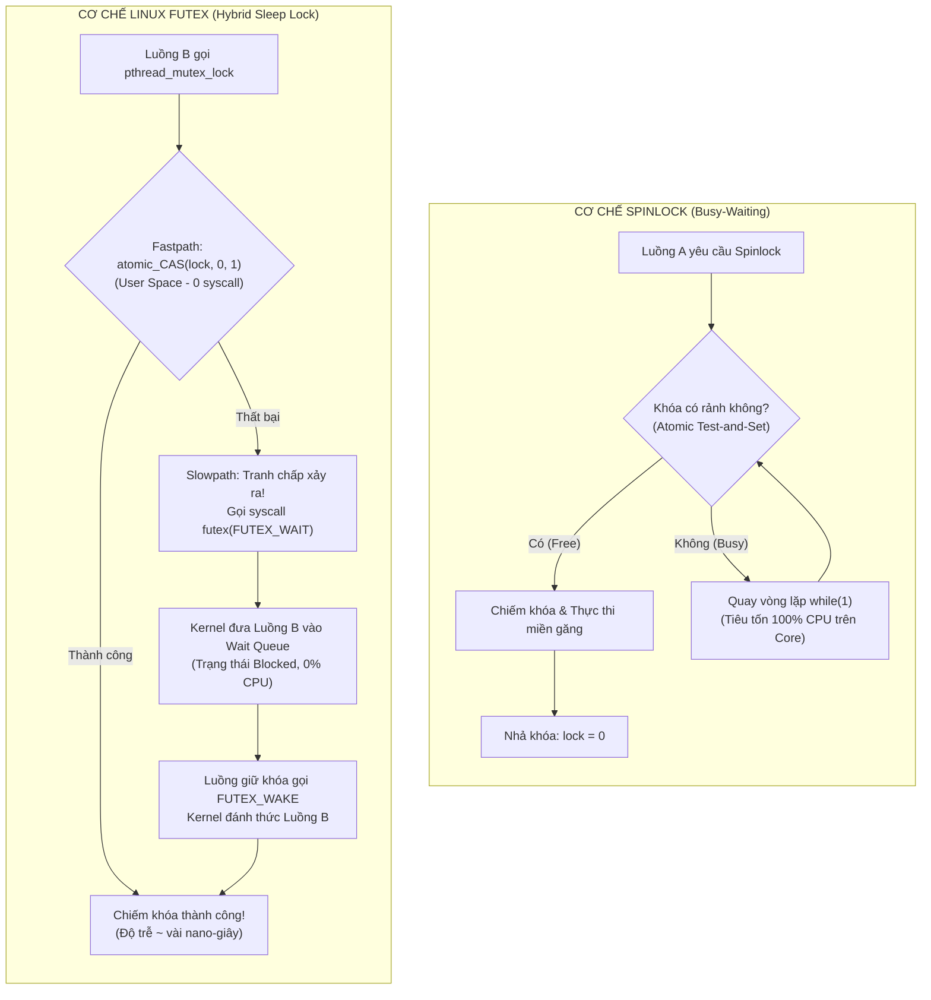

# 1_4_5 Spinlocks vs Sleep Locks

> **Khóa học**: Cloud DevOps Basic — OS Core  
> **Phân nhóm**: 1 Domain 1 - Operating System Core Fundamentals › 1_4 Process Synchronization and Concurrency  
> **Chủ đề**: Khóa bận (Spinlocks) vs Khóa ngủ (Sleep Locks): Bản chất kỹ thuật, chi phí chu kỳ CPU, quy tắc ngắt Kernel và cơ chế Linux Futex  
> **Trạng thái**: Draft (WRITE-CDB-1_4_5, 14-11-2026)  
> **Checklist đối chiếu**: [1_4_5](../../../CHECKLIST.md#domain-1-operating-system-core-fundamentals-45-items)  

---

## 1. Khái Niệm Cốt Lõi & Bản Chất Kỹ Thuật (Core Concepts & Technical Deep Dive)

Trong thiết kế hệ điều hành và lập trình hệ thống hiệu năng cao, khi một luồng muốn bước vào miền găng nhưng phát hiện chiếc khóa bảo vệ đang bị luồng khác chiếm giữ, hệ thống có hai phương án ứng xử hoàn toàn trái ngược nhau:
1. **Khóa bận (Spinlock)**: Luồng không chịu từ bỏ CPU, mà liên tục quay vòng (*busy-waiting / polling*) kiểm tra trạng thái khóa trong một vòng lặp chặt chẽ cho đến khi khóa được mở.
2. **Khóa ngủ (Sleep Lock / Blocking Lock)**: Luồng chủ động từ bỏ quyền thực thi, chuyển giao quyền kiểm soát cho hệ điều hành để đưa mình vào trạng thái ngủ (*Blocked / Waiting*), nhường lại chu kỳ CPU cho các tác vụ khác.

```
       +-----------------------------------------------------------------+
       |         KHI KHÓA ĐANG BỊ CHIẾM GIỮ (LOCK IS CONTENDED)          |
       +-----------------------------------------------------------------+
                     /                                     \
                    /                                       \
       [LỰA CHỌN 1: SPINLOCK]                    [LỰA CHỌN 2: SLEEP LOCK]
       - Luồng chạy vòng lặp while(lock)         - Luồng gọi System Call vào Kernel
       - Đốt cháy 100% chu kỳ CPU                - Chuyển trạng thái: Running -> Blocked
       - Độ trễ phản hồi: Gần như 0 ns           - CPU chuyển sang chạy tiến trình khác
       - Không tốn chi phí Context Switch        - Tốn chi phí 2 lần Context Switch
       - Thích hợp: Thời gian giữ khóa SIÊU NGẮN - Thích hợp: Thời gian giữ khóa DÀI (I/O)
```

---

### 1.1 Khóa Bận (Spinlock): Cơ Chế và Quy Tắc Vàng (Rule of Thumb)

Theo giáo trình *Operating Systems: Three Easy Pieces (OSTEP - Ch. 28)*:
- **Cơ chế hoạt động**: Spinlock dựa trên các chỉ lệnh nguyên tử phần cứng như `TestAndSet` hoặc `CompareAndSwap`. Luồng liên tục thực thi chỉ lệnh này trên một biến cờ nguyên tử. Nếu khóa đang bận, CPU tiếp tục quay vòng lặp lại câu lệnh đó với tốc độ hàng tỷ chu kỳ xung nhịp mỗi giây.
- **Quy tắc vàng lựa chọn (The Rule of Thumb - OSTEP Ch. 28.16)**:
  Việc sử dụng Spinlock chỉ đem lại lợi thế kinh tế về mặt hiệu năng khi và chỉ khi:
  $$\text{Thời gian giữ khóa (Lock Hold Time)} < 2 \times T_{\text{context\_switch}}$$
  Trong đó $T_{\text{context\_switch}}$ là thời gian cần thiết để hệ điều hành thực hiện một lần chuyển đổi ngữ cảnh (thường từ $1 \text{ đến } 5 \ \mu\text{s}$ trên máy chủ hiện đại).
  - Nếu miền găng chỉ thực hiện cộng vài phép tính (tốn $50 \text{ ns}$), việc ngủ và đánh thức tiêu tốn tới hàng nghìn nano-giây. Dùng Spinlock quay vòng vài chục nano-giây rồi chiếm được khóa ngay là giải pháp tối ưu vượt trội!
  - Ngược lại, nếu miền găng thực hiện đọc ghi ổ đĩa hoặc kết nối mạng (tốn $1 \text{ ms}$ đến $10 \text{ ms}$), việc dùng Spinlock sẽ thiêu rụi hàng triệu chu kỳ CPU một cách vô nghĩa.

---

### 1.2 Hiểm Họa của Spinlock trên Hệ Thống Đơn Nhân (Uniprocessor Livelock)

Trên hệ thống máy tính chỉ có **1 CPU Core vật lý duy nhất**, việc sử dụng Spinlock ở không gian người dùng (*User-Space*) mà không có cơ chế cưỡng chế ngắt thời gian là một sai lầm chết người:
- Giả sử Luồng 1 chiếm được Spinlock và đang thực hiện công việc trong miền găng.
- Hết thời gian định mức, CPU chuyển ngữ cảnh sang Luồng 2 (hoặc Luồng 2 có độ ưu tiên cao hơn nhảy vào).
- Luồng 2 cố gắng chiếm Spinlock: Vì khóa đang bị giữ bởi Luồng 1, Luồng 2 bắt đầu quay vòng lặp vô tận (*busy-waiting*).
- **Hậu quả**: Vì Luồng 2 đang chiếm 100% thời gian của lõi CPU duy nhất đó, **Luồng 1 không bao giờ có cơ hội được nạp vào CPU để hoàn thành công việc và nhả khóa**! Hệ thống rơi vào trạng thái bế tắc sống (*Livelock*) hoặc bỏ đói vĩnh viễn (*Priority Inversion Starvation*). Do đó, Spinlock chỉ thực sự phát huy giá trị trên các hệ thống vi xử lý đa nhân (**Symmetric Multiprocessing - SMP**).

---

### 1.3 Spinlock trong Nhân Linux Kernel: Ngữ Cảnh Ngắt và `spin_lock_irqsave`

Trong kiến trúc nhân hệ điều hành Linux (*Linux Kernel Locking Documentation - docs.kernel.org*), có một khu vực cấm kỵ tuyệt đối: **Ngữ cảnh ngắt phần cứng (Interrupt Context / Interrupt Service Routines - ISR)**.
- Khi một thiết bị phần cứng (card mạng, bàn phím, ổ đĩa) kích hoạt ngắt, CPU tạm dừng luồng hiện tại để nhảy vào hàm ISR. Trong ISR, luồng không có cấu trúc tiến trình đại diện cụ thể (`current` là bất kỳ), do đó **NGHIÊM CẤM NGỦ TRONG NGỮ CẢNH NGẮT (`Cannot sleep in interrupt context`)**!
- Vì không được phép ngủ, **Spinlock là cơ chế khóa duy nhất hợp lệ bên trong các hàm xử lý ngắt**.

#### Hiểm họa Deadlock Ngắt và Giải pháp `spin_lock_irqsave`
Giả sử một tiến trình thông thường đang chạy trên Core 0 chiếm Spinlock `lock_A`. Đúng lúc đó, ngắt mạng phát sinh trên chính Core 0 đó:
1. CPU dừng tiến trình và nhảy vào hàm xử lý ngắt ISR.
2. Hàm ISR cũng cần truy cập vào hàng đợi mạng nên cố gắng chiếm `lock_A`.
3. Hàm ISR bắt đầu quay vòng chờ `lock_A`.
4. Tuy nhiên, tiến trình đang giữ `lock_A` lại đang bị hàm ISR này chặn đứng trên cùng một CPU! ISR sẽ quay vòng vĩnh viễn $\rightarrow$ **Hệ thống Kernel bị treo cứng (Self-Deadlock)!**

**Quy tắc cứu sinh**: Khi chiếm một Spinlock có khả năng được sử dụng bởi hàm xử lý ngắt, nhân Linux bắt buộc phải gọi hàm:
```c
spin_lock_irqsave(&lock, flags);
// Miền găng an toàn tuyệt đối
spin_unlock_irqrestore(&lock, flags);
```
Hàm này sẽ **vô hiệu hóa ngắt cục bộ trên lõi CPU đó (disable local IRQs)** và lưu lại cờ trạng thái trước khi chiếm khóa, ngăn chặn triệt để mọi ngắt chen ngang vào giữa miền găng.

---

### 1.4 Đột Phá Kiến Trúc: Cơ Chế Linux `futex(2)` (Fast Userspace Mutex)

Để kết hợp ưu điểm siêu nhanh của Spinlock khi không có tranh chấp với ưu điểm tiết kiệm CPU của Sleep Lock khi có tranh chấp, Linux Kernel 2.6 đã giới thiệu cơ chế mang tính cách mạng: **`futex(2)` (Fast Userspace Mutex)** (`man 2 futex`).

Một Futex về bản chất là một số nguyên 32-bit trong bộ nhớ người dùng, vận hành theo mô hình hai pha:

```
                      +------------------------------------+
                      |     BƯỚC VÀO KHÓA MUTEX (FUTEX)    |
                      +-----------------+------------------+
                                        |
                                        v
                 [PHA 1: FASTPATH - Không gian Người dùng (User Space)]
                 Thực hiện chỉ lệnh nguyên tử: atomic_CAS(lock_val, 0, 1)
                                        |
                       +----------------+----------------+
                       |                                 |
              [Thành công (0 ns)]               [Thất bại (Bị chiếm)]
                       v                                 v
         Chiếm khóa ngay lập tức!         [PHA 2: SLOWPATH - Kernel Space]
         TIÊU TỐN 0 SYSTEM CALLS!         Gọi syscall: sys_futex(FUTEX_WAIT)
                                          Kernel đưa luồng vào hàng đợi ngủ.
                                          Tiết kiệm 100% tài nguyên CPU!
```

1. **Pha Nhanh (Fastpath - Không gian Người dùng)**:
   - Khi không có tranh chấp (*uncontended case*), luồng thực hiện một chỉ lệnh nguyên tử Compare-and-Swap ở User Space (Ring 3). Nếu khóa đang bằng 0, nó đổi thành 1 và chiếm khóa ngay lập tức. **Toàn bộ thao tác hoàn thành trong vài nano-giây mà không tốn một lời gọi System Call nào vào Kernel!**
2. **Pha Chậm (Slowpath - Không gian Hạt nhân)**:
   - Nếu CAS thất bại (khóa đang bị luồng khác chiếm giữ), luồng mới thực hiện System Call `futex(uaddr, FUTEX_WAIT, val, ...)`.
   - Kernel sẽ chuyển trạng thái của luồng sang Blocked và đưa nó vào danh sách chờ (*wait queue*), giải phóng hoàn toàn lõi CPU cho các tiến trình khác. Khi luồng giữ khóa nhả khóa, nó gọi `futex(uaddr, FUTEX_WAKE, 1)` để Kernel đánh thức luồng đang ngủ dậy.

---

## 2. Ví Dụ Đời Sống Thực Tế Dễ Hiểu (Intuitive Real-World Analogies)

Để phân biệt sâu sắc giữa Spinlock và Sleep Lock, hãy liên tưởng tới hành vi của **Người Đến Ký Giấy Tờ Tại Phòng Làm Việc Của Giám Đốc**:

```
+-------------------------------------------------------------------------------+
|                    ẨN DỤ: ĐẾN KÝ HỢP ĐỒNG TẠI PHÒNG GIÁM ĐỐC                  |
|                                                                               |
|  [Spinlock - Đứng Gõ Cửa Liên Tục "Xong Chưa?"]:                              |
|  Bạn đứng ngay trước cửa phòng, dán mắt vào khe cửa, liên tục gõ cộc cộc:     |
|  "Sếp xong chưa? Xong chưa ạ?".                                               |
|  - Nếu sếp chỉ ký mất đúng 2 giây: Bạn đẩy cửa vào lấy giấy ngay, không mất   |
|    công đi lại. Cực kỳ nhanh!                                                 |
|  - Nhưng nếu sếp đang bận họp 3 tiếng: Bạn đứng gõ cửa suốt 3 tiếng sẽ kiệt   |
|    sức ngất xỉu (đốt cháy 100% năng lượng cơ thể vô ích)!                     |
|                                                                               |
|  [Sleep Lock - Về Bàn Ngủ Chờ Điện Thoại]:                                    |
|  Bạn đến thấy cửa đóng, liền để lại số điện thoại cho thư ký rồi quay về bàn  |
|  làm việc ngả lưng ngủ một giấc. Khi nào sếp rảnh, thư ký sẽ gọi điện gọi bạn |
|  dậy. Bạn không tốn một chút calo nào, nhưng mất công thức dậy đi bộ sang.   |
|                                                                               |
|  [Linux Futex - Sự Kết Hợp Tinh Hoa]:                                         |
|  Bạn bước tới, tiện tay vặn nhẹ tay nắm cửa xem có mở không (Fastpath).       |
|  Nếu cửa không khóa, bạn bước vào ký luôn (0 giây thủ tục)!                   |
|  Nếu cửa khóa trái thật, lúc đó bạn mới để lại số điện thoại rồi về ngủ       |
|  (Slowpath). Cực kỳ văn minh và tối ưu!                                       |
+-------------------------------------------------------------------------------+
```

---

## 3. Kiến Trúc, Luồng Hoạt Động & Hình Ảnh Trực Quan (Architecture, Diagrams & Visual Media)

### 3.1 Minh Họa Kiến Trúc Đặc Quyền

Các Sleep Lock phụ thuộc vào Kernel Mode để quản lý hàng đợi tiến trình ngủ, trong khi Spinlock có thể chạy thuần túy ở User Mode hoặc tầng Driver:

[](https://learn.microsoft.com/en-us/windows-hardware/drivers/gettingstarted/images/userandkernelmode01.png)  
*Hình 1: Mô hình phân tách đặc quyền thực thi phần cứng giữa User Mode và Kernel Mode từ Microsoft Learn.*

---

### 3.2 Sơ đồ Luồng Hoạt Động So Sánh: Spinlock vs Futex / Sleep Lock



---

## 4. Code Mẫu Trực Quan Hoặc Dòng Lệnh Thực Chiến (Runnable Sample Code / CLI)

### 4.1 Mã Nguồn C Thực Chiến: Kiểm Chứng Hiệu Năng và Quan Sát CPU của Spinlock vs Mutex

Chương trình C dưới đây tạo 4 luồng cùng tranh chấp một miền găng có thời gian xử lý giả lập. Chúng ta sẽ đối chiếu trực tiếp:
1. `pthread_spinlock_t`: Khóa bận ở không gian người dùng.
2. `pthread_mutex_t`: Khóa Futex kết hợp ngủ ở kernel.

```c
/**
 * file: spinlock_vs_mutex_demo.c
 * Biên dịch: gcc -O2 -pthread spinlock_vs_mutex_demo.c -o spinlock_vs_mutex_demo
 * Thực thi:  ./spinlock_vs_mutex_demo [spin|mutex]
 */
#define _GNU_SOURCE
#include <stdio.h>
#include <stdlib.h>
#include <string.h>
#include <pthread.h>
#include <unistd.h>
#include <time.h>

#define NUM_THREADS 4
#define NUM_OPERATIONS 200000

static pthread_spinlock_t spinlock;
static pthread_mutex_t mutex;
static long shared_counter = 0;
static int use_spin = 0;

void *worker_func(void *arg) {
    (void)arg;
    for (int i = 0; i < NUM_OPERATIONS; i++) {
        if (use_spin) {
            // Chiếm Spinlock: Luồng sẽ quay vòng CPU nếu bị tranh chấp
            pthread_spin_lock(&spinlock);
            shared_counter++;
            pthread_spin_unlock(&spinlock);
        } else {
            // Chiếm Mutex: Luồng sẽ dùng Futex Fastpath hoặc ngủ trong Kernel
            pthread_mutex_lock(&mutex);
            shared_counter++;
            pthread_mutex_unlock(&mutex);
        }
    }
    return NULL;
}

int main(int argc, char *argv[]) {
    if (argc < 2) {
        printf("Sử dụng: %s [spin|mutex]\n", argv[0]);
        return 1;
    }

    use_spin = (strcmp(argv[1], "spin") == 0);
    printf("=================================================================\n");
    printf("[THỰC NGHIỆM ĐỒNG BỘ] Chế độ kiểm thử: %s\n", use_spin ? "SPINLOCK (Busy-Waiting)" : "MUTEX (Futex Sleep)");
    printf("  -> Số lượng luồng đồng thời: %d\n", NUM_THREADS);
    printf("  -> Tổng số lần cập nhật   : %d\n", NUM_THREADS * NUM_OPERATIONS);
    printf("=================================================================\n");

    pthread_t threads[NUM_THREADS];
    pthread_spin_init(&spinlock, PTHREAD_PROCESS_PRIVATE);
    pthread_mutex_init(&mutex, NULL);

    struct timespec start, end;
    clock_gettime(CLOCK_MONOTONIC, &start);

    for (int i = 0; i < NUM_THREADS; i++) {
        pthread_create(&threads[i], NULL, worker_func, NULL);
    }

    for (int i = 0; i < NUM_THREADS; i++) {
        pthread_join(threads[i], NULL);
    }

    clock_gettime(CLOCK_MONOTONIC, &end);
    double elapsed = (end.tv_sec - start.tv_sec) + (end.tv_nsec - start.tv_nsec) / 1e9;

    printf("[KẾT QUẢ]\n");
    printf("  -> Counter cuối cùng: %ld\n", shared_counter);
    printf("  -> Thời gian thực thi: %.4f giây\n", elapsed);
    printf("=================================================================\n");

    pthread_spin_destroy(&spinlock);
    pthread_mutex_destroy(&mutex);
    return 0;
}
```

---

### 4.2 Điều Tra Hệ Thống Bằng Công Cụ DevOps (CLI Inspection)

#### 1. Biên dịch và so sánh thời gian thực thi
```bash
gcc -O2 -pthread spinlock_vs_mutex_demo.c -o spinlock_vs_mutex_demo
./spinlock_vs_mutex_demo spin
./spinlock_vs_mutex_demo mutex
```
- Khi miền găng siêu ngắn (`shared_counter++`), `spinlock` chạy cực kỳ nhanh vì các luồng hầu như chỉ tốn vài chục chu kỳ quay là chiếm được khóa ngay, không mất chi phí chuyển ngữ cảnh vào Kernel.

#### 2. Dùng `strace` để chứng minh cơ chế Futex Fastpath (0 Syscalls)
Hãy theo dõi xem cơ chế `mutex` gọi bao nhiêu System Call khi chạy:
```bash
strace -c -e futex ./spinlock_vs_mutex_demo mutex
```
*Kết quả quan sát mẫu*:
```text
% time     seconds  usecs/call     calls    errors syscall
------ ----------- ----------- --------- --------- ----------------
100.00    0.012415           8      1420           futex
------ ----------- ----------- --------- --------- ----------------
100.00    0.012415                  1420           total
```
**Bằng chứng kỹ thuật thuyết phục**: Trong tổng số **800.000 lần** chiếm khóa (`4 threads x 200.000 ops`), hệ điều hành chỉ phải gọi System Call `futex` đúng **1.420 lần** (khi có tranh chấp thực sự)! Hơn 798.000 lần còn lại, khóa được chiếm và nhả hoàn toàn ở không gian người dùng với **0 System Calls**!

---

## 5. Cạm Bẫy Thực Tế & Thực Tiễn Sản Xuất (Production Gotchas & Best Practices)

Trong quản trị hạ tầng Cloud, Kubernetes và lập trình nhân Linux, các lỗi liên quan tới Spinlock là nguyên nhân hàng đầu gây sập hệ thống:

### 1. Hiểm Họa Quên Tắt Ngắt Khi Dùng Spinlock Trong Kernel (`might_sleep` Bug)
- *Hiện tượng*: Một kỹ sư viết Linux Kernel Module hoặc Device Driver chiếm Spinlock nhưng lại gọi hàm cấp phát bộ nhớ `kmalloc(..., GFP_KERNEL)` hoặc hàm sao chép `copy_from_user()`.
- *Hậu quả*: Hàm `kmalloc` với cờ `GFP_KERNEL` có thể đưa luồng vào trạng thái ngủ nếu bộ nhớ khan hiếm. Việc **ngủ trong khi đang giữ một Spinlock là một vi phạm nghiêm trọng trong Linux Kernel**. Cơ chế kiểm tra lỗi của Kernel sẽ kích hoạt cảnh báo `BUG: scheduling while atomic` hoặc `might_sleep()`, kéo theo việc đổ vỡ nhân hệ điều hành (*Kernel Panic*).
- *Thực tiễn*: Tuyệt đối không gọi bất kỳ hàm nào có khả năng ngủ (I/O, phân bổ RAM lớn, semaphore) khi đang nắm giữ Spinlock.

---

### 2. Cạm Bẫy Lạm Dụng Spinlock Trong Container Kubernetes (CFS Quota Throttling)
- *Hiện tượng*: Một ứng dụng đa luồng hiệu năng cao triển khai trong Kubernetes Pod bị giới hạn tài nguyên CPU (ví dụ: `resources.limits.cpu: "2"`). Đột nhiên ứng dụng bị phản hồi cực kỳ chậm chạp và thường xuyên bị nghẽn mạng.
- *Nguyên nhân kỹ thuật*: Ứng dụng lạm dụng Spinlock ở User Space. Khi một luồng giữ khóa bị bộ lập lịch CFS của Linux ngắt quyền thực thi vì hết hạn ngạch CPU (*CPU Throttling*), các luồng khác trên các core còn lại bắt đầu **quay vòng Spinlock điên cuồng**. Vòng lặp quay bận này đốt cháy cạn kiệt toàn bộ hạn ngạch CPU của container trong nháy mắt, khiến toàn bộ Pod bị Kernel cưỡng chế đóng băng (*Throttle*) trong phần còn lại của chu kỳ định thời!
- *Khắc phục*: Trong môi trường ảo hóa container và Cloud chia sẻ tài nguyên (Multi-tenant), luôn ưu tiên sử dụng **Futex Mutex** thay vì Spinlock thuần túy.

---

### 3. Hiện Tượng Đảo Ngược Độ Ưu Tiên (Priority Inversion) với Spinlock
- *Kịch bản*: Luồng có độ ưu tiên thấp ($L$) chiếm Spinlock. Luồng có độ ưu tiên cao ($H$) xuất hiện và cần chiếm Spinlock đó.
- Nếu là Spinlock, luồng $H$ chiếm trọn 100% CPU để quay vòng. Hệ quả là luồng $L$ không bao giờ được cấp thời gian CPU để chạy ra khỏi miền găng và nhả khóa. Toàn bộ hệ thống bị tê liệt.
- *Khắc phục*: Khi thiết kế hệ thống thời gian thực (*Real-Time OS*), bắt buộc phải áp dụng giao thức **Thừa kế độ ưu tiên (Priority Inheritance Protocol)** hoặc sử dụng khóa ngủ có hỗ trợ PI Mutex.

---

## 6. Câu Hỏi Củng Cố Kiến Thức (Active Recall Quiz)

<details>
<summary><b>Câu hỏi 1:</b> Quy tắc ngón tay cái (Rule of Thumb) để lựa chọn giữa việc sử dụng Spinlock và Sleep Lock là gì? Tại sao việc sử dụng Spinlock trên máy tính chỉ có 1 CPU Core vật lý lại là một quyết định tồi tệ?</summary>

**Đáp án:**
- **Quy tắc vàng (Rule of Thumb)**: Chỉ sử dụng Spinlock khi thời gian dự kiến giữ khóa ngắn hơn hai lần chi phí chuyển ngữ cảnh ($\text{Hold Time} < 2 \times T_{\text{context\_switch}}$).
  - Nếu thời gian giữ khóa siêu ngắn (vài chục nano-giây), Spinlock tránh được chi phí chuyển đổi ngữ cảnh đắt đỏ vào Kernel.
  - Nếu thời gian giữ khóa dài (chờ I/O hoặc tính toán phức tạp), Sleep Lock tối ưu hơn vì nó giải phóng CPU cho luồng khác làm việc.
- **Tồi tệ trên 1 CPU Core**: Trên hệ thống đơn nhân, nếu Luồng A giữ Spinlock và Luồng B chạy vào quay vòng, Luồng B sẽ chiếm 100% CPU duy nhất đó. Luồng A không bao giờ được cấp CPU để chạy tiếp và giải phóng khóa, dẫn tới hiện tượng bế tắc sống (*Livelock*) hoặc lãng phí toàn bộ định mức thời gian của CPU.
</details>

<details>
<summary><b>Câu hỏi 2:</b> Tại sao trong các hàm xử lý ngắt phần cứng của nhân Linux (Interrupt Service Routines - ISR), các lập trình viên bắt buộc phải sử dụng Spinlock thay vì Mutex hay Semaphore?</summary>

**Đáp án:**
- Trong ngữ cảnh xử lý ngắt (Interrupt Context), luồng thực thi đang chạy đáp ứng trực tiếp tín hiệu phần cứng của CPU, không thuộc về bất kỳ tiến trình người dùng nào (`current` không có ý nghĩa).
- Một nguyên tắc bất di bất dịch của kiến trúc nhân hệ điều hành là: **Không được phép chuyển trạng thái ngủ (Sleep / Block) bên trong ngữ cảnh ngắt**, bởi vì ngắt không có ngữ cảnh tiến trình để Kernel có thể lưu vào PCB và lập lịch đánh thức sau này.
- Mutex và Semaphore đều là các khóa ngủ (có khả năng đưa luồng vào trạng thái Blocked khi có tranh chấp). Do đó, chỉ có **Spinlock** (luôn giữ CPU ở trạng thái hoạt động và không bao giờ ngủ) mới là cơ chế đồng bộ duy nhất được phép sử dụng trong ISR.
</details>

<details>
<summary><b>Câu hỏi 3:</b> Cơ chế <code>futex(2)</code> (Fast Userspace Mutex) của Linux đã giải quyết sự đánh đổi giữa hiệu năng và tiêu tốn CPU của Spinlock vs Sleep Lock như thế nào?</summary>

**Đáp án:**
- Linux Futex áp dụng mô hình phân tách hai pha (*Two-phase hybrid approach*):
  1. **Pha Nhanh (Fastpath - Không gian Người dùng)**: Sử dụng một số nguyên 32-bit và chỉ lệnh nguyên tử `atomic_CAS`. Khi không có ai tranh chấp, luồng chiếm hoặc nhả khóa trực tiếp ở User Space trong vài nano-giây mà **hoàn toàn không tiêu tốn bất kỳ System Call nào vào Kernel (0 syscalls)**, nhanh tương đương Spinlock.
  2. **Pha Chậm (Slowpath - Không gian Hạt nhân)**: Chỉ khi tranh chấp thực sự xảy ra (CAS thất bại), luồng mới thực hiện System Call `futex(..., FUTEX_WAIT)` để yêu cầu Kernel đưa mình vào danh sách ngủ, giải phóng 100% tài nguyên CPU giống như Sleep Lock.
- Nhờ cơ chế này, Futex vừa đạt được tốc độ cực đại khi tải nhẹ, vừa đảm bảo không lãng phí chu kỳ CPU khi xảy ra tranh chấp tải cao.
</details>

---

## 7. 📚 Nguồn Tài Liệu Chính Thống (Tier-1 Official References)

- [OSTEP Chapter 28: Locks](https://pages.cs.wisc.edu/~remzi/OSTEP/threads-locks.pdf) - Giáo trình chuẩn mực *Operating Systems: Three Easy Pieces* (Remzi H. Arpaci-Dusseau & Andrea C. Arpaci-Dusseau), phân tích bản chất Spinlock, quy tắc ngón tay cái so sánh với Sleep Lock, và cơ chế hàng đợi Solar/Linux.
- [Linux Kernel Documentation: Spinlocks](https://docs.kernel.org/locking/spinlocks.html) - Hướng dẫn chính thức từ Linux Kernel Documentation về quy tắc sử dụng Spinlocks trong Ring 0, ngữ cảnh ngắt và hàm cứu sinh `spin_lock_irqsave()`.
- [Linux Manual Pages: futex(2)](https://man7.org/linux/man-pages/man2/futex.2.html) - Đặc tả kỹ thuật chuẩn về System Call `futex`, phân tích chi tiết cơ chế phân tách Fastpath (User Space) vs Slowpath (Kernel Wait Queue).
- [Microsoft Learn: User Mode and Kernel Mode](https://learn.microsoft.com/en-us/windows-hardware/drivers/gettingstarted/user-mode-and-kernel-mode) - Tài liệu kiến trúc phân tầng đặc quyền phần cứng CPU giữa User Mode và Kernel Mode từ Microsoft Learn.
