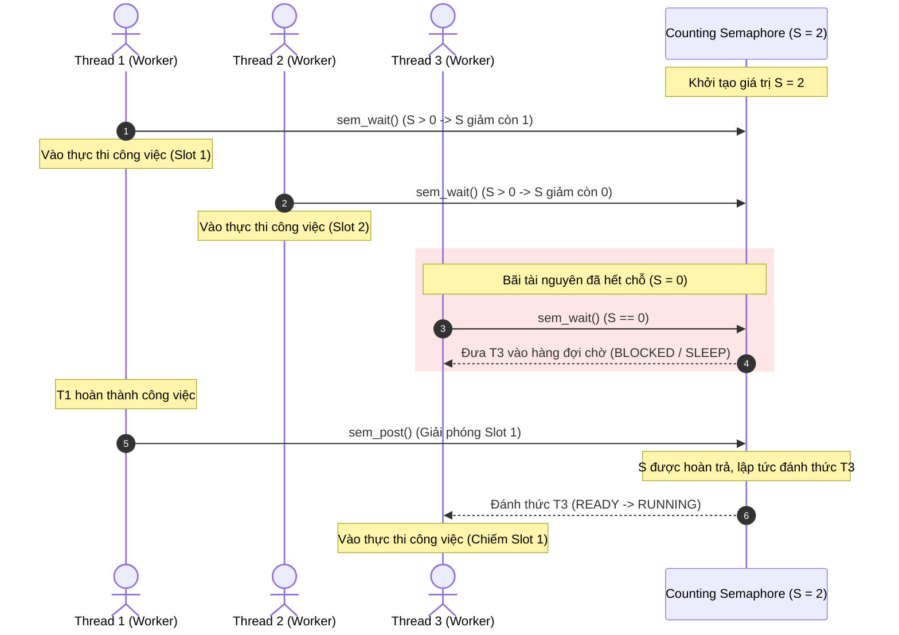

# 1_4_6 Semaphores

> **Khóa học**: Cloud & DevOps Cơ Bản  
> **Phân nhóm**: Domain 1 - Operating System Core Fundamentals  
> **Chủ đề**: 1_4 Process Synchronization and Concurrency  
> **Checklist đối chiếu**: [1_4_6](../../../CHECKLIST.md#domain-1-operating-system-core-fundamentals-45-items)  
> **Trạng thái**: Hoàn thành  

---

## 1. Khái Niệm Cốt Lõi & Bản Chất Kỹ Thuật (Core Concepts & Technical Deep Dive)

Trong lĩnh vực điều phối đồng thời và đồng bộ hóa tiến trình, **Semaphore** (cột cờ báo hiệu) là một cấu trúc dữ liệu nguyên thủy kinh điển do nhà khoa học máy tính người Hà Lan **Edsger W. Dijkstra** giới thiệu lần đầu tiên vào năm 1965 (trong chuyên khảo kinh điển EWD 123).

Khác với Mutex chỉ đơn thuần phục vụ mục đích khóa loại trừ tương hỗ nhị phân, Semaphore là một biến số nguyên được truy cập và thao tác độc quyền thông qua đúng hai nguyên tử (atomic operations): **$P()$** và **$V()$**.

```
           +-----------------------------------------+
           |     SEMAPHORE NGUYÊN TỬ (Dijkstra)      |
           |             Giá trị: S                  |
           +--------------------+--------------------+
                                |
             +------------------+------------------+
             |                                     |
    Thao tác P(S) / wait()                Thao tác V(S) / post()
   (proberen: "thử / kiểm tra")          (verhogen: "tăng / dựng lên")
             |                                     |
             v                                     v
    Giảm S đi 1 đơn vị.                  Tăng S lên 1 đơn vị.
    Nếu S < 0 (hoặc S <= 0               Đánh thức (unblock) một luồng
    trước khi giảm): Luồng               đang bị phong tỏa trong hàng đợi
    bị phong tỏa vào hàng đợi.           ngủ (nếu có).
```

### 1.1. Thao Tác Nguyên Tử $P()$ và $V()$

Tên gọi ban đầu của Dijkstra xuất phát từ tiếng Hà Lan:
- **$P()$ (proberen - kiểm tra / thử giảm)**: Được chuẩn hóa trong POSIX là `sem_wait()`. Tiến trình kiểm tra giá trị của semaphore:
  - Nếu giá trị lớn hơn 0, tiến trình giảm giá trị đi 1 và tiếp tục thực thi ngay lập tức.
  - Nếu giá trị bằng 0 (hoặc không dương), tiến trình bị chặn (block/sleep) và đưa vào hàng đợi chờ của semaphore.
- **$V()$ (verhogen - làm tăng lên)**: Được chuẩn hóa trong POSIX là `sem_post()`. Tiến trình tăng giá trị của semaphore lên 1:
  - Nếu có luồng khác đang bị phong tỏa trong hàng đợi chờ của semaphore, hệ điều hành sẽ đánh thức một luồng dậy để tiếp tục chạy.

Cả hai thao tác trên phải được bảo đảm tính nguyên tử tuyệt đối (atomic), không thể bị ngắt quãng giữa chừng bởi việc chuyển ngữ cảnh (context switch) hoặc đa luồng tranh chấp đồng thời.

### 1.2. Phân Loại Semaphore: Binary Semaphore vs Counting Semaphore

Dựa trên miền giá trị và mục đích sử dụng, Semaphore được chia làm hai loại chính:

1. **Binary Semaphore (Semaphore nhị phân)**:
   - Miền giá trị khởi tạo chỉ nhận `0` hoặc `1`.
   - Khi khởi tạo là `1`: Có thể dùng cho mục đích loại trừ tương hỗ (Mutual Exclusion - tương tự cơ chế khóa). Luồng gọi `sem_wait()` để vào Critical Section và gọi `sem_post()` để rời khỏi.
   - Khi khởi tạo là `0`: Phục vụ mục đích phát tín hiệu thông báo (Signaling). Luồng A dừng lại chờ tín hiệu (`sem_wait()`), luồng B hoàn thành xong công việc sẽ phát tín hiệu kích hoạt (`sem_post()`) để đánh thức luồng A.
2. **Counting Semaphore (Semaphore đếm)**:
   - Miền giá trị khởi tạo là một số nguyên dương bất kỳ $N \ge 0$.
   - Giá trị $N$ biểu diễn số lượng thực tế của một nhóm tài nguyên hữu hạn khả dụng (chẳng hạn hồ kết nối cơ sở dữ liệu gồm 10 kết nối, bộ đệm giới hạn dung lượng 64 ô).
   - Mỗi lần một luồng chiếm giữ 1 tài nguyên, nó gọi `sem_wait()` (giảm tài nguyên khả dụng). Khi dùng xong, nó gọi `sem_post()` (hoàn trả tài nguyên cho hồ dùng chung).

### 1.3. Khác Biệt Cốt Lõi: Khái Niệm Quyền Sở Hữu (Ownership)

Điểm khác biệt căn bản và quan trọng nhất giữa **Mutex** và **Semaphore** nằm ở khái niệm **Quyền sở hữu (Ownership)**:
- **Mutex có quyền sở hữu (Ownership)**: Luồng nào gọi `pthread_mutex_lock()` để khóa thì **chỉ duy nhất luồng đó** mới được phép gọi `pthread_mutex_unlock()`. Nếu một luồng khác tự ý mở khóa Mutex của luồng sở hữu, hệ thống sẽ rơi vào hành vi không xác định (Undefined Behavior) hoặc báo lỗi `EPERM`.
- **Semaphore KHÔNG có khái niệm quyền sở hữu**: Bất kỳ luồng nào trong tiến trình, hoặc thậm chí một chương trình ngắt phần cứng (Interrupt Service Routine - ISR), cũng có thể gọi `sem_post()` để tăng giá trị semaphore hoặc đánh thức một luồng khác. Đặc tính này biến Semaphore thành công cụ số một cho bài toán **đồng bộ tín hiệu sự kiện (Event Signaling)** giữa các luồng hoặc tiến trình độc lập.

### 1.4. Sự Khác Biệt Giữa Mô Hình Lý Thuyết Dijkstra và Chuẩn POSIX

Trong nghiên cứu lý thuyết hệ điều hành và thực tế hiện thực chuẩn POSIX có một sự khác biệt tinh tế nhưng rất hay xuất hiện trong các bài kiểm tra chuyên sâu:

| Tiêu chí | Mô hình lý thuyết Dijkstra (OSTEP Ch. 31) | Chuẩn POSIX (`sem_overview(7)`) |
| :--- | :--- | :--- |
| **Giá trị âm** | Giá trị của $S$ **có thể âm**. Nếu $S < 0$, thì giá trị tuyệt đối $|S|$ phản ánh chính xác số lượng luồng đang bị chặn trong hàng đợi ngủ. | Giá trị semaphore **không bao giờ rơi xuống dưới 0**. Giá trị đại diện cho số tài nguyên sẵn sàng cấp phát. |
| **Hàm đọc giá trị** | Đọc được giá trị âm (ví dụ: $-3$ có nghĩa là có 3 luồng đang ngủ chờ). | Hàm `sem_getvalue()` trả về `0` nếu hiện tại không còn tài nguyên hoặc đang có luồng bị block chờ tài nguyên. |

### 1.5. POSIX Unnamed Semaphore vs Named Semaphore

Trên các hệ thống Linux/Unix, chuẩn POSIX định nghĩa hai biến thể triển khai:
- **Unnamed Semaphores (Semaphore không tên)**:
  - Khai báo dưới dạng biến bộ nhớ `sem_t`.
  - Khởi tạo bằng `sem_init(sem_t *sem, int pshared, unsigned int value)`.
  - Nếu cờ `pshared = 0`: Semaphore chỉ được chia sẻ giữa các luồng trong cùng tiến trình (nằm trên bộ nhớ cục bộ heap hoặc global).
  - Nếu cờ `pshared != 0`: Semaphore được chia sẻ giữa các tiến trình khác nhau (phải đặt trong vùng nhớ chia sẻ Shared Memory).
  - Hủy bằng hàm `sem_destroy(sem_t *sem)`.
- **Named Semaphores (Semaphore có tên)**:
  - Định danh bởi một chuỗi ký tự dạng đường dẫn `/ten_semaphore`.
  - Được tạo hoặc mở bằng `sem_open(const char *name, int oflag, ...)`.
  - Xuất hiện trên hệ thống tập tin ảo (thông thường được gắn tại thư mục ramfs `/dev/shm/` trên Linux dưới tiền tố `sem.ten_semaphore`).
  - Cho phép các tiến trình hoàn toàn độc lập, không có quan hệ cha-con chia sẻ đồng bộ dễ dàng thông qua tên gọi.
  - Đóng bằng `sem_close()` và xóa bỏ vĩnh viễn khỏi hệ thống bằng `sem_unlink()`.

---

## 2. Ví Dụ Đời Sống Thực Tế Dễ Hiểu (Intuitive Real-World Analogies)

```
       BÃI GIỮ XE TÒA NHÀ (COUNTING SEMAPHORE = 3 CHỖ ĐẬU)
       
       Cổng rào tự động: S = 3
       ========================================================
       Xe A vào  --> sem_wait() --> S = 2  (Hợp lệ, vào bãi)
       Xe B vào  --> sem_wait() --> S = 1  (Hợp lệ, vào bãi)
       Xe C vào  --> sem_wait() --> S = 0  (Hợp lệ, vào bãi)
       --------------------------------------------------------
       Xe D vào  --> sem_wait() --> S = 0! (Hết chỗ, XE D BỊ CHẶN Ở CỔNG)
       Xe E vào  --> sem_wait() --> S = 0! (Hết chỗ, XE E NỐI ĐUÔI CHỜ)
       --------------------------------------------------------
       Xe B rời bãi --> sem_post() --> Tăng tài nguyên, đánh thức Xe D!
       Bảo vệ phát thêm chỗ trống --> sem_post() --> Xe E được vào!
```

### 2.1. Phép So Sánh: Bãi Đỗ Xe Có Cột Thẻ Tự Động (Counting Semaphore)

Hãy tưởng tượng một bãi đỗ xe thông minh của tòa nhà với sức chứa cố định là **3 vị trí đỗ**:
1. **Giá trị khởi tạo ($N = 3$)**: Trên bảng điện tử hiển thị `Còn lại: 3 chỗ`.
2. **Xe đến lấy vé ($P()$ / `sem_wait()`)**: Mỗi chiếc ô tô (luồng) đến cổng phải bấm nút rút một chiếc vé. Bảng điện tử giảm xuống 1 đơn vị. Khi có 3 xe liên tiếp vào đậu, bảng đếm về số 0.
3. **Bãi xe đầy (Blocked)**: Chiếc xe thứ 4 đến bấm vé, máy báo hết chỗ, thanh chắn barie không mở. Chiếc xe thứ 4 và thứ 5 buộc phải tắt máy đứng đợi tại hàng rào ngoài cổng.
4. **Xe ra trả vé ($V()$ / `sem_post()`)**: Khi xe thứ 2 nổ máy ra về và quẹt thẻ trả chỗ, thanh chắn barie tự động nâng lên, cho phép chiếc xe đang chờ ngoài cổng tiến vào bãi đỗ.

### 2.2. Phép So Sánh: Người Bấm Chuông Cửa (Signaling Không Sở Hữu)

Hãy hình dung sự khác biệt giữa **Chìa khóa phòng** (Mutex) và **Chuông cửa** (Semaphore):
- Với Mutex: Bạn cầm chìa khóa vào phòng, khóa cửa bên trong. Không ai mở được phòng trừ khi chính bạn mở cửa và bước ra ngoài.
- Với Semaphore: Người giao hàng đứng ngoài cổng bấm chuông (`sem_post()`). Người chủ nhà đang ngồi đợi tiếng chuông reo trong phòng (`sem_wait()`) lập tức đứng dậy ra nhận hàng. Người bấm chuông (người giao hàng) hoàn toàn không phải là người bước vào nhà hay sở hữu căn phòng!

---

## 3. Kiến Trúc, Luồng Hoạt Động & Hình Ảnh Trực Quan (Architecture & Diagrams)

### 3.1. Bảng So Sánh Chi Tiết: Mutex vs Binary Semaphore vs Counting Semaphore

| Thuộc tính | Mutex (Mutual Exclusion Lock) | Binary Semaphore | Counting Semaphore |
| :--- | :--- | :--- | :--- |
| **Miền giá trị** | Nhị phân (`0` = Unlocked, `1` = Locked). | Nhị phân (`0` hoặc `1`). | Số nguyên không âm ($0, 1, 2, ..., N$). |
| **Khái niệm sở hữu** | **Có (Strict Ownership)**: Luồng lock bắt buộc phải là luồng unlock. | **Không có (No Ownership)**: Luồng này wait, luồng khác post thoải mái. | **Không có (No Ownership)**: Bất kỳ luồng nào cũng có thể post. |
| **Công dụng chính** | Bảo vệ Critical Section chống Race Condition. | Báo hiệu sự kiện (Signaling) giữa các luồng / tiến trình. | Giới hạn hồ tài nguyên chia sẻ hữu hạn (Resource Pooling / Throttling). |
| **Khả năng dùng trong ISR** | **Không** (ISR không được phép ngủ để chờ lock). | **Có** (ISR có thể gọi `sem_post` để đánh thức một tác vụ xử lý). | **Có** (ISR có thể giải phóng slot tài nguyên bằng post). |
| **Cơ chế chống Inversion** | Hỗ trợ giao thức kế thừa độ ưu tiên (Priority Inheritance Protocol). | **Không tích hợp sẵn** cơ chế kế thừa độ ưu tiên trong chuẩn POSIX. | **Không tích hợp sẵn**. |

### 3.2. Sơ Đồ Luồng Hoạt Động Của Counting Semaphore



---

## 4. Code Mẫu Trực Quan Hoặc Dòng Lệnh Thực Chiến (Runnable Sample Code / CLI)

> ⚠️ Dữ liệu mã nguồn C dưới đây mang tính chất minh họa (illustrative output) các nguyên lý chuẩn POSIX threads và POSIX semaphores (`<semaphore.h>`), được biên dịch với trình biên dịch `gcc -pthread`.

### 4.1. Mã Nguồn C: Giới Hạn Tối Đa Luồng Song Song Bằng Counting Semaphore

Đoạn mã sau mô phỏng hệ thống có **6 tác vụ (tasks)** đồng thời gửi yêu cầu, nhưng tài nguyên kết nối mạng hoặc cơ sở dữ liệu chỉ cho phép **tối đa 2 luồng** hoạt động cùng lúc:

```c
#include <stdio.h>
#include <stdlib.h>
#include <unistd.h>
#include <pthread.h>
#include <semaphore.h>

#define MAX_CONCURRENT_WORKERS 2
#define TOTAL_TASKS 5

// Khai báo biến semaphore
sem_t resource_pool;

void* worker_routine(void* arg) {
    int task_id = *(int*)arg;
    free(arg);

    printf("[Task %d] Đang xếp hàng chờ xin cấp phát tài nguyên...\n", task_id);

    // Chờ tài nguyên khả dụng (P operation)
    if (sem_wait(&resource_pool) != 0) {
        perror("Lỗi khi gọi sem_wait");
        pthread_exit(NULL);
    }

    // --- CRITICAL SECTION: Tối đa 2 luồng được chạy song song tại đây ---
    printf(">>> [Task %d] ĐÃ NHẬN TÀI NGUYÊN! Đang xử lý tính toán trong 2 giây...\n", task_id);
    sleep(2);
    printf("<<< [Task %d] Hoàn tất công việc, đang giải phóng tài nguyên.\n", task_id);
    // -------------------------------------------------------------------

    // Trả lại tài nguyên cho hồ dùng chung (V operation)
    sem_post(&resource_pool);

    pthread_exit(NULL);
}

int main(void) {
    pthread_t threads[TOTAL_TASKS];

    // Khởi tạo semaphore không tên:
    // pshared = 0 (dùng chung giữa các luồng trong cùng tiến trình)
    // value = MAX_CONCURRENT_WORKERS (khởi tạo 2 slot)
    if (sem_init(&resource_pool, 0, MAX_CONCURRENT_WORKERS) != 0) {
        perror("Khởi tạo semaphore thất bại");
        return EXIT_FAILURE;
    }

    printf("=== KHỞI TẠO BÃI TÀI NGUYÊN: SỐ LƯỢNG KẾT NỐI TỐI ĐA = %d ===\n\n", 
           MAX_CONCURRENT_WORKERS);

    // Tạo các worker threads
    for (int i = 0; i < TOTAL_TASKS; i++) {
        int* id = malloc(sizeof(int));
        *id = i + 1;
        if (pthread_create(&threads[i], NULL, worker_routine, id) != 0) {
            perror("Lỗi tạo thread");
            return EXIT_FAILURE;
        }
    }

    // Đợi tất cả hoàn thành
    for (int i = 0; i < TOTAL_TASKS; i++) {
        pthread_join(threads[i], NULL);
    }

    // Hủy semaphore giải phóng cấu trúc dữ liệu kernel
    sem_destroy(&resource_pool);
    printf("\n=== TOÀN BỘ CÁC TÁC VỤ ĐÃ HOÀN TẤT THÀNH CÔNG ===\n");

    return EXIT_SUCCESS;
}
```

### 4.2. Biên Dịch và Quan Sát Thực Tế

```bash
# Biên dịch chương trình với cờ liên kết thư viện pthread
gcc -Wall -Wextra -pthread -o semaphore_demo semaphore_demo.c

# Thực thi chương trình
./semaphore_demo
```

**Đầu ra chuẩn kỳ vọng:**
```text
=== KHỞI TẠO BÃI TÀI NGUYÊN: SỐ LƯỢNG KẾT NỐI TỐI ĐA = 2 ===

[Task 1] Đang xếp hàng chờ xin cấp phát tài nguyên...
>>> [Task 1] ĐÃ NHẬN TÀI NGUYÊN! Đang xử lý tính toán trong 2 giây...
[Task 2] Đang xếp hàng chờ xin cấp phát tài nguyên...
>>> [Task 2] ĐÃ NHẬN TÀI NGUYÊN! Đang xử lý tính toán trong 2 giây...
[Task 3] Đang xếp hàng chờ xin cấp phát tài nguyên...
[Task 4] Đang xếp hàng chờ xin cấp phát tài nguyên...
[Task 5] Đang xếp hàng chờ xin cấp phát tài nguyên...
<<< [Task 1] Hoàn tất công việc, đang giải phóng tài nguyên.
<<< [Task 2] Hoàn tất công việc, đang giải phóng tài nguyên.
>>> [Task 3] ĐÃ NHẬN TÀI NGUYÊN! Đang xử lý tính toán trong 2 giây...
>>> [Task 4] ĐÃ NHẬN TÀI NGUYÊN! Đang xử lý tính toán trong 2 giây...
<<< [Task 3] Hoàn tất công việc, đang giải phóng tài nguyên.
<<< [Task 4] Hoàn tất công việc, đang giải phóng tài nguyên.
>>> [Task 5] ĐÃ NHẬN TÀI NGUYÊN! Đang xử lý tính toán trong 2 giây...
<<< [Task 5] Hoàn tất công việc, đang giải phóng tài nguyên.

=== TOÀN BỘ CÁC TÁC VỤ ĐÃ HOÀN TẤT THÀNH CÔNG ===
```

Quan sát thấy tại bất kỳ thời điểm nào, không bao giờ có quá 2 luồng cùng xuất hiện trong pha `ĐÃ NHẬN TÀI NGUYÊN`.

---

## 5. Cạm Bẫy Thực Tế & Thực Tiễn Sản Xuất (Production Gotchas & Best Practices)

### 5.1. Hiểm Họa Nghịch Đảo Độ Ưu Tiên (Priority Inversion Không Thể Tự Cứu)

Một trong những nguy cơ kỹ thuật nghiêm trọng nhất khi dùng Semaphore để bảo vệ đoạn găng thay cho Mutex là **Nghịch đảo độ ưu tiên (Priority Inversion)**:
- Với `pthread_mutex_t`, hệ điều hành hỗ trợ thuộc tính `PTHREAD_PRIO_INHERIT` (Priority Inheritance Protocol). Khi một luồng độ ưu tiên thấp giữ khóa mà luồng độ ưu tiên cao đang chờ, luồng thấp sẽ được tạm thời nâng độ ưu tiên ngang bằng với luồng cao để chạy nhanh và nhả khóa.
- Với Semaphore, vì **không có khái niệm quyền sở hữu (No Ownership)**, hệ điều hành hoàn toàn không biết luồng nào sẽ là người gọi `sem_post()` trong tương lai! Do đó, kernel **không thể áp dụng cơ chế thừa kế độ ưu tiên**. Kết quả là một luồng ưu tiên trung bình có thể chiếm CPU liên tục, khiến luồng ưu tiên cao bị bỏ đói vô tận (Starvation/Livelock).
- **Quy tắc thực chiến**: Chỉ dùng Mutex cho bài toán bảo vệ đoạn găng độc quyền (Mutual Exclusion). Chỉ dùng Semaphore cho bài toán báo hiệu sự kiện (Signaling) hoặc giới hạn hồ tài nguyên (Throttling/Rate Limiting).

### 5.2. Lỗi Bị Ngắt Bởi Tín Hiệu Hệ Thống (`EINTR`)

Trong môi trường Linux production, khi một tiến trình đang dừng chờ tại `sem_wait()`, nếu có bất kỳ tín hiệu POSIX Signal nào được gửi tới tiến trình (ví dụ `SIGALRM`, `SIGCHLD`, `SIGUSR1`), hàm `sem_wait()` sẽ lập tức bị hủy bỏ và trả về `-1`, thiết lập `errno = EINTR`.

Nếu lập trình viên không xử lý vòng lặp bắt lỗi:
```c
// SAI LẦM: Không kiểm tra EINTR
sem_wait(&my_sem); // Bị hủy do signal, nhưng code vẫn chạy tiếp vào Critical Section gây hỏng dữ liệu!

// ĐÚNG ĐẮN: Bắt buộc lặp lại nếu gặp EINTR
while (sem_wait(&my_sem) == -1) {
    if (errno != EINTR) {
        perror("sem_wait thực sự lỗi");
        exit(EXIT_FAILURE);
    }
    // Tiếp tục lặp để chờ lại khi bị ngắt bởi Signal
}
```

### 5.3. Rò Rỉ Named Semaphore Trên Hệ Thống Tập Tin Ảo (`/dev/shm`)

Khi sử dụng Named Semaphores (`sem_open("/my_semaphore", O_CREAT, ...)`):
- Nếu tiến trình ứng dụng bị dừng đột ngột (do `SIGKILL` hoặc lỗi phân đoạn `SIGSEGV`), file định danh semaphore trên `/dev/shm/sem.my_semaphore` vẫn tồn tại vĩnh viễn trên RAM của kernel Linux.
- Khi ứng dụng khởi động lại, nó mở phải semaphore cũ có giá trị rác hoặc trạng thái khóa dở dang, dẫn đến deadlock toàn bộ hệ thống.
- **Biện pháp khắc phục**: Luôn đăng ký hàm dọn dẹp bằng `atexit()` hoặc bộ xử lý tín hiệu (signal handlers) để gọi `sem_unlink()`, đồng thời giám sát thư mục `/dev/shm/` trong các kịch bản kiểm thử tích hợp.

---

## 6. Câu Hỏi Củng Cố Kiến Thức (Active Recall Quiz)

<details>
<summary><b>Câu hỏi 1:</b> Tại sao một Interrupt Service Routine (ISR - hàm xử lý ngắt phần cứng) có thể gọi <code>sem_post()</code> nhưng tuyệt đối không được phép gọi <code>pthread_mutex_lock()</code>?</summary>

> **Đáp án:**
> 1. Hàm xử lý ngắt (ISR) chạy trong ngữ cảnh ngắt (interrupt context), không gắn liền với bất kỳ tiến trình người dùng nào và tuyệt đối không bao giờ được phép đi ngủ (sleep/block) hoặc nhường CPU. Gọi `pthread_mutex_lock()` có thể khiến CPU rơi vào trạng thái ngủ chờ khóa nếu khóa đang bị luồng khác giữ, dẫn đến crash toàn bộ hệ thống hoặc treo kernel.
> 2. Ngoài ra, Mutex yêu cầu luồng nào lock thì chính luồng đó phải unlock (Ownership). Trong khi đó, `sem_post()` chỉ đơn thuần thực hiện phép cộng nguyên tử tăng biến đếm của semaphore lên 1 và đánh thức luồng khác nếu có hàng đợi, không bao giờ tự mình chuyển sang trạng thái ngủ (non-blocking) và không đòi hỏi quyền sở hữu. Do đó, ISR an toàn tuyệt đối khi gọi `sem_post()`.
</details>

<details>
<summary><b>Câu hỏi 2:</b> Trong mô hình lý thuyết của Dijkstra, nếu một Semaphore có giá trị là <code>-4</code>, con số này có ý nghĩa gì đối với hệ thống? Chuẩn POSIX trên Linux có hỗ trợ hiển thị giá trị này không?</summary>

> **Đáp án:**
> 1. Trong mô hình lý thuyết của Dijkstra, khi giá trị của biến Semaphore âm, giá trị tuyệt đối $|S|$ (ở đây là $|-4| = 4$) biểu thị chính xác rằng hiện đang có **4 tiến trình/luồng đang bị phong tỏa (blocked)** và nằm trong hàng đợi chờ tài nguyên của Semaphore đó.
> 2. Chuẩn POSIX trên Linux **không** hỗ trợ giá trị âm. Theo đặc tả của `sem_overview(7)` và hàm `sem_getvalue(3)`, giá trị của POSIX Semaphore không bao giờ giảm xuống dưới 0. Khi có luồng đang chờ tài nguyên, hàm `sem_getvalue()` sẽ trả về giá trị `0` chứ không trả về số âm.
</details>

<details>
<summary><b>Câu hỏi 3:</b> Điều gì sẽ xảy ra nếu một tiến trình khởi tạo một Counting Semaphore với giá trị ban đầu là <code>0</code>, sau đó một luồng thực hiện <code>sem_wait()</code> ngay lập tức?</summary>

> **Đáp án:**
> Luồng gọi `sem_wait()` sẽ lập tức bị phong tỏa (blocked) và chuyển sang trạng thái chờ ngủ, bởi vì giá trị tài nguyên khả dụng hiện tại bằng 0. Luồng này sẽ tiếp tục ngủ vô thời hạn cho tới khi có một luồng khác thực hiện thành công thao tác `sem_post()`. Đây chính là mô hình mẫu chuẩn (Pattern) để cài đặt cơ chế phát tín hiệu đồng bộ sự kiện (Signaling) giữa các luồng.
</details>

---

## 7. 📚 Nguồn Tài Liệu Chính Thống (Tier-1 Official References)

- [Dijkstra (1965) Cooperating Sequential Processes (EWD 123)](https://www.cs.utexas.edu/~EWD/ewd01xx/EWD123.PDF) - Bài báo khoa học kinh điển của Edsger W. Dijkstra định nghĩa nguyên lý Semaphore, thao tác P và V.
- [OSTEP Chapter 31: Semaphores (Arpaci-Dusseau)](https://pages.cs.wisc.edu/~remzi/OSTEP/threads-sema.pdf) - Giáo trình hệ điều hành chuẩn quốc tế của Đại học Wisconsin-Madison phân tích Semaphore đếm, Semaphore nhị phân và các bài toán kinh điển.
- [Linux Programmer's Manual - sem_overview(7)](https://man7.org/linux/man-pages/man7/sem_overview.7.html) - Đặc tả chuẩn POSIX Semaphore trên Linux (Unnamed vs Named, giá trị không âm).
- [Linux Programmer's Manual - sem_getvalue(3)](https://man7.org/linux/man-pages/man3/sem_getvalue.3.html) - Chi tiết kỹ thuật về giá trị trả về của Semaphore và cách ứng xử khi có luồng bị block.
- [Linux Programmer's Manual - sem_init(3)](https://man7.org/linux/man-pages/man3/sem_init.3.html) - Cú pháp khởi tạo POSIX unnamed semaphore và ý nghĩa cờ pshared.
