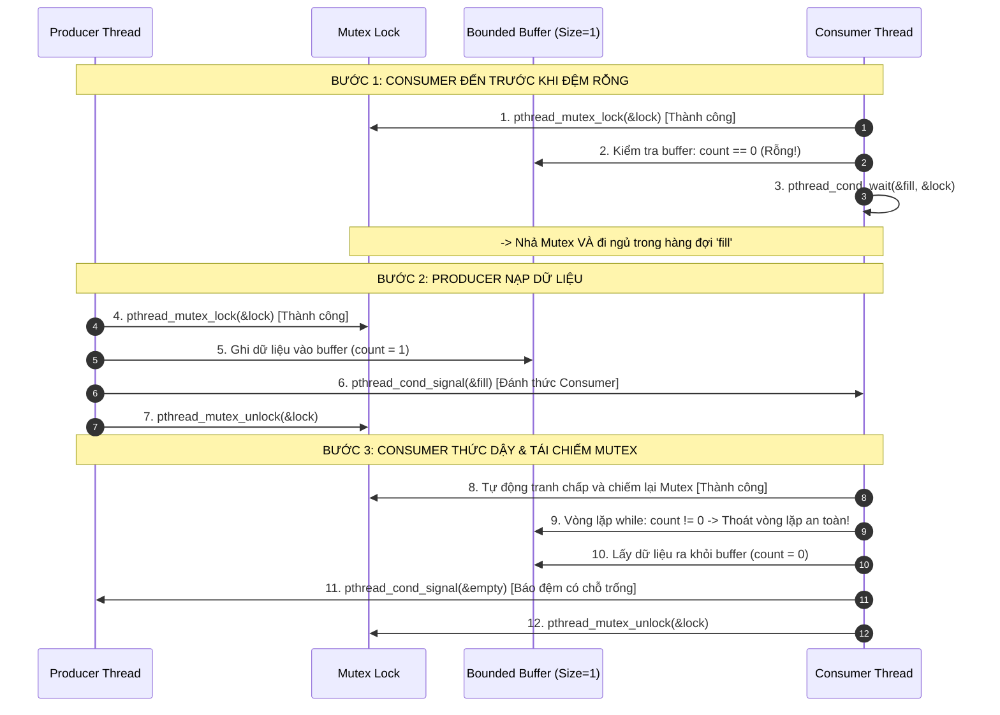

# 1_4_7 Condition Variables

> **Khóa học**: Cloud DevOps Basic — OS Core  
> **Phân nhóm**: 1 Domain 1 - Operating System Core Fundamentals › 1_4 Process Synchronization and Concurrency  
> **Chủ đề**: Biến điều kiện (Condition Variables): Cơ chế hàng đợi chờ, nguyên tử hóa Mutex, Ngữ nghĩa Mesa, Thức tỉnh giả (Spurious Wakeup) và giải pháp Bounded Buffer  
> **Trạng thái**: Draft (WRITE-CDB-1_4_7, 14-11-2026)  
> **Checklist đối chiếu**: [1_4_7](../../../CHECKLIST.md#domain-1-operating-system-core-fundamentals-45-items)  

---

## 1. Khái Niệm Cốt Lõi & Bản Chất Kỹ Thuật (Core Concepts & Technical Deep Dive)

Trong lập trình đồng thời, Mutex giải quyết xuất sắc bài toán **Loại trừ tương hỗ (Mutual Exclusion)** — đảm bảo chỉ một luồng duy nhất được thực thi bên trong miền găng. Tuy nhiên, trong thực tế phát triển phần mềm, các luồng thường xuyên phải chờ đợi một **Điều kiện trạng thái (Condition State)** nào đó trở nên thỏa mãn trước khi có thể tiếp tục tiến triển (ví dụ: luồng Consumer phải đợi cho đến khi hàng đợi có dữ liệu; luồng tiến trình cha phải đợi cho đến khi tiến trình con kết thúc).

Nếu chỉ dùng Mutex, luồng bắt buộc phải liên tục chiếm khóa, kiểm tra biến cờ, rồi nhả khóa trong một vòng lặp quay bận (*polling*). Điều này thiêu rụi chu kỳ CPU và làm nghẽn khóa nghiêm trọng. Để giải quyết triệt để vấn đề này, khoa học máy tính cung cấp một công cụ nguyên thủy tối thượng: **Biến điều kiện (Condition Variable)**.

```
+-------------------------------------------------------------------------------+
|                      BẢN CHẤT CỦA CONDITION VARIABLE (CV)                     |
|                                                                               |
|  1. ĐỊNH NGHĨA:                                                               |
|     Là một hàng đợi chờ tường minh (Explicit Wait Queue) do hệ điều hành /    |
|     thư viện quản lý, cho phép một luồng tự đưa mình vào giấc ngủ (sleep) khi |
|     điều kiện chưa thỏa mãn, và được đánh thức bởi một luồng khác.            |
|                                                                               |
|  2. MỐI QUAN HỆ SỐNG CÒN VỚI MUTEX:                                           |
|     Condition Variable LUÔN LUÔN phải đi kèm với một Mutex bảo vệ trạng thái: |
|     - pthread_cond_wait(&cond, &mutex):                                       |
|       1. Nhả khóa Mutex VÀ đưa luồng vào hàng đợi ngủ một cách NGUYÊN TỬ.     |
|       2. Khi được đánh thức, BẮT BUỘC phải chiếm lại Mutex trước khi return!  |
|                                                                               |
|  3. BỘ ĐÔI ĐÁNH THỨC:                                                         |
|     - pthread_cond_signal(&cond)    : Đánh thức ÍT NHẤT 1 luồng đang chờ.     |
|     - pthread_cond_broadcast(&cond) : Đánh thức TOÀN BỘ các luồng đang chờ.   |
+-------------------------------------------------------------------------------+
```

---

### 1.1 Hoạt Động Nguyên Tử của `pthread_cond_wait`

Theo giáo trình *Operating Systems: Three Easy Pieces (OSTEP - Ch. 30)* và đặc tả chuẩn POSIX (`man 3 pthread_cond_wait`):
Lời gọi hàm `pthread_cond_wait(&cond, &mutex)` thực hiện hai hành động cốt tử được **kết hợp nguyên tử (atomically)** với nhau:
1. **Nhả khóa Mutex (`mutex`)**: Mở cửa miền găng để các luồng khác (ví dụ: luồng Producer) có thể bước vào thay đổi trạng thái dữ liệu (đẩy dữ liệu vào hàng đợi).
2. **Đưa luồng gọi vào hàng đợi ngủ (*Wait Queue*) của biến điều kiện**: Chuyển trạng thái của luồng sang Blocked, giải phóng 100% CPU.

> [!IMPORTANT]
> **Tại sao hai hành động này bắt buộc phải NGUYÊN TỬ?**  
> Nếu việc nhả khóa và việc ngủ diễn ra tách rời: Giả sử Luồng Consumer vừa nhả khóa nhưng chưa kịp ngủ, CPU bị chuyển sang Luồng Producer. Producer lập tức nạp dữ liệu và phát tín hiệu `signal()`. Vì Consumer chưa kịp vào danh sách ngủ, tín hiệu `signal` bị phát vào không khí (*Lost Wakeup*). Sau đó CPU quay lại Consumer và đưa nó vào giấc ngủ vĩnh viễn dù dữ liệu đã có sẵn! Tính nguyên tử của `pthread_cond_wait` loại bỏ hoàn toàn kẽ hở thời gian chết người này.

Khi được đánh thức bởi `pthread_cond_signal` hoặc `pthread_cond_broadcast`, luồng **chưa được phép chạy tiếp ngay lập tức**. Nó bắt buộc phải thực hiện thao tác **Tái chiếm khóa Mutex (`re-acquire the mutex`)**. Chỉ khi giành được quyền sở hữu Mutex, hàm `pthread_cond_wait` mới chính thức trả về quyền điều khiển cho mã nguồn ứng dụng.

---

### 1.2 Ngữ Nghĩa Mesa vs Hoare (Mesa vs Hoare Semantics)

Trong lý thuyết ngôn ngữ đồng thời, có hai trường phái thiết kế cách thức đánh thức luồng:
1. **Ngữ nghĩa Hoare (Hoare Semantics)**:
   - Khi Luồng A gọi `signal()`, CPU lập tức đình chỉ Luồng A và chuyển giao quyền thực thi ngay tức khắc cho Luồng B vừa được đánh thức.
   - Do không có bất kỳ luồng nào khác chen ngang, trạng thái điều kiện được đảm bảo là đúng 100%. Luồng B có thể an tâm sử dụng câu lệnh `if (condition)` để kiểm tra.
2. **Ngữ nghĩa Mesa (Mesa Semantics - Chuẩn mực POSIX pthreads & Hệ điều hành hiện đại)**:
   - Được thiết kế đầu tiên tại Trung tâm Nghiên cứu Xerox PARC trên hệ điều hành Mesa.
   - Khi Luồng A gọi `signal()`, Luồng B chỉ được **chuyển từ Wait Queue sang Ready Queue**. Luồng B không chạy ngay mà phải xếp hàng chờ bộ lập lịch CPU phân bổ thời gian, đồng thời phải cạnh tranh chiếm lại Mutex với các luồng khác!
   - Trong khoảng thời gian từ lúc Luồng B được đánh thức cho đến khi nó thực sự chiếm được Mutex và chạy, một Luồng C thứ ba có thể đã nhanh chân nhảy vào cướp mất phần tử dữ liệu đó!

```
Luồng B (Consumer 1)       Luồng A (Producer)           Luồng C (Consumer 2)
--------------------       ------------------           --------------------
Chờ trong Wait Queue...    Đẩy dữ liệu vào đệm
                           Phát tín hiệu: signal() 
                           Nhả Mutex
Được đánh thức!
Đang chờ chiếm Mutex...
                           -------------------------------------------------
                           Luồng C xuất hiện! Nhanh chân chiếm Mutex trước!
                           Lấy mất phần tử dữ liệu trong đệm!
                           Nhả Mutex.
                           -------------------------------------------------
Chiếm được Mutex!
Nếu dùng 'if': Đệm đã RỖNG -> Đọc con trỏ rác -> CRASH (Segmentation Fault)!
Nếu dùng 'while': Kiểm tra thấy đệm rỗng -> Tiếp tục ngủ an toàn!
```

---

### 1.3 Hiện Tượng Thức Tỉnh Giả (Spurious Wakeup)

Theo tài liệu tiêu chuẩn POSIX (`man 3 pthread_cond_wait`):
**Thức tỉnh giả (Spurious Wakeup)** là hiện tượng một luồng đang ngủ trong `pthread_cond_wait()` đột ngột thức giấc và hàm trả về thành công **dù hoàn toàn không có bất kỳ luồng nào trong hệ thống gọi `pthread_cond_signal()` hay `pthread_cond_broadcast()`**!

Nguyên nhân phát sinh:
- Do nhân Linux Kernel tối ưu hóa cơ chế phân phối tín hiệu ngắt phần cứng hoặc tín hiệu hệ thống Unix (*Signals* như `SIGINT`, `SIGCHLD`).
- Do các cuộc đua vi kiến trúc trên máy tính đa nhân khi đánh thức luồng từ Futex wait queue.

#### Quy Tắc Sống Còn của Kỹ Sư Hệ Thống: Luôn Dùng Vòng Lặp `while`
Bởi vì cả hai lý do: **Ngữ nghĩa Mesa** và **Hiện tượng Thức tỉnh giả**, chuẩn POSIX và giáo trình OSTEP đưa ra nguyên tắc vàng tuyệt đối:

$$\text{LUÔN LUÔN DÙNG } \mathbf{while} \text{ ĐỂ KIỂM TRA ĐIỀU KIỆN, TUYỆT ĐỐI CẤM DÙNG } \mathbf{if}!$$

```c
// SAI LẦM CHẾT NGƯỜI (CẤM DÙNG):
if (buffer_is_empty()) {
    pthread_cond_wait(&cond, &mutex);
}
// Chạy tiếp -> Có thể sập ứng dụng do thức tỉnh giả hoặc Mesa race!

// CHUẨN MỰC CHÍNH XÁC 100%:
while (buffer_is_empty()) {
    pthread_cond_wait(&cond, &mutex);
}
// Khi thức dậy, vòng lặp ép kiểm tra lại điều kiện một lần nữa!
```

---

### 1.4 Phân Biệt: `signal()` vs `broadcast()`

- **`pthread_cond_signal(&cond)`**: Đánh thức **ít nhất một** luồng đang chờ trong hàng đợi.
  - Sử dụng khi: Tất cả các luồng đang chờ đều có cùng chung một điều kiện và mỗi lần phát tín hiệu chỉ có đúng 1 luồng có thể tiến triển (như mô hình Producer-Consumer cơ bản).
- **`pthread_cond_broadcast(&cond)`**: Đánh thức **toàn bộ** các luồng đang chờ trong hàng đợi.
  - Sử dụng khi: Các luồng đang chờ có các tiêu chí thỏa mãn khác nhau (ví dụ: hệ thống cấp phát bộ nhớ động `malloc` đa luồng, mỗi luồng chờ một kích thước byte trống khác nhau). Nếu chỉ dùng `signal`, hệ thống có thể đánh thức nhầm một luồng đòi 100MB trong khi bộ nhớ chỉ vừa giải phóng 10MB; luồng đó ngủ tiếp và không ai đánh thức các luồng đang cần 5MB, dẫn tới **Tắc nghẽn hệ thống (Lost Wakeup / Thread Starvation)**.

---

## 2. Ví Dụ Đời Sống Thực Tế Dễ Hiểu (Intuitive Real-World Analogies)

Để không bao giờ mắc lỗi dùng `if` thay vì `while` với Condition Variable, hãy liên tưởng tới **Phòng Chờ Sân Bay và Loa Phát Thanh**:

```
+-------------------------------------------------------------------------------+
|                    ẨN DỤ: PHÒNG CHỜ SÂN BAY & LOA PHÁT THANH                  |
|                                                                               |
|  [Hành Khách Ngủ Chờ - pthread_cond_wait]:                                    |
|  Hành khách đến cửa ra máy bay nhưng máy bay chưa tới. Họ trả lại thẻ ưu tiên  |
|  ở quầy (nhả Mutex), rồi ngồi vào ghế phòng chờ ngả lưng ngủ (Wait Queue).    |
|                                                                               |
|  [Loa Phát Thanh Gọi - signal / broadcast]:                                   |
|  - signal   : Loa gọi: "Xin mời 01 hành khách vé phổ thông lên máy bay".     |
|  - broadcast: Loa gọi: "Xin mời TOÀN BỘ hành khách lên máy bay".              |
|                                                                               |
|  [Cuộc Chen Lấn Cửa Soát Vé - Tranh Chấp Mutex]:                             |
|  Khi loa phát thanh gọi, hành khách thức dậy bước ra cửa soát vé. Nhưng tại    |
|  cửa soát vé, mọi người lại phải xếp hàng tranh quyền đi qua cửa (chiếm Mutex)|
|                                                                               |
|  [Thức Tỉnh Giả & Quy Tắc while]:                                             |
|  - Một hành khách khác chạy từ sảnh ngoài vào nhanh chân cướp mất chỗ cuối!    |
|  - Hoặc loa phát thanh bị chập điện hú lên một tiếng nhầm (Spurious Wakeup)!  |
|  Hành khách thông minh khi đến cửa luôn ngước nhìn bảng điện tử:              |
|  while (máy bay chưa sẵn sàng) { quay lại ghế ngủ tiếp! }                    |
|  Nếu chủ quan dùng 'if' bước thẳng qua cửa, hành khách sẽ rơi thẳng xuống     |
|  đường băng vì máy bay thực tế... chưa cập cảng!                              |
+-------------------------------------------------------------------------------+
```

---

## 3. Kiến Trúc, Luồng Hoạt Động & Hình Ảnh Trực Quan (Architecture, Diagrams & Visual Media)

### 3.1 Minh Họa Kiến Trúc Chuyển Đổi Đặc Quyền

Các thao tác ngủ và đánh thức của Condition Variable dựa trên hạ tầng `futex` trong Kernel Mode:

[](https://learn.microsoft.com/en-us/windows-hardware/drivers/gettingstarted/images/userandkernelmode01.png)  
*Hình 1: Mô hình phân tách đặc quyền thực thi CPU giữa User Mode và Kernel Mode từ Microsoft Learn.*

---

### 3.2 Sơ đồ Tuần Tự: Bộ Đệm Có Giới Hạn (Producer-Consumer Bounded Buffer)

Sơ đồ dưới đây mô tả sự phối hợp hoàn hảo giữa 1 Mutex và 2 Condition Variables (`empty` và `fill`):



---

## 4. Code Mẫu Trực Quan Hoặc Dòng Lệnh Thực Chiến (Runnable Sample Code / CLI)

### 4.1 Mã Nguồn C Thực Chiến: Bộ Đệm Có Giới Hạn Chuẩn Mực Bằng Pthreads

Chương trình C dưới đây hiện thực giải pháp kinh điển cho bài toán **Producer-Consumer Bounded Buffer**:
- Sử dụng 1 Mutex (`mutex`) bảo vệ vùng đệm vòng (*Circular Buffer*).
- Sử dụng 2 Condition Variables:
  - `cond_empty`: Producer chờ khi đệm bị ĐẦY.
  - `cond_fill`: Consumer chờ khi đệm bị RỖNG.
- Bắt buộc kiểm tra điều kiện bằng vòng lặp `while`.

```c
/**
 * file: bounded_buffer_cond_demo.c
 * Biên dịch: gcc -O2 -pthread bounded_buffer_cond_demo.c -o bounded_buffer_cond_demo
 * Thực thi:  ./bounded_buffer_cond_demo
 */
#define _GNU_SOURCE
#include <stdio.h>
#include <stdlib.h>
#include <pthread.h>
#include <unistd.h>

#define BUFFER_SIZE 5
#define TOTAL_ITEMS 20

// Cấu trúc Bounded Buffer
static int buffer[BUFFER_SIZE];
static int in = 0;
static int out = 0;
static int count = 0;

// Các công cụ đồng bộ hóa POSIX
static pthread_mutex_t mutex = PTHREAD_MUTEX_INITIALIZER;
static pthread_cond_t cond_empty = PTHREAD_COND_INITIALIZER; // Chờ có chỗ trống
static pthread_cond_t cond_fill  = PTHREAD_COND_INITIALIZER; // Chờ có dữ liệu

void *producer_worker(void *arg) {
    long id = (long)arg;
    for (int i = 1; i <= TOTAL_ITEMS; i++) {
        pthread_mutex_lock(&mutex);

        // NGUYÊN TẮC VÀNG: Kiểm tra điều kiện bằng WHILE (Mesa semantics)
        while (count == BUFFER_SIZE) {
            printf("[PRODUCER %ld] Đệm ĐẦY (%d/%d). Ngủ chờ chỗ trống...\n", id, count, BUFFER_SIZE);
            pthread_cond_wait(&cond_empty, &mutex);
        }

        // Nạp dữ liệu vào buffer
        buffer[in] = i;
        in = (in + 1) % BUFFER_SIZE;
        count++;
        printf("[PRODUCER %ld] -> Đã sản xuất sản phẩm #%02d (Số lượng trong đệm: %d)\n", id, i, count);

        // Báo hiệu cho các Consumer đang chờ
        pthread_cond_signal(&cond_fill);

        pthread_mutex_unlock(&mutex);
        usleep(30000); // Giả lập độ trễ sản xuất 30ms
    }
    return NULL;
}

void *consumer_worker(void *arg) {
    long id = (long)arg;
    for (int i = 1; i <= TOTAL_ITEMS; i++) {
        pthread_mutex_lock(&mutex);

        // NGUYÊN TẮC VÀNG: Kiểm tra điều kiện bằng WHILE (Mesa semantics & Spurious Wakeup)
        while (count == 0) {
            printf("  [CONSUMER %ld] Đệm RỖNG. Ngủ chờ sản phẩm...\n", id);
            pthread_cond_wait(&cond_fill, &mutex);
        }

        // Lấy dữ liệu ra khỏi buffer
        int item = buffer[out];
        out = (out + 1) % BUFFER_SIZE;
        count--;
        printf("  [CONSUMER %ld] <- Đã tiêu thụ sản phẩm #%02d (Số lượng còn lại: %d)\n", id, item, count);

        // Báo hiệu cho các Producer đang chờ
        pthread_cond_signal(&cond_empty);

        pthread_mutex_unlock(&mutex);
        usleep(50000); // Giả lập độ trễ tiêu thụ 50ms
    }
    return NULL;
}

int main(void) {
    pthread_t prod, cons;

    printf("=================================================================\n");
    printf("[BOUNDED BUFFER DEMO] Khởi động Producer-Consumer với Condition Variables\n");
    printf("  -> Kích thước đệm (Buffer Size) : %d\n", BUFFER_SIZE);
    printf("  -> Tổng số sản phẩm luân chuyển : %d\n", TOTAL_ITEMS);
    printf("=================================================================\n");

    pthread_create(&cons, NULL, consumer_worker, (void *)1);
    pthread_create(&prod, NULL, producer_worker, (void *)1);

    pthread_join(prod, NULL);
    pthread_join(cons, NULL);

    printf("\n=================================================================\n");
    printf("[HOÀN TẤT] Toàn bộ %d sản phẩm đã được luân chuyển an toàn 100%%!\n", TOTAL_ITEMS);
    printf("=================================================================\n");

    pthread_mutex_destroy(&mutex);
    pthread_cond_destroy(&cond_empty);
    pthread_cond_destroy(&cond_fill);
    return 0;
}
```

---

### 4.2 Kiểm Chứng Thực Thi

Biên dịch và chạy chương trình:
```bash
gcc -O2 -pthread bounded_buffer_cond_demo.c -o bounded_buffer_cond_demo
./bounded_buffer_cond_demo
```
*Đầu ra quan sát thấy sự phối hợp nhịp nhàng, đệm không bao giờ bị tràn (vượt quá 5) và không bao giờ bị âm*:
```text
=================================================================
[BOUNDED BUFFER DEMO] Khởi động Producer-Consumer với Condition Variables
  -> Kích thước đệm (Buffer Size) : 5
  -> Tổng số sản phẩm luân chuyển : 20
=================================================================
  [CONSUMER 1] Đệm RỖNG. Ngủ chờ sản phẩm...
[PRODUCER 1] -> Đã sản xuất sản phẩm #01 (Số lượng trong đệm: 1)
  [CONSUMER 1] <- Đã tiêu thụ sản phẩm #01 (Số lượng còn lại: 0)
[PRODUCER 1] -> Đã sản xuất sản phẩm #02 (Số lượng trong đệm: 1)
[PRODUCER 1] -> Đã sản xuất sản phẩm #03 (Số lượng trong đệm: 2)
[PRODUCER 1] -> Đã sản xuất sản phẩm #04 (Số lượng trong đệm: 3)
[PRODUCER 1] -> Đã sản xuất sản phẩm #05 (Số lượng trong đệm: 4)
[PRODUCER 1] -> Đã sản xuất sản phẩm #06 (Số lượng trong đệm: 5)
[PRODUCER 1] Đệm ĐẦY (5/5). Ngủ chờ chỗ trống...
  [CONSUMER 1] <- Đã tiêu thụ sản phẩm #02 (Số lượng còn lại: 4)
[PRODUCER 1] -> Đã sản xuất sản phẩm #07 (Số lượng trong đệm: 5)
...
=================================================================
[HOÀN TẤT] Toàn bộ 20 sản phẩm đã được luân chuyển an toàn 100%!
=================================================================
```

---

## 5. Cạm Bẫy Thực Tế & Thực Tiễn Sản Xuất (Production Gotchas & Best Practices)

### 1. Cạm Bẫy Chết Người: Dùng `if` Thay Vì `while`
- *Hiện tượng*: Trong ứng dụng xử lý hàng đợi giao dịch tài chính đa luồng, lập trình viên sử dụng câu lệnh `if (!queue.isEmpty())` trước khi gọi `wait()`. Hệ thống chạy thử nghiệm trên máy đơn lõi hoàn toàn bình thường. Nhưng khi triển khai lên máy chủ Cloud 32 lõi, ứng dụng thỉnh thoảng bị sập ngẫu nhiên với lỗi `NullPointerException` hoặc `Segmentation Fault`.
- *Bản chất kỹ thuật*: Dưới ngữ nghĩa Mesa, khi Consumer A được đánh thức, Consumer B có thể chen ngang lấy mất phần tử trong hàng đợi. Consumer A thức dậy và tiếp tục chạy mà không kiểm tra lại, truy cập vào hàng đợi rỗng dẫn đến đổ vỡ phần mềm.
- *Khắc phục*: **100% các lời gọi `wait()` bắt buộc phải nằm trong vòng lặp `while (condition)`**.

---

### 2. Cạm Bẫy Tín Hiệu Thất Lạc (Lost Wakeup via Unprotected Signal)
- *Hiện tượng*: Luồng Worker ngủ mãi mãi trong `wait()` dù luồng Manager khẳng định đã gửi tín hiệu `signal()`.
- *Nguyên nhân*: Luồng Manager thay đổi biến trạng thái và gọi `pthread_cond_signal()` **bên ngoài khóa Mutex**. Nếu luồng Worker kiểm tra điều kiện ngay tại tích tắc đó, thấy chưa thỏa mãn và chuẩn bị gọi `wait()`, tín hiệu `signal` của Manager phát ra sẽ bị mất hút vào khoảng trống.
- *Thực tiễn*: Luôn cập nhật điều kiện trạng thái và ưu tiên phát tín hiệu `signal` hoặc `broadcast` trong khi vẫn đang nắm giữ Mutex hoặc ngay sau khi chuẩn bị nhả Mutex có kiểm soát.

---

### 3. Cạm Bẫy Dùng Sai `signal` Thay Vì `broadcast` (Thread Starvation)
- *Kịch bản*: Một bộ nhớ đệm dùng chung có 100 KB dung lượng trống.
  - Luồng 1 yêu cầu cấp phát 60 KB $\rightarrow$ Không đủ, đi vào `cond_wait`.
  - Luồng 2 yêu cầu cấp phát 20 KB $\rightarrow$ Không đủ, đi vào `cond_wait`.
- Một luồng khác giải phóng 30 KB bộ nhớ và gọi `pthread_cond_signal()`.
- *Hậu quả*: Hệ điều hành đánh thức ngẫu nhiên Luồng 1 (cần 60 KB). Luồng 1 thức dậy thấy 30 KB vẫn không đủ, liền ngủ tiếp! Luồng 2 (chỉ cần 20 KB, hoàn toàn có thể chạy được) lại không được đánh thức và bị bỏ đói vĩnh viễn!
- *Giải pháp*: Trong các hệ thống mà các luồng chờ đợi với các kích thước hoặc tiêu chí khác nhau, **bắt buộc phải sử dụng `pthread_cond_broadcast()`** để đánh thức toàn bộ các luồng dậy tự kiểm tra điều kiện của riêng mình.

---

## 6. Câu Hỏi Củng Cố Kiến Thức (Active Recall Quiz)

<details>
<summary><b>Câu hỏi 1:</b> Tại sao trong chuẩn POSIX pthreads, hàm <code>pthread_cond_wait(&cond, &mutex)</code> bắt buộc phải nhận vào con trỏ của một Mutex? Hai hành động cốt tử mà hàm này thực hiện là gì và tại sao chúng phải diễn ra một cách nguyên tử?</summary>

**Đáp án:**
- **Lý do cần Mutex**: Bản thân Condition Variable không tự lưu trữ trạng thái (nó không có biến cờ hay bộ đếm bên trong), nó chỉ là một hàng đợi chờ. Trạng thái thực sự (như biến `count`, `is_ready`) được bảo vệ bởi Mutex.
- **Hai hành động cốt tử**:
  1. Nhả khóa Mutex để các luồng khác có thể bước vào cập nhật trạng thái.
  2. Đưa luồng gọi vào hàng đợi ngủ (*Wait Queue*) của Condition Variable.
- **Tính nguyên tử**: Hai hành động này bắt buộc phải diễn ra nguyên tử (không thể bị ngắt quãng) để ngăn ngừa hiện tượng **Tín hiệu thất lạc (Lost Wakeup)**: Nếu nhả khóa trước mà chưa kịp ngủ, một luồng khác có thể chen vào phát `signal()` rồi biến mất, khiến luồng gọi sau đó đi ngủ vĩnh viễn dù điều kiện đã thỏa mãn.
</details>

<details>
<summary><b>Câu hỏi 2:</b> Ngữ nghĩa Mesa (Mesa Semantics) là gì và nó khác biệt như thế nào so với Ngữ nghĩa Hoare (Hoare Semantics)? Tại sao Ngữ nghĩa Mesa lại bắt buộc lập trình viên phải đặt lời gọi <code>wait()</code> bên trong vòng lặp <code>while</code> thay vì <code>if</code>?</summary>

**Đáp án:**
- **Sự khác biệt**:
  - *Hoare Semantics*: Phát tín hiệu sẽ chuyển giao CPU ngay lập tức cho luồng được đánh thức chạy; trạng thái điều kiện được đảm bảo là đúng.
  - *Mesa Semantics*: Phát tín hiệu chỉ chuyển luồng từ Wait Queue sang Ready Queue; luồng được đánh thức không chạy ngay mà phải đợi được lập lịch và phải **tranh chấp lại Mutex** với các luồng khác.
- **Tại sao bắt buộc dùng `while`**:
  - Dưới ngữ nghĩa Mesa, trong khoảng thời gian từ lúc luồng được đánh thức cho đến khi nó thực sự giành được Mutex, một luồng khác có thể đã nhảy vào miền găng và thay đổi lại trạng thái (ví dụ lấy mất dữ liệu vừa sinh ra).
  - Vòng lặp `while (condition == false)` ép luồng khi thức dậy và chiếm được Mutex phải **kiểm tra lại điều kiện một lần nữa**. Nếu trạng thái đã bị luồng khác lấy mất, nó sẽ tự động ngủ tiếp một cách an toàn, tránh hoàn toàn lỗi đọc dữ liệu rác hoặc làm sập ứng dụng.
</details>

<details>
<summary><b>Câu hỏi 3:</b> Hiện tượng Thức tỉnh giả (Spurious Wakeup) là gì? Khi nào một kỹ sư phần mềm bắt buộc phải sử dụng <code>pthread_cond_broadcast()</code> thay vì <code>pthread_cond_signal()</code>?</summary>

**Đáp án:**
- **Thức tỉnh giả (Spurious Wakeup)**: Là hiện tượng một luồng đang ngủ trong `pthread_cond_wait()` tự động thức giấc dù hoàn toàn không có bất kỳ luồng nào phát tín hiệu `signal` hay `broadcast`. Nguyên nhân do kernel xử lý các ngắt hệ thống Unix signals hoặc sự tối ưu hóa luồng ở tầng thấp. Việc dùng vòng lặp `while` giúp vô hiệu hóa hoàn toàn tác động tiêu cực của thức tỉnh giả.
- **Bắt buộc dùng `broadcast` khi**: Các luồng đang ngủ trong hàng đợi chờ đợi các điều kiện hoặc tài nguyên có **kích thước/tiêu chí khác nhau** (ví dụ: các luồng chờ cấp phát bộ nhớ động với kích thước byte khác nhau). Nếu chỉ dùng `signal`, hệ thống có thể đánh thức nhầm một luồng đòi hỏi tài nguyên lớn hơn khả năng hiện có; luồng đó ngủ lại và khiến các luồng đòi hỏi tài nguyên nhỏ hơn bị bỏ đói vĩnh viễn. `broadcast` đánh thức tất cả để luồng nào đủ điều kiện thì tiếp tục thực thi.
</details>

---

## 7. 📚 Nguồn Tài Liệu Chính Thống (Tier-1 Official References)

- [OSTEP Chapter 30: Condition Variables](https://pages.cs.wisc.edu/~remzi/OSTEP/threads-cv.pdf) - Giáo trình chuẩn mực *Operating Systems: Three Easy Pieces* (Remzi H. Arpaci-Dusseau & Andrea C. Arpaci-Dusseau), phân tích định nghĩa bản chất Condition Variables, giải pháp Producer-Consumer Bounded Buffer, ngữ nghĩa Mesa vs Hoare, và quy tắc vòng lặp `while`.
- [Linux Manual Pages: pthread_cond_wait(3p)](https://man7.org/linux/man-pages/man3/pthread_cond_wait.3p.html) - Đặc tả chuẩn POSIX Threads chính thức về các hàm `pthread_cond_wait`, `pthread_cond_signal`, `pthread_cond_broadcast` và cảnh báo bắt buộc về Thức tỉnh giả (Spurious Wakeups).
- [Linux Manual Pages: pthreads(7)](https://man7.org/linux/man-pages/man7/pthreads.7.html) - Tổng quan chuẩn kiến trúc luồng POSIX Threads và các công cụ đồng bộ hóa đi kèm.
- [Microsoft Learn: User Mode and Kernel Mode](https://learn.microsoft.com/en-us/windows-hardware/drivers/gettingstarted/user-mode-and-kernel-mode) - Tài liệu kiến trúc phân tầng đặc quyền thực thi CPU giữa User Mode và Kernel Mode từ Microsoft Learn.
