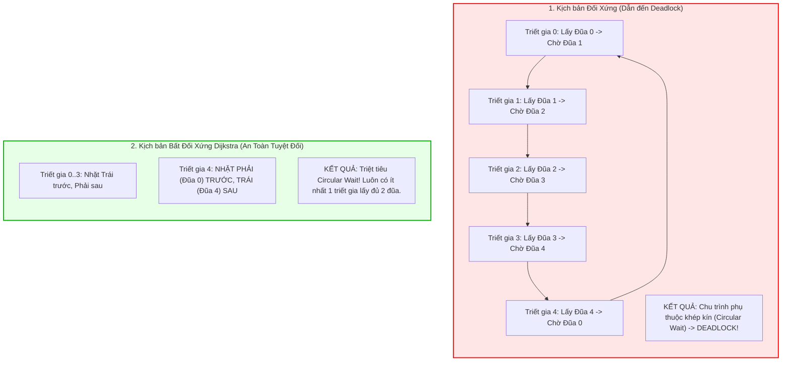

# 1_4_8 Classic Synchronization Problems

> **Khóa học**: Cloud & DevOps Cơ Bản  
> **Phân nhóm**: Domain 1 - Operating System Core Fundamentals  
> **Chủ đề**: 1_4 Process Synchronization and Concurrency  
> **Checklist đối chiếu**: [1_4_8](../../../CHECKLIST.md#domain-1-operating-system-core-fundamentals-45-items)  
> **Trạng thái**: Hoàn thành  

---

## 1. Khái Niệm Cốt Lõi & Bản Chất Kỹ Thuật (Core Concepts & Technical Deep Dive)

Trong lịch sử phát triển của khoa học máy tính và kỹ thuật hệ điều hành, các bài toán đồng bộ hóa kinh điển (**Classic Synchronization Problems**) được đề xuất nhằm mô hình hóa toàn diện các mẫu tranh chấp tài nguyên (Resource Contention), điều phối bất đối xứng, hiện tượng bỏ đói (**Starvation**) và hiểm họa bế tắc (**Deadlock**). 

Hầu như mọi thách thức concurrency phức tạp trong kernel hệ điều hành (I/O buffers, Page Cache, VFS locks) và kiến trúc phân tán hiện đại (Message Queues, Read-Heavy Distributed Caching, Distributed Locks) đều quy về ba bài toán nền tảng dưới đây.

```
       +-------------------------------------------------------------+
       |             BA BÀI TOÁN ĐỒNG BỘ HÓA KINH ĐIỂN               |
       +------------------------------+------------------------------+
                                      |
         +----------------------------+----------------------------+
         |                            |                            |
         v                            v                            v
1. Bounded Buffer             2. Readers-Writers           3. Dining Philosophers
   (Producer-Consumer)           (Độc quyền ghi vs            (Tranh chấp tài nguyên &
   Điều phối dòng dữ liệu        Chia sẻ đọc song song)       Triệt tiêu chu trình Deadlock)
```

---

### 1.1. Bài Toán Vùng Đệm Hữu Hạn (Bounded Buffer / Producer-Consumer Problem)

Bài toán do **Edsger W. Dijkstra** mô hình hóa lần đầu tiên vào năm 1965 (EWD 123):
- **Bối cảnh**: Một hoặc nhiều tiến trình sản xuất (**Producers**) tạo ra các mẩu tin dữ liệu và đưa vào một vùng đệm chia sẻ (**Shared Buffer**) có sức chứa giới hạn tối đa là $N$ phần tử. Cùng lúc đó, một hoặc nhiều tiến trình tiêu thụ (**Consumers**) lấy dữ liệu từ vùng đệm ra để xử lý.
- **Ràng buộc an toàn (Safety Invariants)**:
  1. **Không ghi tràn (No Overflow)**: Producer không được phép ghi dữ liệu khi vùng đệm đã đầy ($N$ phần tử); Producer phải chuyển sang trạng thái chờ (block/sleep) cho tới khi có ít nhất một ô trống.
  2. **Không đọc rỗng (No Underflow)**: Consumer không được phép đọc khi vùng đệm đang rỗng (0 phần tử); Consumer phải chờ cho tới khi có ít nhất một ô dữ liệu được ghi vào.
  3. **Loại trừ tương hỗ (Mutual Exclusion)**: Việc cập nhật con trỏ hàng đợi (Head/Tail pointers) của buffer phải được bảo vệ độc quyền để tránh xung đột dữ liệu.
- **Giải pháp kinh điển bằng Semaphores**:
  - `empty`: Counting Semaphore, khởi tạo giá trị ban đầu là $N$ (biểu thị số lượng ô trống khả dụng).
  - `full`: Counting Semaphore, khởi tạo giá trị ban đầu là `0` (biểu thị số lượng ô dữ liệu đã sẵn sàng).
  - `mutex`: Binary Semaphore hoặc Mutex Lock, khởi tạo là `1` (bảo vệ cấu trúc dữ liệu hàng đợi bên trong đoạn găng).

```
Producer Logic:                    Consumer Logic:
1. sem_wait(&empty);               1. sem_wait(&full);
2. pthread_mutex_lock(&mutex);     2. pthread_mutex_lock(&mutex);
3. // Thêm phần tử vào buffer      3. // Lấy phần tử khỏi buffer
4. pthread_mutex_unlock(&mutex);   4. pthread_mutex_unlock(&mutex);
5. sem_post(&full);                5. sem_post(&empty);
```

> **Quy tắc sống còn về thứ tự khóa (Nesting Order)**: Thao tác `sem_wait(&empty)` bắt buộc phải thực hiện **trước** `pthread_mutex_lock(&mutex)`. Nếu đảo ngược thứ tự, hệ thống sẽ rơi vào Deadlock ngay khi buffer bị đầy!

---

### 1.2. Bài Toán Độc Giả - Tác Giả (Readers-Writers Problem)

Bài toán do P.J. Courtois, F. Heymans và D.L. Parnas đề xuất năm 1971 ([CHP71]), mô hình hóa tình huống một cấu trúc dữ liệu chia sẻ (ví dụ: bảng định tuyến mạng, cơ sở dữ liệu in-memory, hệ thống tập tin) được truy cập bởi hai nhóm tiến trình với đặc quyền khác nhau:
- **Readers (Độc giả)**: Chỉ đọc dữ liệu, không làm thay đổi trạng thái của dữ liệu. Do đó, **nhiều Reader được phép truy cập đồng thời** mà hoàn toàn không gây Race Condition.
- **Writers (Tác giả)**: Sửa đổi dữ liệu. Do đó, **Writer đòi hỏi quyền truy cập độc quyền tuyệt đối** (Mutual Exclusion): không được phép có bất kỳ Reader nào đang đọc hoặc Writer nào khác đang ghi cùng lúc.

#### Các Biến Thể Điều Phối:
1. **Reader-Preference (Ưu tiên người đọc)**:
   - Nếu dữ liệu đang mở cho một Reader đọc, các Reader đến sau được phép vào đọc ngay lập tức mà không phải chờ.
   - **Hệ quả tiêu cực**: Dẫn đến **Writer Starvation (Tác giả bị chết đói)**. Trong hệ thống có lưu lượng đọc liên tục không ngắt quãng, các Writer có thể phải chờ đợi vô thời hạn.
2. **Writer-Preference (Ưu tiên người ghi)**:
   - Ngay khi một Writer phát tín hiệu yêu cầu quyền ghi, các Reader đến sau sẽ bị chặn lại và xếp hàng chờ. Khi nhóm Reader hiện tại hoàn tất, Writer sẽ được ưu tiên vào ghi ngay trước nhóm Reader mới.
   - Giải pháp này ngăn chặn Writer Starvation nhưng có thể làm giảm thông lượng đọc (Read Throughput).
3. **Chuẩn hóa POSIX**:
   - Thư viện POSIX Threads cung cấp trực tiếp cấu trúc khóa chuyên dụng `pthread_rwlock_t` với hai hàm khóa: `pthread_rwlock_rdlock()` (khóa chia sẻ cho Readers) và `pthread_rwlock_wrlock()` (khóa độc quyền cho Writers).

---

### 1.3. Bài Toán Bữa Ăn Của Các Nhà Triết Học (Dining Philosophers Problem)

Được Edsger W. Dijkstra đề xuất năm 1965 (dưới dạng bài toán đề thi điều phối ổ băng từ, sau này xuất bản trong EWD 310 năm 1971 và được C.A.R. Hoare đặt tên là Dining Philosophers) để mô phỏng sự tranh chấp tài nguyên hạn chế giữa các tiến trình chạy song song và cách thức các chu trình chờ đợi lẫn nhau hình thành:

```
                      Triết gia 0
                     (Chopstick 0)
                 /                  \
      Chopstick 4                    Chopstick 1
             /                          \
   Triết gia 4                          Triết gia 1
           |                              |
      Chopstick 3                    Chopstick 2
             \                          /
        Triết gia 3 ———————— Triết gia 2
```

- **Mô hình**: Năm nhà triết học ngồi quanh một bàn tròn. Giữa mỗi cặp triết gia liền kề có đúng một chiếc đũa (tổng cộng 5 triết gia và 5 chiếc đũa).
- **Hành vi**: Mỗi triết gia luân phiên giữa hai trạng thái: **Suy ngẫm (Thinking)** và **Ăn mì (Eating)**. Để ăn được mì, một triết gia **bắt buộc phải có đủ 2 chiếc đũa** (chiếc bên trái và chiếc bên phải của mình). Khi ăn xong, họ đặt cả 2 đũa xuống bàn và tiếp tục suy ngẫm.
- **Hiểm họa Deadlock (Bế tắc toàn cục)**:
  - Nếu áp dụng thuật toán ngây thơ đối xứng: Mỗi triết gia khi đói đều nhặt chiếc đũa bên trái mình trước, sau đó chờ chiếc đũa bên phải.
  - Khi cả 5 triết gia cùng đói tại một thời điểm: Mỗi người đều nhặt thành công đũa bên trái của mình. Lúc này, cả 5 chiếc đũa trên bàn đều bị giữ, không còn chiếc đũa nào tự do. Cả 5 triết gia cùng ngồi chờ đũa bên phải của nhau, tạo thành **Chu trình chờ đợi (Circular Wait)**. Toàn bộ hệ thống bị treo cứng và cả 5 người cùng chết đói (Deadlock).
- **Giải pháp kinh điển của Dijkstra (Phá vỡ tính đối xứng - Breaking Symmetry)**:
  - Bốn triết gia đầu tiên (từ 0 đến 3) vẫn tuân thủ quy tắc: Nhặt đũa trái trước, đũa phải sau.
  - Riêng triết gia cuối cùng (triết gia số 4) sẽ đảo ngược quy tắc: **Nhặt đũa bên phải trước, đũa bên trái sau**.
  - Việc phá vỡ tính đối xứng này triệt tiêu hoàn toàn khả năng hình thành chu trình phụ thuộc vòng kín (Circular Wait), từ đó loại bỏ hoàn toàn Deadlock mà không cần thêm cấu trúc dữ liệu trung gian phức tạp.

---

## 2. Ví Dụ Đời Sống Thực Tế Dễ Hiểu (Intuitive Real-World Analogies)

### 2.1. Bounded Buffer: Băng Chuyền Xưởng Bánh Mì

```
   [ LÒ NƯỚNG ]  --->  [ BĂNG CHUYỀN KHAY BÁNH ]  --->  [ BÀN ĐÓNG GÓI ]
 (Producer tạo bánh)         (Buffer N = 4 khay)       (Consumer đóng hộp)
```
- **Khay đầy bánh**: Băng chuyền chỉ chứa tối đa 4 khay. Nếu thợ nướng liên tục đưa bánh lên mà bàn đóng gói chưa kịp làm, khay thứ 4 nằm im. Thợ nướng buộc phải tạm ngừng tay (`sem_wait(&empty)`) chờ thợ đóng gói lấy bớt khay ra ngoài.
- **Băng chuyền rỗng**: Đầu giờ sáng chưa có bánh trên chuyền (`full = 0`), thợ đóng gói đến nơi không có việc làm nên ngồi uống trà chờ (`sem_wait(&full)`). Ngay khi lò cho ra lò khay bánh đầu tiên (`sem_post(&full)`), thợ đóng gói lập tức bắt tay vào việc.

### 2.2. Readers-Writers: Bảng Điện Tử Thông Báo Lịch Bay Tại Sân Bay

- **Hàng ngàn hành khách (Readers)**: Tại sảnh sân bay, 500 hành khách cùng lúc ngước nhìn lên một màn hình LED lớn để xem giờ cất cánh chuyến bay. Họ không làm hỏng dữ liệu của nhau, nên việc 500 người cùng đọc một lúc là hoàn toàn an toàn và được khuyến khích.
- **Kỹ thuật viên cập nhật (Writer)**: Khi cổng bay bị đổi từ Gate A3 sang Gate B7, kỹ thuật viên phải chuyển màn hình sang chế độ bảo trì hoặc cập nhật độc quyền trong tích tắc. Nếu hành khách vẫn đọc dở dang lúc kỹ thuật viên đang gõ nửa chừng từ "A3" sang "B7", hành khách có thể đọc nhầm dữ liệu rác ("A7" hoặc "B3"). Do đó, kỹ thuật viên phải chờ mọi ánh mắt rời khỏi hoặc tạm ngắt đọc để viết mới.

### 2.3. Dining Philosophers: Năm Vị Khách Quanh Nồi Lẩu 5 Đôi Đũa

Trong một mâm cỗ truyền thống có 5 vị khách và đúng 5 chiếc đũa đơn. Để gắp đồ nhúng lẩu, mỗi người cần 1 đôi (2 chiếc hai bên).
Nếu người phục vụ hô "Mời dùng bữa!" và cả 5 người cùng nhanh tay giật lấy chiếc đũa bên tay trái của mình, mỗi người đều cầm khư khư 1 chiếc đũa và nhìn sang người bên cạnh chờ họ buông đũa xuống. Không ai chịu buông đũa, và nồi lẩu nguội ngắt trong sự bất lực. Chỉ cần người số 5 đổi ý định, với tay sang phải thay vì sang trái, thế bế tắc sẽ lập tức tan biến.

---

## 3. Kiến Trúc, Luồng Hoạt Động & Hình Ảnh Trực Quan (Architecture & Diagrams)

### 3.1. Sơ Đồ Kiến Trúc Bounded Buffer Với Circular Queue

```
                   HÀNG ĐỢI VÒNG (CIRCULAR BUFFER: CAPACITY = 5)
                     +-------+-------+-------+-------+-------+
       Chỉ số:       |   0   |   1   |   2   |   3   |   4   |
                     +-------+-------+-------+-------+-------+
       Dữ liệu:      |  [D1] |  [D2] |  [D3] | Empty | Empty |
                     +-------+-------+-------+-------+-------+
                       ^                       ^
                       |                       |
                     out_idx (Consumer đọc)  in_idx (Producer ghi)

       TRẠNG THÁI SEMAPHORES:
       - empty = 2  (Còn 2 ô trống để ghi)
       - full  = 3  (Đã có 3 phần tử dữ liệu chờ đọc)
       - mutex = 1  (Sẵn sàng cho thao tác ghi/đọc độc quyền)
```

### 3.2. Sơ Đồ Phá Vỡ Deadlock Trong Bài Toán Dining Philosophers (Dijkstra Asymmetry)



---

## 4. Code Mẫu Trực Quan Hoặc Dòng Lệnh Thực Chiến (Runnable Sample Code / CLI)

> ⚠️ Dữ liệu mã nguồn C dưới đây mang tính chất minh họa (illustrative output) các nguyên lý chuẩn POSIX threads, mutexes và POSIX semaphores (`<semaphore.h>`), được biên dịch với trình biên dịch `gcc -pthread`.

### 4.1. Mã Nguồn C: Hiện Thực Hoàn Chỉnh Bounded Buffer (Producer-Consumer)

Đoạn mã C chuẩn hóa cơ chế điều phối giữa 2 Producer threads và 2 Consumer threads thông qua một bộ đệm tròn 4 phần tử:

```c
#include <stdio.h>
#include <stdlib.h>
#include <unistd.h>
#include <pthread.h>
#include <semaphore.h>

#define BUFFER_SIZE 4
#define TOTAL_ITEMS 10

// Cấu trúc hàng đợi vòng (Circular Buffer)
int buffer[BUFFER_SIZE];
int in_idx = 0;
int out_idx = 0;

// Các công cụ đồng bộ hóa
sem_t empty_slots; // Đếm số ô trống khả dụng
sem_t full_slots;  // Đếm số ô có dữ liệu sẵn sàng
pthread_mutex_t buffer_mutex; // Khóa bảo vệ Critical Section

// Hàm Producer
void* producer_routine(void* arg) {
    int producer_id = *(int*)arg;
    free(arg);

    for (int i = 0; i < TOTAL_ITEMS / 2; i++) {
        int item = (producer_id * 100) + i + 1;

        // 1. Chờ cho tới khi có ít nhất một ô trống
        sem_wait(&empty_slots);

        // 2. Chiếm khóa để cập nhật buffer độc quyền
        pthread_mutex_lock(&buffer_mutex);

        buffer[in_idx] = item;
        printf("[Producer %d] Đã ghi item %d vào ô [%d]\n", producer_id, item, in_idx);
        in_idx = (in_idx + 1) % BUFFER_SIZE;

        pthread_mutex_unlock(&buffer_mutex);

        // 3. Báo hiệu cho Consumer rằng có thêm 1 ô chứa dữ liệu
        sem_post(&full_slots);

        usleep(150000); // Tạm dừng 150ms
    }

    pthread_exit(NULL);
}

// Hàm Consumer
void* consumer_routine(void* arg) {
    int consumer_id = *(int*)arg;
    free(arg);

    for (int i = 0; i < TOTAL_ITEMS / 2; i++) {
        // 1. Chờ cho tới khi có ít nhất một ô chứa dữ liệu
        sem_wait(&full_slots);

        // 2. Chiếm khóa để lấy dữ liệu khỏi buffer độc quyền
        pthread_mutex_lock(&buffer_mutex);

        int item = buffer[out_idx];
        printf("    ---> [Consumer %d] ĐÃ LẤY item %d từ ô [%d]\n", consumer_id, item, out_idx);
        out_idx = (out_idx + 1) % BUFFER_SIZE;

        pthread_mutex_unlock(&buffer_mutex);

        // 3. Báo hiệu cho Producer rằng đã giải phóng 1 ô trống
        sem_post(&empty_slots);

        usleep(250000); // Tạm dừng 250ms
    }

    pthread_exit(NULL);
}

int main(void) {
    pthread_t prod1, prod2, cons1, cons2;

    // Khởi tạo semaphores và mutex
    sem_init(&empty_slots, 0, BUFFER_SIZE); // Ban đầu toàn bộ N ô đều trống
    sem_init(&full_slots, 0, 0);            // Ban đầu không có dữ liệu
    pthread_mutex_init(&buffer_mutex, NULL);

    printf("=== KHỞI CHẠY HỆ THỐNG PRODUCER-CONSUMER (BUFFER SIZE = %d) ===\n\n", BUFFER_SIZE);

    int* p1 = malloc(sizeof(int)); *p1 = 1;
    int* p2 = malloc(sizeof(int)); *p2 = 2;
    int* c1 = malloc(sizeof(int)); *c1 = 1;
    int* c2 = malloc(sizeof(int)); *c2 = 2;

    pthread_create(&prod1, NULL, producer_routine, p1);
    pthread_create(&prod2, NULL, producer_routine, p2);
    pthread_create(&cons1, NULL, consumer_routine, c1);
    pthread_create(&cons2, NULL, consumer_routine, c2);

    pthread_join(prod1, NULL);
    pthread_join(prod2, NULL);
    pthread_join(cons1, NULL);
    pthread_join(cons2, NULL);

    // Hủy tài nguyên đồng bộ
    sem_destroy(&empty_slots);
    sem_destroy(&full_slots);
    pthread_mutex_destroy(&buffer_mutex);

    printf("\n=== TOÀN BỘ 10 PHẦN TỬ ĐÃ ĐƯỢC TRAO ĐỔI AN TOÀN TUYỆT ĐỐI ===\n");
    return EXIT_SUCCESS;
}
```

### 4.2. Biên Dịch và Kết Quả Thực Thi Kỳ Vọng

```bash
# Biên dịch chương trình
gcc -Wall -Wextra -pthread -o bounded_buffer bounded_buffer.c

# Thực thi chương trình
./bounded_buffer
```

**Đầu ra mẫu:**
```text
=== KHỞI CHẠY HỆ THỐNG PRODUCER-CONSUMER (BUFFER SIZE = 4) ===

[Producer 1] Đã ghi item 101 vào ô [0]
[Producer 2] Đã ghi item 201 vào ô [1]
    ---> [Consumer 1] ĐÃ LẤY item 101 từ ô [0]
    ---> [Consumer 2] ĐÃ LẤY item 201 từ ô [1]
[Producer 1] Đã ghi item 102 vào ô [2]
[Producer 2] Đã ghi item 202 vào ô [3]
    ---> [Consumer 1] ĐÃ LẤY item 102 từ ô [2]
[Producer 1] Đã ghi item 103 vào ô [0]
    ---> [Consumer 2] ĐÃ LẤY item 202 từ ô [3]
[Producer 2] Đã ghi item 203 vào ô [1]
...
=== TOÀN BỘ 10 PHẦN TỬ ĐÃ ĐƯỢC TRAO ĐỔI AN TOÀN TUYỆT ĐỐI ===
```

---

## 5. Cạm Bẫy Thực Tế & Thực Tiễn Sản Xuất (Production Gotchas & Best Practices)

### 5.1. Cạm Bẫy Đảo Lộn Thứ Tự Lock Gây Deadlock Trong Bounded Buffer

Một trong những sai sót phổ biến nhất của các kỹ sư phần mềm khi cài đặt Producer-Consumer là **đặt Mutex Lock bao bọc bên ngoài Semaphore Wait**:

```c
// SAI LẦM CHẾT NGƯỜI (DEADLOCK NẰM VÙNG):
pthread_mutex_lock(&buffer_mutex); // 1. Khóa mutex trước!
sem_wait(&empty_slots);             // 2. Chờ ô trống trong buffer...
// ... ghi dữ liệu ...
pthread_mutex_unlock(&buffer_mutex);
sem_post(&full_slots);
```

**Hậu quả tại thời điểm Buffer bị đầy**:
1. Giả sử Buffer đã đầy 4/4 ô. Producer A đến, khóa thành công `buffer_mutex`.
2. Producer A kiểm tra `sem_wait(&empty_slots)`: vì `empty_slots = 0`, Producer A bị kernel đưa vào trạng thái ngủ chờ (sleep/blocked).
3. Tuy nhiên, Producer A **vẫn đang giữ chiếc chìa khóa `buffer_mutex` trong túi** khi đi ngủ!
4. Consumer đến để lấy dữ liệu giải phóng ô trống, nhưng ngay lập tức bị chặn đứng tại dòng `pthread_mutex_lock(&buffer_mutex)` vì Mutex đang bị Producer A chiếm giữ.
5. Producer chờ Consumer lấy bớt đồ để có ô trống; Consumer lại chờ Producer nhả Mutex để vào lấy đồ. **Deadlock vĩnh cửu xảy ra!**
- **Quy tắc vàng**: Luôn luôn kiểm tra điều kiện tài nguyên (`sem_wait`) trước khi chiếm giữ khóa đoạn găng (`mutex_lock`).

### 5.2. Writer Starvation Trong Các Hệ Thống Web Cache Tải Đọc Cao

Trong các bài toán thiết kế backend (như Redis/Local in-memory Cache của API Gateway):
- Số lượng luồng đọc dữ liệu (Read QPS) thường gấp hàng trăm lần số lượng luồng ghi (Write QPS).
- Nếu sử dụng cơ chế Read-Preference mặc định: Luồng đọc mới liên tục tới trước khi các luồng đọc cũ hoàn tất. Số lượng `readcount` không bao giờ rơi về 0, khiến các thao tác cập nhật (Write) bị treo vĩnh viễn (Starvation), dẫn đến dữ liệu trong hệ thống bị cũ (Stale Cache) kéo dài.
- **Biện pháp sản xuất**: Sử dụng các cơ chế **Fair Read-Write Lock** (hàng đợi FIFO) hoặc cấu trúc dữ liệu không khóa (**Lock-Free RCU - Read-Copy-Update** trong Linux Kernel), cho phép Writer tạo bản sao mới và thay thế con trỏ nguyên tử mà không cần phong tỏa các Readers.

---

## 6. Câu Hỏi Củng Cố Kiến Thức (Active Recall Quiz)

<details>
<summary><b>Câu hỏi 1:</b> Tại sao trong bài toán Bounded Buffer, chúng ta cần cả Counting Semaphore (<code>empty_slots</code>, <code>full_slots</code>) lẫn Mutex Lock (<code>buffer_mutex</code>)? Chỉ dùng Counting Semaphore có đủ để đảm bảo an toàn luồng không?</summary>

> **Đáp án:**
> Không đủ. Counting Semaphore chỉ đóng vai trò điều phối số lượng ô khả dụng (báo hiệu khi nào đầy hoặc rỗng). Khi có nhiều Producer hoặc nhiều Consumer cùng truy cập đồng thời, nếu không có Mutex bảo vệ, hai Producer có thể cùng được phép ghi vào hàng đợi và cập nhật biến con trỏ `in_idx` cùng một lúc. Điều này gây ra Race Condition trực tiếp trên chỉ số mảng và ghi đè làm mất mát dữ liệu của nhau. Do đó, Mutex là bắt buộc để đảm bảo Mutual Exclusion trên cấu trúc dữ liệu nội bộ của hàng đợi.
</details>

<details>
<summary><b>Câu hỏi 2:</b> Giải pháp của Dijkstra cho bài toán Dining Philosophers (triết gia cuối cùng nhặt đũa phải trước thay vì đũa trái) đã triệt tiêu điều kiện nào trong 4 điều kiện sinh ra Deadlock (Coffman Conditions)?</summary>

> **Đáp án:**
> Giải pháp này triệt tiêu điều kiện **Chờ đợi vòng quanh (Circular Wait)**. Khi triết gia cuối cùng nhặt đũa phải trước, anh ta sẽ cạnh tranh trực tiếp chiếc đũa số 0 với triết gia số 0 ngay từ đầu, thay vì giữ đũa 4 và chờ đũa 0. Nhờ đó, chu trình đồ thị phân bổ tài nguyên (Resource Allocation Graph) không thể khép thành một vòng lặp khép kín, ngăn chặn Deadlock xảy ra hoàn toàn.
</details>

<details>
<summary><b>Câu hỏi 3:</b> Trong bài toán Readers-Writers theo cơ chế Reader-Preference, điều gì xảy ra nếu hàng nghìn yêu cầu đọc liên tục được gửi tới hệ thống mà không có khoảng trống nào?</summary>

> **Đáp án:**
> Hiện tượng **Bỏ đói tác giả (Writer Starvation)** sẽ xảy ra. Do Reader-Preference cho phép bất kỳ Reader mới nào bước vào đọc ngay nếu đang có ít nhất một Reader khác ở bên trong, biến đếm người đọc (`readcount`) sẽ luôn duy trì giá trị $\ge 1$. Do đó, khóa ghi độc quyền sẽ không bao giờ được giải phóng, khiến tiến trình Writer phải chờ đợi vô hạn và không thể cập nhật dữ liệu mới vào hệ thống.
</details>

---

## 7. 📚 Nguồn Tài Liệu Chính Thống (Tier-1 Official References)

- [Dijkstra (1965) Cooperating Sequential Processes (EWD 123)](https://www.cs.utexas.edu/~EWD/ewd01xx/EWD123.PDF) - Văn bản gốc của Edsger W. Dijkstra định nghĩa cơ chế Semaphore và bài toán Bounded Buffer (Mục 4.3).
- [Courtois, Heymans, Parnas (1971) Concurrent Control with "Readers" and "Writers"](https://dl.acm.org/doi/10.1145/362759.362813) - Công trình kinh điển của ACM đề xuất và giải quyết bài toán Readers-Writers.
- [OSTEP Chapter 31: Semaphores (Arpaci-Dusseau)](https://pages.cs.wisc.edu/~remzi/OSTEP/threads-sema.pdf) - Phân tích chi tiết và cài đặt mẫu của bài toán Bounded Buffer, Reader-Writer Lock và Dining Philosophers.
- [Linux Programmer's Manual - pthreads(7)](https://man7.org/linux/man-pages/man7/pthreads.7.html) - Tổng quan kiến trúc đa luồng POSIX threads trên Linux.
- [Linux Programmer's Manual - pthread_rwlock_rdlock(3p)](https://man7.org/linux/man-pages/man3/pthread_rwlock_rdlock.3p.html) - Đặc tả kỹ thuật của cơ chế khóa đọc-ghi độc quyền Readers-Writers trên Linux.
