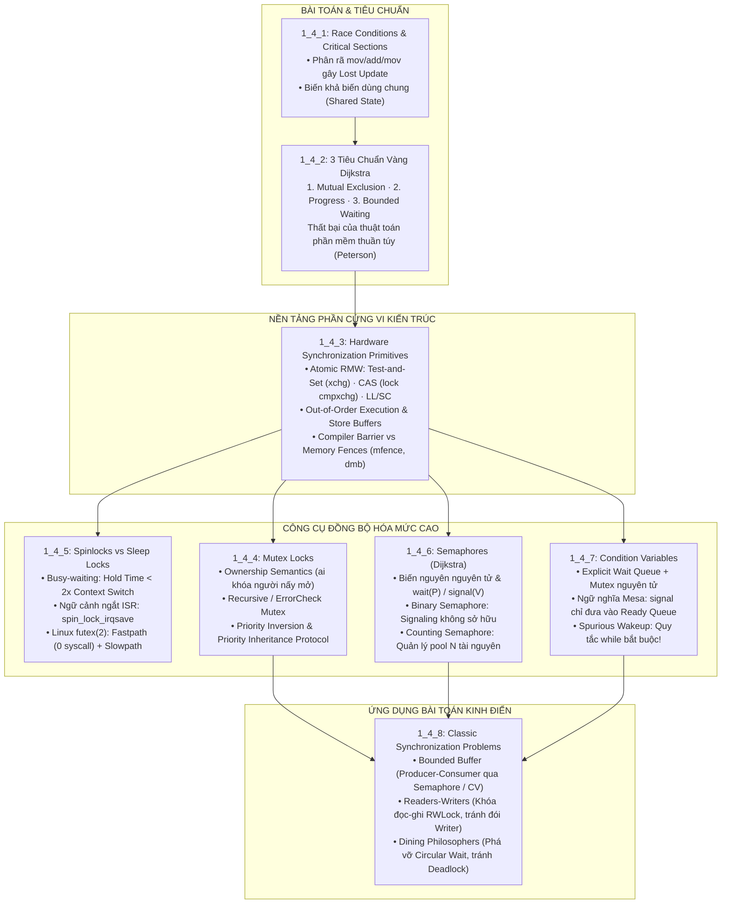

# 1_4 Process Synchronization and Concurrency

> **Khóa học**: Cloud DevOps Basic — OS Core · **Domain**: 1 Domain 1 - Operating System Core Fundamentals · **Roadmap gốc**: [os/README.md](<../../README.md#module-4-process-synchronization--concurrency>)

---

## Module này dạy gì? (What & Why)

Module này phân tích toàn diện lý thuyết và thực tiễn của Đồng bộ hóa Tiến trình (Process Synchronization) và Lập trình Đồng thời (Concurrency)—nền tảng cốt tử bảo đảm tính toàn vẹn dữ liệu và loại trừ các lỗi sai phi tất định (Heisenbugs) trong các hệ thống máy tính đa nhân và dịch vụ phân tán. Người học sẽ bắt đầu từ bản chất của Điều kiện tranh định (Race Conditions) phát sinh từ việc phân rã các phép toán số học bậc cao (`counter++` thành chuỗi 3 lệnh hợp ngữ `mov/add/mov`) và khái niệm Miền găng (Critical Sections). Tiếp theo, module làm sáng tỏ 3 tiêu chuẩn vàng của Dijkstra (Mutual Exclusion, Progress, Bounded Waiting) cùng các giới hạn của thuật toán phần mềm cổ điển (Peterson) trên phần cứng hiện đại. Từ đó, module đi sâu vào các cơ chế đồng bộ phần cứng vi kiến trúc (chỉ lệnh nguyên tử Test-and-Set, Compare-and-Swap, LL/SC và Rào cản bộ nhớ Memory Barriers). Trên nền tảng phần cứng đó, người học sẽ làm chủ hệ thống công cụ đồng bộ cao cấp: Khóa Mutex với ngữ nghĩa sở hữu nghiêm ngặt và cơ chế giải quyết đảo ngược độ ưu tiên (Priority Inheritance); sự đánh đổi giữa Khóa bận (Spinlocks) và Khóa ngủ (Sleep Locks) kết hợp kiến trúc 2 pha đột phá của Linux `futex(2)`; Đèn báo hiệu Semaphore (Binary vs Counting); và Biến điều kiện (Condition Variables) dưới ngữ nghĩa Mesa và quy tắc vòng lặp `while`. Cuối cùng, module ứng dụng các công cụ này giải quyết triệt để 3 bài toán đồng bộ kinh điển: Producer-Consumer (Bộ đệm có hạn Bounded Buffer), Readers-Writers (tránh bỏ đói writer), và Dining Philosophers (ngăn chặn Deadlock và Starvation).

---

## Lộ trình bài học (Lesson Path)

| Bài học | Mục tiêu cốt lõi | Checklist ID |
| :--- | :--- | :---: |
| [1_4_1 Race Conditions and Critical Sections](<./1_4_1 Race Conditions and Critical Sections.md>) | Phân tích nguyên nhân Race Condition, phân rã hợp ngữ `counter++` (`mov/add/mov`), hiện tượng Lost Update, vai trò của `volatile` và bảo vệ bằng `pthread_mutex_t`. | [1_4_1](<../../../CHECKLIST.md#domain-1-operating-system-core-fundamentals-45-items>) |
| [1_4_2 The Three Critical Section Requirements](<./1_4_2 The Three Critical Section Requirements.md>) | Nắm vững 3 tiêu chuẩn vàng của Dijkstra (Mutual Exclusion, Progress, Bounded Waiting), phân tích giải thuật Peterson và cạm bẫy trên CPU hiện đại. | [1_4_2](<../../../CHECKLIST.md#domain-1-operating-system-core-fundamentals-45-items>) |
| [1_4_3 Hardware Synchronization Primitives](<./1_4_3 Hardware Synchronization Primitives.md>) | Làm chủ các chỉ lệnh nguyên tử phần cứng (Test-and-Set, CAS `lock cmpxchg`, LL/SC), hiện tượng Out-of-Order Memory Reordering, và rào cản bộ nhớ (Compiler Barrier vs Memory Fences). | [1_4_3](<../../../CHECKLIST.md#domain-1-operating-system-core-fundamentals-45-items>) |
| [1_4_4 Mutex Locks](<./1_4_4 Mutex Locks.md>) | Khóa loại trừ tương hỗ, ngữ nghĩa sở hữu (Ownership Semantics), phân loại Mutex POSIX (Normal, Recursive, ErrorCheck), hiện tượng Priority Inversion và giao thức Priority Inheritance. | [1_4_4](<../../../CHECKLIST.md#domain-1-operating-system-core-fundamentals-45-items>) |
| [1_4_5 Spinlocks vs Sleep Locks](<./1_4_5 Spinlocks vs Sleep Locks.md>) | So sánh chi phí CPU busy-waiting vs Context Switch, quy tắc ngón tay cái OSTEP, cơ chế cấm ngủ trong ngắt Kernel (`spin_lock_irqsave`), và cơ chế Linux `futex(2)` Fastpath/Slowpath. | [1_4_5](<../../../CHECKLIST.md#domain-1-operating-system-core-fundamentals-45-items>) |
| [1_4_6 Semaphores](<./1_4_6 Semaphores.md>) | Đèn hiệu Dijkstra, bản chất biến nguyên nguyên tử với `wait()` (`P()`) và `signal()` (`V()`), phân biệt Binary Semaphore (báo hiệu, không sở hữu) vs Counting Semaphore (quản lý nhóm tài nguyên). | [1_4_6](<../../../CHECKLIST.md#domain-1-operating-system-core-fundamentals-45-items>) |
| [1_4_7 Condition Variables](<./1_4_7 Condition Variables.md>) | Hàng đợi chờ tường minh kết hợp Mutex nguyên tử (`pthread_cond_wait`), Ngữ nghĩa Mesa vs Hoare, hiện tượng Thức tỉnh giả (Spurious Wakeup), và quy tắc vàng vòng lặp `while`. | [1_4_7](<../../../CHECKLIST.md#domain-1-operating-system-core-fundamentals-45-items>) |
| [1_4_8 Classic Synchronization Problems](<./1_4_8 Classic Synchronization Problems.md>) | Làm chủ 3 bài toán kinh điển: Producer-Consumer (Bộ đệm có hạn Bounded Buffer), Readers-Writers (ưu tiên đọc vs ưu tiên ghi), và Dining Philosophers (phá vỡ Deadlock và Starvation). | [1_4_8](<../../../CHECKLIST.md#domain-1-operating-system-core-fundamentals-45-items>) |

---

## Bản đồ khái niệm (Concept Map)

Sơ đồ dưới đây thể hiện mạch logic kết nối toàn diện 8 bài học trong Module 1.4:

---

## Ẩn dụ xuyên suốt (Module Analogy)

Các bài học trong Module 1.4 được xâu chuỗi thông qua hệ thống ẩn dụ đời sống sinh động:

1. **Rút tiền tại hai cây ATM (1_4_1)**: Hai vợ chồng cùng lúc rút 1 triệu tại 2 cây ATM từ sổ tiết kiệm 1 triệu chung; cả hai máy cùng đọc 1 triệu, cùng nhả 1 triệu rồi trừ về 0 đồng $\rightarrow$ Ngân hàng mất trắng 1 triệu do Race Condition vì thiếu khóa bảo vệ giao dịch.
2. **Phòng vệ sinh trên máy bay (1_4_2)**: Chỉ một người dùng tại một thời điểm (Mutual Exclusion); khi phòng trống, người cần đi vệ sinh được quyền vào ngay không bị cản trở (Progress); không ai phải nhịn tiểu đứng chờ vô hạn trong khi người khác liên tục chen ngang (Bounded Waiting).
3. **Khóa vân tay siêu tốc & Kính cách âm dây chuyền (1_4_3)**: Khóa vân tay cơ học hoàn tất kiểm tra và mở chốt trong 1 tích tắc duy nhất không ai chen ngón tay vào giữa được (Hardware Atomic CAS); Rào chắn dây chuyền buộc công nhân phải lắp xong pin vào hộp rồi mới cho phép dán tem niêm phong ra ngoài (Memory Barrier ngăn CPU Out-of-Order).
4. **Chìa khóa phòng khách sạn độc quyền (1_4_4)**: Người nhận phòng cầm chìa khóa duy nhất và chỉ chính người đó mới có quyền trả chìa khóa cho lễ tân (Strict Ownership); không ai được phép tự ý mở phòng của người khác. Khi một giám đốc phòng VIP bị chặn bởi nhân viên phục vụ phòng, quản lý tạm thời nâng quyền cho nhân viên đó làm thật nhanh để giải tỏa phòng (Priority Inheritance).
5. **Gõ cửa liên tục vs Về bàn ngủ chờ điện thoại (1_4_5)**: Đứng gõ cộc cộc trước cửa phòng sếp hỏi "xong chưa?" (Spinlock: sếp ký mất 2 giây thì nhanh nhất, nhưng sếp họp 2 tiếng thì kiệt sức ngất xỉu); để lại số điện thoại rồi về bàn ngủ chờ chuông báo (Sleep Lock: tốn công đi lại nhưng không mất sức). Linux Futex kết hợp: thử vặn tay nắm cửa trước ở ngoài (Fastpath 0 syscalls), nếu khóa thật mới về bàn ngủ (Slowpath).
6. **Bãi đỗ xe thông minh & Vé đỗ xe (1_4_6)**: Bãi đỗ xe có bảng điện tử hiển thị $N$ chỗ trống (Counting Semaphore); mỗi xe vào bốc vé thì số chỗ giảm 1 (`wait/P`), xe ra trả vé thì số chỗ tăng 1 (`signal/V`). Vé xe có thể được bảo vệ phát cho xe khác mà không đòi hỏi người gửi và người lấy phải là cùng một người (No Ownership / Signaling).
7. **Phòng chờ sân bay & Loa phát thanh (1_4_7)**: Hành khách ngồi ngủ chờ máy bay đến (`pthread_cond_wait`); loa phát thanh thông báo cho 1 người (`signal`) hoặc toàn chuyến (`broadcast`). Khi loa gọi, hành khách tỉnh dậy phải chen lấn xuất trình vé ở cửa (chiếm lại Mutex); vì có thể có người chen vào cướp chỗ hoặc loa chập điện phát nhầm (Spurious Wakeup), hành khách thông minh luôn nhìn bảng điện tử kiểm tra lại: `while (chưa sẵn sàng) { ngủ tiếp; }`.
8. **Nhà kho phân phối & Bàn ăn 5 triết gia (1_4_8)**: Nhà kho có sức chứa hữu hạn yêu cầu xe giao hàng và xe nhận hàng phối hợp nhịp nhàng (Bounded Buffer); 5 triết gia ngồi ăn mì nhưng chỉ có 5 chiếc đũa, nếu cùng nhấc đũa bên phải sẽ chết đói hàng loạt (Deadlock); muốn sống sót phải áp dụng quy luật bất đối xứng (Resource Ordering).

---

## Tự kiểm tra cuối module (Module Review)

<b>Câu hỏi 1:</b> Tại sao thao tác <code>counter++</code> trên biến số nguyên toàn cục trong ngôn ngữ C/C++ lại không an toàn đa luồng trên kiến trúc x86_64? Giải thích 3 bước hợp ngữ và vai trò của từ khóa <code>volatile</code>.

**Đáp án:**
- Thao tác `counter++` trên kiến trúc x86_64 không phải là một câu lệnh nguyên tử, mà bị phân rã thành **3 chỉ lệnh hợp ngữ độc lập**:
  1. `Load`: Nạp giá trị từ ô nhớ RAM vào thanh ghi CPU (`movl counter(%rip), %eax`).
  2. `Modify`: Tăng giá trị thanh ghi lên 1 trên bộ số học ALU (`addl $1, %eax`).
  3. `Store`: Ghi ngược giá trị mới từ thanh ghi về lại ô nhớ RAM (`movl %eax, counter(%rip)`).
- Nếu ngắt thời gian (Timer Interrupt) hoặc chuyển ngữ cảnh xảy ra giữa các chỉ lệnh này, hai luồng cùng đọc giá trị cũ và cùng ghi đè một giá trị, dẫn tới hiện tượng **Mất mát cập nhật (Lost Update)**.
- **Vai trò của `volatile`**: Buộc trình biên dịch (đặc biệt khi bật tối ưu hóa `-O2`/`-O3`) phải phát sinh lệnh đọc và ghi RAM thực tế trên mỗi chu kỳ lặp, ngăn chặn trình tối ưu hóa gộp cả vòng lặp 1.000.000 lần thành một câu lệnh cộng duy nhất `add counter, 1000000`, qua đó tái hiện trung thực điều kiện tranh định.

<b>Câu hỏi 2:</b> Ba tiêu chuẩn vàng của Dijkstra để giải quyết bài toán Miền găng (Critical Section) là gì? Hiện tượng Bế tắc (Deadlock) vi phạm tiêu chuẩn nào trong số ba tiêu chuẩn đó?

**Đáp án:**
- **Ba tiêu chuẩn vàng của Dijkstra**:
  1. **Loại trừ tương hỗ (Mutual Exclusion)**: Nếu một tiến trình đang thực thi bên trong miền găng, không có tiến trình nào khác được phép cùng thực thi trong miền găng đó.
  2. **Tiến triển (Progress)**: Nếu không có tiến trình nào trong miền găng và có các tiến trình muốn bước vào, chỉ những tiến trình không nằm trong miền còn lại mới tham gia quyết định ai được vào tiếp theo, và quyết định này không thể bị trì hoãn vô thời hạn.
  3. **Chờ đợi có giới hạn (Bounded Waiting)**: Phải tồn tại một giới hạn về số lần các tiến trình khác được phép vào miền găng sau khi một tiến trình đã đưa ra yêu cầu, nhằm ngăn chặn nguy cơ bị bỏ đói vĩnh viễn (Starvation).
- **Hiện tượng Deadlock**: Khi bế tắc xảy ra, không có bất kỳ tiến trình nào đang ở trong miền găng, nhưng cũng không có tiến trình nào có thể tiến triển để bước vào miền găng. Do đó, Deadlock vi phạm trực tiếp tiêu chuẩn **Tiến triển (Progress)**.

<b>Câu hỏi 3:</b> Phân biệt sự khác nhau bản chất giữa Khóa Mutex và Đèn báo hiệu Binary Semaphore? Tại sao không thể sử dụng Mutex để làm cơ chế báo hiệu (Signaling) giữa hai luồng độc lập?

**Đáp án:**
- **Sự khác biệt bản chất - Ngữ nghĩa sở hữu (Ownership Semantics)**:
  - **Mutex**: Có ngữ nghĩa sở hữu nghiêm ngặt (*Strict Ownership*). Luồng nào gọi `lock()` để chiếm khóa thì **bắt buộc phải là chính luồng đó** gọi `unlock()` để giải phóng khóa. Một luồng không thể giải phóng Mutex do luồng khác đang nắm giữ.
  - **Binary Semaphore**: Không có khái niệm sở hữu. Giá trị của nó chỉ là một biến nguyên 0 hoặc 1. Bất kỳ luồng nào cũng có thể gọi `sem_post()` (hoặc `V()`) để đánh thức một luồng khác đang bị khóa bởi `sem_wait()` (hoặc `P()`).
- **Tại sao Mutex không dùng làm Signaling**:
  - Cơ chế báo hiệu (Signaling) đòi hỏi Luồng A phát tín hiệu (Unlock/Post) để đánh thức Luồng B đang chờ (Lock/Wait).
  - Nếu dùng Mutex, hành vi Luồng A gọi `unlock()` trên một chiếc khóa mà nó không sở hữu (do Luồng B đang giữ hoặc không ai giữ) bị chuẩn POSIX coi là hành vi bất định (*Undefined Behavior*), sẽ sinh lỗi `EPERM` hoặc gây đổ vỡ hệ thống. Báo hiệu giữa hai luồng bắt buộc phải dùng **Semaphore** hoặc **Condition Variable**.

<b>Câu hỏi 4:</b> Dưới Ngữ nghĩa Mesa (Mesa Semantics), tại sao các lời gọi <code>pthread_cond_wait()</code> bắt buộc phải được đặt bên trong vòng lặp <code>while</code> mà tuyệt đối không được dùng <code>if</code>?

**Đáp án:**
- **Bản chất Ngữ nghĩa Mesa**:
  - Khi một luồng phát tín hiệu `signal()`, luồng đang ngủ không được chạy ngay lập tức, mà chỉ được chuyển từ Wait Queue sang Ready Queue.
  - Khi luồng được đánh thức nạp vào CPU, nó bắt buộc phải cạnh tranh để **chiếm lại Mutex** với các luồng khác.
  - Trong khoảng thời gian trễ này, một luồng thứ ba có thể đã nhanh chân chiếm Mutex trước và làm thay đổi điều kiện (ví dụ lấy mất dữ liệu vừa sinh ra).
- **Hiện tượng Thức tỉnh giả (Spurious Wakeup)**: Luồng có thể thức giấc do ngắt hệ thống mà không có tín hiệu nào được phát ra.
- **Vai trò của `while`**: Vòng lặp `while (condition == false)` ép luồng khi thức dậy và chiếm được Mutex phải **kiểm tra lại điều kiện một lần nữa**. Nếu điều kiện không còn thỏa mãn, luồng tự động ngủ tiếp, loại trừ hoàn toàn nguy cơ truy cập bộ đệm rỗng dẫn đến sập ứng dụng.

<b>Câu hỏi 5:</b> Trong bài toán 5 Triết gia ăn tối (Dining Philosophers), điều kiện bế tắc vòng tròn (Circular Wait) xảy ra khi nào và kỹ sư có thể áp dụng chiến lược Phá vỡ bất đối xứng (Resource Ordering) như thế nào để ngăn chặn Deadlock?

**Đáp án:**
- **Điều kiện xảy ra Circular Wait**:
  - Khi cả 5 triết gia cùng đói bụng vào đúng một thời điểm và cùng đồng loạt nhấc chiếc đũa bên tay phải của mình lên.
  - Lúc này, mỗi triết gia đều đang giữ 1 chiếc đũa bên phải và cùng ngồi chờ chiếc đũa bên tay trái (đang bị triết gia bên cạnh giữ). Một chu trình chờ đợi khép kín hình thành ($P_0 \to P_1 \to P_2 \to P_3 \to P_4 \to P_0$), dẫn tới bế tắc vĩnh viễn (Deadlock).
- **Chiến lược Phá vỡ bất đối xứng (Resource Ordering)**:
  - Đánh số thứ tự các chiếc đũa từ 0 đến 4. Quy định nguyên tắc toàn cục: Bất kỳ triết gia nào cũng phải chiếm chiếc đũa có số thứ tự **nhỏ hơn trước**, sau đó mới chiếm chiếc đũa có số thứ tự **lớn hơn**.
  - Các triết gia từ 0 đến 3 sẽ nhặt đũa $i$ (bên phải) rồi mới nhặt $i+1$ (bên trái).
  - Riêng triết gia số 4 (ngồi giữa đũa 4 và đũa 0): Vì số 0 nhỏ hơn số 4, triết gia 4 bắt buộc phải đổi chiều, nhặt đũa 0 (bên trái) trước rồi mới nhặt đũa 4 (bên phải).
  - Quy tắc này phá vỡ hoàn toàn chu trình chờ đợi vòng tròn, đảm bảo luôn có ít nhất một triết gia cầm được cả hai chiếc đũa để ăn và giải phóng tài nguyên.

---

## 📚 Nguồn chính (Key References)

- [OSTEP Chapter 26: Concurrency: An Introduction](https://pages.cs.wisc.edu/~remzi/OSTEP/threads-intro.pdf) - Giáo trình chuẩn mực *Operating Systems: Three Easy Pieces* (Remzi H. Arpaci-Dusseau & Andrea C. Arpaci-Dusseau), phân tích định nghĩa bản chất Race Conditions, giải phẫu 3 chỉ lệnh hợp ngữ của `counter++`, và khái niệm Critical Section.
- [OSTEP Chapter 28: Locks](https://pages.cs.wisc.edu/~remzi/OSTEP/threads-locks.pdf) - Giáo trình OSTEP phân tích chi tiết cơ chế hoạt động của Test-and-Set, Compare-and-Swap (CAS), Load-Linked / Store-Conditional, Spinlocks vs Sleep Locks.
- [OSTEP Chapter 30: Condition Variables](https://pages.cs.wisc.edu/~remzi/OSTEP/threads-cv.pdf) - Giáo trình OSTEP phân tích định nghĩa bản chất Condition Variables, giải pháp Producer-Consumer Bounded Buffer, ngữ nghĩa Mesa vs Hoare, và quy tắc vòng lặp `while`.
- [OSTEP Chapter 31: Semaphores](https://pages.cs.wisc.edu/~remzi/OSTEP/threads-sema.pdf) - Giáo trình OSTEP phân tích cơ chế hoạt động của Semaphore, Binary Semaphore, và ứng dụng giải quyết các bài toán đồng bộ kinh điển.
- [Linux Kernel Documentation: Memory Barriers](https://docs.kernel.org/core-api/wrappers/memory-barriers.html) - Tài liệu kỹ thuật chính thức từ Linux Kernel Documentation, giải thích tường tận về CPU Out-of-Order Execution, Store Buffers, Compiler Barriers và Hardware Memory Fences.
- [Linux Kernel Documentation: Spinlocks](https://docs.kernel.org/locking/spinlocks.html) - Hướng dẫn chính thức từ Linux Kernel Documentation về quy tắc sử dụng Spinlocks trong Ring 0, ngữ cảnh ngắt và hàm cứu sinh `spin_lock_irqsave()`.
- [Linux Manual Pages: pthreads(7)](https://man7.org/linux/man-pages/man7/pthreads.7.html) - Tổng quan chuẩn kiến trúc luồng POSIX Threads và các công cụ đồng bộ hóa đi kèm.
- [Linux Manual Pages: pthread_mutex_lock(3p)](https://man7.org/linux/man-pages/man3/pthread_mutex_lock.3p.html) - Đặc tả chuẩn POSIX về hàm `pthread_mutex_lock` và `pthread_mutex_unlock`, định nghĩa thuộc tính loại trừ tương hỗ.
- [Linux Manual Pages: pthread_cond_wait(3p)](https://man7.org/linux/man-pages/man3/pthread_cond_wait.3p.html) - Đặc tả chuẩn POSIX Threads về các hàm `pthread_cond_wait`, `pthread_cond_signal`, `pthread_cond_broadcast` và cảnh báo Thức tỉnh giả (Spurious Wakeups).
- [Linux Manual Pages: futex(2)](https://man7.org/linux/man-pages/man2/futex.2.html) - Đặc tả kỹ thuật chuẩn về System Call `futex`, phân tích chi tiết cơ chế phân tách Fastpath (User Space) vs Slowpath (Kernel Wait Queue).
- [Microsoft Learn: User Mode and Kernel Mode](https://learn.microsoft.com/en-us/windows-hardware/drivers/gettingstarted/user-mode-and-kernel-mode) - Tài liệu kiến trúc phân tầng đặc quyền thực thi CPU giữa User Mode và Kernel Mode từ Microsoft Learn.
