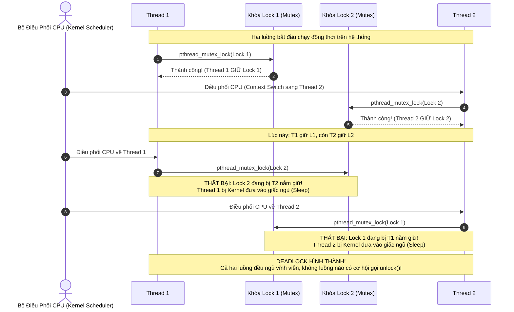
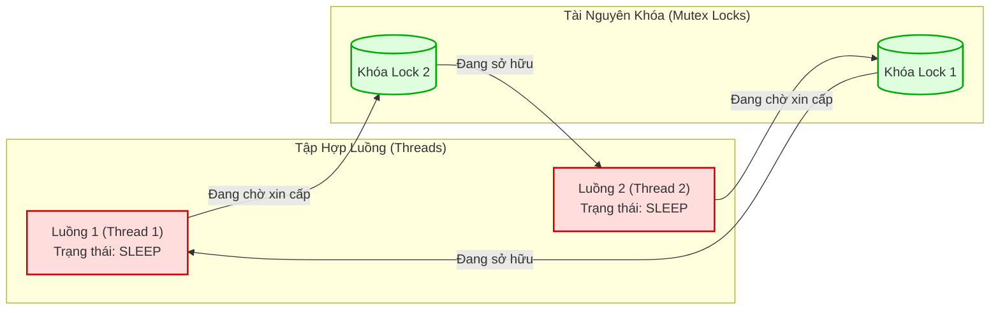

# 1_5_1 What is Deadlock

> **Khóa học**: Cloud & DevOps Cơ Bản  
> **Phân nhóm**: Domain 1 - Operating System Core Fundamentals  
> **Chủ đề**: 1_5 Deadlock Deep Dive  
> **Checklist đối chiếu**: [1_5_1](../../../CHECKLIST.md#domain-1-operating-system-core-fundamentals-45-items)  
> **Trạng thái**: Hoàn thành  

---

## 1. Khái Niệm Cốt Lõi & Bản Chất Kỹ Thuật (Core Concepts & Technical Deep Dive)

Trong lý thuyết hệ điều hành hiện đại và lập trình đa luồng (multithreading / concurrent programming), **Deadlock (Bế tắc)** là một trong những trạng thái lỗi nghiêm trọng nhất.

### 1.1. Định Nghĩa Hình Thức & Nguồn Gốc Lịch Sử: "The Deadly Embrace"

Khái niệm Deadlock lần đầu tiên được định nghĩa chính thức trong khoa học máy tính bởi nhà khoa học máy tính lỗi lạc **Edsger W. Dijkstra** vào năm 1965 trong bài khảo luận nền tảng mang mã hiệu **EWD 123** ("Cooperating Sequential Processes", Mục 6):

> *"This situation, when one process can only continue provided the other one is killed first, is called 'The Deadly Embrace'. The problem to be solved is: how can we avoid the danger of the Deadly Embrace without being unnecessarily restrictive."*  
> — **Edsger W. Dijkstra (1965)**, *EWD 123: Cooperating Sequential Processes, Section 6*

Dijkstra đã sử dụng cụm từ tượng hình **"The Deadly Embrace"** (Cái ôm chết chóc) để mô tả tình huống hai hoặc nhiều tiến trình ôm giữ tài nguyên của nhau và không chịu buông tha, tạo ra một thế bế tắc vĩnh cửu.

Theo định nghĩa chuẩn tắc từ sách giáo khoa hệ điều hành kinh điển **OSTEP (Operating Systems: Three Easy Pieces - Chapter 32: Concurrency Bugs)**:
- **Deadlock** là trạng thái mà một tập hợp các tiến trình hoặc luồng thực thi đồng thời (concurrent processes or threads) bị phong tỏa vĩnh viễn (**permanently blocked**), bởi vì mỗi tiến trình trong tập hợp đều đang nắm giữ ít nhất một tài nguyên (resource / lock) và đồng thời đang ngủ để chờ xin cấp phát thêm một tài nguyên khác đang bị chính một tiến trình khác trong cùng tập hợp đó nắm giữ.

```
+-------------------------------------------------------------------------------+
|                      BẢN CHẤT CỐT LÕI CỦA DEADLOCK                            |
+-------------------------------------------------------------------------------+
| 1. Tập hợp bị bế tắc (Set of Blocked Processes): {P1, P2, ..., Pn}            |
| 2. P1 đang giữ R1 và chờ xin R2.                                              |
| 3. P2 đang giữ R2 và chờ xin R1.                                              |
| 4. Sự kiện giải phóng (Release Event) chỉ có thể sinh ra từ P1 hoặc P2.       |
| 5. Nhưng vì cả hai đều đang ngủ say chờ đợi, hành vi giải phóng KHÔNG BAO GIỜ |
|    diễn ra tự nhiên -> Bế tắc vĩnh viễn (Permanent Halt).                     |
+-------------------------------------------------------------------------------+
```

---

### 1.2. Phân Tích Cơ Chế Dưới Góc Nhìn Hệ Điều Hành

Về mặt kỹ thuật tầng thấp (low-level OS internals):
1. **Trạng thái luồng (Thread State)**: Khi một luồng cố gắng chiếm đoạt một khóa loại trừ tương hỗ (Mutual Exclusion Lock / Mutex) đã bị luồng khác chiếm giữ, luồng đó sẽ bị thu hồi quyền thực thi trên CPU, chuyển trạng thái từ `TASK_RUNNING` sang trạng thái ngủ (Sleep State - trên Linux là `TASK_INTERRUPTIBLE` hoặc `TASK_UNINTERRUPTIBLE`, hiển thị mã trạng thái `Sl` hoặc `Sl+`).
2. **Cơ chế đánh thức (Wake-up Mechanism)**: Hệ điều hành (Kernel Scheduler) chỉ đánh thức (wake up) một luồng đang ngủ khi có một tiến trình khác kích hoạt sự kiện mở khóa (ví dụ gọi hàm `pthread_mutex_unlock` hoặc system call giải phóng tài nguyên tương ứng).
3. **Nút thắt Deadlock**: Trong kịch bản Deadlock, tiến trình chịu trách nhiệm phát ra sự kiện đánh thức lại chính là tiến trình cũng đang bị đưa vào trạng thái ngủ vì đang đợi một tài nguyên khác. Kết quả là toàn bộ chuỗi phụ thuộc đều đi vào giấc ngủ vĩnh hằng mà không tiêu tốn thêm bất kỳ chu kỳ xung nhịp CPU nào (CPU Usage tụt về 0% cho các luồng bị kẹt).

---

## 2. Ví Dụ Đời Sống Thực Tế Dễ Hiểu (Intuitive Real-World Analogies)

```
                     NÚT GIAO THÔNG CHỮ THẬP BỊ KẸT CỨNG
                            (TRAFFIC GRIDLOCK)
                                 Hướng Bắc
                                    |  |
                                    |  |
                              [Xe D]|  |
                                    |  v
          --------------------------+  +--------------------------
          <================= [Xe A]      [Xe B] <=================   Hướng Tây / Đông
          --------------------------+  +--------------------------
                                    ^  |
                                    |  |[Xe C]
                                    |  |
                                    |  |
                                 Hướng Nam

  - Xe A đi từ Đông sang Tây: Đầu xe A chặn Xe B, nhưng thân Xe A bị Xe D chặn.
  - Xe B đi từ Tây sang Đông: Bị Xe A chặn đầu, nhưng đầu Xe B lại chặn Xe C.
  - Xe C đi từ Nam lên Bắc:   Bị Xe B chặn đầu, nhưng đầu Xe C lại chặn Xe D.
  - Xe D đi từ Bắc xuống Nam: Bị Xe C chặn đầu, nhưng đầu Xe D lại chặn Xe A.
  
  ===> Đuôi mỗi xe đều có dòng xe phía sau bịt kín (Không thể lùi).
  ===> Đầu mỗi xe đều bị xe vuông góc chắn ngang (Không thể tiến).
  ===> TOÀN BỘ NGÃ TƯ TÊ LIỆT VĨNH VIỄN ("THE DEADLY EMBRACE")!
```

### 2.1. Phép So Sánh: Nút Giao Thông Chữ Thập Kẹt Cứng (Traffic Gridlock)

Hãy tưởng tượng một ngã tư đường phố không có đèn tín hiệu giao thông hoặc khi 4 chiếc ô tô cùng lao vào giao lộ từ 4 hướng (Đông, Tây, Nam, Bắc) tại cùng một tích tắc:
- **Xe A** tiến vào giao lộ, chiếm khoảng trống trung tâm phía Tây và muốn đi tiếp sang phía Đông, nhưng lối đi phía trước đang bị **Xe D** chắn ngang.
- **Xe D** chiếm khoảng trống phía Bắc và muốn đi xuống Nam, nhưng lối đi lại bị **Xe C** chắn ngang.
- **Xe C** chiếm khoảng trống phía Nam và muốn đi lên Bắc, nhưng lối đi lại bị **Xe B** chắn ngang.
- **Xe B** chiếm khoảng trống phía Đông và muốn rẽ sang Tây, nhưng lối đi lại bị **Xe A** chắn ngang.

Tại thời điểm này:
- Không xe nào có thể **tiến lên** vì khoảng không gian phía trước đang bị xe bên cạnh chiếm dụng.
- Không xe nào có thể **lùi lại** vì phía sau đuôi xe đã bị dòng phương tiện đông đúc của thành phố khóa chặt.
- Mỗi người tài xế đều kiên quyết bóp còi và chờ xe trước mặt nhúc nhích trước thì mình mới đi.

Đây chính là hiện tượng **Traffic Gridlock** — hình ảnh tương đương 100% với hiện tượng Deadlock trong hệ điều hành: Một vòng tròn bế tắc khép kín, trong đó sự tiến triển của mỗi bên phụ thuộc vào sự giải phóng không gian của bên kế tiếp. Nếu không có "ngoại lực" (cảnh sát giao thông hoặc xe cứu hộ đến cẩu một xe đi), ngã tư sẽ tê liệt đến thiên thu.

---

## 3. Kiến Trúc, Luồng Hoạt Động & Hình Ảnh Trực Quan (Architecture & Diagrams)

### 3.1. Luồng Thời Gian Dẫn Đến Deadlock (Reverse Lock Acquisition)

Kịch bản Deadlock điển hình nhất trong các ứng dụng đa luồng xảy ra khi hai luồng tranh chấp hai khóa (`Lock 1` và `Lock 2`) nhưng theo **thứ tự ngược chiều nhau**:
- **Thread 1**: Giành `Lock 1`, sau đó cố gắng giành `Lock 2`.
- **Thread 2**: Giành `Lock 2`, sau đó cố gắng giành `Lock 1`.



---

### 3.2. Chu Trình Đồ Thị Phân Bổ Tài Nguyên (Resource Allocation Graph - RAG Cycle)

Sự bế tắc này tạo nên một chu trình khép kín có hướng (Directed Cycle) giữa các đối tượng luồng và tài nguyên:



Chu trình khép kín hình thành:
$$\text{Thread 1} \longrightarrow \text{Lock 2} \longrightarrow \text{Thread 2} \longrightarrow \text{Lock 1} \longrightarrow \text{Thread 1}$$

---

## 4. Code Mẫu Trực Quan Hoặc Dòng Lệnh Thực Chiến (Runnable Sample Code / CLI)

### 4.1. Mã Nguồn C Hoàn Chỉnh: `deadlock_demo.c`

Dưới đây là chương trình C chuẩn POSIX minh họa trực quan sự cố Deadlock kinh điển được trình bày trong OSTEP Chương 32, Mục 32.3. Chương trình khởi tạo hai mutex và hai luồng giành khóa ngược thứ tự nhau:

```c
#include <stdio.h>
#include <stdlib.h>
#include <unistd.h>
#include <pthread.h>

// Định nghĩa hai khóa loại trừ tương hỗ (Mutexes)
pthread_mutex_t lock1 = PTHREAD_MUTEX_INITIALIZER;
pthread_mutex_t lock2 = PTHREAD_MUTEX_INITIALIZER;

// Hàm thực thi của Luồng 1: Giành Lock 1 trước, sau đó đòi Lock 2
void* worker1(void* arg) {
    (void)arg;
    printf("[Thread 1] Đang gửi yêu cầu chiếm giữ Lock 1 (L1)...\n");
    pthread_mutex_lock(&lock1);
    printf("[Thread 1] => ĐÃ NẮM GIỮ Lock 1 (L1) thành công!\n");

    // Tạm dừng 1 giây để đảm bảo Luồng 2 kịp giành Lock 2
    // Nhằm kích hoạt tình huống tranh chấp chéo (Interleaving)
    sleep(1);

    printf("[Thread 1] Đang chờ yêu cầu chiếm giữ thêm Lock 2 (L2)...\n");
    pthread_mutex_lock(&lock2); // Bị kẹt vô hạn ở đây nếu Luồng 2 đang giữ Lock 2

    printf("[Thread 1] Đã vào vùng tranh chấp an toàn với cả 2 khóa!\n");
    pthread_mutex_unlock(&lock2);
    pthread_mutex_unlock(&lock1);
    return NULL;
}

// Hàm thực thi của Luồng 2: Đảo ngược thứ tự - Giành Lock 2 trước, sau đó đòi Lock 1
void* worker2(void* arg) {
    (void)arg;
    printf("[Thread 2] Đang gửi yêu cầu chiếm giữ Lock 2 (L2)...\n");
    pthread_mutex_lock(&lock2);
    printf("[Thread 2] => ĐÃ NẮM GIỮ Lock 2 (L2) thành công!\n");

    // Tạm dừng 1 giây để đảm bảo Luồng 1 đã kịp giữ Lock 1
    sleep(1);

    printf("[Thread 2] Đang chờ yêu cầu chiếm giữ thêm Lock 1 (L1)...\n");
    pthread_mutex_lock(&lock1); // Bị kẹt vô hạn ở đây nếu Luồng 1 đang giữ Lock 1

    printf("[Thread 2] Đã vào vùng tranh chấp an toàn với cả 2 khóa!\n");
    pthread_mutex_unlock(&lock1);
    pthread_mutex_unlock(&lock2);
    return NULL;
}

int main(void) {
    pthread_t t1, t2;

    printf("========================================================\n");
    printf("  CHƯƠNG TRÌNH MINH HỌA DEADLOCK (REVERSE LOCK ORDER)   \n");
    printf("  PID tiến trình hiện tại: %d                           \n", getpid());
    printf("========================================================\n\n");

    // Khởi tạo 2 luồng thực thi đồng thời
    if (pthread_create(&t1, NULL, worker1, NULL) != 0) {
        perror("Lỗi tạo Thread 1");
        return 1;
    }
    if (pthread_create(&t2, NULL, worker2, NULL) != 0) {
        perror("Lỗi tạo Thread 2");
        return 1;
    }

    // Chờ hai luồng hoàn tất (Tiến trình sẽ treo cứng tại đây)
    pthread_join(t1, NULL);
    pthread_join(t2, NULL);

    printf("Chương trình hoàn tất (Dòng này KHÔNG BAO GIỜ được in ra)!\n");
    return 0;
}
```

---

### 4.2. Biên Dịch và Quan Sát Đầu Ra Bị Bế Tắc

Biên dịch chương trình bằng trình biên dịch `gcc`:

```bash
# Biên dịch kèm cờ -pthread
gcc -Wall -Wextra -pthread deadlock_demo.c -o deadlock_demo

# Chạy chương trình
./deadlock_demo
```

**Kết quả hiển thị trên Terminal:**
```text
========================================================
  CHƯƠNG TRÌNH MINH HỌA DEADLOCK (REVERSE LOCK ORDER)   
  PID tiến trình hiện tại: 84521                        
========================================================

[Thread 1] Đang gửi yêu cầu chiếm giữ Lock 1 (L1)...
[Thread 1] => ĐÃ NẮM GIỮ Lock 1 (L1) thành công!
[Thread 2] Đang gửi yêu cầu chiếm giữ Lock 2 (L2)...
[Thread 2] => ĐÃ NẮM GIỮ Lock 2 (L2) thành công!
[Thread 1] Đang chờ yêu cầu chiếm giữ thêm Lock 2 (L2)...
[Thread 2] Đang chờ yêu cầu chiếm giữ thêm Lock 1 (L1)...
```
*(Chương trình dừng hẳn lại, con trỏ nhấp nháy, không có tiến trình nào nhả khóa và không có dòng log nào tiếp theo được in ra).*

---

### 4.3. Điều Tra Deadlock Tầng Thấp Bằng Linux CLI

Trên hệ điều hành Linux, các luồng người dùng sử dụng thư viện `glibc pthreads` được quản lý tầng dưới bằng cơ chế **futex** (Fast Userspace Mutex). Khi một luồng bị kẹt trong `pthread_mutex_lock`, Kernel sẽ đưa luồng vào hàng đợi chờ và gán địa chỉ hàm nhân vào trường `wchan`.

Mở một Terminal khác để soi trực tiếp vào tiến trình đang bị Deadlock bằng lệnh `ps`:

```bash
# Lấy PID của tiến trình deadlock_demo
PID=$(pgrep deadlock_demo)

# Kiểm tra tất cả các luồng (-T) cùng với thông tin trạng thái và kernel wait channel
ps -o pid,tid,stat,wchan,cmd -T -p $PID
```

**Kết quả quan sát thực tế trên Linux:**
```text
  PID   TID STAT WCHAN  CMD
84521 84521 Sl+  do_wai ./deadlock_demo
84521 84522 Sl+  futex_ ./deadlock_demo
84521 84523 Sl+  futex_ ./deadlock_demo
```

**Phân tích kỹ thuật chuyên sâu:**
- **Cột `STAT`**: Hiển thị `Sl+`
  - `S`: Trạng thái ngủ có thể ngắt (Interruptible Sleep), chứng minh luồng không hề chạy tốn CPU.
  - `l`: Luồng đa luồng (Multi-threaded process).
  - `+`: Thuộc về nhóm tiến trình tiền cảnh (Foreground process group).
- **Cột `WCHAN`**: Hiển thị tên hàm Kernel mà luồng đang bị chặn (`futex_` hoặc `futex_wait_queue`).
  - TID `84521` (Luồng chính `main`): Đang chờ `do_wait` / `pthread_join` để đón hai luồng con.
  - TID `84522` (Luồng 1) và TID `84523` (Luồng 2): Đều đang bị chặn trong hàm hạt nhân **`futex_`** (`futex_wait`), khẳng định chắc chắn 100% hai luồng đang kẹt cứng chờ nhau mở khóa.

Bạn cũng có thể đọc trực tiếp từ hệ thống tệp ảo `/proc`:
```bash
cat /proc/$PID/task/84522/wchan
# Kết quả trả về: futex_wait_queue (hoặc do_futex tuỳ phiên bản Linux kernel)
```

---

## 5. Cạm Bẫy Thực Tế & Thực Tiễn Sản Xuất (Production Gotchas & Best Practices)

### 5.1. Cạm Bẫy Thứ Tự Chiếm Khóa Trái Ngược (Lock Ordering Inconsistency)

- **Hiện tượng**: Đây là nguyên nhân gây ra hơn 80% các sự cố Deadlock trong mã nguồn ứng dụng thực tế. Kịch bản kinh điển là tính năng chuyển tiền ngân hàng giữa hai tài khoản `Account A` và `Account B`:
  - Luồng 1 thực hiện giao dịch: Chuyển tiền từ A sang B (Khóa A trước $\to$ Khóa B sau).
  - Luồng 2 chạy đồng thời: Chuyển tiền từ B sang A (Khóa B trước $\to$ Khóa A sau).
- **Hậu quả**: Khi lượng tải cao (High Traffic), cả hai luồng sẽ khóa chéo tài nguyên của nhau, làm treo toàn bộ cụm worker process.
- **Biện pháp chuẩn mực (Best Practice)**: Thiết lập **Quy tắc thứ tự khóa toàn cục (Total Lock Ordering)**. Bất kể chiều giao dịch là gì, luôn sắp xếp các ID tài nguyên theo thứ tự tăng dần trước khi thực hiện khóa:
  ```c
  void transfer_money(Account* from, Account* to, double amount) {
      Account* first  = (from->id < to->id) ? from : to;
      Account* second = (from->id < to->id) ? to : from;

      pthread_mutex_lock(&first->lock);
      pthread_mutex_lock(&second->lock);

      // Thực hiện nghiệp vụ chuyển tiền an toàn...

      pthread_mutex_unlock(&second->lock);
      pthread_mutex_unlock(&first->lock);
  }
  ```

---

### 5.2. Cạm Bẫy Khóa Vô Hạn Không Có Timeout (Unbounded Wait & Cascading Failures)

- **Hiện tượng**: Sử dụng các hàm xin khóa với thời gian chờ vô hạn như `pthread_mutex_lock()` trong C, `synchronized` trong Java hoặc câu lệnh SQL `SELECT ... FOR UPDATE` không thiết lập cờ `NOWAIT` hay `WAIT <n>`.
- **Hậu quả**: Khi một luồng bị kẹt Deadlock, các luồng tiếp theo đến phục vụ yêu cầu người dùng cũng bị kẹt theo, dẫn đến hiện tượng **Connection Pool Starvation** (cạn kiệt luồng hoặc connection trong hồ chứa). Toàn bộ hệ thống backend rơi vào trạng thái sụp đổ dây chuyền (Cascading Failure).
- **Biện pháp chuẩn mực (Best Practice)**:
  - Luôn sử dụng cơ chế khóa có giới hạn thời gian (Timeout Lock): Ví dụ `pthread_mutex_timedlock()` trong POSIX, `tryLock(timeout, timeUnit)` trong Java, hoặc `SET lock_timeout = '5s'` trong cơ sở dữ liệu PostgreSQL.
  - Khi hết hạn chờ mà không lấy được khóa, tiến trình cần chủ động hủy bỏ giao dịch, nhả toàn bộ tài nguyên hiện có và thực hiện kỹ thuật **Exponential Backoff with Jitter** trước khi thử lại.

---

## 6. Câu Hỏi Củng Cố Kiến Thức (Active Recall Quiz)

<details>
<summary><b>Câu hỏi 1:</b> Tại sao Edsger W. Dijkstra lại gọi Deadlock là "The Deadly Embrace"? Yếu tố kỹ thuật cốt lõi nào khiến các luồng không thể tự giải thoát khỏi trạng thái này?</summary>

> **Đáp án:**
> Dijkstra dùng hình ảnh "The Deadly Embrace" (Cái ôm chết chóc) vì các tiến trình đang siết chặt tài nguyên của nhau trong một vòng tròn phụ thuộc khép kín. Yếu tố cốt lõi khiến các luồng không thể tự giải thoát là: Luồng chỉ có thể được đánh thức bởi một sự kiện giải phóng tài nguyên (unlock / release) từ luồng khác; tuy nhiên luồng giữ quyền giải phóng đó lại chính là luồng cũng đang bị hệ điều hành đưa vào giấc ngủ say chờ đợi một tài nguyên khác. Vì không còn luồng nào trong tập hợp có thể chạy để phát tín hiệu đánh thức, trạng thái bế tắc này là vĩnh viễn nếu không có tác nhân bên ngoài can thiệp.
</details>

<details>
<summary><b>Câu hỏi 2:</b> Khi một tiến trình gặp Deadlock trên Linux, chỉ số CPU Usage của các luồng đó trong lệnh <code>top</code> hoặc <code>htop</code> sẽ là bao nhiêu? Làm thế nào để phân biệt giữa Deadlock và Livelock / Vòng lặp vô tận (Infinite Loop)?</summary>

> **Đáp án:**
> Khi gặp Deadlock, các luồng chuyển sang trạng thái ngủ (Sleep State - mã `Sl` hoặc `Sl+`) và bị Kernel thu hồi quyền dùng CPU; do đó chỉ số CPU Usage của chúng sẽ **bằng đúng 0%**.  
> Để phân biệt:
> - **Deadlock**: CPU Usage = 0%, trạng thái luồng là `S` (Sleeping), trường `WCHAN` hiển thị hàm chờ nhân kernel như `futex_` hoặc `futex_wait_queue`.
> - **Livelock hoặc Infinite Loop**: CPU Usage chạm mức **100%** trên core đó, trạng thái luồng là `R` (Running), các luồng liên tục tiêu tốn chu kỳ CPU nhưng không hoàn thành được bất kỳ tác vụ hữu ích nào.
</details>

<details>
<summary><b>Câu hỏi 3:</b> Hai luồng cùng cần hai tài nguyên A và B. Nếu cả hai luồng đều được lập trình tuân thủ nghiêm ngặt quy tắc lấy Khóa A trước rồi mới lấy Khóa B, liệu Deadlock có thể xảy ra hay không? Vì sao?</summary>

> **Đáp án:**
> **Deadlock KHÔNG THỂ xảy ra.** Bởi vì khi cả hai luồng cùng tuân theo một thứ tự khóa cố định (Total Ordering: $A \to B$), luồng nào chiếm được Khóa A trước sẽ nghiễm nhiên được quyền tiếp tục chạy để chiếm nốt Khóa B (vì luồng thứ hai chưa có Khóa A nên không thể nào chạm tới Khóa B để chiếm đoạt nó trước). Do đó, chu trình chờ đợi chéo (Circular Wait) bị triệt tiêu hoàn toàn, loại bỏ hoàn toàn khả năng hình thành Deadlock.
</details>

---

## 7. 📚 Nguồn Tài Liệu Chính Thống (Tier-1 Official References)

- [Edsger W. Dijkstra (1965) Cooperating Sequential Processes (EWD 123)](https://www.cs.utexas.edu/~EWD/ewd01xx/EWD123.PDF) - Văn bản kinh điển khai sinh lý thuyết đồng thời và định nghĩa hiện tượng Deadlock dưới tên gọi "The Deadly Embrace" (Mục 6, trang 28-30).
- [OSTEP Chapter 32: Concurrency Bugs (Remzi H. Arpaci-Dusseau and Andrea C. Arpaci-Dusseau)](https://pages.cs.wisc.edu/~remzi/OSTEP/threads-bugs.pdf) - Giáo trình hệ điều hành chuẩn mực phân tích bản chất Deadlock, mã nguồn đảo khóa và các kỹ thuật phòng tránh.
- [Linux Programmer's Manual: ps(1)](https://man7.org/linux/man-pages/man1/ps.1.html) - Hướng dẫn tra cứu cờ tiến trình, trạng thái `Sl` và trường `wchan` của lệnh `ps` trên Linux.
- [Linux Programmer's Manual: futex(2)](https://man7.org/linux/man-pages/man2/futex.2.html) - Đặc tả kỹ thuật syscall `futex` (Fast Userspace Mutex) điều khiển cơ chế ngủ/đánh thức luồng trên Linux Kernel.
- [Linux Programmer's Manual: pthread_mutex_lock(3p)](https://man7.org/linux/man-pages/man3/pthread_mutex_lock.3p.html) - Đặc tả chuẩn POSIX cho cơ chế khóa loại trừ tương hỗ luồng.
