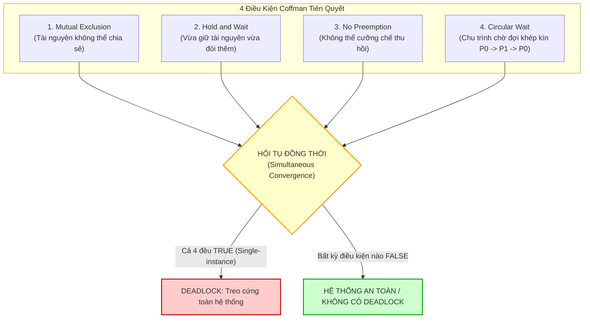

# 1_5_2 The Four Coffman Conditions

> **Khóa học**: Cloud & DevOps Cơ Bản  
> **Phân nhóm**: Domain 1 - Operating System Core Fundamentals  
> **Chủ đề**: 1_5 Deadlock Deep Dive  
> **Checklist đối chiếu**: [1_5_2](../../../CHECKLIST.md#domain-1-operating-system-core-fundamentals-45-items)  
> **Trạng thái**: Hoàn thành  

---

## 1. Khái Niệm Cốt Lõi & Bản Chất Kỹ Thuật (Core Concepts & Technical Deep Dive)

Trong lý thuyết hệ điều hành và kỹ thuật xử lý đồng thời (concurrency), **Deadlock (Bế tắc)** là trạng thái mà một tập hợp các tiến trình hoặc luồng bị phong tỏa vĩnh viễn (permanently blocked), trong đó mỗi tiến trình đều đang nắm giữ một số tài nguyên và đồng thời chờ đợi để được cấp phát thêm tài nguyên khác đang bị chính các tiến trình trong cùng tập hợp đó chiếm giữ.

Vào năm 1971, ba nhà khoa học máy tính **Edward G. Coffman Jr.**, **Michael J. Elphick**, và **Arie Shoshani** đã xuất bản một công trình mang tính nền tảng trên tạp chí *ACM Computing Surveys* ("System Deadlocks"). Trong công trình này, các tác giả đã chứng minh rằng một hiện tượng Deadlock chỉ có thể xảy ra khi **đồng thời cả 4 điều kiện tiên quyết (The Four Coffman Conditions)** cùng hội tụ tại một thời điểm. Nói cách khác, 4 điều kiện Coffman là **điều kiện cần (Necessary Conditions)** cho sự xuất hiện của Deadlock trong mọi hệ thống tổng quát:

```
          +-------------------------------------------------------+
          |             4 ĐIỀU KIỆN COFFMAN (1971)                |
          +---------------------------+---------------------------+
                                      |
         +----------------------------+----------------------------+
         |                                                         |
         v                                                         v
 1. MUTUAL EXCLUSION                                       2. HOLD AND WAIT
    (Loại trừ tương hỗ)                                       (Giữ và Chờ đợi)
    Tài nguyên không thể chia sẻ;                             Đang giữ ít nhất 1 tài nguyên
    chỉ 1 tiến trình được dùng tại                            và đang chờ cấp thêm tài nguyên
    một thời điểm vật lý.                                     mà tiến trình khác đang nắm.
         |                                                         |
         +----------------------------+----------------------------+
                                      |
         +----------------------------+----------------------------+
         |                                                         |
         v                                                         v
 3. NO PREEMPTION                                          4. CIRCULAR WAIT
    (Không thể tước đoạt)                                     (Chờ đợi vòng quanh)
    Tài nguyên không thể bị thu hồi                           Tồn tại một chu trình khép kín:
    cưỡng bức; chỉ được giải phóng                            P0 chờ P1, P1 chờ P2, ...,
    tự nguyện bởi tiến trình sở hữu.                          và Pn lại chờ P0.
```

---

### 1.1. Phân Tích Chi Tiết 4 Điều Kiện Coffman

#### Điều kiện 1: Loại Trừ Tương Hỗ (Mutual Exclusion)
- **Định nghĩa**: Ít nhất một tài nguyên trong hệ thống phải được duy trì ở trạng thái **không thể chia sẻ (Non-shareable Mode)**.
- **Bản chất kỹ thuật**: Tại một thời điểm, tài nguyên này chỉ có thể được phục vụ hoặc sở hữu bởi duy nhất một tiến trình. Nếu một tiến trình khác gửi yêu cầu xin sử dụng tài nguyên này, nó buộc phải bị hệ điều hành hoãn lại và đưa vào hàng đợi chờ cho tới khi tài nguyên được giải phóng hoàn toàn.
- **Ví dụ tài nguyên**: Thiết bị ghi đĩa CD/DVD, máy in phần cứng, hoặc một khóa loại trừ `pthread_mutex_t` bảo vệ một vùng nhớ ghi.

#### Điều kiện 2: Giữ và Chờ (Hold and Wait)
- **Định nghĩa**: Phải tồn tại một tiến trình đang **nắm giữ (holding)** ít nhất một tài nguyên đã được cấp phát trước đó, và đồng thời đang **chờ đợi (waiting)** để được cấp phát thêm các tài nguyên mới.
- **Bản chất kỹ thuật**: Các tài nguyên mới này hiện đang bị một hoặc nhiều tiến trình khác trong hệ thống chiếm giữ. Tiến trình không chịu trả lại tài nguyên đang có mà vẫn cố chấp giữ chặt trong tay trong suốt thời gian chờ đợi.

#### Điều kiện 3: Không Thể Thu Hồi / Cưỡng Chế (No Preemption)
- **Định nghĩa**: Tài nguyên đã cấp phát cho một tiến trình thì **không thể bị tước đoạt cưỡng bức (forcibly preempted)** bởi hệ điều hành hoặc các tiến trình khác.
- **Bản chất kỹ thuật**: Tiến trình nắm giữ tài nguyên chỉ nhả tài nguyên đó ra một cách hoàn toàn tự nguyện sau khi nó đã hoàn thành toàn bộ khối công việc cần thiết (ví dụ: thông qua lệnh gọi hàm `pthread_mutex_unlock` hoặc `close`). Hệ điều hành không can thiệp giật lại tài nguyên để trao cho tiến trình khác.

#### Điều kiện 4: Chờ Đợi Vòng Quanh (Circular Wait)
- **Định nghĩa**: Tồn tại một tập hợp khép kín gồm $n$ tiến trình $\{P_0, P_1, P_2, \dots, P_{n-1}\}$ sao cho:
  - $P_0$ đang chờ tài nguyên do $P_1$ nắm giữ,
  - $P_1$ đang chờ tài nguyên do $P_2$ nắm giữ,
  - $\dots$
  - $P_{n-1}$ đang chờ tài nguyên do $P_0$ nắm giữ.
- **Bản chất kỹ thuật**: Đây là điều kiện định hình chu trình phụ thuộc khép kín (Directed Cycle). Mỗi mắt xích trong chuỗi đều phụ thuộc vào mắt xích tiếp theo, tạo thành một chiếc bẫy logic mà không một mắt xích nào có thể tự giải thoát.

---

### 1.2. Định Lý Về Sự Tồn Tại Của Deadlock: Điều Kiện Cần vs Điều Kiện Đủ

Một điểm mấu chốt về mặt toán học và lý thuyết hệ điều hành cần được phân biệt rõ ràng: 4 điều kiện Coffman về bản chất là **Điều kiện cần (Necessary Conditions)** cho Deadlock trong một hệ thống tài nguyên tổng quát:

$$\text{Deadlock xảy ra} \implies \text{Cả 4 điều kiện Coffman đồng thời thỏa mãn}$$

Điều này có nghĩa là: **Nếu một trạng thái Deadlock đang diễn ra, chắc chắn 100% cả 4 điều kiện Coffman đều đang tồn tại.**

Tuy nhiên, chiều ngược lại ($\impliedby$) phụ thuộc vào loại tài nguyên:
1. **Đối với hệ thống tài nguyên đơn vị (Single-instance resources)**: Mỗi loại tài nguyên chỉ có đúng 1 bản sao duy nhất (ví dụ: 1 chiếc máy in duy nhất, 1 biến mutex duy nhất). Lúc này, cả 4 điều kiện Coffman trở thành **điều kiện cần và đủ (Necessary and Sufficient Conditions)**:
   $$\text{Deadlock xảy ra} \iff \text{Cả 4 điều kiện Coffman đồng thời thỏa mãn (Hệ thống Single-instance)}$$
2. **Đối với hệ thống tài nguyên đa đơn vị (Multi-instance resources)**: Một loại tài nguyên có thể có nhiều bản sao (ví dụ: hệ thống có 3 máy in cùng loại). Khi đó, cả 4 điều kiện có thể cùng thỏa mãn (tồn tại chu trình phụ thuộc Circular Wait), nhưng **chưa chắc đã xảy ra Deadlock** nếu một tiến trình khác nằm ngoài chu trình giải phóng một bản sao tài nguyên mà các tiến trình trong chu trình đang chờ.

> **Hệ quả cốt lõi cho phòng ngừa (Core Invariant for Prevention)**:  
> Theo luật phản đảo trong logic mệnh đề ($P \implies Q \iff \neg Q \implies \neg P$):
> $$\neg (\text{Cả 4 điều kiện Coffman đồng thời thỏa mãn}) \implies \neg (\text{Deadlock xảy ra})$$
> 1. Nếu thiếu dù chỉ **1 trong 4 điều kiện** trên, trạng thái Deadlock **về mặt toán học là KHÔNG THỂ HÌNH THÀNH** trong bất kỳ hệ thống nào (cả Single-instance lẫn Multi-instance).
> 2. Mọi kỹ thuật phòng ngừa (Deadlock Prevention) trong thiết kế hệ thống và phần mềm đều tập trung vào việc **triệt tiêu vĩnh viễn ít nhất một trong bốn điều kiện này**.

---

## 2. Ví Dụ Đời Sống Thực Tế Dễ Hiểu (Intuitive Real-World Analogies)

```
       VỤ BẮT CÓC TỐNG TIỀN VÀ 4 ĐIỀU KIỆN COFFMAN
       
       [ CẢNH SÁT ]                              [ KẺ BẮT CÓC ]
       Giữ: Tiền chuộc                           Giữ: Con tin
       Chờ: Con tin                              Chờ: Tiền chuộc
            \                                         /
             \                                       /
              v                                     v
             1. Mutual Exclusion: Con tin & vali tiền chỉ có 1, không cưa đôi.
             2. Hold & Wait: Cảnh sát ôm tiền chờ người, cướp ôm người chờ tiền.
             3. No Preemption: Luật cấm cảnh sát bắn tỉa, cướp không buông tay.
             4. Circular Wait: "Đưa tiền trước tao thả người!" vs 
                               "Thả người trước tao đưa tiền!" 
                               ===> DEADLOCK BẾ TẮC TOÀN CỤC!
```

### 2.1. Phép So Sánh: Vụ Bắt Cóc Tống Tiền Bế Tắc

Hãy hình dung một kịch bản phim trinh thám nơi xảy ra một vụ giao dịch con tin giữa Cảnh sát và Kẻ bắt cóc:
1. **Mutual Exclusion (Độc quyền)**: Con tin và vali tiền chuộc là tài nguyên độc quyền tuyệt đối, không thể "dùng chung" hay cưa đôi cho cả hai bên cùng sử dụng một lúc.
2. **Hold and Wait (Giữ và Chờ)**: Cảnh sát tay ôm chặt vali tiền và đòi chuộc người; Kẻ bắt cóc tay túm chặt con tin và đòi nhận tiền. Không ai chịu bỏ thứ mình đang giữ xuống đất trước.
3. **No Preemption (Không tước đoạt)**: Pháp luật và hoàn cảnh cấm cảnh sát nổ súng bắn tỉa để cướp lại con tin bằng vũ lực; con tin chỉ có thể được thả tự nguyện khi tên cướp đồng ý mở trói.
4. **Circular Wait (Vòng tròn bế tắc)**:
   - Kẻ bắt cóc gào lên: *"Mày phải ném vali tiền sang trước thì tao mới thả con tin!"*
   - Cảnh sát đáp lại: *"Mày phải đẩy con tin sang trước thì tao mới ném vali tiền!"*

Cả 4 điều kiện hội tụ đầy đủ: Cuộc giao dịch rơi vào **Deadlock** vĩnh viễn, không bên nào chịu nhúc nhích dù chỉ một bước chân.

### 2.2. Phép So Sánh: Hai Con Dê Qua Cầu Hẹp

Hai con dê cùng đi vào giữa một chiếc cầu khỉ độc đạo bắc qua vực sâu:
- Chiếc cầu chỉ đủ chỗ cho đúng 1 con đứng (Mutual Exclusion).
- Con dê bên trái đã bước lên nửa cầu bên trái và muốn chiếm nốt nửa cầu bên phải; con dê bên phải đã bước lên nửa cầu bên phải và muốn chiếm nửa cầu bên trái (Hold and Wait).
- Cả hai con dê đều quá khỏe và cứng đầu, không con nào có thể húc văng con kia xuống vực (No Preemption).
- Dê trái chờ dê phải lùi, dê phải chờ dê trái lùi (Circular Wait).
- Kết quả: Cả hai con dê đứng im chịu trận giữa cầu đến chết vì kiệt sức.

---

## 3. Kiến Trúc, Luồng Hoạt Động & Hình Ảnh Trực Quan (Architecture & Diagrams)

### 3.1. Sơ Đồ Hội Tụ Của 4 Điều Kiện Coffman Dẫn Đến Deadlock



### 3.2. Đồ Thị Phân Bổ Tài Nguyên (Resource Allocation Graph - RAG) Biểu Diễn Circular Wait

Khi cả 4 điều kiện xảy ra, đồ thị phân bổ tài nguyên sẽ xuất hiện một chu trình có hướng (Directed Cycle):

```
       [ Resource 1 ] <========== (Đang sở hữu) ========= [ Thread 1 ]
             |                                                  ^
             | (Đang xin chờ)                                   | (Đang xin chờ)
             v                                                  |
       [ Thread 2 ] ========= (Đang sở hữu) =========> [ Resource 2 ]
```

- Thread 1 sở hữu Resource 1, nhưng đang chặn chờ Resource 2.
- Thread 2 sở hữu Resource 2, nhưng đang chặn chờ Resource 1.
- Tạo thành chu trình: $\text{Thread 1} \to \text{Resource 2} \to \text{Thread 2} \to \text{Resource 1} \to \text{Thread 1}$.

---

## 4. Code Mẫu Trực Quan Hoặc Dòng Lệnh Thực Chiến (Runnable Sample Code / CLI)

> ⚠️ Dữ liệu mã nguồn C dưới đây mang tính chất minh họa (illustrative output) việc tái hiện chính xác 4 điều kiện Coffman dẫn đến Deadlock thực tế bằng POSIX threads (`<pthread.h>`).

### 4.1. Mã Nguồn C: Tái Hiện Deadlock Thỏa Mãn 4 Điều Kiện Coffman

Chương trình dưới đây tạo ra hai luồng (`Thread A` và `Thread B`) tranh chấp hai tài nguyên khóa (`lock1` và `lock2`) theo thứ tự chéo nhau, kích hoạt đầy đủ 4 điều kiện Coffman:

```c
#include <stdio.h>
#include <stdlib.h>
#include <unistd.h>
#include <pthread.h>

// Hai tài nguyên không thể chia sẻ (Điều kiện 1: Mutual Exclusion)
pthread_mutex_t lock1 = PTHREAD_MUTEX_INITIALIZER;
pthread_mutex_t lock2 = PTHREAD_MUTEX_INITIALIZER;

void* thread_A_routine(void* arg) {
    (void)arg;
    printf("[Thread A] Đang cố gắng chiếm Lock 1...\n");
    pthread_mutex_lock(&lock1);
    printf("[Thread A] ĐÃ GIỮ Lock 1 thành công!\n");

    // Tạm dừng 1 giây để đảm bảo Thread B kịp chiếm Lock 2
    // (Tạo điều kiện cho Hold and Wait xuất hiện đồng thời)
    sleep(1);

    printf("[Thread A] Đang giữ Lock 1 và CHỜ xin thêm Lock 2...\n");
    // Điều kiện 2: Hold & Wait (giữ lock1, chờ lock2)
    // Điều kiện 3: No Preemption (hệ điều hành không thể cướp lock2 từ Thread B)
    pthread_mutex_lock(&lock2);

    printf("[Thread A] Đã vào Critical Section hoàn chỉnh!\n");
    pthread_mutex_unlock(&lock2);
    pthread_mutex_unlock(&lock1);
    return NULL;
}

void* thread_B_routine(void* arg) {
    (void)arg;
    printf("[Thread B] Đang cố gắng chiếm Lock 2...\n");
    pthread_mutex_lock(&lock2);
    printf("[Thread B] ĐÃ GIỮ Lock 2 thành công!\n");

    sleep(1);

    printf("[Thread B] Đang giữ Lock 2 và CHỜ xin thêm Lock 1...\n");
    // Điều kiện 4: Circular Wait hình thành (Thread B chờ lock1 của Thread A)
    pthread_mutex_lock(&lock1);

    printf("[Thread B] Đã vào Critical Section hoàn chỉnh!\n");
    pthread_mutex_unlock(&lock1);
    pthread_mutex_unlock(&lock2);
    return NULL;
}

int main(void) {
    pthread_t tA, tB;

    printf("=== BẮT ĐẦU CHƯƠNG TRÌNH MINH HỌA 4 ĐIỀU KIỆN COFFMAN ===\n\n");

    pthread_create(&tA, NULL, thread_A_routine, NULL);
    pthread_create(&tB, NULL, thread_B_routine, NULL);

    // Chờ hai luồng kết thúc (trên thực tế chương trình sẽ treo vĩnh viễn ở đây)
    pthread_join(tA, NULL);
    pthread_join(tB, NULL);

    printf("=== CHƯƠNG TRÌNH KẾT THÚC THÀNH CÔNG (KHÔNG THỂ CHẠY TỚI ĐÂY) ===\n");
    return 0;
}
```

### 4.2. Biên Dịch và Quan Sát Hiện Tượng Bế Tắc Bằng GDB

```bash
# Biên dịch chương trình kèm cờ debug
gcc -g -pthread -o coffman_deadlock coffman_deadlock.c

# Chạy chương trình trong nền
./coffman_deadlock
```

**Đầu ra trên terminal:**
```text
=== BẮT ĐẦU CHƯƠNG TRÌNH MINH HỌA 4 ĐIỀU KIỆN COFFMAN ===

[Thread A] Đang cố gắng chiếm Lock 1...
[Thread A] ĐÃ GIỮ Lock 1 thành công!
[Thread B] Đang cố gắng chiếm Lock 2...
[Thread B] ĐÃ GIỮ Lock 2 thành công!
[Thread A] Đang giữ Lock 1 và CHỜ xin thêm Lock 2...
[Thread B] Đang giữ Lock 2 và CHỜ xin thêm Lock 1...
(Hệ thống bị treo cứng vô thời hạn tại đây...)
```

### 4.3. Kiểm Tra Trạng Thái Deadlock Bằng Công Cụ GDB

Sử dụng `gdb` để soi vào call stack của các luồng đang bị treo nhằm quan sát system call `futex`:

```bash
# Lấy PID của tiến trình
PID=$(pgrep coffman_deadlock)

# GDB in backtrace của toàn bộ các luồng
gdb -batch -ex "thread apply all bt" -p $PID
```

**Kết quả phân tích từ GDB:**
```text
Thread 2 (Thread 0x7ffff77fe640):
#0  __futex_abstimed_wait_common64 (...) at futex-internal.c:57
#1  __pthread_mutex_lock_wait (...) at pthread_mutex_lock.c:140
#2  thread_B_routine (arg=0x0) at coffman_deadlock.c:42

Thread 1 (Thread 0x7ffff7fff640):
#0  __futex_abstimed_wait_common64 (...) at futex-internal.c:57
#1  __pthread_mutex_lock_wait (...) at pthread_mutex_lock.c:140
#2  thread_A_routine (arg=0x0) at coffman_deadlock.c:22
```
Cả hai luồng đều đang bị kẹt vĩnh viễn trong hàm kernel `futex` chờ đợi nhau giải phóng khóa!

---

## 5. Cạm Bẫy Thực Tế & Thực Tiễn Sản Xuất (Production Gotchas & Best Practices)

### 5.1. Lầm Tưởng Rằng Tranh Chấp Tài Nguyên Luôn Dẫn Đến Deadlock

Một sai lầm rất phổ biến của lập trình viên là đồng nhất **Hiện tượng tranh chấp (Resource Contention / Lock Contention)** với **Deadlock**:
- Tranh chấp khóa xảy ra khi 10 luồng cùng cố gắng giành lấy 1 chiếc khóa `lockA`. Tại đây, điều kiện 1 (Mutual Exclusion) và điều kiện 3 (No Preemption) có thể thỏa mãn, nhưng **hoàn toàn không có Circular Wait** hay **Hold and Wait** (các luồng không giữ khóa nào khác trong khi chờ).
- Hệ quả của Contention chỉ là làm chậm ứng dụng (High Latency). Các luồng sẽ lần lượt lần lượt vào rồi ra. Chỉ khi có vòng tròn phụ thuộc chéo giữa nhiều tài nguyên thì Deadlock mới chính thức hình thành.

### 5.2. Deadlock Giữa Các Giao Dịch Cơ Sở Dữ Liệu (Database Row-Level Deadlocks)

Trong các ứng dụng backend kết nối PostgreSQL hoặc MySQL InnoDB:
- Giao dịch 1 (TX1): Cập nhật tài khoản người dùng A (`UPDATE users WHERE id=1`), sau đó cập nhật tài khoản người dùng B (`UPDATE users WHERE id=2`).
- Giao dịch 2 (TX2): Chạy đồng thời, cập nhật tài khoản người dùng B trước (`UPDATE users WHERE id=2`), rồi mới cập nhật tài khoản người dùng A (`UPDATE users WHERE id=1`).
- **Phân tích theo Coffman**:
  1. *Mutual Exclusion*: Khóa dòng (Exclusive Row Lock `X-lock`) không thể chia sẻ.
  2. *Hold and Wait*: TX1 giữ dòng 1 chờ dòng 2; TX2 giữ dòng 2 chờ dòng 1.
  3. *No Preemption*: CSDL không thể tự ý ép một giao dịch nhả khóa khi chưa `COMMIT` hoặc `ROLLBACK`.
  4. *Circular Wait*: TX1 $\to$ TX2 $\to$ TX1.
- **Biện pháp phòng ngừa chuẩn**: Luôn chuẩn hóa thứ tự cập nhật dữ liệu (Total Ordering) trong code backend (ví dụ: luôn sắp xếp mảng các ID cần cập nhật theo thứ tự tăng dần `ORDER BY id ASC` trước khi gửi lệnh `UPDATE` tới CSDL).

---

## 6. Câu Hỏi Củng Cố Kiến Thức (Active Recall Quiz)

<details>
<summary><b>Câu hỏi 1:</b> Tại sao loại bỏ điều kiện 1 (Mutual Exclusion) bằng cách biến mọi tài nguyên thành Read-Only hoặc dùng Lock-Free là giải pháp triệt để nhưng lại không thể áp dụng cho mọi tài nguyên trong hệ điều hành?</summary>

> **Đáp án:**
> Bởi vì trong bản chất vật lý và logic của hệ thống, một số tài nguyên bắt buộc phải có tính thay đổi trạng thái (Mutable State) và tính độc quyền phần cứng. Ví dụ: một cổng kết nối serial, một thiết bị điều khiển máy in vật lý, hoặc biến số dư tài khoản ngân hàng không thể cho phép ghi đồng thời không kiểm soát. Nếu biến mọi thứ thành Read-Only, hệ thống sẽ mất khả năng cập nhật trạng thái; còn cấu trúc Lock-Free chỉ phù hợp với các biến dữ liệu đơn giản hỗ trợ lệnh CPU Compare-And-Swap (CAS), không thể mở rộng tùy tiện cho các đoạn logic nghiệp vụ phức tạp.
</details>

<details>
<summary><b>Câu hỏi 2:</b> Nếu một hệ thống có 4 luồng đang tranh chấp tài nguyên, trong đó điều kiện Mutual Exclusion, Hold & Wait và No Preemption đều thỏa mãn, liệu Deadlock có chắc chắn xảy ra hay không?</summary>

> **Đáp án:**
> **Chưa chắc chắn xảy ra.** Theo định lý của Coffman (1971), Deadlock đòi hỏi sự hội tụ đồng thời của **cả 4 điều kiện**. Nếu thiếu điều kiện thứ tư là **Circular Wait** (nghĩa là đồ thị phân bổ tài nguyên không tồn tại bất kỳ chu trình khép kín nào, mà là một chuỗi phụ thuộc tuyến tính dạng $P_1 \to P_2 \to P_3 \to P_4$), thì khi tiến trình $P_4$ kết thúc, nó sẽ giải phóng tài nguyên cho $P_3$, từ đó $P_3$ giải phóng cho $P_2$ và giải tỏa toàn bộ hệ thống mà không hề bị Deadlock.
</details>

<details>
<summary><b>Câu hỏi 3:</b> Điều kiện "No Preemption" (Không thu hồi tài nguyên) có ý nghĩa như thế nào đối với các hàm khóa POSIX mutex thông thường? Làm sao một ứng dụng có thể tự nguyện phá vỡ điều kiện này?</summary>

> **Đáp án:**
> Đối với hàm `pthread_mutex_lock()`, khi một luồng bị block, nó sẽ ngủ và giữ chặt các khóa đã có; hệ điều hành không bao giờ can thiệp giật khóa để trao cho luồng khác (thỏa mãn No Preemption). Để phá vỡ điều kiện này, lập trình viên có thể sử dụng hàm `pthread_mutex_trylock()`. Nếu không thể chiếm được khóa tiếp theo ngay lập tức, luồng sẽ chủ động nhả toàn bộ các khóa nó đang nắm giữ, lùi lại một khoảng thời gian ngẫu nhiên (backoff) rồi thử lại từ đầu. Thao tác này tương đương với việc "tự nguyện thu hồi tài nguyên", triệt tiêu điều kiện No Preemption.
</details>

---

## 7. 📚 Nguồn Tài Liệu Chính Thống (Tier-1 Official References)

- [Coffman, Elphick, Shoshani (1971) System Deadlocks](https://dl.acm.org/doi/10.1145/356586.356588) - Công trình nghiên cứu kinh điển trên ACM Computing Surveys thiết lập và chứng minh 4 điều kiện Coffman.
- [OSTEP Chapter 32: Concurrency Bugs (Arpaci-Dusseau)](https://pages.cs.wisc.edu/~remzi/OSTEP/threads-bugs.pdf) - Phân tích chi tiết lỗi Deadlock, 4 điều kiện Coffman và các giải pháp thực tế trong hệ điều hành.
- [Linux Programmer's Manual - pthreads(7)](https://man7.org/linux/man-pages/man7/pthreads.7.html) - Tổng quan thư viện luồng chuẩn POSIX threads trên Linux.
- [Linux Programmer's Manual - pthread_mutex_lock(3p)](https://man7.org/linux/man-pages/man3/pthread_mutex_lock.3p.html) - Đặc tả kỹ thuật hàm khóa mutex loại trừ tương hỗ POSIX.
