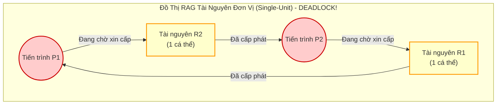
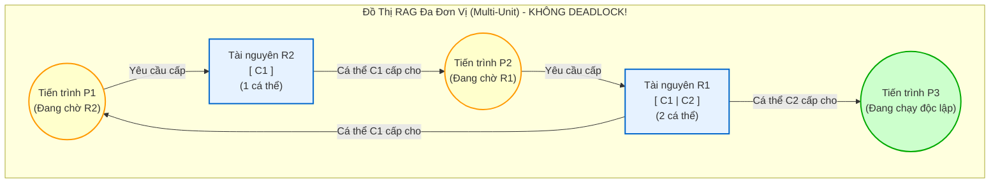
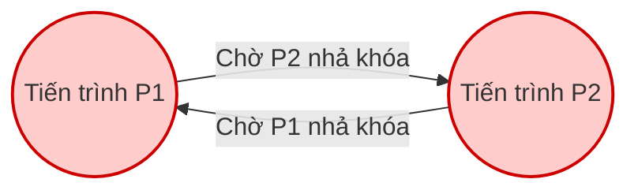

# 1_5_3 Resource Allocation Graph

> **Khóa học**: Cloud & DevOps Cơ Bản  
> **Phân nhóm**: Domain 1 - Operating System Core Fundamentals  
> **Chủ đề**: 1_5 Deadlock Deep Dive  
> **Checklist đối chiếu**: [1_5_3](../../../CHECKLIST.md#domain-1-operating-system-core-fundamentals-45-items)  
> **Trạng thái**: Hoàn thành  

---

## 1. Khái Niệm Cốt Lõi & Bản Chất Kỹ Thuật (Core Concepts & Technical Deep Dive)

Trong lý thuyết hệ điều hành, để mô hình hóa trạng thái cấp phát tài nguyên và phát hiện hiện tượng bế tắc (Deadlock) một cách chính xác dưới góc độ toán học, nhà khoa học máy tính **Richard C. Holt** đã công bố mô hình **Đồ Thị Phân Bổ Tài Nguyên (Resource Allocation Graph - RAG)** vào năm 1972 trong bài báo kinh điển *"Some Deadlock Properties of Computer Systems"* trên tạp chí *ACM Computing Surveys*.

### 1.1. Cấu Trúc Đồ Thị RAG Hình Thức

Một Đồ thị Phân bổ Tài nguyên là một **đồ thị hai phía có hướng (Directed Bipartite Graph)** được ký hiệu toán học là:

$$G = (V, E)$$

Trong đó tập đỉnh $V$ (Vertices) được phân tách thành hai tập con rời rạc hoàn toàn:
1. **Tập hợp tiến trình (Processes)**: $P = \{P_1, P_2, \dots, P_n\}$ — đại diện cho các luồng hoặc tiến trình đang thực thi đồng thời trong hệ thống. Trên sơ đồ, tiến trình thường được ký hiệu bằng **hình tròn**.
2. **Tập hợp kiểu tài nguyên (Resource Types)**: $R = \{R_1, R_2, \dots, R_m\}$ — đại diện cho các loại tài nguyên như CPU, Mutex, bộ nhớ, kết nối socket hoặc thiết bị I/O. Trên sơ đồ, tài nguyên được ký hiệu bằng **hình chữ nhật**, bên trong chứa một hoặc nhiều dấu chấm đại diện cho số lượng cá thể (**instances / units**) khả dụng của kiểu tài nguyên đó.

Tập cạnh $E$ (Directed Edges) bao gồm hai loại cạnh phản ánh trạng thái sở hữu và chờ đợi:
- **Cạnh yêu cầu (Request Edge)**: Ký hiệu $P_i \longrightarrow R_j$. Một cung có hướng đi từ tiến trình $P_i$ tới ô tài nguyên $R_j$, biểu thị tiến trình $P_i$ đã phát đi yêu cầu xin cấp phát một đơn vị của tài nguyên $R_j$ và hiện đang bị hệ điều hành chặn (Blocked/Sleeping) để chờ tài nguyên này.
- **Cạnh phân bổ (Assignment Edge / Allocation Edge)**: Ký hiệu $R_j \longrightarrow P_i$. Một cung có hướng đi từ một chấm cá thể cụ thể bên trong ô tài nguyên $R_j$ tới tiến trình $P_i$, biểu thị một đơn vị của tài nguyên $R_j$ đã được cấp phát thành công và đang được nắm giữ độc quyền bởi $P_i$.

```
+---------------------------------------------------------------------------------+
|                        CÁC THÀNH PHẦN CỦA ĐỒ THỊ RAG                            |
+---------------------------------------------------------------------------------+
|                                                                                 |
|       ( Pi ) -------- Request Edge (Cạnh yêu cầu) --------> [ Rj ( * ) ]        |
|     (Tiến trình)                                           (Tài nguyên)         |
|                                                                                 |
|       [ Rj ( * ) ] ---- Assignment Edge (Cạnh phân bổ) ----> ( Pi )             |
|     (Tài nguyên)                                           (Tiến trình)         |
|                                                                                 |
+---------------------------------------------------------------------------------+
```

---

### 1.2. Định Lý Về Chu Trình Của Holt (1972): Single-Unit vs Multi-Unit

Mối quan hệ giữa sự tồn tại của **Chu trình (Directed Cycle)** trong đồ thị RAG và trạng thái **Deadlock** phụ thuộc hoàn toàn vào số lượng đơn vị (units) của mỗi kiểu tài nguyên:

#### Trường hợp 1: Hệ thống tài nguyên đơn vị (Single-Unit / Single-Instance Resources)
Mỗi kiểu tài nguyên chỉ sở hữu **duy nhất 1 cá thể** (ví dụ: một chiếc máy in vật lý duy nhất, hoặc một biến khóa `pthread_mutex_t` độc nhất):

$$\text{Tồn tại chu trình trong RAG} \iff \text{Hệ thống chắc chắn bị Deadlock}$$

> **Định lý Holt 1 (Theorem 1)**:  
> Đối với hệ thống tài nguyên đơn vị, sự tồn tại của chu trình có hướng là **điều kiện CẦN và ĐỦ (Necessary and Sufficient Condition)** của Deadlock. Nếu đồ thị không có chu trình, hệ thống an toàn tuyệt đối. Nếu xuất hiện dù chỉ 1 chu trình, toàn bộ các tiến trình tham gia chu trình đó đều bị Deadlock.

#### Trường hợp 2: Hệ thống tài nguyên đa đơn vị (Multi-Unit / Multiple-Instance Resources)
Một hoặc nhiều kiểu tài nguyên sở hữu **từ 2 cá thể trở lên** (ví dụ: hồ chứa kết nối gồm 10 database connections, hoặc hệ thống có 4 ổ đĩa USB giống hệt nhau):

$$\text{Hệ thống bị Deadlock} \implies \text{Tồn tại chu trình trong RAG}$$
$$\text{Tồn tại chu trình trong RAG} \centernot\implies \text{Hệ thống bị Deadlock}$$

> **Định lý Holt 2**:  
> Đối với hệ thống tài nguyên đa đơn vị, chu trình chỉ là **điều kiện CẦN chứ CHƯA ĐỦ (Necessary but NOT Sufficient Condition)**.  
> *Lý do*: Một chu trình có thể tồn tại trên đồ thị nhưng hệ thống **vẫn không bị Deadlock** nếu như một cá thể tài nguyên khác của cùng loại tài nguyên trong chu trình đang được sở hữu bởi một tiến trình **nằm ngoài chu trình**. Khi tiến trình bên ngoài hoàn thành công việc và trả lại tài nguyên, tài nguyên đó sẽ được điều phối cho các tiến trình trong chu trình, phá vỡ bế tắc.

---

### 1.3. Đồ Thị Chờ (Wait-For Graph - WFG)

Trong trường hợp tất cả tài nguyên đều là tài nguyên đơn vị (Single-Unit), đồ thị RAG có thể được rút gọn thành **Wait-For Graph (WFG)**:
- Loại bỏ hoàn toàn các nút tài nguyên ($R_j$).
- Chỉ giữ lại các nút tiến trình ($P_i$).
- Vẽ cạnh có hướng trực tiếp $P_i \longrightarrow P_k$ nếu và chỉ nếu tiến trình $P_i$ đang chờ một tài nguyên mà tiến trình $P_k$ đang nắm giữ.

Thuật toán phát hiện Deadlock trên WFG quy về bài toán tìm chu trình trên đồ thị có hướng bằng thuật toán **Duyệt Theo Chiều Sâu (Depth-First Search - DFS)** với độ phức tạp thời gian là $O(V + E)$ hoặc $O(V^2)$ với ma trận kề.

---

## 2. Ví Dụ Đời Sống Thực Tế Dễ Hiểu (Intuitive Real-World Analogies)

```
===================================================================================
                   BẢN ĐỒ MƯỢN DỤNG CỤ TRONG XƯỞNG CƠ KHÍ
===================================================================================

[KỊCH BẢN 1: TÀI NGUYÊN ĐƠN VỊ - SINGLE-UNIT] ===> CHẮC CHẮN DEADLOCK!
  - Xưởng chỉ có: 1 Máy Khoan (R1) và 1 Cờ Lê (R2).
  - Thợ A: Đang cầm Máy Khoan (R1) ----------> Đòi mượn Cờ Lê (R2)
  - Thợ B: Đang cầm Cờ Lê (R2) --------------> Đòi mượn Máy Khoan (R1)
  ===> Chu trình khép kín: Thợ A -> Cờ Lê -> Thợ B -> Máy Khoan -> Thợ A.
  ===> Vì không còn cái cờ lê hay máy khoan nào khác ngoài xưởng -> KẸT CỨNG 100%!

-----------------------------------------------------------------------------------

[KỊCH BẢN 2: TÀI NGUYÊN ĐA ĐƠN VỊ - MULTI-UNIT] ===> CÓ CHU TRÌNH NHƯNG KHÔNG DEADLOCK!
  - Xưởng có: 2 Máy Khoan (R1 gồm Khoan #1 & Khoan #2) và 1 Cờ Lê (R2).
  - Thợ A: Cầm Khoan #1 ---------------------> Đòi mượn Cờ Lê (R2)
  - Thợ B: Cầm Cờ Lê (R2) -------------------> Đòi mượn Máy Khoan (R1)
  - Thợ C (Đứng ngoài chu trình): Cầm Khoan #2, đang khoan nốt tấm gỗ trong 3 phút.
  
  ===> Diễn biến giải tỏa:
       1. Thợ C khoan xong -> Trả Khoan #2 về giá dụng cụ.
       2. Quản đốc lấy Khoan #2 trao ngay cho Thợ B!
       3. Thợ B có đủ đồ nghề (Cờ Lê + Khoan #2), hoàn thành việc và trả lại Cờ Lê.
       4. Thợ A nhận Cờ Lê -> Hoàn thành việc -> TOÀN BỘ XƯỞNG THOÁT DEADLOCK!
===================================================================================
```

### 2.1. Phép So Sánh: Bản Đồ Mượn Dụng Cụ Trong Xưởng Cơ Khí

Hãy hình dung một xưởng cơ khí chế tạo máy với các bác thợ và kho đồ nghề:

1. **Khi xưởng chỉ có 1 Máy Khoan và 1 Cờ Lê (Single-Unit)**:
   - Thợ A đang giữ chiếc máy khoan duy nhất và đứng chờ mượn chiếc cờ lê.
   - Thợ B đang giữ chiếc cờ lê duy nhất và đứng chờ mượn chiếc máy khoan.
   - Hai người tạo thành một chu trình phụ thuộc chéo. Vì trong toàn bộ xưởng không còn chiếc máy khoan hay cờ lê dự phòng nào khác, cả hai bác thợ sẽ đứng ôm đồ nhìn nhau mãi mãi. **Chu trình xuất hiện đồng nghĩa với Deadlock chắc chắn.**

2. **Khi xưởng đầu tư mua thêm chiếc Máy Khoan thứ 2 (Multi-Unit)**:
   - Thợ A vẫn ôm Máy Khoan #1 đòi Cờ Lê; Thợ B vẫn ôm Cờ Lê đòi Máy Khoan. Về mặt hình học, một chu trình phụ thuộc vẫn xuất hiện giữa Thợ A, Thợ B, Cờ Lê và Máy Khoan.
   - Tuy nhiên, chiếc Máy Khoan #2 đang nằm trong tay Thợ C (người hoàn toàn không cần cờ lê và không tham gia chu trình tranh chấp).
   - Chỉ 3 phút sau, Thợ C hoàn thành công việc và trả chiếc Máy Khoan #2 lại cho xưởng. Chiếc máy khoan này lập tức được giao cho Thợ B. Thợ B đã có đủ cả máy khoan lẫn cờ lê để thao tác, nhanh chóng hoàn thành nhiệm vụ và trả lại cờ lê cho Thợ A.
   - **Kết luận**: Mặc dù trên đồ thị có xuất hiện chu trình, nhưng hệ thống **không hề bị Deadlock** nhờ có tài nguyên được giải phóng từ tiến trình ngoài chu trình.

---

## 3. Kiến Trúc, Luồng Hoạt Động & Hình Ảnh Trực Quan (Architecture & Diagrams)

### 3.1. Sơ Đồ RAG Tài Nguyên Đơn Vị Gây Deadlock (Single-Unit Deadlock Cycle)

Trong sơ đồ dưới đây, mỗi tài nguyên $R_1$ và $R_2$ chỉ có đúng 1 cá thể. Chu trình khép kín giữa $P_1$ và $P_2$ gây ra hiện tượng bế tắc vĩnh cửu:



Chu trình xác định:
$$P_1 \longrightarrow R_2 \longrightarrow P_2 \longrightarrow R_1 \longrightarrow P_1$$

---

### 3.2. Sơ Đồ RAG Tài Nguyên Đa Đơn Vị KHÔNG Gây Deadlock (Multi-Unit Cycle Without Deadlock)

Trong sơ đồ này, tài nguyên $R_1$ có 2 cá thể, $R_2$ có 1 cá thể. Mặc dù tồn tại chu trình giữa $P_1, R_1, P_2, R_2$, nhưng tiến trình $P_3$ nắm giữ cá thể thứ hai của $R_1$ không chờ bất kỳ tài nguyên nào:



**Luồng giải tỏa của hệ thống:**
1. $P_3$ không bị chặn bởi bất kỳ tài nguyên nào $\to$ $P_3$ tiếp tục chạy và kết thúc công việc.
2. $P_3$ giải phóng cá thể $C_2$ của tài nguyên $R_1$.
3. Cá thể $C_2$ của $R_1$ được cấp phát cho $P_2$, thỏa mãn yêu cầu của $P_2$.
4. $P_2$ chạy xong và giải phóng toàn bộ tài nguyên (bao gồm cả $R_2$).
5. $R_2$ được trao cho $P_1 \to$ Toàn bộ hệ thống hoàn tất mà không hề xảy ra Deadlock.

---

### 3.3. Đồ Thị Chờ (Wait-For Graph - WFG) Rút Gọn

Khi chuyển đổi sơ đồ Single-Unit ở Mục 3.1 sang đồ thị WFG:



---

## 4. Code Mẫu Trực Quan Hoặc Dòng Lệnh Thực Chiến (Runnable Sample Code / CLI)

### 4.1. Mã Nguồn C: Thuật Toán Phát Hiện Chu Trình Deadlock Trên Wait-For Graph (DFS Cycle Detection)

Chương trình C dưới đây hiện thực hóa thuật toán phát hiện chu trình trên đồ thị có hướng (Wait-For Graph) sử dụng kỹ thuật duyệt theo chiều sâu (**Depth-First Search - DFS**) với 3 trạng thái tô màu đỉnh:
- `WHITE` (0): Đỉnh chưa được ghé thăm.
- `GRAY` (1): Đỉnh đang nằm trong ngăn xếp đệ quy hiện tại (Active on Call Stack). Nếu duyệt gặp lại đỉnh `GRAY`, chứng tỏ phát hiện **Cạnh Ngược (Back-edge)** $\to$ **Có chu trình $\iff$ Deadlock!**
- `BLACK` (2): Đỉnh đã được duyệt xong toàn bộ nhánh con và không có chu trình.

```c
#include <stdio.h>
#include <stdbool.h>
#include <stdlib.h>

#define MAX_PROCESSES 10

// 3 trạng thái màu sắc phục vụ thuật toán DFS
typedef enum {
    WHITE = 0, // Chưa thăm
    GRAY  = 1, // Đang trong call stack (đang duyệt)
    BLACK = 2  // Đã hoàn tất nhánh duyệt
} Color;

typedef struct {
    int num_processes;
    int adj[MAX_PROCESSES][MAX_PROCESSES]; // Ma trận kề: adj[u][v] = 1 nghĩa là P_u chờ P_v
} WaitForGraph;

// Hàm khởi tạo đồ thị WFG
void init_graph(WaitForGraph* g, int n) {
    g->num_processes = n;
    for (int i = 0; i < n; i++) {
        for (int j = 0; j < n; j++) {
            g->adj[i][j] = 0;
        }
    }
}

// Thêm cạnh chờ: Process u đang chờ Process v
void add_wait_edge(WaitForGraph* g, int u, int v) {
    if (u >= 0 && u < g->num_processes && v >= 0 && v < g->num_processes) {
        g->adj[u][v] = 1;
        printf("[WFG Edge] Thêm quan hệ phụ thuộc: Process P%d ---> Process P%d\n", u, v);
    }
}

// Hàm duyệt DFS phát hiện cạnh ngược (Back-edge)
bool dfs_detect_cycle(const WaitForGraph* g, int u, Color color[], int parent[]) {
    color[u] = GRAY; // Đánh dấu đỉnh u đang trong stack duyệt

    for (int v = 0; v < g->num_processes; v++) {
        if (g->adj[u][v] == 1) {
            // Nếu đỉnh kề v đang có màu GRAY => Phát hiện chu trình khép kín!
            if (color[v] == GRAY) {
                printf("\n=> [CẢNH BÁO BẾ TẮC] Phát hiện Cạnh Ngược (Back-edge): P%d -> P%d!\n", u, v);
                printf("=> Chu trình Deadlock hình thành: P%d -> P%d ... -> P%d\n", v, u, v);
                return true;
            }
            // Nếu đỉnh kề chưa thăm, đệ quy duyệt tiếp
            if (color[v] == WHITE) {
                parent[v] = u;
                if (dfs_detect_cycle(g, v, color, parent)) {
                    return true;
                }
            }
        }
    }

    color[u] = BLACK; // Hoàn tất duyệt nút u
    return false;
}

// Hàm quét toàn bộ đồ thị để tìm chu trình
bool has_deadlock(const WaitForGraph* g) {
    Color color[MAX_PROCESSES];
    int parent[MAX_PROCESSES];

    for (int i = 0; i < g->num_processes; i++) {
        color[i] = WHITE;
        parent[i] = -1;
    }

    // Duyệt qua tất cả các thành phần liên thông
    for (int i = 0; i < g->num_processes; i++) {
        if (color[i] == WHITE) {
            if (dfs_detect_cycle(g, i, color, parent)) {
                return true;
            }
        }
    }
    return false;
}

int main(void) {
    printf("===============================================================\n");
    printf(" THUẬT TOÁN PHÁT HIỆN DEADLOCK TRÊN WAIT-FOR GRAPH (DFS)      \n");
    printf("===============================================================\n\n");

    // Kịch bản: Hệ thống gồm 3 tiến trình P0, P1, P2
    WaitForGraph g;
    init_graph(&g, 3);

    // Xây dựng chu trình: P0 chờ P1, P1 chờ P2, P2 chờ P0
    printf("--- Thiết lập trạng thái chờ đợi tài nguyên ---\n");
    add_wait_edge(&g, 0, 1); // P0 chờ P1
    add_wait_edge(&g, 1, 2); // P1 chờ P2
    add_wait_edge(&g, 2, 0); // P2 chờ P0 (Tạo chu trình!)

    printf("\n--- Tiến hành phân tích chu trình trên WFG ---\n");
    if (has_deadlock(&g)) {
        printf("\n[KẾT LUẬN]: ĐỒ THỊ CHỨA CHU TRÌNH => HỆ THỐNG ĐANG BỊ DEADLOCK!\n");
    } else {
        printf("\n[KẾT LUẬN]: Đồ thị không có chu trình => Hệ thống an toàn.\n");
    }

    return 0;
}
```

---

### 4.2. Biên Dịch và Kết Quả Thực Thi

```bash
# Biên dịch chương trình C
gcc -Wall -Wextra rag_cycle_detector.c -o rag_cycle_detector

# Chạy chương trình kiểm tra
./rag_cycle_detector
```

**Đầu ra trên Terminal:**
```text
==============================================================
 THUẬT TOÁN PHÁT HIỆN DEADLOCK TRÊN WAIT-FOR GRAPH (DFS)      
==============================================================

--- Thiết lập trạng thái chờ đợi tài nguyên ---
[WFG Edge] Thêm quan hệ phụ thuộc: Process P0 ---> Process P1
[WFG Edge] Thêm quan hệ phụ thuộc: Process P1 ---> Process P2
[WFG Edge] Thêm quan hệ phụ thuộc: Process P2 ---> Process P0

--- Tiến hành phân tích chu trình trên WFG ---

=> [CẢNH BÁO BẾ TẮC] Phát hiện Cạnh Ngược (Back-edge): P2 -> P0!
=> Chu trình Deadlock hình thành: P0 -> P2 ... -> P0

[KẾT LUẬN]: ĐỒ THỊ CHỨA CHU TRÌNH => HỆ THỐNG ĐANG BỊ DEADLOCK!
```

---

## 5. Cạm Bẫy Thực Tế & Thực Tiễn Sản Xuất (Production Gotchas & Best Practices)

### 5.1. Cạm Bẫy Báo Động Giả Do Đồng Nhất Chu Trình Với Deadlock (False Positive Alerts)

- **Cạm bẫy**: Một kỹ sư thiết kế công cụ giám sát (APM monitoring tool) xây dựng thuật toán phát hiện chu trình trên đồ thị tài nguyên đa đơn vị (như Connection Pool gồm 50 kết nối cơ sở dữ liệu hoặc Thread Pool). Khi thấy một chu trình xuất hiện giữa các worker, công cụ lập tức gửi cảnh báo đỏ P1 hoặc tự động kill tiến trình của người dùng.
- **Bản chất**: Trong hệ tài nguyên đa đơn vị, chu trình chỉ là điều kiện cần chứ không phải điều kiện đủ. Nhiều luồng khác ngoài chu trình vẫn đang trả kết nối về pool liên tục, giúp chu trình tự động tan biến sau vài chục mili-giây. Việc giết nhầm tiến trình gây ra lỗi mất dữ liệu không đáng có.
- **Biện pháp chuẩn mực (Best Practice)**: Đối với tài nguyên đa đơn vị, bắt buộc phải sử dụng thuật toán kiểm tra an toàn toàn diện (như **Banker's Algorithm** hoặc thuật toán **Graph Reduction** của Holt) thay vì chỉ kiểm tra chu trình thuần túy.

---

### 5.2. Cạm Bẫy Chi Phí Hiệu Năng Của Thuật Toán Phát Hiện Chu Trình (Detection Overhead)

- **Cạm bẫy**: Kích hoạt thuật toán tìm chu trình DFS trên mỗi thao tác xin khóa (`mutex_lock` hoặc `lock_acquire`).
- **Hậu quả**: Nếu một ứng dụng backend xử lý 50.000 requests/giây, việc xây dựng và duyệt đồ thị WFG ở mỗi thao tác khóa sẽ làm CPU bận rộn với overhead của chính thuật toán giám sát, khiến throughput của ứng dụng tụt giảm nghiêm trọng.
- **Biện pháp chuẩn mực (Best Practice)**:
  - Chỉ kích hoạt thuật toán phát hiện chu trình theo **chu kỳ thời gian định kỳ** (Periodic Detection, ví dụ 10 giây/lần).
  - Hoặc chỉ kích hoạt thuật toán khi có một luồng đã bị chặn (blocked) vượt quá một **ngưỡng thời gian chờ bất thường** (Deadlock Timeout Threshold, ví dụ luồng bị kẹt quá 1 giây).

---

## 6. Câu Hỏi Củng Cố Kiến Thức (Active Recall Quiz)

<details>
<summary><b>Câu hỏi 1:</b> Tại sao trong một hệ thống tài nguyên có từ 2 cá thể trở lên (Multi-Unit Resources), sự xuất hiện của một chu trình có hướng trong RAG không đảm bảo 100% rằng hệ thống đang bị Deadlock?</summary>

> **Đáp án:**
> Bởi vì trong hệ thống tài nguyên đa đơn vị, các cá thể tài nguyên cùng loại có tính chất thay thế tương đương cho nhau. Nếu một cá thể của tài nguyên tham gia chu trình đang được sở hữu bởi một tiến trình thứ ba nằm ngoài chu trình, và tiến trình này không bị chặn bởi bất kỳ tài nguyên nào khác, nó sẽ tiếp tục chạy đến khi hoàn tất và trả lại cá thể đó. Cá thể vừa giải phóng sẽ được trao cho một tiến trình đang chờ trong chu trình, phá vỡ thế bế tắc và giúp chu trình tự giải tỏa mà không bị Deadlock.
</details>

<details>
<summary><b>Câu hỏi 2:</b> Khi nào một Đồ thị Phân bổ Tài nguyên (RAG) có thể được chuyển đổi tương đương sang Đồ thị Chờ (Wait-For Graph - WFG)? Thao tác chuyển đổi này mang lại lợi ích gì về mặt thuật toán?</summary>

> **Đáp án:**
> RAG chỉ có thể chuyển đổi tương đương sang WFG khi và chỉ khi **tất cả các kiểu tài nguyên trong hệ thống đều là tài nguyên đơn vị (Single-Unit / Single-Instance)**.  
> Lợi ích thuật toán: WFG loại bỏ hoàn toàn các đỉnh trung gian là tài nguyên, giảm số lượng đỉnh từ $|P| + |R|$ xuống chỉ còn $|P|$ (số lượng tiến trình). Nhờ đó, việc biểu diễn đồ thị ma trận kề trở nên gọn gàng hơn, và thuật toán duyệt DFS tìm chu trình đạt hiệu năng cao hơn đáng kể.
</details>

<details>
<summary><b>Câu hỏi 3:</b> Thế nào là thuật toán Rút Gọn Đồ Thị (Graph Reduction) của Holt? Một đồ thị có thể rút gọn hoàn toàn (Completely Reducible) phản ánh điều gì?</summary>

> **Đáp án:**
> Thuật toán Rút Gọn Đồ Thị (Graph Reduction) hoạt động bằng cách liên tục tìm các tiến trình không bị chặn (nghĩa là tiến trình không có cạnh yêu cầu nào đi ra), giả định tiến trình đó sẽ chạy xong và xóa bỏ toàn bộ các cạnh phân bổ tài nguyên của nó để trả tài nguyên về hệ thống. Quá trình này lặp lại cho đến khi không còn tiến trình nào rút gọn được nữa.  
> Nếu một đồ thị **có thể rút gọn hoàn toàn** (tất cả các tiến trình đều lần lượt hoàn tất và đồ thị không còn cạnh nào), điều đó chứng minh toán học rằng **hệ thống hoàn toàn KHÔNG CÓ DEADLOCK**. Ngược lại, nếu còn lại một tập hợp tiến trình không thể rút gọn, chính tập hợp đó đang bị Deadlock.
</details>

---

## 7. 📚 Nguồn Tài Liệu Chính Thống (Tier-1 Official References)

- [Richard C. Holt (1972) Some Deadlock Properties of Computer Systems](https://dl.acm.org/doi/10.1145/356603.356607) - Công trình kinh điển trên ACM Computing Surveys thiết lập cấu trúc hình thức của Đồ thị Phân bổ Tài nguyên (RAG) và chứng minh các định lý chu trình.
- [OSTEP Chapter 32: Concurrency Bugs (Remzi H. Arpaci-Dusseau and Andrea C. Arpaci-Dusseau)](https://pages.cs.wisc.edu/~remzi/OSTEP/threads-bugs.pdf) - Chương sách giáo khoa chính thống phân tích về Đồ thị Chờ (Wait-For Graph), điều kiện chu trình và kỹ thuật phòng ngừa bế tắc.
- [Linux Programmer's Manual: pthreads(7)](https://man7.org/linux/man-pages/man7/pthreads.7.html) - Tổng quan kiến trúc thư viện luồng chuẩn POSIX và quản lý tài nguyên đồng bộ trên Linux.
