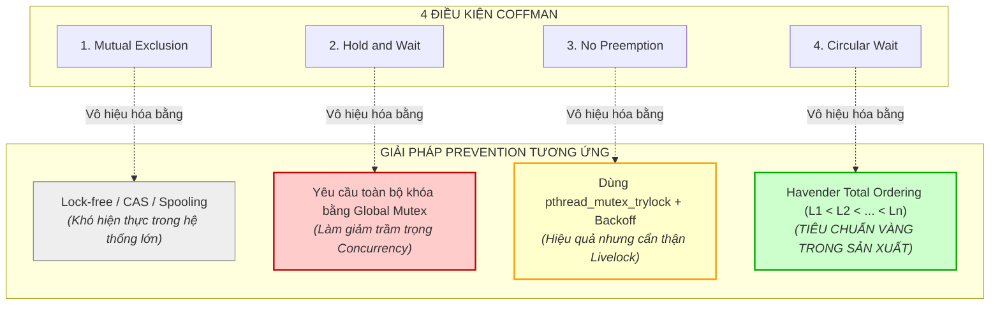
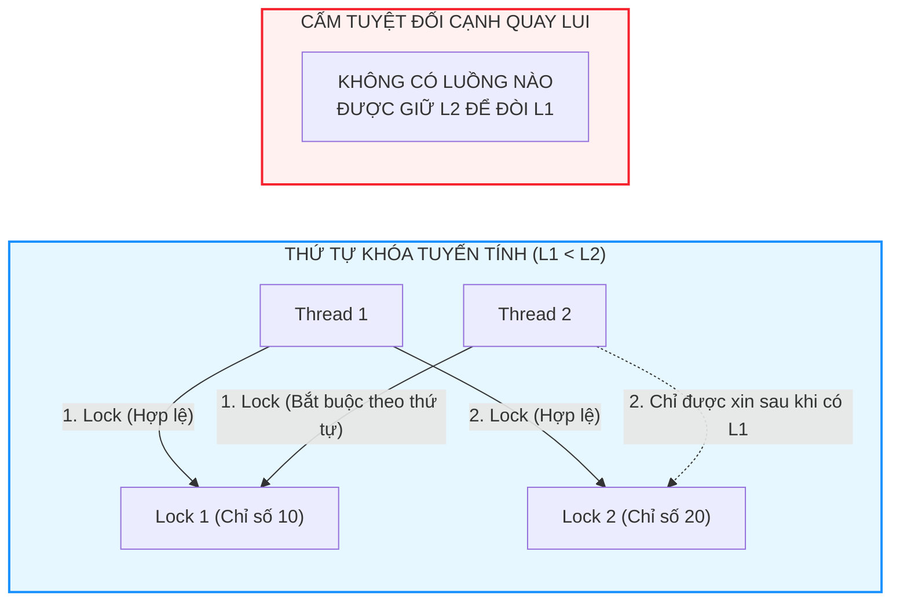

# 1_5_4 Deadlock Prevention

> **Khóa học**: Cloud & DevOps Cơ Bản  
> **Phân nhóm**: Domain 1 - Operating System Core Fundamentals  
> **Chủ đề**: 1_5 Deadlock Deep Dive  
> **Checklist đối chiếu**: [1_5_4](../../../CHECKLIST.md#domain-1-operating-system-core-fundamentals-45-items)  
> **Trạng thái**: Hoàn thành  

---

## 1. Khái Niệm Cốt Lõi & Bản Chất Kỹ Thuật (Core Concepts & Technical Deep Dive)

Trong kỹ thuật hệ thống và kiến trúc phần mềm đồng thời (concurrent systems), có ba phương pháp chính để đối phó với hiện tượng bế tắc (Deadlock): **Ngăn ngừa (Prevention)**, **Né tránh (Avoidance)**, và **Phát hiện & Khôi phục (Detection & Recovery)**.

Trong đó, **Deadlock Prevention (Ngăn ngừa Bế tắc)** là chiến lược can thiệp tĩnh ngay từ **giai đoạn thiết kế hệ thống (Design Time)**. Nguyên lý nền tảng của phương pháp này dựa trên định lý của Coffman et al. (1971):
$$\text{Deadlock chỉ xảy ra khi và chỉ khi cả 4 điều kiện Coffman cùng tồn tại đồng thời.}$$

Do đó, **Deadlock Prevention** được định nghĩa là tập hợp các kỹ thuật và quy tắc lập trình nhằm **vô hiệu hóa vĩnh viễn ít nhất một trong bốn điều kiện Coffman** (Mutual Exclusion, Hold and Wait, No Preemption, Circular Wait). Nếu một trong bốn mắt xích này bị triệt tiêu bằng mặt thiết kế, trạng thái Deadlock về mặt toán học là **không bao giờ có thể hình thành**.

```
                           +---------------------------------------+
                           |     DEADLOCK PREVENTION STRATEGIES    |
                           +-------------------+-------------------+
                                               |
         +--------------------+----------------+--------------------+--------------------+
         |                    |                                     |                    |
         v                    v                                     v                    v
  1. PHÁ VỠ              2. PHÁ VỠ                             3. PHÁ VỠ            4. PHÁ VỠ
  MUTUAL EXCLUSION       HOLD AND WAIT                         NO PREEMPTION        CIRCULAR WAIT
  ------------------     ------------------                    -------------        -------------
  - Lock-free / CAS      - Xin toàn bộ khóa                    - Dùng trylock()     - Havender's Rule
  - Read-Only data         nguyên tử (Atomically)              - Thất bại: nhả      - Total Ordering
  - Spooling Daemon      - Cần Global Lock                       khóa & Backoff       L1 < L2 < ... < Ln
  (Rất khó thực hiện)    (Làm giảm Concurrency)                (Nguy cơ Livelock)   (PHỔ BIẾN & TỐT NHẤT)
```

---

### 1.1. Chiến Lược 1: Triệt Tiêu Loại Trừ Tương Hỗ (Eliminating Mutual Exclusion)

- **Mục tiêu**: Loại bỏ hoàn toàn sự tồn tại của các tài nguyên độc quyền (Non-shareable Resources). Nếu mọi tài nguyên đều có thể được chia sẻ đồng thời không giới hạn, sẽ không tiến trình nào phải chờ đợi tiến trình khác.
- **Kỹ thuật thực hiện**:
  1. **Chia sẻ dữ liệu chỉ đọc (Read-Only / Immutable Sharing)**: Dữ liệu bất biến có thể được hàng ngàn luồng đọc đồng thời mà không bao giờ cần dùng Mutex.
  2. **Cấu trúc dữ liệu Lock-Free / Wait-Free**: Được tiên phong bởi Maurice Herlihy (1991), kỹ thuật này sử dụng các chỉ thị nguyên tử phần cứng CPU (như `Compare-And-Swap` - CAS, hoặc `Load-Linked / Store-Conditional` - LL/SC) để cập nhật biến trạng thái hoặc con trỏ danh sách liên kết mà không cần dùng bất kỳ loại khóa nào (`pthread_mutex_t`).
  3. **Kỹ thuật Spooling (Đệm tài nguyên)**: Áp dụng cho các thiết bị phần cứng độc quyền vật lý (như máy in). Thay vì cho phép các tiến trình mở trực tiếp cổng máy in, hệ thống triển khai một tiến trình nền duy nhất (Printer Spooler Daemon). Các tiến trình người dùng chỉ việc ghi file cần in vào thư mục đệm (spool directory) rồi tiếp tục thực thi; chỉ có duy nhất Spooler Daemon tương tác tuần tự với máy in.
- **Giới hạn thực tế**: Rất khó loại bỏ hoàn toàn Mutual Exclusion, bởi vì trong bản chất hệ thống, một số tài nguyên bắt buộc phải có tính thay đổi trạng thái (Mutable State) và tính độc quyền phần cứng không thể tránh khỏi.

---

### 1.2. Chiến Lược 2: Triệt Tiêu Giữ Và Chờ (Eliminating Hold and Wait)

- **Mục tiêu**: Đảm bảo rằng một tiến trình không bao giờ rơi vào trạng thái vừa nắm giữ tài nguyên này, vừa phải ngủ chờ để được cấp thêm tài nguyên khác.
- **Kỹ thuật thực hiện**:
  1. **Cấp phát nguyên tử toàn bộ (Atomic All-or-Nothing Acquisition)**: Tiến trình bắt buộc phải yêu cầu và nhận được **toàn bộ tài nguyên nó sẽ cần trong suốt vòng đời** ngay từ trước khi bắt đầu thực thi. Nếu thiếu dù chỉ một tài nguyên, nó không được phép nhận bất kỳ tài nguyên nào.
  2. **Khóa tổng thể (Global Master Lock)**: Trong lập trình đa luồng, khi muốn chiếm đồng thời hai khóa `lockA` và `lockB`, luồng sẽ bắt buộc phải giữ một chiếc khóa tổng thể `global_lock` trước khi xin `lockA` và `lockB`:
     ```c
     pthread_mutex_lock(&global_lock);
     pthread_mutex_lock(&lockA);
     pthread_mutex_lock(&lockB);
     pthread_mutex_unlock(&global_lock);
     ```
- **Nhược điểm nghiêm trọng**:
  - **Giảm thông lượng tương tranh (Poor Concurrency)**: Việc bao bọc một khóa tổng thể toàn cục biến đoạn mã thành tuần tự hóa (serialized), làm triệt tiêu sức mạnh xử lý song song của CPU đa nhân.
  - **Lãng phí tài nguyên**: Một tài nguyên chỉ cần dùng trong 1 giây ở cuối tiến trình nhưng lại bị chiếm giữ suốt 10 phút kể từ đầu tiến trình.
  - **Nguy cơ Starvation (Đói tài nguyên)**: Một tiến trình cần nhiều tài nguyên cùng lúc có thể phải chờ vô thời hạn vì luôn có ít nhất một tài nguyên trong danh sách đang bị kẻ khác sử dụng.

---

### 1.3. Chiến Lược 3: Triệt Tiêu Không Thể Tước Đoạt (Eliminating No Preemption)

- **Mục tiêu**: Cho phép hệ thống hoặc chính luồng sở hữu có thể thu hồi/nhả tài nguyên đang nắm giữ nếu quá trình xin tài nguyên tiếp theo không thành công.
- **Kỹ thuật thực hiện**:
  - Thay vì sử dụng hàm khóa chặn `pthread_mutex_lock()` (vốn sẽ đưa luồng vào trạng thái ngủ và ôm chặt các khóa đã có), lập trình viên sử dụng hàm không chặn **`pthread_mutex_trylock()`**:
    ```c
    top:
        pthread_mutex_lock(&lockA);
        if (pthread_mutex_trylock(&lockB) != 0) {
            // Không chiếm được lockB -> Chủ động nhả lockA ra ngay!
            pthread_mutex_unlock(&lockA);
            // Ngủ một khoảng thời gian ngẫu nhiên để tránh xung đột lặp lại
            usleep(rand() % 1000);
            goto top; // Thử lại từ đầu
        }
    ```
- **Cạm bẫy thực tế (Livelock)**:
  - Khi hai luồng cùng áp dụng kỹ thuật này một cách đồng bộ: Cả hai cùng chiếm khóa thứ nhất, cùng thất bại khi thử chiếm khóa thứ hai, cùng đồng loạt nhả khóa thứ nhất, rồi lại cùng nhảy vào chiếm lại khóa thứ nhất...
  - Hai luồng tiêu tốn 100% chu kỳ CPU chỉ để liên tục nhả và chiếm khóa mà không thể hoàn thành công việc. Hiện tượng này gọi là **Livelock (Khóa sống)**. Livelock được giải quyết bằng cách áp dụng thời gian chờ ngẫu nhiên (**Randomized Exponential Backoff**).

---

### 1.4. Chiến Lược 4: Triệt Tiêu Chờ Đợi Vòng Quanh (Eliminating Circular Wait - Havender's Total Ordering)

- **Vị thế**: Đây là chiến lược **phổ biến, thực tế và hiệu quả nhất** trong lập trình hệ điều hành và kỹ nghệ phần mềm.
- **Quy tắc Havender (1968)**: Nhà khoa học J. W. Havender đã công bố trên tạp chí *IBM Systems Journal* nguyên tắc sắp xếp trật tự tuyến tính (Linear Total Ordering):
  1. Gán cho mỗi tài nguyên/khóa trong toàn bộ hệ thống một số thứ tự duy nhất $F: R \to \mathbb{N}$ sao cho $R_1 < R_2 < R_3 < \dots < R_n$.
  2. **Quy tắc bất biến (Lock Ordering Invariant)**: Mọi luồng trong hệ thống **bắt buộc phải chiếm khóa theo đúng thứ tự tăng dần** của chỉ số. Một luồng đang giữ tài nguyên $R_i$ chỉ được phép xin thêm tài nguyên $R_j$ nếu và chỉ nếu:
     $$F(R_j) > F(R_i)$$
- **Chứng minh toán học (Proof by Contradiction)**:
  - Giả sử tồn tại một chu trình chờ đợi khép kín gồm $k$ tiến trình:
    $$P_0 \to P_1 \to P_2 \to \dots \to P_{k-1} \to P_0$$
  - Theo quy tắc Havender, vì mỗi tiến trình đều yêu cầu tài nguyên có thứ tự lớn hơn tài nguyên nó đang giữ:
    $$F(R_{P_0}) < F(R_{P_1}) < F(R_{P_2}) < \dots < F(R_{P_{k-1}}) < F(R_{P_0})$$
  - Bằng tính chất bắc cầu của quan hệ thứ tự nhỏ hơn, ta suy ra:
    $$F(R_{P_0}) < F(R_{P_0}) \quad \text{(Vô lý / Mâu thuẫn toán học)}$$
  - **Kết luận**: Đồ thị phân bổ tài nguyên RAG không thể tồn tại bất kỳ chu trình khép kín nào. **Deadlock là điều bất khả thi.**

---

## 2. Ví Dụ Đời Sống Thực Tế Dễ Hiểu (Intuitive Real-World Analogies)

```
       QUY TẮC HAVENDER VÀ VÒNG XOAY GIAO THÔNG 1 CHIỀU

       [ Đường 2 Chiều Đối Đầu ]                     [ Bùng Binh 1 Chiều (Havender) ]
          Xe A ---> | <--- Xe B                          Vào Vòng Xoay (1 Chiều)
       (Hai xe đâm đầu vào nhau,                                +---> Xe 1 --->+
        chờ nhau lùi bước                              |              |
        ===> DEADLOCK BẾ TẮC)                          +<--- Xe 2 <---+
                                                     (Mọi xe cùng quay theo 1 hướng,
                                                      không bao giờ đối đầu xung đột!)
```

### 2.1. Phép So Sánh: Trật Tự Mượn Sách Theo Mã Số Thư Viện

Hãy tưởng tượng một thư viện sinh viên có hai cuốn sách tham khảo quý hiếm: Cuốn số 1 (`Tập 1`) và Cuốn số 2 (`Tập 2`).
- **Khi không có quy tắc (Tự do mượn)**:
  - Sinh viên Nam cầm Cuốn 1 và ngồi chờ Cuốn 2.
  - Sinh viên Lan cầm Cuốn 2 và ngồi chờ Cuốn 1.
  - Kết quả: Nam chờ Lan, Lan chờ Nam $\to$ Bế tắc vĩnh viễn!
- **Áp dụng quy tắc Havender (Trật tự tuyến tính)**:
  - Thủ thư đặt ra một nội quy sắt đá: *"Ai muốn mượn cả hai cuốn thì BẮT BUỘC phải mượn Cuốn 1 trước, sau đó mới được mượn Cuốn 2. Tuyệt đối cấm cầm Cuốn 2 đi mượn Cuốn 1!"*
  - Lúc này, cả Nam và Lan đều phải xếp hàng trước giá sách Cuốn 1. Người nào nhanh chân hơn sẽ lấy được Cuốn 1, người kia buộc phải chờ ở Cuốn 1 chứ chưa hề được chạm vào Cuốn 2. Người lấy được Cuốn 1 đi tiếp sang giá sách Cuốn 2 và lấy Cuốn 2 một cách thuận lợi mà không gặp bất kỳ tranh chấp nào. Chu trình bế tắc xoay vòng hoàn toàn bị triệt tiêu!

### 2.2. Phép So Sánh: Hai Người Lịch Sự Trên Hành Lang Và Hiện Tượng Livelock

Khi triệt tiêu điều kiện *No Preemption* bằng cách dùng lệnh `trylock`, một hiện tượng kỳ lạ có thể xảy ra:
- Hai người đi bộ đối diện nhau trong một lối đi hẹp.
- Người bên trái lịch sự bước sang phải để nhường đường, nhưng cùng khoảnh khắc đó, người bên phải cũng lịch sự bước sang trái (cùng hướng chắn đường nhau).
- Cả hai nhận ra mình đang chắn đường nhau, bèn cùng nhau xin lỗi và lập tức bước sang hướng ngược lại. Nhưng họ lại tiếp tục va vào nhau!
- Cả hai liên tục nhường qua nhường lại suốt 5 phút, chân tay vận động hết công suất (tiêu thụ 100% CPU) nhưng không ai tiến thêm được một bước chân nào. Đây chính là **Livelock (Khóa sống)**. Để thoát khỏi tình huống này, một người chỉ cần đứng im vài giây (Backoff) để người kia đi qua trước.

---

## 3. Kiến Trúc, Luồng Hoạt Động & Hình Ảnh Trực Quan (Architecture & Diagrams)

### 3.1. Sơ Đồ So Sánh Kỹ Thuật Triệt Tiêu 4 Điều Kiện Coffman



### 3.2. Cơ Chế Havender Total Ordering Triệt Tiêu Directed Cycle

Trong sơ đồ phân bổ tài nguyên dưới đây, khi quy tắc $L_1 < L_2$ được áp đặt, cạnh quay lui từ $L_2 \to L_1$ bị cấm tuyệt đối, do đó không bao giờ hình thành chu trình:



---

## 4. Code Mẫu Trực Quan Hoặc Dòng Lệnh Thực Chiến (Runnable Sample Code / CLI)

> ⚠️ Mã nguồn C dưới đây hoàn chỉnh, có thể biên dịch và thực thi trực tiếp trên bất kỳ hệ điều hành Linux nào có cài đặt trình biên dịch `gcc`.

### 4.1. Kỹ Thuật 1: Áp Dụng Quy Tắc Havender Cho Bài Toán Chuyển Tiền Ngân Hàng

Trong các ứng dụng thực tế, tài khoản $A$ và tài khoản $B$ có thể được gọi chuyển tiền chéo nhau ($A \to B$ và $B \to A$). Nếu khóa theo thứ tự tài khoản nguồn trước, tài khoản đích sau thì Deadlock sẽ xảy ra ngay lập tức.

**Giải pháp chuẩn xác**: Sắp xếp thứ tự khóa dựa trên **địa chỉ con trỏ vùng nhớ** hoặc **ID tài khoản duy nhất** để đảm bảo tính thứ tự tuyến tính toàn cục:

```c
#include <stdio.h>
#include <stdlib.h>
#include <unistd.h>
#include <pthread.h>
#include <stdint.h>

typedef struct {
    int id;
    double balance;
    pthread_mutex_t lock;
} Account;

Account acc1 = { .id = 1, .balance = 1000.0, .lock = PTHREAD_MUTEX_INITIALIZER };
Account acc2 = { .id = 2, .balance = 2000.0, .lock = PTHREAD_MUTEX_INITIALIZER };

// Hàm chuyển tiền an toàn tuyệt đối áp dụng quy tắc Havender (Total Ordering)
void transfer_money_safe(Account* from, Account* to, double amount) {
    Account* first = from;
    Account* second = to;

    // So sánh địa chỉ vùng nhớ hoặc ID để xác định trật tự khóa tuyến tính toàn cục
    if ((uintptr_t)first > (uintptr_t)second) {
        first = to;
        second = from;
    }

    // Luôn luôn chiếm khóa theo thứ tự đã được chuẩn hóa: first -> second
    pthread_mutex_lock(&first->lock);
    pthread_mutex_lock(&second->lock);

    // Vùng an toàn (Critical Section)
    if (from->balance >= amount) {
        from->balance -= amount;
        to->balance += amount;
        printf("[Giao dịch thành công] Chuyển %.2f$ từ Acc %d sang Acc %d\n", amount, from->id, to->id);
    } else {
        printf("[Thất bại] Acc %d không đủ số dư!\n", from->id);
    }

    // Giải phóng khóa theo thứ tự bất kỳ (thường giải phóng ngược lại)
    pthread_mutex_unlock(&second->lock);
    pthread_mutex_unlock(&first->lock);
}

void* routine_transfer_1(void* arg) {
    (void)arg;
    for (int i = 0; i < 5; i++) {
        transfer_money_safe(&acc1, &acc2, 10.0);
        usleep(10000);
    }
    return NULL;
}

void* routine_transfer_2(void* arg) {
    (void)arg;
    for (int i = 0; i < 5; i++) {
        transfer_money_safe(&acc2, &acc1, 20.0);
        usleep(10000);
    }
    return NULL;
}

int main(void) {
    pthread_t t1, t2;

    printf("=== BẮT ĐẦU CHUYỂN TIỀN VỚI QUY TẮC HAVENDER (TOTAL ORDERING) ===\n\n");

    pthread_create(&t1, NULL, routine_transfer_1, NULL);
    pthread_create(&t2, NULL, routine_transfer_2, NULL);

    pthread_join(t1, NULL);
    pthread_join(t2, NULL);

    printf("\n=== KẾT THÚC TOÀN BỘ GIAO DỊCH AN TOÀN (KHÔNG BỊ DEADLOCK) ===\n");
    printf("Số dư cuối cùng: Acc 1 = %.2f$, Acc 2 = %.2f$\n", acc1.balance, acc2.balance);

    return 0;
}
```

---

### 4.2. Kỹ Thuật 2: Triệt Tiêu No Preemption Bằng `pthread_mutex_trylock()` Và Randomized Backoff

Trong tình huống không thể xác định trước trật tự khóa (ví dụ: giao tiếp phân tán), ta sử dụng `trylock` để thu hồi tài nguyên tự nguyện:

```c
#include <stdio.h>
#include <stdlib.h>
#include <unistd.h>
#include <pthread.h>

pthread_mutex_t mutexA = PTHREAD_MUTEX_INITIALIZER;
pthread_mutex_t mutexB = PTHREAD_MUTEX_INITIALIZER;

void* worker_thread(void* arg) {
    const char* name = (const char*)arg;

    while (1) {
        printf("[%s] Đang chiếm Mutex A...\n", name);
        pthread_mutex_lock(&mutexA);

        // Cố gắng xin thêm Mutex B một cách không phong tỏa (Non-blocking)
        if (pthread_mutex_trylock(&mutexB) == 0) {
            // Chiếm thành công cả 2 khóa!
            printf("[%s] ĐÃ GIỮ CẢ 2 MUTEX! Đang xử lý công việc...\n", name);
            usleep(50000); // Giả lập công việc trong 50ms

            pthread_mutex_unlock(&mutexB);
            pthread_mutex_unlock(&mutexA);
            printf("[%s] Đã hoàn thành công việc và giải phóng cả 2 khóa.\n", name);
            break;
        } else {
            // Triệt tiêu No Preemption: Nhả ngay Mutex A để luồng khác có cơ hội hoàn thành
            printf("[%s] Không chiếm được Mutex B. Đang giải phóng Mutex A để rút lui!\n", name);
            pthread_mutex_unlock(&mutexA);

            // RANDOMIZED BACKOFF: Chờ một khoảng thời gian ngẫu nhiên (1ms -> 10ms) để dập tắt Livelock
            int backoff_us = (rand() % 9000) + 1000;
            usleep(backoff_us);
        }
    }
    return NULL;
}

int main(void) {
    srand(time(NULL));
    pthread_t t1, t2;

    printf("=== BẮT ĐẦU DEMO TRIỆT TIÊU NO PREEMPTION BẰNG TRYLOCK + BACKOFF ===\n\n");

    pthread_create(&t1, NULL, worker_thread, "Worker 1");
    pthread_create(&t2, NULL, worker_thread, "Worker 2");

    pthread_join(t1, NULL);
    pthread_join(t2, NULL);

    printf("\n=== CHƯƠNG TRÌNH KẾT THÚC THÀNH CÔNG ===\n");
    return 0;
}
```

---

### 4.3. Biên Dịch và Kiểm Thử Thực Tế Trên Linux

```bash
# 1. Biên dịch chương trình kỹ thuật Havender
gcc -Wall -Wextra -pthread -o havender_demo havender_demo.c

# 2. Chạy thử nghiệm: Chương trình chạy mượt mà không bao giờ bị treo
./havender_demo

# 3. Biên dịch chương trình kỹ thuật trylock + backoff
gcc -Wall -Wextra -pthread -o trylock_demo trylock_demo.c

# 4. Chạy thử nghiệm và quan sát các lượt rút lui có trật tự
./trylock_demo
```

---

## 5. Cạm Bẫy Thực Tế & Thực Tiễn Sản Xuất (Production Gotchas & Best Practices)

### 5.1. Cạm Bẫy Vi Phạm Thứ Tự Khóa Qua Hàm Gọi Ngược (Lock Inversion via Callbacks)

Một cạm bẫy cực kỳ nguy hiểm trong các dự án phần mềm hướng đối tượng lớn là **Lock Order Inversion (Đảo ngược thứ tự khóa)** ngầm định:
- Luồng 1 thực thi trong `Module A`, giữ `Lock A`, sau đó gọi sang hàm của `Module B`. Tại đây, `Module B` yêu cầu chiếm `Lock B`.
- Nhưng trong thiết kế của `Module B`, nó đăng ký một hàm gọi ngược (Observer Callback) để thông báo cập nhật về lại `Module A`.
- Khi luồng 2 thực thi trong `Module B`, nó giữ `Lock B` trước, rồi qua callback kích hoạt một hàm trong `Module A` đòi chiếm `Lock A`.
- **Hệ quả**: Mặc dù trên tài liệu lập trình viên quy định $A < B$, nhưng luồng 2 đã vô tình đảo ngược thành $B \to A$. Deadlock âm thầm xuất hiện trong môi trường Production.
- **Biện pháp phòng ngừa**: Tuyệt đối không bao giờ thực hiện lời gọi hàm ngoại vi (External Call / Callback) trong khi đang nắm giữ một khóa cục bộ (nguyên tắc "Open Calls").

### 5.2. Cạm Bẫy Livelock Khi Thiếu Jitter / Random Backoff

Khi sử dụng `pthread_mutex_trylock()`, nếu thời gian chờ (delay) giữa các lần thử lại là **cố định (Fixed Delay)** (ví dụ: cả hai luồng đều ngủ đúng `100ms`):
- Hai luồng chạy trên hai lõi CPU với xung nhịp đồng bộ sẽ rơi vào một vũ điệu bất tận: Cùng thức dậy tại miligiây thứ 100, cùng chiếm khóa 1, cùng thất bại ở khóa 2, cùng nhả khóa 1, và cùng ngủ tiếp 100ms.
- **Giải pháp bắt buộc**: Luôn cộng thêm một giá trị ngẫu nhiên (**Jitter**) vào thời gian chờ:
  $$\text{Delay} = \text{Base Backoff} + \text{rand() } \% \text{ Jitter}$$

---

## 6. Câu Hỏi Củng Cố Kiến Thức (Active Recall Quiz)

<details>
<summary><b>Câu hỏi 1:</b> Trong bài toán chuyển tiền ngân hàng giữa hai tài khoản X và Y, tại sao việc so sánh địa chỉ con trỏ vùng nhớ <code>(uintptr_t)first &gt; (uintptr_t)second</code> lại đảm bảo tuân thủ tuyệt đối quy tắc Havender?</summary>

> **Đáp án:**
> Bởi vì trong không gian địa chỉ ảo của một tiến trình, mỗi cấu trúc tài khoản nằm tại một địa chỉ bộ nhớ duy nhất và cố định trong suốt thời gian tồn tại. Địa chỉ bộ nhớ là một trường số nguyên không âm có quan hệ thứ tự toàn phần (Total Order). Khi luôn so sánh hai địa chỉ và khóa vùng nhớ có địa chỉ nhỏ hơn trước, mọi luồng trong hệ thống dù thực hiện chiều chuyển tiền $X \to Y$ hay $Y \to X$ đều sẽ khóa theo cùng một thứ tự vật lý nhất quán tuyệt đối, triệt tiêu hoàn toàn khả năng hình thành Circular Wait.
</details>

<details>
<summary><b>Câu hỏi 2:</b> Phân tích sự khác biệt cơ bản giữa Deadlock và Livelock khi quan sát trên các công cụ giám sát hệ thống (như <code>top</code> hoặc <code>htop</code>)?</summary>

> **Đáp án:**
> - **Khi bị Deadlock**: Các tiến trình rơi vào trạng thái ngủ không ngắt được (`D` state) hoặc ngủ ngắt được (`S` state), bị chặn ở các lời gọi hàm hệ thống như `futex`. Mức tiêu thụ CPU của các tiến trình này trên `top` xấp xỉ **0.0% CPU**.
> - **Khi bị Livelock**: Các tiến trình vẫn liên tục đổi trạng thái, thực thi vòng lặp `while(1)`, gọi `trylock`, giải phóng khóa, tính toán và kiểm tra điều kiện. Mức tiêu thụ CPU trên `top` thường tăng vọt lên **100% CPU** trên các lõi tương ứng, nhưng không hề có tác vụ hữu ích nào hoàn thành.
</details>

<details>
<summary><b>Câu hỏi 3:</b> Tại sao việc triệt tiêu điều kiện Hold and Wait bằng cách sử dụng một Global Mutex đơn lẻ lại bị coi là một giải pháp tồi (anti-pattern) trong các máy chủ backend?</summary>

> **Đáp án:**
> Bởi vì một Global Mutex sẽ biến toàn bộ các thao tác xử lý đồng thời thành tuần tự (Serialization). Dù máy chủ có 64 hay 128 lõi CPU, chỉ có duy nhất 1 luồng được cấp quyền chiếm giữ các khóa tài nguyên tại một thời điểm, các luồng khác đều bị chặn đứng ở Global Mutex. Điều này gây suy giảm nghiêm trọng thông lượng hệ thống (Throughput), tăng vọt độ trễ (Latency) và triệt tiêu toàn bộ lợi ích của kiến trúc đa lõi.
</details>

---

## 7. 📚 Nguồn Tài Liệu Chính Thống (Tier-1 Official References)

- [OSTEP Chapter 32: Concurrency Bugs (Arpaci-Dusseau)](https://pages.cs.wisc.edu/~remzi/OSTEP/threads-bugs.pdf) - Phân tích chi tiết các kỹ thuật Deadlock Prevention (loại bỏ 4 điều kiện Coffman, Total Ordering, trylock).
- [Havender, J. W. (1968) Avoiding deadlock in multitasking systems](https://dl.acm.org/doi/10.1147/sj.72.0074) - Công trình gốc trên IBM Systems Journal thiết lập nguyên lý trật tự tuyến tính cho tài nguyên.
- [Linux Programmer's Manual - pthread_mutex_trylock(3p)](https://man7.org/linux/man-pages/man3/pthread_mutex_trylock.3p.html) - Đặc tả kỹ thuật hàm khóa mutex không phong tỏa chuẩn POSIX.
- [Herlihy, M. (1991) Wait-Free Synchronization](https://dl.acm.org/doi/10.1145/114005.102808) - Tài liệu nền tảng trên ACM TOPLAS về cấu trúc dữ liệu không dùng khóa (Lock-free / Wait-free).