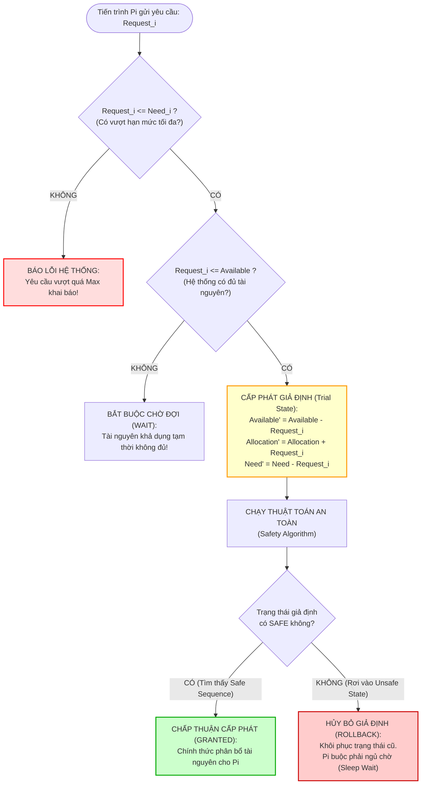

# 1_5_5 Deadlock Avoidance and Bankers Algorithm

> **Khóa học**: Cloud & DevOps Cơ Bản  
> **Phân nhóm**: Domain 1 - Operating System Core Fundamentals  
> **Chủ đề**: 1_5 Deadlock Deep Dive  
> **Checklist đối chiếu**: [1_5_5](../../../CHECKLIST.md#domain-1-operating-system-core-fundamentals-45-items)  
> **Trạng thái**: Hoàn thành  

---

## 1. Khái Niệm Cốt Lõi & Bản Chất Kỹ Thuật (Core Concepts & Technical Deep Dive)

Trong kỹ thuật xử lý bế tắc hệ điều hành, khác với **Deadlock Prevention (Phòng ngừa bế tắc)** vốn can thiệp bằng cách áp đặt các quy tắc tĩnh để triệt tiêu vĩnh viễn 1 trong 4 điều kiện Coffman, **Deadlock Avoidance (Tránh bế tắc)** tiếp cận bài toán theo cơ chế **động (dynamic approach)**:
- Hệ thống cho phép cả 4 điều kiện Coffman tiềm tàng xuất hiện.
- Tuy nhiên, trước mỗi quyết định cấp phát tài nguyên theo yêu cầu của tiến trình, hệ điều hành sẽ tiến hành tính toán mô phỏng trạng thái tương lai.
- Nếu việc cấp phát dẫn hệ thống vào một trạng thái có nguy cơ bế tắc (**Unsafe State**), hệ điều hành sẽ chủ động từ chối hoặc trì hoãn yêu cầu, bắt tiến trình phải chờ cho tới khi có đủ tài nguyên an toàn.

---

### 1.1. Nguồn Gốc Lịch Sử & Thuật Toán Kẻ Cho Vay (Banker's Algorithm)

Thuật toán tránh bế tắc kinh điển nhất được nhà khoa học máy tính lỗi lạc **Edsger W. Dijkstra** phát minh vào năm 1965 trong bản thảo nghiên cứu **EWD 108** (*"Een algorithme ter voorkoming van de dodelijke omarming"*) và sau đó được công bố chi tiết bằng tiếng Anh trong tác phẩm nền tảng **EWD 123** (*"Cooperating Sequential Processes"*, Mục 6.1).

Thuật toán này được đặt tên là **Banker's Algorithm (Thuật toán Kẻ Cho Vay)** vì Dijkstra lấy cảm hứng từ phương thức vận hành của một giám đốc ngân hàng tại một thị trấn nhỏ:
- Ngân hàng có một lượng tiền mặt dự trữ hữu hạn.
- Các khách hàng (doanh nghiệp) đến vay vốn, mỗi người tuyên bố trước hạn mức tín dụng tối đa mà họ sẽ cần để hoàn thành dự án.
- Vị giám đốc không bao giờ giải ngân vượt quá mức khiến ngân hàng không còn đủ tiền mặt để giúp ít nhất một khách hàng hoàn thành trọn vẹn dự án và trả lại toàn bộ tiền vay.

---

### 1.2. Phân Biệt Cơ Chế Tránh Bế Tắc: Tài Nguyên Đơn Cá Thể vs Đa Cá Thể

Tùy thuộc vào số lượng cá thể (instances) của mỗi kiểu tài nguyên trong hệ thống, kỹ thuật Tránh bế tắc (Deadlock Avoidance) được chia làm hai trường phái tiếp cận:

1. **Hệ thống tài nguyên đơn cá thể (Single-Instance per resource type)**:
   - Sử dụng biến thể mở rộng của **Đồ Thị Phân Bổ Tài Nguyên (Resource Allocation Graph - RAG)** bằng cách bổ sung thêm **Cạnh tuyên bố (Claim Edge)**.
   - Cạnh tuyên bố $P_i \dashrightarrow R_j$ được vẽ bằng nét đứt, biểu thị tiến trình $P_i$ có khả năng sẽ yêu cầu tài nguyên $R_j$ tại một thời điểm nào đó trong tương lai (tương ứng với việc khai báo nhu cầu tối đa trước khi thực thi).
   - Khi $P_i$ phát yêu cầu thực tế, cạnh nét đứt chuyển thành cạnh yêu cầu nét liền $P_i \to R_j$.
   - Yêu cầu chỉ được chấp thuận (chuyển thành cạnh phân bổ $R_j \to P_i$) khi và chỉ khi thao tác đảo chiều cạnh này **không tạo ra bất kỳ chu trình nào** trong toàn bộ đồ thị.
   - Thuật toán kiểm tra chu trình trên đồ thị có độ phức tạp thời gian là $O(n^2)$ với $n$ là số lượng tiến trình.

2. **Hệ thống tài nguyên đa cá thể (Multi-Instance per resource type)**:
   - Trong hệ tài nguyên đa cá thể, việc kiểm tra chu trình thuần túy trên đồ thị RAG không còn đầy đủ (vì chu trình không đồng nghĩa với Deadlock).
   - Hệ thống bắt buộc phải áp dụng **Banker's Algorithm (Thuật toán Kẻ Cho Vay)**, quản trị trạng thái động thông qua các ma trận và vector số lượng, với độ phức tạp thời gian là $O(m \cdot n^2)$ (với $n$ tiến trình và $m$ kiểu tài nguyên).

---

### 1.3. Các Cấu Trúc Dữ Liệu Hình Thức Của Banker's Algorithm

Xét hệ thống gồm $n$ tiến trình ($P_0, P_1, \dots, P_{n-1}$) và $m$ kiểu tài nguyên khác nhau ($R_0, R_1, \dots, R_{m-1}$):

1. **Vector Khả Dụng — $Available[m]$**:
   - Mảng 1 chiều kích thước $m$.
   - Nếu $Available[j] = k$, nghĩa là hiện tại đang có $k$ cá thể (instances) của kiểu tài nguyên $R_j$ sẵn sàng cấp phát.
2. **Ma Trận Yêu Cầu Tối Đa — $Max[n][m]$**:
   - Ma trận 2 chiều kích thước $n \times m$.
   - Nếu $Max[i][j] = k$, nghĩa là tiến trình $P_i$ tuyên bố sẽ cần tối đa $k$ cá thể của tài nguyên $R_j$ trong toàn bộ vòng đời của nó.
3. **Ma Trận Đang Nắm Giữ — $Allocation[n][m]$**:
   - Ma trận 2 chiều kích thước $n \times m$.
   - Nếu $Allocation[i][j] = k$, nghĩa là tiến trình $P_i$ hiện tại đang thực sự nắm giữ $k$ cá thể của tài nguyên $R_j$.
4. **Ma Trận Nhu Cầu Còn Lại — $Need[n][m]$**:
   - Ma trận 2 chiều kích thước $n \times m$, được xác định bởi công thức bất biến:
     $$Need[i][j] = Max[i][j] - Allocation[i][j]$$
   - Biểu thị số lượng tài nguyên $R_j$ mà tiến trình $P_i$ vẫn còn cần được cấp thêm để hoàn tất công việc.

---

### 1.4. Trạng Thái An Toàn (Safe State) vs Trạng Thái Không An Toàn (Unsafe State)

```
+-----------------------------------------------------------------------------------+
|               MỐI QUAN HỆ GIỮA SAFE, UNSAFE VÀ DEADLOCK TRONG HỆ THỐNG           |
+-----------------------------------------------------------------------------------+
|                                                                                   |
|    +-------------------------------------------------------------------------+    |
|    |                             TẤT CẢ TRẠNG THÁI                           |    |
|    |                                                                         |    |
|    |    +--------------------------+     +------------------------------+    |    |
|    |    |    SAFE STATE            |     |      UNSAFE STATE            |    |    |
|    |    |  (Trạng thái An toàn)    |     |   (Trạng thái Không an toàn) |    |    |
|    |    |                          |     |                              |    |    |
|    |    |  - Tồn tại ít nhất một   |     |   +----------------------+   |    |    |
|    |    |    Safe Sequence.        |     |   |       DEADLOCK       |   |    |    |
|    |    |  - Đảm bảo 100% không    |     |   |   (Bế tắc thực sự)   |   |    |    |
|    |    |    bao giờ xảy ra        |     |   +----------------------+   |    |    |
|    |    |    Deadlock.             |     |                              |    |    |
|    |    +--------------------------+     +------------------------------+    |    |
|    +-------------------------------------------------------------------------+    |
|                                                                                   |
+-----------------------------------------------------------------------------------+
```

- **Safe State (Trạng thái an toàn)**: Trạng thái được gọi là an toàn nếu hệ thống có thể phân bổ tài nguyên cho từng tiến trình (lên tới mức tối đa $Max$) theo một trình tự nào đó mà không bao giờ dẫn đến Deadlock. Về mặt hình thức, hệ thống an toàn nếu và chỉ nếu tồn tại một **Chuỗi An Toàn (Safe Sequence)** $\langle P_0, P_1, \dots, P_{n-1} \rangle$.
- **Safe Sequence (Chuỗi an toàn)**: Là một thứ tự thực thi của các tiến trình sao cho với mỗi $P_i$, nhu cầu tài nguyên còn lại của nó ($Need_i$) hoàn toàn có thể được đáp ứng bởi lượng tài nguyên đang khả dụng ($Available$) cộng với lượng tài nguyên đang được nắm giữ bởi tất cả các tiến trình đứng trước nó ($P_k$ với $k < i$). Khi các tiến trình đứng trước hoàn tất, chúng sẽ giải phóng toàn bộ tài nguyên cho $P_i$.
- **Unsafe State (Trạng thái không an toàn)**: Là trạng thái mà hệ thống **không tìm thấy bất kỳ chuỗi an toàn nào**.
  > ⚠️ **Quy tắc cốt lõi**: **Unsafe State KHÔNG ĐỒNG NGHĨA VỚI DEADLOCK!**  
  > Một hệ thống ở trạng thái Unsafe chưa chắc đã bị bế tắc ngay lập tức. Tuy nhiên, nếu ở trạng thái Unsafe mà các tiến trình đồng loạt gửi yêu cầu xin cấp phát tới mức tối đa đã tuyên bố ($Max$), hệ thống sẽ chắc chắn rơi vào Deadlock. Do đó, mục tiêu của Deadlock Avoidance là: **Luôn giữ cho hệ thống ở trong vùng Safe State và tuyệt đối không bao giờ bước chân vào Unsafe State.**

---

### 1.5. Thuật Toán An Toàn & Thuật Toán Yêu Cầu Tài Nguyên

#### Thuật Toán An Toàn (Safety Algorithm)
Thuật toán dùng để kiểm tra xem một trạng thái cụ thể có phải là Safe State hay không:
1. Khởi tạo hai vector:
   - $Work = Available$ (vector kích thước $m$, đại diện cho lượng tài nguyên khả dụng tạm thời).
   - $Finish[i] = \text{false}$ với mọi $i = 0, 1, \dots, n-1$ (đánh dấu tiến trình đã hoàn tất hay chưa).
2. Tìm một chỉ số $i$ thỏa mãn đồng thời hai điều kiện:
   - $Finish[i] == \text{false}$
   - $Need_i \le Work$ (tức $Need[i][j] \le Work[j]$ với mọi $j = 0, \dots, m-1$).  
   *Nếu không tìm thấy chỉ số $i$ nào như vậy, chuyển sang Bước 4.*
3. Nếu tìm thấy $i$:
   - $Work = Work + Allocation_i$ (giả định $P_i$ hoàn tất và trả lại tài nguyên).
   - $Finish[i] = \text{true}$.
   - Quay lại Bước 2 để tìm tiến trình tiếp theo.
4. Nếu $Finish[i] == \text{true}$ với mọi $i = 0, \dots, n-1$, thì hệ thống đang ở **Safe State**. Ngược lại, hệ thống ở **Unsafe State**.

#### Thuật Toán Yêu Cầu Tài Nguyên (Resource-Request Algorithm)
Khi tiến trình $P_i$ gửi một yêu cầu cấp phát $Request_i$:
1. Nếu $Request_i \le Need_i$, đi tiếp tới Bước 2. Ngược lại, báo lỗi vì tiến trình yêu cầu vượt quá mức tối đa đã tuyên bố.
2. Nếu $Request_i \le Available$, đi tiếp tới Bước 3. Ngược lại, $P_i$ buộc phải chờ đợi vì hệ thống tạm thời chưa đủ tài nguyên.
3. Hệ điều hành thực hiện **cấp phát giả định (Trial Allocation)**:
   $$Available' = Available - Request_i$$
   $$Allocation_i' = Allocation_i + Request_i$$
   $$Need_i' = Need_i - Request_i$$
4. Chạy **Thuật toán An toàn (Safety Algorithm)** trên trạng thái giả định này:
   - Nếu kết quả là **Safe**: Yêu cầu được chính thức chấp thuận (**Granted**), tài nguyên thực tế được giao cho $P_i$.
   - Nếu kết quả là **Unsafe**: Yêu cầu bị tạm hoãn (**Wait**), trạng thái giả định bị hủy bỏ và phục hồi lại nguyên trạng ban đầu, $P_i$ phải tiếp tục chờ đợi.

---

### 1.6. Bài Tập Thực Hành Chi Tiết Từng Bước (Full Worked Exercise)

Để minh họa toàn bộ cơ chế tính toán số học của thuật toán, xét kịch bản tiêu chuẩn gồm **5 tiến trình ($P_0, P_1, P_2, P_3, P_4$)** và **3 kiểu tài nguyên ($A, B, C$)** với tổng số cá thể của cả hệ thống là:
$$\text{Total Resources} = (A: 10, B: 5, C: 7)$$

#### Bảng trạng thái ban đầu:
- **Allocation (Đang phân bổ)**:
  - $P_0 = (0, 1, 0)$
  - $P_1 = (2, 0, 0)$
  - $P_2 = (3, 0, 2)$
  - $P_3 = (2, 1, 1)$
  - $P_4 = (0, 0, 2)$  
  $$\sum Allocation = (0+2+3+2+0, 1+0+0+1+0, 0+0+2+1+2) = (7, 2, 5)$$

- **Max (Nhu cầu tối đa)**:
  - $P_0 = (7, 5, 3)$
  - $P_1 = (3, 2, 2)$
  - $P_2 = (9, 0, 2)$
  - $P_3 = (2, 2, 2)$
  - $P_4 = (4, 3, 3)$

- **Tính ma trận $Need = Max - Allocation$**:
  - $Need_0 = (7 - 0, 5 - 1, 3 - 0) = (7, 4, 3)$
  - $Need_1 = (3 - 2, 2 - 0, 2 - 0) = (1, 2, 2)$
  - $Need_2 = (9 - 3, 0 - 0, 2 - 2) = (6, 0, 0)$
  - $Need_3 = (2 - 2, 2 - 1, 2 - 1) = (0, 1, 1)$
  - $Need_4 = (4 - 0, 3 - 0, 3 - 2) = (4, 3, 1)$

- **Tính vector $Available = \text{Total} - \sum Allocation$**:
  $$Available = (10, 5, 7) - (7, 2, 5) = (3, 3, 2)$$

| Tiến trình | Allocation (A B C) | Max (A B C) | Need (A B C) | Available (A B C) |
| :---: | :---: | :---: | :---: | :---: |
| **$P_0$** | 0 1 0 | 7 5 3 | 7 4 3 | **3 3 2** |
| **$P_1$** | 2 0 0 | 3 2 2 | 1 2 2 | |
| **$P_2$** | 3 0 2 | 9 0 2 | 6 0 0 | |
| **$P_3$** | 2 1 1 | 2 2 2 | 0 1 1 | |
| **$P_4$** | 0 0 2 | 4 3 3 | 4 3 1 | |

---

#### Bước 1: Thực hiện Thuật Toán An Toàn Tìm Chuỗi An Toàn (Safe Sequence)

- Khởi tạo: $Work = Available = (3, 3, 2)$; $Finish = [\text{F}, \text{F}, \text{F}, \text{F}, \text{F}]$.
- **Lần xét 1**:
  - Xét $P_0$: $Need_0(7, 4, 3) \le Work(3, 3, 2)$? **Sai** ($7 > 3$). $P_0$ không thể chạy.
  - Xét $P_1$: $Need_1(1, 2, 2) \le Work(3, 3, 2)$? **Đúng** ($1 \le 3, 2 \le 3, 2 \le 2$).
    - $P_1$ được cấp đủ tài nguyên để hoàn tất, sau đó trả lại $Allocation_1$.
    - $Work = Work + Allocation_1 = (3, 3, 2) + (2, 0, 0) = (5, 3, 2)$.
    - $Finish[1] = \text{True}$.
- **Lần xét 2**:
  - Xét $P_2$: $Need_2(6, 0, 0) \le Work(5, 3, 2)$? **Sai** ($6 > 5$). $P_2$ chưa thể chạy.
  - Xét $P_3$: $Need_3(0, 1, 1) \le Work(5, 3, 2)$? **Đúng** ($0 \le 5, 1 \le 3, 1 \le 2$).
    - $P_3$ hoàn tất, trả lại $Allocation_3$.
    - $Work = Work + Allocation_3 = (5, 3, 2) + (2, 1, 1) = (7, 4, 3)$.
    - $Finish[3] = \text{True}$.
- **Lần xét 3**:
  - Xét $P_4$: $Need_4(4, 3, 1) \le Work(7, 4, 3)$? **Đúng** ($4 \le 7, 3 \le 4, 1 \le 3$).
    - $P_4$ hoàn tất, trả lại $Allocation_4$.
    - $Work = Work + Allocation_4 = (7, 4, 3) + (0, 0, 2) = (7, 4, 5)$.
    - $Finish[4] = \text{True}$.
- **Lần xét 4**: Quay lại các tiến trình còn $Finish == \text{False}$ ($P_0, P_2$):
  - Xét $P_0$: $Need_0(7, 4, 3) \le Work(7, 4, 5)$? **Đúng** ($7 \le 7, 4 \le 4, 3 \le 5$).
    - $P_0$ hoàn tất, trả lại $Allocation_0$.
    - $Work = Work + Allocation_0 = (7, 4, 5) + (0, 1, 0) = (7, 5, 5)$.
    - $Finish[0] = \text{True}$.
- **Lần xét 5**:
  - Xét $P_2$: $Need_2(6, 0, 0) \le Work(7, 5, 5)$? **Đúng** ($6 \le 7, 0 \le 5, 0 \le 5$).
    - $P_2$ hoàn tất, trả lại $Allocation_2$.
    - $Work = Work + Allocation_2 = (7, 5, 5) + (3, 0, 2) = (10, 5, 7) = \text{Total}$.
    - $Finish[2] = \text{True}$.

**Kết luận**: Cả 5 tiến trình đều có $Finish == \text{True}$. Hệ thống đang ở trạng thái **Safe** với Chuỗi An Toàn:
$$\langle P_1, P_3, P_4, P_0, P_2 \rangle$$

---

#### Bước 2: Mô Phỏng Cấp Phát Yêu Cầu Mới (Resource-Request Simulation)

Giả sử tiến trình **$P_1$ gửi một yêu cầu xin cấp phát thêm tài nguyên**:
$$Request_1 = (1, 0, 2)$$

- **Kiểm tra 1**: $Request_1(1, 0, 2) \le Need_1(1, 2, 2)$? **Đúng** ($1 \le 1, 0 \le 2, 2 \le 2$).
- **Kiểm tra 2**: $Request_1(1, 0, 2) \le Available(3, 3, 2)$? **Đúng** ($1 \le 3, 0 \le 3, 2 \le 2$).
- **Cấp phát giả định**:
  - $Available' = Available - Request_1 = (3, 3, 2) - (1, 0, 2) = (2, 3, 0)$.
  - $Allocation_1' = Allocation_1 + Request_1 = (2, 0, 0) + (1, 0, 2) = (3, 0, 2)$.
  - $Need_1' = Need_1 - Request_1 = (1, 2, 2) - (1, 0, 2) = (0, 2, 0)$.

- **Kiểm tra an toàn trên trạng thái giả định**:
  - $Work = (2, 3, 0)$.
  - Xét $P_1$: $Need_1'(0, 2, 0) \le Work(2, 3, 0)$? **Đúng**!
    $Work = (2, 3, 0) + (3, 0, 2) = (5, 3, 2)$. $Finish[1] = \text{True}$.
  - Tiếp theo với $Work = (5, 3, 2)$, $P_3$ có thể chạy vì $Need_3(0, 1, 1) \le (5, 3, 2)$.
  - Trình tự an toàn tiếp diễn hoàn toàn tương tự như Bước 1: $\langle P_1, P_3, P_4, P_0, P_2 \rangle$.

**Kết luận thẩm định**: Trạng thái sau cấp phát giả định vẫn là Safe State $\implies$ **YÊU CẦU ĐƯỢC CHẤP THUẬN NGAY LẬP TỨC (REQUEST GRANTED)!**

---

## 2. Ví Dụ Đời Sống Thực Tế Dễ Hiểu (Intuitive Real-World Analogies)

```
===================================================================================
             PHÉP SO SÁNH: GIÁM ĐỐC NGÂN HÀNG CHO VAY THẬN TRỌNG
===================================================================================

[TÀI SẢN NGÂN HÀNG]: Quỹ tiền mặt còn lại trong két: Available = 300 triệu VND.

[DOANH NGHIỆP ĐẾN VAY]:
  - Doanh nghiệp P1: Đã vay 200 tr, đăng ký vay tối đa 300 tr => Còn cần Need = 100 tr.
  - Doanh nghiệp P2: Đã vay 300 tr, đăng ký vay tối đa 900 tr => Còn cần Need = 600 tr.

[KỊCH BẢN GIẢI NGÂN CỦA GIÁM ĐỐC THẬN TRỌNG]:
  1. Doanh nghiệp P2 xin vay thêm 300 triệu:
     - Giám đốc tính: Nếu cho P2 vay hết 300 tr còn lại -> Két tiền mặt = 0.
     - P2 vẫn còn thiếu 300 tr nữa mới xong nhà máy => P2 chưa thể bán hàng trả nợ.
     - P1 cũng không có tiền để hoàn thành dự án => Cả 2 vỡ nợ, ngân hàng phá sản!
     ===> ĐÂY LÀ UNSAFE STATE! Giám đốc dứt khoát: "TỪ CHỐI CHO P2 VAY THÊM!"

  2. Doanh nghiệp P1 xin vay 100 triệu:
     - Giám đốc tính: Cho P1 vay 100 tr -> Két còn 200 tr.
     - P1 có đủ 300 tr hoàn thành dự án => P1 thanh toán toàn bộ 300 tr vốn lẫn lãi!
     - Két tiền mặt tăng vọt lên: 200 + 300 = 500 triệu!
     - Dùng 500 tr này cộng với tiền thu hồi để tiếp sức cho P2 hoàn tất công trình.
     ===> ĐÂY LÀ SAFE SEQUENCE! Giám đốc tươi cười: "DUYỆT GIẢI NGÂN CHO P1!"
===================================================================================
```

### 2.1. Phép So Sánh: Giám Đốc Ngân Hàng Cho Vay Thận Trọng

Hãy tưởng tượng một ngân hàng thị trấn do một vị Giám đốc vô cùng cẩn trọng quản lý:
1. **Hạn mức cam kết ($Max$)**: Mỗi khách hàng khi mở hồ sơ vay vốn đều phải cam kết rõ mức kinh phí tối đa để xây xong dự án của họ.
2. **Số tiền đã giải ngân ($Allocation$)**: Số vốn ngân hàng đã chuyển vào tài khoản của khách hàng.
3. **Số tiền cần thêm ($Need = Max - Allocation$)**: Số vốn khách hàng bắt buộc phải nhận thêm thì dự án mới hoàn thành và bắt đầu sinh lời để trả nợ cho ngân hàng.
4. **Tiền mặt trong két ($Available$)**: Tiền mặt còn lại của ngân hàng chưa giải ngân cho ai.

Khi một khách hàng bước vào yêu cầu vay thêm tiền, Giám đốc không chỉ nhìn vào số tiền đang có trong két, mà ông luôn chạy một kịch bản mô phỏng trong đầu:
- *"Nếu mình xuất khoản tiền này, số tiền còn lại trong két có đủ để giúp ít nhất một khách hàng nào đó hoàn tất dự án hay không?"*
- Nếu có, khách hàng đó sẽ hoàn tất, trả lại cả gốc lẫn lãi, làm giàu thêm quỹ tiền mặt trong két để ngân hàng lần lượt cứu tiếp các khách hàng còn lại (**Safe Sequence**).
- Nhưng nếu việc cho vay khiến ngân hàng rơi vào cảnh "tiến thoái lưỡng nan" — không khách hàng nào có đủ vốn để hoàn thành công trình và tất cả đều lâm vào cảnh nợ đọng (**Unsafe State**) — Giám đốc sẽ từ chối giải ngân ngay lập tức và yêu cầu khách hàng phải kiên nhẫn chờ đợi.

---

## 3. Kiến Trúc, Luồng Hoạt Động & Hình Ảnh Trực Quan (Architecture & Diagrams)

### 3.1. Sơ Đồ Khối Luồng Quyết Định Cấp Phát Của Thuật Toán Kẻ Cho Vay



---

## 4. Code Mẫu Trực Quan Hoặc Dòng Lệnh Thực Chiến (Runnable Sample Code / CLI)

### 4.1. Mã Nguồn C Chuẩn: Hiện Thực Thuật Toán Kẻ Cho Vay (`bankers_algorithm.c`)

Chương trình dưới đây hiện thực hóa toàn bộ thuật toán an toàn và thuật toán thẩm định yêu cầu cấp phát, khớp chính xác 100% với số liệu bài toán 5 tiến trình và 3 tài nguyên ở Mục 1.6:

```c
#include <stdio.h>
#include <stdbool.h>

#define NUM_PROCESSES 5
#define NUM_RESOURCES 3

// Trạng thái hệ thống ban đầu
int allocation[NUM_PROCESSES][NUM_RESOURCES] = {
    {0, 1, 0}, // P0
    {2, 0, 0}, // P1
    {3, 0, 2}, // P2
    {2, 1, 1}, // P3
    {0, 0, 2}  // P4
};

int max_matrix[NUM_PROCESSES][NUM_RESOURCES] = {
    {7, 5, 3}, // P0
    {3, 2, 2}, // P1
    {9, 0, 2}, // P2
    {2, 2, 2}, // P3
    {4, 3, 3}  // P4
};

int available[NUM_RESOURCES] = {3, 3, 2};

// Thuật toán kiểm tra an toàn (Safety Algorithm)
bool check_safety(int safe_seq[]) {
    int need[NUM_PROCESSES][NUM_RESOURCES];
    int work[NUM_RESOURCES];
    bool finish[NUM_PROCESSES] = {false};

    // 1. Tính Need = Max - Allocation
    for (int i = 0; i < NUM_PROCESSES; i++) {
        for (int j = 0; j < NUM_RESOURCES; j++) {
            need[i][j] = max_matrix[i][j] - allocation[i][j];
        }
    }

    // 2. Khởi tạo Work = Available
    for (int j = 0; j < NUM_RESOURCES; j++) {
        work[j] = available[j];
    }

    int count = 0;
    while (count < NUM_PROCESSES) {
        bool found = false;
        for (int i = 0; i < NUM_PROCESSES; i++) {
            if (!finish[i]) {
                // Kiểm tra xem Need_i <= Work hay không
                bool can_satisfy = true;
                for (int j = 0; j < NUM_RESOURCES; j++) {
                    if (need[i][j] > work[j]) {
                        can_satisfy = false;
                        break;
                    }
                }

                // Nếu thỏa mãn, giả định tiến trình i hoàn tất và trả tài nguyên
                if (can_satisfy) {
                    for (int j = 0; j < NUM_RESOURCES; j++) {
                        work[j] += allocation[i][j];
                    }
                    finish[i] = true;
                    safe_seq[count++] = i;
                    found = true;
                }
            }
        }

        // Nếu duyệt qua toàn bộ mà không tìm thấy tiến trình nào chạy được => Unsafe!
        if (!found) {
            return false;
        }
    }
    return true;
}

// Thuật toán xử lý yêu cầu cấp phát tài nguyên (Resource-Request Algorithm)
void handle_request(int pid, int request[]) {
    printf("\n>>> TIẾN HÀNH THẨM ĐỊNH YÊU CẦU: P%d xin cấp (%d, %d, %d) <<<\n",
           pid, request[0], request[1], request[2]);

    // Kiểm tra 1: Request <= Need
    for (int j = 0; j < NUM_RESOURCES; j++) {
        if (request[j] > (max_matrix[pid][j] - allocation[pid][j])) {
            printf("[LỖI] Tiến trình P%d yêu cầu vượt quá nhu cầu tối đa khai báo!\n", pid);
            return;
        }
    }

    // Kiểm tra 2: Request <= Available
    for (int j = 0; j < NUM_RESOURCES; j++) {
        if (request[j] > available[j]) {
            printf("[CHỜ] Hệ thống không đủ tài nguyên khả dụng. P%d phải chờ!\n", pid);
            return;
        }
    }

    // Thử cấp phát giả định
    for (int j = 0; j < NUM_RESOURCES; j++) {
        available[j] -= request[j];
        allocation[pid][j] += request[j];
    }

    int safe_seq[NUM_PROCESSES];
    if (check_safety(safe_seq)) {
        printf("=> [CHẤP THUẬN] Cấp phát thành công! Hệ thống ở trạng thái SAFE.\n");
        printf("=> Chuỗi an toàn mới: < ");
        for (int i = 0; i < NUM_PROCESSES; i++) {
            printf("P%d ", safe_seq[i]);
        }
        printf(">\n");
    } else {
        printf("=> [TỪ CHỐI] Cấp phát sẽ dẫn vào UNSAFE STATE! Rollback lại nguyên trạng.\n");
        // Rollback
        for (int j = 0; j < NUM_RESOURCES; j++) {
            available[j] += request[j];
            allocation[pid][j] -= request[j];
        }
    }
}

int main(void) {
    printf("===================================================================\n");
    printf("   HIỆN THỰC THUẬT TOÁN KẺ CHO VAY (DIJKSTRA BANKER'S ALGORITHM)   \n");
    printf("===================================================================\n\n");

    int safe_seq[NUM_PROCESSES];
    if (check_safety(safe_seq)) {
        printf("[TRẠNG THÁI BAN ĐẦU]: SAFE STATE!\n");
        printf("Chuỗi an toàn tìm được: < ");
        for (int i = 0; i < NUM_PROCESSES; i++) {
            printf("P%d ", safe_seq[i]);
        }
        printf(">\n");
    } else {
        printf("[TRẠNG THÁI BAN ĐẦU]: UNSAFE STATE!\n");
    }

    // Kịch bản 1: P1 xin (1, 0, 2)
    int req1[NUM_RESOURCES] = {1, 0, 2};
    handle_request(1, req1);

    // Kịch bản 2: P4 xin (3, 3, 0) (Vượt quá Available hiện tại)
    int req2[NUM_RESOURCES] = {3, 3, 0};
    handle_request(4, req2);

    return 0;
}
```

---

### 4.2. Biên Dịch và Kết Quả Thực Thi

```bash
# Biên dịch mã nguồn C
gcc -Wall -Wextra bankers_algorithm.c -o bankers_algorithm

# Chạy chương trình
./bankers_algorithm
```

**Đầu ra trên Terminal:**
```text
===================================================================
   HIỆN THỰC THUẬT TOÁN KẺ CHO VAY (DIJKSTRA BANKER'S ALGORITHM)   
===================================================================

[TRẠNG THÁI BAN ĐẦU]: SAFE STATE!
Chuỗi an toàn tìm được: < P1 P3 P4 P0 P2 >

>>> TIẾN HÀNH THẨM ĐỊNH YÊU CẦU: P1 xin cấp (1, 0, 2) <<<
=> [CHẤP THUẬN] Cấp phát thành công! Hệ thống ở trạng thái SAFE.
=> Chuỗi an toàn mới: < P1 P3 P4 P0 P2 >

>>> TIẾN HÀNH THẨM ĐỊNH YÊU CẦU: P4 xin cấp (3, 3, 0) <<<
[CHỜ] Hệ thống không đủ tài nguyên khả dụng. P4 phải chờ!
```

---

## 5. Cạm Bẫy Thực Tế & Thực Tiễn Sản Xuất (Production Gotchas & Best Practices)

### 5.1. Tại Sao Banker's Algorithm Hiếm Khi Được Dùng Trực Tiếp Trong OS Kernel Hiện Đại?

Mặc dù có vẻ đẹp toán học hoàn hảo, Banker's Algorithm rất ít khi được các nhân hệ điều hành thực tế (Linux, Windows, macOS) áp dụng làm cơ chế quản lý bộ nhớ hoặc khóa tổng quát vì các hạn chế nghiêm trọng sau:
1. **Yêu cầu biết trước nhu cầu tối đa ($Max$)**: Trong thực tế, hầu hết các ứng dụng người dùng không thể biết trước chính xác chúng sẽ mở bao nhiêu files, cấp phát bao nhiêu socket hoặc xin bao nhiêu MB bộ nhớ trong tương lai.
2. **Số lượng tiến trình và tài nguyên biến động liên tục**: Số tiến trình ($n$) liên tục sinh ra (`fork`) và chết đi (`exit`); các thiết bị phần cứng có thể tháo lắp động (hot-plug USB, disk), khiến ma trận $Max$ và $Allocation$ không ngừng thay đổi kích thước.
3. **Chi phí tính toán cao (Algorithmic Overhead)**: Thuật toán kiểm tra an toàn có độ phức tạp thời gian là $O(m \times n^2)$. Nếu hệ thống có $10.000$ luồng và hàng trăm tài nguyên, việc chạy thuật toán này ở mỗi system call xin cấp phát tài nguyên sẽ khiến hệ điều hành bị nghẽn CPU nghiêm trọng.

---

### 5.2. Ứng Dụng Thực Tế Trong Kiến Trúc Cloud & DevOps

Mặc dù không nằm trong OS Kernel, tư tưởng của Banker's Algorithm lại được ứng dụng rộng rãi ở các tầng trừu tượng cao hơn trong Cloud & DevOps:
- **Kubernetes Pod Resource Requests & Limits**: K8s Scheduler phân bổ Node cho Pod dựa trên thông số `requests` (tương đương với $Need$) và `limits` (tương đương với $Max$). Scheduler sẽ từ chối schedule Pod lên một Node nếu tổng `requests` vượt quá năng lực thực tế của Node nhằm tránh tình trạng cạn kiệt tài nguyên (Node OOM).
- **Database Connection Pooling (HikariCP / PgBouncer)**: Giám sát số lượng kết nối đang được giữ và đặt ngưỡng `maxPoolSize` kết hợp `connectionTimeout` để ngăn chặn việc tất cả luồng cùng giữ một phần kết nối mà không hoàn thành được câu lệnh SQL.
- **Cloud Capacity Reservation (AWS EC2 / Azure On-Demand Capacity Reservations)**: Doanh nghiệp đăng ký trước hạn mức tài nguyên cần dùng trong các đợt cao điểm bán hàng (Black Friday) để nhà cung cấp đám mây luôn đảm bảo hệ thống duy trì trong Safe State.

---

## 6. Câu Hỏi Củng Cố Kiến Thức (Active Recall Quiz)

<details>
<summary><b>Câu hỏi 1:</b> Một hệ thống đang ở trạng thái Unsafe State thì có đồng nghĩa với việc hệ thống đó đang bị Deadlock hay không? Phân biệt sự khác nhau giữa hai khái niệm này.</summary>

> **Đáp án:**
> **KHÔNG ĐỒNG NGHĨA.**  
> - **Deadlock**: Là trạng thái bế tắc thực sự đang diễn ra, trong đó một nhóm tiến trình đã rơi vào thế kẹt cứng vĩnh viễn và không tiến triển được nữa.  
> - **Unsafe State**: Là trạng thái hệ thống không thể đảm bảo chắc chắn rằng mọi tiến trình đều sẽ hoàn tất nếu từ thời điểm này, tất cả chúng đồng loạt đòi hỏi tối đa nhu cầu ($Max$). Tuy nhiên, nếu trong thực tế các tiến trình nhả tài nguyên sớm hơn dự kiến hoặc không xin tới mức tối đa, hệ thống hoàn toàn có thể chạy xong bình thường mà không hề xảy ra Deadlock. Unsafe chỉ là "tiền đề có thể dẫn tới Deadlock".
</details>

<details>
<summary><b>Câu hỏi 2:</b> Trong bài toán 5 tiến trình ở Mục 1.6, nếu sau khi cấp phát cho $P_1$ vector $(1, 0, 2)$, tiến trình $P_0$ gửi tiếp yêu cầu $Request_0 = (0, 2, 0)$. Hệ điều hành có chấp thuận yêu cầu này không? Vì sao?</summary>

> **Đáp án:**
> **KHÔNG ĐƯỢC CHẤP THUẬN (BỊ TỪ CHỐI / PHẢI CHỜ).**  
> - Lúc này, sau yêu cầu của $P_1$, $Available = (2, 3, 0)$.  
> - Yêu cầu $Request_0 = (0, 2, 0) \le Need_0(7, 4, 3)$ và $Request_0(0, 2, 0) \le Available(2, 3, 0)$.  
> - Nếu cấp phát giả định: $Available'' = (2, 3, 0) - (0, 2, 0) = (2, 1, 0)$; $Allocation_0'' = (0, 3, 0)$; $Need_0'' = (7, 2, 3)$.  
> - Kiểm tra an toàn: $P_1$ có $Need_1 = (0, 2, 0)$, không chạy được ngay vì thiếu $B$ ($Work_B = 1 < 2$). Nhưng xét $P_3$: $Need_3 = (0, 1, 1)$, thiếu $C$ ($Work_C = 0 < 1$). Không có tiến trình nào chạy được $\implies$ Hệ thống rơi vào **Unsafe State**!  
> - Do đó, **YÊU CẦU CỦA $P_0$ PHẢI BỊ TỪ CHỐI (WAIT)** để tránh rơi vào Unsafe State!
</details>

<details>
<summary><b>Câu hỏi 3:</b> Tại sao phương pháp Deadlock Avoidance (Tránh bế tắc) lại cho phép tận dụng tài nguyên (Resource Utilization) cao hơn so với Deadlock Prevention (Phòng ngừa bế tắc)?</summary>

> **Đáp án:**
> Bởi vì Deadlock Prevention áp đặt các quy tắc khắt khe và bảo thủ ngay từ khâu thiết kế (ví dụ: bắt buộc phải xin toàn bộ tài nguyên cùng lúc hoặc cấm giữ tài nguyên này khi xin tài nguyên khác), khiến tài nguyên bị giữ nhàn rỗi hoặc bị từ chối cấp phát dù hệ thống đang rất rảnh rỗi. Ngược lại, Deadlock Avoidance cấp phát tài nguyên linh hoạt theo nhu cầu thực tế tại thời điểm chạy (Run-time), chỉ can thiệp từ chối khi và chỉ khi phép cấp phát đó thực sự đẩy hệ thống vào vùng nguy hiểm (Unsafe State).
</details>

---

## 7. 📚 Nguồn Tài Liệu Chính Thống (Tier-1 Official References)

- [Edsger W. Dijkstra (1965) EWD 108: Een algorithme ter voorkoming van de dodelijke omarming](https://www.cs.utexas.edu/~EWD/ewd01xx/EWD108.PDF) - Văn bản toán học gốc của Dijkstra khai sinh Thuật toán Kẻ Cho Vay (Banker's Algorithm).
- [Edsger W. Dijkstra (1965) EWD 123: Cooperating Sequential Processes](https://www.cs.utexas.edu/~EWD/ewd01xx/EWD123.PDF) - Chuyên khảo kinh điển giải thích chi tiết cơ chế phân bổ tài nguyên, trạng thái an toàn và thuật toán tránh bế tắc (Mục 6.1, trang 30-34).
- [OSTEP Chapter 32: Concurrency Bugs (Remzi H. Arpaci-Dusseau and Andrea C. Arpaci-Dusseau)](https://pages.cs.wisc.edu/~remzi/OSTEP/threads-bugs.pdf) - Giáo trình hệ điều hành chuẩn mực phân tích kỹ thuật tránh bế tắc thông qua lập lịch và các hạn chế trong thực tế.
