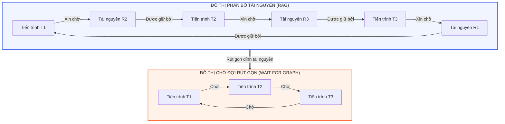
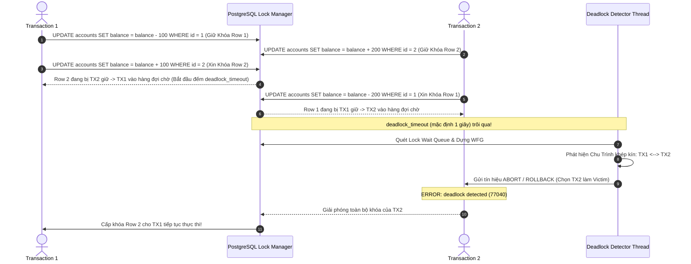

# 1_5_6 Deadlock Detection and Recovery

> **Khóa học**: Cloud & DevOps Cơ Bản  
> **Phân nhóm**: Domain 1 - Operating System Core Fundamentals  
> **Chủ đề**: 1_5 Deadlock Deep Dive  
> **Checklist đối chiếu**: [1_5_6](../../../CHECKLIST.md#domain-1-operating-system-core-fundamentals-45-items)  
> **Trạng thái**: Hoàn thành  

---

## 1. Khái Niệm Cốt Lõi & Bản Chất Kỹ Thuật (Core Concepts & Technical Deep Dive)

Trong khi các kỹ thuật **Deadlock Prevention (Ngăn ngừa)** và **Deadlock Avoidance (Né tránh - Banker's Algorithm)** can thiệp từ sớm để ngăn chặn không bao giờ cho phép hệ thống bước vào trạng thái bế tắc, thì **Deadlock Detection and Recovery (Phát hiện và Khôi phục)** lại tiếp cận theo một triết lý hoàn toàn thực dụng:
1. **Cho phép Deadlock tự do xảy ra**: Hệ thống không áp đặt các quy tắc khắt khe làm nghẽn hiệu năng cấp phát tài nguyên tại thời gian chạy (runtime).
2. **Định kỳ quét và phát hiện (Periodic Detection)**: Một tiến trình giám sát chạy ngầm định kỳ hoặc được kích hoạt sau một khoảng thời gian chờ đợi (timeout) để phân tích trạng thái phân bổ tài nguyên nhằm tìm kiếm sự xuất hiện của Deadlock.
3. **Thực thi quy trình giải cứu (Recovery Action)**: Khi phát hiện có Deadlock, hệ thống chủ động can thiệp bằng cách cưỡng chế hủy tiến trình hoặc thu hồi tài nguyên để phá vỡ chu trình bế tắc.

```
+-----------------------------------------------------------------------------------------+
|                  TRIẾT LÝ: DEADLOCK DETECTION & RECOVERY WORKFLOW                       |
+-----------------------------------------------------------------------------------------+

   [ Các tiến trình tự do xin tài nguyên ]
                      |
                      v
   [ Xảy ra tranh chấp & kẹt chu trình ]
                      |
                      v (Kích hoạt bộ dò tìm sau Timeout hoặc định kỳ)
   [ THUẬT TOÁN PHÁT HIỆN: WAIT-FOR GRAPH (WFG) ]
   - Rút gọn đồ thị RAG thành các đỉnh là Tiến trình
   - Chạy thuật toán tìm kiếm theo chiều sâu (DFS) độ phức tạp O(V + E)
   - Có chu trình khép kín (Cycle)?
         |
         +--------------------> KHÔNG: Hệ thống bình thường (Tiếp tục chạy)
         |
         v CÓ
   [ CHIẾN LƯỢC KHÔI PHỤC (RECOVERY) ]
         |
         +---> 1. Process Termination (Hủy tiến trình nạn nhân - Kill Victim)
         |
         +---> 2. Resource Preemption (Tước đoạt tài nguyên & Rollback giao dịch)
```

---

### 1.1. Đồ Thị Chờ Đợi (Wait-For Graph - WFG) & Thuật Toán Dò Chu Trình

Đối với các hệ thống trong đó mỗi loại tài nguyên chỉ có **đúng 1 thực thể duy nhất (Single-Instance Resource)**, phương pháp phát hiện Deadlock tối ưu và chuẩn xác nhất là chuyển đổi **Đồ thị phân bổ tài nguyên (Resource Allocation Graph - RAG)** thành **Đồ thị chờ đợi (Wait-For Graph - WFG)**:
- **Đỉnh (Vertices - $V$)**: Tập hợp toàn bộ các tiến trình hoặc giao dịch $\{P_1, P_2, \dots, P_n\}$ đang hoạt động. Các đỉnh tài nguyên trung gian bị loại bỏ hoàn toàn.
- **Cạnh có hướng (Directed Edges - $E$)**: Cạnh $P_i \to P_j$ tồn tại nếu và chỉ nếu tiến trình $P_i$ đang bị chặn chờ một tài nguyên mà tiến trình $P_j$ hiện đang chiếm giữ.
- **Định lý cốt lõi**:
  $$\text{Deadlock tồn tại trong hệ thống} \iff \text{Đồ thị WFG chứa ít nhất một chu trình có hướng (Directed Cycle)}$$

#### Thuật Toán Tìm Chu Trình (Cycle Detection Algorithm)
Bộ phát hiện Deadlock sử dụng thuật toán duyệt đồ thị **Tìm kiếm theo chiều sâu (Depth-First Search - DFS)** với ba trạng thái đánh dấu đỉnh (Trắng: chưa duyệt, Xám: đang nằm trên ngăn xếp đệ quy duyệt, Đen: đã duyệt xong):
- **Độ phức tạp tính toán**: Thời gian $O(V + E)$, trong đó $V$ là số lượng tiến trình và $E$ là số lượng mối quan hệ phụ thuộc chờ đợi.
- Nếu DFS gặp lại một đỉnh đang ở trạng thái Xám (Back-edge), một chu trình khép kín được xác nhận: Deadlock đã xảy ra!

---

### 1.2. Các Chiến Lược Khôi Phục Hệ Thống (Recovery Strategies)

Khi chu trình Deadlock được xác định, hệ thống phải phá vỡ chu trình bằng một trong hai hướng:

#### 1. Hủy Tiến Trình (Process Termination)
- **Hủy toàn bộ (Abort All Deadlocked Processes)**: Tốn kém nhất vì vứt bỏ toàn bộ kết quả tính toán của mọi tiến trình liên quan, nhưng giải phóng ngay lập tức mọi tài nguyên.
- **Hủy từng tiến trình một (Abort One Process at a Time)**: Chọn một tiến trình làm "vật tế thần" (Victim Selection), tiêu diệt nó, sau đó chạy lại thuật toán WFG. Lặp lại quá trình này cho đến khi đồ thị sạch chu trình.
- **Tiêu chí lựa chọn nạn nhân (Victim Selection Metrics)**:
  1. *Độ ưu tiên (Priority)*: Tiến trình có mức ưu tiên thấp nhất bị hủy trước.
  2. *Thời gian tính toán đã tiêu tốn*: Ưu tiên giữ lại các tiến trình đã chạy nhiều giờ và sắp hoàn tất; chọn tiến trình vừa mới bắt đầu chạy để giảm thiểu lãng phí tính toán.
  3. *Số lượng và loại tài nguyên đang giữ*: Chọn tiến trình đang giữ ít tài nguyên nhất hoặc tiến trình đang giữ tài nguyên dễ cấp phát lại nhất.

#### 2. Thu Hồi Tài Nguyên & Hoàn Nguyên (Resource Preemption & Rollback)
- **Cơ chế**: Không tiêu diệt tiến trình mà chỉ cưỡng bức tước đoạt tài nguyên từ tiến trình nạn nhân để trao cho tiến trình khác trong chu trình.
- **Yêu cầu Checkpoint & Rollback**: Tiến trình bị tước tài nguyên phải được khôi phục trạng thái về điểm kiểm tra (Checkpoint) an toàn gần nhất trước khi nó yêu cầu tài nguyên đó.
- **Phòng chống Starvation (Đói tài nguyên vĩnh viễn)**: Nếu việc lựa chọn nạn nhân chỉ dựa thuần túy trên chi phí thấp nhất, một tiến trình "nhẹ cân" có thể liên tục bị chọn làm nạn nhân và bị rollback hàng trăm lần mà không bao giờ hoàn thành. Hệ thống giải quyết bằng cách gắn một **Bộ đếm số lần Rollback (Rollback Counter)**; tiến trình nào bị rollback quá số lần ngưỡng quy định sẽ được tăng độ ưu tiên tạm thời để thoát khỏi danh sách nạn nhân.

---

### 1.3. Thực Tế Trong Hệ Điều Hành: Thuật Toán Đà Điểu (The Ostrich Algorithm)

Một sự thật thú vị nhưng tuyệt đối thực tế trong ngành khoa học máy tính: **Cả Linux, macOS và Windows đều KHÔNG triển khai thuật toán phát hiện hay né tránh Deadlock cho các tài nguyên hạt nhân và bộ nhớ thông thường.**

Chiến lược này được giới học thuật gọi là **The Ostrich Algorithm (Thuật toán Đà điểu)**: *Hành vi giống như một chú đà điểu vùi đầu vào cát, vờ như không thấy nguy hiểm và giả định rằng Deadlock không bao giờ xảy ra.*

#### Tại sao các hệ điều hành lớn lại chọn "lờ đi" Deadlock?
1. **Tần suất xảy ra cực thấp**: Ở cấp độ phân bổ bộ nhớ hệ điều hành, hiện tượng Deadlock giữa các tiến trình hệ thống diễn ra với tần suất rất hiếm.
2. **Chi phí đánh đổi quá lớn (Prohibitive Cost)**:
   - Một hệ điều hành phục vụ hàng trăm ngàn lời gọi cấp phát bộ nhớ (`malloc`, `mmap`, `brk`, cấp phát Page Frame) mỗi giây.
   - Nếu mỗi lần cấp phát đều phải cập nhật ma trận phân bổ, dựng đồ thị WFG và chạy thuật toán DFS hoặc Banker's Algorithm, năng lực tính toán của CPU sẽ bị suy giảm từ **50% đến 90%** chỉ để phục vụ việc kiểm tra.
3. **Đánh đổi thực tế (Engineering Trade-off)**: Người thiết kế hệ điều hành thà chấp nhận rằng vài tháng một lần hệ thống có thể bị treo một ứng dụng (và người dùng chỉ việc mở Task Manager hoặc gõ `kill -9` để tắt ứng dụng đó), còn hơn là bắt toàn bộ máy tính chạy chậm như rùa trong 100% thời gian hoạt động thường nhật.

---

### 1.4. Thực Tế Trong Cơ Sở Dữ Liệu: Bắt Buộc Phát Hiện & Tự Động Phục Hồi

Ngược lại hoàn toàn với hệ điều hành đa dụng, các hệ quản trị cơ sở dữ liệu quan hệ (RDBMS) như **PostgreSQL** và **MySQL (InnoDB)** **BẮT BUỘC phải có cơ chế Deadlock Detection & Recovery tự động hoàn hảo**. 

Bởi vì trong hệ thống tài chính/ngân hàng, hàng triệu giao dịch cập nhật các dòng dữ liệu (Row-level Locks) đan xen liên tục. Một trạng thái Deadlock nếu không được phát hiện sẽ làm khóa cứng các bảng dữ liệu quan trọng, làm tê liệt toàn bộ cổng thanh toán và không thể bắt quản trị viên khởi động lại máy chủ.

| Tiêu chí | Hệ Điều Hành (Linux / Windows) | Hệ Quản Trị CSDL (PostgreSQL / MySQL InnoDB) |
| :--- | :--- | :--- |
| **Chiến lược áp dụng** | **The Ostrich Algorithm** (Bỏ qua, phó mặc cho User) | **Detection & Recovery Tự Động** (Bắt buộc) |
| **Cơ chế kích hoạt** | Không có (hoặc cơ chế OOM-Killer khi cạn RAM) | Bộ đếm thời gian chờ khóa (`deadlock_timeout`, `lock_wait_timeout`) |
| **Hình thức xử lý** | Người dùng gửi `kill -9` hoặc khởi động lại máy | Tự động chọn 1 Transaction làm Victim để `ROLLBACK` |
| **Lý do thiết kế** | Chi phí kiểm tra liên tục làm suy sụp hiệu năng CPU OS | Đảm bảo tính toàn vẹn ACID và tính sẵn sàng của dữ liệu |

---

## 2. Ví Dụ Đời Sống Thực Tế Dễ Hiểu (Intuitive Real-World Analogies)

```
       BÁC SĨ KIỂM TRA ĐIỆN TÂM ĐỒ VS. CHIẾN LƯỢC ĐÀ ĐIỂU

       [ Hệ Thống CSDL / ICU ]                     [ Hệ Điều Hành / Người Bình Thường ]
          Máy Đo Nhịp Tim Liên Tục                       Chiến Lược Đà Điểu (Ostrich)
             +---------------+                                 +---------------+
             | /\   /\   /\  |                                 |   (Chôn đầu   |
             |   \/   \/   \/|                                 |    vào cát)   |
             +---------------+                                 +---------------+
       Phát hiện loạn nhịp (Cycle)                       "Xác suất đột quỵ rất thấp,
       ---> Kích sốc điện tim ngay!                      chẳng ai vừa đi bộ vừa chụp
       (Tự động Rollback Transaction)                    cộng hưởng từ MRI 24/7 cả!"
```

### 2.1. Phép So Sánh: Máy Đo Điện Tâm Đồ Và "Vật Tế Thần" (Victim Selection)

Hãy hình dung một bệnh nhân trong phòng cấp cứu (ICU) được gắn máy theo dõi nhịp tim liên tục:
- Bình thường, bác sĩ không can thiệp vào cách quả tim đập để bệnh nhân thoải mái hô hấp (giống như RDBMS cho phép các giao dịch thoải mái xin khóa dòng).
- Định kỳ mỗi giây, máy quét điện tim phân tích sóng tim. Nếu phát hiện một chu kỳ rung thất bất thường (chu trình Wait-For Graph khép kín), còi báo động Deadlock hú vang!
- Bác sĩ lập tức chọn giải pháp: Tiêm một mũi thuốc an thần hoặc dùng máy sốc điện để cưỡng bức một nhịp tim dừng lại (`Rollback Victim`). Nhờ nhịp tim đó dừng lại, toàn bộ các cơ tim khác được giải tỏa co thắt và trở lại nhịp tuần hoàn bình thường.

### 2.2. Phép So Sánh: Tại Sao Bạn Không Mặc Giáp Toàn Thân Đi Làm Mỗi Ngày? (The Ostrich Algorithm)

- **Nguy cơ**: Mỗi khi bước ra khỏi nhà, bạn luôn có một xác suất cực nhỏ bị một viên gạch rơi trúng đầu hoặc bị sét đánh (Deadlock trong OS).
- **Giải pháp triệt để 100%**: Mặc một bộ giáp sắt bọc chì nặng 80kg và đội mũ bảo hộ 5 lớp mỗi ngày (Banker's Algorithm trên mỗi lệnh `malloc`).
- **Thực tế lựa chọn**: Bạn chấp nhận mặc áo sơ mi bình thường đi làm để di chuyển nhẹ nhàng, nhanh chóng. Bạn hành xử như chú đà điểu phớt lờ rủi ro gạch rơi, vì nếu mặc bộ giáp 80kg đó, bạn sẽ chết vì kiệt sức trước khi kịp đến văn phòng!
- Nếu chẳng may gạch rơi trúng chân (ứng dụng bị treo)? Bạn vào bệnh viện băng bó vết thương (`kill -9 PID` hoặc mở Task Manager bấm `End Task`) rồi tiếp tục cuộc sống.

---

## 3. Kiến Trúc, Luồng Hoạt Động & Hình Ảnh Trực Quan (Architecture & Diagrams)

### 3.1. Sơ Đồ Chuyển Đổi Từ RAG Sang Wait-For Graph (WFG)



### 3.2. Cơ Chế Dò Deadlock Trong PostgreSQL (`deadlock_timeout`)



---

## 4. Code Mẫu Trực Quan Hoặc Dòng Lệnh Thực Chiến (Runnable Sample Code / CLI)

### 4.1. Thực Nghiệm Cơ Chế Tự Động Dò Deadlock Trên PostgreSQL

Trong PostgreSQL, khi hai phiên làm việc (sessions) tranh chấp chéo khóa dòng, sau đúng khoảng thời gian tham số cấu hình `deadlock_timeout` (mặc định là `1s`), PostgreSQL sẽ tự động tiêu diệt một giao dịch để cứu giao dịch còn lại.

```sql
-- Chuẩn bị bảng dữ liệu thử nghiệm
CREATE TABLE accounts (
    id INT PRIMARY KEY,
    owner_name VARCHAR(50),
    balance NUMERIC(10, 2)
);

INSERT INTO accounts VALUES (1, 'Alice', 1000.00), (2, 'Bob', 2000.00);

-- =========================================================================
-- MỞ TERMINAL 1 (SESSION 1)
-- =========================================================================
BEGIN;
UPDATE accounts SET balance = balance - 50 WHERE id = 1;
-- Session 1 đã giữ khóa X-lock trên dòng id = 1. Chưa gõ COMMIT!

-- =========================================================================
-- MỞ TERMINAL 2 (SESSION 2)
-- =========================================================================
BEGIN;
UPDATE accounts SET balance = balance - 100 WHERE id = 2;
-- Session 2 đã giữ khóa X-lock trên dòng id = 2.
-- Bây giờ Session 2 cố gắng cập nhật dòng id = 1:
UPDATE accounts SET balance = balance + 100 WHERE id = 1;
-- -> Session 2 bị chặn (Block) và bước vào trạng thái chờ Session 1!

-- =========================================================================
-- QUAY LẠI TERMINAL 1 (SESSION 1)
-- =========================================================================
-- Session 1 cố gắng cập nhật dòng id = 2 mà Session 2 đang nắm:
UPDATE accounts SET balance = balance + 50 WHERE id = 2;

-- KẾT QUẢ QUAN SÁT ĐƯỢC SAU ĐÚNG 1 GIÂY:
-- Terminal 2 lập tức ném ra thông báo lỗi và bị ROLLBACK cưỡng bức:
-- ERROR:  deadlock detected
-- DETAIL: Process 1420 waits for ShareLock on transaction 854; blocked by process 1419.
--         Process 1419 waits for ShareLock on transaction 855; blocked by process 1420.
-- HINT:   See server log for query details.
-- CONTEXT: while updating tuple (0,2) in relation "accounts"
```

---

### 4.2. Chẩn Đoán Luồng Bị Deadlock Bằng Công Cụ Linux CLI (`gdb` & `/proc`)

Khi một ứng dụng C/C++ đa luồng trên Linux bị treo cứng do Deadlock trong không gian người dùng (User Space), kỹ sư hệ thống sử dụng `gdb` để bắt quả tang chu trình bế tắc mà hệ điều hành đã bỏ qua theo thuật toán Đà điểu:

```bash
# 1. Tìm Process ID (PID) của chương trình bị treo
PID=$(pgrep -f coffman_deadlock)
echo "Đang phân tích tiến trình: $PID"

# 2. Kiểm tra trạng thái luồng trong /proc
ps -p $PID -L -o pid,tid,stat,time,comm
# Kết quả: Các luồng đều ở trạng thái 'Sl+' (Interruptible Sleep, luồng con đang ngủ)

# 3. Sử dụng GDB đính kèm (attach) không tương tác để in backtrace toàn bộ luồng
sudo gdb -batch -ex "thread apply all bt" -p $PID
```

**Đầu ra phân tích ngăn xếp (Stack Backtrace) từ GDB:**
```text
Thread 3 (Thread 0x7f9a8a1ff640 (LWP 32104)):
#0  __futex_abstimed_wait_common64 (futex_word=0x55d7a0404060 <lock2>, ...) at futex-internal.c:57
#1  __pthread_mutex_lock_wait (mutex=0x55d7a0404060 <lock2>) at pthread_mutex_lock.c:140
#2  __pthread_mutex_lock (mutex=0x55d7a0404060 <lock2>) at pthread_mutex_lock.c:81
#3  thread_A_routine (arg=0x0) at deadlock_demo.c:28
#4  start_thread (arg=<optimized out>) at pthread_create.c:442

Thread 2 (Thread 0x7f9a899fe640 (LWP 32105)):
#0  __futex_abstimed_wait_common64 (futex_word=0x55d7a0404040 <lock1>, ...) at futex-internal.c:57
#1  __pthread_mutex_lock_wait (mutex=0x55d7a0404040 <lock1>) at pthread_mutex_lock.c:140
#2  __pthread_mutex_lock (mutex=0x55d7a0404040 <lock1>) at pthread_mutex_lock.c:81
#3  thread_B_routine (arg=0x0) at deadlock_demo.c:46
#4  start_thread (arg=<optimized out>) at pthread_create.c:442
```
> **Nhận định**: Cả hai luồng con (LWP 32104 và 32105) đều đang bị kẹt cứng ở hàm thư viện C `__pthread_mutex_lock_wait` và system call hạt nhân `futex`. Luồng 3 đang đợi địa chỉ `0x55d7a0404060` (lock2), trong khi Luồng 2 đang đợi địa chỉ `0x55d7a0404040` (lock1). Deadlock đã được định vị chính xác!

---

## 5. Cạm Bẫy Thực Tế & Thực Tiễn Sản Xuất (Production Gotchas & Best Practices)

### 5.1. Cạm Bẫy Cấu Hình `deadlock_timeout` Trong Cơ Sở Dữ Liệu Lớn

- **Vấn đề**: Trong PostgreSQL, nếu quản trị viên đặt `deadlock_timeout` quá nhỏ (ví dụ: `10ms`):
  - Chi phí chạy giải thuật kiểm tra chu trình trên hàng ngàn khóa hàng đợi sẽ làm nghẽn CPU của Database Server.
  - Ngược lại, nếu đặt quá lớn (ví dụ: `60s`), các ứng dụng backend phía trên sẽ bị dồn ứ kết nối (Connection Pool Exhaustion) trong cả phút trước khi giao dịch được giải phóng.
- **Thực tiễn sản xuất**: Giữ giá trị mặc định `1s` hoặc tinh chỉnh từ `500ms` đến `2s`. Đối với MySQL InnoDB, đảm bảo cờ `innodb_deadlock_detect = ON` luôn được kích hoạt trừ khi hệ thống có hàng ngàn luồng tranh chấp cực đoan trên cùng một dòng.

### 5.2. Cạm Bẫy Cơ Chế OOM Killer Bị Nhầm Là Deadlock Recovery Của Linux

- **Hiểu lầm phổ biến**: Nhiều kỹ sư cho rằng tiến trình nền **OOM Killer (Out-Of-Memory Killer)** của nhân Linux chính là cơ chế giải quyết Deadlock.
- **Bản chất kỹ thuật**: OOM Killer hoàn toàn **không liên quan đến Deadlock**. OOM Killer chỉ được kích hoạt khi dung lượng RAM vật lý và Swap của máy chủ bị cạn kiệt 100%. Lúc đó, nhân Linux tính toán điểm `oom_score` và tiêu diệt tiến trình ngốn RAM nhất để cứu sống nhân hệ điều hành. Đối với Deadlock thuần túy (vốn chỉ chiếm 0% CPU và không tiêu tốn thêm RAM), Linux hoàn toàn không can thiệp (Ostrich Algorithm).

---

## 6. Câu Hỏi Củng Cố Kiến Thức (Active Recall Quiz)

<details>
<summary><b>Câu hỏi 1:</b> Tại sao trong đồ thị Wait-For Graph (WFG), việc xuất hiện một chu trình (Cycle) là điều kiện cần và đủ để khẳng định Deadlock đối với tài nguyên đơn lẻ (Single-instance), nhưng lại chỉ là điều kiện cần đối với tài nguyên đa thực thể (Multi-instance)?</summary>

> **Đáp án:**
> Đối với tài nguyên đơn lẻ (Single-instance), mỗi tài nguyên chỉ có đúng 1 chủ sở hữu duy nhất; do đó nếu tồn tại chu trình khép kín, không một tiến trình nào trong chu trình có thể nhận được tài nguyên cho đến khi tiến trình trước nó nhả ra, dẫn đến bế tắc vĩnh viễn (điều kiện cần và đủ). 
> Ngược lại, đối với tài nguyên đa thực thể (Multi-instance), một loại tài nguyên có thể có nhiều bản sao (ví dụ: có 3 máy in). Ngay cả khi tồn tại chu trình giữa $P_1$ và $P_2$, nhưng nếu còn một tiến trình $P_3$ nằm ngoài chu trình đang nắm giữ một bản sao của tài nguyên đó và sắp hoàn tất công việc, thì khi $P_3$ trả lại tài nguyên, hệ thống sẽ cấp phát bản sao đó cho $P_1$, phá vỡ trạng thái nghẽn mà không gây ra Deadlock thực sự.
</details>

<details>
<summary><b>Câu hỏi 2:</b> Thuật toán Đà điểu (The Ostrich Algorithm) giải quyết vấn đề Deadlock như thế nào trong nhân Linux và Windows? Đánh đổi kỹ thuật (Trade-off) đằng sau quyết định này là gì?</summary>

> **Đáp án:**
> Thuật toán Đà điểu giải quyết Deadlock bằng cách... **hoàn toàn bỏ qua nó** (sticking head in the sand), không thực hiện bất kỳ phép kiểm tra phòng ngừa hay dò tìm nào trong quá trình cấp phát tài nguyên thông thường. Đánh đổi kỹ thuật ở đây là: chấp nhận hy sinh tính tin cậy tuyệt đối trong những trường hợp cực kỳ hiếm hoi khi xảy ra Deadlock (người dùng phải tự can thiệp thủ công bằng lệnh `kill` hoặc khởi động lại), để đổi lấy hiệu năng xử lý tối đa cho hàng trăm triệu thao tác cấp phát bộ nhớ và tác vụ mỗi ngày của hệ điều hành mà không bị suy giảm thông lượng.
</details>

<details>
<summary><b>Câu hỏi 3:</b> Khi một cơ sở dữ liệu như MySQL InnoDB phát hiện Deadlock giữa hai Transaction A và B, dựa vào tiêu chí cụ thể nào mà engine quyết định chọn Transaction nào để ROLLBACK?</summary>

> **Đáp án:**
> MySQL InnoDB áp dụng tiêu chuẩn tối thiểu hóa chi phí (Cost Metric): nó sẽ so sánh số lượng dòng dữ liệu đã bị chèn (INSERT), cập nhật (UPDATE) hoặc xóa (DELETE) bởi mỗi Transaction. Transaction nào làm thay đổi **ít dòng dữ liệu hơn (nhẹ hơn)** sẽ được chọn làm "vật tế thần" (Victim) để thực hiện `ROLLBACK`. Quyết định này giúp giảm thiểu tối đa khối lượng công việc phải hoàn nguyên từ undo log và cho phép ứng dụng client có thể thử lại (retry) giao dịch nhỏ đó một cách nhanh chóng nhất.
</details>

---

## 7. 📚 Nguồn Tài Liệu Chính Thống (Tier-1 Official References)

- [OSTEP Chapter 32: Concurrency Bugs (Arpaci-Dusseau)](https://pages.cs.wisc.edu/~remzi/OSTEP/threads-bugs.pdf) - Phân tích chi tiết chiến lược Deadlock Detection, Wait-For Graph, và Thuật toán Đà điểu (The Ostrich Algorithm).
- [PostgreSQL Documentation - Explicit Locking: Deadlocks](https://www.postgresql.org/docs/current/explicit-locking.html#LOCKING-DEADLOCKS) - Tài liệu chính thức về cơ chế phát hiện Deadlock và tham số `deadlock_timeout` trong PostgreSQL.
- [MySQL 8.0 Reference Manual - InnoDB Deadlock Handling](https://dev.mysql.com/doc/refman/8.0/en/innodb-deadlocks-handling.html) - Đặc tả chi tiết cơ chế duy trì Wait-For Graph và thuật toán chọn nạn nhân rollback của InnoDB.
- [Linux Programmer's Manual - gdb(1)](https://man7.org/linux/man-pages/man1/gdb.1.html) - Hướng dẫn sử dụng trình gỡ lỗi GNU Debugger để soi backtrace luồng tiến trình.
- [Linux Programmer's Manual - futex(2)](https://man7.org/linux/man-pages/man2/futex.2.html) - Đặc tả kỹ thuật system call đồng bộ hóa cơ bản của nhân Linux.