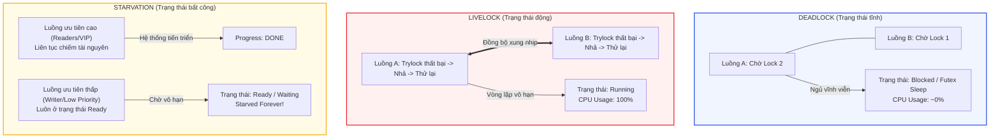
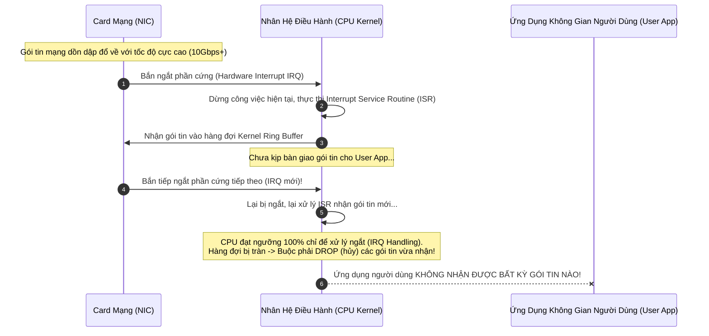

# 1_5_7 Deadlock vs Livelock vs Starvation

> **Khóa học**: Cloud & DevOps Cơ Bản  
> **Phân nhóm**: Domain 1 - Operating System Core Fundamentals  
> **Chủ đề**: 1_5 Deadlock Deep Dive  
> **Checklist đối chiếu**: [1_5_7](../../../CHECKLIST.md#domain-1-operating-system-core-fundamentals-45-items)  
> **Trạng thái**: Hoàn thành  

---

## 1. Khái Niệm Cốt Lõi & Bản Chất Kỹ Thuật (Core Concepts & Technical Deep Dive)

Trong lĩnh vực điện toán đồng thời (Concurrent Computing) và lý thuyết hệ điều hành, có ba hiện tượng lỗi bất thường về mặt tiến triển (Liveness Hazards) khiến hệ thống hoặc tiến trình không thể hoàn thành tác vụ: **Deadlock (Bế tắc)**, **Livelock (Khóa sống)**, và **Starvation (Đói tài nguyên)**. 

Mặc dù cả ba đều dẫn đến kết quả cuối cùng là công việc của ứng dụng bị đóng băng hoặc đình trệ, nhưng **bản chất trạng thái tiến trình, mức tiêu thụ tài nguyên phần cứng (CPU), và nguyên nhân gốc rễ** của chúng hoàn toàn khác biệt.

```
+-----------------------------------------------------------------------------------------+
|                  BA TRẠNG THÁI LỖI TIẾN TRIỂN (LIVENESS HAZARDS)                        |
+-----------------------------------------------------------------------------------------+

  1. DEADLOCK (TĨNH - STATIC)
     - Trạng thái: Phong tỏa vĩnh viễn (Blocked / Sleeping / Waiting).
     - Tiêu thụ CPU: ~0.0% CPU.
     - Bản chất: Chu trình phụ thuộc khép kín (Circular Wait), không ai nhúc nhích.
     - Toàn hệ thống: Ngưng trệ hoàn toàn trên các luồng bị ảnh hưởng.

  2. LIVELOCK (ĐỘNG - DYNAMIC)
     - Trạng thái: Đang chạy tích cực (Running / Executing instructions).
     - Tiêu thụ CPU: 100% CPU trên các lõi liên quan.
     - Bản chất: Các luồng liên tục đổi trạng thái để phản ứng với nhau nhưng vô ích.
     - Toàn hệ thống: Bận rộn tối đa nhưng tiến trình thực tế bằng không (Zero Progress).

  3. STARVATION (BẤT CÔNG - UNFAIRNESS)
     - Trạng thái: Sẵn sàng thực thi (Ready state), có thể chạy bất kỳ lúc nào.
     - Tiêu thụ CPU: 0% cho tiến trình bị đói; các tiến trình khác vẫn ngốn CPU.
     - Bản chất: Cơ chế điều phối (Scheduler / Lock) thiên vị kẻ khác liên tục.
     - Toàn hệ thống: Vẫn tiến triển tốt, chỉ riêng tiến trình bị đói là đứng im vĩnh viễn.
```

---

### 1.1. Bảng So Sánh Toàn Diện: Deadlock vs Livelock vs Starvation

| Tiêu Chí So Sánh | Deadlock (Bế tắc) | Livelock (Khóa sống) | Starvation (Đói tài nguyên) |
| :--- | :--- | :--- | :--- |
| **Bản chất trạng thái** | **Tĩnh (Static)**: Phong tỏa hoàn toàn | **Động (Dynamic)**: Vận động liên tục | **Bất công (Unfairness)**: Bị bỏ quên |
| **Trạng thái tiến trình** | `Blocked` / `Waiting` / `Sleeping` (Hạt nhân đưa vào hàng đợi chờ) | `Running` (Liên tục đổi trạng thái trong vòng lặp vô hạn) | `Ready` (Có thể chạy ngay nhưng không được cấp phát CPU/Khóa) |
| **Mức tiêu thụ CPU** | **Xấp xỉ 0.0%** (Tiến trình ngủ, không tiêu tốn chu kỳ lệnh) | **Gần 100%** (CPU quay vòng xử lý logic thử lại) | Bình thường đối với toàn hệ thống; **0%** đối với tiến trình nạn nhân |
| **Tiến triển hệ thống** | **Không**: Toàn bộ nhóm luồng trong chu trình đứng im | **Không**: Mọi luồng trong cuộc đều không hoàn tất công việc | **Có**: Hệ thống vẫn hoàn thành công việc của các tiến trình ưu tiên cao |
| **Nguyên nhân cốt lõi** | Hội tụ đủ 4 điều kiện Coffman (Chu trình phụ thuộc tài nguyên khép kín) | Thuật toán né tránh xung đột quá đối xứng; liên tục nhượng bộ đồng bộ | Thuật toán lập lịch có độ ưu tiên cố định; khóa Reader-Preference |
| **Giải pháp triệt tiêu** | - Havender Total Ordering<br/>- Phá vỡ Coffman Conditions<br/>- Detection & Rollback | - Randomized Exponential Backoff<br/>- Thêm Jitter ngẫu nhiên<br/>- Chuyển Interrupt sang Polling | - Kỹ thuật Lão hóa (Aging mechanism)<br/>- Hàng đợi công bằng (FIFO / Ticket Lock)<br/>- Fair RWLock |

---

### 1.2. Phân Tích Kỹ Thuật Từng Hiện Tượng

#### 1. Deadlock (Bế tắc)
- Xảy ra khi tồn tại một chu trình vòng tròn: Tiến trình $P_1$ giữ tài nguyên $R_1$ và đợi $R_2$, trong khi $P_2$ giữ $R_2$ và đợi $R_1$.
- Cả hai tiến trình đều bị đưa vào trạng thái ngủ ngắt được (`TASK_INTERRUPTIBLE`) hoặc không ngắt được (`TASK_UNINTERRUPTIBLE`) trong Linux Kernel thông qua các system call như `futex`. 
- **Đặc trưng nhận diện**: Mức tiêu thụ CPU của ứng dụng rơi về mức 0%, các tiến trình dừng hoàn toàn mọi thao tác I/O.

#### 2. Livelock (Khóa sống)
- Xảy ra khi lập trình viên cố gắng giải quyết Deadlock bằng cách sử dụng các hàm không phong tỏa (như `pthread_mutex_trylock`). Nếu không chiếm được khóa thứ hai, luồng chủ động nhả khóa thứ nhất và thử lại từ đầu.
- Nếu hai luồng cùng chạy trên hai lõi CPU với tần số đồng bộ: Cả hai luồng cùng chiếm khóa thứ nhất $\to$ cùng thất bại ở khóa thứ hai $\to$ cùng nhả khóa thứ nhất $\to$ cùng thử lại sau một khoảng thời gian cố định $\to$ lại va chạm nhau!
- **Đặc trưng nhận diện**: Quạt tản nhiệt máy chủ quay hết công suất, lệnh `top` báo tiến trình chiếm 100% CPU trên nhiều lõi, nhưng nhật ký ứng dụng (logs) không ghi nhận bất kỳ nghiệp vụ nào được hoàn thành.

#### 3. Starvation (Đói tài nguyên)
- Xảy ra khi một tiến trình hoàn toàn đủ điều kiện để thực thi (không bị khóa hay deadlock), nhưng nó liên tục bị bộ điều phối (Scheduler) hoặc cơ chế đồng bộ hóa gạt sang một bên vì luôn có các tiến trình khác được đánh giá là "quan trọng hơn" hoặc "đến đúng lúc hơn".
- **Ví dụ điển hình**: Khóa đọc-ghi thiên vị người đọc (Reader-Preference Read-Write Lock):
  - Khi có luồng đang đọc (Reader), luồng ghi (Writer) buộc phải đứng chờ.
  - Nếu các luồng đọc mới liên tục xuất hiện gối đầu nhau không dứt (Reader 1 chưa đọc xong thì Reader 2 đã vào, Reader 2 chưa xong thì Reader 3 đã vào), luồng ghi sẽ bị bỏ đói vĩnh viễn (Writer Starvation).

---

## 2. Ví Dụ Đời Sống Thực Tế Dễ Hiểu (Intuitive Real-World Analogies)

```
        BA TÌNH HUỐNG BẾ TẮC TRONG ĐỜI SỐNG THỰC TẾ

  [ DEADLOCK: ĐỨNG IM BẤT ĐỘNG ]        [ LIVELOCK: NHẢY MÚA NHƯỢNG BỘ ]
       A  ====>  |  <====  B                  A  <====  |  ====>  B
    Hai người trừng mắt nhìn nhau,          Cùng né sang trái, cùng né sang phải,
       không ai chịu nhường bước.              nhảy qua nhảy lại toát mồ hôi!
          (0% Tiêu hao sức lực)                   (100% Tiêu hao sức lực)

  -------------------------------------------------------------------------

  [ STARVATION: NGƯỜI XẾP HÀNG BỊ BỎ RƠI ]
       Hàng đợi: [Người áo rách] <--- [VIP 1] <--- [VIP 2] <--- [VIP 3]...
       Quản lý liên tục nhét khách VIP vào đầu hàng.
       Người áo rách hoàn toàn khỏe mạnh nhưng đứng cuối hàng đến chết đói!
```

### 2.1. Phép So Sánh: Hai Người Gặp Nhau Ở Lối Đi Hẹp
- **Kịch bản Deadlock**: Anh Nam và anh Tuấn đi đối diện nhau trong một ngõ hẹp chỉ vừa đúng 1 người. Cả hai cùng chạm mặt nhau ở giữa ngõ, dừng phắt lại, khoanh tay đứng nhìn nhau trừng trừng: *"Tao không lùi, mày phải lùi trước!"*. Cả hai đứng im bất động suốt 3 tiếng đồng hồ, không tốn một giọt mồ hôi nào (0% CPU), nhưng không ai tiến lên được.
- **Kịch bản Livelock**: Anh Nam và anh Tuấn quá đỗi lịch thiệp. Vừa thấy nhau, Nam lập tức né sang bên phải để nhường, cùng lúc đó Tuấn cũng né sang bên trái của mình (tức là cùng một bên mép ngõ). Nhận ra bị chắn, cả hai cùng bối rối xin lỗi và đồng thời né sang mép ngõ đối diện. Họ cứ thế nhảy qua nhảy lại nhịp nhàng như đang khiêu vũ tango suốt 30 phút, thở hổn hển toát mồ hôi đầm đìa (100% CPU), nhưng vị trí hai người vẫn đứng nguyên ở giữa ngõ!

### 2.2. Phép So Sánh: Quầy Phát Cơm Từ Thiện Và Hiện Tượng Bị Bỏ Đói (Starvation)
- Một ông lão nghèo khổ đến xếp hàng từ sáng sớm trước quầy phát cơm từ thiện.
- Khi người quản lý mở cửa, ông ấy lại áp dụng một luật ưu tiên đặc biệt: *"Ai mặc âu phục vest sang trọng sẽ được ưu tiên lấy cơm trước!"*.
- Cứ mỗi khi ông lão chuẩn bị bước lên tới quầy, lại có một vị khách mặc vest bước vào và được ban quản lý chen ngang đưa lên đầu hàng.
- Khách mặc vest đến không dứt. Quầy cơm vẫn phát hàng ngàn suất ăn đều đặn (toàn hệ thống vẫn tiến triển vượt bậc). Chỉ riêng ông lão nghèo đứng mãi ở cuối hàng, mắt sáng quắc, tay cầm bát cơm rỗng, kiệt sức và chết đói vì không bao giờ tới lượt!

---

## 3. Kiến Trúc, Luồng Hoạt Động & Hình Ảnh Trực Quan (Architecture & Diagrams)

### 3.1. Sơ Đồ Chuyển Đổi Trạng Thái CPU Trong Ba Hiện Tượng



### 3.2. Hiện Tượng Receive Livelock Trong Mạng Linux (Network Receive Livelock)

Một trường hợp Livelock kinh điển ở cấp độ kiến trúc nhân hệ điều hành là **Interrupt Storm (Cơn bão ngắt mạng)**:



---

## 4. Code Mẫu Trực Quan Hoặc Dòng Lệnh Thực Chiến (Runnable Sample Code / CLI)

> ⚠️ Đoạn mã nguồn C dưới đây minh họa sự khác biệt thực tế giữa thuật toán gây ra **Livelock (100% CPU)** và cách hóa giải bằng **Randomized Exponential Backoff**.

### 4.1. Mã Nguồn C: Tái Hiện Hiện Tượng Livelock Bằng `trylock`

```c
#include <stdio.h>
#include <stdlib.h>
#include <unistd.h>
#include <pthread.h>

pthread_mutex_t lock1 = PTHREAD_MUTEX_INITIALIZER;
pthread_mutex_t lock2 = PTHREAD_MUTEX_INITIALIZER;

volatile int livelock_active = 1;

void* thread_A(void* arg) {
    (void)arg;
    long iterations = 0;
    while (livelock_active) {
        iterations++;
        pthread_mutex_lock(&lock1);
        
        // Thử chiếm lock2 một cách non-blocking
        if (pthread_mutex_trylock(&lock2) == 0) {
            printf("[Thread A] Đã chiếm thành công cả 2 khóa sau %ld vòng lặp!\n", iterations);
            pthread_mutex_unlock(&lock2);
            pthread_mutex_unlock(&lock1);
            break;
        }

        // Không chiếm được lock2: Nhả lock1 ra ngay để tránh Deadlock
        pthread_mutex_unlock(&lock1);

        // NGUY NGUYÊN LIVELOCK: Cố tình không dùng random delay, ngay lập tức thử lại!
        // (Vòng lặp quay điên cuồng làm CPU ngốn 100%)
    }
    return NULL;
}

void* thread_B(void* arg) {
    (void)arg;
    long iterations = 0;
    while (livelock_active) {
        iterations++;
        pthread_mutex_lock(&lock2);

        // Thử chiếm lock1 một cách non-blocking
        if (pthread_mutex_trylock(&lock1) == 0) {
            printf("[Thread B] Đã chiếm thành công cả 2 khóa sau %ld vòng lặp!\n", iterations);
            pthread_mutex_unlock(&lock1);
            pthread_mutex_unlock(&lock2);
            break;
        }

        // Không chiếm được lock1: Nhả lock2 ra ngay để tránh Deadlock
        pthread_mutex_unlock(&lock2);

        // Thử lại ngay lập tức...
    }
    return NULL;
}

int main(void) {
    pthread_t tA, tB;
    printf("=== KHỞI CHẠY TÁI HIỆN LIVELOCK (CPU SẼ TĂNG VỌT LÊN 100%%) ===\n");

    pthread_create(&tA, NULL, thread_A, NULL);
    pthread_create(&tB, NULL, thread_B, NULL);

    // Để chương trình chạy trong 3 giây để người dùng quan sát trên công cụ top
    sleep(3);
    printf("=== ĐANG DỪNG THỬ NGHIỆM SAU 3 GIÂY ĐỂ TRÁNH QUÁ TẢI CPU ===\n");
    livelock_active = 0;

    pthread_join(tA, NULL);
    pthread_join(tB, NULL);
    return 0;
}
```

---

### 4.2. Quan Sát Hiện Tượng Livelock Bằng Công Cụ Linux `top`

Biên dịch và chạy chương trình trên:
```bash
# Biên dịch chương trình
gcc -O0 -pthread -o livelock_demo livelock_demo.c

# Chạy chương trình trong một terminal
./livelock_demo &
PID=$!

# Mở công cụ giám sát CPU theo thời gian thực
top -p $PID -H
```

**Kết quả quan sát được trên màn hình `top`:**
```text
  PID USER      PR  NI    VIRT    RES    SHR S  %CPU  %MEM     TIME+ COMMAND
35812 ubuntu    20   0   32440   2180   1920 R  99.8   0.1   0:02.85 livelock_demo
35813 ubuntu    20   0   32440   2180   1920 R  99.8   0.1   0:02.85 livelock_demo
```
> **Phân tích thực chiến**: Cả hai luồng đều ở trạng thái **`R` (Running)** và ngốn trọn vẹn **~100% CPU** mỗi lõi! Không có bất kỳ luồng nào bị ngủ (`S` hay `D` như Deadlock), nhưng cả hai hoàn toàn không đạt được bước tiến thực chất nào trong suốt 3 giây.

---

## 5. Cạm Bẫy Thực Tế & Thực Tiễn Sản Xuất (Production Gotchas & Best Practices)

### 5.1. Cạm Bẫy Starvation Trong Reader-Writer Lock (`pthread_rwlock_t`)

- **Vấn đề sản xuất**: Thư viện chuẩn POSIX threads cung cấp cơ chế khóa đọc-ghi `pthread_rwlock_t`. Trên nhiều phiên bản triển khai mặc định của Linux Glibc, cơ chế này ưu tiên người đọc (**Reader-Preference**):
  - Khi một dịch vụ web nhận 10.000 truy vấn đọc dữ liệu (Read Requests) mỗi giây, hàng trăm luồng đọc liên tục vào và ra khỏi khóa.
  - Một tiến trình nền muốn ghi cập nhật dữ liệu (Writer Thread) sẽ bị chặn và **bị bỏ đói vĩnh viễn (Starvation)** suốt cả ngày làm việc, dẫn đến dữ liệu trong bộ nhớ cache không bao giờ được làm tươi!
- **Giải pháp chuẩn sản xuất**:
  - Khởi tạo thuộc tính khóa với cờ thiên vị người ghi hoặc công bằng:
    ```c
    pthread_rwlockattr_t attr;
    pthread_rwlockattr_init(&attr);
    pthread_rwlockattr_setkind_np(&attr, PTHREAD_RWLOCK_PREFER_WRITER_NONRECURSIVE_NP);
    pthread_rwlock_init(&my_rwlock, &attr);
    ```

### 5.2. Giải Pháp Linux NAPI Đối Phó Với Receive Livelock Ở Tầng Mạng

- **Vấn đề**: Trong các máy chủ Cloud tiếp nhận lưu lượng mạng hàng triệu gói tin mỗi giây (DDoS hoặc tải cao), mô hình tiếp nhận theo ngắt (Interrupt-driven I/O) sẽ dẫn đến hiện tượng **Receive Livelock**: Toàn bộ các lõi CPU bận 100% để tiếp nhận ngắt từ card mạng, dẫn đến ứng dụng backend (như Nginx, Redis) bị đói CPU và không bao giờ đọc được dữ liệu từ socket.
- **Giải pháp kiến trúc**: Nhân Linux triển khai cơ chế **NAPI (New API)**:
  - Khi lưu lượng mạng thấp: Card mạng hoạt động ở chế độ ngắt bình thường (Interrupt Mode) để đảm bảo độ trễ thấp nhất.
  - Khi lưu lượng mạng vượt ngưỡng cao: Linux Kernel chủ động **tắt hoàn toàn ngắt phần cứng của card mạng (Disable IRQ)** và chuyển sang chế độ thăm dò định kỳ theo lô (**Polling Mode**). Nhờ đó, CPU có thể kiểm soát chính xác hạn ngạch (budget) thời gian xử lý gói tin, ngăn ngừa tuyệt đối thảm họa Livelock.

### 5.3. Kỹ Thuật Lão Hóa (Aging) Chống Starvation Trong Bộ Điều Phối CPU

- Trong các hệ thống điều phối tiến trình theo độ ưu tiên (Priority Scheduling):
  - Nếu chỉ đơn thuần chọn tiến trình có độ ưu tiên cao nhất để chạy, một tiến trình có độ ưu tiên thấp (Low-priority process) có thể bị đói vĩnh viễn (Starvation).
  - **Kỹ thuật Lão hóa (Aging)**: Cứ sau mỗi chu kỳ thời gian (ví dụ: mỗi 1 giây) mà một tiến trình nằm chờ trong hàng đợi `Ready` mà chưa được cấp CPU, bộ điều phối hệ điều hành sẽ **tăng dần độ ưu tiên của nó lên 1 bậc**. Đến một lúc nào đó, độ ưu tiên của nó sẽ vượt qua cả các tiến trình mới vào, đảm bảo chắc chắn rằng mọi tiến trình đều sẽ được phục vụ công bằng.

---

## 6. Câu Hỏi Củng Cố Kiến Thức (Active Recall Quiz)

<details>
<summary><b>Câu hỏi 1:</b> Một kỹ sư DevOps nhận thấy máy chủ web đột ngột phản hồi chậm. Khi mở lệnh <code>top</code>, kỹ sư thấy mức tiêu thụ CPU của ứng dụng chạm ngưỡng 100% trên toàn bộ các lõi, nhưng nhật ký ứng dụng (access log) hoàn toàn ngừng ghi nhận các yêu cầu hoàn tất. Đây là triệu chứng của Deadlock hay Livelock? Giải thích?</summary>

> **Đáp án:**
> Đây là triệu chứng đặc trưng của **Livelock**. 
> Trong trạng thái Deadlock, các luồng bị chặn vĩnh viễn ở các cuộc gọi hệ thống khóa (như `futex`), do đó chúng rơi vào trạng thái ngủ và tiêu thụ xấp xỉ **0.0% CPU**. Ngược lại, mức tiêu thụ **100% CPU** kèm theo việc không có tiến triển công việc nào hoàn thành chứng minh rằng các luồng vẫn đang hoạt động tích cực (thực thi mã lệnh trong vòng lặp liên tục thử lại - retry loop, tranh chấp và nhả tài nguyên lặp đi lặp lại), hoàn toàn khớp với định nghĩa của Livelock.
</details>

<details>
<summary><b>Câu hỏi 2:</b> Phân tích sự khác biệt căn bản giữa Starvation và Deadlock về mặt phạm vi ảnh hưởng đối với toàn bộ hệ thống?</summary>

> **Đáp án:**
> - **Đối với Deadlock**: Toàn bộ các tiến trình tham gia vào chu trình phụ thuộc khép kín đều bị phong tỏa vĩnh viễn; không một tiến trình nào trong nhóm đó có thể tự giải thoát hoặc tạo ra bước tiến triển, làm tê liệt một phần hoặc toàn bộ hệ thống.
> - **Đối với Starvation**: Hệ thống nói chung **vẫn đang tiến triển rất tốt** và hoàn thành liên tục các tác vụ của những tiến trình được ưu tiên cao. Chỉ riêng một hoặc một vài tiến trình có độ ưu tiên thấp hoặc kém may mắn là bị gạt ra ngoài lề và không bao giờ được cấp phát tài nguyên cần thiết.
</details>

<details>
<summary><b>Câu hỏi 3:</b> Làm thế nào để phân biệt trạng thái tiến trình (Process State) của Deadlock và Starvation khi quan sát cột <code>STAT</code> trong lệnh <code>ps aux</code> trên Linux?</summary>

> **Đáp án:**
> - Các tiến trình bị **Deadlock** sẽ hiển thị trạng thái `S` (Interruptible Sleep) hoặc `D` (Uninterruptible Sleep / I/O wait) vì chúng đang bị hạt nhân treo ngủ trên hàng đợi chờ tài nguyên (ví dụ chờ đợi mutex giải phóng qua futex).
> - Tiến trình bị **Starvation** thường ở trạng thái `R` (Running / Runnable trên hàng đợi Ready) hoặc trạng thái ngủ rất ngắn, bởi vì về mặt logic nó hoàn toàn sẵn sàng nhận CPU để chạy ngay lập tức, nhưng liên tục bị bộ lập lịch bỏ qua để nhường CPU cho các tiến trình có độ ưu tiên cao hơn.
</details>

---

## 7. 📚 Nguồn Tài Liệu Chính Thống (Tier-1 Official References)

- [OSTEP Chapter 32: Concurrency Bugs (Arpaci-Dusseau)](https://pages.cs.wisc.edu/~remzi/OSTEP/threads-bugs.pdf) - Định nghĩa nền tảng và phân loại chi tiết Deadlock vs Livelock.
- [OSTEP Chapter 28: Locks (Arpaci-Dusseau)](https://pages.cs.wisc.edu/~remzi/OSTEP/threads-locks.pdf) - Phân tích tính công bằng (Fairness) của khóa và hiện tượng Starvation.
- [Mogul & Ramakrishnan (1997) Eliminating Receive Livelock in an Interrupt-Driven Kernel](https://dl.acm.org/doi/10.1145/263326.263335) - Công trình kinh điển trên ACM Transactions on Computer Systems (TOCS) đặt nền móng giải quyết Receive Livelock ở tầng mạng hệ điều hành.
- [Linux Programmer's Manual - pthread_rwlockattr_setkind_np(3)](https://man7.org/linux/man-pages/man3/pthread_rwlockattr_setkind_np.3.html) - Đặc tả kỹ thuật thiết lập chính sách ưu tiên chống Starvation cho Reader-Writer Lock trong Glibc.
- [Linux Kernel Documentation - NAPI (New API)](https://docs.kernel.org/networking/napi.html) - Tài liệu chính thức từ Linux Kernel về cơ chế chuyển đổi ngắt sang thăm dò chống Livelock mạng.