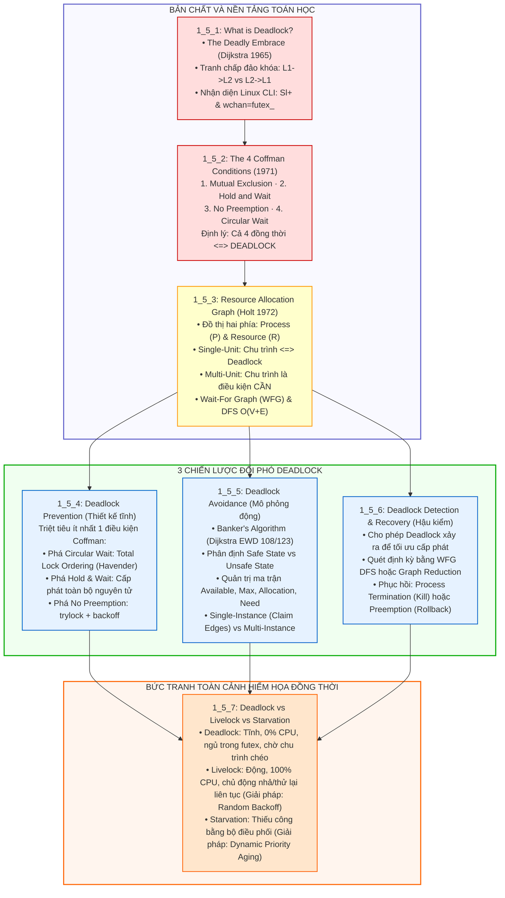

# 1_5 Deadlock Deep Dive

> **Khóa học**: Cloud DevOps Basic — OS Core · **Domain**: 1 Domain 1 - Operating System Core Fundamentals · **Roadmap gốc**: [os/README.md](<../../README.md#module-5-deadlock-deep-dive>)

---

## Module này dạy gì? (What & Why)

Module này phân tích chuyên sâu lý thuyết và thực tiễn của hiện tượng **Bế tắc hệ thống (Deadlock)** — một trong những sự cố đồng thời (Concurrency Bug) hiểm hóc và tai hại nhất trong khoa học máy tính, hệ điều hành và các hệ thống dịch vụ phân tán. Khi Deadlock xảy ra, các tiến trình hoặc luồng thực thi bị phong tỏa vĩnh viễn trong trạng thái ngủ mà không hề tiêu tốn CPU (CPU usage bằng 0%), khiến các cụm máy chủ và kết nối cơ sở dữ liệu dần bị tê liệt hoàn toàn mà không phát sinh thông báo lỗi sụp đổ (crash) tức thì.

Người học sẽ được dẫn dắt từ nguồn gốc lịch sử và định nghĩa hình thức kinh điển của Edsger W. Dijkstra năm 1965 (**"The Deadly Embrace"** - EWD 123), nhận diện cơ chế khóa chéo thứ tự ngược (`L1 -> L2` vs `L2 -> L1`) và cách điều tra tầng thấp thông qua trạng thái luồng Linux `Sl+` và hàm kernel `wchan = futex_`. Tiếp theo, module phân tích nền tảng toán học của **4 điều kiện Coffman (1971)** và chứng minh rằng chỉ khi cả 4 điều kiện (Loại trừ tương hỗ, Giữ và Chờ, Không thể tước đoạt, Chờ đợi vòng quanh) cùng hội tụ đồng thời thì Deadlock mới có thể hình thành.

Trên cơ sở đó, module xây dựng công cụ mô hình hóa trực quan bằng **Đồ Thị Phân Bổ Tài Nguyên (Resource Allocation Graph - RAG)** của Richard C. Holt (1972), làm sáng tỏ định lý ranh giới giữa hệ tài nguyên đơn cá thể (Single-Unit: chu trình là điều kiện cần và đủ) và đa cá thể (Multi-Unit: chu trình chỉ là điều kiện cần), kết hợp thuật toán duyệt theo chiều sâu (DFS) trên Đồ thị Chờ (Wait-For Graph). Từ nền tảng lý thuyết vững chắc này, người học sẽ làm chủ **3 chiến lược đối phó với Deadlock** trong công nghệ phần mềm và điện toán đám mây:
1. **Deadlock Prevention (Phòng ngừa tĩnh)**: Triệt tiêu ít nhất 1 trong 4 điều kiện Coffman ngay từ khâu thiết kế (nguyên tắc Total Lock Ordering của Havender, cấu trúc Lock-Free, hoặc `trylock` kết hợp backoff).
2. **Deadlock Avoidance (Tránh động)**: Sử dụng **Thuật toán Kẻ Cho Vay (Banker's Algorithm - Dijkstra EWD 108/123)** để thẩm định ma trận nhu cầu ($Available, Max, Allocation, Need$), phân định ranh giới Safe State vs Unsafe State trước mỗi quyết định cấp phát.
3. **Deadlock Detection & Recovery (Phát hiện và Khôi phục)**: Cho phép bế tắc xảy ra tự nhiên để tối ưu hóa throughput, định kỳ kích hoạt bộ quét WFG DFS hoặc rút gọn đồ thị (Graph Reduction), sau đó thực thi hành động khôi phục thông qua Hủy tiến trình (Process Termination) hoặc Tước đoạt tài nguyên (Resource Preemption / Rollback to Checkpoint).

Cuối cùng, module hoàn thiện bức tranh toàn cảnh bằng cách phân định ranh giới bản chất giữa **Deadlock (bế tắc tĩnh, 0% CPU)**, **Livelock (khóa sống động, 100% CPU do nhường nhịn nhau liên tục)**, và **Starvation (đói tài nguyên do phân biệt độ ưu tiên)**, trang bị đầy đủ năng lực phòng vệ cho kỹ sư Cloud & DevOps khi đối mặt với các sự cố concurrency phức tạp trong sản xuất.

---

## Lộ trình bài học (Lesson Path)

| Bài học | Mục tiêu cốt lõi | Checklist ID |
| :--- | :--- | :---: |
| [1_5_1 What is Deadlock](<./1_5_1 What is Deadlock.md>) | Định nghĩa hình thức "The Deadly Embrace" (Dijkstra 1965, OSTEP Ch. 32), cơ chế tranh chấp khóa đảo chiều (`L1 -> L2` vs `L2 -> L1`), dấu hiệu nhận biết luồng `Sl+` và `wchan = futex_` trên Linux CLI. | [1_5_1](<../../../CHECKLIST.md#domain-1-operating-system-core-fundamentals-45-items>) |
| [1_5_2 The Four Coffman Conditions](<./1_5_2 The Four Coffman Conditions.md>) | Chứng minh toán học 4 điều kiện tiên quyết (Mutual Exclusion, Hold and Wait, No Preemption, Circular Wait) của Coffman (1971); định lý hội tụ đồng thời dẫn tới bế tắc. | [1_5_2](<../../../CHECKLIST.md#domain-1-operating-system-core-fundamentals-45-items>) |
| [1_5_3 Resource Allocation Graph](<./1_5_3 Resource Allocation Graph.md>) | Mô hình hóa đồ thị hai phía của Holt (1972) với Request edges ($P \to R$) và Assignment edges ($R \to P$); định lý chu trình trên tài nguyên Single-Unit vs Multi-Unit; Wait-For Graph (WFG) và DFS cycle detection. | [1_5_3](<../../../CHECKLIST.md#domain-1-operating-system-core-fundamentals-45-items>) |
| [1_5_4 Deadlock Prevention](<./1_5_4 Deadlock Prevention.md>) | Kỹ thuật triệt tiêu 1 trong 4 điều kiện Coffman tại thời điểm thiết kế: Cấu trúc Lock-Free, gom khóa nguyên tử, `pthread_mutex_trylock()` có backoff, và Total Lock Ordering (Havender 1968). | [1_5_4](<../../../CHECKLIST.md#domain-1-operating-system-core-fundamentals-45-items>) |
| [1_5_5 Deadlock Avoidance and Bankers Algorithm](<./1_5_5 Deadlock Avoidance and Bankers Algorithm.md>) | Bản chất thuật toán Kẻ Cho Vay (Dijkstra EWD 108/123), phân biệt Safe State vs Unsafe State, thẩm định ma trận $Available, Max, Allocation, Need$, bài tập tính toán chi tiết và mô phỏng cấp phát. | [1_5_5](<../../../CHECKLIST.md#domain-1-operating-system-core-fundamentals-45-items>) |
| [1_5_6 Deadlock Detection and Recovery](<./1_5_6 Deadlock Detection and Recovery.md>) | Triết lý cho phép bế tắc xảy ra rồi phát hiện định kỳ bằng WFG DFS hoặc Holt Graph Reduction; các cơ chế cứu vãn: Process Termination (Kill theo chi phí) vs Resource Preemption (Rollback về Checkpoint). | [1_5_6](<../../../CHECKLIST.md#domain-1-operating-system-core-fundamentals-45-items>) |
| [1_5_7 Deadlock vs Livelock vs Starvation](<./1_5_7 Deadlock vs Livelock vs Starvation.md>) | So sánh toàn diện 3 hiểm họa tiến triển (Liveness Hazards) về trạng thái tiến trình, tiêu thụ CPU, bản chất kỹ thuật; giải pháp phá vỡ Livelock (Random Jitter) và Starvation (Dynamic Priority Aging). | [1_5_7](<../../../CHECKLIST.md#domain-1-operating-system-core-fundamentals-45-items>) |

---

## Bản đồ khái niệm (Concept Map)

Sơ đồ dưới đây thể hiện mạch logic kết nối toàn diện 7 bài học trong Module 1.5:

---

## Ẩn dụ xuyên suốt (Module Analogy)

Để giúp người học dễ dàng nắm bắt các khái niệm trừu tượng, Module 1.5 sử dụng một chuỗi hình tượng so sánh đời thực xuyên suốt:

1. **Nút giao thông chữ thập kẹt cứng (Traffic Gridlock) — Bản chất Deadlock**: Bốn chiếc xe từ 4 hướng cùng lao vào ngã tư, đầu xe này chắn ngang lối đi của xe bên cạnh và đuôi xe bị các phương tiện phía sau khóa chặt. Không xe nào tiến được, không xe nào lùi được, ngã tư hoàn toàn tê liệt ("The Deadly Embrace").
2. **Vụ bắt cóc tống tiền — 4 Điều kiện Coffman**: Cảnh sát ôm vali tiền đòi người, cướp ôm con tin đòi tiền (Hold & Wait); con tin và tiền không thể cưa đôi (Mutual Exclusion); cảnh sát không thể bắn tỉa cướp con tin (No Preemption); và hai bên hét vào mặt nhau "Thả người trước tao mới đưa tiền!" vs "Đưa tiền trước tao mới thả người!" (Circular Wait). Chỉ cần một bên nhượng bộ ném vali tiền sang trước (phá vỡ No Preemption / Circular Wait), bế tắc lập tức được giải tỏa.
3. **Bản đồ mượn đồ nghề xưởng cơ khí — Đồ thị RAG**: Thợ A giữ máy khoan đòi cờ lê, Thợ B giữ cờ lê đòi máy khoan. Nếu xưởng chỉ có 1 khoan và 1 cờ lê (Single-Unit), chu trình đồng nghĩa với bế tắc 100%. Nhưng nếu xưởng có chiếc máy khoan thứ 2 do Thợ C đang dùng sắp xong (Multi-Unit), Thợ C trả máy khoan sẽ giúp Thợ B hoàn tất công việc, phá vỡ chu trình mà không hề bị Deadlock.
4. **Giám đốc ngân hàng cho vay thận trọng — Banker's Algorithm**: Trước khi giải ngân cho doanh nghiệp vay thêm tiền, vị giám đốc luôn chạy kịch bản mô phỏng xem số tiền mặt còn lại trong két ($Available$) có đủ giúp ít nhất một khách hàng hoàn thành dự án để thu hồi cả gốc lẫn lãi hay không. Nếu có kịch bản thoát hiểm an toàn (**Safe Sequence**), ông duyệt chi; nếu có nguy cơ rơi vào đường cùng nợ xấu (**Unsafe State**), ông bắt khách hàng phải chờ.
5. **Cảnh sát giao thông kéo xe vi phạm & Bác sĩ cấp cứu — Detection & Recovery**: Thay vì cấm tất cả phương tiện ra đường để tránh tai nạn (Prevention quá tốn kém), thành phố để xe cộ lưu thông tự do, khi xảy ra tai nạn hoặc kẹt cứng ngã tư thì xe cứu hộ sẽ đến cẩu chiếc xe gây cản trở đi nơi khác (Process Termination).
6. **Ba kiểu mắc kẹt ở cửa tiệm — Deadlock vs Livelock vs Starvation**:
   - **Deadlock**: Hai người khổng lồ đứng đối đầu chặn cửa, cả hai ôm chặt cánh cửa và trừng mắt nhìn nhau, đứng im bất động mãi mãi (0% năng lượng).
   - **Livelock**: Hai người lịch sự gặp nhau ở cửa hẹp, cùng bước sang trái để nhường, thấy đối phương cũng bước sang trái thì cùng giật mình bước sang phải, liên tục lặp lại điệu nhảy nhường đường hàng giờ liền, tiêu tốn rất nhiều mồ hôi và sức lực nhưng không ai bước qua được cửa (100% năng lượng CPU).
   - **Starvation**: Một vị khách bình dân đứng xếp hàng chờ vào cửa một cách lịch sự, nhưng cửa hàng áp dụng chính sách ưu tiên khách VIP, nên mỗi khi có khách VIP bước tới thì người khách bình dân lại bị đẩy lùi về sau và bị bỏ đói vô thời hạn.

---

## Tự kiểm tra cuối module (Module Review)

<b>Câu hỏi 1:</b> Trình bày 4 điều kiện Coffman dẫn đến Deadlock. Tại sao trong kỹ thuật Deadlock Prevention, kỹ sư chỉ cần loại bỏ thành công 1 trong 4 điều kiện là có thể đảm bảo hệ thống không bao giờ bị Deadlock?

**Đáp án:**
- **4 điều kiện Coffman (1971)**:
  1. **Loại trừ tương hỗ (Mutual Exclusion)**: Ít nhất một tài nguyên được nắm giữ ở chế độ không thể chia sẻ (chỉ 1 tiến trình dùng tại một thời điểm).
  2. **Giữ và Chờ (Hold and Wait)**: Tiến trình đang nắm giữ ít nhất một tài nguyên và đồng thời chờ xin thêm tài nguyên khác đang bị tiến trình khác chiếm giữ.
  3. **Không thể tước đoạt (No Preemption)**: Tài nguyên không thể bị hệ điều hành hay tiến trình khác cưỡng chế thu hồi; chỉ được giải phóng tự nguyện bởi tiến trình sở hữu.
  4. **Chờ đợi vòng quanh (Circular Wait)**: Tồn tại một chuỗi khép kín các tiến trình $\{P_0, P_1, \dots, P_n\}$ sao cho $P_0$ chờ tài nguyên của $P_1$, $P_1$ chờ $P_2$, ..., và $P_n$ chờ $P_0$.
- **Lý do chỉ cần loại bỏ 1 điều kiện**:
  - Công trình của Coffman et al. (1971) đã chứng minh toán học rằng: Deadlock xảy ra **khi và chỉ khi cả 4 điều kiện cùng hội tụ đồng thời** ($\text{Deadlock} \iff C_1 \land C_2 \land C_3 \land C_4$).
  - Theo luật De Morgan trong logic toán học: $\neg \text{Deadlock} \iff \neg C_1 \lor \neg C_2 \lor \neg C_3 \lor \neg C_4$. Do đó, chỉ cần thiết kế hệ thống sao cho ít nhất một điều kiện vĩnh viễn không thể xảy ra (ví dụ áp dụng Total Lock Ordering để triệt tiêu $\text{Circular Wait}$), hiện tượng Deadlock về mặt toán học là hoàn toàn bất khả thi.

<b>Câu hỏi 2:</b> Trong Đồ thị Phân bổ Tài nguyên (RAG), tại sao đối với hệ tài nguyên đơn cá thể (Single-Unit) thì sự xuất hiện của chu trình là điều kiện cần và đủ của Deadlock, nhưng đối với hệ tài nguyên đa cá thể (Multi-Unit) thì chu trình chỉ là điều kiện cần chứ chưa đủ?

**Đáp án:**
- **Đối với hệ tài nguyên đơn cá thể (Single-Unit)**:
  - Mỗi kiểu tài nguyên chỉ có đúng 1 cá thể duy nhất. Khi một chu trình có hướng hình thành giữa các tiến trình và tài nguyên, mỗi tiến trình trong chu trình đang nắm giữ 1 tài nguyên duy nhất và chờ 1 tài nguyên duy nhất tiếp theo.
  - Vì không còn cá thể tài nguyên nào khác ngoài xưởng để cấp phát, và các tiến trình trong chu trình đều đang ngủ chờ nhau, không ai có thể giải phóng tài nguyên. Do đó, **Chu trình $\iff$ Deadlock (Điều kiện Cần và Đủ)**.
- **Đối với hệ tài nguyên đa cá thể (Multi-Unit)**:
  - Một kiểu tài nguyên có từ 2 cá thể trở lên. Một chu trình có thể xuất hiện giữa một nhóm tiến trình, nhưng một cá thể khác của tài nguyên tham gia chu trình có thể đang được sở hữu bởi một tiến trình độc lập nằm **bên ngoài chu trình**.
  - Nếu tiến trình bên ngoài không bị chặn và tiếp tục chạy đến khi hoàn tất, nó sẽ trả cá thể tài nguyên đó về hệ thống. Cá thể này được phân bổ cho tiến trình đang chờ trong chu trình, giải tỏa bế tắc mà không cần can thiệp. Do đó, **Chu trình chỉ là điều kiện Cần chứ chưa Đủ**.

<b>Câu hỏi 3:</b> Phân biệt sự khác nhau bản chất giữa Deadlock Prevention và Deadlock Avoidance? Tại sao Thuật toán Kẻ Cho Vay (Banker's Algorithm) của Dijkstra hiếm khi được triển khai trực tiếp trong nhân hệ điều hành Linux hay Windows?

**Đáp án:**
- **Sự khác biệt bản chất**:
  - **Deadlock Prevention (Phòng ngừa)**: Can thiệp **tĩnh tại thời điểm thiết kế** (Design-time). Áp đặt các ràng buộc khắt khe lên cách viết code (ví dụ: bắt buộc lấy khóa theo thứ tự ID tăng dần hoặc phải gom toàn bộ khóa cùng lúc), đảm bảo 1 trong 4 điều kiện Coffman không bao giờ xuất hiện. Nhược điểm: Giảm tính linh hoạt và mức độ tận dụng tài nguyên.
  - **Deadlock Avoidance (Tránh bế tắc)**: Can thiệp **động tại thời gian chạy** (Runtime). Cho phép cả 4 điều kiện Coffman tiềm tàng xuất hiện, nhưng trước mỗi quyết định cấp phát tài nguyên, hệ thống mô phỏng tương lai để đảm bảo hệ thống luôn nằm trong **Safe State** (tồn tại ít nhất một Safe Sequence).
- **Lý do Banker's Algorithm hiếm khi dùng trong OS Kernel**:
  1. *Yêu cầu phi thực tế*: Đòi hỏi tiến trình phải khai báo trước nhu cầu tài nguyên tối đa ($Max$) ngay từ đầu, trong khi hầu hết các ứng dụng người dùng không thể biết trước chúng sẽ mở bao nhiêu files hoặc cấp phát bao nhiêu RAM trong tương lai.
  2. *Hệ thống động*: Số lượng tiến trình ($n$) liên tục sinh ra (`fork`) và chết đi (`exit`), tài nguyên có thể cắm rút động, khiến kích thước ma trận biến động liên tục.
  3. *Chi phí tính toán cao*: Độ phức tạp thuật toán là $O(m \cdot n^2)$. Việc chạy thuật toán này ở mỗi system call xin cấp phát tài nguyên sẽ làm tê liệt CPU của hệ điều hành.

<b>Câu hỏi 4:</b> Trong các hệ quản trị cơ sở dữ liệu quan hệ (RDBMS như PostgreSQL hoặc MySQL InnoDB), hệ thống xử lý Deadlock theo chiến lược nào? Cơ chế phát hiện và phục hồi hoạt động như thế nào?

**Đáp án:**
- **Chiến lược áp dụng**: Cơ sở dữ liệu sử dụng chiến lược **Deadlock Detection & Recovery (Phát hiện và Khôi phục)**.
- **Cơ chế hoạt động**:
  1. *Cho phép tranh chấp khóa tự do*: Các giao dịch (Transactions) tự do thực hiện khóa dòng (`SELECT ... FOR UPDATE`, `UPDATE`, `INSERT`) theo thứ tự nghiệp vụ.
  2. *Phát hiện chu trình bằng Wait-For Graph (WFG)*: Khi một giao dịch bị chặn chờ khóa vượt quá một ngưỡng thời gian trễ nhất định (ví dụ tham số `deadlock_timeout = 1s` trong PostgreSQL hoặc `innodb_lock_wait_timeout` trong MySQL), hệ thống sẽ kích hoạt tiến trình nền xây dựng Đồ thị Chờ (Wait-For Graph) giữa các giao dịch và chạy thuật toán tìm chu trình có hướng (DFS).
  3. *Phục hồi bằng cách tước đoạt tài nguyên (Resource Preemption / Transaction Abort)*: Khi phát hiện chu trình bế tắc, cơ sở dữ liệu sẽ chọn một giao dịch làm "vật tế thần" (**Victim Transaction** — thường là giao dịch có chi phí rollback nhỏ nhất hoặc thực hiện ít thao tác ghi nhất), tự động phát lệnh `ROLLBACK` để hủy giao dịch này, nhả toàn bộ các khóa dòng mà nó đang giữ cho giao dịch còn lại tiếp tục chạy, và trả mã lỗi Deadlock (`40P01` trong PostgreSQL / Error `1213` trong MySQL) về cho tầng ứng dụng thực hiện thử lại (Retry).

<b>Câu hỏi 5:</b> Làm thế nào để phân biệt Deadlock, Livelock và Starvation trên máy chủ Linux khi chỉ sử dụng các công cụ giám sát dòng lệnh (CLI như <code>top</code>, <code>ps</code>)? Nêu giải pháp kỹ thuật triệt để cho từng trường hợp.

**Đáp án:**
- **Phân biệt bằng công cụ CLI Linux**:
  - **Deadlock**:
    - Chỉ số CPU (`top` / `htop`): **~0.0% CPU** (tiến trình hoàn toàn không tiêu tốn chu kỳ CPU).
    - Trạng thái tiến trình (`ps -o stat`): `Sl` hoặc `Sl+` (Trạng thái ngủ ngắt được `TASK_INTERRUPTIBLE`).
    - Kernel Wait Channel (`ps -o wchan` hoặc `/proc/<PID>/wchan`): Hiển thị hàm ngủ nhân hạt nhân `futex_` hoặc `futex_wait_queue`.
  - **Livelock**:
    - Chỉ số CPU: **Chạm đỉnh ~100% CPU** trên một hoặc nhiều lõi (các luồng liên tục chạy vòng lặp active-wait hoặc `trylock` thất bại và nhả ra làm lại).
    - Trạng thái tiến trình: `R` hoặc `R+` (`TASK_RUNNING`).
    - Dấu hiệu logic: Ứng dụng ngốn tối đa CPU nhưng throughput tác vụ thực tế bằng 0, không có bản ghi nào được hoàn thành.
  - **Starvation**:
    - Trạng thái tiến trình: Có thể ở trạng thái `R` (Ready to run) nhưng nằm trong hàng đợi của bộ điều phối mà không được cấp phát CPU time, hoặc ở trạng thái chờ đợi tài nguyên quá lâu.
    - Dấu hiệu: Các tiến trình khác có độ ưu tiên cao hơn (High Priority / Low Nice Value) liên tục chiếm CPU, trong khi tiến trình độ ưu tiên thấp không bao giờ được phục vụ.
- **Giải pháp kỹ thuật triệt để**:
  - *Deadlock*: Áp dụng **Total Lock Ordering** (chuẩn hóa thứ tự khóa toàn cục theo ID) hoặc cấu trúc dữ liệu **Lock-Free**.
  - *Livelock*: Bổ sung thuật toán **Exponential Backoff with Random Jitter** (thời gian lùi ngẫu nhiên) trước khi thử chiếm lại tài nguyên, phá vỡ sự cộng hưởng nhường nhịn đồng pha giữa các luồng.
  - *Starvation*: Áp dụng cơ chế **Điều chỉnh độ ưu tiên động theo thời gian (Dynamic Priority Aging)** — tiến trình càng chờ lâu trong hàng đợi thì độ ưu tiên của nó càng được hệ điều hành tự động tăng dần lên, đảm bảo cuối cùng nó cũng sẽ giành được quyền thực thi.

---

## 📚 Nguồn chính (Key References)

- [Edsger W. Dijkstra (1965) EWD 123: Cooperating Sequential Processes](https://www.cs.utexas.edu/~EWD/ewd01xx/EWD123.PDF) - Khảo luận kinh điển khai sinh lý thuyết đồng thời và đặt tên hiện tượng Deadlock dưới thuật ngữ "The Deadly Embrace" (Mục 6, trang 28-34).
- [Edsger W. Dijkstra (1965) EWD 108: Een algorithme ter voorkoming van de dodelijke omarming](https://www.cs.utexas.edu/~EWD/ewd01xx/EWD108.PDF) - Văn bản toán học gốc của Dijkstra khai sinh Thuật toán Kẻ Cho Vay (Banker's Algorithm) tránh bế tắc động.
- [Edward G. Coffman Jr., Michael J. Elphick, Arie Shoshani (1971) System Deadlocks](https://dl.acm.org/doi/10.1145/356586.356588) - Công trình nghiên cứu nền tảng trên tạp chí ACM Computing Surveys thiết lập và chứng minh 4 điều kiện Coffman.
- [Richard C. Holt (1972) Some Deadlock Properties of Computer Systems](https://dl.acm.org/doi/10.1145/356603.356607) - Công trình kinh điển trên ACM Computing Surveys thiết lập cấu trúc Đồ thị Phân bổ Tài nguyên (RAG) và chứng minh các định lý chu trình Single-Unit vs Multi-Unit.
- [OSTEP Chapter 32: Concurrency Bugs (Remzi H. Arpaci-Dusseau and Andrea C. Arpaci-Dusseau)](https://pages.cs.wisc.edu/~remzi/OSTEP/threads-bugs.pdf) - Giáo trình hệ điều hành chuẩn mực phân tích sâu về Non-Deadlock bugs, Deadlock bugs, Wait-For Graph và các kỹ thuật xử lý bế tắc trong thực tế.
- [Linux Programmer's Manual: ps(1)](https://man7.org/linux/man-pages/man1/ps.1.html) - Hướng dẫn tra cứu cờ tiến trình, trạng thái `Sl` và trường `wchan` của lệnh `ps` trên Linux.
- [Linux Programmer's Manual: futex(2)](https://man7.org/linux/man-pages/man2/futex.2.html) - Đặc tả kỹ thuật syscall `futex` (Fast Userspace Mutex) điều khiển cơ chế ngủ/đánh thức luồng trên Linux Kernel.
- [Linux Programmer's Manual: pthreads(7)](https://man7.org/linux/man-pages/man7/pthreads.7.html) - Tổng quan kiến trúc thư viện luồng chuẩn POSIX Threads và các công cụ đồng bộ hóa đi kèm.
- [Linux Programmer's Manual: pthread_mutex_lock(3p)](https://man7.org/linux/man-pages/man3/pthread_mutex_lock.3p.html) - Đặc tả chuẩn POSIX cho cơ chế khóa loại trừ tương hỗ luồng.
