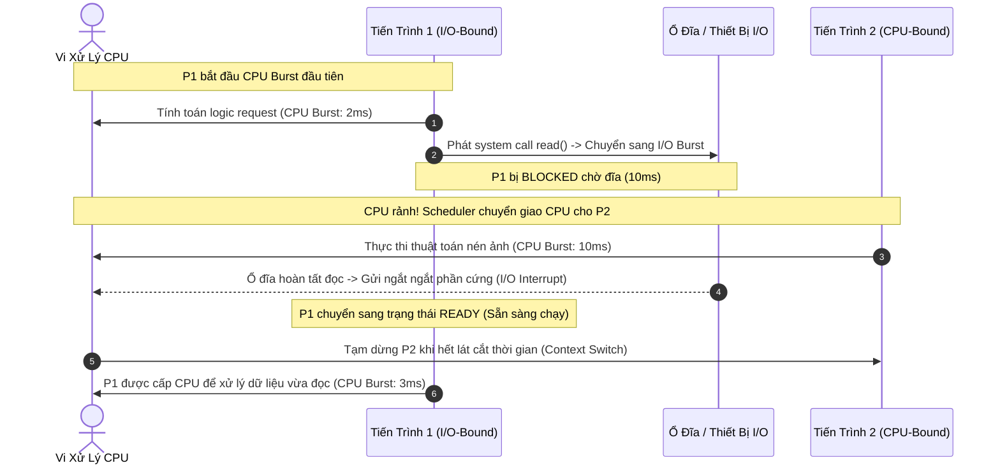

# 1_6_1 CPU Burst vs IO Burst Cycle

> **Khóa học**: Cloud & DevOps Cơ Bản  
> **Phân nhóm**: Domain 1 - Operating System Core Fundamentals  
> **Chủ đề**: 1_6 CPU Scheduling  
> **Checklist đối chiếu**: [1_6_1](../../../CHECKLIST.md#domain-1-operating-system-core-fundamentals-45-items)  
> **Trạng thái**: Hoàn thành  

---

## 1. Khái Niệm Cốt Lõi & Bản Chất Kỹ Thuật (Core Concepts & Technical Deep Dive)

Trong lý thuyết điều phối hệ điều hành (CPU Scheduling), sự thành công của một thuật toán lập lịch phụ thuộc cốt lõi vào việc thấu hiểu bản chất hành vi thực thi của các tiến trình. Mọi chương trình máy tính khi nạp vào bộ nhớ để vận hành đều không tiêu tốn CPU một cách liên tục từ đầu đến cuối, mà vòng đời của chúng là một chuỗi luân phiên liên tục giữa hai trạng thái: **Thực thi tính toán trên CPU (CPU Burst)** và **Chờ đợi nhập/xuất (I/O Burst)**.

```
+-------------------------------------------------------------------------------+
|                 CHU TRÌNH LUÂN PHIÊN CPU BURST VÀ I/O BURST                  |
+-------------------------------------------------------------------------------+
|                                                                               |
|  [ Bắt đầu ]                                                                  |
|       |                                                                       |
|       v                                                                       |
|  +--------------------+                                                       |
|  |     CPU Burst      | ===> Xử lý lệnh, tính toán số học ALU, xử lý logic     |
|  +--------------------+                                                       |
|       |                                                                       |
|       v                                                                       |
|  +--------------------+                                                       |
|  |     I/O Burst      | ===> Ngủ chờ đọc đĩa, nhận gói tin socket mạng, gõ phím |
|  +--------------------+                                                       |
|       |                                                                       |
|       v                                                                       |
|  +--------------------+                                                       |
|  |     CPU Burst      | ===> Xử lý dữ liệu vừa đọc từ I/O                     |
|  +--------------------+                                                       |
|       |                                                                       |
|       v                                                                       |
|      ...                                                                      |
|       |                                                                       |
|       v                                                                       |
|  +--------------------+                                                       |
|  |  Final CPU Burst   | ===> Dọn dẹp tài nguyên và gọi system call exit()     |
|  +--------------------+                                                       |
|       |                                                                       |
|       v                                                                       |
|  [ Kết thúc ]                                                                 |
|                                                                               |
+-------------------------------------------------------------------------------+
```

---

### 1.1. Chu Kỳ Luân Phiên CPU Burst vs I/O Burst (The Burst Cycle)

Theo giáo trình chuẩn mực **OSTEP (Operating Systems: Three Easy Pieces - Chapter 7)** và tài liệu kinh điển của **Silberschatz, Galvin & Gagne (§5.1.1)**:
- **CPU Burst**: Khoảng thời gian liên tục mà một tiến trình độc chiếm vi xử lý để thực thi các chỉ lệnh máy tính (tính toán số học, biến đổi dữ liệu trong thanh ghi và bộ nhớ cache).
- **I/O Burst**: Khoảng thời gian tiến trình chuyển từ trạng thái `Running` sang trạng thái `Blocked`/`Waiting` để chờ đợi một thiết bị ngoại vi hoàn tất tác vụ nhập/xuất (đọc khối dữ liệu từ ổ cứng SSD, chờ gói tin TCP từ card mạng NIC, hoặc chờ tương tác bàn phím/chuột từ người dùng).
- **Quy luật bắt đầu và kết thúc**: Vòng đời của mọi tiến trình **luôn bắt đầu bằng một CPU Burst** (để nạp mã lệnh, khởi tạo ngăn xếp và cấu trúc dữ liệu), tiếp nối bởi một I/O Burst, lặp lại nhiều lần, và **luôn kết thúc bằng một CPU Burst cuối cùng** (để thực hiện lời gọi hệ thống kết thúc như `exit()` nhằm trả lại mã trạng thái kết thúc cho tiến trình cha).

---

### 1.2. Phân Phối Thực Nghiệm Của CPU Burst: Hàm Mũ Phân Rã (Exponential Decay Distribution)

Các nghiên cứu thực nghiệm đo lường trên hàng triệu tiến trình trong hệ điều hành thực tế đã đưa ra một kết luận bất biến: **Độ dài của các CPU burst tuân theo một hàm phân phối tần suất có dạng hàm mũ phân rã (Exponentially Decaying Curve)**:
1. **Số lượng CPU burst cực ngắn chiếm đa số áp đảo**: Đại đa số các CPU burst có thời lượng cực kỳ nhỏ (thường **dưới 8 mili-giây**). Tiến trình chỉ chiếm CPU trong tích tắc để xử lý nhanh một sự kiện (ví dụ: phân tích một gói tin mạng vừa nhận, cập nhật tọa độ chuột, hoặc ghi một dòng log vào bộ đệm) rồi lập tức nhả CPU để chờ đợi tác vụ I/O tiếp theo.
2. **Số lượng CPU burst cực dài chiếm tỷ lệ rất nhỏ (Long Tail)**: Chỉ có một lượng rất nhỏ các CPU burst kéo dài hàng trăm mili-giây hoặc vài giây. Đây là các giai đoạn tính toán nặng nề (ví dụ: giải thuật mã hóa dữ liệu lớn, render đồ họa 3D, hoặc huấn luyện mô hình máy học).

Biểu đồ phân phối này chính là chìa khóa vàng cho các nhà thiết kế bộ lập lịch: Hệ điều hành không cần phải chờ đợi một tiến trình chạy xong toàn bộ vòng đời, mà chỉ cần coi **mỗi CPU burst là một tác vụ con độc lập (independent sub-job)**.

---

### 1.3. Phân Loại Tiến Trình: CPU-Bound vs I/O-Bound

Dựa trên tỷ lệ thời gian tiêu tốn giữa tính toán và nhập/xuất, các tiến trình được phân thành hai nhóm rõ rệt:

| Tiêu chí | Tiến trình Hướng CPU (CPU-Bound Process) | Tiến trình Hướng I/O (I/O-Bound Process) |
| :--- | :--- | :--- |
| **Đặc điểm CPU burst** | Ít CPU burst, nhưng mỗi burst kéo dài liên tục hàng trăm mili-giây hoặc hàng giây. | Rất nhiều CPU burst, nhưng mỗi burst siêu ngắn (chỉ từ vài micro-giây đến vài mili-giây). |
| **Tần suất I/O** | Rất hiếm khi thực hiện I/O; CPU luôn ở trạng thái bận rộn 100%. | Thực hiện I/O liên tục; tiến trình dành phần lớn thời gian nằm trong hàng đợi chờ I/O. |
| **Ví dụ điển hình** | Trình nén video `ffmpeg`, thuật toán băm mật mã, trình biên dịch mã nguồn `gcc`, tính toán khoa học mô phỏng vật lý. | Web server xử lý request, trình chỉnh sửa văn bản (Vim, VSCode), phần mềm quản trị CSDL MySQL, giao diện đồ họa GUI. |
| **Mục tiêu lập lịch** | Tối đa hóa thông lượng tính toán (**Throughput**) và giảm thiểu chi phí chuyển ngữ cảnh (Context Switch Overhead). | Tối thiểu hóa thời gian phản hồi (**Response Time**) để người dùng không cảm nhận độ trễ (Zero Latency). |

---

### 1.4. Cơ Chế Chồng Lấn Tài Nguyên (Overlapping CPU Execution & I/O Wait)

Mục tiêu tối thượng của bộ lập lịch CPU trong hệ điều hành đa nhiệm là **tối đa hóa hiệu suất sử dụng phần cứng (Resource Utilization)**.
- Nếu không có cơ chế lập lịch theo chu kỳ burst: Một tiến trình chạy CPU rồi đứng chờ ổ cứng đọc dữ liệu trong 10ms. Suốt 10ms đó, vi xử lý CPU hoàn toàn nhàn rỗi (CPU Idle) lãng phí chu kỳ xung nhịp.
- Cơ chế lập lịch hiện đại: Ngay khi Tiến trình A phát ra lệnh đọc ổ cứng và bước vào **I/O Burst**, Kernel lập tức can thiệp thu hồi CPU và trao quyền thực thi cho Tiến trình B đang có nhu cầu **CPU Burst**. Khi Tiến trình B chuyển sang I/O burst thì Tiến trình A đã hoàn tất đọc đĩa và sẵn sàng cho CPU burst tiếp theo.
- **Kết quả**: CPU và các bộ điều khiển I/O (I/O Controllers) hoạt động **song song đồng thời (overlapped execution)**, đẩy mức sử dụng hệ thống lên gần 100%.

---

## 2. Ví Dụ Đời Sống Thực Tế Dễ Hiểu (Intuitive Real-World Analogies)

```
===================================================================================
               ĐẦU BẾP NHÀ HÀNG: THÁI RAU (CPU) VÀ CHỜ NƯỚC SÔI (I/O)
===================================================================================

[KỊCH BẢN ĐỜI THẬN]:
  Một đầu bếp nấu món súp không bao giờ đứng thái rau liên tục suốt 10 tiếng đồng hồ.
  Công việc luôn luân phiên:
  1. Thái cà rốt (CPU Burst: 1 phút) ----> Đổ vào nồi nước hầm xương.
  2. Chờ nước sôi (I/O Burst: 15 phút) -> Đầu bếp KHÔNG ĐỨNG CHỜ NHÀN RỖI!
  3. Trong lúc chờ nước sôi, đầu bếp quay sang:
     - Thái khoai tây cho bàn khác (CPU Burst của Tiến trình B).
     - Rửa thịt cho món nướng (CPU Burst của Tiến trình C).
  4. Chuông đồng hồ báo nước đã sôi (Ngắt phần cứng I/O Interrupt)!
  5. Đầu bếp quay lại nêm gia vị (CPU Burst tiếp theo của Tiến trình A).

-----------------------------------------------------------------------------------

[HAI TUÝP NGƯỜI ĐẶC TRƯNG]:
  - NHÀ TOÁN HỌC (CPU-Bound): Cầm bút ngồi cặm cụi giải phương trình phức tạp suốt 5 tiếng
    đồng hồ (CPU Burst cực dài). Thỉnh thoảng mới ngẩng lên uống ngụm nước (I/O ngắn).
  - NHÂN VIÊN VĂN PHÒNG (I/O-Bound): Gõ được 3 chữ trên bàn phím (CPU Burst 2 mili-giây),
    sau đó dừng lại suy nghĩ, đọc tài liệu, chờ sếp gửi tin nhắn Slack (I/O Burst dài).
===================================================================================
```

### 2.1. Phép So Sánh: Đầu Bếp Thái Rau và Chờ Nước Sôi

Hãy tưởng tượng bạn là một đầu bếp chuyên nghiệp trong căn bếp nhà hàng:
- **Thái rau, băm thịt (CPU Burst)**: Đòi hỏi sự tập trung cao độ của não bộ và đôi bàn tay (tương đương với các chỉ lệnh chạy trên thanh ghi và bộ số học ALU của CPU).
- **Đun nước sôi, chờ nướng bánh trong lò (I/O Burst)**: Bạn đặt chiếc bánh vào lò nướng và hẹn giờ 20 phút. Trong suốt 20 phút này, công việc phụ thuộc hoàn toàn vào nhiệt lượng của lò nướng (thiết bị phần cứng ngoại vi), đôi tay của bạn hoàn toàn rảnh rỗi.
- Nếu là một đầu bếp tồi: Bạn sẽ đứng trừng mắt nhìn lò nướng suốt 20 phút mà không làm gì cả (lãng phí CPU).
- Đầu bếp chuyên nghiệp (Hệ điều hành thông minh): Ngay khi cho bánh vào lò, bạn lập tức quay sang bàn bên cạnh để nạo phô mai cho món pizza của khách khác. Nhờ đó, công việc trong bếp diễn ra liên tục không một giây lãng phí.

---

## 3. Kiến Trúc, Luồng Hoạt Động & Hình Ảnh Trực Quan (Architecture & Diagrams)

### 3.1. Hình Ảnh Trực Quan Từ Tài Liệu Chuẩn

Dưới đây là các sơ đồ kiến trúc chính thức mô tả chu trình luân phiên Burst và biểu đồ phân phối thời lượng CPU Burst:

[](https://www.cs.uic.edu/~jbell/CourseNotes/OperatingSystems/images/Chapter5/5_01_CPU_BurstCycle.jpg)  
*Hình 1: Chu trình luân phiên giữa các pha tính toán CPU Burst và chờ đợi I/O Burst trong vòng đời tiến trình (Nguồn: UIC Operating Systems Notes / Silberschatz).*

[](https://www.cs.uic.edu/~jbell/CourseNotes/OperatingSystems/images/Chapter5/5_02_CPU_Histogram.jpg)  
*Hình 2: Biểu đồ tần suất thời lượng CPU Burst tuân theo hàm mũ phân rã với đa số burst có độ dài nhỏ hơn 8ms (Nguồn: UIC Operating Systems Notes / Silberschatz).*

---

### 3.2. Sơ Đồ Cơ Chế Chồng Lấn Luân Phiên (Overlapped Scheduling Timeline)



---

## 4. Code Mẫu Trực Quan Hoặc Dòng Lệnh Thực Chiến (Runnable Sample Code / CLI)

### 4.1. Mã Nguồn C: So Sánh Tiến Trình CPU-Bound vs I/O-Bound (`burst_demo.c`)

Chương trình C dưới đây tạo ra hai luồng chạy song song: một luồng đại diện cho tác vụ **CPU-Bound** (vòng lặp tính toán số học không ngừng nghỉ) và một luồng đại diện cho tác vụ **I/O-Bound** (chuỗi luân phiên liên tục giữa xử lý ngắn và gọi I/O flush xuống đĩa kèm lệnh ngủ `usleep`):

```c
#include <stdio.h>
#include <stdlib.h>
#include <unistd.h>
#include <pthread.h>
#include <fcntl.h>
#include <sys/time.h>

// Luồng 1: Mô phỏng tác vụ CPU-Bound (tính toán số học liên tục)
void* cpu_bound_worker(void* arg) {
    (void)arg;
    printf("[CPU-Bound] Bắt đầu tác vụ tính toán nặng nề...\n");
    volatile unsigned long long count = 0;
    // Chạy vòng lặp tính toán hàng tỷ phép tính để duy trì CPU Burst kéo dài
    for (int i = 0; i < 5; i++) {
        for (unsigned long long j = 0; j < 500000000ULL; j++) {
            count += j;
        }
        printf("[CPU-Bound] Đã hoàn thành 1 chu kỳ CPU Burst kéo dài!\n");
        usleep(1000); // Ngắt cực ngắn
    }
    printf("[CPU-Bound] Hoàn tất toàn bộ tác vụ CPU.\n");
    return NULL;
}

// Luồng 2: Mô phỏng tác vụ I/O-Bound (luân phiên liên tục giữa CPU ngắn và I/O)
void* io_bound_worker(void* arg) {
    (void)arg;
    printf("[I/O-Bound] Bắt đầu tác vụ hướng nhập/xuất...\n");
    int fd = open("/tmp/io_burst_test.tmp", O_WRONLY | O_CREAT | O_TRUNC, 0644);
    if (fd < 0) {
        perror("Lỗi mở file");
        return NULL;
    }

    char buffer[128] = "Du lieu mau dai dien cho mot CPU burst sieu ngan truoc khi ghi xuong dia.\n";
    for (int i = 0; i < 10; i++) {
        // 1. CPU Burst cực ngắn: Chuẩn bị buffer
        buffer[0] = (char)('A' + i);

        // 2. I/O Burst: Ghi dữ liệu và ép đồng bộ hóa xuống đĩa (fsync)
        write(fd, buffer, sizeof(buffer));
        fdatasync(fd); // Chờ đợi đĩa cứng vật lý phản hồi

        // Nghỉ 100ms mô phỏng thời gian chờ I/O mạng hoặc người dùng
        usleep(100000);
        printf("[I/O-Bound] Hoàn thành luân phiên: CPU Burst ngắn -> I/O Burst chờ đợi.\n");
    }

    close(fd);
    unlink("/tmp/io_burst_test.tmp");
    printf("[I/O-Bound] Hoàn tất toàn bộ tác vụ I/O.\n");
    return NULL;
}

int main(void) {
    pthread_t t_cpu, t_io;

    printf("===================================================================\n");
    printf("   MINH HỌA CHU KỲ CPU BURST VS I/O BURST TRONG LẬP TRÌNH ĐỒNG THỜI\n");
    printf("   PID của tiến trình: %d                                         \n", getpid());
    printf("===================================================================\n\n");

    pthread_create(&t_cpu, NULL, cpu_bound_worker, NULL);
    pthread_create(&t_io, NULL, io_bound_worker, NULL);

    pthread_join(t_cpu, NULL);
    pthread_join(t_io, NULL);

    printf("=== Chương trình hoàn tất xuất sắc ===\n");
    return 0;
}
```

---

### 4.2. Quan Sát Bằng Công Cụ Đo Lường Linux CLI (`pidstat` & `schedstat`)

Khi chương trình trên đang chạy, sử dụng tiện ích `pidstat` từ gói `sysstat` để phân biệt rạch ròi mức tiêu thụ CPU và mức độ hoạt động I/O của hai luồng:

```bash
# 1. Đo lường chỉ số CPU của tiến trình (1 giây/lần)
pidstat -u -p $(pgrep burst_demo) 1
```

**Đầu ra phân tích CPU (`pidstat -u`):**
```text
14:40:01      UID       PID    %usr %system  %guest   %wait    %CPU   CPU  Command
14:40:02     1000     91240   98.50    1.50    0.00    0.00  100.00     2  burst_demo
```
*(Tiến trình tiêu thụ gần 100% CPU do luồng CPU-Bound liên tục độc chiếm lõi vi xử lý).*

```bash
# 2. Đo lường chỉ số I/O đọc/ghi của tiến trình (1 giây/lần)
pidstat -d -p $(pgrep burst_demo) 1
```

**Đầu ra phân tích I/O đĩa (`pidstat -d`):**
```text
14:40:03      UID       PID   kB_rd/s   kB_wr/s kB_ccwr/s iodelay  Command
14:40:04     1000     91240      0.00    128.00      0.00      42  burst_demo
```
*(Cột `kB_wr/s` và `iodelay` thể hiện thời gian tiến trình bị hoãn lại để chờ đợi các khối dữ liệu thực tế được ghi xuống thiết bị lưu trữ).*

Bạn cũng có thể tra cứu trực tiếp số liệu thống kê điều phối từ hệ thống tệp `/proc`:
```bash
cat /proc/$(pgrep burst_demo)/schedstat
# Cấu trúc: <cpu_run_time_ns> <runqueue_wait_time_ns> <timeslices_count>
```

---

## 5. Cạm Bẫy Thực Tế & Thực Tiễn Sản Xuất (Production Gotchas & Best Practices)

### 5.1. Cạm Bẫy Chạy Tác Vụ CPU-Bound Trên Event Loop Đơn Luồng (Node.js / Python AsyncIO)

- **Cạm bẫy thực tế**: Các framework như Node.js (V8) hay Python AsyncIO/FastAPI vận hành dựa trên cơ chế non-blocking event loop đơn luồng. Kiến trúc này được tối ưu hóa xuất sắc cho các tác vụ **I/O-Bound** (nơi CPU burst chỉ kéo dài vài micro-giây rồi nhả quyền điều khiển cho epoll).  
  Nếu lập trình viên vô tình đưa một tác vụ **CPU-Bound** kéo dài (như mã hóa ảnh, tính toán hàm băm bcrypt với cost cao, hoặc xử lý JSON payload khổng lồ) vào trực tiếp luồng chính:
  - CPU burst kéo dài hàng giây sẽ **chặn đứng (block) toàn bộ Event Loop**.
  - Mọi yêu cầu I/O khác (dù chỉ cần 1 micro-giây CPU) đều bị treo cứng trong hàng đợi.
- **Biện pháp chuẩn mực (Best Practice)**:
  - Tách biệt rạch ròi: Các tác vụ CPU-Bound bắt buộc phải được chuyển giao sang cụm **Worker Threads** riêng biệt (ví dụ `worker_threads` trong Node.js, `ProcessPoolExecutor` trong Python) hoặc các microservices tính toán chuyên biệt (Go/Rust/C++). Luồng chính chỉ đóng vai trò điều phối I/O.

---

### 5.2. Công Thức Tính Toán Kích Thước Thread Pool Tối Ưu (Brian Goetz Formula)

Trong các ứng dụng backend Java (Spring Boot / Tomcat) hoặc Golang, cấu hình số lượng luồng trong Thread Pool (`ThreadPoolExecutor`) quyết định trực tiếp khả năng chịu tải:
- Nếu toàn bộ tác vụ là **CPU-Bound**: Đặt số lượng luồng vượt quá số lõi CPU ($N_{threads} > N_{cpu}$) sẽ không làm ứng dụng chạy nhanh hơn, mà chỉ gây lãng phí tài nguyên do chi phí chuyển ngữ cảnh (Context Switching Overhead) và làm tràn bộ đệm CPU Cache.
- Nếu tác vụ là **I/O-Bound**: Đặt số lượng luồng bằng số lõi CPU sẽ khiến hệ thống bị thiếu tải trầm trọng (Underutilization), vì các luồng phần lớn thời gian nằm ngủ chờ đĩa và mạng.
- **Công thức vàng của Brian Goetz (Java Concurrency in Practice)**:
  $$N_{\text{threads}} = N_{\text{CPU}} \times U_{\text{CPU}} \times \left(1 + \frac{W}{C}\right)$$
  Trong đó:
  - $N_{\text{CPU}}$: Số lượng lõi vi xử lý khả dụng.
  - $U_{\text{CPU}}$: Mức độ sử dụng CPU mong muốn ($0 \le U_{\text{CPU}} \le 1$).
  - $W/C$: Tỷ lệ giữa **Thời gian chờ đợi I/O (Wait time)** và **Thời gian tính toán CPU (Compute time / CPU Burst)**.  
  *Ví dụ*: Nếu một dịch vụ mất $W = 100\text{ms}$ chờ database và chỉ mất $C = 10\text{ms}$ xử lý CPU ($W/C = 10$), trên máy chủ 8 lõi với mục tiêu 100% CPU, số lượng luồng tối ưu cần cấu hình là $8 \times 1 \times (1 + 10) = 88\text{ threads}$.

---

## 6. Câu Hỏi Củng Cố Kiến Thức (Active Recall Quiz)

<details>
<summary><b>Câu hỏi 1:</b> Tại sao hầu hết mọi tiến trình trong hệ điều hành đều bắt đầu và kết thúc bằng một CPU Burst chứ không phải I/O Burst?</summary>

> **Đáp án:**
> - **Khi bắt đầu**: Tiến trình cần CPU để khởi tạo môi trường thực thi ban đầu (đọc mã lệnh từ bộ nhớ nạp, thiết lập con trỏ ngăn xếp Stack Pointer, khởi tạo các biến toàn cục trong phân vùng BSS/Data) trước khi nó có thể đưa ra quyết định thực hiện bất kỳ lệnh nhập/xuất nào.
> - **Khi kết thúc**: Trước khi biến mất hoàn toàn khỏi bảng tiến trình, tiến trình bắt buộc phải sử dụng CPU để thực thi lời gọi hệ thống dọn dẹp cuối cùng (như `exit()` hoặc `return main()`), ghi nhận mã trạng thái kết thúc (exit code) vào PCB để tiến trình cha có thể thu thập qua hàm `wait()`.
</details>

<details>
<summary><b>Câu hỏi 2:</b> Phân phối thời lượng CPU Burst của các tiến trình trong thực tế có hình dạng như thế nào? Ý nghĩa kỹ thuật của phân phối này đối với thiết kế thuật toán lập lịch là gì?</summary>

> **Đáp án:**
> - **Hình dạng phân phối**: Tuân theo quy luật **hàm mũ phân rã (Exponential Decay)**. Trong đó, số lượng CPU Burst có thời lượng cực ngắn (thường $< 8\text{ms}$) chiếm tỷ lệ áp đảo đại đa số, và chỉ có một tỷ lệ rất nhỏ các CPU Burst kéo dài hàng trăm mili-giây hoặc hàng giây (phần đuôi dài - Long Tail).
> - **Ý nghĩa kỹ thuật**: Bộ lập lịch hệ điều hành nhận biết rằng đa số tiến trình sẽ nhanh chóng tự nguyện nhả CPU sau một khoảng thời gian rất ngắn để đi làm I/O. Do đó, hệ điều hành chỉ cần ưu tiên phục vụ các burst ngắn trước (như trong thuật toán SJF, Round Robin hoặc MLFQ) là có thể tối ưu hóa vượt bậc thời gian phản hồi (Response Time) mà không sợ các tiến trình ngắn chiếm dụng CPU quá lâu.
</details>

<details>
<summary><b>Câu hỏi 3:</b> Một kỹ sư DevOps giám sát một microservice chạy trên Linux thấy CPU Usage của container liên tục chạm ngưỡng 99%, trong khi thông số I/O Wait (iowait) xấp xỉ 0%. Ứng dụng này thuộc dạng CPU-Bound hay I/O-Bound? Kỹ sư nên thực hiện giải pháp tối ưu hóa nào?</summary>

> **Đáp án:**
> - **Phân loại**: Đây là ứng dụng thuần túy **CPU-Bound** (tiêu tốn toàn bộ thời gian vào các phép toán trên bộ xử lý, hầu như không phải chờ đợi các thiết bị ngoại vi hay mạng).
> - **Giải pháp tối ưu hóa**:
>   1. Không nên tăng số lượng luồng xử lý đồng thời vượt quá số lõi CPU, vì sẽ gây thêm nghẽn do Context Switch.
>   2. Tối ưu hóa thuật toán tính toán trong mã nguồn (profiling bằng công cụ `perf` để tìm hàm tốn CPU nhất).
>   3. Mở rộng tài nguyên theo chiều ngang (**Scale Out** — tăng số lượng pod/container replica) hoặc tăng số lượng vCPU của máy chủ (**Scale Up**).
</details>

---

## 7. 📚 Nguồn Tài Liệu Chính Thống (Tier-1 Official References)

- [OSTEP Chapter 7: CPU Scheduling (Remzi H. Arpaci-Dusseau and Andrea C. Arpaci-Dusseau)](https://pages.cs.wisc.edu/~remzi/OSTEP/cpu-sched.pdf) - Giáo trình hệ điều hành chuẩn mực phân tích chu trình CPU/IO Burst và cơ chế chồng lấn tài nguyên (Mục 7.8, trang 7-8).
- [Linux Kernel Documentation: Scheduler Statistics](https://docs.kernel.org/scheduler/sched-stats.html) - Tài liệu kỹ thuật chính thức từ Linux Kernel Documentation về cấu trúc `/proc/[pid]/schedstat` và số liệu thống kê luân chuyển CPU burst.
- [Linux Programmer's Manual: proc(5)](https://man7.org/linux/man-pages/man5/proc.5.html) - Đặc tả cấu trúc các tệp tin hệ thống ảo `/proc/[pid]/stat` và thông tin trạng thái lập lịch luồng trên Linux.
- [Linux User's Manual: pidstat(1)](https://man7.org/linux/man-pages/man1/pidstat.1.html) - Hướng dẫn sử dụng công cụ đo lường mức độ sử dụng CPU (`-u`) và thông lượng I/O (`-d`) của tiến trình trên Linux.
- [Linux Programmer's Manual: sched(7)](https://man7.org/linux/man-pages/man7/sched.7.html) - Tổng quan cấu trúc và cơ chế điều phối tiến trình trên nhân Linux.
