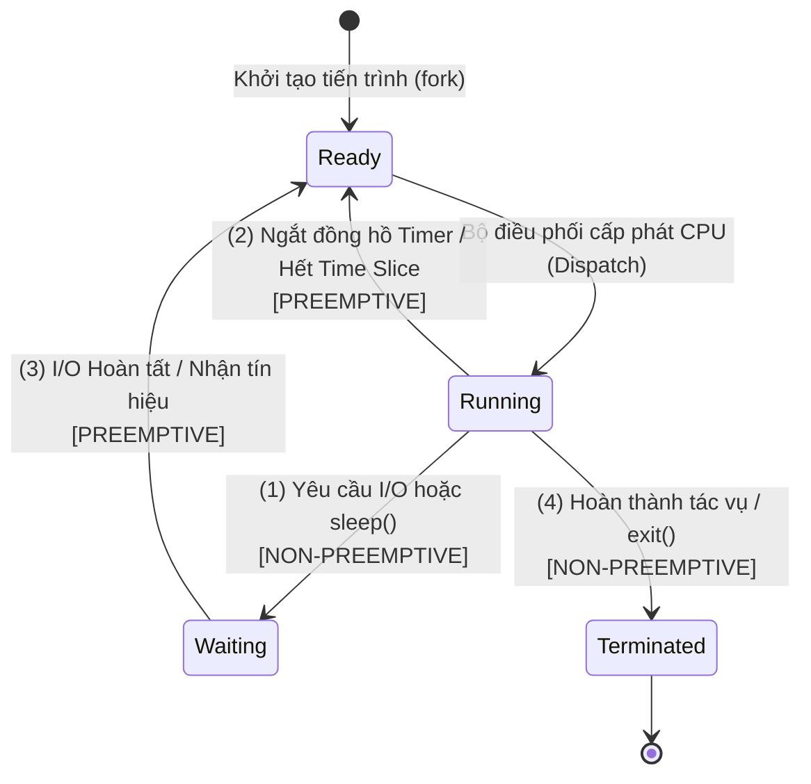
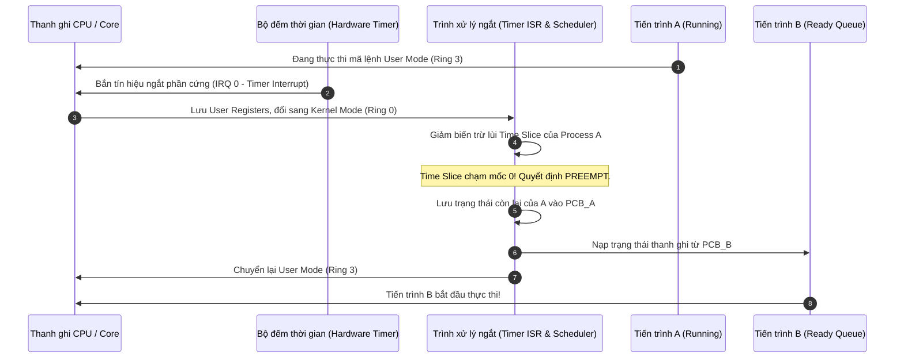

# 1_6_2 Preemptive vs Non-Preemptive Scheduling

> **Khóa học**: Cloud & DevOps Cơ Bản  
> **Phân nhóm**: Domain 1 - Operating System Core Fundamentals  
> **Chủ đề**: 1_6 CPU Scheduling  
> **Checklist đối chiếu**: [1_6_2](../../../CHECKLIST.md#domain-1-operating-system-core-fundamentals-45-items)  
> **Trạng thái**: Hoàn thành  

---

## 1. Khái Niệm Cốt Lõi & Bản Chất Kỹ Thuật (Core Concepts & Technical Deep Dive)

Trong hệ điều hành đa nhiệm (Multitasking Operating System), bộ điều phối CPU (CPU Scheduler) liên tục phải đưa ra quyết định: *Tiến trình nào sẽ được trao quyền sử dụng CPU tiếp theo, và trong bao lâu?* Dựa trên cách thức CPU được thu hồi từ một tiến trình đang chạy, toàn bộ các giải thuật điều phối được phân chia thành hai trường phái nền tảng: **Điều phối không chiếm dụng (Non-Preemptive / Cooperative Scheduling)** và **Điều phối chiếm dụng (Preemptive Scheduling)**.

```
                      +-------------------------------------------------+
                      |        PHÂN LOẠI ĐIỀU PHỐI CPU THEO CƠ CHẾ      |
                      +------------------------+------------------------+
                                               |
              +--------------------------------+--------------------------------+
              |                                                                 |
              v                                                                 v
  1. NON-PREEMPTIVE (HỢP TÁC)                                       2. PREEMPTIVE (CHIẾM DỤNG)
  ---------------------------                                       --------------------------
  - Tiến trình giữ CPU cho đến khi                                  - Hệ điều hành có quyền ngắt
    tự nguyện từ bỏ (Exit/IO/Yield).                                  ngang tiến trình đang chạy.
  - Phụ thuộc vào "sự tử tế" của code.                              - Được kích hoạt bởi Ngắt đồng hồ
  - Nguy cơ: Vòng lặp vô hạn làm treo                                 phần cứng (Hardware Timer Interrupt).
    toàn bộ hệ thống.                                               - Đảm bảo công bằng và tính phản hồi
  - Dùng trong: Windows 3.1, Mac OS 9.                                (Hệ điều hành hiện đại: Linux, Win NT).
```

---

### 1.1. Bốn Thời Điểm Ra Quyết Định Điều Phối (The 4 Scheduling Decision Points)

Theo lý thuyết hệ điều hành (Silberschatz §5.1.3), quyết định điều phối CPU có thể diễn ra tại đúng **4 thời điểm chuyển đổi trạng thái tiến trình**:

1. **Khi tiến trình chuyển từ trạng thái `Running` sang `Waiting`**:
   - Xảy ra khi tiến trình phát sinh một yêu cầu I/O (ví dụ: đọc đĩa, nhận gói tin socket) hoặc gọi hàm hệ thống chờ tiến trình con (`wait()`, `sleep()`).
   - *Phân loại*: **Không chiếm dụng (Non-preemptive)**, vì bản thân tiến trình không thể tiếp tục thực thi và tự nguyện rời khỏi CPU.
2. **Khi tiến trình chuyển từ trạng thái `Running` sang `Ready`**:
   - Xảy ra khi xuất hiện một ngắt phần cứng (Hardware Interrupt), đặc biệt là ngắt đồng hồ (Timer Interrupt) báo hiệu lát cắt thời gian (Time Slice) đã cạn, hoặc có tiến trình độ ưu tiên cao hơn thức dậy.
   - *Phân loại*: **Chiếm dụng (Preemptive)**, hạt nhân cưỡng chế tước quyền điều khiển CPU của tiến trình.
3. **Khi tiến trình chuyển từ trạng thái `Waiting` sang `Ready`**:
   - Xảy ra khi thao tác I/O hoàn tất hoặc sự kiện mà tiến trình chờ đợi đã xảy ra (ví dụ: đĩa trả về dữ liệu, socket nhận đủ byte). Tiến trình chuyển về hàng đợi `Ready`. Nếu tiến trình này có độ ưu tiên cao hơn tiến trình đang `Running`, bộ điều phối có thể ngắt ngay tiến trình hiện tại.
   - *Phân loại*: **Chiếm dụng (Preemptive)**.
4. **Khi tiến trình kết thúc (`Terminated`)**:
   - Tiến trình hoàn thành khối lệnh hoặc gọi `exit()`, giải phóng hoàn toàn tài nguyên CPU.
   - *Phân loại*: **Không chiếm dụng (Non-preemptive)**.

> **Định lý phân loại (Classification Rule)**:  
> - Nếu một hệ thống chỉ thực hiện điều phối tại **tình huống 1 và 4**: Đó là mô hình **Non-preemptive (Cooperative)**.  
> - Nếu hệ thống thực hiện điều phối tại **tình huống 2 hoặc 3**: Đó là mô hình **Preemptive**.

---

### 1.2. Cơ Chế Điều Phối Hợp Tác (Non-Preemptive / Cooperative Scheduling)

- **Nguyên lý**: Khi CPU được trao cho một tiến trình, hệ điều hành **không thể** can thiệp để lấy lại quyền kiểm soát trừ khi tiến trình đó tự nguyện trả lại.
- **Cách thức nhượng quyền**:
  1. Gọi lệnh kết thúc chương trình (`exit()`).
  2. Bị chặn bởi thao tác vào/ra I/O hoặc đồng bộ hóa khóa.
  3. Chủ động nhường CPU thông qua lời gọi hàm hệ thống chuyên dụng như `sched_yield(2)` trong POSIX.
- **Hạn chế trí mạng**: Hệ thống hoàn toàn phụ thuộc vào sự đúng đắn của lập trình viên. Nếu một tiến trình chứa một lỗi vòng lặp vô hạn (`while(1) { /* không I/O */ }`), toàn bộ máy tính sẽ bị "đóng băng" vĩnh viễn, người dùng không thể di chuột hay bấm bàn phím để tắt ứng dụng!

---

### 1.3. Cơ Chế Điều Phối Chiếm Dụng (Preemptive Scheduling)

- **Nguyên lý**: Hệ điều hành giữ quyền tối thượng trên CPU. Bằng cách thiết lập bộ đếm thời gian phần cứng (Hardware Timer), cứ sau một khoảng thời gian cố định (ví dụ: vài miligiây), phần cứng sẽ kích hoạt một **Ngắt đồng hồ (Timer Interrupt)**.
- **Chu trình ngắt chiếm dụng (Preemption Cycle)**:
  1. Phần cứng CPU tạm dừng tiến trình người dùng đang chạy ở Ring 3 (User Mode).
  2. Chuyển đổi Mode Bit sang Ring 0 (Kernel Mode) và nhảy vào trình xử lý ngắt (Timer Interrupt Handler) của hệ điều hành.
  3. Bộ lập lịch (Scheduler) kiểm tra xem tiến trình hiện tại đã chạy hết định mức thời gian (Time Slice / Quantum) chưa.
  4. Nếu hết giờ, bộ điều phối lưu lại toàn bộ trạng thái thanh ghi của tiến trình cũ vào Process Control Block (PCB) và thực hiện **Chuyển ngữ cảnh (Context Switch)** để trao CPU cho tiến trình tiếp theo trong hàng đợi `Ready`.
- **Ưu điểm**:
  - **Bảo vệ hệ thống**: Một tiến trình bị lỗi vòng lặp vô hạn chỉ làm tốn phần quota thời gian của chính nó, không bao giờ làm tê liệt hệ thống.
  - **Đảm bảo tính phản hồi (Responsiveness)**: Các tác vụ tương tác giao diện người dùng (UI, chuột, bàn phím) luôn được ưu tiên chen ngang để phản hồi tức thì.

---

## 2. Ví Dụ Đời Sống Thực Tế Dễ Hiểu (Intuitive Real-World Analogies)

```
        HAI PHƯƠNG THỨC DI CHUYỂN: XE BUÝT VS. TAXI ĐỒNG HỒ CƯỚC

  [ XE BUÝT LIÊN TỈNH (NON-PREEMPTIVE) ]     [ TAXI CÓ ĐỒNG HỒ TÍNH CƯỚC (PREEMPTIVE) ]
       +-------------------------+                 +-------------------------+
       | [Khách A]   [Khách B]   |                 | [Khách A] (Hết 10 phút) |
       +-------------------------+                 +-------------------------+
       Bác tài chỉ dừng xe khi:                    Đồng hồ reo "Tít tít!" (Timer Interrupt).
       1. Tới bến cuối (Exit)                      Tài xế: "Hết giờ thuê, mời quý khách
       2. Xe hết xăng (I/O Block)                  xuống xe để người khác đi tiếp!"
       3. Khách tự xin xuống (sched_yield)         ===> Mọi khách hàng đều được phục vụ!
```

### 2.1. Phép So Sánh: Xe Buýt Tuyến Cố Định vs. Taxi Tính Giờ Định Kỳ
- **Xe buýt liên tỉnh không dừng (Non-Preemptive)**: 
  Bạn lên một chuyến xe buýt độc quyền. Bác tài cam kết xe chỉ dừng khi tới bến cuối cùng của hành trình (`exit()`) hoặc xe hỏng hóc hết xăng giữa đường (`I/O Block`). Nếu một hành khách xấu tính cố tình ngồi lì trên ghế không chịu xuống bến, những người đứng chờ ở trạm tiếp theo sẽ không bao giờ được bước lên xe.
- **Taxi có đồng hồ tính giờ ngắt quãng (Preemptive)**:
  Mỗi người bước lên taxi được quy định thời gian tối đa là 15 phút. Trên xe gắn một chiếc đồng hồ báo thức phần cứng (Timer Interrupt). Đúng 15 phút trôi qua, chuông reo vang! Bác tài lịch sự mời bạn bước xuống trạm dừng kế tiếp để đón vị khách khác đang xếp hàng, và bạn sẽ quay lại cuối hàng đợi nếu vẫn cần đi tiếp. Nhờ đó, cả 10 người đều di chuyển được từng chặng nhỏ mà không ai bị bỏ quên.

---

## 3. Kiến Trúc, Luồng Hoạt Động & Hình Ảnh Trực Quan (Architecture & Diagrams)

### 3.1. Sơ Đồ Chuyển Trạng Thái Và 4 Điểm Ra Quyết Định Điều Phối



### 3.2. Trình Tự Thời Gian Xử Lý Ngắt Chiếm Dụng (Preemption via Hardware Timer)



---

## 4. Code Mẫu Trực Quan Hoặc Dòng Lệnh Thực Chiến (Runnable Sample Code / CLI)

### 4.1. Mã Nguồn C: Cơ Chế Tự Nguyện Nhường CPU Với `sched_yield(2)`

> ⚠️ Đoạn mã nguồn C dưới đây minh họa sự khác biệt giữa việc một luồng chiếm dụng CPU liên tục và việc chủ động tự nguyện nhường quyền điều phối bằng system call chuẩn POSIX `sched_yield(2)`.

```c
#define _GNU_SOURCE
#include <stdio.h>
#include <stdlib.h>
#include <unistd.h>
#include <sched.h>
#include <pthread.h>
#include <time.h>

void* cooperative_worker(void* arg) {
    const char* name = (const char*)arg;
    for (int i = 0; i < 5; i++) {
        printf("[%s] Đang thực thi một phần công việc (bước %d/5)...\n", name, i + 1);
        
        // CHỦ ĐỘNG NHƯỜNG CPU (Non-Preemptive Cooperative Yield)
        // Đưa luồng hiện tại về cuối hàng đợi của độ ưu tiên tương ứng
        sched_yield();
    }
    printf("[%s] Hoàn thành toàn bộ công việc!\n", name);
    return NULL;
}

int main(void) {
    pthread_t t1, t2;

    printf("=== BẮT ĐẦU THỬ NGHIỆM ĐIỀU PHỐI HỢP TÁC VỚI SCHED_YIELD ===\n\n");

    pthread_create(&t1, NULL, cooperative_worker, "Worker 1");
    pthread_create(&t2, NULL, cooperative_worker, "Worker 2");

    pthread_join(t1, NULL);
    pthread_join(t2, NULL);

    printf("\n=== CẢ HAI LUỒNG ĐÃ KẾT THÚC THÀNH CÔNG ===\n");
    return 0;
}
```

---

### 4.2. Quan Sát Chuyển Ngữ Cảnh Tự Nguyện vs Cưỡng Chế Trên Linux CLI

Trong Linux, hệ điều hành theo dõi rất chi tiết hai loại chuyển đổi ngữ cảnh:
- **Voluntary Context Switches (`cswch/s`)**: Số lần chuyển ngữ cảnh **tự nguyện** (tương ứng với Non-Preemptive, ví dụ: chờ I/O hoặc gọi `sched_yield`).
- **Non-voluntary / Involuntary Context Switches (`nvcswch/s`)**: Số lần chuyển ngữ cảnh **cưỡng chế / chiếm dụng** (tương ứng với Preemptive, do hết Time Slice hoặc bị tiến trình ưu tiên cao hơn cướp CPU).

Sử dụng công cụ `pidstat` (thuộc gói `sysstat`) hoặc soi trực tiếp file `/proc/<PID>/status`:

```bash
# 1. Biên dịch và chạy chương trình thử nghiệm
gcc -Wall -pthread -o yield_demo yield_demo.c
./yield_demo &
PID=$!

# 2. Quan sát trực tiếp số lần chuyển đổi ngữ cảnh của tiến trình
grep -E "voluntary_ctxt_switches|nonvoluntary_ctxt_switches" /proc/$PID/status

# 3. Hoặc giám sát theo thời gian thực mỗi 1 giây bằng pidstat
pidstat -w -p $PID 1
```

**Đầu ra phân tích minh họa (Illustrative Output):**
```text
Linux 6.8.0 (ubuntu)    11/14/2026      _x86_64_        (4 CPU)

07:45:01 UID       PID   cswch/s  nvcswch/s  Command
07:45:02 1000     4218     12.00       0.00  yield_demo
07:45:03 1000     4218      0.00     145.00  cpu_stress_app
```
> **Phân tích kết quả**:
> - `yield_demo` ghi nhận chỉ số `cswch/s` cao vì liên tục chủ động gọi `sched_yield()`.
> - Ứng dụng tính toán ngốn CPU `cpu_stress_app` ghi nhận chỉ số `nvcswch/s` cao (145 lần/giây) vì liên tục bị bộ điều phối nhân Linux cưỡng chế chiếm dụng (Preempted) khi hết hạn mức lát cắt thời gian.

---

## 5. Cạm Bẫy Thực Tế & Thực Tiễn Sản Xuất (Production Gotchas & Best Practices)

### 5.1. Cạm Bẫy Tranh Chấp Dữ Liệu Khi Chuyển Sang Cơ Chế Chiếm Dụng (Concurrency Bugs)

- **Vấn đề kỹ thuật**: Trong mô hình Non-preemptive, một tiến trình có thể an tâm cập nhật một danh sách liên kết mà không sợ bị luồng khác xen ngang (miễn là nó không gọi I/O trong lúc đó).
- Khi chuyển sang mô hình Preemptive, một ngắt đồng hồ có thể xảy ra **tại bất kỳ chu kỳ lệnh máy nào**, ngay cả khi tiến trình đang ghi dở nửa con trỏ bộ nhớ! Nếu không sử dụng các cơ chế đồng bộ hóa phù hợp (Mutex, Spinlock), dữ liệu sẽ bị hỏng vĩnh viễn (Race Condition).

### 5.2. Khái Niệm Chiếm Dụng Nhân Hệ Điều Hành (Kernel Preemption - `CONFIG_PREEMPT`)

- Trong các phiên bản Unix cổ điển, mã nguồn thực thi trong Kernel Mode là **bất khả xâm phạm (Non-preemptive Kernel)**: Nếu một tiến trình đang gọi system call, không tiến trình nào được phép cướp CPU cho tới khi system call đó hoàn tất hoặc tiến trình tự ngủ.
- Trên Linux hiện đại, cấu hình **`CONFIG_PREEMPT`** cho phép một tác vụ có độ ưu tiên cao (Real-Time task) **chiếm dụng CPU ngay cả khi CPU đang chạy mã hạt nhân**, ngoại trừ các đoạn mã đang giữ `spinlock`. Điều này giúp giảm độ trễ đáp ứng (Latency) của hệ điều hành từ vài miligiây xuống dưới 50 microgiây, cực kỳ quan trọng cho các hệ thống viễn thông và robot tự hành.

---

## 6. Câu Hỏi Củng Cố Kiến Thức (Active Recall Quiz)

<details>
<summary><b>Câu hỏi 1:</b> Tại sao các hệ điều hành giao diện đồ họa hiện đại (Windows, Linux, macOS) bắt buộc phải sử dụng cơ chế điều phối Preemptive thay vì Non-preemptive?</summary>

> **Đáp án:**
> Bởi vì trong môi trường tương tác đồ họa của người dùng, nếu một ứng dụng bị lỗi vòng lặp vô hạn hoặc thực hiện một tác vụ tính toán nặng mà không nhả CPU, mô hình Non-preemptive sẽ khiến toàn bộ giao diện bị treo cứng (con trỏ chuột đứng im, bàn phím không nhận phím tắt). Cơ chế Preemptive dựa trên ngắt đồng hồ phần cứng cho phép hệ điều hành luôn giành lại quyền kiểm soát để xử lý sự kiện giao diện và phân bổ lại CPU công bằng cho các tiến trình khác.
</details>

<details>
<summary><b>Câu hỏi 2:</b> Trong 4 thời điểm chuyển trạng thái của tiến trình (Silberschatz §5.1.3), những thời điểm nào xác định bản chất của cơ chế điều phối là Preemptive?</summary>

> **Đáp án:**
> Đó là thời điểm **(2) Chuyển từ Running sang Ready** (do ngắt đồng hồ hoặc hết Time Slice) và thời điểm **(3) Chuyển từ Waiting sang Ready** (do thao tác I/O hoàn tất và tiến trình ưu tiên cao hơn chen ngang tiến trình đang chạy). Nếu hệ điều hành chỉ điều phối ở thời điểm (1) và (4), nó là Non-preemptive; chỉ cần điều phối ở thời điểm (2) hoặc (3) thì hệ thống đó là Preemptive.
</details>

<details>
<summary><b>Câu hỏi 3:</b> Khi quan sát qua lệnh <code>pidstat -w</code>, sự khác biệt giữa hai chỉ số <code>cswch/s</code> và <code>nvcswch/s</code> phản ánh điều gì về hành vi của tiến trình?</summary>

> **Đáp án:**
> - `cswch/s` (Voluntary context switch): Số lần tiến trình tự nguyện nhả CPU mỗi giây do phải chờ một tài nguyên không có sẵn (như đọc đĩa, nhận socket mạng, chờ khóa mutex) hoặc gọi `sched_yield()`.
> - `nvcswch/s` (Non-voluntary context switch): Số lần tiến trình bị hệ điều hành cưỡng bức chiếm dụng CPU mỗi giây do đã tiêu thụ hết định mức thời gian (Time Slice) hoặc bị một tiến trình có độ ưu tiên cao hơn chiếm chỗ.
</details>

---

## 7. 📚 Nguồn Tài Liệu Chính Thống (Tier-1 Official References)

- [OSTEP Chapter 6: Mechanism: Limited Direct Execution](https://pages.cs.wisc.edu/~remzi/OSTEP/cpu-mechanisms.pdf) - Cơ chế ngắt đồng hồ phần cứng (Timer Interrupt) và chuyển ngữ cảnh chiếm dụng trong hệ điều hành.
- [OSTEP Chapter 7: Scheduling: Introduction](https://pages.cs.wisc.edu/~remzi/OSTEP/cpu-sched.pdf) - Phân biệt bản chất điều phối Cooperative vs Preemptive và các chính sách lập lịch.
- [Linux Programmer's Manual - sched_yield(2)](https://man7.org/linux/man-pages/man2/sched_yield.2.html) - Đặc tả kỹ thuật lời gọi hệ thống tự nguyện nhường CPU chuẩn POSIX.
- [Linux Kernel Documentation - Kernel Preemption (CONFIG_PREEMPT)](https://docs.kernel.org/kernel-hacking/hacking.html) - Cơ chế chiếm dụng mã nhân hệ điều hành Linux.