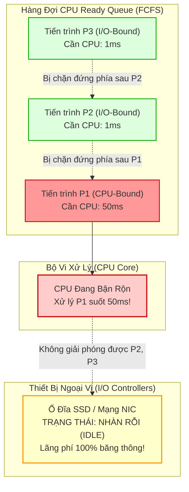

# 1_6_3 First-Come First-Served Scheduling

> **Khóa học**: Cloud & DevOps Cơ Bản  
> **Phân nhóm**: Domain 1 - Operating System Core Fundamentals  
> **Chủ đề**: 1_6 CPU Scheduling  
> **Checklist đối chiếu**: [1_6_3](../../../CHECKLIST.md#domain-1-operating-system-core-fundamentals-45-items)  
> **Trạng thái**: Hoàn thành  

---

## 1. Khái Niệm Cốt Lõi & Bản Chất Kỹ Thuật (Core Concepts & Technical Deep Dive)

Trong lịch sử phát triển của các hệ thống xử lý hàng loạt (Batch Processing Systems), thuật toán lập lịch CPU đơn giản và trực quan nhất chính là **First-Come, First-Served (FCFS)** — hay còn được gọi là **First-In, First-Out (FIFO)**.

### 1.1. Bản Chất Kỹ Thuật Của Lập Lịch FCFS

- **Cơ chế hàng đợi FIFO**: Khi một tiến trình chuyển sang trạng thái `Ready`, Khối Điều Khiển Tiến Trình (Process Control Block - PCB) của nó được nối vào đuôi của hàng đợi sẵn sàng (Ready Queue). Bộ điều phối (Scheduler) luôn lấy tiến trình đứng ở đầu hàng đợi (Head of Queue) để trao quyền kiểm soát CPU.
- **Tính chất Không Chiếm Quyền (Non-Preemptive)**: FCFS là một thuật toán lập lịch **phi tước đoạt**. Một khi CPU đã được cấp phát cho một tiến trình, tiến trình đó sẽ giữ chặt CPU cho đến khi nó tự nguyện từ bỏ quyền thực thi — hoặc do hoàn tất toàn bộ công việc và gọi lời gọi hệ thống kết thúc (`exit()`), hoặc do phát sinh yêu cầu I/O (chuyển sang trạng thái `Blocked`). Hệ điều hành không bao giờ ngắt ngang một tiến trình đang chạy FCFS để nhường quyền cho tiến trình khác.

```
+-------------------------------------------------------------------------------+
|                    CƠ CHẾ ĐIỀU PHỐI KHÔNG TƯỚC ĐOẠT (FCFS)                    |
+-------------------------------------------------------------------------------+
|                                                                               |
|  [ Ready Queue FIFO ]                                                         |
|  +--------+   +--------+   +--------+           +-------------+               |
|  |   P3   |-->|   P2   |-->|   P1   | ========> |     CPU     |               |
|  | (Đuôi) |   | (Giữa) |   | (Đầu)  |           +-------------+               |
|  +--------+   +--------+   +--------+                  |                      |
|                                                        v                      |
|                                             Thực thi đến khi HOÀN TẤT         |
|                                             hoặc tự nguyện xin I/O            |
+-------------------------------------------------------------------------------+
```

---

### 1.2. Các Thước Đo Hiệu Năng Lập Lịch Chuẩn Mực

Để đánh giá chất lượng của một thuật toán điều phối CPU, giáo trình **OSTEP (Chương 7, Mục 7.2)** định nghĩa các công thức toán học chuẩn tắc:

1. **Thời Gian Hoàn Thành (Turnaround Time - $T_{\text{turnaround}}$)**:  
   Khoảng thời gian từ lúc tiến trình xuất hiện trong hệ thống (Arrival Time) cho đến khi nó hoàn tất trọn vẹn (Completion Time):
   $$T_{\text{turnaround}} = T_{\text{completion}} - T_{\text{arrival}}$$

2. **Thời Gian Chờ Đợi (Waiting Time - $T_{\text{waiting}}$)**:  
   Tổng thời gian tiến trình phải nằm chờ thụ động trong Ready Queue mà không được cấp phát CPU:
   $$T_{\text{waiting}} = T_{\text{turnaround}} - T_{\text{burst}}$$

3. **Thời Gian Phản Hồi (Response Time - $T_{\text{response}}$)**:  
   Khoảng thời gian từ lúc tiến trình xuất hiện cho đến lần đầu tiên nó được cấp CPU để bắt đầu phản hồi:
   $$T_{\text{response}} = T_{\text{first\_run}} - T_{\text{arrival}}$$

---

### 1.3. Hiệu Ứng Đoàn Tàu (The Convoy Effect)

Mặc dù FCFS cài đặt cực kỳ đơn giản và không tốn chi phí tính toán thuật toán, điểm yếu chí mạng của nó là hiện tượng **Hiệu Ứng Đoàn Tàu (Convoy Effect)** — được công bố chính thức bởi **Blasgen et al. (ACM SIGOPS, 1979)**:

> **Định nghĩa Convoy Effect**:  
> Là hiện tượng mà một tiến trình tiêu tốn CPU khổng lồ (CPU-Bound / Heavyweight Process) chiếm giữ vi xử lý quá lâu, buộc toàn bộ các tiến trình ngắn hơn (thường là các tiến trình hướng nhập/xuất I/O-Bound) phải xếp hàng chờ đợi kéo dài phía sau.

**Hậu quả kỹ thuật nghiêm trọng của Convoy Effect**:
- **Thời gian chờ trung bình tăng vọt**: Các tiến trình chỉ cần 1 micro-giây CPU để tương tác với người dùng nhưng phải chờ hàng chục giây sau một tiến trình tính toán nặng.
- **Lãng phí thiết bị ngoại vi (Low Device Utilization)**: Trong khi tiến trình CPU-Bound đang ngấu nghiến vi xử lý, các thiết bị I/O (ổ cứng, card mạng) rơi vào trạng thái hoàn toàn nhàn rỗi vì các tiến trình I/O-Bound đang bị kẹt cứng trong Ready Queue. Khi tiến trình CPU-Bound cuối cùng chuyển sang I/O, toàn bộ các tiến trình ngắn đồng loạt ùa vào CPU trong tích tắc rồi lại ùa ra tranh giành I/O, tạo nên sự mất cân bằng luân phiên gay gắt.

---

### 1.4. Bài Toán Đối Chiếu Định Lượng: Sự Nhạy Cảm Của FCFS Với Thứ Tự Tiến Trình

Xét hệ thống gồm 3 tiến trình cùng đến tại thời điểm $T_{\text{arrival}} = 0$:
- $P_1$: Thời lượng CPU Burst $BT_1 = 24\text{ ms}$ (tiến trình nặng CPU-Bound).
- $P_2$: Thời lượng CPU Burst $BT_2 = 3\text{ ms}$ (tiến trình tương tác ngắn).
- $P_3$: Thời lượng CPU Burst $BT_3 = 3\text{ ms}$ (tiến trình tương tác ngắn).

#### Trường Hợp A: Thứ tự đến là $P_1 \to P_2 \to P_3$ (Bị ảnh hưởng nặng bởi Convoy Effect)

```
Biểu đồ Gantt (Gantt Chart):
+-------------------------------------------------------+-------+-------+
|                          P1                           |  P2   |  P3   |
+-------------------------------------------------------+-------+-------+
0                                                      24      27      30
```

- **Thời gian hoàn thành ($T_{\text{completion}}$)**: $P_1 = 24$, $P_2 = 27$, $P_3 = 30$.
- **Thời gian chờ ($T_{\text{waiting}}$)**:
  - $P_1 = 0\text{ ms}$
  - $P_2 = 24\text{ ms}$ (chờ $P_1$ chạy xong)
  - $P_3 = 27\text{ ms}$ (chờ cả $P_1$ và $P_2$)
- **Thời gian chờ trung bình (Average Waiting Time)**:
  $$\bar{T}_{\text{waiting}} = \frac{0 + 24 + 27}{3} = \frac{51}{3} = \mathbf{17.0\text{ ms}}$$
- **Thời gian hoàn thành trung bình (Average Turnaround Time)**:
  $$\bar{T}_{\text{turnaround}} = \frac{24 + 27 + 30}{3} = \frac{81}{3} = \mathbf{27.0\text{ ms}}$$

---

#### Trường Hợp B: Đảo thứ tự đến thành $P_2 \to P_3 \to P_1$ (Tiến trình ngắn chạy trước)

```
Biểu đồ Gantt (Gantt Chart):
+-------+-------+-------------------------------------------------------+
|  P2   |  P3   |                          P1                           |
+-------+-------+-------------------------------------------------------+
0       3       6                                                      30
```

- **Thời gian hoàn thành ($T_{\text{completion}}$)**: $P_2 = 3$, $P_3 = 6$, $P_1 = 30$.
- **Thời gian chờ ($T_{\text{waiting}}$)**:
  - $P_2 = 0\text{ ms}$
  - $P_3 = 3\text{ ms}$
  - $P_1 = 6\text{ ms}$
- **Thời gian chờ trung bình (Average Waiting Time)**:
  $$\bar{T}_{\text{waiting}} = \frac{0 + 3 + 6}{3} = \frac{9}{3} = \mathbf{3.0\text{ ms}}$$
- **Thời gian hoàn thành trung bình (Average Turnaround Time)**:
  $$\bar{T}_{\text{turnaround}} = \frac{3 + 6 + 30}{3} = \frac{39}{3} = \mathbf{13.0\text{ ms}}$$

> 💡 **Kết luận số học đắt giá**:  
> Chỉ cần thay đổi thứ tự đến của các tiến trình, thời gian chờ trung bình giảm từ **$17\text{ms}$ xuống còn $3\text{ms}$ (nhanh hơn gần 6 lần!)**. Điều này chứng minh thuật toán FCFS cực kỳ nhạy cảm và phụ thuộc hoàn toàn vào may rủi của thứ tự tiến trình đến ban đầu.

---

## 2. Ví Dụ Đời Sống Thực Tế Dễ Hiểu (Intuitive Real-World Analogies)

```
===================================================================================
             HIỆU ỨNG ĐOÀN TÀU (CONVOY EFFECT) TẠI QUẦY THU NGÂN SIÊU THỊ
===================================================================================

[KỊCH BẢN THỰC TẾ]:
  Bạn bước vào siêu thị vào một buổi chiều bận rộn chỉ để mua đúng 1 chai nước ngọt.
  Thời gian thanh toán quét mã chai nước của bạn chỉ mất đúng 5 giây (P2: Burst cực ngắn).

  Thế nhưng tại quầy thu ngân duy nhất (CPU Core) áp dụng nguyên tắc "Ai đến trước phục vụ trước" (FCFS):
  Đứng ngay trước bạn là một người đẩy chiếc xe chở đầy ắp 200 món hàng hóa (P1: Burst khổng lồ).
  Thu ngân mất tới 30 phút để quét từng món đồ, cân rau củ và đóng gói thùng carton!

  HẬU QUẢ BẾ TẮC:
  1. Bạn cầm chai nước trong tay và buộc phải đứng chôn chân suốt 30 phút trong cơn bức xúc tột cùng!
  2. Phía sau lưng bạn, hàng chục người khác mua vài món đồ lặt vặt cũng bị tắc nghẽn kéo dài.
  3. Trong khi đó, nhân viên bốc vác ngoài cửa (Thiết bị I/O) ngồi bấm điện thoại ngáp ngắn ngáp dài
     vì 30 phút trôi qua không có một người khách nào ra khỏi cửa để phục vụ!
===================================================================================
```

### 2.1. Phép So Sánh: Đoàn Xe Nối Đuôi Sau Chiếc Xe Tải Nặng Trên Đèo

Hãy hình dung một con đường độc đạo vượt đèo quanh co chỉ có duy nhất một làn xe (CPU đơn lõi):
- Chiếc xe đầu tiên là một **chiếc xe tải chở đá nặng 50 tấn** bò lên dốc với vận tốc rùa bò $10\text{ km/h}$ (Tiến trình CPU-Bound $P_1$).
- Nối đuôi ngay sau nó là 20 chiếc xe con thể thao có khả năng chạy $80\text{ km/h}$ (Các tiến trình tương tác $P_2, P_3, \dots$).
- Vì luật giao thông cấm vượt (Non-preemptive FCFS), toàn bộ 20 chiếc xe con buộc phải kìm phanh, xả khói và bò với tốc độ $10\text{ km/h}$ sau đuôi chiếc xe tải.
- Đây chính là hình tượng chuẩn xác của **Đoàn Tàu Xe Hơi (Convoy)** — sự chậm chạp của người dẫn đầu kéo sập hiệu năng của cả một hệ thống.

---

## 3. Kiến Trúc, Luồng Hoạt Động & Hình Ảnh Trực Quan (Architecture & Diagrams)

### 3.1. Sơ Đồ Kiến Trúc Cơ Chế Convoy Effect Giữa CPU và Thiết Bị I/O



---

## 4. Code Mẫu Trực Quan Hoặc Dòng Lệnh Thực Chiến (Runnable Sample Code / CLI)

### 4.1. Mã Nguồn C: Mô Phỏng Thuật Toán Lập Lịch FCFS (`fcfs_simulator.c`)

Chương trình C dưới đây hiện thực hóa thuật toán lập lịch FCFS, nhận đầu vào là danh sách các tiến trình cùng thời điểm đến và thời lượng CPU burst, sau đó tính toán chi tiết biểu đồ Gantt, thời gian chờ, thời gian hoàn thành và in ra bảng thống kê:

```c
#include <stdio.h>
#include <stdlib.h>

#define MAX_PROCESSES 10

typedef struct {
    int pid;             // Mã tiến trình
    int arrival_time;    // Thời điểm đến
    int burst_time;      // Thời lượng CPU Burst
    int completion_time; // Thời điểm hoàn tất
    int turnaround_time; // Turnaround Time = Completion - Arrival
    int waiting_time;    // Waiting Time = Turnaround - Burst
} Process;

// Hàm mô phỏng lập lịch FCFS
void simulate_fcfs(Process proc[], int n) {
    int current_time = 0;
    float total_turnaround = 0;
    float total_waiting = 0;

    printf("\n=== BIỂU ĐỒ GANTT (GANTT CHART) ===\n|");
    for (int i = 0; i < n; i++) {
        // Nếu CPU nhàn rỗi do tiến trình tiếp theo chưa đến
        if (current_time < proc[i].arrival_time) {
            printf(" IDLE (%d->%d) |", current_time, proc[i].arrival_time);
            current_time = proc[i].arrival_time;
        }

        // Tiến trình proc[i] thực thi trên CPU
        int start_time = current_time;
        current_time += proc[i].burst_time;
        proc[i].completion_time = current_time;
        proc[i].turnaround_time = proc[i].completion_time - proc[i].arrival_time;
        proc[i].waiting_time = proc[i].turnaround_time - proc[i].burst_time;

        total_turnaround += (float)proc[i].turnaround_time;
        total_waiting += (float)proc[i].waiting_time;

        printf("  P%d (%d->%d)  |", proc[i].pid, start_time, current_time);
    }
    printf("\n");

    // In bảng kết quả chi tiết
    printf("\n=======================================================================\n");
    printf("| PID | Arrival Time | Burst Time | Completion | Turnaround | Waiting |\n");
    printf("=======================================================================\n");
    for (int i = 0; i < n; i++) {
        printf("|  %d  |      %2d      |     %2d     |     %2d     |     %2d     |    %2d   |\n",
               proc[i].pid, proc[i].arrival_time, proc[i].burst_time,
               proc[i].completion_time, proc[i].turnaround_time, proc[i].waiting_time);
    }
    printf("=======================================================================\n");
    printf("Thời gian chờ trung bình (Average Waiting Time):       %.2f ms\n", total_waiting / (float)n);
    printf("Thời gian hoàn thành trung bình (Average Turnaround):  %.2f ms\n\n", total_turnaround / (float)n);
}

int main(void) {
    printf("=======================================================================\n");
    printf("     MÔ PHỎNG THUẬT TOÁN ĐIỀU PHỐI CPU: FIRST-COME FIRST-SERVED (FCFS) \n");
    printf("=======================================================================\n");

    // Kịch bản A: P1 (nặng) đến trước P2, P3 (minh họa Convoy Effect)
    Process scenario_A[3] = {
        {1, 0, 24, 0, 0, 0},
        {2, 0, 3,  0, 0, 0},
        {3, 0, 3,  0, 0, 0}
    };
    printf("\n>>> KỊCH BẢN A: TIẾN TRÌNH NẶNG P1 (24ms) ĐẾN TRƯỚC (CONVOY EFFECT) <<<");
    simulate_fcfs(scenario_A, 3);

    // Kịch bản B: P2, P3 (ngắn) đến trước P1
    Process scenario_B[3] = {
        {2, 0, 3,  0, 0, 0},
        {3, 0, 3,  0, 0, 0},
        {1, 0, 24, 0, 0, 0}
    };
    printf("\n>>> KỊCH BẢN B: CÁC TIẾN TRÌNH NGẮN P2, P3 (3ms) ĐẾN TRƯỚC <<<");
    simulate_fcfs(scenario_B, 3);

    return 0;
}
```

---

### 4.2. Biên Dịch và Kết Quả Thực Thi

```bash
# Biên dịch chương trình
gcc -Wall -Wextra fcfs_simulator.c -o fcfs_simulator

# Chạy mô phỏng
./fcfs_simulator
```

**Đầu ra trên Terminal:**
```text
=======================================================================
     MÔ PHỎNG THUẬT TOÁN ĐIỀU PHỐI CPU: FIRST-COME FIRST-SERVED (FCFS) 
=======================================================================

>>> KỊCH BẢN A: TIẾN TRÌNH NẶNG P1 (24ms) ĐẾN TRƯỚC (CONVOY EFFECT) <<<
=== BIỂU ĐỒ GANTT (GANTT CHART) ===
|  P1 (0->24)  |  P2 (24->27)  |  P3 (27->30)  |

=======================================================================
| PID | Arrival Time | Burst Time | Completion | Turnaround | Waiting |
=======================================================================
|  1  |       0      |     24     |     24     |     24     |     0   |
|  2  |       0      |      3     |     27     |     27     |    24   |
|  3  |       0      |      3     |     30     |     30     |    27   |
=======================================================================
Thời gian chờ trung bình (Average Waiting Time):       17.00 ms
Thời gian hoàn thành trung bình (Average Turnaround):  27.00 ms


>>> KỊCH BẢN B: CÁC TIẾN TRÌNH NGẮN P2, P3 (3ms) ĐẾN TRƯỚC <<<
=== BIỂU ĐỒ GANTT (GANTT CHART) ===
|  P2 (0->3)  |  P3 (3->6)  |  P1 (6->30)  |

=======================================================================
| PID | Arrival Time | Burst Time | Completion | Turnaround | Waiting |
=======================================================================
|  2  |       0      |      3     |      3     |      3     |     0   |
|  3  |       0      |      3     |      6     |      6     |     3   |
|  1  |       0      |     24     |     30     |     30     |     6   |
=======================================================================
Thời gian chờ trung bình (Average Waiting Time):       3.00 ms
Thời gian hoàn thành trung bình (Average Turnaround):  13.00 ms
```

---

## 5. Cạm Bẫy Thực Tế & Thực Tiễn Sản Xuất (Production Gotchas & Best Practices)

### 5.1. Cạm Bẫy Head-of-Line (HoL) Blocking Trong Message Queues & Microservices

- **Biểu hiện thực tế**: Trong các hệ thống phân tán sử dụng hàng đợi tin nhắn (Message Broker như RabbitMQ, AWS SQS FIFO hoặc Kafka Partition):
  - Hàng đợi vận hành theo cơ chế FCFS nghiêm ngặt để bảo toàn thứ tự nghiệp vụ (Ordering Guarantee).
  - Một tác vụ "độc hại" hoặc cực nặng (Poison Message / Heavy Batch Task) nằm ở vị trí đầu tiên của hàng đợi (Head of Line) mất tới 10 phút để xử lý hoặc liên tục thử lại (retry loop).
  - Toàn bộ hàng triệu thông điệp nhẹ phía sau (chỉ mất 5ms xử lý) đều bị **chặn đứng hoàn toàn (Head-of-Line Blocking)**, tương tự như hiệu ứng Convoy Effect trong CPU.
- **Biện pháp chuẩn mực (Best Practice)**:
  - Tách hàng đợi: Tách các tác vụ thành nhiều hàng đợi khác nhau dựa trên độ ưu tiên và thời lượng dự kiến (ví dụ: `fast-lane-queue` cho tác vụ nhẹ và `batch-lane-queue` cho tác vụ nặng).
  - Thiết lập Dead-Letter Queue (DLQ): Tự động cô lập các tin nhắn lỗi hoặc quá hạn sau $N$ lần thử thất bại để giải phóng đầu hàng đợi.

---

### 5.2. Tại Sao Không Bao Giờ Dùng Thuần FCFS Cho Ứng Dụng Tương Tác Hiện Đại?

- **Hạn chế cố hữu**: FCFS hoàn toàn không hỗ trợ cơ chế chiếm quyền (Preemption) dựa trên ngắt thời gian (Timer Interrupt). Nếu một ứng dụng người dùng bị lọt vào một vòng lặp vô tận `while(1);` (Infinite Loop), nó sẽ độc chiếm CPU vĩnh viễn và làm tê liệt toàn bộ hệ thống.
- **Phạm vi ứng dụng thực tế của FCFS**:
  - FCFS chỉ được sử dụng làm thuật toán cấp 2 (thứ cấp) **bên trong một mức ưu tiên đơn lẻ** của các bộ lập lịch phức tạp hơn (ví dụ: các tác vụ có cùng mức ưu tiên trong Round Robin sẽ được xếp hàng theo FCFS).
  - Sử dụng trong các hệ thống tính toán siêu máy tính lô (Batch Computing / High-Performance Supercomputing) như SLURM hoặc PBS, nơi các bài toán khoa học chạy tuần tự từ đầu đến cuối mà không cần tương tác người dùng.

---

## 6. Câu Hỏi Củng Cố Kiến Thức (Active Recall Quiz)

<details>
<summary><b>Câu hỏi 1:</b> Phân biệt sự khác nhau giữa Turnaround Time (Thời gian hoàn thành) và Waiting Time (Thời gian chờ đợi) của một tiến trình? FCFS tác động tiêu cực nhất đến chỉ số nào?</summary>

> **Đáp án:**
> - **Turnaround Time ($T_{\text{turnaround}}$)**: Là tổng thời gian từ khi tiến trình xuất hiện trong hệ thống đến khi kết thúc hoàn toàn ($T_{\text{completion}} - T_{\text{arrival}}$), bao gồm cả thời gian thực sự chạy trên CPU và thời gian nằm chờ.
> - **Waiting Time ($T_{\text{waiting}}$)**: Chỉ đo lường khoảng thời gian tiến trình bị hoãn lại một cách thụ động trong hàng đợi sẵn sàng (Ready Queue) mà không được cấp CPU ($T_{\text{turnaround}} - T_{\text{burst}}$).
> - **Tác động tiêu cực của FCFS**: FCFS tác động tiêu cực khủng khiếp nhất lên **Waiting Time** của các tiến trình ngắn khi chúng vô tình đứng sau một tiến trình CPU-Bound dài (hiệu ứng Convoy Effect).
</details>

<details>
<summary><b>Câu hỏi 2:</b> Hiệu ứng Convoy Effect trong FCFS gây lãng phí tài nguyên phần cứng như thế nào ngoài việc làm tăng thời gian chờ của CPU?</summary>

> **Đáp án:**
> Convoy Effect gây suy giảm nghiêm trọng **mức độ tận dụng các thiết bị ngoại vi I/O (Device Underutilization)**. Khi một tiến trình CPU-Bound dài đang chiếm CPU, các tiến trình hướng I/O đứng sau đều bị kẹt trong Ready Queue và không thể chạy CPU burst ngắn của chúng để phát lệnh I/O. Hậu quả là các thiết bị phần cứng như ổ đĩa đắt tiền hay card mạng rơi vào trạng thái hoàn toàn nhàn rỗi (Idle). Đến khi tiến trình CPU-Bound kết thúc, toàn bộ các tiến trình kia cùng ùa vào tranh chấp I/O, tạo nên sự nghẽn cổ chai cục bộ và lệch pha tài nguyên nghiêm trọng.
</details>

<details>
<summary><b>Câu hỏi 3:</b> Một kỹ sư phần mềm thiết kế một hệ điều hành nhúng điều khiển màn hình cảm ứng tương tác cho ô tô thông minh. Liệu kỹ sư có nên chọn thuật toán FCFS làm thuật toán điều phối CPU chính không? Vì sao?</summary>

> **Đáp án:**
> **TUYỆT ĐỐI KHÔNG.**  
> Màn hình cảm ứng trên ô tô là hệ thống tương tác đòi hỏi thời gian phản hồi cực thấp (Response Time $< 16\text{ms}$ để đạt tần số 60 FPS mượt mà). Nếu dùng FCFS, chỉ cần một tiến trình nền (như quét bản đồ GPS hoặc tải bản cập nhật firmware) chiếm CPU trong 2 giây, thao tác bấm nút phanh khẩn cấp hoặc điều khiển điều hòa của người lái xe sẽ bị đóng băng suốt 2 giây đó. Hệ thống tương tác bắt buộc phải sử dụng các thuật toán chiếm quyền (Preemptive Scheduling như Round Robin hoặc Priority Scheduling).
</details>

---

## 7. 📚 Nguồn Tài Liệu Chính Thống (Tier-1 Official References)

- [OSTEP Chapter 7: CPU Scheduling (Remzi H. Arpaci-Dusseau and Andrea C. Arpaci-Dusseau)](https://pages.cs.wisc.edu/~remzi/OSTEP/cpu-sched.pdf) - Giáo trình hệ điều hành chuẩn mực phân tích cơ chế FIFO/FCFS, công thức Turnaround Time và Hiệu ứng đoàn tàu (Mục 7.2-7.3, trang 2-4).
- [Blasgen et al. (1979) The Convoy Phenomenon (ACM SIGOPS Operating Systems Review)](https://dl.acm.org/doi/10.1145/850657.850659) - Công trình nghiên cứu kinh điển chính thức đặt tên và chứng minh bản chất toán học của hiện tượng Convoy Effect.
- [Linux Programmer's Manual: sched(7)](https://man7.org/linux/man-pages/man7/sched.7.html) - Tổng quan các chính sách điều phối tiến trình trên nhân Linux và so sánh giữa Non-preemptive vs Preemptive Scheduling.
