# 1_6_4 Shortest Job First and SRTF

> **Khóa học**: Cloud & DevOps Cơ Bản  
> **Phân nhóm**: Domain 1 - Operating System Core Fundamentals  
> **Chủ đề**: 1_6 CPU Scheduling  
> **Checklist đối chiếu**: [1_6_4](../../../CHECKLIST.md#domain-1-operating-system-core-fundamentals-45-items)  
> **Trạng thái**: Hoàn thành  

---

## 1. Khái Niệm Cốt Lõi & Bản Chất Kỹ Thuật (Core Concepts & Technical Deep Dive)

Trong các giải thuật điều phối CPU cổ điển, thuật toán Đến trước - Phục vụ trước (First-Come, First-Served - FCFS) thường mắc phải nhược điểm nghiêm trọng mang tên **Hiệu ứng đoàn tàu (Convoy Effect)**: Các tiến trình ngắn ngủi phải xếp hàng chờ đợi trong vô vọng phía sau một tiến trình tính toán CPU khổng lồ, làm tăng vọt thời gian chờ đợi trung bình (Average Waiting Time).

Để giải quyết triệt để bài toán này, các nhà khoa học máy tính đã phát triển giải thuật **Shortest Job First (SJF - Việc ngắn nhất làm trước)** và biến thể chiếm dụng của nó là **Shortest Remaining Time First (SRTF - Thời gian còn lại ngắn nhất làm trước)**, còn được gọi là **Shortest Time-to-Completion First (STCF)**.

```
                      +-------------------------------------------------+
                      |        HỌ THUẬT TOÁN ĐIỀU PHỐI THEO ĐỘ DÀI BURST |
                      +------------------------+------------------------+
                                               |
              +--------------------------------+--------------------------------+
              |                                                                 |
              v                                                                 v
  1. SHORTEST JOB FIRST (SJF)                                       2. SHORTEST REMAINING TIME FIRST (SRTF)
  ---------------------------                                       ---------------------------------------
  - Không chiếm dụng (Non-preemptive).                              - Chiếm dụng (Preemptive / STCF).
  - Chọn tiến trình có CPU Burst tiếp theo                          - Khi tiến trình mới xuất hiện: Nếu Burst
    ngắn nhất để cấp CPU.                                             của nó ngắn hơn thời gian CÒN LẠI của
  - Tối ưu toán học về Thời gian chờ                                  tiến trình đang chạy -> Chiếm dụng ngay!
    trung bình nếu mọi việc đến cùng lúc (t=0).                     - Tối ưu tuyệt đối ngay cả khi các tiến
  - Dễ gây Starvation cho tiến trình dài.                             trình đến tại các thời điểm khác nhau.
```

---

### 1.1. Tính Tối Ưu Toán Học Của SJF (Provable Optimality)

> **Định lý**: Đối với một tập hợp các tiến trình tĩnh cùng sẵn sàng tại một thời điểm ($t=0$), giải thuật SJF **đảm bảo thời gian chờ đợi trung bình (Average Waiting Time) là nhỏ nhất tuyệt đối** so với bất kỳ thuật toán điều phối nào khác.

#### Chứng minh trực quan bằng phép hoán vị (Proof by Transposition)
Giả sử có hai tiến trình $P_i$ và $P_j$ với độ dài CPU Burst tương ứng là $B_i$ và $B_j$, trong đó $B_i < B_j$:
- **Nếu chạy $P_j$ trước $P_i$**:
  - $P_j$ chờ $0$.
  - $P_i$ phải chờ $B_j$.
  - Tổng thời gian chờ $= 0 + B_j = B_j$.
- **Nếu chạy $P_i$ trước $P_j$ (Quy tắc SJF)**:
  - $P_i$ chờ $0$.
  - $P_j$ phải chờ $B_i$.
  - Tổng thời gian chờ $= 0 + B_i = B_i$.
- Vì $B_i < B_j$, việc chuyển tiến trình ngắn hơn lên trước đã làm giảm thời gian chờ của tiến trình ngắn nhiều hơn mức làm tăng thời gian chờ của tiến trình dài, dẫn đến tổng thời gian chờ của toàn bộ hệ thống giảm đi một lượng đúng bằng $(B_j - B_i)$. Lặp lại phép hoán vị này trên toàn bộ danh sách tiến trình, ta thu được thứ tự sắp xếp tăng dần theo Burst Time của SJF.

---

### 1.2. Biến Thể Chiếm Dụng: Shortest Remaining Time First (SRTF / STCF)

Trong thực tế, các tiến trình không đến đồng thời tại $t=0$ mà rải rác theo thời gian (Dynamic Arrival Times). Khi một tiến trình mới $P_{\text{new}}$ bước vào hàng đợi `Ready`:
- SJF thông thường (Non-preemptive) sẽ để tiến trình hiện tại chạy đến khi kết thúc rồi mới xem xét.
- **SRTF (Preemptive SJF)** sẽ so sánh:
  $$\text{Burst}(P_{\text{new}}) < \text{Remaining\_Time}(P_{\text{current}})$$
- Nếu điều kiện trên đúng: Hệ thống thực hiện chuyển ngữ cảnh ngay lập tức, tước CPU từ $P_{\text{current}}$ để trao cho $P_{\text{new}}$.

---

### 1.3. Nút Thắt Trí Mạng: Dự Đoán Độ Dài CPU Burst Bằng Làm Mịn Số Mũ (Exponential Smoothing)

Mặc dù SJF và SRTF tối ưu tuyệt đối về mặt lý thuyết, nhưng trong các hệ điều hành tương tác đa dụng (Linux, Windows), hạt nhân **không thể biết trước tương lai một tiến trình sẽ chạy trong bao nhiêu miligiây** trước khi nó gọi I/O hoặc kết thúc.

Để xấp xỉ giá trị này, hệ thống áp dụng kỹ thuật **Làm mịn số mũ (Exponential Smoothing / Exponential Average)** dựa trên lịch sử hoạt động quá khứ của tiến trình:

$$\tau_{n+1} = \alpha t_n + (1 - \alpha) \tau_n$$

Trong đó:
- $t_n$: Độ dài CPU Burst **thực tế** lần thứ $n$ mà tiến trình vừa thực thi.
- $\tau_n$: Giá trị độ dài CPU Burst đã được **dự đoán** cho lần thứ $n$.
- $\tau_{n+1}$: Giá trị độ dài CPU Burst được **dự đoán cho lần tiếp theo** $(n+1)$.
- $\alpha \in [0, 1]$: Trọng số điều chỉnh mức độ tin cậy vào quá khứ gần so với lịch sử xa (thường chọn $\alpha = 0.5$ hoặc $1/2$).

#### Khai triển chuỗi lịch sử của công thức:
$$\tau_{n+1} = \alpha t_n + (1 - \alpha)\alpha t_{n-1} + (1 - \alpha)^2 \alpha t_{n-2} + \dots + (1 - \alpha)^j \alpha t_{n-j} + (1 - \alpha)^{n+1} \tau_0$$

Vì $(1 - \alpha) \le 1$, trọng số của các lần thực thi trong quá khứ xa sẽ suy giảm theo hàm mũ. Các lần chạy gần nhất đóng góp tỷ trọng lớn nhất vào giá trị dự đoán tương lai!

---

## 2. Ví Dụ Đời Sống Thực Tế Dễ Hiểu (Intuitive Real-World Analogies)

```
       LÀN ƯU TIÊN THANH TOÁN SIÊU THỊ DƯỚI 5 MÓN (SJF & SRTF)

  [ KỊCH BẢN FCFS (CONVOY EFFECT) ]
     Khách A (Xe đẩy 100 món)  --->  Khách B (1 hộp sữa tươi)
     (Khách B phải đứng chờ 30 phút chỉ để thanh toán 1 hộp sữa!)

  -------------------------------------------------------------------------

  [ KỊCH BẢN SJF / SRTF ]
     Nhân viên thu ngân kiểm tra số món đồ:
     1. Khách B (1 món) được thanh toán TRƯỚC! (SJF)
     2. Đang quét đồ cho Khách C (còn 4 món), Khách D chạy tới cầm đúng 1 gói kẹo
        ---> Nhân viên tạm dừng Khách C, quét ngay gói kẹo cho Khách D! (SRTF)
```

### 2.1. Phép So Sánh: Quầy Thu Ngân Siêu Thị Và Làn Mua Hàng Nhanh
- Hãy hình dung quầy thu ngân tại một siêu thị lớn:
  - Nếu áp dụng **FCFS**: Một khách hàng đi siêu thị mua sắm cả tuần với 2 xe đẩy chất đầy 150 món hàng đứng trước. Bạn đứng ngay sau lưng chỉ để mua đúng một chai nước ngọt (Burst cực ngắn). Bạn buộc phải đứng đợi 45 phút! Tổng thời gian chờ đợi trung bình của hai người là cực kỳ cao.
  - Nếu áp dụng **SJF**: Thu ngân nhìn vào giỏ hàng và mời người cầm chai nước lên thanh toán trước. Chai nước chỉ mất 30 giây để quét mã. Người có 150 món chỉ bị trễ thêm 30 giây (không đáng kể), nhưng thời gian chờ đợi của bạn giảm từ 45 phút xuống còn 0 giây! Thời gian chờ trung bình giảm ngoạn mục.
- **Kịch bản SRTF (Chiếm dụng)**:
  Thu ngân đang quét đồ cho một khách hàng có 5 món hàng (đã quét xong 2 món, còn lại 3 món). Bỗng nhiên có một vị khách khác hớt hải chạy vào chỉ cầm trên tay đúng 1 gói khăn giấy (1 món < 3 món còn lại). Thu ngân lịch sự xin phép khách cũ tạm dừng 10 giây để bấm máy cho gói khăn giấy rồi mới tiếp tục phục vụ người cũ.

---

## 3. Kiến Trúc, Luồng Hoạt Động & Hình Ảnh Trực Quan (Architecture & Diagrams)

### 3.1. So Sánh Biểu Đồ Gantt Giữa FCFS, SJF và SRTF

Xét tập hợp 3 tiến trình với thời điểm đến và thời gian Burst như sau:
- $P_1$: Đến tại $t=0$, Burst $= 8$
- $P_2$: Đến tại $t=1$, Burst $= 4$
- $P_3$: Đến tại $t=2$, Burst $= 2$

```mermaid
gantt
    title So Sánh Tiến Độ Thực Thi Gantt Giữa Các Giải Thuật
    dateFormat X
    axisFormat %s

    section FCFS (Không chiếm dụng)
    P1 : 0, 8
    P2 : 8, 12
    P3 : 12, 14

    section Non-preemptive SJF
    P1 : 0, 8
    P3 : 8, 10
    P2 : 10, 14

    section Preemptive SRTF (Tối ưu)
    P1 (đoạn 1) : 0, 1
    P2 (đoạn 1) : 1, 2
    P3 (xong)    : 2, 4
    P2 (xong)    : 4, 7
    P1 (xong)    : 7, 14
```



> **Giải thích diễn biến SRTF**:
> - Tại $t=0$: Chỉ có $P_1$ trong hệ thống $\to$ $P_1$ chạy.
> - Tại $t=1$: $P_2$ xuất hiện với Burst $= 4$. Tại lúc này, thời gian còn lại của $P_1$ là $8 - 1 = 7$. Vì $4 < 7$, $P_1$ bị chiếm dụng (preempted), $P_2$ nhận CPU!
> - Tại $t=2$: $P_3$ xuất hiện với Burst $= 2$. Thời gian còn lại của $P_2$ lúc này là $4 - 1 = 3$. Vì $2 < 3$, $P_2$ tiếp tục bị chiếm dụng, $P_3$ nhận CPU và chạy hết đến $t=4$!
> - Tại $t=4$: $P_3$ hoàn tất. Hàng đợi còn $P_2$ (còn lại 3) và $P_1$ (còn lại 7). $P_2$ ngắn hơn nên chạy tiếp từ $t=4 \to 7$.
> - Tại $t=7$: $P_2$ hoàn tất. $P_1$ nhận CPU chạy nốt từ $t=7 \to 14$.

---

## 4. Bài Tập Tính Toán Thực Hành & Code Mô Phỏng (Worked Exercise & Code)

### 4.1. Bài Tập Tính Toán Chi Tiết: FCFS vs SJF vs SRTF

Cho bảng tiến trình với thời điểm đến ($AT - Arrival\ Time$) và thời gian thực thi ($BT - Burst\ Time$):

| Tiến trình | Thời điểm đến ($AT$) | Thời gian Burst ($BT$) |
| :---: | :---: | :---: |
| **$P_1$** | $0$ | $7$ |
| **$P_2$** | $2$ | $4$ |
| **$P_3$** | $4$ | $1$ |
| **$P_4$** | $5$ | $4$ |

#### Yêu cầu:
1. Vẽ biểu đồ Gantt cho **Non-preemptive SJF** và **Preemptive SRTF**.
2. Tính Thời gian hoàn thành ($CT$), Thời gian lưu lại ($TAT = CT - AT$), và Thời gian chờ ($WT = TAT - BT$).
3. Tính Thời gian chờ trung bình ($Avg\ WT$).

---

#### Lời giải chi tiết:

#### Kịch bản 1: Non-preemptive SJF
- Tại $t=0$: Chỉ có $P_1$ $\to$ $P_1$ chạy từ $0 \to 7$.
- Tại $t=7$: Toàn bộ $P_2, P_3, P_4$ đều đã đến. Độ dài Burst tương ứng là $P_2(4), P_3(1), P_4(4)$.
  - $P_3$ ngắn nhất ($1$) $\to$ $P_3$ chạy từ $7 \to 8$.
  - Tiếp theo là $P_2$ và $P_4$ (cùng Burst $= 4$). Áp dụng FCFS để phá vỡ thế hòa: $P_2$ đến trước ($AT=2$) $\to$ $P_2$ chạy từ $8 \to 12$.
  - Cuối cùng là $P_4$ chạy từ $12 \to 16$.

**Bảng kết quả Non-preemptive SJF:**
| Tiến trình | $AT$ | $BT$ | Thời điểm hoàn thành ($CT$) | Thời gian lưu lại ($TAT = CT - AT$) | Thời gian chờ ($WT = TAT - BT$) |
| :---: | :---: | :---: | :---: | :---: | :---: |
| $P_1$ | 0 | 7 | 7 | $7 - 0 = 7$ | $7 - 7 = 0$ |
| $P_3$ | 4 | 1 | 8 | $8 - 4 = 4$ | $4 - 1 = 3$ |
| $P_2$ | 2 | 4 | 12 | $12 - 2 = 10$ | $10 - 4 = 6$ |
| $P_4$ | 5 | 4 | 16 | $16 - 5 = 11$ | $11 - 4 = 7$ |
| **Trung bình** | | | | **$8.00$** | **$4.00$** |

---

#### Kịch bản 2: Preemptive SRTF (Tối ưu)
- $t=0 \to 2$: $P_1$ chạy. Còn lại: $P_1(5)$.
- $t=2$: $P_2$ đến ($BT=4$). So sánh: $P_2(4) < P_1(5) \to$ Chiếm dụng! $P_2$ chạy.
- $t=2 \to 4$: $P_2$ chạy. Còn lại: $P_2(2), P_1(5)$.
- $t=4$: $P_3$ đến ($BT=1$). So sánh: $P_3(1) < P_2(2) \to$ Chiếm dụng! $P_3$ chạy.
- $t=4 \to 5$: $P_3$ chạy xong ($CT=5$).
- $t=5$: $P_4$ đến ($BT=4$). Các tiến trình trong Ready: $P_2(\text{còn } 2), P_4(4), P_1(\text{còn } 5)$. Nhỏ nhất là $P_2(2) \to P_2$ chạy tiếp từ $5 \to 7$ ($CT=7$).
- $t=7$: Còn lại $P_4(4)$ và $P_1(5)$. Nhỏ nhất là $P_4(4) \to P_4$ chạy từ $7 \to 11$ ($CT=11$).
- $t=11$: Cuối cùng $P_1$ chạy nốt 5 đơn vị còn lại từ $11 \to 16$ ($CT=16$).

**Bảng kết quả Preemptive SRTF:**
| Tiến trình | $AT$ | $BT$ | Thời điểm hoàn thành ($CT$) | Thời gian lưu lại ($TAT = CT - AT$) | Thời gian chờ ($WT = TAT - BT$) |
| :---: | :---: | :---: | :---: | :---: | :---: |
| $P_1$ | 0 | 7 | 16 | $16 - 0 = 16$ | $16 - 7 = 9$ |
| $P_2$ | 2 | 4 | 7 | $7 - 2 = 5$ | $5 - 4 = 1$ |
| $P_3$ | 4 | 1 | 5 | $5 - 4 = 1$ | $1 - 1 = 0$ |
| $P_4$ | 5 | 4 | 11 | $11 - 5 = 6$ | $6 - 4 = 2$ |
| **Trung bình** | | | | **$7.00$** | **$3.00$ (Tối ưu!)** |

> **Nhận xét**: SRTF đạt thời gian chờ đợi trung bình chỉ **3.00**, tốt hơn đáng kể so với mức **4.00** của Non-preemptive SJF!

---

### 4.2. Mã Nguồn C: Tính Toán Dự Đoán CPU Burst Bằng Exponential Smoothing

> ⚠️ Đoạn mã C dưới đây mô phỏng chính xác thuật toán làm mịn số mũ $\tau_{n+1} = \alpha t_n + (1 - \alpha)\tau_n$ để dự đoán độ dài CPU Burst tiếp theo trong nhân hệ điều hành.

```c
#include <stdio.h>

void calculate_exponential_smoothing(double alpha, double tau_initial, double actual_bursts[], int n) {
    double tau = tau_initial;

    printf("=== DỰ ĐOÁN CPU BURST VỚI ALPHA = %.2f (Dự đoán ban đầu tau_0 = %.1f) ===\n", alpha, tau_initial);
    printf("%-6s | %-16s | %-16s | %-10s\n", "Lần n", "Thực tế (t_n)", "Dự đoán (tau_n)", "Lệch (|t-tau|)");
    printf("------------------------------------------------------------\n");

    for (int i = 0; i < n; i++) {
        double error = actual_bursts[i] - tau;
        if (error < 0) error = -error;

        printf("%-6d | %-16.2f | %-16.2f | %-10.2f\n", i + 1, actual_bursts[i], tau, error);

        // Công thức cốt lõi: tau_{n+1} = alpha * t_n + (1 - alpha) * tau_n
        tau = alpha * actual_bursts[i] + (1.0 - alpha) * tau;
    }
    printf("===> DỰ ĐOÁN CHO BURST TIẾP THEO (tau_%d) = %.2f ms\n\n", n + 1, tau);
}

int main(void) {
    // Dãy độ dài CPU burst thực tế quan sát được của tiến trình qua 6 chu kỳ (đơn vị ms)
    double bursts[] = { 6.0, 4.0, 6.0, 12.0, 8.0, 4.0 };
    int n = sizeof(bursts) / sizeof(bursts[0]);

    // Thử nghiệm với alpha = 0.5 (cân bằng giữa quá khứ gần và lịch sử xa)
    calculate_exponential_smoothing(0.5, 10.0, bursts, n);

    return 0;
}
```

---

## 5. Cạm Bẫy Thực Tế & Thực Tiễn Sản Xuất (Production Gotchas & Best Practices)

### 5.1. Cạm Bẫy Starvation Của Các Tác Vụ Dài (Long Job Starvation)

- **Vấn đề sản xuất**: Trong cả SJF và SRTF, nếu hệ thống tiếp nhận một luồng liên tục các tiến trình ngắn (Short Jobs - ví dụ các truy vấn microservice nhỏ, gói tin ping), các tác vụ dài (Long Jobs - ví dụ: tác vụ sao lưu cơ sở dữ liệu, render video) sẽ **bị bỏ đói vĩnh viễn (Starvation)** và không bao giờ được cấp CPU.
- **Biện pháp khắc phục**: Kỹ thuật **Lão hóa (Aging)** - Tăng dần độ ưu tiên hoặc giảm trừ độ dài dự đoán của tiến trình theo tỷ lệ thuận với thời gian mà nó đã phải nằm chờ trong hàng đợi `Ready`.

### 5.2. Chi Phí Chuyển Ngữ Cảnh Bị Bỏ Qua Trong Lý Thuyết SRTF

- Về mặt toán học, SRTF đạt thời gian chờ đợi lý thuyết nhỏ nhất. Tuy nhiên, trong thực tế sản xuất:
  - Mỗi lần chiếm dụng (Preemption) đều kéo theo một chi phí chuyển ngữ cảnh (**Context Switch Overhead**: Lưu/nạp thanh ghi CPU, mất mát bộ đệm CPU L1/L2/L3 Cache, nạp lại TLB).
  - Nếu một tiến trình mới đến chỉ ngắn hơn tiến trình cũ `0.001 ms` mà hệ điều hành lại quyết định chiếm dụng, chi phí chuyển ngữ cảnh (thường mất từ `1 đến 5 microgiây`) sẽ xóa sạch toàn bộ lợi ích tối ưu của SRTF!
  - **Thực tiễn Linux**: Linux Completely Fair Scheduler (CFS) đưa vào tham số `granularity` (`sysctl_sched_min_granularity`) để ngăn chặn việc chiếm dụng nếu tiến trình đang chạy chưa thực thi đủ một khoảng thời gian tối thiểu.

---

## 6. Câu Hỏi Củng Cố Kiến Thức (Active Recall Quiz)

<details>
<summary><b>Câu hỏi 1:</b> Tại sao thuật toán Shortest Job First (SJF) được chứng minh là tối ưu tuyệt đối về thời gian chờ trung bình, nhưng lại không thể triển khai một cách nguyên bản trong hệ điều hành thương mại như Windows hay Linux?</summary>

> **Đáp án:**
> Bởi vì trong môi trường hệ điều hành tương tác đa dụng, hạt nhân không thể biết trước chính xác độ dài của CPU Burst tiếp theo của một tiến trình người dùng trước khi nó chạy (tương lai là điều chưa biết). Hệ điều hành chỉ có thể xấp xỉ giá trị này thông qua dự đoán thống kê (như công thức làm mịn số mũ), nhưng dự đoán luôn có sai số nên tính tối ưu tuyệt đối của SJF không thể được bảo đảm trọn vẹn trong thực tế.
</details>

<details>
<summary><b>Câu hỏi 2:</b> Trong công thức làm mịn số mũ $\tau_{n+1} = \alpha t_n + (1 - \alpha)\tau_n$, chuyện gì sẽ xảy ra nếu ta cấu hình $\alpha = 0$ hoặc $\alpha = 1$?</summary>

> **Đáp án:**
> - Khi $\alpha = 1$: $\tau_{n+1} = t_n$. Hệ thống hoàn toàn phớt lờ toàn bộ lịch sử trong quá khứ xa và chỉ tin tưởng duy nhất vào độ dài burst thực tế của lần chạy gần nhất. Điều này khiến dự đoán biến động rất mạnh nếu lần chạy gần nhất là một ngoại lệ bất thường.
> - Khi $\alpha = 0$: $\tau_{n+1} = \tau_n = \tau_0$. Hệ thống hoàn toàn phớt lờ hành vi thực tế gần đây và giữ nguyên giá trị dự đoán ban đầu cố định mãi mãi, không hề có khả năng tự học hay thích ứng.
</details>

<details>
<summary><b>Câu hỏi 3:</b> Trong trường hợp nào thì Shortest Remaining Time First (SRTF) sẽ hoạt động hoàn toàn giống hệt như Shortest Job First (SJF)?</summary>

> **Đáp án:**
> SRTF sẽ hoạt động hoàn toàn đồng nhất với SJF khi **tất cả các tiến trình đều xuất hiện đồng thời tại cùng một thời điểm ban đầu ($t=0$)**. Khi toàn bộ tiến trình đều có mặt ngay từ đầu, tiến trình có Burst ngắn nhất sẽ được chọn chạy trước; trong suốt thời gian nó chạy, không có bất kỳ tiến trình mới nào xuất hiện để kích hoạt điều kiện chiếm dụng, do đó thuật toán diễn ra hoàn toàn không chiếm dụng giống hệt SJF.
</details>

---

## 7. 📚 Nguồn Tài Liệu Chính Thống (Tier-1 Official References)

- [OSTEP Chapter 7: Scheduling: Introduction](https://pages.cs.wisc.edu/~remzi/OSTEP/cpu-sched.pdf) - Phân tích chi tiết tính tối ưu của SJF, biến thể STCF/SRTF và nhược điểm Starvation.
- [Corbató et al. (1968) - An Experimental Time-Sharing System](https://dl.acm.org/doi/10.1145/1460833.1460871) - Tài liệu lịch sử đặt nền móng cho các giải thuật điều phối chia sẻ thời gian và chiếm dụng.
- [Linux Kernel Documentation - CFS Scheduler](https://docs.kernel.org/scheduler/sched-design-CFS.html) - Tổng quan thiết kế bộ điều phối Completely Fair Scheduler trong nhân Linux.