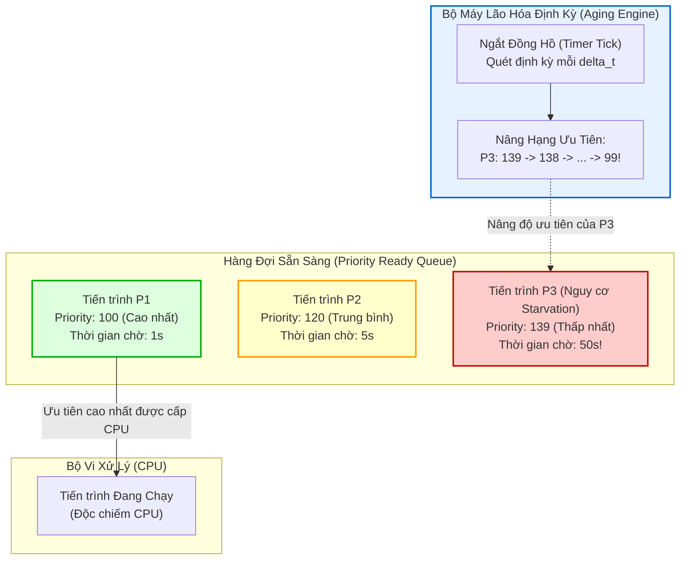

# 1_6_5 Priority Scheduling and Aging

> **Khóa học**: Cloud & DevOps Cơ Bản  
> **Phân nhóm**: Domain 1 - Operating System Core Fundamentals  
> **Chủ đề**: 1_6 CPU Scheduling  
> **Checklist đối chiếu**: [1_6_5](../../../CHECKLIST.md#domain-1-operating-system-core-fundamentals-45-items)  
> **Trạng thái**: Hoàn thành  

---

## 1. Khái Niệm Cốt Lõi & Bản Chất Kỹ Thuật (Core Concepts & Technical Deep Dive)

Trong các hệ thống máy tính thực tế, không phải mọi tác vụ đều có tầm quan trọng ngang nhau. Một tiến trình hiển thị giao diện đồ họa phục vụ thao tác bấm chuột của người dùng hoặc một luồng xử lý tín hiệu phanh khẩn cấp phải được ưu tiên xử lý trước một tiến trình sao lưu dữ liệu nền (background backup). Để đáp ứng yêu cầu nghiệp vụ này, các hệ điều hành triển khai thuật toán **Điều Phối Theo Độ Ưu Tiên (Priority Scheduling)** kết hợp với kỹ thuật cứu sinh **Lão Hóa Độ Ưu Tiên (Aging)**.

---

### 1.1. Bản Chất Kỹ Thuật Của Lập Lịch Theo Độ Ưu Tiên

- **Nguyên lý hoạt động**: Mỗi tiến trình khi khởi tạo được gắn với một số nguyên biểu diễn mức độ ưu tiên (**Priority Integer**). Bộ điều phối CPU luôn chọn tiến trình có độ ưu tiên cao nhất trong hàng đợi sẵn sàng (Ready Queue) để cấp phát CPU.
  > ⚠️ **Lưu ý về quy ước số học**: Trong lý thuyết hệ điều hành nói chung, không có quy chuẩn thống nhất về việc số lớn hơn hay số nhỏ hơn là ưu tiên cao hơn. Tuy nhiên, trên hầu hết các hệ điều hành dòng UNIX/Linux, **số nguyên càng nhỏ thì độ ưu tiên càng cao** (mức 0 là ưu tiên tối cao, mức 139 là ưu tiên thấp nhất).
- **Phân loại**:
  - **Chiếm quyền (Preemptive Priority Scheduling)**: Nếu một tiến trình mới xuất hiện trong Ready Queue có độ ưu tiên cao hơn tiến trình đang chạy trên CPU, hệ điều hành sẽ ngay lập tức ngắt ngang (preempt) tiến trình hiện tại và chuyển giao CPU cho tiến trình mới.
  - **Không chiếm quyền (Non-preemptive Priority Scheduling)**: Tiến trình mới có độ ưu tiên cao chỉ đơn thuần được xếp lên đầu Ready Queue và phải kiên nhẫn chờ tiến trình hiện tại hoàn tất CPU burst của nó.

---

### 1.2. Vấn Đề Bỏ Đói Tài Nguyên (Starvation / Indefinite Blocking)

Nhược điểm chí mạng của thuật toán điều phối theo độ ưu tiên thuần túy là hiện tượng **Bỏ Đói Tài Nguyên (Starvation)**:
- Nếu hệ thống liên tục tiếp nhận một dòng các tiến trình có độ ưu tiên cao (High-Priority Stream), các tiến trình có độ ưu tiên thấp (Low-Priority) sẽ **không bao giờ có cơ hội được chạm vào CPU**.
- Tiến trình bị kẹt vĩnh viễn trong hàng đợi Ready Queue, không thể tiến triển dù không hề bị Deadlock hay lỗi mã nguồn.
- *Câu chuyện lịch sử kinh điển*: Năm 1973, khi các kỹ sư tại Viện Công nghệ Massachusetts (MIT) tiến hành tắt nguồn chiếc siêu máy tính IBM 7094 để thay thế, họ phát hiện ra một tiến trình có độ ưu tiên thấp đã nằm chờ trong hàng đợi từ năm 1967 (suốt 6 năm trời không được cấp CPU do liên tục bị các tiến trình quan trọng hơn chen ngang)!

---

### 1.3. Kỹ Thuật Lão Hóa Độ Ưu Tiên (Aging Mechanism)

Để giải quyết triệt để vấn nạn Starvation, các nhà thiết kế hệ điều hành đã sáng tạo ra kỹ thuật **Lão Hóa (Aging)**:

> **Định nghĩa Aging**:  
> Là kỹ thuật điều chỉnh độ ưu tiên động (Dynamic Priority Adjustment), trong đó hệ điều hành định kỳ **tăng dần mức độ ưu tiên của các tiến trình đã phải nằm chờ quá lâu** trong hàng đợi Ready Queue.

- **Cơ chế hoạt động**:
  - Khi một tiến trình mới vào hàng đợi, nó mang độ ưu tiên tĩnh ban đầu: $P_{\text{initial}}$.
  - Sau mỗi chu kỳ thời gian cố định $\Delta t$ (ví dụ: cứ sau mỗi 1 giây nằm chờ trong Ready Queue), hệ điều hành tự động tăng độ ưu tiên của nó lên 1 bậc ($P_{\text{current}} = P_{\text{current}} + 1$).
  - Dù ban đầu tiến trình có độ ưu tiên thấp đến đâu, sau một khoảng thời gian chờ đợi đủ dài, độ ưu tiên của nó sẽ dần vượt qua cả các tiến trình mới đến và trở thành tiến trình có độ ưu tiên cao nhất hệ thống.
  - Khi được cấp CPU và chạy xong, độ ưu tiên của nó được thiết lập lại mức ban đầu.
  - **Hệ quả**: Đảm bảo nguyên tắc công bằng (Fairness) và triệt tiêu 100% nguy cơ Starvation.

---

### 1.4. Phân Tầng Độ Ưu Tiên Trong Nhân Linux: Thang Đo 0–139 & Giá Trị `nice`

Trên hệ điều hành Linux hiện đại, hệ thống phân tầng độ ưu tiên được chia thành **140 mức nguyên tử (từ 0 đến 139)**:

```
+-------------------------------------------------------------------------------+
|                 PHÂN TẦNG ĐỘ ƯU TIÊN TIẾN TRÌNH TRONG LINUX KERNEL            |
+-------------------------------------------------------------------------------+
|                                                                               |
|  [ 0 --------------------------- 99 ] [ 100 --------------------------- 139 ] |
|  |<----- REAL-TIME TASKS ---------->| |<------- NORMAL USER TASKS --------->| |
|  |  Chính sách: SCHED_FIFO, SCHED_RR | |  Chính sách: SCHED_OTHER (CFS)       | |
|  |  Ưu tiên tuyệt đối vi xử lý       | |  Điều phối dựa trên giá trị nice    | |
|  |  rt_priority: 1 (thấp) -> 99 (cao) | |  nice: -20 (cao) đến +19 (thấp)     | |
|  +-----------------------------------+ +-------------------------------------+ |
|                                                                               |
|  Công thức ánh xạ nhân Linux (Kernel Mapping Formula):                        |
|                  kernel_priority = 120 + nice_value                           |
|                                                                               |
|  - nice = -20 (Ưu tiên người dùng tối cao) ===> priority = 120 + (-20) = 100 |
|  - nice =   0 (Mặc định chuẩn)             ===> priority = 120 +   0   = 120 |
|  - nice = +19 (Ưu tiên người dùng thấp nhất)===> priority = 120 + (+19) = 139 |
+-------------------------------------------------------------------------------+
```

1. **Dải Thời Gian Thực (Real-Time Range: 0 đến 99)**:
   - Dành riêng cho các tiến trình Real-Time (`SCHED_FIFO`, `SCHED_RR`).
   - Các tiến trình này luôn luôn chiếm quyền (preempt) mọi tiến trình người dùng thông thường. Bất kể khi nào một tác vụ Real-Time sẵn sàng, nó sẽ giành CPU ngay lập tức.
2. **Dải Người Dùng Thông Thường (Normal Tasks: 100 đến 139)**:
   - Dành cho các ứng dụng chạy chính sách `SCHED_OTHER` (quản lý bởi Completely Fair Scheduler - CFS hoặc EEVDF).
   - Được kiểm soát thông qua giá trị **`nice` (từ -20 đến +19)**.
   - Giá trị `nice` mang ý nghĩa là "mức độ tốt bụng" của tiến trình đối với các tiến trình khác:
     - Giá trị `nice` càng cao (tiến tới `+19`): Tiến trình càng "tốt bụng", tự nguyện nhường nhịn CPU cho kẻ khác $\implies$ Độ ưu tiên thấp.
     - Giá trị `nice` càng âm (tiến tới `-20`): Tiến trình càng "ích kỷ", đòi hỏi tối đa tài nguyên CPU $\implies$ Độ ưu tiên cao (chỉ người dùng `root` mới có quyền gán giá trị âm).
3. **Hệ số trọng số CFS (CFS Weight Factor $\approx 1.25$)**:
   - Trong bộ lập lịch CFS của Linux, sự chênh lệch 1 mức `nice` tương ứng với một hệ số nhân trọng số khoảng **1.25** ($\approx 10\%$ khác biệt về tỷ lệ chia sẻ thời gian CPU giữa hai tiến trình cạnh tranh).

---

## 2. Ví Dụ Đời Sống Thực Tế Dễ Hiểu (Intuitive Real-World Analogies)

```
===================================================================================
             PHÒNG CẤP CỨU BỆNH VIỆN (PRIORITY) VÀ NGƯỜI BỊ HẮT HƠI (AGING)
===================================================================================

[KỊCH BẢN PHÒNG CẤP CỨU]:
  Bác sĩ trực cấp cứu (CPU Core) áp dụng quy tắc phân loại bệnh nhân (Triage Priority):
  - Mức 1 (Đỏ - Real-Time): Đột quỵ, tai nạn mất máu nguy kịch (Khám ngay lập tức).
  - Mức 2 (Vàng - Normal High): Gãy tay, sốt cao co giật.
  - Mức 3 (Xanh - Low Priority): Hắt hơi, sổ mũi nhẹ, xây xát nhẹ ngoài da.

[VẤN NẠN STARVATION]:
  Anh Nam bị hắt hơi (Mức 3) đến phòng cấp cứu lúc 8h sáng.
  Suốt cả ngày hôm đó, các ca tai nạn giao thông và gãy chân liên tục được xe cứu thương
  chở vào. Bác sĩ liên tục khám cho các ca nặng.
  Đến 12h đêm, anh Nam vẫn phải ngồi ôm mặt ở phòng chờ!
  Nếu cứ có ca nặng đến liên tục, anh Nam sẽ bị "bỏ đói" (Starvation) ngồi chờ đến 3 ngày sau!

[GIẢI PHÁP CỨU NGUY: QUY TẮC LÃO HÓA (AGING)]:
  Bệnh viện ban hành quy định nhân đạo mới:
  "Bệnh nhân Mức 3 cứ ngồi chờ đủ 2 tiếng thì được tự động tăng lên 1 bậc ưu tiên!"
  - Sau 2 tiếng: Anh Nam được nâng lên Mức 2 (ngang hàng với người gãy tay).
  - Sau 4 tiếng: Anh Nam được nâng lên Mức 1 (ngang hàng với ca nguy kịch).
  - Kết quả: Anh Nam được gọi vào khám dứt điểm, không ai bị bỏ quên vô thời hạn!
===================================================================================
```

### 2.1. Phép So Sánh: Hàng Chờ Lên Máy Bay Tại Sân Bay

Hãy hình dung cửa kiểm soát an ninh tại sân bay:
- **Hành khách VIP / Thương gia (Priority Cao)**: Đi làn ưu tiên riêng, luôn được bước qua cửa trước hành khách phổ thông.
- **Hành khách Phổ thông (Priority Thấp)**: Phải xếp hàng ở làn thông thường.
- Nếu các chuyến bay liên tục có hàng trăm khách VIP xuất hiện ở làn ưu tiên, toàn bộ khách phổ thông sẽ bị chôn chân và có nguy cơ trễ chuyến bay (**Starvation**).
- Nhân viên an ninh áp dụng **Aging**: Nhìn thấy một hành khách phổ thông chỉ còn 15 phút nữa là máy bay cất cánh (thời gian chờ đã quá hạn), nhân viên lập tức mời hành khách đó sang làn ưu tiên để đi qua ngay.

---

## 3. Kiến Trúc, Luồng Hoạt Động & Hình Ảnh Trực Quan (Architecture & Diagrams)

### 3.1. Sơ Đồ Kiến Trúc Cơ Chế Điều Phối Độ Ưu Tiên Kết Hợp Aging



---

## 4. Code Mẫu Trực Quan Hoặc Dòng Lệnh Thực Chiến (Runnable Sample Code / CLI)

### 4.1. Mã Nguồn C: Mô Phỏng Priority Scheduling Có và Không Có Aging (`aging_demo.c`)

Chương trình dưới đây mô phỏng sự khác biệt sống còn giữa Priority Scheduling thuần túy (dẫn tới Starvation) và Priority Scheduling tích hợp thuật toán Aging:

```c
#include <stdio.h>
#include <stdbool.h>

#define NUM_TASKS 4

typedef struct {
    int pid;
    int burst_time;
    int static_priority;   // Mức ưu tiên tĩnh ban đầu (số càng nhỏ càng ưu tiên)
    int dynamic_priority;  // Mức ưu tiên động sau khi áp dụng Aging
    int wait_time;         // Thời gian đã nằm chờ trong hàng đợi
    bool completed;
} Task;

// Khởi tạo danh sách tác vụ mẫu
void reset_tasks(Task tasks[]) {
    tasks[0] = (Task){1, 5, 1, 1, 0, false};  // Tác vụ VIP 1
    tasks[1] = (Task){2, 5, 1, 1, 0, false};  // Tác vụ VIP 2
    tasks[2] = (Task){3, 5, 2, 2, 0, false};  // Tác vụ thường
    tasks[3] = (Task){4, 5, 10, 10, 0, false}; // Tác vụ độ ưu tiên cực thấp (Nguy cơ Starvation)
}

// 1. Điều phối theo độ ưu tiên thuần túy (Không có Aging)
void run_pure_priority(Task tasks[]) {
    printf("\n>>> THỰC THI: PRIORITY SCHEDULING THUẦN TÚY (KHÔNG AGING) <<<\n");
    int current_time = 0;
    for (int step = 0; step < NUM_TASKS; step++) {
        int best_idx = -1;
        int highest_prio = 9999;

        // Tìm tác vụ chưa hoàn tất có priority cao nhất (số nhỏ nhất)
        for (int i = 0; i < NUM_TASKS; i++) {
            if (!tasks[i].completed && tasks[i].static_priority < highest_prio) {
                highest_prio = tasks[i].static_priority;
                best_idx = i;
            }
        }

        tasks[best_idx].completed = true;
        tasks[best_idx].wait_time = current_time;
        printf("Thời điểm T=%2d: Task P%d (Priority %2d) được chạy CPU. Thời gian chờ = %2d ms\n",
               current_time, tasks[best_idx].pid, tasks[best_idx].static_priority, tasks[best_idx].wait_time);
        current_time += tasks[best_idx].burst_time;
    }
}

// 2. Điều phối theo độ ưu tiên có tích hợp Aging
void run_priority_with_aging(Task tasks[]) {
    printf("\n>>> THỰC THI: PRIORITY SCHEDULING CÓ TÍCH HỢP AGING <<<\n");
    int current_time = 0;
    for (int step = 0; step < NUM_TASKS; step++) {
        int best_idx = -1;
        int highest_prio = 9999;

        // Chọn tiến trình có dynamic_priority tốt nhất hiện tại
        for (int i = 0; i < NUM_TASKS; i++) {
            if (!tasks[i].completed && tasks[i].dynamic_priority < highest_prio) {
                highest_prio = tasks[i].dynamic_priority;
                best_idx = i;
            }
        }

        tasks[best_idx].completed = true;
        tasks[best_idx].wait_time = current_time;
        printf("Thời điểm T=%2d: Task P%d (Prio Gốc: %2d -> Đã Lão Hóa: %2d) chạy CPU! Chờ = %2d ms\n",
               current_time, tasks[best_idx].pid, tasks[best_idx].static_priority,
               tasks[best_idx].dynamic_priority, tasks[best_idx].wait_time);

        current_time += tasks[best_idx].burst_time;

        // ÁP DỤNG AGING: Tất cả các tác vụ còn lại nằm chờ đều được tăng 3 bậc ưu tiên!
        for (int i = 0; i < NUM_TASKS; i++) {
            if (!tasks[i].completed) {
                tasks[i].dynamic_priority -= 3; // Giảm số nghĩa là tăng độ ưu tiên
                if (tasks[i].dynamic_priority < 0) tasks[i].dynamic_priority = 0;
            }
        }
    }
}

int main(void) {
    Task tasks[NUM_TASKS];

    reset_tasks(tasks);
    run_pure_priority(tasks);

    reset_tasks(tasks);
    run_priority_with_aging(tasks);

    return 0;
}
```

---

### 4.2. Biên Dịch và Kết Quả Thực Thi

```bash
# Biên dịch mã nguồn
gcc -Wall -Wextra aging_demo.c -o aging_demo

# Chạy chương trình
./aging_demo
```

**Đầu ra trên Terminal:**
```text
>>> THỰC THI: PRIORITY SCHEDULING THUẦN TÚY (KHÔNG AGING) <<<
Thời điểm T= 0: Task P1 (Priority  1) được chạy CPU. Thời gian chờ =  0 ms
Thời điểm T= 5: Task P2 (Priority  1) được chạy CPU. Thời gian chờ =  5 ms
Thời điểm T=10: Task P3 (Priority  2) được chạy CPU. Thời gian chờ = 10 ms
Thời điểm T=15: Task P4 (Priority 10) được chạy CPU. Thời gian chờ = 15 ms

>>> THỰC THI: PRIORITY SCHEDULING CÓ TÍCH HỢP AGING <<<
Thời điểm T= 0: Task P1 (Prio Gốc:  1 -> Đã Lão Hóa:  1) chạy CPU! Chờ =  0 ms
Thời điểm T= 5: Task P2 (Prio Gốc:  1 -> Đã Lão Hóa:  0) chạy CPU! Chờ =  5 ms
Thời điểm T=10: Task P3 (Prio Gốc:  2 -> Đã Lão Hóa:  0) chạy CPU! Chờ = 10 ms
Thời điểm T=15: Task P4 (Prio Gốc: 10 -> Đã Lão Hóa:  1) chạy CPU! Chờ = 15 ms
```

---

### 4.3. Các Lệnh Thực Chiến Quản Trị Độ Ưu Tiên Trên Linux CLI

Trong quản trị hệ thống Linux sản xuất, kỹ sư DevOps thường xuyên sử dụng bộ công cụ dòng lệnh để can thiệp độ ưu tiên:

```bash
# 1. Khởi chạy một tiến trình sao lưu nền với độ ưu tiên thấp nhất (nice = 19)
nice -n 19 tar -czf backup.tar.gz /var/log/

# 2. Khởi chạy một tiến trình phân tích dữ liệu khẩn cấp với độ ưu tiên cao (cần sudo)
sudo nice -n -10 ./critical_data_analyzer

# 3. Thay đổi độ ưu tiên của một tiến trình đang chạy (PID: 84521) lên mức ưu tiên cao hơn
sudo renice -n -5 -p 84521

# 4. Kiểm tra độ ưu tiên thực tế (PRI) và giá trị nice (NI) của toàn bộ tiến trình
ps -eo pid,ni,pri,rtprio,comm | grep -E "backup|critical"

# 5. Soi thuộc tính Real-Time của một tiến trình
chrt -p 84521
```

---

## 5. Cạm Bẫy Thực Tế & Thực Tiễn Sản Xuất (Production Gotchas & Best Practices)

### 5.1. Thảm Họa Đảo Ngược Độ Ưu Tiên (Priority Inversion - Sự Cố Tàu Mars Pathfinder 1997)

- **Cạm bẫy thực tế**: Sự cố nổi tiếng nhất lịch sử phần mềm hàng không vũ trụ xảy ra trên tàu thám hiểm sao Hỏa **Mars Pathfinder (NASA, 1997)**:
  - Có 3 tác vụ: Tác vụ đo đạc khoa học độ ưu tiên cao ($T_{\text{High}}$), tác vụ truyền thông trung bình ($T_{\text{Medium}}$), và tác vụ thu thập dữ liệu thời tiết độ ưu tiên thấp ($T_{\text{Low}}$).
  - $T_{\text{Low}}$ chiếm giữ một chiếc khóa Mutex để ghi dữ liệu thời tiết.
  - $T_{\text{High}}$ thức giấc, cần chiếc Mutex đó nên bị chuyển sang trạng thái `Blocked` chờ $T_{\text{Low}}$.
  - Đúng lúc này, $T_{\text{Medium}}$ thức giấc. Vì $T_{\text{Medium}}$ có độ ưu tiên cao hơn $T_{\text{Low}}$ và không cần Mutex, nó chiếm quyền CPU và chạy liên tục, ngăn không cho $T_{\text{Low}}$ hoàn tất để nhả Mutex.
  - **Hệ quả**: Tác vụ ưu tiên cao nhất ($T_{\text{High}}$) bị gián tiếp "bỏ đói" và đứng chờ tác vụ ưu tiên trung bình ($T_{\text{Medium}}$) suốt một thời gian dài, kích hoạt cơ chế Watchdog Timer tự động khởi động lại toàn bộ hệ thống tàu nhiều lần trên sao Hỏa!
- **Biện pháp cứu sinh (Best Practice)**: Kích hoạt giao thức **Thừa Kế Độ Ưu Tiên (Priority Inheritance Protocol)**: Bất cứ khi nào $T_{\text{High}}$ bị chặn bởi Mutex do $T_{\text{Low}}$ giữ, $T_{\text{Low}}$ sẽ tạm thời được "thừa kế" mức ưu tiên cao nhất của $T_{\text{High}}$ để chạy nhanh về đích và nhả khóa, ngăn chặn $T_{\text{Medium}}$ chen ngang.

---

### 5.2. Lạm Dụng Giá Trị Nice Âm (-20) Trong Môi Trường Kubernetes & Container

- **Cạm bẫy thực tế**: Một nhóm phát triển microservice muốn dịch vụ của mình chạy nhanh nhất có thể nên đã cấu hình `nice -n -20` trong script khởi động container hoặc cấp phát `securityContext.capabilities: [SYS_NICE]`.  
  Khi container này gặp lỗi rò rỉ vòng lặp (CPU leak), nó sẽ ngấu nghiến toàn bộ thời gian CPU của Node máy chủ vật lý, khiến ngay cả các daemon cốt lõi của Kubernetes như `kubelet` và `containerd` cũng bị đói CPU, dẫn đến việc Node bị mất kết nối (`NodeNotReady`) và làm sập dây chuyền cả cụm cluster.
- **Biện pháp chuẩn mực (Best Practice)**:
  - Tuyệt đối không tùy tiện cấp quyền `SYS_NICE` cho container ứng dụng người dùng.
  - Quản trị độ ưu tiên trong Cloud thông qua cơ chế chuẩn mực của Linux Control Groups (cgroups): Thiết lập `resources.requests.cpu` và `resources.limits.cpu` trong Kubernetes manifest.

---

## 6. Câu Hỏi Củng Cố Kiến Thức (Active Recall Quiz)

<details>
<summary><b>Câu hỏi 1:</b> Tại sao thuật toán Priority Scheduling thuần túy lại dễ dẫn đến hiện tượng Starvation? Kỹ thuật Aging triệt tiêu hiện tượng này theo nguyên lý toán học nào?</summary>

> **Đáp án:**
> - **Nguyên nhân Starvation**: Vì thuật toán thuần túy luôn chọn tiến trình có độ ưu tiên cao nhất tại thời điểm điều phối. Nếu tốc độ xuất hiện của các tiến trình mới có độ ưu tiên cao lớn hơn hoặc bằng tốc độ phục vụ của CPU, các tiến trình có độ ưu tiên thấp sẽ liên tục bị đẩy lùi về cuối hàng đợi và không bao giờ được cấp phát vi xử lý.
> - **Nguyên lý của Aging**: Aging biến độ ưu tiên tĩnh thành một **hàm đơn điệu tăng theo thời gian chờ đợi**:
>   $$P_{\text{dynamic}}(t) = P_{\text{static}} + f(t_{\text{wait}})$$
>   Trong đó $f(t_{\text{wait}})$ tăng dần theo thời gian. Khi $t_{\text{wait}} \to \infty$, $P_{\text{dynamic}}$ chắc chắn sẽ vượt qua mọi ngưỡng ưu tiên tĩnh của các tiến trình mới đến, đảm bảo tiến trình chắc chắn sẽ được phục vụ trong một khoảng thời gian có giới hạn (Bounded Waiting).
</details>

<details>
<summary><b>Câu hỏi 2:</b> Trên hệ điều hành Linux, giá trị <code>nice</code> có mối quan hệ số học như thế nào với độ ưu tiên nội bộ của Kernel đối với các tiến trình thông thường? Giá trị <code>nice = -5</code> tương ứng với kernel priority là bao nhiêu?</summary>

> **Đáp án:**
> - **Mối quan hệ số học**: Trong nhân Linux, các tiến trình người dùng thông thường (`SCHED_OTHER`) nằm trong dải độ ưu tiên từ 100 đến 139, được ánh xạ tuyến tính từ giá trị `nice` (từ -20 đến +19) theo công thức chuẩn:
>   $$\text{kernel\_priority} = 120 + \text{nice}$$
> - **Tính toán với `nice = -5`**:
>   $$\text{kernel\_priority} = 120 + (-5) = \mathbf{115}$$
</details>

<details>
<summary><b>Câu hỏi 3:</b> Hiện tượng Đảo ngược độ ưu tiên (Priority Inversion) khác với hiện tượng Starvation thông thường ở điểm cốt lõi nào? Kỹ thuật nào giúp giải quyết triệt để vấn đề này?</summary>

> **Đáp án:**
> - **Điểm khác biệt cốt lõi**:
>   - Trong *Starvation thông thường*: Tiến trình ưu tiên thấp bị bỏ đói bởi các tiến trình ưu tiên cao hơn (đúng theo logic thiết kế).
>   - Trong *Priority Inversion*: Một tiến trình có **độ ưu tiên cao nhất** lại bị bỏ đói một cách nghịch lý và gián tiếp bởi một tiến trình có **độ ưu tiên trung bình**, xuất phát từ việc tiến trình ưu tiên cao đang chờ một tài nguyên khóa (Mutex) bị giữ bởi tiến trình ưu tiên thấp, trong khi tiến trình ưu tiên thấp lại liên tục bị tiến trình ưu tiên trung bình chiếm quyền CPU.
> - **Giải pháp triệt để**: Sử dụng **Giao thức Thừa kế độ ưu tiên (Priority Inheritance Protocol)** — tạm thời nâng độ ưu tiên của tiến trình đang giữ khóa lên ngang bằng với tiến trình ưu tiên cao nhất đang chờ chiếc khóa đó.
</details>

---

## 7. 📚 Nguồn Tài Liệu Chính Thống (Tier-1 Official References)

- [OSTEP Chapter 7: CPU Scheduling (Remzi H. Arpaci-Dusseau and Andrea C. Arpaci-Dusseau)](https://pages.cs.wisc.edu/~remzi/OSTEP/cpu-sched.pdf) - Giáo trình hệ điều hành chuẩn mực phân tích các chính sách lập lịch theo độ ưu tiên và hiện tượng bỏ đói tài nguyên Starvation.
- [OSTEP Chapter 8: Multi-level Feedback Queue (Arpaci-Dusseau)](https://pages.cs.wisc.edu/~remzi/OSTEP/cpu-sched-mlfq.pdf) - Giáo trình chuẩn mực phân tích kỹ thuật Aging và cơ chế nâng hạng độ ưu tiên động (Priority Boost).
- [Linux Programmer's Manual: sched(7)](https://man7.org/linux/man-pages/man7/sched.7.html) - Hướng dẫn tra cứu toàn diện về các chính sách lập lịch của Linux Kernel, dải ưu tiên 0-139, Real-Time vs Normal tasks.
- [Linux User's Manual: nice(1)](https://man7.org/linux/man-pages/man1/nice.1.html) - Hướng dẫn sử dụng tiện ích dòng lệnh `nice` để khởi tạo tiến trình với mức độ ưu tiên điều chỉnh.
- [Linux User's Manual: renice(1)](https://man7.org/linux/man-pages/man1/renice.1.html) - Hướng dẫn sử dụng lệnh `renice` điều chỉnh độ ưu tiên động của tiến trình đang chạy.
- [Linux User's Manual: chrt(1)](https://man7.org/linux/man-pages/man1/chrt.1.html) - Hướng dẫn tra cứu và thiết lập thuộc tính điều phối thời gian thực (Real-Time attributes) trên Linux.
