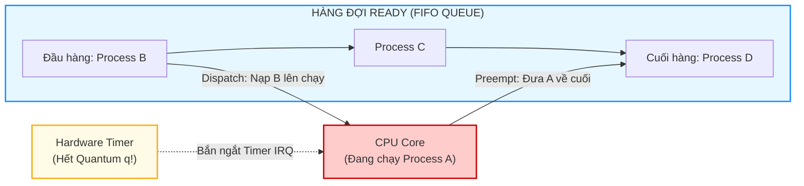

# 1_6_6 Round Robin Scheduling

> **Khóa học**: Cloud & DevOps Cơ Bản  
> **Phân nhóm**: Domain 1 - Operating System Core Fundamentals  
> **Chủ đề**: 1_6 CPU Scheduling  
> **Checklist đối chiếu**: [1_6_6](../../../CHECKLIST.md#domain-1-operating-system-core-fundamentals-45-items)  
> **Trạng thái**: Hoàn thành  

---

## 1. Khái Niệm Cốt Lõi & Bản Chất Kỹ Thuật (Core Concepts & Technical Deep Dive)

Trong các hệ thống tính toán chia sẻ thời gian (Time-Sharing Systems) và máy trạm tương tác hiện đại, người dùng đòi hỏi hệ thống phải phản hồi nhanh chóng (Low Response Time). Một lập trình viên gõ bàn phím trên terminal hoặc di chuột trên giao diện không thể chấp nhận việc phải đợi hàng chục giây chỉ vì một tiến trình nền đang biên dịch mã nguồn.

Để giải quyết triệt để nhu cầu tương tác này, giải thuật **Round Robin (RR - Điều phối luân phiên vòng tròn)** ra đời. Đây là một trong những giải thuật điều phối lâu đời, công bằng và phổ biến nhất trong lịch sử khoa học máy tính:
- **Cơ chế hàng đợi FIFO vòng tròn**: Toàn bộ các tiến trình sẵn sàng được đưa vào một hàng đợi theo thứ tự trước sau (FIFO Queue).
- **Lát cắt thời gian (Time Quantum / Time Slice - ký hiệu $q$)**: Mỗi tiến trình được cấp phát CPU để thực thi trong một khoảng thời gian tối đa xác định trước $q$ (thường dao động từ $10\text{ ms}$ đến $100\text{ ms}$).
- **Cơ chế chiếm dụng tuần hoàn**:
  1. Bộ điều phối chọn tiến trình ở đầu hàng đợi và bật bộ đếm thời gian phần cứng (Hardware Timer).
  2. Nếu tiến trình hoàn tất hoặc phát sinh I/O trước khi hết $q$: Tiến trình tự nguyện nhả CPU.
  3. Nếu tiến trình vẫn đang chạy khi hết $q$: Bộ đếm phần cứng bắn ngắt Timer Interrupt, hệ điều hành cưỡng chế thu hồi CPU, đưa tiến trình đó về **cuối hàng đợi `Ready`**, và nạp tiến trình tiếp theo lên chạy.

```
                           HÀNG ĐỢI FIFO VÒNG TRÒN (ROUND ROBIN)
                           
               +---------------------------------------------------+
               |                                                   |
               v                                                   |
       [ Đầu Hàng Đợi ]                                            |
      +----------------+     Cấp CPU trong Quantum q     +-------------------+
      | Tiến trình P1  | ------------------------------> | CPU (Đang chạy)   |
      +----------------+                                 +-------------------+
              |                                                    |
              v                                                    | Hết giờ (q)
      +----------------+                                           | (Timer Interrupt)
      | Tiến trình P2  |                                           |
      +----------------+                                           |
              |                                                    |
              v                                                    |
      +----------------+                                           |
      | Tiến trình P3  | <-----------------------------------------+
      +----------------+      Đưa về CUỐI hàng đợi để chờ lượt mới!
```

---

### 1.1. Sự Đánh Đổi Trọng Yếu Khi Lựa Chọn Kích Thước Time Quantum ($q$)

Hiệu năng của Round Robin hoàn toàn phụ thuộc vào việc định cỡ lát cắt thời gian $q$. Đây là bài toán đánh đổi kinh điển giữa **Thời gian đáp ứng (Response Time)** và **Chi phí chuyển ngữ cảnh (Context Switch Overhead)**:

```
  KÍCH THƯỚC QUANTUM (q)                                   HỆ QUẢ TRÊN HỆ THỐNG
  --------------------------------------------------------------------------------------------------
  q quá lớn (q -> vô cùng)    --->   Suy biến thành FCFS! Hiệu ứng đoàn tàu (Convoy Effect) quay lại.
  q quá nhỏ (q -> 0)          --->   CPU dành 90% thời gian chỉ để lưu/nạp thanh ghi Context Switch!
  q tối ưu (10ms - 100ms)     --->   Đảm bảo 80% CPU burst ngắn hơn q; tương tác mượt mà.
```

1. **Nếu $q$ quá lớn ($q \to \infty$)**:
   - Nếu $q$ được đặt là 10 giây trong khi các tiến trình chỉ chạy vài chục miligiây, ngắt đồng hồ hầu như không bao giờ kích hoạt. Mọi tiến trình sẽ chạy một mạch tới khi hoàn tất.
   - Round Robin suy biến hoàn toàn thành **First-Come, First-Served (FCFS)**.
2. **Nếu $q$ quá nhỏ ($q \to 0$)**:
   - Về mặt lý thuyết, người dùng sẽ có cảm giác như mọi tiến trình đều đang chạy song song cùng lúc (Processor Sharing).
   - Tuy nhiên, trong thực tế vật lý: Mỗi lần chuyển ngữ cảnh tiêu tốn từ $1 \mu\text{s}$ đến $10 \mu\text{s}$ (lưu thanh ghi, mất mát CPU L1/L2 Cache, xóa TLB). Nếu đặt $q = 10 \mu\text{s}$, CPU sẽ dành tới **50% công suất chỉ để đổi chỗ tiến trình** mà không thực hiện được tác vụ hữu ích nào!
3. **Quy tắc ngón tay cái trong thực tế (Rule of Thumb)**:
   > Trong thiết kế hệ điều hành chuẩn, lát cắt thời gian $q$ nên được cấu hình sao cho **khoảng 80% các CPU Burst của tiến trình ngắn hơn $q$**. Khi đó, hầu hết các tác vụ ngắn sẽ hoàn thành ngay trong lượt đầu tiên mà không bị ngắt quãng, trong khi các tác vụ dài vẫn bị chia nhỏ để nhường đường cho tác vụ khác.

---

### 1.2. Nghịch Lý Round Robin: Tuyệt Vời Về Response Time Nhưng Tồi Tệ Về Turnaround Time

- **Chỉ số Thời gian đáp ứng ($Response\ Time = \text{Thời điểm chạy lần đầu} - AT$)**: Round Robin đạt điểm số vượt trội. Nếu có $N$ tiến trình trong hàng đợi với lát cắt $q$, không một tiến trình nào phải đợi quá $(N - 1) \times q$ đơn vị thời gian để được tương tác với CPU.
- **Chỉ số Thời gian lưu lại ($Turnaround\ Time = CT - AT$)**: Round Robin thường có kết quả **kém nhất** trong các thuật toán.
  - *Nguyên nhân*: RR kéo dài thời gian hoàn thành của tất cả các tiến trình. Thay vì để một tiến trình làm xong dứt điểm rồi rời đi, RR lại chia đều thời gian cho mọi người cùng làm một chút, khiến cho tất cả các tiến trình đều hoàn tất rất muộn vào những giây cuối cùng.

---

## 2. Ví Dụ Đời Sống Thực Tế Dễ Hiểu (Intuitive Real-World Analogies)

```
       VÒNG QUAY NGỰA GỖ TRONG CÔNG VIÊN (ROUND ROBIN)

  [ HÀNG ĐỢI 10 ĐỨA TRẺ ]                 [ VÒNG QUAY CƯỠNG CHẾ (q = 2 PHÚT) ]
  Bé Nam, Bé Lan, Bé Hùng...  ========>   Bé Nam cưỡi ngựa đúng 2 phút.
                                          Chuông reo reng reng! (Timer Interrupt)
                                          Người quản lý: "Hết 2 phút rồi bé ơi,
                                          xuống ngựa ra cuối hàng xếp hàng lại!"
                                          Bé Lan lên cưỡi tiếp 2 phút...
```

### 2.1. Phép So Sánh: Vòng Quay Ngựa Gỗ Công Viên
- Một khu vui chơi chỉ có đúng 1 con ngựa gỗ duy nhất (CPU Core) nhưng có 10 đứa trẻ đang xếp hàng mong được chơi (Ready Queue).
- **Nếu quản lý theo FCFS**: Bé đầu tiên bước lên ngựa và chơi liền 2 tiếng đồng hồ cho đến khi chán ngấy (`exit()`). 9 đứa trẻ còn lại đứng ngoài khóc lóc vì phải chờ đợi quá lâu.
- **Nếu quản lý theo Round Robin ($q = 2$ phút)**:
  - Bác quản lý quy định: Mỗi lượt chỉ được cưỡi đúng 2 phút.
  - Bác cầm đồng hồ bấm giờ (Hardware Timer). Đúng 2 phút, chuông reng reng! Bác mời bé Nam bước xuống, đi vòng ra sau lưng bạn số 10 để xếp hàng lại. Bé Lan lập tức được lên ngựa 2 phút.
  - Nhờ vậy, chỉ sau chưa đầy 20 phút, toàn bộ 10 đứa trẻ đều đã được cưỡi ngựa ít nhất một lần. Cả khu vui chơi đều vui vẻ (Response Time tuyệt hảo)!
- **Đánh đổi về thời gian leo lên leo xuống (Context Switch Overhead)**:
  Nếu bác quản lý khó tính đặt giờ $q = 2$ giây: Một đứa trẻ vừa trèo lên yên ngựa, chưa kịp ngồi ấm chỗ thì chuông đã reo, phải tụt xuống để bạn khác trèo lên. Toàn bộ thời gian ở khu vui chơi bị lãng phí vào việc trèo lên tụt xuống!

---

## 3. Kiến Trúc, Luồng Hoạt Động & Hình Ảnh Trực Quan (Architecture & Diagrams)

### 3.1. Sơ Đồ Chuyển Đổi Hàng Đợi Ready Vòng Tròn Khi Hết Time Quantum



---

## 4. Bài Tập Tính Toán So Sánh Toàn Diện: FCFS vs SJF vs SRTF vs Round Robin

> 🎯 **BÀI TẬP THỰC HÀNH CHUẨN MỰC THEO GIÁO TRÌNH (Plan Section 6.2 Mandatory Exercise)**  
> Dưới đây là bài toán so sánh chi tiết 4 giải thuật điều phối kinh điển trên cùng một tập dữ liệu đầu vào.

### Đề bài:
Cho 4 tiến trình với Thời điểm đến ($AT - Arrival\ Time$) và Thời gian Burst ($BT - Burst\ Time$) như sau:

| Tiến trình | Thời điểm đến ($AT$) | Thời gian Burst ($BT$) |
| :---: | :---: | :---: |
| **$P_1$** | $0$ | $8$ |
| **$P_2$** | $1$ | $4$ |
| **$P_3$** | $2$ | $9$ |
| **$P_4$** | $3$ | $5$ |

#### Công thức bắt buộc:
- Thời gian lưu lại: $TAT = CT - AT$ (Turnaround Time)
- Thời gian chờ: $WT = TAT - BT$ (Waiting Time)
- Thời gian hoàn thành: $CT$ (Completion Time)

---

### 4.1. Giải Thuật 1: First-Come, First-Served (FCFS)

- **Cơ chế**: Không chiếm dụng. Tiến trình nào đến trước thì chạy liên tục một mạch cho đến khi hoàn thành.
- **Diễn biến**:
  - $t=0$: $P_1$ đến $\to$ Chạy liên tục từ $0 \to 8$ ($CT = 8$).
  - $t=8$: $P_2$ chạy tiếp từ $8 \to 12$ ($CT = 12$).
  - $t=12$: $P_3$ chạy tiếp từ $12 \to 21$ ($CT = 21$).
  - $t=21$: $P_4$ chạy tiếp từ $21 \to 26$ ($CT = 26$).

**Biểu đồ Gantt FCFS:**
```text
|   P1 (8)   |  P2 (4)  |     P3 (9)     |   P4 (5)   |
0            8          12               21           26
```

**Bảng tính toán FCFS:**
| Tiến trình | $AT$ | $BT$ | $CT$ | $TAT = CT - AT$ | $WT = TAT - BT$ |
| :---: | :---: | :---: | :---: | :---: | :---: |
| $P_1$ | 0 | 8 | 8 | $8 - 0 = 8$ | $8 - 8 = 0$ |
| $P_2$ | 1 | 4 | 12 | $12 - 1 = 11$ | $11 - 4 = 7$ |
| $P_3$ | 2 | 9 | 21 | $21 - 2 = 19$ | $19 - 9 = 10$ |
| $P_4$ | 3 | 5 | 26 | $26 - 3 = 23$ | $23 - 5 = 18$ |
| **Trung bình** | | | | **$15.25$** | **$8.75$** |

---

### 4.2. Giải Thuật 2: Non-Preemptive Shortest Job First (SJF)

- **Cơ chế**: Không chiếm dụng. Khi CPU rảnh, chọn tiến trình có $BT$ nhỏ nhất trong số các tiến trình **đã đến**.
- **Diễn biến**:
  - Tại $t=0$: Chỉ duy nhất $P_1$ có mặt $\to$ Bắt buộc chạy $P_1$ từ $0 \to 8$ ($CT = 8$).
  - Tại $t=8$: Cả $P_2(4), P_3(9), P_4(5)$ đều đã đến.
    - $P_2$ có Burst nhỏ nhất ($4$) $\to$ Chạy $P_2$ từ $8 \to 12$ ($CT = 12$).
  - Tại $t=12$: Còn $P_4(5)$ và $P_3(9)$. $P_4$ nhỏ hơn $\to$ Chạy $P_4$ từ $12 \to 17$ ($CT = 17$).
  - Tại $t=17$: Chạy $P_3$ từ $17 \to 26$ ($CT = 26$).

**Biểu đồ Gantt Non-preemptive SJF:**
```text
|   P1 (8)   |  P2 (4)  |   P4 (5)   |     P3 (9)     |
0            8          12           17               26
```

**Bảng tính toán Non-preemptive SJF:**
| Tiến trình | $AT$ | $BT$ | $CT$ | $TAT = CT - AT$ | $WT = TAT - BT$ |
| :---: | :---: | :---: | :---: | :---: | :---: |
| $P_1$ | 0 | 8 | 8 | $8 - 0 = 8$ | $8 - 8 = 0$ |
| $P_2$ | 1 | 4 | 12 | $12 - 1 = 11$ | $11 - 4 = 7$ |
| $P_4$ | 3 | 5 | 17 | $17 - 3 = 14$ | $14 - 5 = 9$ |
| $P_3$ | 2 | 9 | 26 | $26 - 2 = 24$ | $24 - 9 = 15$ |
| **Trung bình** | | | | **$14.25$** | **$7.75$** |

---

### 4.3. Giải Thuật 3: Preemptive Shortest Remaining Time First (SRTF)

- **Cơ chế**: Chiếm dụng. Tại mỗi thời điểm có tiến trình mới xuất hiện, nếu thời gian còn lại của nó ngắn hơn tiến trình đang chạy $\to$ Cướp CPU ngay!
- **Diễn biến chi tiết**:
  - $t=0 \to 1$: $P_1$ chạy 1 đơn vị. Tại $t=1$, $P_1$ còn $7$.
  - $t=1$: $P_2$ đến với $BT=4$. Vì $4 < 7 \to$ Chiếm dụng $P_1$! $P_2$ nhận CPU.
  - $t=2$: $P_3$ đến ($BT=9$). So sánh: $P_2$ còn $3 < 9 \to P_2$ chạy tiếp.
  - $t=3$: $P_4$ đến ($BT=5$). So sánh: $P_2$ còn $2 < 5 \to P_2$ chạy tiếp đến $t=5$ và hoàn thành ($CT = 5$).
  - $t=5$: Hàng đợi còn lại: $P_4(5), P_1(7), P_3(9)$. Nhỏ nhất là $P_4(5) \to$ Chạy $P_4$ từ $5 \to 10$ ($CT = 10$).
  - $t=10$: Hàng đợi còn: $P_1(7), P_3(9)$. Nhỏ nhất là $P_1(7) \to$ Chạy $P_1$ từ $10 \to 17$ ($CT = 17$).
  - $t=17$: Cuối cùng chạy $P_3(9)$ từ $17 \to 26$ ($CT = 26$).

**Biểu đồ Gantt Preemptive SRTF:**
```text
| P1 |  P2 (4)  |   P4 (5)   |    P1 (7)    |     P3 (9)     |
0    1          5            10             17               26
```

**Bảng tính toán Preemptive SRTF:**
| Tiến trình | $AT$ | $BT$ | $CT$ | $TAT = CT - AT$ | $WT = TAT - BT$ |
| :---: | :---: | :---: | :---: | :---: | :---: |
| $P_1$ | 0 | 8 | 17 | $17 - 0 = 17$ | $17 - 8 = 9$ |
| $P_2$ | 1 | 4 | 5 | $5 - 1 = 4$ | $4 - 4 = 0$ |
| $P_4$ | 3 | 5 | 10 | $10 - 3 = 7$ | $7 - 5 = 2$ |
| $P_3$ | 2 | 9 | 26 | $26 - 2 = 24$ | $24 - 9 = 15$ |
| **Trung bình** | | | | **$13.00$** | **$6.50$ (Tối ưu!)** |

---

### 4.4. Giải Thuật 4: Round Robin với Lát Cắt $q = 2$

- **Cơ chế**: Chiếm dụng theo chu kỳ FIFO với $q = 2$.
- **Theo dõi vết hàng đợi (Ready Queue Trace)**:
  - $t=0$: $P_1$ vào hàng đợi: `[P1]`. $P_1$ chạy từ $0 \to 2$.
  - Trong lúc đó, $P_2$ đến tại $t=1$. Tại $t=2$, $P_1$ còn 6 bị đưa về cuối, đồng thời $P_3$ đến tại $t=2$.
    $\to$ Hàng đợi: `[P2, P3, P1]`.
  - $t=2 \to 4$: $P_2$ chạy 2 đơn vị (còn 2). Trong lúc đó, $P_4$ đến tại $t=3$. Tại $t=4$, $P_2$ về cuối.
    $\to$ Hàng đợi: `[P3, P1, P4, P2]`.
  - $t=4 \to 6$: $P_3$ chạy 2 đơn vị (còn 7), về cuối.
    $\to$ Hàng đợi: `[P1, P4, P2, P3]`.
  - $t=6 \to 8$: $P_1$ chạy 2 đơn vị (còn 4), về cuối.
    $\to$ Hàng đợi: `[P4, P2, P3, P1]`.
  - $t=8 \to 10$: $P_4$ chạy 2 đơn vị (còn 3), về cuối.
    $\to$ Hàng đợi: `[P2, P3, P1, P4]`.
  - $t=10 \to 12$: $P_2$ chạy nốt 2 đơn vị cuối cùng $\to$ **$P_2$ HOÀN THÀNH tại $t=12$ ($CT=12$)**!
    $\to$ Hàng đợi: `[P3, P1, P4]`.
  - $t=12 \to 14$: $P_3$ chạy 2 đơn vị (còn 5), về cuối.
    $\to$ Hàng đợi: `[P1, P4, P3]`.
  - $t=14 \to 16$: $P_1$ chạy 2 đơn vị (còn 2), về cuối.
    $\to$ Hàng đợi: `[P4, P3, P1]`.
  - $t=16 \to 18$: $P_4$ chạy 2 đơn vị (còn 1), về cuối.
    $\to$ Hàng đợi: `[P3, P1, P4]`.
  - $t=18 \to 20$: $P_3$ chạy 2 đơn vị (còn 3), về cuối.
    $\to$ Hàng đợi: `[P1, P4, P3]`.
  - $t=20 \to 22$: $P_1$ chạy nốt 2 đơn vị cuối cùng $\to$ **$P_1$ HOÀN THÀNH tại $t=22$ ($CT=22$)**!
    $\to$ Hàng đợi: `[P4, P3]`.
  - $t=22 \to 23$: $P_4$ chỉ còn 1 đơn vị, chạy 1 đơn vị $\to$ **$P_4$ HOÀN THÀNH tại $t=23$ ($CT=23$)**!
    $\to$ Hàng đợi: `[P3]`.
  - $t=23 \to 26$: $P_3$ còn 3 đơn vị, chạy nốt từ $23 \to 26$ $\to$ **$P_3$ HOÀN THÀNH tại $t=26$ ($CT=26$)**!

**Biểu đồ Gantt Round Robin ($q=2$):**
```text
| P1 | P2 | P3 | P1 | P4 | P2 | P3 | P1 | P4 | P3 | P1 | P4 | P3 |
0    2    4    6    8   10   12   14   16   18   20   22   23   26
```

**Bảng tính toán Round Robin ($q=2$):**
| Tiến trình | $AT$ | $BT$ | $CT$ | $TAT = CT - AT$ | $WT = TAT - BT$ |
| :---: | :---: | :---: | :---: | :---: | :---: |
| $P_1$ | 0 | 8 | 22 | $22 - 0 = 22$ | $22 - 8 = 14$ |
| $P_2$ | 1 | 4 | 12 | $12 - 1 = 11$ | $11 - 4 = 7$ |
| $P_3$ | 2 | 9 | 26 | $26 - 2 = 24$ | $24 - 9 = 15$ |
| $P_4$ | 3 | 5 | 23 | $23 - 3 = 20$ | $20 - 5 = 15$ |
| **Trung bình** | | | | **$19.25$** | **$12.75$** |

---

### 4.5. Bảng So Sánh Tổng Hợp Đánh Đổi Cả 4 Giải Thuật

| Thuật Toán Điều Phối | Thời Gian Chờ TB ($Avg\ WT$) | Thời Gian Lưu Lại TB ($Avg\ TAT$) | Đánh Đổi / Ưu Khuyết Điểm Chính |
| :--- | :---: | :---: | :--- |
| **Preemptive SRTF** | **$6.50$ (Tốt nhất)** | **$13.00$ (Tốt nhất)** | Tối ưu tuyệt đối về toán học, nhưng không biết trước tương lai và chi phí ngắt cao. |
| **Non-Preemptive SJF** | $7.75$ | $14.25$ | Rất tốt cho hệ thống xử lý theo lô (Batch), không tốn chi phí chuyển ngữ cảnh ngắt ngang. |
| **FCFS** | $8.75$ | $15.25$ | Cực kỳ đơn giản, không bao giờ Starvation, nhưng mắc lỗi Convoy Effect khi job dài đứng trước. |
| **Round Robin ($q=2$)** | $12.75$ (Kém nhất) | $19.25$ (Kém nhất) | $TAT$ và $WT$ kém vì kéo dài toàn bộ tiến trình, nhưng **Response Time tốt nhất**, chống độc quyền CPU. |

---

### 4.6. Mã Nguồn C: Thao Tác Chính Sách Lập Lịch Real-Time Round Robin (`SCHED_RR`)

> ⚠️ Đoạn mã nguồn C dưới đây minh họa việc truy vấn và thiết lập chính sách lập lịch `SCHED_RR` bằng các hàm chuẩn hệ thống `sched_getscheduler` và `sched_setscheduler`.

```c
#define _GNU_SOURCE
#include <stdio.h>
#include <string.h>
#include <stdlib.h>
#include <unistd.h>
#include <sched.h>
#include <errno.h>

void print_scheduler_policy(int policy) {
    switch (policy) {
        case SCHED_OTHER: printf("SCHED_OTHER (Mặc định Completely Fair Scheduler)\n"); break;
        case SCHED_RR:    printf("SCHED_RR (Real-Time Round Robin)\n"); break;
        case SCHED_FIFO:  printf("SCHED_FIFO (Real-Time First-In First-Out)\n"); break;
        default:          printf("Chính sách không xác định (%d)\n", policy); break;
    }
}

int main(void) {
    pid_t pid = getpid();

    // 1. Đọc chính sách lập lịch hiện tại của tiến trình
    int current_policy = sched_getscheduler(pid);
    if (current_policy == -1) {
        perror("sched_getscheduler thất bại");
        return 1;
    }

    printf("=== KIỂM TRA CHÍNH SÁCH LẬP LỊCH CỦA TIẾN TRÌNH (PID: %d) ===\n", pid);
    printf("Chính sách hiện tại: ");
    print_scheduler_policy(current_policy);

    // 2. Kiểm tra khoảng thời gian lát cắt (Time Quantum) của SCHED_RR trên hệ thống
    struct timespec tp;
    if (sched_rr_get_interval(pid, &tp) == 0) {
        printf("Time Quantum mặc định của SCHED_RR: %ld ms (%ld ns)\n",
               tp.tv_sec * 1000 + tp.tv_nsec / 1000000, tp.tv_nsec);
    } else {
        perror("sched_rr_get_interval thất bại");
    }

    // 3. Thử nghiệm chuyển sang SCHED_RR (Yêu cầu quyền root / CAP_SYS_NICE)
    struct sched_param param;
    param.sched_priority = 10; // Đặt độ ưu tiên Real-Time (1 - 99)

    printf("\nĐang thử nghiệm chuyển sang SCHED_RR với priority = 10...\n");
    if (sched_setscheduler(pid, SCHED_RR, &param) == 0) {
        printf("[Thành công] Đã đổi chính sách sang: ");
        print_scheduler_policy(sched_getscheduler(pid));
    } else {
        printf("[Lưu ý] Không thể đổi sang Real-Time mà không có quyền sudo/root (Lỗi: %d - %s)\n",
               errno, strerror(errno));
    }

    return 0;
}
```

---

### 4.7. Chẩn Đoán Lập Lịch Bằng Công Cụ Linux CLI (`chrt` & `/proc`)

```bash
# 1. Xem dải mức ưu tiên hỗ trợ cho các chính sách lập lịch của Linux Kernel
chrt -m

# 2. Xem chính sách lập lịch hiện tại của tiến trình hệ thống (ví dụ: PID 1)
chrt -p 1

# 3. Khởi chạy một tiến trình với chính sách Round Robin thực thời (độ ưu tiên 20)
sudo chrt -r 20 ./my_app &

# 4. Soi thông số nội bộ của bộ lập lịch Linux trong /proc
cat /proc/sys/kernel/sched_rr_timeslice_ms
# Kết quả mặc định trên Linux thường là 100 ms

# 5. Xem chi tiết thống kê chuyển ngữ cảnh và thời gian chạy trong /proc/<PID>/sched
head -n 20 /proc/$!/sched
```

---

## 5. Cạm Bẫy Thực Tế & Thực Tiễn Sản Xuất (Production Gotchas & Best Practices)

### 5.1. Cạm Bẫy Đặt Lát Cắt Thời Gian Quá Nhỏ Dưới Tải Cao

- Trong các ứng dụng Web/Microservices tiếp nhận tải lớn (High Throughput):
  - Nếu quản trị viên cố tình can thiệp kernel giảm `sched_rr_timeslice_ms` xuống quá thấp (ví dụ: `1 ms`):
  - Tần suất ngắt đồng hồ phần cứng và chuyển ngữ cảnh tăng vọt lên hàng chục ngàn lần mỗi giây trên mỗi lõi CPU.
  - Bộ đệm CPU Cache L1/L2 liên tục bị "ô nhiễm" (Cache Pollution / Thrashing) do mã nguồn và dữ liệu của các tiến trình khác nhau liên tục ghi đè lên nhau. Hiệu năng tính toán tổng thể của máy chủ có thể sụt giảm từ 20% đến 40%!

### 5.2. Sự Khác Biệt Giữa Round Robin Cổ Điển Và Linux CFS Hiện Đại

- Nhiều kỹ sư lầm tưởng rằng Linux Kernel ngày nay vẫn dùng Round Robin đơn giản cho các tiến trình thông thường.
- Thực tế: Kể từ Linux 2.6.23, hạt nhân Linux sử dụng **Completely Fair Scheduler (CFS)** dựa trên cây đỏ-đen (Red-Black Tree) và biến thời gian ảo **`vruntime`** (Virtual Runtime).
- CFS không phân chia một Time Quantum cố định cho từng tiến trình, mà cấp phát tỷ lệ phần trăm CPU dựa trên trọng số `nice`. Tuy nhiên, chính sách **`SCHED_RR`** chuẩn POSIX vẫn được duy trì nguyên vẹn dành riêng cho các tác vụ thời gian thực (Real-Time Applications).

---

## 6. Câu Hỏi Củng Cố Kiến Thức (Active Recall Quiz)

<details>
<summary><b>Câu hỏi 1:</b> Tại sao trong bài tập so sánh 4 tiến trình ở mục 4, giải thuật Round Robin (q = 2) lại có thời gian chờ đợi trung bình (12.75) và thời gian lưu lại trung bình (19.25) kém hơn đáng kể so với FCFS (8.75 và 15.25)?</summary>

> **Đáp án:**
> Bởi vì Round Robin kéo dài đồng đều thời gian thực thi của toàn bộ các tiến trình tham gia. Trong FCFS, tiến trình $P_1$ và $P_2$ kết thúc rất sớm ở các mốc thời gian $8$ và $12$. Ngược lại, trong Round Robin, do liên tục bị cắt ngang và đưa về cuối hàng đợi, tiến trình $P_1$ (chỉ cần 8 đơn vị) phải kéo dài lê thê tới tận thời điểm $t=22$ mới hoàn tất, và $P_4$ bị kéo tới $t=23$. Việc tất cả các tiến trình đều hoàn tất muộn ở giai đoạn cuối đã đẩy thời gian lưu lại ($TAT$) và thời gian chờ ($WT$) trung bình lên mức rất cao.
</details>

<details>
<summary><b>Câu hỏi 2:</b> Nếu thời gian chuyển ngữ cảnh (Context Switch Time) là $S$, và lát cắt thời gian là $q$, thì tỷ lệ phần trăm thời gian CPU bị lãng phí thuần túy cho việc chuyển đổi là bao nhiêu? Điều này đặt ra yêu cầu gì đối với việc chọn $q$?</summary>

> **Đáp án:**
> Tỷ lệ phần trăm thời gian CPU bị lãng phí cho việc chuyển đổi ngữ cảnh xấp xỉ bằng:
> $$\text{Overhead Ratio} = \frac{S}{q + S} \approx \frac{S}{q} \quad (\text{khi } S \ll q)$$
> Để chi phí này không làm suy sụp hệ thống (thường giới hạn dưới mức 1% - 2% tổng thời gian CPU), hệ điều hành bắt buộc phải chọn kích thước $q$ lớn hơn rất nhiều so với thời gian chuyển ngữ cảnh $S$ (nghĩa là $q \ge 100 \times S$). Vì $S$ trong phần cứng hiện đại thường mất từ $1$ đến vài microgiây, $q$ thường được thiết lập từ $10\text{ ms}$ trở lên.
</details>

<details>
<summary><b>Câu hỏi 3:</b> Lệnh <code>chrt -r 50 ./app</code> trên Linux có ý nghĩa gì và nó áp dụng chính sách điều phối nào?</summary>

> **Đáp án:**
> Lệnh này khởi chạy ứng dụng `./app` với chính sách lập lịch thời gian thực **Real-Time Round Robin (`SCHED_RR`)** với mức độ ưu tiên thời gian thực là `50` (nằm trong dải ưu tiên tĩnh từ 1 đến 99). Tiến trình này sẽ chạy luân phiên theo lát cắt thời gian cố định với các tiến trình real-time có cùng mức ưu tiên 50, và sẽ luôn luôn chiếm dụng (preempt) mọi tiến trình thông thường chạy ở chính sách `SCHED_OTHER` (CFS).
</details>

---

## 7. 📚 Nguồn Tài Liệu Chính Thống (Tier-1 Official References)

- [OSTEP Chapter 7: Scheduling: Introduction](https://pages.cs.wisc.edu/~remzi/OSTEP/cpu-sched.pdf) - Phân tích chi tiết giải thuật Round Robin, đánh đổi Time Quantum và so sánh các độ đo hiệu năng.
- [Linux Programmer's Manual - sched_setscheduler(2)](https://man7.org/linux/man-pages/man2/sched_setscheduler.2.html) - Đặc tả kỹ thuật các chính sách lập lịch POSIX và `SCHED_RR` trong nhân Linux.
- [Linux Programmer's Manual - chrt(1)](https://man7.org/linux/man-pages/man1/chrt.1.html) - Hướng dẫn công cụ dòng lệnh thao tác thuộc tính thời gian thực của tiến trình.
- [Linux Kernel Documentation - CFS Scheduler](https://docs.kernel.org/scheduler/sched-design-CFS.html) - Tài liệu chính thức về kiến trúc lập lịch Completely Fair Scheduler trong Linux.