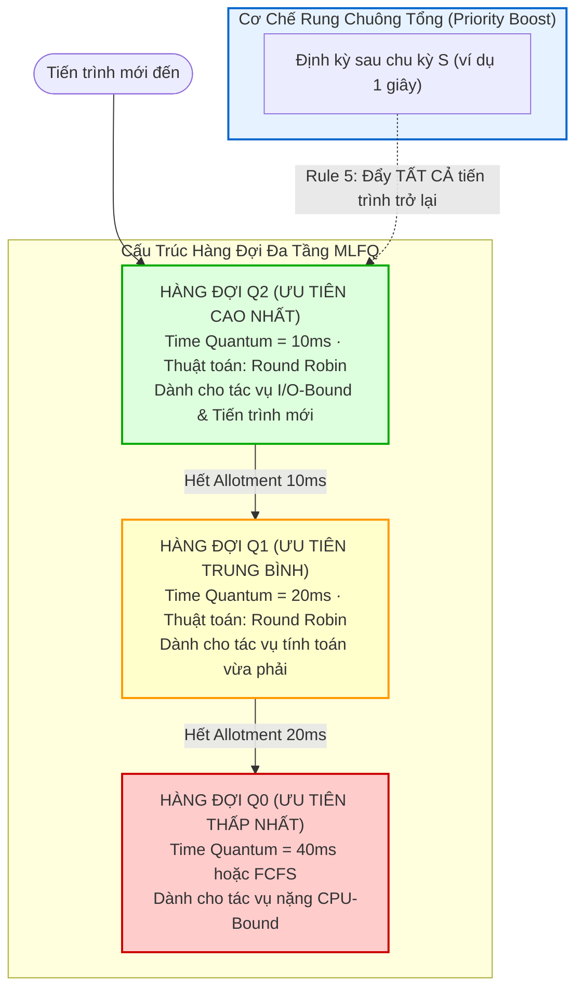

# 1_6_7 Multilevel Feedback Queue

> **Khóa học**: Cloud & DevOps Cơ Bản  
> **Phân nhóm**: Domain 1 - Operating System Core Fundamentals  
> **Chủ đề**: 1_6 CPU Scheduling  
> **Checklist đối chiếu**: [1_6_7](../../../CHECKLIST.md#domain-1-operating-system-core-fundamentals-45-items)  
> **Trạng thái**: Hoàn thành  

---

## 1. Khái Niệm Cốt Lõi & Bản Chất Kỹ Thuật (Core Concepts & Technical Deep Dive)

Trong lý thuyết điều phối hệ điều hành, hai mục tiêu hiệu năng quan trọng nhất thường xuyên xung đột gay gắt với nhau:
1. **Tối ưu hóa Thời gian hoàn thành (Turnaround Time)**: Cần ưu tiên các tác vụ ngắn chạy trước (như trong thuật toán Shortest Job First - SJF hoặc STCF).
2. **Tối ưu hóa Thời gian phản hồi (Response Time)**: Cần chia nhỏ các lát cắt thời gian CPU đều đặn cho mọi tiến trình (như trong thuật toán Round Robin - RR) để đảm bảo tính tương tác mượt mà cho người dùng.

Để giải quyết bài toán hóc búa này trong điều kiện thực tế — **nơi hệ điều hành hoàn toàn không thể biết trước độ dài CPU burst tương lai của bất kỳ tiến trình nào** — nhà khoa học máy tính **Fernando J. Corbató** đã phát minh ra **Hàng Đợi Đa Cấp Phản Hồi (Multi-Level Feedback Queue - MLFQ)** vào năm 1962 cho hệ thống chia sẻ thời gian CTSS (công trình đã mang lại cho ông giải thưởng Turing Award danh giá năm 1990).

```
+-------------------------------------------------------------------------------+
|                      TRIẾT LÝ HỌC HỎI TỪ QUÁ KHỨ CỦA MLFQ                     |
+-------------------------------------------------------------------------------+
|                                                                               |
|  1. TIẾN TRÌNH MỚI ĐẾN: Mặc định coi là tác vụ ngắn tương tác                 |
|     ===> Đưa vào hàng đợi ưu tiên cao nhất (Q2) với Time Quantum cực ngắn.    |
|                                                                               |
|  2. NẾU TIẾN TRÌNH NGỐN HẾT QUANTUM: Chứng tỏ nó là tác vụ tính toán nặng     |
|     ===> Giáng cấp (Demote) xuống hàng đợi thấp hơn (Q1 -> Q0).               |
|                                                                               |
|  3. NẾU TIẾN TRÌNH NHẢ CPU SỚM LÀM I/O: Chứng tỏ nó là tác vụ tương tác GUI   |
|     ===> Giữ nguyên ở hàng đợi ưu tiên cao để phản hồi siêu tốc!              |
|                                                                               |
+-------------------------------------------------------------------------------+
```

---

### 1.1. 5 Quy Tắc Vàng Chuẩn Mực Của Thuật Toán MLFQ

Theo giáo trình chuẩn mực **OSTEP (Operating Systems: Three Easy Pieces - Chapter 8, Section 8.6)**, một bộ lập lịch MLFQ hoàn thiện được điều khiển bởi **5 quy tắc bất biến (The 5 Canonical Rules)**:

- **Quy tắc 1 (Rule 1)**: Nếu $\text{Priority}(A) > \text{Priority}(B)$, Tiến trình $A$ được chạy CPU ($B$ không được chạy).
- **Quy tắc 2 (Rule 2)**: Nếu $\text{Priority}(A) = \text{Priority}(B)$, $A$ và $B$ cùng chạy chia sẻ thời gian theo thuật toán **Round Robin (RR)** sử dụng lát cắt thời gian ($Time\ Quantum$) của hàng đợi đó.
- **Quy tắc 3 (Rule 3)**: Khi một tiến trình mới bước vào hệ thống, nó luôn được đặt vào **hàng đợi có mức ưu tiên cao nhất** (Topmost Queue).
- **Quy tắc 4 (Rule 4 - Cơ chế Chống Gian Lận / Anti-Gaming)**: Khi một tiến trình sử dụng hết hạn mức thời gian tích lũy (**Time Allotment**) ở một tầng hàng đợi (bất kể nó đã chủ động nhả CPU bao nhiêu lần bằng lệnh I/O), độ ưu tiên của nó sẽ bị giáng xuống một bậc (**chuyển xuống hàng đợi thấp hơn** kề dưới).
- **Quy tắc 5 (Rule 5 - Cơ chế Chống Bỏ Đói / Priority Boost)**: Sau một chu kỳ thời gian $S$ nhất định (Time Period $S$), hệ thống thực hiện cú "rung chuông tổng", **di chuyển toàn bộ tất cả các tiến trình trong hệ thống trở lại hàng đợi cao nhất** (Topmost Queue).

---

### 1.2. Phân Tích Hai Cơ Chế Phòng Thủ Cốt Tử Của MLFQ

#### 1. Cơ Chế Chống Gian Lận (Preventing Gaming of the Scheduler)
- **Lỗ hổng ban đầu**: Trong phiên bản thiết kế thô sơ, quy tắc giáng cấp quy định: *"Nếu tiến trình dùng hết 1 time quantum mà chưa nhả CPU thì bị giáng cấp"*. Một lập trình viên tinh quái có thể viết mã độc hại: Chạy tính toán đến 99% thời lượng quantum, sau đó phát ra một lệnh I/O giả (dummy I/O) để tự nguyện nhả CPU. Hệ thống ngây thơ tưởng nó là tiến trình I/O nên tiếp tục giữ nó ở hàng đợi cao nhất, giúp nó chiếm tới 99% CPU vĩnh viễn!
- **Giải pháp bằng Allotment (Rule 4)**: Thay vì đo lường từng quantum riêng lẻ, hệ điều hành thiết lập một bộ đếm thời gian tích lũy (**Cumulative Time Allotment**). Dù tiến trình có phát ra 100 lần I/O ngắt quãng, chỉ cần tổng thời gian nó đã thực thi trên CPU tại tầng đó cộng dồn chạm ngưỡng Allotment, nó sẽ lập tức bị giáng cấp xuống hàng đợi dưới.

#### 2. Cơ Chế Chống Bỏ Đói & Thích Ứng Đổi Pha (Preventing Starvation & Handling Phase Change)
- **Vấn đề**: Nếu có quá nhiều tiến trình tương tác mới liên tục đổ vào hệ thống, các tiến trình tính toán CPU-Bound nằm ở hàng đợi thấp nhất ($Q_0$) sẽ bị bỏ đói hoàn toàn (**Starvation**). Ngoài ra, một tiến trình trước đây là CPU-Bound (ví dụ đọc dữ liệu lớn) nhưng sau đó chuyển pha thành tương tác (hiển thị kết quả cho người dùng bấm) sẽ bị kẹt vĩnh viễn ở đáy xã hội $Q_0$.
- **Giải pháp bằng Priority Boost (Rule 5)**: Cứ sau mỗi chu kỳ thời gian $S$ (ví dụ: $S = 1\text{ giây}$), toàn bộ tiến trình ở mọi tầng đều được "tẩy trắng hồ sơ", đồng loạt đưa về hàng đợi trên cùng $Q_{\text{top}}$. Nhờ đó, các tác vụ tính toán nặng đều được đảm bảo tiến triển (phá vỡ Starvation), và các tác vụ đổi pha tương tác có cơ hội lấy lại phong độ phản hồi nhanh.

---

## 2. Ví Dụ Đời Sống Thực Tế Dễ Hiểu (Intuitive Real-World Analogies)

```
===================================================================================
       HỆ THỐNG PHÂN LÀN THÔNG MINH 3 TẦNG TẠI TRUNG TÂM HÀNH CHÍNH CÔNG (MLFQ)
===================================================================================

[TẦNG 1: LÀN VIP / HỎI NHANH ĐÁP GỌN (Quantum = 1 phút)]:
  - Dành cho mọi công dân mới bước chân vào cửa (Rule 3).
  - Bác Ba chỉ đến xin đóng dấu vào 1 tờ giấy (I/O-Bound): Xử lý mất 30 giây xong việc ngay.
    Bác Ba ra về vui vẻ, thời gian phản hồi siêu tốc!

[TẦNG 2: LÀN THỦ TỤC TRUNG BÌNH (Quantum = 5 phút)]:
  - Anh Nam vào Tầng 1 nhưng nói chuyện quá 1 phút không xong.
  - Cán bộ hành chính lịch sự mời: "Hết giờ ưu tiên nhanh, mời anh sang Bàn Tầng 2 ngồi!" (Rule 4).
  - Tầng 2 có thời gian xử lý dài hơn cho các hồ sơ vừa phải.

[TẦNG 3: LÀN HỒ SƠ PHỨC TẠP / XỬ LÝ LÔ (Quantum = 30 phút / FCFS)]:
  - Chị Lan mang theo 50 bộ hồ sơ chuyển nhượng nhà đất cồng kềnh (CPU-Bound).
  - Chị Lan dùng hết 1 phút ở Tầng 1, hết tiếp 5 phút ở Tầng 2 vẫn chưa xong.
  - Chị Lan được chuyển xuống Tầng 3 ngồi xếp hàng tuần tự giải quyết các bộ hồ sơ lớn.

[RUNG CHUÔNG TỔNG MỖI SÁNG THỨ HAI (Priority Boost - Rule 5)]:
  - Cứ đúng 8h sáng thứ Hai đầu tuần, loa phát thanh thông báo:
    "Mời tất cả bà con đang chờ ở Tầng 3 và Tầng 2 cùng quay lại Tầng 1 để được rà soát lại từ đầu!"
  - Giúp chị Lan không bao giờ bị bỏ quên, và nếu chị chỉ còn 1 chữ ký cuối cùng thì sẽ xong ngay!
===================================================================================
```

---

## 3. Kiến Trúc, Luồng Hoạt Động & Hình Ảnh Trực Quan (Architecture & Diagrams)

### 3.1. Hình Ảnh Trực Quan Từ Tài Liệu Chuẩn

Dưới đây là sơ đồ kiến trúc chính thức của Hàng đợi đa cấp có phản hồi:

[](https://www.cs.uic.edu/~jbell/CourseNotes/OperatingSystems/images/Chapter5/5_07_MultilevelFeedbackQueues.jpg)  
*Hình 1: Cấu trúc điều phối hàng đợi đa cấp phản hồi với các lát cắt thời gian tăng dần ($8\text{ms} \to 16\text{ms} \to \text{FCFS}$) và luồng giáng cấp tiến trình (Nguồn: UIC Operating Systems Notes / Silberschatz).*

---

### 3.2. Sơ Đồ Luồng Hoạt Động Chi Tiết Của MLFQ 3 Tầng



---

## 4. Code Mẫu Trực Quan Hoặc Dòng Lệnh Thực Chiến (Runnable Sample Code / CLI)

### 4.1. Mã Nguồn C: Mô Phỏng Thuật Toán MLFQ 3 Tầng Chuẩn Mực (`mlfq_simulator.c`)

Chương trình C dưới đây mô phỏng đầy đủ thuật toán MLFQ với 3 hàng đợi, hiện thực hóa cơ chế giáng cấp tích lũy Allotment và cơ chế thăng cấp Priority Boost định kỳ:

```c
#include <stdio.h>
#include <stdbool.h>

#define NUM_JOBS 3
#define BOOST_INTERVAL 50 // Cứ sau 50ms thực hiện Priority Boost

typedef struct {
    int pid;
    int remaining_time;      // Thời gian chạy còn lại
    int priority_queue;      // Hàng đợi hiện tại (2: Cao nhất, 1: Trung bình, 0: Thấp nhất)
    int time_allotment_left; // Hạn mức thời gian còn lại ở tầng hiện tại
} Job;

// Lát cắt thời gian cấu hình cho từng tầng
const int queue_quantum[3] = {40, 20, 10}; // Q0: 40ms, Q1: 20ms, Q2: 10ms

void priority_boost(Job jobs[], int n, int current_time) {
    printf("\n>>> [CHUÔNG TỔNG PRIORITY BOOST T=%d ms]: Đưa toàn bộ tiến trình về Q2! <<<\n", current_time);
    for (int i = 0; i < n; i++) {
        if (jobs[i].remaining_time > 0) {
            jobs[i].priority_queue = 2; // Nâng về Q2
            jobs[i].time_allotment_left = queue_quantum[2];
        }
    }
}

int main(void) {
    printf("=======================================================================\n");
    printf("      MÔ PHỎNG THUẬT TOÁN ĐIỀU PHỐI MULTI-LEVEL FEEDBACK QUEUE (MLFQ)  \n");
    printf("=======================================================================\n\n");

    // Khởi tạo 3 tiến trình mẫu:
    // P1: Tác vụ cực dài (CPU-Bound, 80ms)
    // P2: Tác vụ trung bình (35ms)
    // P3: Tác vụ tương tác siêu ngắn (I/O-Bound, 8ms)
    Job jobs[NUM_JOBS] = {
        {1, 80, 2, queue_quantum[2]},
        {2, 35, 2, queue_quantum[2]},
        {3,  8, 2, queue_quantum[2]}
    };

    int current_time = 0;
    int completed_count = 0;
    int last_boost_time = 0;

    while (completed_count < NUM_JOBS) {
        // Kiểm tra định kỳ Priority Boost (Rule 5)
        if (current_time - last_boost_time >= BOOST_INTERVAL) {
            priority_boost(jobs, NUM_JOBS, current_time);
            last_boost_time = current_time;
        }

        // Tìm tiến trình có hàng đợi ưu tiên cao nhất (Q2 > Q1 > Q0)
        int selected = -1;
        int highest_q = -1;
        for (int i = 0; i < NUM_JOBS; i++) {
            if (jobs[i].remaining_time > 0) {
                if (jobs[i].priority_queue > highest_q) {
                    highest_q = jobs[i].priority_queue;
                    selected = i;
                }
            }
        }

        if (selected == -1) break;

        Job* j = &jobs[selected];
        int q_level = j->priority_queue;
        int slice = (j->remaining_time < j->time_allotment_left) ? j->remaining_time : j->time_allotment_left;

        printf("T=%3d ms: Job P%d đang chạy tại Hàng đợi Q%d (Chạy %2d ms) | Còn lại: %2d ms\n",
               current_time, j->pid, q_level, slice, j->remaining_time - slice);

        current_time += slice;
        j->remaining_time -= slice;
        j->time_allotment_left -= slice;

        // Nếu tiến trình hoàn tất
        if (j->remaining_time == 0) {
            printf("   ===> [HOÀN TẤT] Job P%d đã kết thúc thành công tại T=%d ms!\n", j->pid, current_time);
            completed_count++;
        }
        // Nếu hết hạn mức allotment ở tầng này => Giáng cấp (Rule 4)
        else if (j->time_allotment_left <= 0) {
            if (j->priority_queue > 0) {
                j->priority_queue--;
                printf("   ---> [GIÁNG CẤP] Job P%d hết allotment, bị chuyển xuống Q%d!\n", j->pid, j->priority_queue);
            }
            j->time_allotment_left = queue_quantum[j->priority_queue];
        }
    }

    printf("\n=== Toàn bộ %d tiến trình đã hoàn tất điều phối MLFQ tại T=%d ms ===\n", NUM_JOBS, current_time);
    return 0;
}
```

---

### 4.2. Biên Dịch và Kết Quả Thực Thi

```bash
# Biên dịch chương trình
gcc -Wall -Wextra mlfq_simulator.c -o mlfq_simulator

# Chạy mô phỏng
./mlfq_simulator
```

**Đầu ra trên Terminal:**
```text
=======================================================================
      MÔ PHỎNG THUẬT TOÁN ĐIỀU PHỐI MULTI-LEVEL FEEDBACK QUEUE (MLFQ)  
=======================================================================

T=  0 ms: Job P1 đang chạy tại Hàng đợi Q2 (Chạy 10 ms) | Còn lại: 70 ms
   ---> [GIÁNG CẤP] Job P1 hết allotment, bị chuyển xuống Q1!
T= 10 ms: Job P2 đang chạy tại Hàng đợi Q2 (Chạy 10 ms) | Còn lại: 25 ms
   ---> [GIÁNG CẤP] Job P2 hết allotment, bị chuyển xuống Q1!
T= 20 ms: Job P3 đang chạy tại Hàng đợi Q2 (Chạy  8 ms) | Còn lại:  0 ms
   ===> [HOÀN TẤT] Job P3 đã kết thúc thành công tại T=28 ms!
T= 28 ms: Job P1 đang chạy tại Hàng đợi Q1 (Chạy 20 ms) | Còn lại: 50 ms
   ---> [GIÁNG CẤP] Job P1 hết allotment, bị chuyển xuống Q0!
T= 48 ms: Job P2 đang chạy tại Hàng đợi Q1 (Chạy 20 ms) | Còn lại:  5 ms
   ---> [GIÁNG CẤP] Job P2 hết allotment, bị chuyển xuống Q0!

>>> [CHUÔNG TỔNG PRIORITY BOOST T=68 ms]: Đưa toàn bộ tiến trình về Q2! <<<
T= 68 ms: Job P1 đang chạy tại Hàng đợi Q2 (Chạy 10 ms) | Còn lại: 40 ms
   ---> [GIÁNG CẤP] Job P1 hết allotment, bị chuyển xuống Q1!
T= 78 ms: Job P2 đang chạy tại Hàng đợi Q2 (Chạy  5 ms) | Còn lại:  0 ms
   ===> [HOÀN TẤT] Job P2 đã kết thúc thành công tại T=83 ms!
T= 83 ms: Job P1 đang chạy tại Hàng đợi Q1 (Chạy 20 ms) | Còn lại: 20 ms
   ---> [GIÁNG CẤP] Job P1 hết allotment, bị chuyển xuống Q0!
T=103 ms: Job P1 đang chạy tại Hàng đợi Q0 (Chạy 20 ms) | Còn lại:  0 ms
   ===> [HOÀN TẤT] Job P1 đã kết thúc thành công tại T=123 ms!

=== Toàn bộ 3 tiến trình đã hoàn tất điều phối MLFQ tại T=123 ms ===
```

---

## 5. Cạm Bẫy Thực Tế & Thực Tiễn Sản Xuất (Production Gotchas & Best Practices)

### 5.1. Đính Chính Kỹ Thuật Trọng Yếu: Mainline Linux Kernel KHÔNG DÙNG MLFQ!

Một sự nhầm lẫn phổ biến của sinh viên và kỹ sư phần mềm là cho rằng nhân Linux hiện đại sử dụng thuật toán MLFQ. Thực tế cấu trúc điều phối của nhân Linux có lộ trình tiến hóa hoàn toàn khác biệt:

```
+-------------------------------------------------------------------------------+
|               LỊCH SỬ TIẾN HÓA BỘ LẬP LỊCH CỦA LINUX KERNEL                   |
+-------------------------------------------------------------------------------+
|                                                                               |
|  1. Linux 2.4: Bộ lập lịch O(n) đơn giản (duyệt tuyến tính toàn bộ task).     |
|                                                                               |
|  2. Linux 2.6: Bộ lập lịch O(1) của Ingo Molnar                               |
|     - Sử dụng 2 mảng active/expired runqueues với 140 mảng liên kết.          |
|     - Bị thay thế vì logic tương tác (heuristics) quá phức tạp và dễ lỗi.     |
|                                                                               |
|  3. Linux 2.6.23 đến 6.5: Completely Fair Scheduler (CFS)                     |
|     - Sáng tạo bởi Ingo Molnar.                                               |
|     - Vận hành dựa trên khái niệm Virtual Runtime (vruntime) và Cây Đỏ-Đen    |
|       (Red-Black Tree), áp dụng triết lý Chia sẻ tỷ lệ (Proportional Share).  |
|                                                                               |
|  4. Linux 6.6+ (Hiện tại): EEVDF (Earliest Eligible Virtual Deadline First)   |
|     - Được phát triển bởi chuyên gia Peter Zijlstra.                          |
|     - Thay thế hoàn toàn CFS để giải quyết triệt để vấn đề độ trễ phản hồi   |
|       (Latency-sensitive tasks) mà không cần dùng đến các mẹo can thiệp thô. |
|                                                                               |
+-------------------------------------------------------------------------------+
```

- **Vậy các hệ điều hành nào thực sự sử dụng MLFQ?**
  - **4.4BSD & FreeBSD**: Triển khai thuật toán MLFQ cổ điển với cơ chế phân rã độ ưu tiên (decay-usage priority).
  - **Oracle Solaris**: Phân lớp lập lịch `TS` (Time-Sharing Scheduling Class) sử dụng bảng tra cứu ma trận MLFQ với các mức ưu tiên từ 0 đến 59.
  - **Microsoft Windows NT (Windows 10/11 Server)**: Hàng đợi đa cấp với cơ chế **Dynamic Priority Boosting** — tự động tăng độ ưu tiên tạm thời cho các luồng khi nhận được sự kiện chuột/bàn phím hoặc hoàn tất I/O.

---

### 5.2. Cạm Bẫy Cấu Hình Tham Số Trong Các Hệ Thống Sử Dụng MLFQ

- **Số lượng hàng đợi quá nhiều hoặc quá ít**: Nếu chỉ có 2 hàng đợi, MLFQ thoái hóa thành thuật toán Round Robin thông thường. Nếu có quá nhiều hàng đợi (ví dụ 64 tầng), chi phí kiểm tra và dịch chuyển tiến trình qua lại sẽ làm nghẽn bộ nhớ đệm CPU (Cache Thrashing).
- **Tham số chu kỳ $S$ của Priority Boost**:
  - Nếu cấu hình $S$ quá lớn: Các tiến trình tính toán nặng ở đáy $Q_0$ sẽ bị bỏ đói (Starvation) trong thời gian dài.
  - Nếu cấu hình $S$ quá nhỏ: Các tác vụ CPU-Bound liên tục bị đẩy lên đỉnh $Q_{\text{top}}$, làm nghẽn hàng đợi ưu tiên và cản trở các tác vụ tương tác thực sự.

---

## 6. Câu Hỏi Củng Cố Kiến Thức (Active Recall Quiz)

<details>
<summary><b>Câu hỏi 1:</b> Tại sao thuật toán MLFQ lại được coi là bộ lập lịch "học hỏi từ hành vi quá khứ"? Nó giải quyết bài toán tối ưu Turnaround Time mà không cần biết trước tương lai bằng cách nào?</summary>

> **Đáp án:**
> - **Nguyên lý học hỏi**: MLFQ không yêu cầu ứng dụng phải khai báo trước thời lượng thực thi. Thay vào đó, nó đưa ra một **giả định lạc quan ban đầu** (mọi tiến trình mới đều là việc ngắn tương tác và đặt ở $Q_{\text{top}}$).  
> - **Cơ chế tự điều chỉnh**: Khi tiến trình thực thi, nếu nó liên tục ngốn hết hạn mức thời gian (Allotment) mà không nhả CPU, nó đã tự bộc lộ bản chất là một tác vụ tính toán nặng (CPU-Bound), và MLFQ sẽ giáng cấp nó xuống các hàng đợi thấp hơn. Ngược lại, nếu tiến trình nhả CPU sớm để làm I/O, nó duy trì vị trí ở tầng cao. Nhờ vậy, MLFQ tự động phân loại và xắp xếp các tiến trình ngắn chạy trước các tiến trình dài một cách tự nhiên, đạt được hiệu quả xấp xỉ thuật toán tối ưu SJF/STCF mà không cần biết trước tương lai.
</details>

<details>
<summary><b>Câu hỏi 2:</b> Một tiến trình độc hại liên tục chạy 9.9ms trong lát cắt thời gian 10ms rồi gọi lệnh đọc 1 byte file giả (Dummy I/O) để nhả CPU. Trong phiên bản MLFQ chuẩn mực (với Rule 4 về Allotment), tiến trình này có thể chiếm giữ vĩnh viễn hàng đợi cao nhất không? Vì sao?</summary>

> **Đáp án:**
> **HOÀN TOÀN KHÔNG THỂ.**  
> Trong phiên bản MLFQ chuẩn mực (được hoàn thiện bởi Rule 4), hệ thống không đặt lại (reset) thời gian sử dụng về 0 mỗi khi tiến trình nhả CPU. Thay vào đó, nó theo dõi **hạn mức thời gian tích lũy (Cumulative Time Allotment)**. Dù tiến trình có gọi dummy I/O bao nhiêu lần, các khoảng thời gian 9.9ms sẽ được cộng dồn lại: $9.9\text{ms} + 9.9\text{ms} + \dots = 19.8\text{ms} > 10\text{ms}$. Ngay khi tổng thời gian cộng dồn vượt quá hạn mức allotment của tầng đó, tiến trình sẽ lập tức bị giáng cấp xuống hàng đợi thấp hơn, triệt tiêu hoàn toàn chiêu trò gian lận.
</details>

<details>
<summary><b>Câu hỏi 3:</b> Nhân Linux từ phiên bản 2.6.23 đến 6.5 sử dụng bộ lập lịch nào? Thuật toán đó khác biệt cơ bản như thế nào so với MLFQ?</summary>

> **Đáp án:**
> - **Bộ lập lịch sử dụng**: Nhân Linux sử dụng **Completely Fair Scheduler (CFS)** (và từ Linux 6.6+ chuyển sang **EEVDF**).
> - **Khác biệt cơ bản so với MLFQ**:
>   - *MLFQ*: Phân chia hệ thống thành nhiều hàng đợi ưu tiên rời rạc ($Q_0, Q_1, Q_2$), sử dụng các lát cắt thời gian cố định và di chuyển tiến trình lên xuống giữa các hàng đợi dựa trên việc hết quantum.
>   - *CFS*: Hoàn toàn **không dùng nhiều hàng đợi ưu tiên**. CFS sử dụng một cấu trúc dữ liệu duy nhất là **Cây Đỏ-Đen (Red-Black Tree)** và theo dõi chỉ số **Thời gian thực thi ảo (Virtual Runtime - `vruntime`)** của mỗi tiến trình. Tiến trình nào có `vruntime` nhỏ nhất (được hưởng ít thời gian CPU nhất trong quá khứ) sẽ nằm ở nút ngoài cùng bên trái của cây và được chọn chạy tiếp theo. CFS hiện thực hóa mô hình Chia sẻ theo tỷ lệ (Proportional Share) lý tưởng thay vì phân tầng hàng đợi như MLFQ.
</details>

---

## 7. 📚 Nguồn Tài Liệu Chính Thống (Tier-1 Official References)

- [OSTEP Chapter 8: Multi-level Feedback Queue (Remzi H. Arpaci-Dusseau and Andrea C. Arpaci-Dusseau)](https://pages.cs.wisc.edu/~remzi/OSTEP/cpu-sched-mlfq.pdf) - Giáo trình hệ điều hành chuẩn mực phân tích chi tiết nguồn gốc lịch sử, 5 quy tắc vàng của MLFQ và các cơ chế phòng thủ (Mục 8.1 - 8.7, trang 1-12).
- [Corbató et al. (1962) An Experimental Time-Sharing System (ACM SJCC / Turing Award)](https://dl.acm.org/doi/10.1145/1461518.1461563) - Công trình nghiên cứu lịch sử đầu tiên công bố mô hình phân tầng hàng đợi phản hồi cho hệ thống tương tác CTSS.
- [Linux Kernel Documentation: CFS Scheduler](https://docs.kernel.org/scheduler/sched-design-CFS.html) - Tài liệu kiến trúc chính thức từ Linux Kernel Documentation mô tả chi tiết thiết kế Completely Fair Scheduler (CFS) và giải thích tại sao Linux không dùng MLFQ.
- [Linux Kernel Documentation: EEVDF Scheduler](https://docs.kernel.org/scheduler/sched-eevdf.html) - Tài liệu kiến trúc bộ điều phối EEVDF chính thức của Linux Kernel.
- [Linux Programmer's Manual: sched(7)](https://man7.org/linux/man-pages/man7/sched.7.html) - Tổng quan chính thức về các chính sách lập lịch `SCHED_OTHER`, `SCHED_BATCH`, `SCHED_FIFO`, `SCHED_RR` trên nhân Linux.
