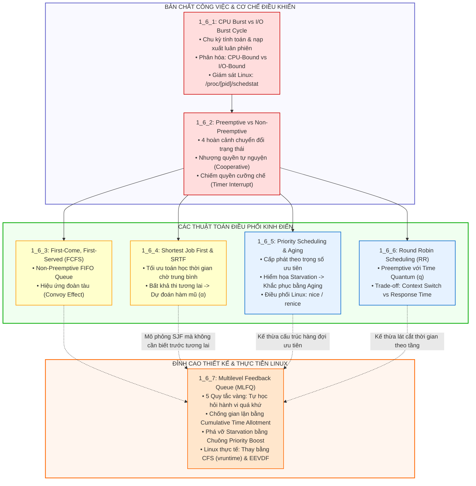

# 1_6 CPU Scheduling

> **Khóa học**: Hệ điều hành (Operating Systems) · **Domain**: 1 Domain 1 - Operating System Core Fundamentals · **Roadmap gốc**: [OS README](<../../README.md#module-6-cpu-scheduling>)

---

## Module này dạy gì? (What & Why)

Module này trang bị toàn diện lý thuyết nền tảng và cơ chế thực thi của **Bộ điều phối CPU (CPU Scheduler)** — trái tim của hệ điều hành hiện đại chịu trách nhiệm phân chia tài nguyên tính toán hữu hạn cho hàng trăm tiến trình đồng thời. Bản chất của mọi chương trình máy tính là chu kỳ luân phiên liên tục giữa xử lý tính toán (**CPU Burst**) và chờ nạp xuất dữ liệu (**I/O Burst**), tạo nên sự phân hóa rõ rệt giữa tiến trình tính toán nặng (CPU-Bound) và tiến trình tương tác nhanh (I/O-Bound). 

Hệ điều hành kiểm soát tiến trình thông qua hai cơ chế điều phối cơ bản: **Không thể tước đoạt (Non-Preemptive / Cooperative)** dựa trên sự nhượng bộ tự nguyện, và **Có thể tước đoạt (Preemptive)** dựa trên ngắt đồng hồ phần cứng (Timer Interrupt) để bảo vệ tính công bằng và khả năng đáp ứng của hệ thống. Trên cơ sở đó, module phân tích có hệ thống các thuật toán điều phối cổ điển: từ **FCFS** với hiện tượng thắt cổ chai đoàn tàu (**Convoy Effect**), tính tối ưu toán học của **SJF/SRTF** cùng công thức làm mịn hàm mũ dự đoán thời gian chạy, cho đến hiểm họa đói tài nguyên (**Starvation**) trong **Priority Scheduling** và giải pháp khắc phục bằng cơ chế **Lão hóa (Aging)**.

Cuối cùng, module phân tích thuật toán xoay vòng **Round Robin (RR)** với bài toán đánh đổi sống còn giữa thời gian đáp ứng và chi phí chuyển đổi ngữ cảnh (**Context Switch Overhead**), trước khi đi sâu vào đỉnh cao của kỹ thuật điều phối cổ điển: **Đa hàng đợi phản hồi (Multilevel Feedback Queue - MLFQ)**. Người học sẽ nắm vững 5 quy tắc vàng giúp MLFQ tự động học hỏi hành vi trong quá khứ để tối ưu đồng thời thời gian lưu lại (Turnaround Time) và thời gian đáp ứng (Response Time), cùng cái nhìn chuẩn xác về sự chuyển dịch sang Completely Fair Scheduler (CFS) và EEVDF trong nhân Linux sản xuất ngày nay.

---

## Lộ trình bài học (Lesson Path)

| Bài học | Mục tiêu cốt lõi | Checklist ID |
| :--- | :--- | :---: |
| [1_6_1 CPU Burst vs IO Burst Cycle](<./1_6_1 CPU Burst vs IO Burst Cycle.md>) | Phân tích chu kỳ luân phiên CPU-I/O Burst, phân loại tiến trình CPU-Bound vs I/O-Bound, quan sát thời gian chờ và chạy qua `/proc/[pid]/schedstat` trên Linux. | [1_6_1](<../../../CHECKLIST.md#16-cpu-scheduling>) |
| [1_6_2 Preemptive vs Non-Preemptive Scheduling](<./1_6_2 Preemptive vs Non-Preemptive Scheduling.md>) | Phân biệt 4 hoàn cảnh chuyển trạng thái của tiến trình; cơ chế nhượng quyền CPU tự nguyện vs ngắt đồng hồ phần cứng (Hardware Timer Interrupt / Preemption). | [1_6_2](<../../../CHECKLIST.md#16-cpu-scheduling>) |
| [1_6_3 First-Come First-Served Scheduling](<./1_6_3 First-Come First-Served Scheduling.md>) | Nguyên lý hàng đợi FIFO không tước đoạt, xây dựng biểu đồ Gantt, phân tích định lượng hiệu ứng đoàn tàu (Convoy Effect) kéo sụt giảm hiệu năng hệ thống. | [1_6_3](<../../../CHECKLIST.md#16-cpu-scheduling>) |
| [1_6_4 Shortest Job First and SRTF](<./1_6_4 Shortest Job First and SRTF.md>) | Chứng minh toán học tính tối ưu thời gian chờ của SJF/SRTF; phương pháp ước lượng thời lượng CPU burst tiếp theo bằng giải thuật làm mịn hàm mũ (Exponential Smoothing). | [1_6_4](<../../../CHECKLIST.md#16-cpu-scheduling>) |
| [1_6_5 Priority Scheduling and Aging](<./1_6_5 Priority Scheduling and Aging.md>) | Nguyên lý cấp phát theo độ ưu tiên số học, hiểm họa Starvation vô thời hạn và giải thuật Lão hóa (Aging); quản trị `nice` và `renice` trên Linux CLI. | [1_6_5](<../../../CHECKLIST.md#16-cpu-scheduling>) |
| [1_6_6 Round Robin Scheduling](<./1_6_6 Round Robin Scheduling.md>) | Phân bổ lát cắt thời gian (Time Quantum $q$), phân tích bài toán đánh đổi giữa Context Switch overhead và Response Time; điều phối thời gian thực mềm `SCHED_RR`. | [1_6_6](<../../../CHECKLIST.md#16-cpu-scheduling>) |
| [1_6_7 Multilevel Feedback Queue](<./1_6_7 Multilevel Feedback Queue.md>) | 5 quy tắc vàng của Corbató/OSTEP, cơ chế Allotment chống gian lận CPU, Priority Boost định kỳ chống Starvation, đính chính kiến trúc CFS/EEVDF của Linux. | [1_6_7](<../../../CHECKLIST.md#16-cpu-scheduling>) |

---

## Bản đồ khái niệm (Concept Map)

Sơ đồ dưới đây minh họa mối quan hệ logic xuyên suốt giữa 7 bài học trong Module 1.6:

---

## Ẩn dụ xuyên suốt (Module Analogy)

Để giúp người học dễ dàng nắm bắt các khái niệm trừu tượng, Module 1.6 sử dụng hình tượng so sánh xuyên suốt về **Nhà hàng ẩm thực với Bếp trưởng CPU điều phối các loại thực khách**:

1. **Chu kỳ ăn uống của khách — CPU Burst vs I/O Burst**: Khách vào nhà hàng không ăn liên tục suốt 5 tiếng. Khách có lúc gắp thức ăn bỏ vào miệng nhai (CPU Burst - lúc Bếp trưởng xào nấu) và có lúc dừng lại uống nước ngọt, nói chuyện với bạn bè (I/O Burst - chờ nạp xuất dữ liệu). Khách I/O-Bound như người ghé uống vội ly trà đá (ăn nhanh, nói nhiều), còn khách CPU-Bound như hội nhóm gọi lẩu buffet phức tạp (bếp phải nấu liên tục không ngừng).
2. **Quyền hạn của Bếp trưởng — Non-Preemptive vs Preemptive**:
   - *Non-Preemptive (Không tước đoạt)*: Bếp trưởng nấu cho bàn nào là phục vụ đến khi bàn đó ăn no nê đứng dậy thanh toán mới chuyển bàn khác. Nếu gặp bàn tiệc 10 món, toàn bộ khách phía sau phải đứng chờ ngoài cửa dù họ chỉ xin một cốc nước lọc.
   - *Preemptive (Tước đoạt)*: Gian bếp lắp đồng hồ bấm giờ (Timer Interrupt). Bếp trưởng chỉ nấu cho mỗi bàn một khoảng thời gian nhất định, chuông reo là bếp trưởng tạm dừng dọn món cho bàn tiếp theo.
3. **Các thuật toán phục vụ bàn**:
   - *FCFS*: Ai đến cửa trước được ăn trước. Người xếp đầu gọi mâm cỗ 10 món khiến cả hàng dài người đứng sau chờ mỏi chân (hiệu ứng đoàn tàu Convoy Effect).
   - *SJF / SRTF*: Bếp trưởng phục vụ người gọi món nhanh nhất trước (rót nước trước, làm salad trước). Số lượng thực khách rời quán tăng vọt (Thời gian chờ trung bình tối ưu), nhưng bếp trưởng phải đoán mò xem món nào nấu nhanh hơn (Dự đoán hàm mũ $\alpha$).
   - *Priority*: Phục vụ người có thẻ VIP trước. Khách vãng lai đến trước bị gạt sang một bên. Nếu khách VIP vào liên tục, khách vãng lai chết đói (Starvation). Để giải quyết, nhà hàng ban hành luật **Lão hóa (Aging)**: cứ mỗi 15 phút khách vãng lai ngồi chờ, thẻ của họ tự động được thăng lên 1 bậc ưu tiên, đến khi họ biến thành khách VIP và được phục vụ!
   - *Round Robin*: Bếp trưởng phục vụ theo vòng tròn, mỗi bàn nếm thử một đĩa nhỏ trong 5 phút (Time Quantum $q$). Nếu $q$ quá dài, biến thành FCFS. Nếu $q$ quá ngắn (vài giây), bếp trưởng chỉ lo đổi tạp dề, rửa chảo, ghi chép sổ sách (Context Switch Overhead) mà khách chẳng kịp nhai xong miếng thịt.
   - *MLFQ*: Nhà hàng chia làm 3 tầng phục vụ. Khách mới vào luôn được đưa lên Tầng 1 (Tầng phục vụ nhanh nhất, lát cắt thời gian ngắn). Khách nào chỉ uống nước ngọt rồi về thì được phục vụ ngay lập tức (Response Time cực nhanh). Khách nào ăn hết hạn mức thời gian quy định (Time Allotment) mà chưa chịu về thì tự động bị mời xuống Tầng 2, rồi Tầng 3 (lát cắt thời gian dài hơn để xử lý việc lớn). Định kỳ mỗi giờ, tiếng chuông tổng (**Priority Boost**) vang lên, đưa toàn bộ khách ở tầng dưới lên lại Tầng 1 để không một ai bị bỏ quên!

---

## Tự kiểm tra cuối module (Module Review)

<b>Câu hỏi 1:</b> Tại sao thuật toán Shortest Job First (SJF / SRTF) được chứng minh toán học là tối ưu về Thời gian chờ trung bình (Average Waiting Time), nhưng lại không thể triển khai hoàn hảo trong bộ lập lịch thực tế của hệ điều hành? Các hệ điều hành ước lượng burst time như thế nào?

> **Đáp án:**
> - **Lý do không thể triển khai hoàn hảo**:
>   - Thuật toán SJF/SRTF đòi hỏi hệ điều hành phải biết trước chính xác độ dài của CPU burst tiếp theo ($t_n$) của mọi tiến trình ngay tại thời điểm lập lịch.
>   - Trong các hệ thống máy tính đa nhiệm thực tế, hành vi của tiến trình phụ thuộc vào dữ liệu đầu vào của người dùng, gói tin mạng ngẫu nhiên và các nhánh rẽ điều kiện trong mã nguồn, khiến hệ điều hành không thể "nhìn thấy trước tương lai".
> - **Phương pháp ước lượng burst time**:
>   - Hệ điều hành sử dụng kỹ thuật **Làm mịn hàm mũ (Exponential Smoothing)** dựa trên lịch sử thực thi quá khứ:
>     $$\tau_{n+1} = \alpha t_n + (1 - \alpha)\tau_n$$
>   - Trong đó: $t_n$ là thời lượng CPU burst vừa xảy ra, $\tau_n$ là giá trị đã dự đoán trước đó, và $\alpha \in [0, 1]$ là trọng số điều chỉnh mức độ nhạy cảm với lịch sử gần nhất.

<b>Câu hỏi 2:</b> Phân tích bài toán đánh đổi sống còn khi lựa chọn kích thước Time Quantum ($q$) trong thuật toán Round Robin. Điều gì xảy ra khi $q \to +\infty$ hoặc $q \to 0$? Ngưỡng chi phí chuyển đổi ngữ cảnh an toàn trong sản xuất là bao nhiêu?

> **Đáp án:**
> - **Bài toán đánh đổi kích thước $q$**:
>   - **Nếu $q$ quá lớn ($q \to +\infty$)**: Thuật toán Round Robin thoái hóa hoàn toàn thành **First-Come, First-Served (FCFS)**. Mọi tiến trình hoàn tất toàn bộ CPU burst trong một lượt duy nhất mà không bị tước đoạt, dẫn đến hiện tượng Convoy Effect và phá hủy hoàn toàn thời gian phản hồi (Response Time) của hệ thống tương tác.
>   - **Nếu $q$ quá nhỏ ($q \to 0$)**: Mặc dù hệ thống tạo ra ảo giác chia sẻ vi xử lý lý tưởng (Processor Sharing), nhưng chi phí chuyển đổi ngữ cảnh (**Context Switch Overhead** bao gồm lưu/phục hồi thanh ghi CPU, flush TLB, mất dữ liệu L1/L2 cache) sẽ chiếm lĩnh toàn bộ thời gian của CPU. Máy tính bị tê liệt vì chỉ lo chuyển đổi ngữ cảnh mà không làm được công việc hữu ích nào.
> - **Ngưỡng an toàn sản xuất**:
>   - Trong thực tiễn kỹ thuật hệ điều hành, thời lượng Time Quantum thường được cấu hình trong khoảng **10 ms đến 100 ms**, sao cho chi phí của một lần chuyển đổi ngữ cảnh (thường dưới vài microsecond, $< 10\ \mu\text{s}$) chỉ chiếm **dưới 1%** tổng thời gian của CPU.

<b>Câu hỏi 3:</b> Thuật toán Đa hàng đợi phản hồi (MLFQ) giải quyết mâu thuẫn giữa việc tối ưu hóa Turnaround Time (cần ưu tiên việc ngắn) và tối ưu hóa Response Time (cần phản hồi ngay cho tương tác) như thế nào mà không cần biết trước tương lai? Nêu vai trò của 2 cơ chế: Cumulative Time Allotment và Periodic Priority Boost.

> **Đáp án:**
> - **Cơ chế tự học hỏi của MLFQ**:
>   - Khi một tiến trình mới gia nhập hệ thống, MLFQ đưa ra **giả định lạc quan ban đầu**: coi nó là một tác vụ tương tác ngắn và đặt nó vào hàng đợi có độ ưu tiên cao nhất ($Q_{\text{top}}$).
>   - Nhờ đó, các tác vụ ngắn hoặc thao tác I/O tương tác (bấm chuột, gõ phím) sẽ được phục vụ ngay lập tức, tối ưu hóa tuyệt đối **Response Time**.
>   - Nếu tiến trình thực sự là tác vụ tính toán nặng (CPU-bound), nó sẽ ngốn hết hạn mức thời gian và tự động bị giáng cấp dần xuống các hàng đợi thấp hơn. Khi đó, các tiến trình ngắn tự nhiên nằm ở tầng trên và được ưu tiên chạy trước các tiến trình dài, đạt được hiệu quả xấp xỉ thuật toán tối ưu SJF/STCF để tối ưu **Turnaround Time** mà hoàn toàn không cần biết trước tương lai.
> - **Vai trò của 2 cơ chế phòng vệ cốt lõi**:
>   1. **Hạn mức thời gian tích lũy (Cumulative Time Allotment - Rule 4)**: Theo dõi tổng thời gian tiến trình đã chiếm dụng CPU ở một tầng hàng đợi, bất kể nó có nhả CPU giữa chừng để làm dummy I/O hay không. Khi tổng thời gian đạt đến allotment, tiến trình bắt buộc bị giáng cấp, triệt tiêu hoàn toàn chiêu trò "lừa đảo bộ lập lịch" (Gaming the Scheduler).
>   2. **Chuông báo nâng hạng định kỳ (Periodic Priority Boost - Rule 5)**: Sau một khoảng thời gian hệ thống $S$, đưa toàn bộ các tiến trình đang nằm ở mọi hàng đợi thấp trở về hàng đợi cao nhất ($Q_{\text{top}}$). Cơ chế này đảm bảo hai mục đích: (a) Triệt tiêu hoàn toàn nguy cơ **Đói tài nguyên (Starvation)** cho các tác vụ tính toán nặng nằm ở đáy; (b) Cho phép một tác vụ trước đây chạy nặng nhưng nay chuyển sang tương tác có cơ hội được đối xử công bằng trở lại.

---

## 📚 Nguồn chính (Key References)

- [OSTEP Chapter 7: Scheduling: Introduction (Remzi H. Arpaci-Dusseau and Andrea C. Arpaci-Dusseau)](https://pages.cs.wisc.edu/~remzi/OSTEP/cpu-sched.pdf) - Giáo trình hệ điều hành chuẩn mực phân tích chu kỳ CPU-I/O Burst, các chỉ số đánh giá Turnaround Time, Response Time, các thuật toán FCFS, SJF, SRTF, RR.
- [OSTEP Chapter 8: Multi-level Feedback Queue (Remzi H. Arpaci-Dusseau and Andrea C. Arpaci-Dusseau)](https://pages.cs.wisc.edu/~remzi/OSTEP/cpu-sched-mlfq.pdf) - Phân tích chi tiết 5 quy tắc vàng của MLFQ, cơ chế Time Allotment chống gian lận và Priority Boost chống đói CPU.
- [Corbató et al. (1962) An Experimental Time-Sharing System (ACM SJCC / Turing Award)](https://dl.acm.org/doi/10.1145/1461518.1461563) - Công trình nghiên cứu lịch sử đầu tiên công bố mô hình phân tầng hàng đợi phản hồi cho hệ thống chia sẻ thời gian CTSS.
- [Linux Kernel Documentation: CFS Scheduler](https://docs.kernel.org/scheduler/sched-design-CFS.html) - Tài liệu kiến trúc chính thức của Completely Fair Scheduler (CFS) trên nhân Linux, quản trị `vruntime` và Cây Đỏ-Đen.
- [Linux Kernel Documentation: EEVDF Scheduler](https://docs.kernel.org/scheduler/sched-eevdf.html) - Tài liệu kiến trúc bộ điều phối Earliest Eligible Virtual Deadline First (EEVDF) thay thế CFS từ Linux 6.6+.
- [Linux Kernel Documentation: Scheduler Statistics](https://docs.kernel.org/scheduler/sched-stats.html) - Hướng dẫn chính thức về các trường thông số lập lịch xuất ra tại `/proc/[pid]/schedstat` và `/proc/schedstat`.
- [Linux Programmer's Manual: sched(7)](https://man7.org/linux/man-pages/man7/sched.7.html) - Tổng quan chính thức về các chính sách lập lịch `SCHED_OTHER`, `SCHED_BATCH`, `SCHED_FIFO`, `SCHED_RR` trên nhân Linux.
- [Linux Programmer's Manual: proc(5)](https://man7.org/linux/man-pages/man5/proc.5.html) - Cẩm nang hệ thống tập tin ảo `/proc`, định dạng `/proc/[pid]/stat` và `/proc/[pid]/schedstat`.
