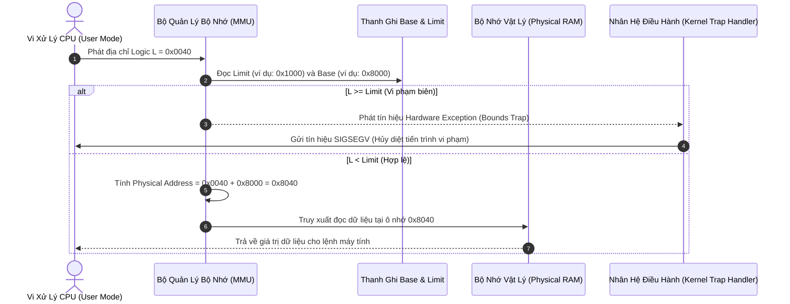
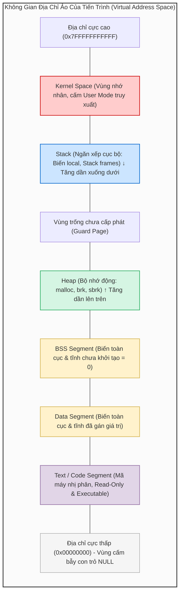

# 1_7_1 Logical vs Physical Address Space and the MMU

> **Khóa học**: Cloud DevOps Basic — Hệ Điều Hành (OS Core)  
> **Domain**: 1 Domain 1 - Operating System Core Fundamentals  
> **Chủ đề**: 1_7 Memory Management and Virtual Memory  
> **Trạng thái**: Hoàn thành  
> **Checklist đối chiếu**: [CHECKLIST.md](<../../../CHECKLIST.md#17-memory-management--virtual-memory>) · **Roadmap**: [os/README.md](<../../README.md#module-7-memory-management--virtual-memory>)

---

## 1. Khái Niệm Cốt Lõi & Bản Chất Kỹ Thuật (Core Concepts & Technical Deep Dive)

Trong những ngày đầu của lịch sử máy tính (kỷ nguyên đơn nhiệm - uniprogramming), bộ nhớ máy tính được truy cập trực tiếp bằng địa chỉ vật lý: địa chỉ trong mã máy trỏ thẳng tới thanh ghi bộ nhớ thực trên thanh RAM. Tuy nhiên, khi hệ điều hành đa nhiệm (multitasking) ra đời, việc cho phép nhiều tiến trình cùng chia sẻ thanh RAM vật lý đặt ra thách thức sinh tử: làm sao để tiến trình A không thể đọc trộm mật khẩu hoặc ghi đè phá hủy dữ liệu của tiến trình B, và làm sao để người lập trình không phải bận tâm chương trình của mình sẽ được đặt ở vị trí nào trong RAM khi chạy?

Giải pháp mang tính cách mạng của khoa học máy tính là kỹ thuật **Trừu tượng hóa Bộ nhớ (Memory Virtualization)** thông qua việc phân tách rạch ròi giữa **Không gian Địa chỉ Logic (Địa chỉ Ảo)** và **Không gian Địa chỉ Vật lý (Địa chỉ Thực)**.

```text
+-------------------------------------------------------------------------------+
|                       KHÔNG GIAN ĐỊA CHỈ LOGIC VS VẬT LÝ                      |
+-------------------------------------------------------------------------------+
| Tiến trình nhìn thấy (Virtual):  0x00000000 -----------------> 0x7FFFFFFFFFFF   |
|                                         |                                     |
|                                         v [MMU Dịch Runtime]                  |
|                                                                               |
| Phần cứng RAM nhìn thấy (Physical): 0x00000000 -------------> 0x00003FFFFFFF   |
|                             [Khung RAM Vật Lý Thực Tế]                        |
+-------------------------------------------------------------------------------+
```

### 1.1. Địa Chỉ Logic (Logical / Virtual Address) và Địa Chỉ Vật Lý (Physical Address)

- **Địa chỉ Logic (Logical Address / Virtual Address)**: Là địa chỉ do CPU sinh ra trong quá trình nạp và thực thi các lệnh của chương trình (ví dụ: con trỏ lệnh `RIP`, địa chỉ biến trên Stack, con trỏ trả về từ hàm `malloc()`). Tiến trình hoàn toàn tin rằng nó đang sở hữu một không gian bộ nhớ riêng biệt, liên tục và trải dài từ `0x0` cho tới giới hạn trần của kiến trúc (ví dụ: $2^{32} = 4\text{ GB}$ trên hệ 32-bit, hoặc không gian kinh điển 48-bit / 57-bit với dung lượng hàng trăm Terabyte trên hệ 64-bit x86-64). Tiến trình không hề biết và không được phép biết địa chỉ RAM thực tế mà nó đang chiếm giữ.
- **Địa chỉ Vật lý (Physical Address)**: Là địa chỉ thực tế xuất hiện trên các chân đường truyền địa chỉ của bus phần cứng (Memory Bus) để kích hoạt các ô nhớ (Memory Cells) bên trong chip bán dẫn RAM. Đây là địa chỉ mà bộ điều khiển bộ nhớ (Memory Controller) sử dụng để nạp hoặc ghi dữ liệu.

### 1.2. Các Giai Đoạn Ràng Buộc Địa Chỉ (Address Binding)

Để chuyển một dòng mã nguồn thành dữ liệu trong RAM, địa chỉ phải trải qua quá trình gắn kết (Binding):
1. **Compile Time (Thời điểm biên dịch)**: Nếu biết trước tiến trình sẽ nằm ở đâu trong RAM tại thời điểm viết code, trình biên dịch có thể sinh mã địa chỉ tuyệt đối (Absolute code). Bất kỳ sự thay đổi vị trí nạp nào đều buộc phải biên dịch lại toàn bộ chương trình. Phương pháp này chỉ dùng trong các hệ thống vi điều khiển nhúng đơn giản (Embedded Systems), hoàn toàn bất khả thi trên OS hiện đại.
2. **Load Time (Thời điểm nạp)**: Trình biên dịch sinh mã có thể tái định vị (Relocatable code). Khi chương trình được nạp vào bộ nhớ, bộ nạp (Loader) của hệ điều hành sẽ duyệt qua toàn bộ mã máy và cộng dồn địa chỉ offset tương ứng. Nhược điểm: Nếu tiến trình bị hoán đổi (swap out) ra đĩa rồi nạp lại vào vùng RAM khác, việc tính toán lại toàn bộ địa chỉ sẽ gây tổn hao hiệu năng khủng khiếp.
3. **Execution Time / Runtime (Thời gian thực thi)**: Địa chỉ logic được giữ nguyên trong suốt quá trình chạy. Việc ánh xạ từ địa chỉ ảo sang địa chỉ vật lý được hoãn lại cho tới tận thời điểm lệnh truy xuất bộ nhớ thực sự được CPU thực thi. **Phương pháp này bắt buộc phải có sự trợ giúp của phần cứng chuyên dụng: Bộ quản lý bộ nhớ (MMU)**.

### 1.3. Cơ Chế Tái Định Vị Động: Cặp Thanh Ghi Base và Limit (Base and Bounds)

Trong giai đoạn đầu của ảo hóa bộ nhớ, cơ chế tái định vị động phần cứng được hiện thực hóa thông qua cặp thanh ghi **Base** (Thanh ghi Cơ sở / Relocation Register) và **Limit** (Thanh ghi Giới hạn / Bounds Register):

- **Thanh ghi Base (Base Register)**: Lưu trữ địa chỉ vật lý khởi đầu của tiến trình trong RAM.
- **Thanh ghi Limit (Limit Register)**: Quy định kích thước không gian địa chỉ hợp lệ của tiến trình (ví dụ: `16 KB`).

**Nguyên lý vận hành kiểm tra của phần cứng CPU:**
Mỗi khi tiến trình phát ra một địa chỉ logic $L$:
1. Bộ vi xử lý phần cứng sẽ kiểm tra điều kiện an toàn:
   $$0 \le L < \text{Limit}$$
2. **Trường hợp vi phạm**: Nếu $L \ge \text{Limit}$, phần cứng CPU lập tức kích hoạt một ngắt ngoại lệ (Hardware Trap / Addressing Exception). Hệ điều hành bắt lấy ngoại lệ này và gửi tín hiệu báo tử `SIGSEGV` (Segmentation Fault) để hủy diệt tiến trình vi phạm.
3. **Trường hợp hợp lệ**: Nếu $L < \text{Limit}$, bộ cộng phần cứng tự động tính toán địa chỉ vật lý thực tế:
   $$\text{Physical Address} = L + \text{Base}$$
Địa chỉ này được đẩy lên bus bộ nhớ để truy xuất dữ liệu.

```text
+--------------------------------------------------------------------------+
|                     PHẦN CỨNG BASE & LIMIT KIỂM TRA                      |
+--------------------------------------------------------------------------+
                  Địa chỉ Logic (L)
                         |
                         v
                +-----------------+
                |   L < Limit?    | ----(KHÔNG)----> [TRAP BÁO LỖI] -> SIGSEGV
                +-----------------+
                         | (CÓ)
                         v
                +-----------------+
                |    L + Base     |
                +-----------------+
                         |
                         v
                 Địa chỉ Vật lý (RAM)
```

### 1.4. Đơn Vị Quản Lý Bộ Nhớ (Memory Management Unit - MMU)

**MMU** là một mạch tích hợp phần cứng nằm trực tiếp bên trong vi xử lý CPU (hoặc kết nối chặt chẽ trên chip bán dẫn cùng CPU core). Nhiệm vụ tối thượng của MMU là:
- Thực hiện chuyển đổi địa chỉ ảo (Virtual Address) sang địa chỉ vật lý (Physical Address) **ngay trong chu kỳ xung nhịp phần cứng** (ở tốc độ nano giây) mà không làm suy giảm hiệu năng thực thi của các lệnh máy tính.
- Thực thi cơ chế bảo vệ bộ nhớ (Memory Protection): Ngăn chặn tiến trình ở chế độ người dùng (User Mode) truy xuất vào không gian bộ nhớ của nhân (Kernel Space) hoặc vùng nhớ của tiến trình khác.

### 1.5. Lợi Ích Cốt Lõi Của Việc Tách Biệt Không Gian Địa Chỉ

1. **Bảo vệ và Cách ly (Protection & Isolation)**: Không một tiến trình nào có thể can thiệp vào bộ nhớ của tiến trình khác hoặc làm sập hệ điều hành, vì mọi địa chỉ logic nó sở hữu đều được MMU rào chắn nghiêm ngặt trong phạm vi giới hạn.
2. **Mô hình lập trình đơn giản, đồng nhất (Uniform Address Space)**: Lập trình viên và trình biên dịch không cần quan tâm máy tính có bao nhiêu thanh RAM thực tế, thanh RAM đang bị phân mảnh ra sao. Chương trình luôn được biên dịch với một không gian địa chỉ chuẩn mực, sạch sẽ bắt đầu từ địa chỉ gốc.
3. **Chia sẻ bộ nhớ an toàn (Memory Sharing)**: Hai tiến trình khác nhau có thể sử dụng chung các trang mã máy chỉ đọc (Read-Only Code Pages) của các thư viện hệ thống dùng chung (Shared Libraries như `libc.so`), giúp tiết kiệm dung lượng RAM thực tế.

---

## 2. Ví Dụ Đời Sống Thực Tế Dễ Hiểu (Intuitive Real-World Analogies)

### Ẩn dụ: Khách sạn số phòng ảo và Nữ lễ tân thông thái MMU

Hãy hình dung một khách sạn sang trọng đón tiếp các đoàn du khách (Tiến trình - Process):

- **Số phòng trên thẻ chìa khóa (Địa chỉ Logic / Virtual Address)**:
  Khi bạn (tiến trình) nhận phòng, khách sạn cấp cho bạn một tấm thẻ ghi: *"Số phòng của bạn là từ Phòng 1 đến Phòng 100"*. Đoàn du khách bên cạnh cũng nhận được tấm thẻ ghi: *"Số phòng của bạn là từ Phòng 1 đến Phòng 100"*. Cả hai đoàn đều tin rằng mình đang sở hữu toàn bộ các phòng từ số 1 đến 100 của khách sạn một cách riêng tư và liên tục.
- **Buồng ngủ thực tế trong khách sạn (Địa chỉ Vật lý / Physical Address)**:
  Tòa nhà khách sạn thực tế có 1000 buồng phòng được đánh số từ Phòng số 1001 đến Phòng số 2000 rải rác trên các tầng lầu của thanh RAM vật lý.
- **Nữ lễ tân phần cứng (MMU) và Sổ đăng ký (Base & Limit)**:
  - Khi đoàn A muốn vào "Phòng số 5", họ không tự ý đi mở cửa bừa bãi. Họ đi qua quầy lễ tân (MMU).
  - Lễ tân tra cứu quy tắc: *"Đoàn A có Base = 1000, Limit = 100"*.
  - Kiểm tra Limit: Số 5 nhỏ hơn 100 (Hợp lệ!).
  - Tính toán địa chỉ thực: Lễ tân dẫn khách tới buồng thực tế: $5 + 1000 = \text{Phòng 1005}$.
  - Nếu đoàn A lén lút bấm chuông "Phòng số 105", lễ tân kiểm tra: $105 \ge 100$ (Vi phạm!). Ngay lập tức lễ tân bấm chuông báo động gọi bảo vệ (Hardware Trap) và tống cổ đoàn khách ra khỏi khách sạn (Gửi tín hiệu `SIGSEGV` - Segmentation Fault).
- **Tính cách ly tuyệt đối**:
  Đoàn B cũng có "Phòng số 5", nhưng Base của đoàn B là 1500. Lễ tân MMU sẽ dẫn đoàn B tới buồng thực tế số 1505. Dù hai đoàn cùng gọi "Phòng số 5" (trùng địa chỉ ảo), họ hoàn toàn không thể chạm vào nhau hay xâm phạm đồ đạc của nhau!

---

## 3. Kiến Trúc, Luồng Hoạt Động & Hình Ảnh Trực Quan (Architecture, Diagrams & Visual Media)

### 3.1. Luồng Chuyển Đổi Địa Chỉ Qua MMU với Base và Limit

Biểu đồ tuần tự dưới đây mô tả chính xác từng bước kiểm tra phần cứng của CPU và MMU khi thực thi một lệnh đọc bộ nhớ (`MOV EAX, [0x0040]`):



### 3.2. Sơ Đồ Phân Vùng Không Gian Bộ Nhớ Của Tiến Trình (Virtual Memory Layout)

Trong không gian địa chỉ ảo của mỗi tiến trình Linux x86-64, bộ nhớ được phân chia thành các đoạn chức năng rõ ràng:



---

## 4. Code Mẫu Trực Quan Hoặc Dòng Lệnh Thực Chiến (Runnable Sample Code / CLI)

### 4.1. Chương Trình C Khảo Sát Địa Chỉ Ảo Của Các Phân Vùng Bộ Nhớ (`address_space_demo.c`)

Chương trình C dưới đây in ra địa chỉ bộ nhớ ảo của các biến nằm trên Text, Data, BSS, Heap và Stack:

```c
#include <stdio.h>
#include <stdlib.h>
#include <unistd.h>

// Biến toàn cục đã khởi tạo -> Thuộc Data Segment
int global_initialized_var = 42;

// Biến toàn cục chưa khởi tạo -> Thuộc BSS Segment
int global_uninitialized_var;

void recursive_function(int depth) {
    int local_stack_var = depth;
    printf("   [Stack frame %d] Địa chỉ biến cục bộ: %p\n", depth, (void*)&local_stack_var);
    if (depth < 3) {
        recursive_function(depth + 1);
    }
}

int main(void) {
    // Biến cấp phát động trên Heap
    int *heap_var1 = (int*)malloc(sizeof(int));
    int *heap_var2 = (int*)malloc(sizeof(int));

    printf("=================================================================\n");
    printf("  KHẢO SÁT KHÔNG GIAN ĐỊA CHỈ ẢO TIẾN TRÌNH (PID: %d)\n", getpid());
    printf("=================================================================\n\n");

    printf("1. [Code / Text Segment]:\n");
    printf("   - Địa chỉ hàm main():                     %p\n", (void*)main);
    printf("   - Địa chỉ hàm recursive_function():       %p\n\n", (void*)recursive_function);

    printf("2. [Initialized Data Segment]:\n");
    printf("   - Địa chỉ biến global_initialized_var:    %p\n\n", (void*)&global_initialized_var);

    printf("3. [BSS Segment (Uninitialized Data)]:\n");
    printf("   - Địa chỉ biến global_uninitialized_var:  %p\n\n", (void*)&global_uninitialized_var);

    printf("4. [Heap Segment (Grows UP)]:\n");
    printf("   - Địa chỉ heap_var1:                      %p\n", (void*)heap_var1);
    printf("   - Địa chỉ heap_var2:                      %p\n\n", (void*)heap_var2);

    printf("5. [Stack Segment (Grows DOWN)]:\n");
    recursive_function(1);

    printf("\nĐang tạm dừng trong 60 giây để bạn có thể kiểm tra qua Linux CLI...\n");
    sleep(60);

    free(heap_var1);
    free(heap_var2);
    return 0;
}
```

### 4.2. Biên Dịch và Kết Quả Thực Thi Minh Họa

```bash
# Biên dịch chương trình (tắt ASLR ngẫu nhiên hóa vị trí bằng cờ no-pie để quan sát địa chỉ chuẩn)
gcc -no-pie address_space_demo.c -o address_space_demo

# Chạy chương trình nền
./address_space_demo &
```

**Đầu ra trên Terminal (Minh họa):**
```text
=================================================================
  KHẢO SÁT KHÔNG GIAN ĐỊA CHỈ ẢO TIẾN TRÌNH (PID: 14258)
=================================================================

1. [Code / Text Segment]:
   - Địa chỉ hàm main():                     0x401196
   - Địa chỉ hàm recursive_function():       0x401146

2. [Initialized Data Segment]:
   - Địa chỉ biến global_initialized_var:    0x404034

3. [BSS Segment (Uninitialized Data)]:
   - Địa chỉ biến global_uninitialized_var:  0x40403c

4. [Heap Segment (Grows UP)]:
   - Địa chỉ heap_var1:                      0x1a242a0
   - Địa chỉ heap_var2:                      0x1a242c0

5. [Stack Segment (Grows DOWN)]:
   [Stack frame 1] Địa chỉ biến cục bộ: 0x7ffd58f33194
   [Stack frame 2] Địa chỉ biến cục bộ: 0x7ffd58f33164
   [Stack frame 3] Địa chỉ biến cục bộ: 0x7ffd58f33134

Đang tạm dừng trong 60 giây để bạn có thể kiểm tra qua Linux CLI...
```

> **Quan sát bản chất kỹ thuật:**
> 1. Mã Code (Text) nằm ở vùng địa chỉ thấp (`0x401196`).
> 2. Heap tăng dần lên trên (`0x1a242a0` -> `0x1a242c0`, địa chỉ sau lớn hơn địa chỉ trước).
> 3. Stack nằm ở vùng địa chỉ cực cao (`0x7ffd...`) và phát triển giảm dần xuống dưới (`...194` -> `...164` -> `...134`).

### 4.3. Quan Sát Bản Đồ Ánh Xạ Bộ Nhớ Bằng Lệnh Linux CLI: `/proc/[pid]/maps` và `pmap`

Trong khi tiến trình trên đang chạy (PID `14258`), mở một terminal khác và thực thi:

```bash
# 1. Đọc trực tiếp cấu trúc ánh xạ không gian địa chỉ ảo từ nhân Linux
cat /proc/14258/maps
```

**Đầu ra mẫu của `/proc/[pid]/maps`:**
```text
00400000-00401000 r--p 00000000 08:01 131584     /home/user/address_space_demo (Text headers)
00401000-00402000 r-xp 00001000 08:01 131584     /home/user/address_space_demo (Text code)
00402000-00403000 r--p 00002000 08:01 131584     /home/user/address_space_demo
00403000-00404000 r--p 00002000 08:01 131584     /home/user/address_space_demo (Data)
00404000-00405000 rw-p 00003000 08:01 131584     /home/user/address_space_demo (BSS)
01a24000-01a45000 rw-p 00000000 00:00 0          [heap]
7ffd58f14000-7ffd58f35000 rw-p 00000000 00:00 0  [stack]
7ffd58fa0000-7ffd58fa4000 r--p 00000000 00:00 0  [vvar]
7ffd58fa4000-7ffd58fa6000 r-xp 00000000 00:00 0  [vdso]
```

```bash
# 2. Sử dụng lệnh pmap để xem báo cáo bộ nhớ chi tiết
pmap -x 14258
```

> **Giải mã các cột quyền hạn (Permissions):**
> - `r-xp`: Read, eXecute, Private (Phân vùng mã Text chứa lệnh máy, cấm ghi).
> - `rw-p`: Read, Write, Private (Phân vùng dữ liệu Data, Heap, Stack cho phép đọc ghi).
> - Nếu một tiến trình cố tình thực hiện thao tác ghi vào phân vùng `r-xp`, MMU phần cứng sẽ chặn đứng và báo lỗi vi phạm quyền hạn!

---

## 5. Cạm Bẫy Thực Tế & Thực Tiễn Sản Xuất (Production Gotchas & Best Practices)

### 5.1. Cạm Bẫy Con Trỏ Hoang (Wild Pointer) & Lỗi Báo Tử `SIGSEGV` (Signal 11)

- **Bản chất**: Lỗi `Segmentation Fault` (phổ biến nhất khi lập trình C/C++, Rust unsafe, Golang cgo) xảy ra khi chương trình cố truy xuất một địa chỉ logic không được định nghĩa trong bảng ánh xạ của MMU (trang nhớ chưa được map) hoặc vi phạm quyền bảo vệ (ví dụ: ghi vào vùng nhớ chỉ đọc).
- **Vùng cấm `0x0` (NULL Pointer Dereference)**:
  Hệ điều hành hiện đại cố tình **không bao giờ ánh xạ** vài kilobyte đầu tiên của không gian địa chỉ ảo (từ `0x00000000` đến `0x0000FFFF`). Bất cứ thao tác nào truy xuất con trỏ NULL (`*ptr = 0` khi `ptr == NULL`) đều ngay lập tức kích hoạt bẫy MMU và kết liễu tiến trình, giúp lập trình viên phát hiện lỗi lập trình logic ngay tức thì thay vì âm thầm làm hỏng bộ nhớ hệ thống.

### 5.2. Sự Cạn Kiệt Không Gian Địa Chỉ Ảo (Virtual Address Space Exhaustion Trên Hệ 32-bit)

- **Cạm bẫy sản xuất**: Trên các hệ điều hành và tiến trình 32-bit (JVM 32-bit, Node.js 32-bit), tổng không gian địa chỉ logic tối đa chỉ là $2^{32} = 4\text{ GB}$. Không gian này bị chia đôi: $2\text{ GB}$ hoặc $3\text{ GB}$ cho User Space và phần còn lại cho Kernel Space.
- **Hiện tượng**: Dù máy chủ vật lý của bạn có cắm $64\text{ GB}$ RAM, tiến trình Java 32-bit vẫn có thể chết vì `OutOfMemoryError: unable to create new native thread` ngay khi tổng dung lượng Stack và Heap của nó chạm ngưỡng $3\text{ GB}$ địa chỉ ảo!
- **Thực tiễn tốt nhất**: Luôn triển khai các ứng dụng Cloud/DevOps trên nền tảng 64-bit toàn diện (x86-64 / ARM64).

### 5.3. Kỹ Thuật Bảo Mật ASLR (Address Space Layout Randomization)

- Trong môi trường sản xuất Linux hiện đại, hệ điều hành mặc định kích hoạt tính năng **ASLR** (`/proc/sys/kernel/randomize_va_space = 2`).
- Mỗi lần chương trình khởi chạy, địa chỉ khởi đầu của Stack, Heap và các thư viện liên kết động (`.so`) sẽ được di dời ngẫu nhiên trong không gian ảo. Điều này khiến tin tặc không thể dự đoán chính xác địa chỉ cố định của hàm để thực thi các cuộc tấn công khai thác tràn bộ đệm (Buffer Overflow / Return-Oriented Programming).

---

## 6. Câu Hỏi Củng Cố Kiến Thức (Active Recall Quiz)

<details>
<summary><b>Câu hỏi 1:</b> Hai tiến trình độc lập A và B cùng chạy trên cùng một máy chủ vật lý. Cả hai tiến trình đều in ra địa chỉ của biến toàn cục là <code>0x00404034</code>. Điều này có đồng nghĩa với việc hai tiến trình đang dùng chung một ô nhớ trên thanh RAM vật lý và có nguy cơ ghi đè dữ liệu của nhau không? Tại sao?</summary>

> **Đáp án:**
> **HOÀN TOÀN KHÔNG.**  
> - `0x00404034` chỉ là **Địa chỉ Logic (Virtual Address)** nằm trong không gian địa chỉ ảo độc lập của mỗi tiến trình.  
> - Khi thực thi, phần cứng MMU sẽ kết hợp với bảng trang/thanh ghi tái định vị riêng biệt của từng tiến trình để dịch địa chỉ logic này thành hai **Địa chỉ Vật lý (Physical Address)** hoàn toàn khác nhau trên thanh RAM thực tế (ví dụ: tiến trình A được dịch thành RAM `0x12004034`, còn tiến trình B được dịch thành RAM `0x38004034`).  
> - Do đó, dữ liệu của hai tiến trình được cách ly an toàn tuyệt đối.
</details>

<details>
<summary><b>Câu hỏi 2:</b> Trong cơ chế bảo vệ bộ nhớ bằng cặp thanh ghi Base và Limit, điều gì sẽ xảy ra nếu một tiến trình người dùng (User Mode) phát ra một địa chỉ bộ nhớ vượt quá giá trị lưu trong thanh ghi Limit? Hệ thống xử lý tình huống đó theo các bước nào?</summary>

> **Đáp án:**
> 1. Bộ cộng và bộ so sánh phần cứng của CPU/MMU kiểm tra điều kiện: $L \ge \text{Limit}$.
> 2. Phần cứng CPU lập tức **chặn đứng** truy xuất bộ nhớ, không gửi tín hiệu này lên memory bus để bảo vệ tính toàn vẹn của RAM.
> 3. CPU tự động chuyển đổi từ User Mode sang Kernel Mode và kích hoạt một ngắt ngoại lệ phần cứng (**Hardware Trap: Bounds Fault / Addressing Exception**).
> 4. Kernel bắt lấy ngoại lệ thông qua bảng ngắt (IDT), xác định tiến trình vừa vi phạm truy xuất vùng nhớ trái phép, và gửi tín hiệu báo tử `SIGSEGV` (Signal 11 - Segmentation Fault) để lập tức đình chỉ và chấm dứt tiến trình đó.
</details>

<details>
<summary><b>Câu hỏi 3:</b> Tại sao trong kiến trúc hệ điều hành hiện đại, quá trình gắn kết địa chỉ (Address Binding) bắt buộc phải diễn ra tại thời gian thực thi (Execution Time / Runtime) thay vì thời điểm biên dịch (Compile Time) hay nạp vào bộ nhớ (Load Time)?</summary>

> **Đáp án:**
> - Nếu gắn kết tại **Compile Time**, mã máy bị cố định ở một địa chỉ RAM vật lý tuyệt đối, không thể chạy đa nhiệm linh hoạt nhiều tiến trình cùng lúc.
> - Nếu gắn kết tại **Load Time**, một khi tiến trình đã được nạp vào một vùng RAM, nó không thể di chuyển sang vùng RAM khác. Trong các hệ thống hiện đại có cơ chế hoán đổi trang (Swapping/Paging) hoặc nén bộ nhớ, các trang nhớ của tiến trình liên tục bị đưa ra đĩa swap rồi nạp trở lại vào các khung RAM hoàn toàn khác nhau.
> - Việc gắn kết tại **Execution Time (với sự hỗ trợ của MMU)** cho phép tiến trình di chuyển linh hoạt tới bất kỳ vị trí vật lý nào trong RAM trong suốt vòng đời của nó mà không cần sửa đổi bất kỳ dòng mã máy nào bên trong chương trình.
</details>

---

## 7. 📚 Nguồn Tài Liệu Chính Thống (Tier-1 Official References)

- [OSTEP Chapter 13: Address Spaces (Remzi H. Arpaci-Dusseau and Andrea C. Arpaci-Dusseau)](https://pages.cs.wisc.edu/~remzi/OSTEP/vm-intro.pdf) - Giáo trình chuẩn mực phân tích sự cần thiết của trừu tượng hóa bộ nhớ ảo, tính minh bạch, hiệu năng và sự bảo vệ (Mục 13.1 - 13.4, trang 1-10).
- [OSTEP Chapter 15: Mechanism: Address Translation (Remzi H. Arpaci-Dusseau and Andrea C. Arpaci-Dusseau)](https://pages.cs.wisc.edu/~remzi/OSTEP/vm-mechanism.pdf) - Phân tích chi tiết phần cứng Base và Bounds, vai trò của MMU, kiểm tra biên và bẫy ngoại lệ phần cứng (Mục 15.1 - 15.6, trang 1-14).
- [Linux Programmer's Manual: proc(5) - /proc/[pid]/maps](https://man7.org/linux/man-pages/man5/proc.5.html) - Cẩm nang đặc tả định dạng ánh xạ bộ nhớ ảo của tiến trình Linux qua hệ thống tập tin ảo `/proc`.
- [Linux Programmer's Manual: pmap(1)](https://man7.org/linux/man-pages/man1/pmap.1.html) - Tài liệu hướng dẫn sử dụng công cụ hiển thị bản đồ bộ nhớ chi tiết của tiến trình trên hệ điều hành Linux.
- [Intel 64 and IA-32 Architectures Software Developer's Manual (Volume 3A: System Programming Guide, Chapter 3: Protected-Mode Memory Management)](https://www.intel.com/content/www/us/en/developer/articles/technical/intel-sdm.html) - Tài liệu chuẩn của Intel về cơ chế chuyển đổi địa chỉ phần cứng, chế độ bảo vệ và kiến trúc bộ nhớ vi xử lý x86.
