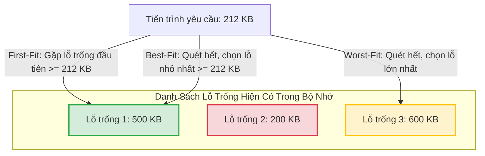

# 1_7_2 Contiguous Allocation and Fragmentation

> **Khóa học**: Cloud & DevOps Cơ Bản  
> **Phân nhóm**: Domain 1 - Operating System Core Fundamentals  
> **Chủ đề**: 1_7 Memory Management and Virtual Memory  
> **Checklist đối chiếu**: [1_7_2](../../../CHECKLIST.md#domain-1-operating-system-core-fundamentals-45-items)  
> **Trạng thái**: Hoàn thành  

---

## 1. Khái Niệm Cốt Lõi & Bản Chất Kỹ Thuật (Core Concepts & Technical Deep Dive)

Trong các thế hệ hệ điều hành sơ khai (như MS-DOS, các phiên bản đầu của UNIX và OS/360), kiến trúc bộ nhớ được thiết kế theo phương thức **Cấp phát liên tục (Contiguous Memory Allocation)**: Mỗi tiến trình người dùng khi nạp vào RAM bắt buộc phải chiếm giữ một **vùng nhớ vật lý duy nhất, liền mạch không đứt quãng** từ địa chỉ bắt đầu đến địa chỉ kết thúc.

Mặc dù giải pháp này rất đơn giản về mặt phần cứng (chỉ cần một cặp thanh ghi `Base` và `Limit` để kiểm tra ranh giới), nó lại là nguồn gốc sinh ra một vấn đề nhức nhối bậc nhất trong quản trị bộ nhớ: **Hiện tượng phân mảnh (Fragmentation)**.

```
+-----------------------------------------------------------------------------------------+
|                  CẤP PHÁT BỘ NHỚ LIÊN TỤC VÀ HAI DẠNG PHÂN MẢNH                         |
+-----------------------------------------------------------------------------------------+

  1. BỘ NHỚ LIÊN TỤC DẠNG PHÂN VÙNG BIẾN ĐỔI (VARIABLE-PARTITION ALLOCATION)
     - Bộ nhớ được chia thành các phân vùng có kích thước vừa khít với yêu cầu của tiến trình.
     - Khi các tiến trình kết thúc và giải phóng bộ nhớ rải rác:
       Xuất hiện các "Lỗ trống" (Holes) nằm xen kẽ giữa các tiến trình đang hoạt động.
     - Vấn đề: Cấp phát lỗ trống nào cho tiến trình mới? (First-Fit, Best-Fit, Worst-Fit).

  2. PHÂN MẢNH NGOẠI VI (EXTERNAL FRAGMENTATION)
     - Tổng dung lượng bộ nhớ trống cộng lại THỪA ĐỦ cho tiến trình mới.
     - NHƯNG không có bất kỳ một lỗ trống đơn lẻ nào đủ lớn và liền mạch để chứa tiến trình!
     - Hệ quả: Tiến trình bị từ chối cấp phát dù bộ nhớ RAM vẫn còn nhiều chỗ trống.

  3. PHÂN MẢNH NỘI VI (INTERNAL FRAGMENTATION)
     - Xảy ra khi hệ thống cấp phát bộ nhớ theo các khối cố định (Fixed-size blocks / Pages).
     - Tiến trình yêu cầu ít hơn kích thước khối được cấp -> Phần dư bên trong bị bỏ phí.
```

---

### 1.1. Ba Chiến Lược Cấp Phát Lỗ Trống (Dynamic Storage-Allocation Strategies)

Khi bộ nhớ xuất hiện một danh sách các lỗ trống tự do (Free List of Holes) có kích thước khác nhau, bộ điều phối bộ nhớ áp dụng một trong ba chiến lược kinh điển sau:

1. **First-Fit (Lựa chọn đầu tiên)**:
   - Quét danh sách lỗ trống từ đầu đến cuối và cấp phát **ngay lỗ trống đầu tiên** có kích thước lớn hơn hoặc bằng kích thước yêu cầu.
   - *Đặc điểm*: Tốc độ thực thi nhanh nhất ($O(1)$ nếu tìm thấy sớm), nhưng có xu hướng dồn các mảnh vụn nhỏ về phía đầu bộ nhớ.
2. **Best-Fit (Lựa chọn vừa khít nhất)**:
   - Quét duyệt qua **toàn bộ danh sách** các lỗ trống và chọn ra lỗ trống **nhỏ nhất mà vẫn đủ lớn** để chứa tiến trình.
   - *Đặc điểm*: Cố gắng tối thiểu hóa dung lượng bộ nhớ dư thừa của lỗ trống được chọn. Tuy nhiên, phần dư còn lại sau khi cắt thường là những mẩu vụn tí hon (Tiny Leftover Holes) đến mức không một tiến trình nào khác có thể dùng được.
3. **Worst-Fit (Lựa chọn tồi tệ nhất / Lỗ trống lớn nhất)**:
   - Quét duyệt toàn bộ danh sách và chọn **lỗ trống có kích thước lớn nhất**.
   - *Đặc điểm*: Với hy vọng rằng phần dư còn lại sau khi cấp phát vẫn sẽ là một lỗ trống tương đối lớn đủ cho một tiến trình khác tiếp tục dùng. Trong thực tế, Worst-Fit lại phá nát các khối nhớ lớn quý giá và có hiệu năng thực nghiệm kém nhất trong cả ba.

---

### 1.2. Phân Mảnh Ngoại Vi (External Fragmentation) & Quy Tắc 50% Của Knuth

- **Bản chất toán học**: Phân mảnh ngoại vi xuất hiện khi bộ nhớ bị băm nhỏ thành vô số phân vùng nhỏ xen kẽ giữa các tiến trình đang chạy.
- **Quy tắc 50% (The 50-Percent Rule - Donald Knuth)**:
  Phân tích thống kê của Donald Knuth đã chứng minh rằng: Đối với bất kỳ giải thuật cấp phát First-Fit nào ở trạng thái cân bằng (Steady State), nếu có $N$ khối nhớ đang được cấp phát cho các tiến trình, thì trung bình sẽ có thêm:
  $$\text{Số lỗ trống phân mảnh} \approx 0.5 \times N$$
  Điều này đồng nghĩa với việc: **Khoảng một phần ba ($33\%$) tổng dung lượng bộ nhớ khả dụng của hệ thống có thể bị lãng phí hoàn toàn** do phân mảnh ngoại vi, biến nó thành vùng nhớ "chết" không thể sử dụng!

---

### 1.3. Giải Pháp Compaction (Dồn Bộ Nhớ) & Giới Hạn Của Nó

Để khắc phục phân mảnh ngoại vi trong mô hình liên tục, hệ thống phải thực hiện kỹ thuật **Compaction (Dồn dịch bộ nhớ / Defragmentation)**:
- **Cơ chế**: Di chuyển vị trí của toàn bộ các tiến trình đang chạy dồn sát về một phía của thanh RAM (thường là dồn về gốc địa chỉ thấp), từ đó gom tất cả các lỗ trống phân tán rải rác lại thành một khối trống khổng lồ duy nhất ở phía trên.
- **Điều kiện tiên quyết**: Compaction **chỉ có thể thực hiện được** nếu cơ chế dịch địa chỉ (Address Binding) là **Động tại thời gian chạy (Execution-Time Dynamic Binding)** thông qua thanh ghi Relocation (Base Register). Nếu việc gán địa chỉ diễn ra lúc biên dịch (Compile-time) hoặc nạp (Load-time), việc dịch chuyển mã lệnh trong RAM sẽ phá hủy toàn bộ con trỏ và làm sụp đổ chương trình.
- **Chi phí cực đắt**: Việc sao chép hàng gigabyte dữ liệu của các tiến trình từ vị trí này sang vị trí khác trong RAM là thao tác ngốn băng thông bộ nhớ và tiêu tốn chu kỳ CPU cực lớn, làm toàn bộ hệ thống bị đứng hình (Freeze/Latency Spike) trong suốt quá trình dồn dịch.

---

### 1.4. Phân Mảnh Nội Vi (Internal Fragmentation)

- **Bản chất**: Trái ngược với phân mảnh ngoại vi (xảy ra ngoài không gian của tiến trình), **Phân mảnh nội vi** là vùng nhớ bị lãng phí **nằm ngay bên trong** không gian đã được cấp phát cho một tiến trình cụ thể.
- **Nguyên nhân**: Để đơn giản hóa cấu trúc dữ liệu quản lý, hệ thống thường cấp phát bộ nhớ theo các bội số của một kích thước cố định (Fixed-size Allocation Units - ví dụ: các trang 4KB hoặc khối 512 bytes).
- **Mức độ lãng phí trung bình**: Nếu một tiến trình yêu cầu cấp phát bộ nhớ ngẫu nhiên $S$, và kích thước khối cấp phát là $B$:
  - Tiến trình sẽ được cấp $\lceil S / B \rceil \times B$.
  - Trung bình trên một số lượng lớn các lần cấp phát, dung lượng bị lãng phí bên trong khối cuối cùng xấp xỉ bằng:
    $$\text{Tổn thất trung bình} \approx \frac{1}{2} \times B \quad (\text{Nửa khối nhớ trên mỗi yêu cầu})$$

---

## 2. Ví Dụ Đời Sống Thực Tế Dễ Hiểu (Intuitive Real-World Analogies)

```
        BÃI ĐỖ XE Ô TÔ TỰ DO VÀ HIỆN TƯỢNG PHÂN MẢNH NGOẠI VI

  Vị trí: [ Xe con A (4m) ] [ Trống 3m ] [ Xe con B (4m) ] [ Trống 3m ] [ Xe con C (4m) ] [ Trống 4m ]
  Tổng chiều dài bãi xe còn trống: 3m + 3m + 4m = 10 MÉT!
  
  Bỗng có một chiếc XE TẢI CONTAINER DÀI 8 MÉT đi vào xin đỗ:
  - Bác bảo vệ đo tổng chỗ trống: "Còn tận 10 mét trống cơ mà!"
  - Nhưng nhìn vào thực tế: Chẳng có chỗ trống nào liền mạch đủ 8 mét.
  ===> XE TẢI BUỘC PHẢI QUAY ĐẦU BỎ ĐI! (EXTERNAL FRAGMENTATION)
```

### 2.1. Phép So Sánh: Bãi Đỗ Xe Không Kẻ Ô (Contiguous Parking Lot)
- Hãy tưởng tượng một bãi đỗ xe dọc bờ biển không hề được sơn vạch phân ô cố định:
  - Mọi người lái xe đến và đỗ xe san sát nhau theo chiều dài xe của họ (Cấp phát liên tục theo kích thước biến đổi).
  - Khi một vài chiếc xe con ở giữa lấy xe rời đi, bãi đỗ xuất hiện những khoảng trống vụn vặt: chỗ này thừa 2 mét, chỗ kia thừa 3 mét, chỗ nọ thừa 3 mét.
  - Tổng diện tích trống trong bãi lúc này là 8 mét. Bỗng một chiếc xe khách 29 chỗ (dài 7 mét) xin vào đỗ. Dù bãi xe còn thừa tận 8 mét đất, nhưng không có bất kỳ khoảng trống đơn lẻ nào đủ dài 7 mét để chiếc xe khách lọt vào. Chiếc xe khách đành ngậm ngùi rời đi dù bãi đất vẫn còn trống! Đây chính là **Phân mảnh ngoại vi (External Fragmentation)**.
- **Biện pháp Compaction (Dồn xe)**:
  Bác bảo vệ cầm loa yêu cầu toàn bộ các chủ xe đang đỗ phải ra nổ máy, cùng lùi xe sát vào nhau về phía góc tường để dồn tất cả các khoảng trống 2m và 3m lại thành một khoảng trống lớn 8m cho xe khách vào. Quá trình này vô cùng hỗn loạn, tốn xăng và gây tắc nghẽn toàn bộ bãi xe!

### 2.2. Phép So Sánh: Hộp Bưu Phẩm Tiêu Chuẩn Và Phân Mảnh Nội Vi (Internal Fragmentation)
- Bưu điện chỉ sản xuất đúng một loại thùng carton đóng hàng có kích thước cố định là $30\text{ cm} \times 30\text{ cm} \times 30\text{ cm}$ (Fixed-size block).
- Bạn mang đến bưu điện một chiếc bút bi nhỏ dài $14\text{ cm}$ để gửi đi.
- Nhân viên bưu điện buộc phải đặt chiếc bút bi vào chiếc thùng to đùng đó, rồi dán băng dính lại. Khoảng không gian trống rỗng bên trong chiếc hộp đó không ai khác được phép nhét thêm hàng vào. Không gian đó bị lãng phí hoàn toàn ngay bên trong bưu kiện của chính bạn! Đó chính là **Phân mảnh nội vi (Internal Fragmentation)**.

---

## 3. Kiến Trúc, Luồng Hoạt Động & Hình Ảnh Trực Quan (Architecture & Diagrams)

### 3.1. Sơ Đồ So Sánh Ba Chiến Lược: First-Fit, Best-Fit, và Worst-Fit

Giả sử bộ nhớ đang có 3 lỗ trống khả dụng: **Khối A ($500\text{ KB}$)**, **Khối B ($200\text{ KB}$)**, và **Khối C ($600\text{ KB}$)**. Một tiến trình mới yêu cầu cấp phát **$212\text{ KB}$**:



*Ghi chú*:
- `First-Fit` chọn ngay Lỗ 1 ($500\text{ KB}$) vì nó là lỗ đầu tiên thỏa mãn. Dư lại: $500 - 212 = 288\text{ KB}$.
- `Best-Fit` duyệt toàn bộ danh sách, thấy Lỗ 2 ($200\text{ KB}$) không đủ, Lỗ 1 ($500\text{ KB}$) và Lỗ 3 ($600\text{ KB}$) đều đủ, nó chọn Lỗ 1 vì $500 < 600$. Dư lại: $288\text{ KB}$.
- `Worst-Fit` chọn Lỗ 3 ($600\text{ KB}$) vì nó lớn nhất. Dư lại: $600 - 212 = 388\text{ KB}$.

---

### 3.2. Quá Trình Dồn Dịch Bộ Nhớ (Memory Compaction)

```mermaid
flowchart LR
    subgraph Before["TRƯỚC KHI COMPACTION (Bị phân mảnh ngoại vi)"]
        direction TB
        B1["Process 1 (100MB)"]
        H_A["Trống 50MB"]
        B2["Process 2 (200MB)"]
        H_B["Trống 150MB"]
        B3["Process 3 (100MB)"]
        H_C["Trống 200MB"]
    end

    subgraph After["SAU KHI COMPACTION (Một khối trống khổng lồ)"]
        direction TB
        A1["Process 1 (100MB)"]
        A2["Process 2 (200MB) - Dịch chuyển"]
        A3["Process 3 (100MB) - Dịch chuyển"]
        H_TOTAL["MỘT LỖ TRỐNG LIỀN MẠCH DUY NHẤT: 400MB<br/>(50 + 150 + 200 = 400MB)"]
    end

    Before ==>|"Sao chép toàn bộ bộ nhớ & Cập nhật Base Register"| After

    style H_TOTAL fill:#cce5ff,stroke:#004085,stroke-width:2px
```



---

## 4. Bài Tập Tính Toán Thực Hành & Linux Diagnostics (Worked Exercise & CLI)

### 4.1. Bài Tập Tính Toán: So Sánh First-Fit, Best-Fit và Worst-Fit

> 🎯 **BÀI TẬP CHUẨN MỰC HỆ ĐIỀU HÀNH (Worked Exercise per Plan Section 6.2)**

#### Đề bài:
Một hệ thống quản lý bộ nhớ liên tục có 5 phân vùng trống (Holes) nằm theo thứ tự địa chỉ bộ nhớ như sau:
$$\text{Holes} = [100\text{ KB}, 500\text{ KB}, 200\text{ KB}, 300\text{ KB}, 600\text{ KB}]$$

Có 4 tiến trình lần lượt gửi yêu cầu xin cấp phát bộ nhớ theo thứ tự:
- $P_1$ yêu cầu $212\text{ KB}$
- $P_2$ yêu cầu $417\text{ KB}$
- $P_3$ yêu cầu $112\text{ KB}$
- $P_4$ yêu cầu $426\text{ KB}$

**Yêu cầu**: Hãy mô phỏng từng bước cấp phát theo 3 thuật toán: **First-Fit**, **Best-Fit**, và **Worst-Fit**. Cho biết thuật toán nào cấp phát thành công cho tất cả tiến trình, và thuật toán nào bị thất bại?

---

#### Lời giải chi tiết:

#### 1. Thuật toán First-Fit
- Ban đầu: `[100, 500, 200, 300, 600]`
- **$P_1 (212\text{ KB})$**: Gặp 100 (không đủ) $\to$ Gặp 500 (đủ). Cấp phát từ lỗ 500.
  - Phân vùng còn lại: `[100, 288, 200, 300, 600]`
- **$P_2 (417\text{ KB})$**: Quét từ đầu: 100 (thiếu), 288 (thiếu), 200 (thiếu), 300 (thiếu) $\to$ Gặp 600 (đủ). Cấp phát từ lỗ 600.
  - Phân vùng còn lại: `[100, 288, 200, 300, 183]`
- **$P_3 (112\text{ KB})$**: Quét từ đầu: 100 (thiếu) $\to$ Gặp 288 (đủ). Cấp phát từ lỗ 288.
  - Phân vùng còn lại: `[100, 176, 200, 300, 183]`
- **$P_4 (426\text{ KB})$**: Quét từ đầu: 100, 176, 200, 300, 183. Không có lỗ trống nào $\ge 426\text{ KB}$!
  - **KẾT QUẢ FIRST-FIT**: **THẤT BẠI!** Tiến trình $P_4$ phải chờ.

---

#### 2. Thuật toán Best-Fit
- Ban đầu: `[100, 500, 200, 300, 600]`
- **$P_1 (212\text{ KB})$**: Các lỗ đủ lớn gồm {500, 300, 600}. Nhỏ nhất là 300 $\to$ Cấp vào lỗ 300.
  - Phân vùng còn lại: `[100, 500, 200, 88, 600]`
- **$P_2 (417\text{ KB})$**: Các lỗ đủ lớn gồm {500, 600}. Nhỏ nhất là 500 $\to$ Cấp vào lỗ 500.
  - Phân vùng còn lại: `[100, 83, 200, 88, 600]`
- **$P_3 (112\text{ KB})$**: Các lỗ đủ lớn gồm {200, 600}. Nhỏ nhất là 200 $\to$ Cấp vào lỗ 200.
  - Phân vùng còn lại: `[100, 83, 88, 88, 600]`
- **$P_4 (426\text{ KB})$**: Lỗ đủ lớn duy nhất là 600 $\to$ Cấp vào lỗ 600.
  - Phân vùng còn lại: `[100, 83, 88, 88, 174]`
- **KẾT QUẢ BEST-FIT**: **THÀNH CÔNG HOÀN TOÀN!** Cả 4 tiến trình đều được cấp phát vào bộ nhớ.

---

#### 3. Thuật toán Worst-Fit
- Ban đầu: `[100, 500, 200, 300, 600]`
- **$P_1 (212\text{ KB})$**: Lỗ lớn nhất là 600 $\to$ Cấp vào lỗ 600.
  - Phân vùng còn lại: `[100, 500, 200, 300, 388]`
- **$P_2 (417\text{ KB})$**: Lỗ lớn nhất hiện tại là 500 $\to$ Cấp vào lỗ 500.
  - Phân vùng còn lại: `[100, 83, 200, 300, 388]`
- **$P_3 (112\text{ KB})$**: Lỗ lớn nhất hiện tại là 388 $\to$ Cấp vào lỗ 388.
  - Phân vùng còn lại: `[100, 83, 200, 300, 276]`
- **$P_4 (426\text{ KB})$**: Các lỗ hiện còn: `[100, 83, 200, 300, 276]`. Lỗ lớn nhất chỉ là 300, không đủ cho $426\text{ KB}$!
  - **KẾT QUẢ WORST-FIT**: **THẤT BẠI!** Tiến trình $P_4$ phải chờ.

> **Bảng Tổng Kết Đánh Giá**:
> Trong bài toán cụ thể này, **Best-Fit là thuật toán duy nhất thành công**, trong khi First-Fit và Worst-Fit đều thất bại ở bước cấp phát cho $P_4$ do phân mảnh ngoại vi.

---

### 4.2. Quan Sát Phân Mảnh Bộ Nhớ Vật Lý Trên Linux Qua `/proc/buddyinfo`

Trong nhân hệ điều hành Linux hiện đại, để quản lý bộ nhớ vật lý ở cấp độ trang (Page Frame), hạt nhân sử dụng **Bộ cấp phát Buddy (Buddy Allocator)**. Mặc dù phân trang (Paging) giải quyết phân mảnh ngoại vi cho không gian địa chỉ ảo, nhưng ở tầng vật lý, hạt nhân đôi khi vẫn cần các khối trang liền mạch (ví dụ cho bộ nhớ DMA của phần cứng mạng).

Để theo dõi phân mảnh bộ nhớ vật lý theo thời gian thực:

```bash
# Đọc thống kê phân mảnh các khối trang trong nhân Linux
cat /proc/buddyinfo
```

**Đầu ra phân tích minh họa (Illustrative Output):**
```text
Node 0, zone      DMA      1      0      1      0      2      1      1      0      1      1      3 
Node 0, zone    DMA32   1245    890    420    210    105     45     12      4      2      1      0 
Node 0, zone   Normal  34120  15210   4102    850    120     15      3      1      0      0      0 
```

**Giải thích các cột:**
- Các cột tương ứng với các bậc phân bổ $2^0, 2^1, 2^2, \dots, 2^{10}$ trang vật lý (với 1 trang tiêu chuẩn $= 4\text{ KB}$):
  - Cột 1 ($2^0 = 1$ trang $= 4\text{ KB}$)
  - Cột 2 ($2^1 = 2$ trang $= 8\text{ KB}$)
  - Cột 5 ($2^4 = 16$ trang $= 64\text{ KB}$)
  - Cột 11 ($2^{10} = 1024$ trang $= 4\text{ MB}$)
- **Dấu hiệu cảnh báo phân mảnh nặng**: Trong dòng `zone Normal`, các cột bậc cao (từ bậc 7 trở đi) đều hiển thị con số `0`. Điều này chứng tỏ bộ nhớ RAM đã bị phân mảnh nghiêm trọng: mặc dù còn hàng chục ngàn trang $4\text{ KB}$ đơn lẻ, nhưng hạt nhân hoàn toàn không còn khối $4\text{ MB}$ liền mạch nào để cấp phát cho các thiết bị phần cứng!

---

### 4.3. Vì Sao Kiến Trúc Phân Trang (Paging) Ra Đời Để "Khai Tử" Phân Mảnh Ngoại Vi?

Chính vì những hạn chế bế tắc không thể vượt qua của cơ chế cấp phát liên tục (phân mảnh ngoại vi làm mất $1/3$ RAM, chi phí compaction quá đắt), các kiến trúc sư máy tính đã tạo ra **Kiến trúc Phân trang (Paging Architecture)**:
1. Chia bộ nhớ vật lý thành các khung cố định bằng nhau gọi là **Frames (Khung trang)**.
2. Chia không gian địa chỉ của tiến trình thành các khối có kích thước bằng hệt gọi là **Pages (Trang nhớ)**.
3. **Nguyên lý đột phá**: Một tiến trình **không cần phải nằm liên tục trong bộ nhớ vật lý nữa**! Trang 0 có thể nằm ở Frame 100, Trang 1 nằm ở Frame 2, Trang 2 nằm ở Frame 58.
4. **Hệ quả**: Bất kỳ khung trang vật lý nào còn trống đều có thể được gán cho bất kỳ trang logic nào của tiến trình. **Hiện tượng Phân mảnh Ngoại vi (External Fragmentation) bị xóa sổ hoàn toàn khỏi hệ thống!**

---

## 5. Cạm Bẫy Thực Tế & Thực Tiễn Sản Xuất (Production Gotchas & Best Practices)

### 5.1. Cạm Bẫy Trễ Dịch Vụ Do Cơ Chế Memory Compaction Của Linux Kernel

- Trong các cụm máy chủ cơ sở dữ liệu lớn (như Redis, MongoDB, PostgreSQL):
  - Khi quản trị viên kích hoạt tính năng **Transparent Huge Pages (THP - Trang khổng lồ 2MB)**: Nhân Linux liên tục phải gom các trang nhỏ $4\text{ KB}$ thành các khối liên tục $2\text{ MB}$.
  - Khi bộ nhớ bị phân mảnh, tiến trình nền **`kcompactd`** của Linux sẽ thức dậy và chạy thuật toán Compaction trong kernel space để dồn dịch các trang bộ nhớ vật lý.
  - **Hậu quả sản xuất**: Việc dồn dịch bộ nhớ gây ra hiện tượng nghẽn khóa hạt nhân (Spinlock Contention) và tạo ra các **đỉnh nhọn độ trễ (Latency Spikes)** từ vài trăm microgiây tăng vọt lên hàng chục giây! Ứng dụng Redis có thể bị "đơ" tạm thời, dẫn đến timeout hàng loạt kết nối microservices.
  - **Khuyến nghị sản xuất**: Tắt Transparent Huge Pages (`echo never > /sys/kernel/mm/transparent_hugepage/enabled`) trên các máy chủ cơ sở dữ liệu đòi hỏi độ trễ thấp cực đoan.

---

## 6. Câu Hỏi Củng Cố Kiến Thức (Active Recall Quiz)

<details>
<summary><b>Câu hỏi 1:</b> Phân tích sự khác biệt cơ bản giữa Phân mảnh ngoại vi (External Fragmentation) và Phân mảnh nội vi (Internal Fragmentation)? Dạng phân mảnh nào nguy hiểm hơn đối với hệ thống cấp phát liên tục?</summary>

> **Đáp án:**
> - **Phân mảnh ngoại vi**: Xảy ra ở khoảng trống giữa các phân vùng được cấp phát. Tổng dung lượng bộ nhớ trống đủ cho yêu cầu nhưng bị chia cắt thành nhiều khối rời rạc không liền mạch.
> - **Phân mảnh nội vi**: Xảy ra bên trong ranh giới của phân vùng đã cấp phát cho tiến trình do kích thước phân vùng lớn hơn kích thước dữ liệu thực tế.
> - Đối với hệ thống cấp phát liên tục, **Phân mảnh ngoại vi nguy hiểm hơn rất nhiều** vì nó có thể làm lãng phí tới 33% (theo quy tắc 50% của Knuth) tổng dung lượng bộ nhớ và khiến các tiến trình bị từ chối khởi chạy dù RAM vẫn còn nhiều chỗ trống.
</details>

<details>
<summary><b>Câu hỏi 2:</b> Tại sao thuật toán Best-Fit, dù trên lý thuyết luôn chọn khối nhớ có kích thước sát nhất với yêu cầu, lại thường dẫn đến hiện tượng phân mảnh ngoại vi trầm trọng nhất trong thực tế?</summary>

> **Đáp án:**
> Bởi vì khi Best-Fit chọn một lỗ trống vừa khít nhất (nhưng vẫn hơi lớn hơn yêu cầu một chút), phần dư còn lại sau khi cắt ra thường là những mẩu vụn bộ nhớ cực kỳ nhỏ (vài bytes đến vài kilobytes). Những mẩu vụn này nằm rải rác khắp bộ nhớ và hầu như không một tiến trình nào trong tương lai có kích thước nhỏ đến mức có thể tận dụng được chúng, biến chúng thành không gian chết vô dụng.
</details>

<details>
<summary><b>Câu hỏi 3:</b> Điều kiện phần cứng tiên quyết nào bắt buộc phải có để hệ điều hành có thể thực hiện kỹ thuật Dồn bộ nhớ (Compaction)?</summary>

> **Đáp án:**
> Hệ thống bắt buộc phải hỗ trợ **Cơ chế dịch chuyển địa chỉ động tại thời gian thực thi (Dynamic Run-Time Relocation)** sử dụng thanh ghi `Base` (hoặc `Relocation Register`) trong bộ xử lý CPU. Khi dịch chuyển một tiến trình sang vị trí mới trong RAM, hệ điều hành chỉ cần cập nhật lại giá trị địa chỉ vật lý mới vào thanh ghi Base của tiến trình đó; toàn bộ các câu lệnh tham chiếu địa chỉ logic bên trong chương trình vẫn giữ nguyên mà không bị sai lệch.
</details>

---

## 7. 📚 Nguồn Tài Liệu Chính Thống (Tier-1 Official References)

- [OSTEP Chapter 17: Free-Space Management](https://pages.cs.wisc.edu/~remzi/OSTEP/vm-freespace.pdf) - Phân tích chi tiết cơ chế phân mảnh ngoại vi, các giải thuật First-Fit, Best-Fit, Worst-Fit và kỹ thuật dồn dịch bộ nhớ.
- [OSTEP Chapter 18: Paging: Introduction](https://pages.cs.wisc.edu/~remzi/OSTEP/vm-paging.pdf) - Giải thích lý do kiến trúc phân trang ra đời để xóa bỏ phân mảnh ngoại vi.
- [Linux Kernel Documentation - Memory Management Overview](https://docs.kernel.org/admin-guide/sysctl/vm.html) - Tài liệu chính thức về quản lý bộ nhớ và thông số hệ thống trong nhân Linux.
- [Linux Kernel Documentation - /proc/buddyinfo](https://www.kernel.org/doc/Documentation/vm/numa) - Đặc tả kỹ thuật theo dõi phân mảnh bộ nhớ vật lý của Buddy Allocator.