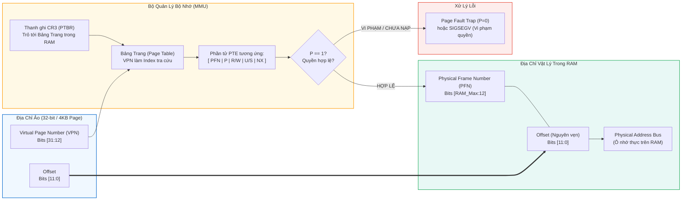

# 1_7_3 Paging Architecture

> **Khóa học**: Cloud DevOps Basic — Hệ Điều Hành (OS Core)  
> **Domain**: 1 Domain 1 - Operating System Core Fundamentals  
> **Chủ đề**: 1_7 Memory Management and Virtual Memory  
> **Trạng thái**: Hoàn thành  
> **Checklist đối chiếu**: [CHECKLIST.md](<../../../CHECKLIST.md#17-memory-management--virtual-memory>) · **Roadmap**: [os/README.md](<../../README.md#module-7-memory-management--virtual-memory>)

---

## 1. Khái Niệm Cốt Lõi & Bản Chất Kỹ Thuật (Core Concepts & Technical Deep Dive)

Trong các cơ chế phân bổ bộ nhớ liên tục ban đầu (Contiguous Allocation) và kỹ thuật phân đoạn (Segmentation), hệ điều hành luôn đòi hỏi mỗi tiến trình phải được cấp phát một dải ô nhớ vật lý liền mạch trên thanh RAM. Điều này dẫn tới một thảm họa hiệu năng kinh điển mang tên **Phân mảnh ngoại vi (External Fragmentation)**: Tổng dung lượng RAM còn trống của hệ thống có thể lên tới hàng Gigabyte, nhưng lại bị xé nhỏ thành các khe hở vụn vặt rải rác khắp nơi, khiến hệ điều hành không thể nạp một tiến trình mới đòi hỏi chỉ vài Megabyte liền khối. Việc gom bộ nhớ (Compaction) để dọn dẹp các khe hở này đòi hỏi sao chép hàng gigabyte dữ liệu trên RAM, làm đóng băng toàn bộ hệ thống.

Để khai tử hoàn toàn vấn đề phân mảnh ngoại vi, các nhà khoa học máy tính đã phát minh ra kiến trúc mang tính cách mạng: **Kiến Trúc Phân Trang (Paging Architecture)**.

```text
+-------------------------------------------------------------------------------+
|                       BẢN CHẤT CỦA KIẾN TRÚC PHÂN TRANG (PAGING)              |
+-------------------------------------------------------------------------------+
| Không Gian Địa Chỉ Ảo (Pages)           Không Gian RAM Vật Lý (Frames)        |
| +-------------------------+             +-------------------------+           |
| | Page 0 (4 KB)           | ----------> | Frame 5 (4 KB RAM)      | (Rải rác) |
| +-------------------------+             +-------------------------+           |
| | Page 1 (4 KB)           | ----------> | Frame 2 (4 KB RAM)      |           |
| +-------------------------+             +-------------------------+           |
| | Page 2 (4 KB)           | ----------> | Frame 8 (4 KB RAM)      |           |
| +-------------------------+             +-------------------------+           |
| (Tiến trình thấy liên tục)              (RAM vật lý hoàn toàn phân mảnh)      |
+-------------------------------------------------------------------------------+
```

### 1.1. Trang Ảo (Pages) và Khung Trang Vật Lý (Frames)

Kiến trúc phân trang chia bộ nhớ thành các khối có **kích thước cố định và bằng nhau tuyệt đối**:
- **Khung Trang Vật Lý (Physical Page Frame / Frame)**: Thanh RAM vật lý được chia thành hàng triệu khối nhớ cố định, kích thước chuẩn phổ biến nhất trong mọi kiến trúc hiện đại (x86, ARM, RISC-V) là **$4096\text{ Bytes} = 4\text{ KB}$** (bằng $2^{12}\text{ bytes}$).
- **Trang Ảo (Virtual Page / Page)**: Không gian địa chỉ ảo của mỗi tiến trình cũng được chia thành các lát cắt có kích thước y hệt: đúng **$4\text{ KB}$**.

> **Định lý cốt lõi**: Bất kỳ Trang ảo (Page) nào của tiến trình cũng có thể được nạp vào **bất kỳ Khung trang vật lý (Frame) nào còn trống** trên RAM, bất kể vị trí của Frame đó nằm ở đâu (đầu RAM, giữa RAM, hay cuối RAM).  
> **Hệ quả**: **Hiện tượng Phân mảnh ngoại vi (External Fragmentation) bị triệt tiêu 100%!** Hệ điều hành không bao giờ cần gom bộ nhớ (Compaction). Nếu một tiến trình cần $16\text{ KB}$, hệ điều hành chỉ việc tìm 4 khung RAM trống bất kỳ và phân bổ.

### 1.2. Sự Đánh Đổi: Phân Mảnh Nội Vi (Internal Fragmentation)

Dù triệt tiêu được phân mảnh ngoại vi, kỹ thuật phân trang làm xuất hiện một lượng lãng phí nhỏ mang tên **Phân mảnh nội vi (Internal Fragmentation)**:
- Bộ nhớ chỉ được cấp phát theo bội số nguyên của kích thước trang ($4\text{ KB}$).
- Nếu một tiến trình yêu cầu cấp phát $4097\text{ bytes}$ dữ liệu, hệ điều hành buộc phải cấp phát tròn **2 Pages ($8192\text{ bytes}$)**. Trang thứ hai chỉ sử dụng đúng $1\text{ byte}$, và $4095\text{ bytes}$ còn lại bị bỏ phí hoàn toàn bên trong trang đó.
- Về mặt thống kê xác suất, trung bình mỗi phân vùng cấp phát chỉ lãng phí **nửa trang ($\approx 2\text{ KB}$)**. Đây là một cái giá quá rẻ để đổi lấy việc loại bỏ hoàn toàn thảm họa phân mảnh ngoại vi.

### 1.3. Cấu Trúc Địa Chỉ Ảo Trong Kiến Trúc Phân Trang

Với kích thước trang chuẩn là $4\text{ KB} = 2^{12}\text{ bytes}$, mỗi địa chỉ ảo do CPU sinh ra được bộ phận phần cứng tự động chẻ làm hai phần rõ rệt:

```text
+---------------------------------------------------------------+
|     Virtual Page Number (VPN)     |       Offset (12 bits)    |
+---------------------------------------------------------------+
  Bits: [Chiều dài địa chỉ - 1 ... 12]     Bits: [11 ... 0]
```

1. **Virtual Page Number (VPN - Số hiệu trang ảo)**:
   - Đại diện cho số thứ tự của trang ảo mà lệnh đang truy xuất.
   - Được lấy bằng cách dịch phải địa chỉ ảo 12 bits: $\text{VPN} = \text{Virtual Address} \gg 12$.
   - Được phần cứng MMU dùng làm chỉ số (Index) để tra cứu trong Bảng Trang (Page Table).
2. **Offset (Độ dời trong trang)**:
   - Đại diện cho vị trí chính xác của byte dữ liệu cần đọc bên trong trang đó (từ byte thứ $0$ đến byte thứ $4095$).
   - Được lấy bằng phép toán bitwise AND: $\text{Offset} = \text{Virtual Address} \ \& \ 0\text{xFFF}$.
   - **Bất biến quan trọng**: Khi chuyển đổi từ địa chỉ ảo sang địa chỉ vật lý, **Offset được giữ nguyên tuyệt đối không hề thay đổi**, vì kích thước của Page và Frame là hoàn toàn bằng nhau!

$$\text{Physical Address} = (\text{Physical Frame Number (PFN)} \times 4096) + \text{Offset} = (\text{PFN} \ll 12) \ | \ \text{Offset}$$

### 1.4. Bảng Trang (Page Table) và Thanh Ghi PTBR

Mỗi tiến trình độc lập trong hệ thống sở hữu một **Bảng Trang (Page Table)** riêng biệt do hệ điều hành quản lý:
- Bảng trang là một mảng các phần tử (mỗi phần tử gọi là một **Page Table Entry - PTE**), lưu vị trí tương ứng: Trang ảo $i$ đang được nạp tại Khung vật lý $PFN$ nào trong RAM.
- **Thanh ghi cơ sở Bảng Trang (Page Table Base Register - PTBR)**: Nằm trực tiếp trên CPU (trên kiến trúc Intel/AMD x86, đây chính là thanh ghi điều khiển **`CR3`**). Mỗi khi hệ điều hành thực hiện chuyển đổi ngữ cảnh (Context Switch) sang tiến trình mới, nó chỉ việc nạp địa chỉ vật lý của Bảng Trang tiến trình đó vào `CR3`.

### 1.5. Cấu Trúc Giải Phẫu Từng Bit Của Một Phần Tử Bảng Trang (PTE Anatomy)

Trong kiến trúc x86-64, mỗi PTE có kích thước 8 bytes (64 bits). Mỗi bit đảm nhận một trọng trách an ninh và điều khiển phần cứng tối thượng:

```text
+-----------------------------------------------------------------------------------------+
| NX | Hỗ trợ tương lai | PFN (Địa chỉ Khung RAM vật lý) | G | PS | D | A | PCD | PWT | U/S | R/W | P |
+-----------------------------------------------------------------------------------------+
Bit: 63                 51 ... 12                         9   7    6   5    4     3     2     1    0
```

1. **Present / Valid Bit (P - Bit 0)**:
   - `1`: Khung trang đang thực sự hiện diện trên thanh RAM vật lý.
   - `0`: Trang chưa được nạp hoặc đã bị hoán đổi (swap) ra ổ cứng. CPU truy xuất vào trang này sẽ lập tức kích hoạt bẫy **Ngắt Thiếu Trang (Page Fault Trap)**.
2. **Read / Write Bit (R/W - Bit 1)**:
   - `0`: Trang chỉ có quyền Đọc (Read-Only). Mọi hành vi ghi dữ liệu sẽ bị MMU chặn và báo lỗi `SIGSEGV`.
   - `1`: Trang cho phép cả Đọc và Ghi (Read-Write).
3. **User / Supervisor Bit (U/S - Bit 2)**:
   - `0`: Trang thuộc đặc quyền của Nhân (Kernel Mode / Ring 0). Mã chạy ở User Mode truy xuất sẽ bị tiêu diệt ngay lập tức.
   - `1`: Trang cho phép tiến trình người dùng (User Mode / Ring 3) truy cập.
4. **Accessed Bit (A - Bit 5)**:
   - Phần cứng CPU tự động bật bit này lên `1` mỗi khi có lệnh đọc hoặc ghi vào trang nhớ này. Nhân OS sử dụng bit này để nhận diện trang nào đang được dùng (thuật toán thay thế trang Clock / LRU).
5. **Dirty Bit (D - Bit 6)**:
   - Phần cứng CPU tự động bật bit này lên `1` ngay khi có lệnh **Ghi** làm thay đổi nội dung trang. Giúp hệ điều hành biết trang đã bị sửa đổi (dirty) và bắt buộc phải ghi dữ liệu trở lại ổ cứng khi cần giải phóng RAM.
6. **Page Size Bit (PS - Bit 7)**:
   - `0`: Áp dụng kích thước chuẩn $4\text{ KB}$.
   - `1`: Kích hoạt chế độ **Trang Siêu Lớn (Huge Page - $2\text{ MB}$ hoặc $1\text{ GB}$)**.
7. **No-Execute / Execute-Disable Bit (NX / XD - Bit 63)**:
   - **Đặc tính bảo mật phần cứng tối thượng**: Khi bit này được bật lên `1`, CPU sẽ từ chối nạp mã lệnh máy tính từ trang này để thực thi. Toàn bộ vùng nhớ Stack và Heap đều được hệ điều hành bật bit NX để vô hiệu hóa hoàn toàn các cuộc tấn công tiêm mã độc (Shellcode Injection / Buffer Overflow).

---

## 2. Ví Dụ Đời Sống Thực Tế Dễ Hiểu (Intuitive Real-World Analogies)

### Ẩn dụ: Cuốn sổ tay kẻ ô vuông chuẩn hóa và Mục lục ghép nối linh hoạt

Hãy tưởng tượng bạn đang viết một cuốn tiểu thuyết đồ sộ (Tiến trình - Process):

- **Kỷ nguyên phân đoạn cũ (Contiguous Allocation - Cuốn sổ giấy viết liền mạch)**:
  Mỗi chương truyện đòi hỏi bạn phải có một tập giấy liền khối dài đúng 50 trang. Nếu trong ngăn kéo tủ (RAM) chỉ còn những mẩu giấy vụn 5 trang, 10 trang rải rác ở khắp các ngăn khác nhau (Phân mảnh ngoại vi), bạn hoàn toàn không thể bắt đầu viết chương mới dù tổng số trang giấy vụn cộng lại lên tới 200 trang!
- **Kiến trúc phân trang (Paging - Tập giấy kẻ ô $4\text{ KB}$ rời)**:
  Nhà in quyết định chuẩn hóa: Mọi tờ giấy đều được cắt chuẩn đúng $4\text{ KB}$ (1 trang giấy) và đánh số ô vuông.
  - Bạn viết Chương 1 gồm 3 trang: Bạn chỉ việc nhặt bừa 3 tờ giấy trắng bất kỳ nằm rải rác trong các hộc bàn số 5, hộc bàn số 12, hộc bàn số 99 (Frames).
  - Bạn viết nội dung liên tục từ Trang 0 đến Trang 2 (Pages).
- **Mục lục kẹp đầu sổ (Page Table)**:
  Để đọc được truyện liền mạch, bạn ghi một tờ mục lục:
  - *Trang ảo 0 -> Đang cất ở hộc bàn số 5.*
  - *Trang ảo 1 -> Đang cất ở hộc bàn số 12.*
  - *Trang ảo 2 -> Đang cất ở hộc bàn số 99.*
- **Độ dời (Offset) và Dòng chữ**:
  Nếu bạn muốn đọc "dòng thứ 50 của Trang 1": Bạn giở mục lục thấy Trang 1 ở hộc 12, bạn thò tay vào hộc 12 và đếm đúng dòng thứ 50 (Offset giữ nguyên tuyệt đối).
- **Quyền hạn trên trang (PTE Flags)**:
  - Tờ giấy giới thiệu tác giả: Bạn dán nhãn màu đỏ *"Chỉ được đọc, cấm dùng bút mực viết vẽ bậy"* (Bit R/W = 0).
  - Tờ giấy nháp tính toán: Bạn dán nhãn màu vàng *"Cho phép viết xóa thoải mái"* (Bit R/W = 1).
  - Tờ ghi chú chi tiêu: Bạn dán nhãn cấm kẹp vào máy photocopy in rao bán (Bit NX = 1 - Cấm thực thi).

---

## 3. Kiến Trúc, Luồng Hoạt Động & Hình Ảnh Trực Quan (Architecture, Diagrams & Visual Media)

### 3.1. Sơ Đồ Phần Cứng MMU Dịch Địa Chỉ Ảo Sang Địa Chỉ Vật Lý Trong Phân Trang



---

## 4. Code Mẫu Trực Quan Hoặc Dòng Lệnh Thực Chiến (Runnable Sample Code / CLI)

### 4.1. Bài Tập Tính Toán Thực Tế: Chuyển Đổi Địa Chỉ Bằng Tay (Worked Math Exercise)

Giả sử một hệ thống 32-bit sử dụng kiến trúc phân trang với kích thước trang chuẩn $4\text{ KB} = 4096\text{ bytes} = 2^{12}\text{ bytes}$.
Cho một tiến trình có Bảng Trang (Page Table) hiện tại như sau:

| Virtual Page Number (VPN) | Physical Frame Number (PFN) | Present Bit (P) | Permissions |
| :---: | :---: | :---: | :---: |
| `0` | `7` | `1` | Read / Execute |
| `1` | `15` | `1` | Read / Write |
| `2` | `—` | `0` (Swapped to disk) | Read / Write |
| `3` | `2` | `1` | Read / Write |

**Đề bài**: Hãy tính địa chỉ vật lý (Physical Address) tương ứng với Địa chỉ logic sau: **`0x00003058`**.

#### Các bước giải chi tiết:
1. **Phân tích địa chỉ sang hệ nhị phân hoặc thập lục phân (Hex)**:
   - Kích thước trang là $4\text{ KB} = 2^{12}\text{ bytes}$, do đó **12 bits thấp nhất** biểu diễn cho **Offset**.
   - Trong hệ Hex, mỗi chữ số đại diện cho 4 bits. Do đó, **3 chữ số Hex cuối cùng** (`058`) chính là Offset:
     $$\text{Offset} = \text{0x058} = 5 \times 16^1 + 8 \times 16^0 = 88\text{ (bytes)}$$
   - Các chữ số Hex còn lại phía trước chính là **Virtual Page Number (VPN)**:
     $$\text{VPN} = \text{0x00003058} \gg 12 = \text{0x00003} = 3$$

2. **Tra cứu trong Bảng Trang (Page Table Lookup)**:
   - Tìm dòng có $\text{VPN} = 3$:
     - Present Bit $P = 1$ (Khung trang đang có mặt trong RAM).
     - $\text{PFN} = 2$ (Dưới dạng Hex là `0x2`).

3. **Tính toán Địa chỉ Vật lý (Physical Address)**:
   $$\text{Physical Address} = (\text{PFN} \ll 12) \ | \ \text{Offset}$$
   $$\text{Physical Address} = (\text{0x2} \ll 12) \ | \ \text{0x058} = \text{0x00002058}$$
   - Ở hệ thập phân: $2 \times 4096 + 88 = 8192 + 88 = 8280$.

> **Kết luận**: Địa chỉ logic `0x00003058` được phần cứng MMU chuyển đổi thành địa chỉ vật lý thực tế trên thanh RAM là **`0x00002058`**.

---

### 4.2. Khảo Sát Kích Thước Trang và Thống Kê Phân Trang Trên Linux CLI

Dưới đây là các câu lệnh thực chiến mà kỹ sư DevOps sử dụng để thanh tra hoạt động phân trang của nhân Linux:

```bash
# 1. Kiểm tra kích thước trang chuẩn mặc định của nhân Linux (hầu như luôn là 4096 bytes)
getconf PAGESIZE
# Kết quả đầu ra: 4096

getconf PAGE_SIZE
# Kết quả đầu ra: 4096

# 2. Kiểm tra CPU có hỗ trợ bit bảo vệ No-Execute (NX) và Physical Address Extension (PAE) không
grep --color=auto -E "nx|pae" /proc/cpuinfo | head -n 2
# Nếu cờ 'nx' xuất hiện, hệ thống có hỗ trợ bảo mật chống thực thi mã trên Stack/Heap ở cấp độ phần cứng!

# 3. Thanh tra mức tiêu thụ trang nhớ chi tiết của một tiến trình (ví dụ PID tiến trình Nginx/Web: 1450)
head -n 25 /proc/1450/smaps
```

**Đầu ra mẫu khi đọc `/proc/[pid]/smaps`:**
```text
00400000-00401000 r-xp 00000000 08:01 131584      /usr/sbin/nginx
Size:                  4 kB
KernelPageSize:        4 kB
MMUPageSize:           4 kB
Rss:                   4 kB
Pss:                   4 kB
Shared_Clean:          0 kB
Shared_Dirty:          0 kB
Private_Clean:         4 kB
Private_Dirty:         0 kB
Referenced:            4 kB
Anonymous:             0 kB
LazyFree:              0 kB
AnonHugePages:         0 kB
ShmemPmdMapped:        0 kB
FilePmdMapped:         0 kB
Shared_Hugetlb:        0 kB
Private_Hugetlb:       0 kB
Swap:                  0 kB
SwapPss:               0 kB
Locked:                0 kB
THPeligible:           0
VmFlags: rd ex mr mw me dw 
```

> **Giải mã các chỉ số quản trị RAM:**
> - `Rss` (Resident Set Size): Dung lượng RAM thực tế đang bị chiếm giữ bởi các trang nhớ có mặt ($P=1$).
> - `Pss` (Proportional Set Size): Phần RAM thực tế sau khi đã chia đều các trang dùng chung (Shared Pages) cho các tiến trình khác.
> - `Private_Dirty`: Lượng bộ nhớ riêng của tiến trình đã bị ghi đè, bắt buộc phải lưu ra đĩa swap nếu giải phóng RAM.

---

## 5. Cạm Bẫy Thực Tế & Thực Tiễn Sản Xuất (Production Gotchas & Best Practices)

### 5.1. Cạm Bẫy Dung Lượng Bảng Trang (Page Table Memory Overhead) & Giải Pháp Đa Tầng

- **Cạm bẫy thiết kế Bảng Trang phẳng (Flat Page Table)**:
  - Trên hệ 32-bit: Với trang $4\text{ KB}$, không gian địa chỉ $4\text{ GB}$ có $2^{20} \approx 1.000.000\text{ Pages}$. Với mỗi phần tử PTE chiếm $4\text{ bytes}$, một Bảng Trang tiêu tốn **$4\text{ MB}$ RAM**. Nếu hệ thống chạy $1000$ tiến trình, chỉ riêng việc lưu trữ bảng trang đã ngốn mất $4\text{ GB}$ RAM!
  - Trên hệ 64-bit: Không gian $2^{64}$ nếu dùng bảng phẳng sẽ tiêu tốn hàng triệu Terabyte RAM, hoàn toàn bất khả thi.
- **Giải pháp bắt buộc**: Hệ điều hành hiện đại bắt buộc phải sử dụng **Bảng Trang Đa Tầng (Multi-Level Page Tables)** (ví dụ: cấu trúc 4 tầng PML4 trên x86-64: `PGD -> P4D -> PUD -> PMD -> PTE`). Nhờ đó, những vùng nhớ ảo chưa được tiến trình cấp phát sẽ không cần khởi tạo các bảng trang con, tiết kiệm đến 99% bộ nhớ lưu trữ Bảng Trang.

### 5.2. Tối Ưu Hóa Bằng Trang Siêu Lớn (Huge Pages: 2MB và 1GB) Trong Điện Toán Đám Mây

- **Vấn đề**: Các hệ quản trị cơ sở dữ liệu lớn (PostgreSQL, MySQL InnoDB, Oracle Database, Redis In-Memory) và các cụm máy ảo KVM/QEMU thường phân bổ hàng trăm Gigabyte RAM. Nếu sử dụng trang nhỏ $4\text{ KB}$, số lượng phần tử Bảng Trang sẽ khổng lồ, dẫn tới việc bộ nhớ đệm dịch địa chỉ phần cứng (TLB - Translation Lookaside Buffer) bị tràn liên tục (**TLB Miss Storm**), kéo tụt 20-30% hiệu năng tính toán của CPU.
- **Thực tiễn tốt nhất trong sản xuất**:
  - Cấu hình kích hoạt **Huge Pages** với kích thước $2\text{ MB}$ (gấp 512 lần trang chuẩn) hoặc $1\text{ GB}$ thông qua tham số nhân:
    ```bash
    # Cấp phát trước 1024 trang Huge Pages loại 2MB (tương đương 2GB RAM dành riêng)
    echo 1024 | sudo tee /proc/sys/vm/nr_hugepages
    ```
  - **Lưu ý với Transparent Huge Pages (THP)**: Mặc dù THP tự động gom các trang $4\text{ KB}$ thành $2\text{ MB}$, nhưng trên các cơ sở dữ liệu có tính chất truy cập ngẫu nhiên như **Redis** hoặc **MongoDB**, cơ chế chống phân mảnh động của THP (defrag background daemon) có thể gây ra hiện tượng giật lag độ trễ (Latency Spikes). Do đó, khuyến nghị chính thức của Redis luôn yêu cầu **tắt THP**:
    ```bash
    echo never | sudo tee /sys/kernel/mm/transparent_hugepage/enabled
    ```

---

## 6. Câu Hỏi Củng Cố Kiến Thức (Active Recall Quiz)

<details>
<summary><b>Câu hỏi 1:</b> Tại sao kiến trúc phân trang (Paging) loại bỏ hoàn toàn hiện tượng Phân mảnh ngoại vi (External Fragmentation), nhưng vẫn không thể tránh khỏi Phân mảnh nội vi (Internal Fragmentation)? Ước tính dung lượng RAM lãng phí do phân mảnh nội vi là bao nhiêu?</summary>

> **Đáp án:**
> - **Loại bỏ Phân mảnh ngoại vi**: Vì bộ nhớ vật lý được chia thành các khung (Frames) có kích thước cố định hoàn toàn bằng kích thước của trang ảo (Pages). Bất kỳ trang ảo nào cũng có thể đặt vào bất kỳ khung vật lý trống nào mà không đòi hỏi các khung vật lý đó phải nằm kề sát nhau. Do đó không bao giờ xuất hiện tình trạng có RAM trống nhưng không thể dùng được do thiếu khoảng trống liền mạch.
> - **Xuất hiện Phân mảnh nội vi**: Vì hệ điều hành luôn cấp phát bộ nhớ theo bội số nguyên của kích thước trang ($4\text{ KB}$). Nếu một tiến trình chỉ cần thêm $100\text{ bytes}$, OS vẫn phải phân bổ nguyên 1 trang $4096\text{ bytes}$. Phần dung lượng không dùng tới ($3996\text{ bytes}$) nằm lãng phí ngay bên trong trang đó.
> - **Ước tính mức lãng phí**: Trung bình mỗi vùng cấp phát chỉ lãng phí nửa trang cuối cùng, tương đương $\approx 2\text{ KB}$ trên mỗi cấu trúc bộ nhớ.
</details>

<details>
<summary><b>Câu hỏi 2:</b> Trong một phần tử Bảng Trang (PTE), bit Present (P) và bit No-Execute (NX) đóng vai trò gì? Điều gì sẽ xảy ra ở cấp độ phần cứng nếu CPU cố gắng thực thi một lệnh máy tính nằm trên một trang có bit NX = 1?</summary>

> **Đáp án:**
> - **Vai trò của Present Bit (P)**: Cho biết khung trang tương ứng hiện có đang nằm trong thanh RAM vật lý hay không ($P=1$) hay đang bị đẩy ra swap/chưa cấp phát ($P=0$). Nếu $P=0$, phần cứng MMU kích hoạt ngắt **Page Fault**.
> - **Vai trò của No-Execute Bit (NX - Bit 63)**: Đánh dấu trang bộ nhớ này là vùng dữ liệu thuần túy (Data/Stack/Heap), nghiêm cấm nạp vào thanh ghi con trỏ lệnh để thực thi mã máy tính.
> - **Phản ứng phần cứng khi thực thi trên trang NX = 1**:
>   1. Bộ giải mã lệnh phần cứng của CPU kiểm tra thấy bit NX được bật.
>   2. CPU lập tức đình chỉ chu kỳ thực thi lệnh và phát ra một ngắt ngoại lệ phần cứng (**Instruction Fetch Trap / Page Fault với mã lỗi vi phạm quyền thực thi**).
>   3. Hệ điều hành bắt lấy bẫy này và lập tức gửi tín hiệu `SIGSEGV` kết liễu tiến trình, triệt tiêu cuộc tấn công tràn bộ đệm trước khi mã độc kịp hoạt động.
</details>

<details>
<summary><b>Câu hỏi 3:</b> Cho một hệ thống 32-bit với kích thước trang $4\text{ KB}$. Địa chỉ logic là <code>0x00005ABC</code>. Hãy xác định Virtual Page Number (VPN) và Offset của địa chỉ này (dưới dạng hệ Hex và hệ Thập phân).</summary>

> **Đáp án:**
> - Kích thước trang là $4\text{ KB} = 2^{12}\text{ bytes}$, nên 12 bits thấp nhất (tương đương 3 ký tự Hex cuối cùng) biểu diễn **Offset**.
> - **Offset**:
>   - Dạng Hex: `0xABC`
>   - Dạng Thập phân: $10 \times 16^2 + 11 \times 16^1 + 12 \times 16^0 = 2560 + 176 + 12 = \mathbf{2748}$ (bytes).
> - **Virtual Page Number (VPN)**:
>   - Được lấy bằng cách dịch phải 12 bits (bỏ 3 ký tự Hex cuối):
>   - Dạng Hex: `0x00005` = `0x5`
>   - Dạng Thập phân: $\mathbf{5}$.
</details>

---

## 7. 📚 Nguồn Tài Liệu Chính Thống (Tier-1 Official References)

- [OSTEP Chapter 18: Paging: Introduction (Remzi H. Arpaci-Dusseau and Andrea C. Arpaci-Dusseau)](https://pages.cs.wisc.edu/~remzi/OSTEP/vm-paging.pdf) - Giáo trình chuẩn mực phân tích bản chất của phân trang, cấu trúc địa chỉ VPN/Offset, loại bỏ phân mảnh ngoại vi và giải phẫu bảng trang (Mục 18.1 - 18.4, trang 1-15).
- [Intel 64 and IA-32 Architectures Software Developer's Manual (Volume 3A: System Programming Guide, Chapter 4: Paging)](https://www.intel.com/content/www/us/en/developer/articles/technical/intel-sdm.html) - Đặc tả kỹ thuật phần cứng chính thức của Intel về các chế độ phân trang 32-bit, PAE, 4-Level Paging (PML4) và định dạng chi tiết từng bit của Page Table Entry (PTE).
- [Linux Kernel Documentation: Transparent Hugepage Support](https://docs.kernel.org/admin-guide/mm/transhuge.html) - Tài liệu hướng dẫn chính thức của Linux Kernel về cơ chế quản trị và cấu hình Trang Siêu Lớn (Huge Pages / THP).
- [Linux Programmer's Manual: proc(5) - /proc/[pid]/smaps](https://man7.org/linux/man-pages/man5/proc.5.html) - Cẩm nang phân tích chi tiết các trường thông số tiêu thụ bộ nhớ và kích thước trang qua hệ thống tập tin ảo `/proc`.
