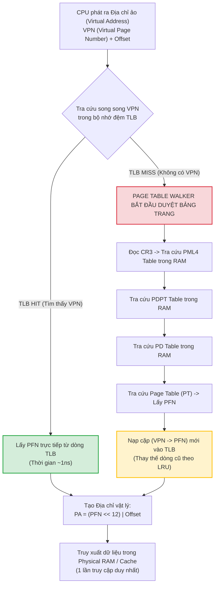

# 1_7_4 Translation Lookaside Buffer

> **Khóa học**: Cloud & DevOps Cơ Bản  
> **Phân nhóm**: Domain 1 - Operating System Core Fundamentals  
> **Chủ đề**: 1_7 Memory Management and Virtual Memory  
> **Checklist đối chiếu**: [1_7_4](../../../CHECKLIST.md#domain-1-operating-system-core-fundamentals-45-items)  
> **Trạng thái**: Hoàn thành  

---

## 1. Khái Niệm Cốt Lõi & Bản Chất Kỹ Thuật (Core Concepts & Technical Deep Dive)

Trong kiến trúc phân trang (Paging Architecture), để dịch một địa chỉ ảo (Virtual Address) thành một địa chỉ vật lý (Physical Address), phần cứng Memory Management Unit (MMU) bắt buộc phải tra cứu cấu trúc **Bảng trang (Page Table)**. Tuy nhiên, bảng trang của các hệ điều hành 64-bit hiện đại (như x86-64) có kích thước quá khổng lồ, buộc các nhà thiết kế phải chia thành **Bảng trang đa cấp (Multi-level Page Tables)** gồm 4 đến 5 tầng lồng nhau nằm rải rác trong bộ nhớ chính (RAM).

Điều này làm phát sinh một thảm họa về mặt hiệu năng:
> Cứ mỗi một thao tác đọc/ghi bộ nhớ thông thường của CPU, phần cứng phải thực hiện thêm **4 đến 5 lần truy cập RAM bổ sung** chỉ để đi tuần tự qua các tầng bảng trang trước khi chạm tới được ô nhớ thực tế! Tốc độ máy tính sẽ bị chậm đi từ $400\%$ đến $500\%$.

Để cứu vãn hiệu năng, các kiến trúc sư vi xử lý đã tích hợp một khối bộ nhớ đệm phần cứng siêu tốc trực tiếp trên chip CPU nằm ngay bên trong MMU: **Translation Lookaside Buffer (TLB - Bộ nhớ đệm tra cứu dịch địa chỉ)**.

```
                           VỊ TRÍ VÀ VAI TRÒ CỦA TLB TRONG CPU
                           
    +--------------------------------------------------------------------------+
    | CPU CHIP CORE                                                            |
    |                                                                          |
    |  [ Thanh ghi / ALU ]                                                     |
    |          |                                                               |
    |          v (Phát ra Virtual Address)                                     |
    |  +--------------------------------------------------------------------+  |
    |  | MEMORY MANAGEMENT UNIT (MMU)                                       |  |
    |  |                                                                    |  |
    |  |   +------------------------------------------------------------+   |  |
    |  |   | TLB (Translation Lookaside Buffer)                         |   |  |
    |  |   | [ VPN 0x7FFF01 ] ----> [ PFN 0x00A4B ] (Tra cứu song song) |   |  |
    |  |   +------------------------------------------------------------+   |  |
    |  |            |                                        |              |  |
    |  +------------|----------------------------------------|--------------+  |
    +---------------|----------------------------------------|-----------------+
                    | TLB HIT (~1 chu kỳ clock)              | TLB MISS
                    |                                        v
                    |                      +-----------------------------------+
                    |                      | HARDWARE PAGE TABLE WALKER        |
                    |                      | Đi bộ qua 4 tầng bảng trang:      |
                    |                      | CR3 -> PML4 -> PDPT -> PD -> PTE  |
                    |                      | (Mất 4 lần đọc RAM ~200ns)        |
                    |                      +-----------------------------------+
                    |                                        |
                    v                                        v
             +-----------------------------------------------------------------+
             | BỘ NHỚ VẬT LÝ CHÍNH (PHYSICAL RAM)                              |
             | Truy xuất ô nhớ thực tế tại Frame tương ứng                     |
             +-----------------------------------------------------------------+
```

---

### 1.1. Bản Chất Phần Cứng Của TLB: Fully Associative Cache

- **Cấu trúc lưu trữ**: TLB là một bộ nhớ đệm liên kết hoàn toàn (Fully Associative Cache). Mỗi dòng trong TLB lưu một cặp ánh xạ:
  $$\text{Dòng TLB} = [\text{Tag: Virtual Page Number (VPN)} \mid \text{Physical Frame Number (PFN)} \mid \text{Bits thuộc tính}]$$
- **Tra cứu song song trong 1 chu kỳ**: Mạch phần cứng của TLB chứa các bộ so sánh (comparators) hoạt động song song. Khi CPU phát ra một địa chỉ ảo, toàn bộ các mục (entries) trong TLB được so sánh đồng thời chỉ trong **1 chu kỳ xung nhịp (clock cycle)**.
- **Kích thước vật lý**: Vì mạch phần cứng so sánh song song cực kỳ đắt đỏ và tỏa nhiều nhiệt, TLB thường có dung lượng tương đối nhỏ: từ **64 đến 1536 mục** (thường chia thành L1 D-TLB, L1 I-TLB, và L2 Shared TLB).

---

### 1.2. Cơ Chế Xử Lý TLB Hit vs TLB Miss

1. **TLB Hit (Trúng đệm)**:
   - Phần cứng MMU tìm thấy ngay VPN trong TLB.
   - PFN được ghép nối trực tiếp với Offset của địa chỉ ảo để tạo thành địa chỉ vật lý.
   - Dữ liệu trong RAM hoặc CPU Cache L1/L2 được truy xuất tức thì mà không cần chạm vào bất kỳ bảng trang nào.
2. **TLB Miss (Trượt đệm)**:
   - VPN không tồn tại trong TLB. MMU phải tiến hành "Đi bộ qua bảng trang" (Page Table Walk) để tìm ánh xạ.
   - **Xử lý bằng phần cứng (Hardware-Managed TLB - x86, ARM)**: Bộ điều khiển phần cứng tích hợp trên MMU tự động đọc thanh ghi `CR3`, duyệt qua cây bảng trang đa cấp trong RAM, nạp ánh xạ mới vào TLB, và tự động thử lại lệnh vừa thực thi.
   - **Xử lý bằng phần mềm (Software-Managed TLB - MIPS, SPARC)**: Khi bị Miss, phần cứng bắn ra một ngắt ngoại lệ (Trap: TLB Miss Trap). Nhân hệ điều hành nhảy vào đoạn mã ngắt, tra cứu bảng trang bằng phần mềm, gọi lệnh đặc quyền để nạp bản ghi vào TLB, rồi trả quyền điều khiển về cho tiến trình.

---

### 1.3. Công Thức Thời Gian Truy Cập Bộ Nhớ Hiệu Dụng (Effective Memory Access Time - EMAT)

Hiệu năng thực tế của hệ thống bộ nhớ ảo được đo lường bằng chỉ số **EMAT**. Với bảng trang $N$ cấp (ví dụ $N=4$ trên x86-64):

$$EMAT = h \times (t_{\text{TLB}} + t_{\text{RAM}}) + (1 - h) \times (t_{\text{TLB}} + (N + 1) \times t_{\text{RAM}})$$

Trong đó:
- $h$: Tỷ lệ trúng đệm TLB (TLB Hit Ratio), thường đạt từ $98\%$ đến $99.9\%$ nhờ tính cục bộ của bộ nhớ (Spatial & Temporal Locality).
- $t_{\text{TLB}}$: Thời gian tra cứu bộ đệm TLB (thường $\approx 1\text{ ns}$ hoặc 1 chu kỳ clock).
- $t_{\text{RAM}}$: Thời gian truy xuất thanh RAM vật lý (thường $\approx 50\text{ ns} - 100\text{ ns}$).
- $N$: Số cấp của bảng trang ($N=4$ cho 4-level paging, $N=5$ cho 5-level paging).
- Khi bị TLB Miss: Hệ thống phải mất $N$ lần truy cập RAM để duyệt qua $N$ tầng bảng trang, cộng thêm $1$ lần truy cập RAM cuối cùng để đọc/ghi dữ liệu thực sự $\implies (N + 1) \times t_{\text{RAM}}$.

---

### 1.4. Tác Động Của Chuyển Ngữ Cảnh (Context Switch) & Tối Ưu PCID / ASID

Khi hệ điều hành thực hiện chuyển ngữ cảnh từ Tiến trình A sang Tiến trình B:
- Không gian địa chỉ ảo của Tiến trình B hoàn toàn khác Tiến trình A. Một VPN `0x00400000` của A trỏ đến dữ liệu của A, nhưng VPN `0x00400000` của B lại trỏ đến dữ liệu của B.
- **Phương pháp truyền thống (Naive Approach - Tốn kém)**:
  Hệ điều hành buộc phải **Xóa sạch toàn bộ TLB (TLB Flush / Invalidate)** mỗi khi nạp lại thanh ghi cơ sở bảng trang `CR3`.
  *Hệ quả*: Khi Tiến trình B bắt đầu chạy, TLB hoàn toàn trống rỗng ("Cold TLB"). Tiến trình B sẽ liên tục bị hàng loạt TLB Miss trong những miligiây đầu tiên, làm suy sụp thông lượng hệ thống.
- **Giải pháp phần cứng hiện đại: PCID (x86-64) và ASID (ARM)**:
  - Vi xử lý x86-64 hỗ trợ tính năng **Process Context Identifier (PCID)** (được kích hoạt thông qua bit `PCIDE` trong thanh ghi điều khiển `CR4`).
  - Gắn kèm một nhãn định danh 12-bit (PCID) vào mỗi dòng lưu trữ trong TLB.
  - Khi chuyển ngữ cảnh, CPU chỉ việc đổi số PCID hiện tại. Các dòng TLB của tiến trình cũ vẫn được giữ nguyên trong bộ nhớ đệm! Khi chuyển ngược lại tiến trình cũ, các ánh xạ TLB vẫn còn đó ("Warm TLB"), triệt tiêu hoàn toàn chi phí TLB Flush.

---

## 2. Ví Dụ Đời Sống Thực Tế Dễ Hiểu (Intuitive Real-World Analogies)

```
       BÀN PHÍM QUAY NHANH (SPEED-DIAL) CỦA NHÂN VIÊN TỔNG ĐÀI

  [ DANH BẠ GIẤY 4 TẦNG (MULTI-LEVEL PAGE TABLE) ]
  Muốn gọi điện cho khách:
  1. Mở Tủ A (PML4) -> Lấy Cuốn sách B (PDPT)
  2. Lật Trang C (PD) -> Tìm Dòng D (PT) -> Ra số điện thoại thật!
  (Mất 5 phút lật sổ cho mỗi cuộc gọi!)

  -------------------------------------------------------------------------

  [ BẢNG GHI NHỚ QUAY NHANH SPEED-DIAL (TLB) ]
  Nhân viên dán 64 mẩu giấy nhớ các số điện thoại hay gọi nhất
  ngay trên mặt bàn phím:
  - Khách quen gọi tới: Liếc mắt 1 giây (TLB Hit) -> Bấm gọi ngay!
  - Khách lạ hoắc (TLB Miss): Lúc đó mới chấp nhận ra mở tủ lật sổ 4 tầng,
    sau đó ghi ngay số mới vào mẩu giấy dán trên bàn phím.
```

### 2.1. Phép So Sánh: Danh Bạ Tra Cứu 4 Tầng vs Bàn Phím Quay Nhanh (Speed-Dial)
- Hãy hình dung bạn là nhân viên trực tổng đài hỗ trợ kỹ thuật:
  - Công ty có 1 triệu khách hàng. Để quản lý, công ty xếp danh bạ thành 4 cấp: Tầng 1 là Thư mục Quốc gia, Tầng 2 là Tỉnh/Thành phố, Tầng 3 là Quận/Huyện, Tầng 4 là Tên người.
  - Mỗi khi cần gọi cho một ai đó, nếu bạn phải lần lượt mở tủ tra 4 cuốn sổ dày cộp mới tìm được số điện thoại thực tế, bạn sẽ mất tới 4 phút chỉ để tìm số và 1 phút để nói chuyện (Tổng cộng 5 phút). Tốc độ phục vụ của bạn cực kỳ chậm chạp.
  - **Áp dụng TLB**: Bạn lấy một tấm bảng nhỏ gắn ngay trên màn hình máy tính (TLB Cache). Trên bảng có chỗ dán đúng 64 mẩu giấy ghi nhanh số điện thoại của 64 khách hàng thường xuyên liên lạc nhất.
  - Mỗi khi cần gọi, 98% trường hợp là bạn gọi cho khách quen. Bạn chỉ việc liếc mắt 1 giây vào tấm bảng (TLB Hit) và bấm số nói chuyện ngay! Chỉ có 2% khách hàng lạ hoắc chưa từng gặp mới bắt buộc bạn phải đứng dậy đi lật danh bạ 4 tầng (TLB Miss). Nhờ tấm bảng nhỏ đó, năng suất làm việc của bạn tăng vọt gấp nhiều lần.

---

## 3. Kiến Trúc, Luồng Hoạt Động & Hình Ảnh Trực Quan (Architecture & Diagrams)

### 3.1. Luồng Hoạt Động Tra Cứu TLB Và Phân Nhánh Hit/Miss



### 3.2. Cấu Trúc Bảng Trang 4 Cấp (4-Level Paging) Trên x86-64

Địa chỉ ảo 48-bit tiêu chuẩn trên kiến trúc vi xử lý x86-64 được phân chia chính xác như sau:

```
+---------------+---------------+---------------+---------------+---------------+
| PML4 (9 bits) | PDPT (9 bits) |  PD (9 bits)  |  PT (9 bits)  | Offset (12 b) |
| Bits 47 - 39  | Bits 38 - 30  | Bits 29 - 21  | Bits 20 - 12  | Bits 11 - 0   |
+---------------+---------------+---------------+---------------+---------------+
       |               |               |               |               |
       v               v               v               v               v
  CR3 Register     Level 4         Level 3         Level 2        Physical Frame
  (Gốc bảng trang) (Page Map L4)   (Page Dir Ptr)  (Page Dir)     (Ô nhớ 4KB)
```
- Mỗi tầng bảng trang có đúng $2^9 = 512$ phần tử (Entries).
- Mỗi Entry có kích thước đúng $8\text{ bytes}$ ($64\text{ bits}$).
- Kích thước của mỗi bảng trang ở từng tầng $= 512 \times 8\text{ bytes} = 4096\text{ bytes} = 4\text{ KB}$ (Vừa khít đúng 1 khung trang vật lý tiêu chuẩn!).

---

## 4. Bài Tập Tính Toán Thực Hành & Linux Diagnostics (Worked Exercise & CLI)

### 4.1. Bài Tập Định Lượng Tính Toán EMAT Với Bảng Trang 4 Cấp

> 🎯 **BÀI TẬP ĐỊNH LƯỢNG KINH ĐIỂN (Plan Section 6.2 Quantitative EMAT Exercise)**

#### Đề bài:
Một máy chủ chạy vi xử lý kiến trúc x86-64 sử dụng bảng trang 4 cấp ($N=4$). Cho các thông số phần cứng:
- Thời gian tra cứu bộ nhớ đệm TLB: $t_{\text{TLB}} = 1\text{ ns}$
- Thời gian truy xuất bộ nhớ RAM vật lý: $t_{\text{RAM}} = 50\text{ ns}$
- Tỷ lệ trúng đệm TLB đo được trong môi trường sản xuất: $h = 98\% = 0.98$

**Yêu cầu**:
1. Tính thời gian truy xuất bộ nhớ hiệu dụng ($EMAT$) của hệ thống.
2. So sánh hiệu năng của hệ thống có TLB ($h = 98\%$) với trường hợp hệ thống không có TLB ($h = 0\%$). TLB mang lại tốc độ tăng tốc (Speedup factor) gấp bao nhiêu lần?

---

#### Lời giải chi tiết:

#### Bước 1: Xác định thời gian trong trường hợp TLB Hit ($T_{\text{hit}}$)
Khi xảy ra TLB Hit, hệ thống chỉ mất thời gian tra cứu TLB và $1$ lần truy xuất ô nhớ thực tế trong RAM:
$$T_{\text{hit}} = t_{\text{TLB}} + t_{\text{RAM}} = 1\text{ ns} + 50\text{ ns} = 51\text{ ns}$$

#### Bước 2: Xác định thời gian trong trường hợp TLB Miss ($T_{\text{miss}}$)
Khi xảy ra TLB Miss, phần cứng mất thời gian tra cứu TLB ban đầu, sau đó phải đi qua 4 tầng bảng trang trong RAM ($4 \times t_{\text{RAM}}$), và cuối cùng là $1$ lần truy xuất dữ liệu thực tế ($1 \times t_{\text{RAM}}$):
$$T_{\text{miss}} = t_{\text{TLB}} + (4 + 1) \times t_{\text{RAM}} = 1\text{ ns} + 5 \times 50\text{ ns} = 1\text{ ns} + 250\text{ ns} = 251\text{ ns}$$

#### Bước 3: Áp dụng công thức tính EMAT tổng thể
$$EMAT = h \times T_{\text{hit}} + (1 - h) \times T_{\text{miss}}$$
$$EMAT = 0.98 \times 51\text{ ns} + 0.02 \times 251\text{ ns}$$
$$EMAT = 49.98\text{ ns} + 5.02\text{ ns} = 55.00\text{ ns}$$

---

#### Bước 4: So sánh với trường hợp không có TLB ($h = 0\%$)
Nếu không có TLB, mọi truy cập đều phải duyệt qua toàn bộ 4 tầng bảng trang:
$$EMAT_{\text{no\_TLB}} = 251\text{ ns}$$

Hệ số tăng tốc (Speedup factor):
$$\text{Speedup} = \frac{EMAT_{\text{no\_TLB}}}{EMAT} = \frac{251\text{ ns}}{55\text{ ns}} \approx 4.56 \times$$

> **Kết luận then chốt**:
> Nhờ có bộ đệm TLB với tỷ lệ Hit $98\%$, thời gian truy xuất bộ nhớ hiệu dụng giảm ngoạn mục từ **$251\text{ ns}$ xuống chỉ còn $55\text{ ns}$**, giúp hệ thống đạt tốc độ xử lý nhanh hơn tới **gấp $4.56$ lần**!

---

### 4.2. Chẩn Đoán Tính Năng PCID Và Cấu Trúc Phân Trang Trên Linux CLI

```bash
# 1. Kiểm tra CPU có hỗ trợ tính năng PCID (Process Context Identifiers) không
grep -w pcid /proc/cpuinfo | head -n 1
# Nếu có cờ 'pcid', nhân Linux sẽ tự động kích hoạt CR4.PCIDE để tránh TLB Flush khi context switch!

# 2. Kiểm tra CPU và Linux Kernel có hỗ trợ phân trang 5 cấp (5-level paging / LA57) không
grep -w la57 /proc/cpuinfo
# Cờ 'la57' (Linear Address 57-bit) cho phép mở rộng không gian ảo lên 128 PB!

# 3. Theo dõi số lượng ngắt TLB Shootdown giữa các CPU Cores
grep -i "tlb" /proc/interrupts
```

**Ý nghĩa của TLB Shootdown (`TLB: ... TLB shootdowns` trong `/proc/interrupts`):**
Khi một luồng trên Core 0 thay đổi quyền truy cập hoặc giải phóng một vùng nhớ ảo (ví dụ: gọi `munmap()`), ánh xạ trong TLB của các Core khác đang chạy cùng tiến trình trở nên không hợp lệ. Core 0 phải phát một ngắt liên bộ xử lý (Inter-Processor Interrupt - IPI) yêu cầu các Core khác xóa bỏ dòng TLB đó ngay lập tức. Nếu hiện tượng TLB Shootdown diễn ra quá thường xuyên, hệ thống đa nhân sẽ bị suy giảm hiệu năng nghiêm trọng do tắc nghẽn IPI.

---

## 5. Cạm Bẫy Thực Tế & Thực Tiễn Sản Xuất (Production Gotchas & Best Practices)

### 5.1. Thảm Họa Suy Giảm Hiệu Năng Sau Các Bản Vá Lỗ Hổng Meltdown / KPTI

- Vào năm 2018, lỗ hổng bảo mật phần cứng nghiêm trọng **Meltdown** được công bố trên các dòng chip Intel. Lỗ hổng này cho phép tiến trình người dùng (Ring 3) đọc trộm bộ nhớ nhân hệ điều hành (Ring 0) thông qua việc thực thi suy đoán (Speculative Execution).
- **Bản vá KPTI (Kernel Page Table Isolation)**:
  - Để ngăn chặn Meltdown, Linux buộc phải tách rời hoàn toàn bảng trang User Space và bảng trang Kernel Space.
  - Cứ mỗi khi tiến trình gọi một system call (như `read`, `write`, `getpid`), CPU phải đổi bảng trang và **buộc phải xóa TLB**!
  - **Hậu quả sản xuất**: Trên các dòng máy chủ CPU Intel đời cũ không có tính năng **PCID**, hiệu năng của các hệ thống cơ sở dữ liệu và máy chủ web bị tụt giảm thê thảm từ **$10\%$ đến $30\%$** sau khi cài bản vá bảo mật của hệ điều hành. Chỉ những CPU hỗ trợ PCID mới duy trì được ánh xạ TLB tách biệt và giảm thiểu được tổn thất hiệu năng này.

---

## 6. Câu Hỏi Củng Cố Kiến Thức (Active Recall Quiz)

<details>
<summary><b>Câu hỏi 1:</b> Tại sao bộ đệm TLB thường có kích thước rất khiêm tốn (chỉ từ 64 đến vài trăm entries) mà không thể mở rộng lên hàng triệu entries như thanh RAM?</summary>

> **Đáp án:**
> Bởi vì TLB được thiết kế theo cấu trúc **Bộ nhớ đệm liên kết hoàn toàn (Fully Associative Cache)**. Để tra cứu nhanh trong vòng 1 chu kỳ xung nhịp (clock cycle), mỗi mục trong TLB đều phải gắn kèm một mạch so sánh phần cứng (Hardware Comparator) hoạt động song song. Việc nhét hàng ngàn bộ so sánh song song vào một diện tích silicon nhỏ trên chip vi xử lý sẽ làm tiêu thụ điện năng cực lớn, tỏa nhiệt lượng khổng lồ và tăng chi phí chế tạo bán dẫn vượt ngưỡng cho phép.
</details>

<details>
<summary><b>Câu hỏi 2:</b> Phân tích cơ chế của tính năng PCID (Process Context Identifier) trên x86-64 giúp tăng tốc chuyển ngữ cảnh (Context Switch) như thế nào?</summary>

> **Đáp án:**
> Theo phương thức truyền thống, mỗi lần nạp lại thanh ghi cơ sở `CR3` khi chuyển ngữ cảnh, CPU sẽ tự động xóa sạch toàn bộ các dòng TLB (TLB Flush) để tránh nhầm lẫn không gian địa chỉ. Với PCID, mỗi dòng TLB được đánh kèm một mã định danh tiến trình 12-bit. Khi chuyển ngữ cảnh, CPU chỉ cần thay đổi số PCID hiện hành mà không cần xóa các dòng TLB cũ. Khi tiến trình cũ được nạp lại, các ánh xạ TLB vẫn còn nguyên vẹn, giúp tiến trình không bị rơi vào tình trạng "Cold Cache" và tránh được hàng loạt TLB Miss tốn kém.
</details>

<details>
<summary><b>Câu hỏi 3:</b> Trong công thức tính EMAT với bảng trang 4 cấp ($N=4$), tại sao khi xảy ra TLB Miss, số lần truy cập RAM lại là $4 + 1 = 5$ lần chứ không phải 4 lần?</summary>

> **Đáp án:**
> Bởi vì trong 4 cấp bảng trang (PML4, PDPT, PD, PT), hệ thống cần đúng 4 lần truy xuất RAM liên tiếp chỉ để "đi bộ" qua các tầng con trỏ nhằm tìm được Physical Frame Number (PFN) cuối cùng. Tuy nhiên, sau khi tìm được địa chỉ vật lý, CPU vẫn cần thêm **$1$ lần truy xuất RAM thực tế thứ năm** để đọc hoặc ghi byte dữ liệu mà câu lệnh của chương trình thực sự yêu cầu. Tổng cộng là $4 + 1 = 5$ lần.
</details>

---

## 7. 📚 Nguồn Tài Liệu Chính Thống (Tier-1 Official References)

- [OSTEP Chapter 19: Paging: Faster Translations (TLBs)](https://pages.cs.wisc.edu/~remzi/OSTEP/vm-tlbs.pdf) - Phân tích chi tiết kiến trúc phần cứng TLB, thuật toán xử lý Hit/Miss, và bài toán chuyển ngữ cảnh.
- [Intel 64 and IA-32 Architectures Software Developer's Manual (Vol 3A - System Programming Guide)](https://www.intel.com/content/www/us/en/developer/articles/technical/intel-sdm.html) - Đặc tả chi tiết thanh ghi điều khiển CR3, CR4.PCIDE và kiến trúc phân trang phần cứng 4 tầng/5 tầng của Intel.
- [Linux Kernel Documentation - x86_64 Virtual Memory Layout](https://docs.kernel.org/arch/x86/x86_64/mm.html) - Cấu trúc phân trang 4 tầng (48-bit) và 5 tầng (57-bit LA57) trong nhân hệ điều hành Linux.
- [Linux Kernel Documentation - Speculative Execution Side Effect Mitigations (KPTI & PCID)](https://docs.kernel.org/admin-guide/hw-vuln/spectre.html) - Cơ chế KPTI và vai trò của PCID trong việc tối ưu hóa hiệu năng TLB.